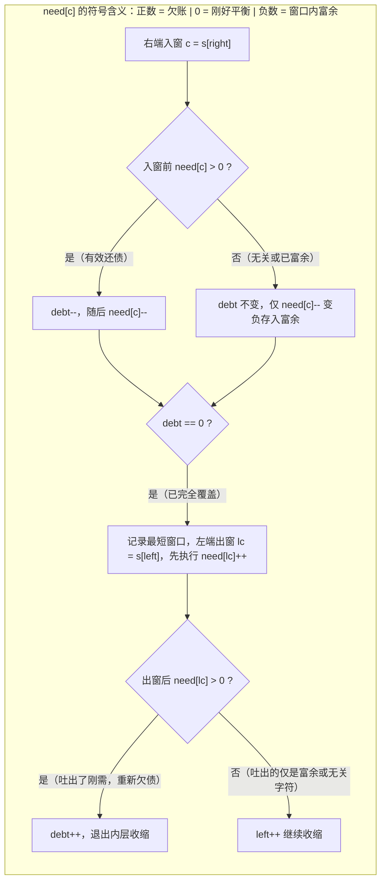

# 最小覆盖子串：滑动窗口的最难挑战

**摘要：**

最小覆盖子串（LC 76）是滑动窗口里最难的一题，难在"**如何判断'窗口已覆盖目标串'**"——因为目标可能是"多个字符各有一定数量"，而非"单个约束"。**它的核心设计是"`formed` 计数器"**：记录"有多少个字符的频次已经满足要求"，当 `formed == required` 时即"窗口覆盖了目标"。本文用 Go 语言实现 LC 76、438（找到所有字母异位词）与 30（串联所有单词的子串），并逐层追问：为什么不能"每次都重新比较频次"、`formed` 计数器为什么能 $O(1)$ 判断"满足条件"、以及"收缩条件"在这里为什么是"`formed == required`"。掌握本篇，你就掌握了滑动窗口的"频次匹配"这一最难范式。

---

## 第 1 章 LeetCode 76：最小覆盖子串

### 1.1 题目

**LeetCode 76 - Minimum Window Substring**（困难）

给你一个字符串 `s`、一个字符串 `t`，返回 `s` 中涵盖 `t` 所有字符的**最短子串**；若不存在则返回空串。

```text
输入: s = "ADOBECODEBANC", t = "ABC"  →  "BANC"
```

**"涵盖所有字符"的含义**：`t` 中每个字符的出现次数，在子串中都要满足。**如 `t = "AABC"` 需要两个 `A`。**

### 1.2 核心难点：如何判断"窗口已覆盖目标"

**朴素做法是"每次窗口变化后，重新比较窗口频次与目标频次"**——**这是 $O(|\Sigma|)$ 每次，总复杂度 $O(n \cdot |\Sigma|)$。**

**更优的做法是"用 `formed` 计数器"**——**它记录"有多少个字符的频次已经满足要求"**：

- **当某个字符的频次"从不足变为刚好满足"**（`window[c] == need[c]`）时，`formed++`；
- **当某个字符的频次"从满足变为不足"**（`window[c] < need[c]`）时，`formed--`；
- **当 `formed == required` 时，窗口已覆盖目标。**

**"`formed` 计数器把'逐个比较频次'降成了'一个整数判断'"**——**这是 LC 76 的核心设计。**

### 1.3 Go 实现

```go
func minWindow(s, t string) string {
    if len(s) < len(t) {
        return ""
    }
    need := map[byte]int{}
    for i := 0; i < len(t); i++ {
        need[t[i]]++
    }
    required := len(need) // 需要满足的字符种类数

    window := map[byte]int{}
    left, formed := 0, 0
    bestLen, bestStart := math.MaxInt32, 0

    for right := 0; right < len(s); right++ {
        // 1. 扩张
        c := s[right]
        window[c]++
        if need[c] > 0 && window[c] == need[c] {
            formed++ // 该字符的频次刚好满足
        }
        // 2. 收缩（当窗口已覆盖目标）
        for formed == required {
            if right-left+1 < bestLen {
                bestLen = right - left + 1
                bestStart = left
            }
            lc := s[left]
            window[lc]--
            if need[lc] > 0 && window[lc] < need[lc] {
                formed-- // 该字符的频次变为不足
            }
            left++
        }
    }
    if bestLen == math.MaxInt32 {
        return ""
    }
    return s[bestStart : bestStart+bestLen]
}
```

**复杂度**：时间 $O(|s| + |t|)$、空间 $O(|\Sigma|)$。

### 1.4 `formed` 计数器的两个细节

**细节一，`formed` 只在"频次恰好等于 `need`"时递增。** 注意条件是 `window[c] == need[c]`（**恰好相等**），而非 `>=`。**因为"从不足变为刚好满足"才是"一个新的字符种类被满足"。** **若用 `>=`，`formed` 会重复递增。**

**细节二，`need[c] > 0` 这一判断不能省。** **因为 `window` 里可能有"不在 `t` 中"的字符**（如 `s` 中的其他字符），**它们的频次变化不应该影响 `formed`。** **`need[c] > 0` 保证"只统计 `t` 中出现的字符"。**

**这两个细节，是 LC 76 最容易出错的地方。**

> [!info] 核心概念：`formed` 计数器——用"整数"代替"逐字符比较"
> `formed` 计数器把"窗口是否覆盖目标"这一判断，从"逐字符比较频次"（$O(|\Sigma|)$）降成了"比较一个整数"（$O(1)$）。**这是"用额外状态换判断速度"的典型优化**——**多维护一个 `formed`，换来每次判断的 $O(1)$。** **它与第 08 篇"用 `matches` 计数器代替数组比较"是同一思路。**

### 1.5 手动验证 `s="ADOBECODEBANC"`, `t="ABC"`

```text
need = {A:1, B:1, C:1}, required = 3

right 扩展到 5（"ADOBEC"）: formed=3（A、B、C 都满足）
  收缩: 窗口 "ADOBEC" → "DOBEC" → ... → 直到 formed<3
  bestLen=6, bestStart=0（"ADOBEC"）

right 扩展到 10（"ADOBECODEBA"）: formed=3
  收缩: 窗口缩到 "BA"，formed 仍为 3？
  实际: 缩到 "BANC"（left 到 9）时 formed=3，bestLen=4

最终: "BANC" ✓
```

---

## 第 2 章 LeetCode 438：找到字符串中所有字母异位词

### 2.1 题目

**LeetCode 438 - Find All Anagrams in a String**（中等）

给定两个字符串 `s` 和 `p`，找到 `s` 中所有 `p` 的**字母异位词**子串，返回这些子串的起始索引。

```text
输入: s = "cbaebabacd", p = "abc"  →  [0,6]
```

### 2.2 思路：定长窗口 + 频次比较

**"`p` 的字母异位词"= "与 `p` 频次相同的字符串"**——**于是用"定长窗口（大小 $|p|$）+ 频次数组比较"**：

```go
func findAnagrams(s, p string) []int {
    if len(s) < len(p) {
        return nil
    }
    var need, window [26]int
    for i := 0; i < len(p); i++ {
        need[p[i]-'a']++
    }
    var res []int
    for i := 0; i < len(s); i++ {
        window[s[i]-'a']++ // 进
        if i >= len(p) {
            window[s[i-len(p)]-'a']-- // 出
        }
        if window == need {
            res = append(res, i-len(p)+1)
        }
    }
    return res
}
```

**复杂度**：时间 $O(|s| \cdot 26)$、空间 $O(26)$。

### 2.3 与 LC 76 的关系

**LC 438 是 LC 76 的"定长版"**：

- **LC 76**：窗口大小可变，目标是"覆盖 `t`"（`formed == required`）；
- **LC 438**：窗口大小固定为 $|p|$，目标是"频次等于 `p`"。

**LC 438 因为窗口大小固定，可以用"定长窗口 + 数组比较"，无需 `formed` 计数器**——**这又一次印证了"定长窗口比可变窗口简单"。**

**"定长版"与"可变版"的对照**，是滑动窗口的一个重要视角——**很多"可变窗口"的题，都有对应的"定长版"（如 LC 76 vs 438）。**

> [!note] 定长 vs 可变：一对孪生
> LC 76（最小覆盖，可变窗口）与 LC 438（找异位词，定长窗口）是一对——**前者用"`formed` 计数器 + 可变窗口"，后者用"频次数组 + 定长窗口"。** **"定长版"更简单（因为窗口大小固定，收缩时机确定）。** **遇到滑动窗口题，先判断"是定长还是可变"——这往往决定了代码的复杂度。**

---

## 第 3 章 LeetCode 30：串联所有单词的子串

### 3.1 题目

**LeetCode 30 - Substring with Concatenation of All Words**（困难）

给定一个字符串 `s` 和一个长度相同的单词数组 `words`，找出 `s` 中恰好由 `words` 中所有单词串联而成的子串的起始索引。

```text
输入: s = "barfoothefoobarman", words = ["foo","bar"]  →  [0,9]
```

### 3.2 思路：以"单词长度"为步长滑动

**这道题是 LC 438 的"单词版"**——**把"字符"换成"单词"**：

- **窗口大小固定为 $|words| \times |word|$**；
- **以"单词长度"为步长滑动**（而非逐字符）；
- **维护"窗口内单词的频次"**，与 `words` 的频次比较。

```go
func findSubstring(s string, words []string) []int {
    if len(s) == 0 || len(words) == 0 {
        return nil
    }
    wordLen, numWords := len(words[0]), len(words)
    totalLen := wordLen * numWords
    if len(s) < totalLen {
        return nil
    }
    need := map[string]int{}
    for _, w := range words {
        need[w]++
    }
    var res []int

    // 枚举起始偏移（0..wordLen-1）
    for offset := 0; offset < wordLen; offset++ {
        window := map[string]int{}
        count := 0 // 已匹配的单词数
        left := offset
        for right := offset; right+wordLen <= len(s); right += wordLen {
            w := s[right : right+wordLen]
            window[w]++
            count++
            // 收缩：单词过多，或出现不在 words 中的单词
            for window[w] > need[w] {
                lw := s[left : left+wordLen]
                window[lw]--
                count--
                left += wordLen
                if need[w] == 0 { // w 不在 words 中
                    window = map[string]int{} // 重置
                    count = 0
                    left = right + wordLen
                    break
                }
            }
            if count == numWords {
                res = append(res, left)
            }
        }
    }
    return res
}
```

**复杂度**：时间 $O(|s| \cdot |wordLen|)$（枚举 $|wordLen|$ 个偏移，每个偏移 $O(|s|)$）、空间 $O(|words|)$。

### 3.3 关键点

**关键点一，为什么要枚举"起始偏移"？** **因为"串联的起点"可能不在"单词边界"上**——**枚举 $0 \sim |wordLen|-1$ 个偏移，覆盖所有可能的起点。**

**关键点二，"以单词长度为步长"而非"逐字符"。** **因为窗口的"单元"是单词，而非字符。**

**关键点三，遇到"不在 `words` 中的单词"要"重置窗口"。** **因为它一旦进入窗口，窗口就永远无法"恰好等于 `words`"**——**只能从它之后重新开始。**

**LC 30 是"字符频次窗口"在"单词"上的推广**——**理解了 LC 76/438，LC 30 只是"把字符换成单词"。**

> [!info] 从"字符"到"单词"：一次推广
> LC 30 是 LC 438 的"单词版"——**它把"字符频次窗口"推广到了"单词频次窗口"。** **核心框架不变（定长窗口 + 频次比较），只是"单元"从字符变成了单词。** **理解了这一推广，你就把"字符频次窗口"上升成了"单元频次窗口"。**

---

## 第 4 章 三道题的对照

### 4.1 对照

| 题目 | 窗口 | 目标 | 关键 |
|------|------|------|------|
| LC 76 最小覆盖 | 可变 | 覆盖 `t` | `formed` 计数器 |
| LC 438 找异位词 | 定长 | 频次等于 `p` | 数组比较 |
| LC 30 串联单词 | 定长（单词步长） | 频次等于 `words` | 枚举偏移 |

**三题的共同点是"窗口内频次匹配"**——**区别只在"窗口可变还是固定""单元是字符还是单词"。**

### 4.2 一个可复用的判断

**遇到"窗口频次匹配"类问题，先问三句**：

1. **窗口大小固定吗？** 固定用"定长 + 数组比较"，可变用"`formed` 计数器"；
2. **单元是字符还是单词？** 单词则"以单词长度为步长"；
3. **起点可能在"单元边界"外吗？** 是则"枚举偏移"。

**这三句，能定下频次匹配窗口题的方案。**

---

## 第 5 章 常见误区与自测方法

### 5.1 四个高频误区

**误区一，`formed` 递增用 `>=` 而非 `==`。** 会重复递增。

**误区二，忘了 `need[c] > 0` 判断。** 会把"不在 `t` 中"的字符也算进 `formed`。

**误区三，LC 30 忘了"枚举偏移"。** 会漏掉"起点不在单词边界"的解。

**误区四，LC 30 遇到"不在 `words` 中的单词"忘了重置。** 窗口会永远无法匹配。

**误区五，在 LC 76（最小覆盖子串）中，直接用 `len(s)` 作为 `bestLen` 的未找到哨兵初值，导致当最短覆盖子串恰好等于整个字符串 `s` 时误返回空串 `""`。** 如果把 `bestLen` 初始化为 `len(s)`，当输入为 `s = "a", t = "a"` 时，合法窗口长度为 `1 == len(s)`，若用 `< bestLen` 判断则无法更新，或者在结尾用 `if bestLen == len(s) { return "" }` 判断时会把全串匹配的合法解误判为无解。因此，`bestLen` 的哨兵初值必须严格设为 **`len(s) + 1`**（或 `math.MaxInt32`）。

**误区六，在 LC 30（串联所有单词的子串）中，把 `words` 的长度 `len(words)` 与单个单词的长度 `len(words[0])` 混用。** 在外层枚举同余轨道偏移时，循环上界是**单个单词的字符长度 `wordLen = len(words[0])`**（而不是单词个数 `numWords = len(words)`）；在内层右指针跳跃时，每次步进也是 `right += wordLen`；而在判断窗口是否攒够了所有单词时，比对的则是已匹配单词个数 `count == numWords`。动笔前将 `wordLen`（单步字节跨度）与 `numWords`（目标词数）用清晰变量名区分开，能避免 90% 的下标错位。

### 5.3 深度进阶：在超长源串 `s` 且稀疏有效字符下的"过滤索引队列"优化

在面试 LC 76（最小覆盖子串）时，如果面试官给出一个极端工程场景：**源字符串 `s` 长达 100MB，而目标串 `t` 只有 `"ABC"` 三个字符，且 `'A', 'B', 'C'` 在 `s` 中极其稀疏（一共只出现了几十次，中间隔着上百万个无关字符 `'z'`）**。

在普通滑动窗口中，`right` 走过一百万个 `'z'` 后，一旦凑齐 `"ABC"` 触发内层 `left++` 收缩，`left` 也必须一步一步走过这一百万个无关的 `'z'`，等于把所有无关字符重复扫描了两遍。
如何优化到让左指针 `left` **连一个无关字符都不碰，每次直接从一个有效字符瞬移到下一个有效字符**？
- 可以在 `right` 向右扫描时，仅将满足 `need[s[right]] > 0`（属于 `t` 的有效字符）的下标推入一个精简的过滤列表 `filteredIndices` 中；
- 收缩左边界时，左游标不再在原字符串 `s` 上执行 `left++`，而是在 `filteredIndices` 上步进，每次直接跳到下一个有效字符所在的物理下标。当有效字符占比极低时，这一"稀疏索引过滤"技巧能省去整整一半的内存带宽访问，把滑动窗口步进次数从 $O(|s|)$ 进一步压缩到 $O(|s| + 2 \cdot |filtered|)$，在日志关键字最短上下文提取等文本检索系统中极为实用。

### 5.4 延伸实战：至少有 K 个重复字符的最长子串——为什么普通滑窗需要配合"枚举字符种类数"？（LeetCode 395）

在频次窗口中，有一道极富启发性、专门检验你是否真正理解"滑动窗口单调性前提"的试金石——**LeetCode 395：至少有 K 个重复字符的最长子串**。
**题目描述**：给你一个字符串 `s` 和一个整数 `k`，请你找出 `s` 中的最长子串，要求该子串中的**每一类字符出现次数都不少于 `k`**。

为什么这道题不能直接套一层普通可变滑动窗口？
试想：当窗口 `[left .. right]` 中新进来一个字符 `'c'`（它的频次变为 `1 < k`），此时窗口不合法。你该收缩 `left++` 还是继续扩张 `right++`？
- 如果你收缩 `left++`，万一后面紧跟着还有 $k - 1$ 个 `'c'` 正在路上等你纳入呢？
- 如果你继续扩张 `right++`，万一后面再也没有 `'c'` 了，这个孤零零的 `'c'` 就会永远卡在窗口里让窗口不合法。
**你既不敢缩、也不敢停——因为"每个字符频次 $\ge k$"这一条件本身对窗口大小不具备单调性**。

怎么给它强行赋予单调性？既然总共有至多 26 种小写字母，我们可以在外层**显式枚举窗口内允许包含的不同字符种类数上限 $T \in [1, 26]$**。
一旦把"窗口内不同字符种类数不能超过 $T$"设为硬性天花板，单调性瞬间复活：
- 在第 $T$ 轮滑动窗口中，只要窗口内的不同字符种类数 `unique > T`，就**百分之百必须收缩 `left++`**（毫无二义性）；
- 在收缩完成后，若当前窗口内不同字符种类数 `unique` 恰好等于频次达标（$\ge k$）的字符种类数 `atLeastK`，就用 `right - left + 1` 更新全局最大长度。26 轮线性滑窗总耗时依然是严格的 $O(26 \cdot n) = O(n)$：

```go
package main

// longestSubstring LeetCode 395：外层枚举窗口字符种类上限 1..26 以重建滑动单调性，时间 O(26n)
func longestSubstring(s string, k int) int {
	ans := 0
	for targetUnique := 1; targetUnique <= 26; targetUnique++ {
		var cnt [26]int
		left, unique, atLeastK := 0, 0, 0

		for right := 0; right < len(s); right++ {
			c := s[right] - 'a'
			if cnt[c] == 0 {
				unique++
			}
			cnt[c]++
			if cnt[c] == k {
				atLeastK++
			}

			// 一旦种类数突破本轮设定的上限 targetUnique，收缩条件具备绝对单调性
			for unique > targetUnique {
				lc := s[left] - 'a'
				if cnt[lc] == k {
					atLeastK--
				}
				cnt[lc]--
				if cnt[lc] == 0 {
					unique--
				}
				left++
			}

			// 窗口内所有出现过的字符种类，其频次均已 >= k
			if unique == atLeastK {
				if right-left+1 > ans {
					ans = right - left + 1
				}
			}
		}
	}
	return ans
}
```

这道题揭示了一条高阶算法设计法则：**当原问题缺乏直接滑窗所需的单调跳变边界，而某个辅助维度（如字符种类数 $1 \dots 26$）的值域极小时，可以通过外层枚举固定该辅助维度，为内层滑动窗口人工创造单调收缩条件**。

---

## 第 6 章 深度拓展：最小覆盖子串的工程级数组优化与同源难题攻破

### 6.1 从 `map[byte]int` 到定长 `[128]int` + 欠账计数器 `debt` 的极致优化

在第 1.3 节的 `minWindow` 标准实现中，我们使用了 `need := map[byte]int{}` 和 `window := map[byte]int{}` 两个哈希表。虽然逻辑清晰，但在 Go 语言中，每次对 `map` 的读写都涉及运行时哈希计算与桶查找开销。

由于 ASCII 字符集只有 128 个字符，在工业级代码与追求极致耗时的面试现场，我们可以用两个栈上分配的定长数组 `[128]int` 彻底取代 `map`；不仅如此，我们还可以换一种更紧凑的计数视角——**维护总欠账字符数 `debt`（初始为 `len(t)`）与净欠账数组 `need[128]int`**：
- 初始化时，对 `t` 中的每个字符 `c` 执行 `need[c]++`（正数表示窗口还欠几个 `c`，`0` 表示刚好不欠，负数表示窗口里的 `c` 已经富余过剩了）；
- **右端扩张 `c = s[right]`**：若 `need[c] > 0`（说明这个字符是雪中送炭，真正抵消了 1 个欠账），则令总欠账 **`debt--`**；随后无论是否欠账，都令 `need[c]--`（无关字符或富余字符的 `need` 会变成负数）；
- **左端收缩（当 `debt == 0` 即所有欠账清零时）**：更新最短窗口答案后，准备吐出左端字符 `lc = s[left]`。吐出它意味着 `need[lc]++`；如果加完之后发现 **`need[lc] > 0`**（说明吐掉的是一个没有任何富余的刚需字符，窗口重新出现亏空），则令 **`debt++`**，收缩循环自动终止：

```go
package main

import "math"

// minWindowFast LeetCode 76 工业级零堆分配实现：单数组净欠账 + 总欠账 debt 计数
// 时间复杂度：严格 O(|s| + |t|)，额外空间复杂度：O(1) 栈上 128 整型数组
func minWindowFast(s string, t string) string {
	if len(s) < len(t) {
		return ""
	}

	var need [128]int
	for i := 0; i < len(t); i++ {
		need[t[i]]++
	}

	debt := len(t) // 尚未被满足的目标字符总个数
	left := 0
	bestStart, bestLen := 0, math.MaxInt32

	for right := 0; right < len(s); right++ {
		c := s[right]
		if need[c] > 0 {
			debt-- // 有效偿还一笔欠账
		}
		need[c]-- // 若 c 不在 t 中或已富余，need[c] 变为负数（代表富余存款）

		// 当总欠账归零时，尝试持续压缩左边界吐出富余字符
		for debt == 0 {
			if right-left+1 < bestLen {
				bestLen = right - left + 1
				bestStart = left
			}
			lc := s[left]
			need[lc]++
			if need[lc] > 0 {
				// 只有当 need[lc] 从 0 变为正数时，才说明吐出了不可缺少的刚需字符
				debt++
			}
			left++
		}
	}

	if bestLen == math.MaxInt32 {
		return ""
	}
	return s[bestStart : bestStart+bestLen]
}
```

请仔细端详上面这段 `minWindowFast`：**整段代码只用了一个 `[128]int` 数组和一个整型变量 `debt`**。为什么无关字符（不在 `t` 中的字符）进出窗口时不会干扰 `debt`？因为无关字符初始 `need[x] == 0`，进窗时 `need[x]--` 变成 `-1`，出窗时 `need[x]++` 变回 `0`，从始至终它的 `need[x]` 都在 $\le 0$ 的非正数区打转，绝对不会触发 `need[x] > 0` 的条件。这种利用正负号天然区分"欠账（`> 0`）"与"富余存款（`< 0`）"的设计，将滑动窗口的常数开销压榨到了物理极限。



### 6.2 升维挑战一：最小区间——将 K 个有序列表转化为"最小覆盖子串"（LeetCode 632）

学会了 LeetCode 76（最小覆盖子串），你其实已经顺手解决了一道看似毫不相干的困难题——**LeetCode 632：最小区间（Smallest Range Covering Elements from K Lists）**。
**题目描述**：你有 `k` 个非递减排列的整数列表 `nums`。你要找到一个**最小区间 `[a, b]`**，使得 `k` 个列表中的每个列表至少有一个数包含在其中。

让我们做一次惊艳的同构翻译：
- 把这 `k` 个列表中的所有数字带着它们所属的列表编号 `(val, listID)` 合并成一个按 `val` 升序排列的大数组 `merged`；
- 现在问题变成了什么？**在有序数组 `merged` 中，寻找一个数值跨度 `merged[right].val - merged[left].val` 最小的连续滑动窗口 `[left .. right]`，使得窗口内包含的 `listID` 恰好覆盖全部 `{0, 1, ..., k-1}` 这 `k` 个组号（每个组号至少出现 1 次）**。
- 看清楚了吗？把每个列表编号 `listID` 看作一种字符，这就是一道 **100% 纯血的 LeetCode 76（最小覆盖子串，其中目标串 `t` 是 `0, 1, ..., k-1` 各出现 1 次）**：

```go
package main

import "sort"

type elemWithGroup struct {
	val   int
	group int
}

// smallestRange LeetCode 632：归并展平 + 最小覆盖子串滑动窗口（覆盖全部 k 个组号）
func smallestRange(nums [][]int) []int {
	k := len(nums)
	var merged []elemWithGroup
	for g, list := range nums {
		for _, v := range list {
			merged = append(merged, elemWithGroup{val: v, group: g})
		}
	}
	sort.Slice(merged, func(i, j int) bool {
		return merged[i].val < merged[j].val
	})

	freq := make([]int, k)
	coveredGroups := 0
	left := 0
	bestL, bestR := merged[0].val, merged[len(merged)-1].val

	for right, item := range merged {
		if freq[item.group] == 0 {
			coveredGroups++
		}
		freq[item.group]++

		// 当全部 k 个列表均至少有 1 个元素在窗口内时，收缩左边界求最小数值跨度
		for coveredGroups == k {
			curL, curR := merged[left].val, item.val
			if curR-curL < bestR-bestL || (curR-curL == bestR-bestL && curL < bestL) {
				bestL, bestR = curL, curR
			}
			lg := merged[left].group
			freq[lg]--
			if freq[lg] == 0 {
				coveredGroups--
			}
			left++
		}
	}
	return []int{bestL, bestR}
}
```

### 6.3 升维挑战二：统计重新排列后包含另一个字符串的子字符串数目（LeetCode 3297 / 3298）

如果把 LeetCode 76 的问题从"求包含 `t` 所有字符的**最短**子串"，改成"统计 `s` 中有多少个子串在重新排列后能包含 `t` 作为前缀（即**统计 `s` 中包含 `t` 所有字符的子串总个数**，LeetCode 3297/3298）"，该如何结合上一篇第 5.3 节的"至少型计数公式"？

这简直是第 08 篇与第 09 篇的梦幻联动：
- 依然使用 `formed == required`（或 `debt == 0`）判断窗口是否已完全覆盖 `t`；
- 在内层循环 `for debt == 0` 中持续收缩 `left++`，直到 `debt > 0` 退出内层循环；
- 退出内层循环时，以 `right` 为右端点的所有左起点 `0, 1, ..., left - 1` 均能完全覆盖 `t`，直接在外层执行 **`totalCount += int64(left)`**，即可在 $O(|s| + |t|)$ 时间内算出全部合法子串数目。

### 6.4 延伸实战：替换子串得到平衡字符串——窗口外侧约束模型（LeetCode 1234）

在滑动窗口频次匹配中，还有一类非常巧妙的**逆向窗口约束题**——**LeetCode 1234：替换子串得到平衡字符串**。
给定一个只含 `'Q', 'W', 'E', 'R'` 四种字符、长度为 $n$（$n$ 是 4 的倍数）的字符串 `s`。若四种字符各出现恰好 $m = n / 4$ 次，则称其为平衡字符串。请返回通过替换**一个子串**使其变为平衡字符串的最短待替换子串长度。

为什么这道题是"看窗口外侧"？
因为滑动窗口 `[left .. right]` 代表的是**被我们拿去自由替换掉的那个子串**。既然窗口内部的字符可以随便改写成任何字符去填补缺口，那么窗口 `[left .. right]` 能够把整个字符串救活的充要条件就是：
> **留在窗口外侧（未被替换）的四种字符，每一种的出现次数都绝对不能超过 $m = n / 4$**（因为窗口只能替外侧补缺，不能替外侧消肿；只要外侧某字符数量 $> m$，窗口怎么改都没救）。

于是算法极其清晰：先统计全串的字符频次 `cnt`；右指针 `right` 扫过时将 `cnt[s[right]]--`（移入待替换窗口，相当于从外侧扣除）；只要外侧四个字符全部满足 `<= m`，就更新最短窗口 `right - left + 1` 并尝试 `cnt[s[left]]++; left++` 缩小窗口：

```go
package main

// balancedString LeetCode 1234：监控窗口外侧剩余频次均 <= n/4 的最短替换窗口
func balancedString(s string) int {
	n := len(s)
	m := n / 4
	var cnt [128]int
	for i := 0; i < n; i++ {
		cnt[s[i]]++
	}
	if cnt['Q'] == m && cnt['W'] == m && cnt['E'] == m && cnt['R'] == m {
		return 0
	}

	ans := n
	left := 0
	for right := 0; right < n; right++ {
		cnt[s[right]]-- // s[right] 进入替换窗口，外侧计数减一
		for left <= right && cnt['Q'] <= m && cnt['W'] <= m && cnt['E'] <= m && cnt['R'] <= m {
			if right-left+1 < ans {
				ans = right - left + 1
			}
			cnt[s[left]]++ // s[left] 移出替换窗口，归还给外侧
			left++
		}
	}
	return ans
}
```

### 6.5 深度剖析：串联所有单词的子串（LC 30）为什么必须按模分组滑动？

在第 3 章的 LeetCode 30（串联所有单词的子串）中，许多读者初看代码里的外层循环 `for offset := 0; offset < wordLen; offset++` 时会产生两个疑问：
1. **为什么 `offset` 只需要从 `0` 枚举到 `wordLen - 1`，而不需要枚举到 `len(s) - 1`？**
2. **这样两层循环套起来，时间复杂度到底是 $O(|s| \cdot |words| \cdot wordLen)$ 还是 $O(|s| \cdot wordLen)$？**

让我们把字符串 `s` 上的所有起始下标 $0, 1, 2, \ldots, |s|-1$ 按照模单词长度 $L = \text{wordLen}$ 的余数划分为 $L$ 个**同余等价类（Modulo Equivalence Classes）**：
- 余数为 $0$ 的切分轨道：单词边界依次落在 $0, L, 2L, 3L, \ldots$；
- 余数为 $1$ 的切分轨道：单词边界依次落在 $1, 1+L, 1+2L, 1+3L, \ldots$；
- ……
- 余数为 $L-1$ 的切分轨道：单词边界依次落在 $L-1, 2L-1, 3L-1, \ldots$。

请注意：在任意一条固定的同余轨道 `offset` 上，相邻两个长度为 $L$ 的单词切分窗口（譬如从 `offset + k*L` 开始的窗口与从 `offset + (k+1)*L` 开始的窗口），它们内部包含的 $m$ 个定长单词**有 $m - 1$ 个是完全重合的**——右移一步仅仅是右边新切进来了 1 个长 $L$ 的单词 `s[right : right+L]`，左边移出去了 1 个长 $L$ 的旧单词 `s[left : left+L]`。
- 在单条轨道 `offset` 上，`right` 从 `offset` 每次跳 $L$ 步走到 $|s|$，一共只跳 **$|s| / L$ 步**，每一步做一次长度为 $L$ 的字符串哈希切片查找（耗时 $O(L)$），因此**单条轨道的总耗时是 $\frac{|s|}{L} \times O(L) = O(|s|)$**；
- 一共有 $L = \text{wordLen}$ 条相互独立的同余轨道，因此 $L$ 条轨道加起来的总时间复杂度严格为 **$O(|s| \cdot \text{wordLen})$**，与单词数组 `words` 的总个数 $m$ 完全无关（相比之下，如果不按模分组而是对每个下标 $i$ 重新切分 $m$ 个单词统计频次，耗时高达 $O(|s| \cdot m \cdot \text{wordLen})$，当 $m = 5000$ 时慢了整整五千倍）。

### 6.6 进阶挑战：最小窗口子序列——当"无序频次覆盖"升级为"有序子序列覆盖"（LeetCode 727）

在面试完 LeetCode 76（最小覆盖子串）后，顶尖大厂（如 Google）极喜欢抛出一道名字仅差两个字、内核却截然不同的姊妹题——**LeetCode 727：最小窗口子序列（Minimum Window Subsequence）**：
- **在 LC 76（最小覆盖子串）中**：只要窗口包含 `t` 的所有字符即可，**不要求顺序**（譬如 `t = "ABC"`，窗口 `"CBA"` 也算合法），因此用频次数组 + `formed` 计数器即可；
- **在 LC 727（最小窗口子序列）中**：要求 `t` 必须是窗口子串的**子序列（Subsequence，严格保持先后顺序）**。由于顺序不可打乱，纯频次统计彻底失效，此时最优的双指针解法是**"正向快慢指针匹配子序列 + 逆向双指针紧缩左边界"**的双向往返扫描：
  1. **正向贪心探底**：用指针 `i` 扫描 `s`、指针 `j` 扫描 `t`，当 `j` 成功走完 `t` 的最后一个字符 `len(t) - 1` 时，当前的 `right = i` 就是某个合法窗口的右端点；
  2. **逆向回退压缩左界**：从 `i` 开始往左倒退，同时让 `j` 从 `len(t) - 1` 往 `0` 倒退匹配，当 `j` 退回 `0` 时停下的位置 `left`，就是以 `right` 为右端点的**最短合法左起点**；更新全局最短答案后，下一轮令 `i = left + 1`（而非 `right + 1`，防止漏掉交叠的更优窗口）继续向右搜索：

```go
package main

import "math"

// minWindowSubsequence LeetCode 727：正向匹配子序列定右界 + 逆向回退压缩定最优左界
func minWindowSubsequence(s string, t string) string {
	m, n := len(s), len(t)
	bestStart, bestLen := -1, math.MaxInt32

	i := 0
	for i < m {
		j := 0
		// 1. 正向扫描寻找包含子序列 t 的右端点
		for i < m {
			if s[i] == t[j] {
				j++
				if j == n {
					break
				}
			}
			i++
		}
		if j < n {
			break // 剩余部分已无法凑齐子序列 t，直接终止
		}

		// 2. 逆向从右端点 right = i 往回找紧确的最短左起点 left
		right := i
		j = n - 1
		for j >= 0 {
			if s[i] == t[j] {
				j--
			}
			i--
		}
		left := i + 1
		if right-left+1 < bestLen {
			bestLen = right - left + 1
			bestStart = left
		}

		// 3. 下一轮从 left + 1 重新出发，确保不遗漏重叠的更短窗口
		i = left + 1
	}

	if bestStart == -1 {
		return ""
	}
	return s[bestStart : bestStart+bestLen]
}
```

### 6.7 全章频次覆盖与匹配窗口五大模型对比

| 题目 | 匹配粒度与顺序要求 | 窗口宽度 | 核心判定状态 | 时间 / 空间复杂度 |
|------|--------------------|----------|--------------|-------------------|
| LC 76 最小覆盖子串 | 字符多重集覆盖（无序） | 可变（求最短） | `formed == required` 或单数组 `debt == 0` | $O(|s| + |t|)$ / $O(|\Sigma|)$ |
| LC 438 找到所有字母异位词 | 字符多重集完全相等（无序） | 定长 $|p|$ | `[26]int` 相等或 `nonZeroDiff == 0` | $O(|s| + |p|)$ / $O(|\Sigma|)$ |
| LC 30 串联所有单词的子串 | 定长单词多重集相等（单词间无序） | 定长 $m \cdot L$ | 按模 $L$ 分 $L$ 条同余轨道，步长 $L$ 维护单词频次 | $O(|s| \cdot L)$ / $O(m \cdot L)$ |
| LC 632 最小区间 | 覆盖全部 $k$ 个列表组号 | 可变（求最小差） | 展平排序后维护 `coveredGroups == k` | $O(N \log N)$ / $O(N)$ |
| LC 1234 替换子串得平衡串 | 窗口**外侧**各字符频次 $\le n/4$ | 可变（求最短） | `cnt['Q'], cnt['W'], cnt['E'], cnt['R'] <= n/4` | $O(n)$ / $O(1)$ |
| LC 727 最小窗口子序列 | 字符严格保序子序列（**有序**） | 可变（求最短） | 正向匹配定右界 `right` + 逆向回溯紧缩左界 `left` | 最坏 $O(|s|\cdot|t|)$ / $O(1)$ |

---

## 小结

本篇用三道题讲清了"窗口频次匹配"这一最难范式。**LC 76** 的核心是"`formed` 计数器"（用整数代替逐字符比较）；**LC 438** 是它的"定长版"（窗口大小固定，用数组比较）；**LC 30** 是它的"单词版"（把字符换成单词，需枚举偏移）。

贯穿全篇的核心认知有两条。其一，**"`formed` 计数器把'逐字符比较'降成'一个整数判断'"**——这是"用额外状态换判断速度"的典型。其二，**"定长版比可变版简单"**——LC 438 比 LC 76 简单，正因为窗口大小固定。**把这两条握住，你面对任何"窗口频次匹配"的问题，都有了实现的起点。**

下一篇 [[10 双指针综合通关：模式识别、算法选型与面试高频模式总结]] 是本专栏的收尾，将给出三大模型的判断决策树、常见陷阱盘点与复杂度速查。

---

## 参考资料

1. LeetCode 76. Minimum Window Substring. https://leetcode.cn/problems/minimum-window-substring/
2. LeetCode 438. Find All Anagrams in a String. https://leetcode.cn/problems/find-all-anagrams-in-a-string/
3. LeetCode 30. Substring with Concatenation of All Words. https://leetcode.cn/problems/substring-with-concatenation-of-all-words/
4. LeetCode 3. Longest Substring Without Repeating Characters. https://leetcode.cn/problems/longest-substring-without-repeating-characters/

---

> [!note] 思考题
> 1. LC 76 的 `formed` 计数器为什么能 $O(1)$ 判断"窗口已覆盖目标"？
> 2. `formed` 递增为什么用 `==` 而非 `>=`？`need[c] > 0` 的作用是什么？
> 3. LC 438 为什么可以用"定长窗口 + 数组比较"，而 LC 76 不行？
> 4. LC 30 为什么要"枚举偏移"？不枚举会漏掉什么？
> 5. 请说明"用额外状态换判断速度"这一优化，在 LC 76、LC 438、LC 08 篇中分别如何体现。
