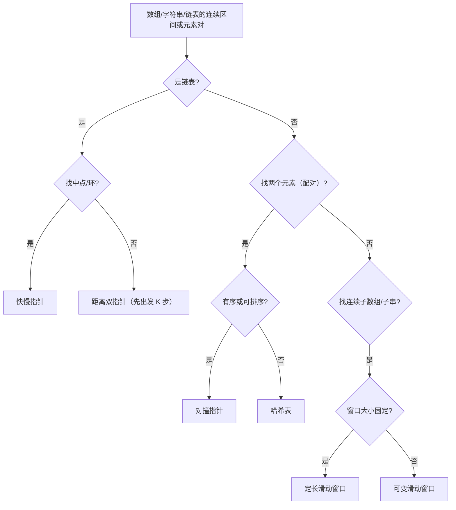
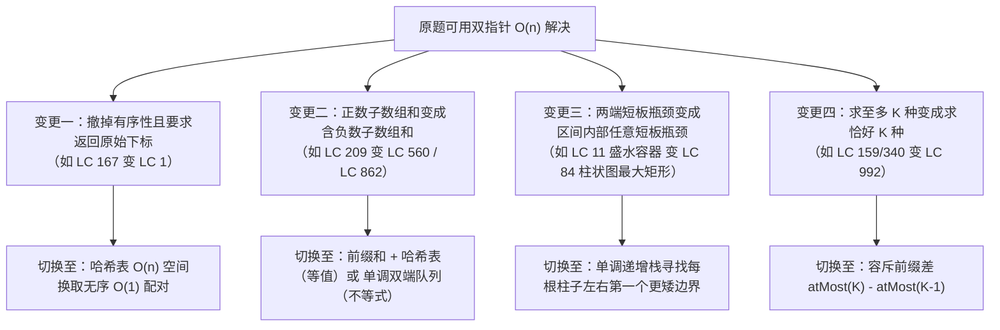

# 双指针综合通关：模式识别、算法选型与面试高频模式总结

**摘要：**

本篇是双指针专栏的收尾，把前 9 篇的内容收敛成一套可复用的"面试通关"框架。核心有三：**其一，三大模型的判断决策树**——用"数据结构 + 目标"两个问题，就能定下大方向；**其二，常见陷阱盘点**——"无序数组用对撞""收缩条件写反""去重的 off-by-one"是失分重灾区；**其三，复杂度速查与练习清单**。全文用 Go 语言给出关键代码，并逐层追问：如何一眼识别题型、三大模型各自的"单调性"来源是什么、以及面试中如何组织表达。掌握本篇，你就把整个双指针专栏的知识串成了一条线。

---

## 第 1 章 三大模型的判断决策树

### 1.1 两个问题定方向

**"数据结构是什么？目标是什么？"**——这两个问题，就能定下双指针模型：



### 1.2 三条判据

**归纳成三条判据**：

1. **链表问题** → 快慢指针（找中点/环）或距离双指针（找倒数第 K）；
2. **数组/字符串的"元素对"** → 对撞指针（需有序）或哈希表；
3. **数组/字符串的"连续区间"** → 滑动窗口（定长或可变）。

**这三条，是双指针选型的第一层判断。**

### 1.3 三大模型的"单调性"来源

**这是本专栏最核心的一条认知**——**三大模型能用，都依赖某种"单调性"，而"单调性的来源"不同**：

| 模型 | 单调性来源 |
|------|-----------|
| 对撞指针 | 数组的**全局有序性** |
| 快慢指针 | 移动的**节奏差**（相对速度、先出发） |
| 滑动窗口 | 窗口内**统计量相对于窗口大小的单调性** |

**"单调性从哪来"决定了"什么时候能用"**——**这也是本专栏反复强调"先问有没有单调性"的原因。**

> [!info] 选型的第一性原理
> 双指针选型的第一性原理，是**"问题有没有单调性、单调性从哪来"**——**有序性、节奏差、窗口单调性，都是单调性的具体形态。** **理解了这一点，你就不再"凭感觉选模型"，而是"按单调性的来源选"。** 这与本专栏反复强调的"先理解问题，再选工具"一脉相承。

---

## 第 2 章 常见陷阱盘点

### 2.1 对撞指针的三个陷阱

**陷阱一，在无序数组上直接用对撞指针。** 不具备全局有序性，正确性证明失效。**解决：先排序，或用哈希表。**

**陷阱二，内层"跳过非法字符"忘了边界。** 如 Valid Palindrome 的 `while left < right && !isAlnum(...)`——**不带 `left < right` 会越界。**

**陷阱三，去重的 off-by-one。** 3Sum 的外层去重必须 `i > 0`（写成 `i >= 0` 会漏解）；内层去重要"先判断相等、再移动"。

### 2.2 快慢指针的三个陷阱

**陷阱一，判空顺序写反。** 应 `fast != nil && fast.Next != nil`（先判 `fast`）。

**陷阱二，环起点定位写错。** 相遇后应"一个从头、一个从相遇点，同速前进"。

**陷阱三，找中点时偶数长度的位置搞错。** 取决于"前半段最后"还是"后半段第一"。

### 2.3 滑动窗口的三个陷阱

**陷阱一，收缩条件写反。** 求最短"满足就收缩"，求最长"不满足才收缩"。

**陷阱二，有负数时仍用滑动窗口。** 单调性失效，须改用前缀和。

**陷阱三，`formed` 递增用 `>=` 而非 `==`。** 会重复递增（LC 76）。

**这九个陷阱，覆盖了双指针题 90% 以上的 bug。**

---

## 第 3 章 复杂度速查

### 3.1 完整复杂度表

| 模型 | 时间 | 空间 | 代表题 |
|------|------|------|--------|
| 对撞指针 | $O(n)$（已排序）/ $O(n\log n)$（需排序） | $O(1)$ | 167、15 |
| 快慢指针（环） | $O(n)$ | $O(1)$ | 141、142 |
| 快慢指针（中点） | $O(n)$ | $O(1)$ | 876 |
| 距离双指针 | $O(n)$ | $O(1)$ | 19、160 |
| 定长窗口 | $O(n)$ | $O(1)$ / $O(k)$ | 643、567 |
| 可变窗口 | $O(n)$ | $O(1)$ / $O(\vert\Sigma\vert)$ | 209、3、76 |

**这张表的价值，是"让你在面试中能快速给出复杂度"。**

### 3.2 复杂度分析的通用方法

**双指针的复杂度，都可以用同一个公式估算**：

$$\text{复杂度} = \text{指针总移动步数} \times \text{每步处理时间}$$

- **对撞指针**：两个指针共移动 $O(n)$ 步；
- **快慢指针**：快指针走 $O(n)$ 步；
- **滑动窗口**：`right` 与 `left` 各移动 $O(n)$ 步。

**"指针只朝一个方向净移动，总步数 $O(n)$"——这是双指针 $O(n)$ 的根本原因。**

### 3.3 一个值得记住的对照

**"为什么双指针是 $O(n)$"的通用论证**：

| 模型 | 为什么是 $O(n)$ |
|------|-----------------|
| 对撞指针 | 两指针相向移动，共 $O(n)$ 步 |
| 快慢指针 | 快指针走 $O(n)$ 步（慢指针更少） |
| 滑动窗口 | `right` 与 `left` 都只向右，各 $O(n)$ 步 |

**这张表说明："指针单向净移动"是双指针 $O(n)$ 的共同原因。**

> [!info] 复杂度分析的"第一性原理"
> 双指针的复杂度分析，有一个"第一性原理"——**"指针只朝一个方向净移动，总步数 $O(n)$"。** **理解了这一点，你就不再"背复杂度"，而是"估算复杂度"。** 这是本专栏"从记忆到理解"的体现。

---

## 第 4 章 面试表达与练习建议

### 4.1 面试表达的四步

**遇到双指针题，建议按这个顺序讲**：

1. **定义问题**："这是'元素对'还是'连续区间'？"；
2. **选模型**："按'数据结构 + 目标'选对撞/快慢/滑动"；
3. **讲单调性**："为什么指针可以这样移动而不回退"；
4. **讲边界**："循环条件、去重、跳字符的边界"。

**第 3 步是关键**——**它表明你理解了"为什么这样移动是正确的"，而非"套模板"。**

### 4.2 练习建议

**按模型组织练习**：

| 模型 | 必刷题 |
|------|--------|
| 对撞指针 | 167、15、11、42 |
| 快慢指针 | 141、142、876、19 |
| 滑动窗口 | 643、209、3、76 |
| 距离双指针 | 19、160、234 |

**每个模型，记住"信号、模板、边界"三件事。**

### 4.3 一个总体的判断

**双指针题的"难"，不在算法，而在"选型与边界"。** 所以备考策略应是：**选型要清晰（按'单调性来源'选），边界清单要背熟（循环条件、去重、跳字符、收缩方向）。** **这两条，覆盖了双指针题的绝大多数考点。**

---

## 第 5 章 专栏总结：三条主线

**回看整个专栏，双指针围绕三条主线**：

**主线一，"搜索空间压缩"是统一的本质。** 双指针能把 $O(n^2)$ 降到 $O(n)$，靠的是"每步排除一整批候选"。

**主线二，"单调性"是双指针的许可证。** 有序性、节奏差、窗口单调性——**没有单调性，双指针失效。**

**主线三，"边界"决定成败。** 循环条件、去重、跳字符、收缩方向——**这些细节是失分的重灾区。**

**这三条，是双指针专栏留给你的最持久的东西。**

### 5.1 一个跨专题的落点

**双指针与"其他技巧"的关系**：

| 技巧 | 与双指针的关系 |
|------|---------------|
| 哈希表 | 无序数组的"两数之和"替代方案 |
| 二分查找 | 同样依赖有序性（找单一位置 vs 找一对） |
| 前缀和 | 有负数时替代滑动窗口 |
| 单调栈/队列 | 处理"窗口极值"等滑动窗口无法处理的统计量 |
| 排序 | 对撞指针的前提 |

**这张表说明："双指针"是"序列处理"的一个中枢**——**它与哈希、二分、前缀和、单调栈都有联系。**

---

## 第 6 章 综合实战演练：四道跨模型经典变形题的现场破题示范

为了检验前五章建立的决策树与不变量体系，我们精选四道在面试中极易选错方向或踩中边界陷阱的跨模型好题，完整演示从"读题识别信号"到"写出零 Bug Go 代码"的全过程。

### 6.1 示范一：双序列逆向空间原地比较——比较含退格的字符串（LeetCode 844）

**题目描述**：给定 `s` 和 `t` 两个字符串，当它们分别被输入到空白的文本编辑器后，如果两者相等，返回 `true`。`#` 代表退格字符（删除前一个有效字符）。**进阶要求：用 $O(n)$ 时间和 $O(1)$ 额外空间解决。**

- **破题思考（为什么正向双指针走不通，而逆向双指针迎刃而解）**：
  - 如果用栈模拟退格，需要 $O(n)$ 额外空间；
  - 如果想用 $O(1)$ 空间的双指针从左往右正向扫描，当你看到一个普通字符 `'a'` 时，你根本不敢拿它跟对方比——因为你不知道它右边后面会不会紧跟着跳出三个 `'#'` 把它给删掉；
  - **换个方向，从右往左（从字符串末尾 `n - 1` 往 `0`）逆向扫描**：当你从右往左遇到一个 `'#'` 时，它明确告诉你"左边紧挨着的 1 个有效字符要被吃掉"。因此我们只需为 `s` 和 `t` 各维护一个退格欠账计数器 `skipS` 和 `skipT`：遇到 `'#'` 则 `skip++`；遇到普通字符且 `skip > 0` 则吃掉该字符并令 `skip--`；直到两边都停在一个真正幸存的有效字符上，再执行比对：

```go
package main

// backspaceCompare LeetCode 844：从右往左逆向双指针 + 退格计数器，时间 O(m+n)，空间严格 O(1)
func backspaceCompare(s string, t string) bool {
	i, j := len(s)-1, len(t)-1
	skipS, skipT := 0, 0

	for i >= 0 || j >= 0 {
		// 1. 定位 s 中下一个幸存的有效字符
		for i >= 0 {
			if s[i] == '#' {
				skipS++
				i--
			} else if skipS > 0 {
				skipS--
				i--
			} else {
				break // 找到幸存字符 s[i]
			}
		}

		// 2. 定位 t 中下一个幸存的有效字符
		for j >= 0 {
			if t[j] == '#' {
				skipT++
				j--
			} else if skipT > 0 {
				skipT--
				j--
			} else {
				break // 找到幸存字符 t[j]
			}
		}

		// 3. 比对幸存字符
		if i >= 0 && j >= 0 {
			if s[i] != t[j] {
				return false
			}
		} else if i >= 0 || j >= 0 {
			return false // 一方还有幸存字符，另一方已耗尽
		}
		i--
		j--
	}
	return true
}
```

### 6.2 示范二：字典序的尽头与转折——下一个排列（LeetCode 31，逆向找拐点 + 逆向找替身 + 对撞翻转）

**题目描述**：整数数组的"下一个排列"是指其整数的下一个字典序更大的排列。如果不存在下一个更大的排列，则将其重排为字典序最小的排列（即升序排列）。必须**原地**修改，只允许使用额外常数空间。

这道题是背向扫描与相向对撞指针完美配合的典范：
1. **想让字典序变大，且变大的幅度尽可能小**，改动的位置必须尽可能靠右（低位）；
2. 从右往左扫描，只要处于从右往左升序（即从左往右降序 `nums[i] >= nums[i+1]`），说明后缀 `[i..n-1]` 已经榨干了所有变大的潜力；**第一个满足 `nums[i] < nums[i+1]` 的位置 `i`，就是必须被替换增大的"拐点"**；
3. 若 `i >= 0`，在已经必然呈降序排列的后缀 `nums[i+1 .. n-1]` 中，从右往左找到**第一个严格大于 `nums[i]` 的元素 `nums[j]`**（因为后缀降序，从右往左第一个 `> nums[i]` 的数就是大于它的最小数），将 `nums[i]` 与 `nums[j]` 交换；
4. 交换之后，后缀 `nums[i+1 .. n-1]` 依然保持着降序排列（字典序最大状态）。为了使新排列尽可能小，最后用**相向对撞指针将后缀 `nums[i+1 .. n-1]` 原地反转为升序**：

```go
package main

// nextPermutation LeetCode 31：两次逆向扫描定位拐点与最小更大值 + 对撞指针反转后缀
func nextPermutation(nums []int) {
	n := len(nums)
	// 1. 从右往左找第一个相邻升序拐点 nums[i] < nums[i+1]
	i := n - 2
	for i >= 0 && nums[i] >= nums[i+1] {
		i--
	}

	// 2. 若存在拐点，从右往左在降序后缀中找第一个 > nums[i] 的元素与之交换
	if i >= 0 {
		j := n - 1
		for nums[j] <= nums[i] {
			j--
		}
		nums[i], nums[j] = nums[j], nums[i]
	}

	// 3. 用对撞指针将降序后缀 nums[i+1 .. n-1] 反转为升序（最小字典序）
	for l, r := i+1, n-1; l < r; l, r = l+1, r-1 {
		nums[l], nums[r] = nums[r], nums[l]
	}
}
```

### 6.3 示范三：双序列区间归并交集与状态跃迁——长按键入（LeetCode 925）与情感丰富的文字（LeetCode 809）

当两个指针分别扫描源字符串 `name` 和实际键盘输入的扩展字符串 `typed` 时，最稳健的手法是**分组同向双指针（Group-by Two Pointers）**——每次内层循环把当前相同字符的连续块长度数出来，对比两边的字符是否一致以及重复次数是否满足扩展规则，彻底消除零散单步回退的分支混乱：

```go
package main

// isLongPressedName LeetCode 925：分组同向双指针比对每个连续相同字符块的字母与长度
func isLongPressedName(name string, typed string) bool {
	i, j := 0, 0
	m, n := len(name), len(typed)

	for i < m && j < n {
		if name[i] != typed[j] {
			return false
		}
		ch := name[i]
		cntName, cntTyped := 0, 0
		for i < m && name[i] == ch {
			i++
			cntName++
		}
		for j < n && typed[j] == ch {
			j++
			cntTyped++
		}
		// typed 中同一连续字符块的长度必须 >= name 中的长度
		if cntTyped < cntName {
			return false
		}
	}
	// 必须确保两个字符串的所有字符块均已同步耗尽
	return i == m && j == n
}
```

### 6.4 示范四：三指针同向夹逼——统计公平数对的数目（LeetCode 2563）与区间子数组个数（LeetCode 795）

如果题目要求统计满足上下界双侧不等式 `lower <= nums[i] + nums[j] <= upper`（$i < j$）的数对数目（**LeetCode 2563：统计公平数对的数目**），有两种同样优雅的 $O(n \log n)$ 双指针解法：
- **路线一（排序 + 容斥对撞差）**：编写辅助函数 `countLessEqual(nums, limit)` 用相向对撞指针统计满足 `nums[left] + nums[right] <= limit` 的数对总数（若 `<= limit` 则 `ans += right - left; left++`），最后返回 **`countLessEqual(nums, upper) - countLessEqual(nums, lower - 1)`**；
- **路线二（排序 + 三指针同向夹逼）**：枚举左端点 `i`，同时维护右端上界指针 `r2`（最后一个满足 `nums[i] + nums[r2] <= upper` 的位置）和右端下界指针 `r1`（最后一个满足 `nums[i] + nums[r1] < lower` 的位置），由于随着 `i` 增大，`r1` 和 `r2` 均单调向左移动，直接累加 `max(i, r2) - max(i, r1)` 即可：

```go
package main

import "sort"

// countFairPairs LeetCode 2563：排序 + 相向对撞指针容斥作差，时间 O(n log n)，空间 O(1)
func countFairPairs(nums []int, lower int, upper int) int64 {
	sort.Ints(nums)

	countLessEqual := func(limit int) int64 {
		var cnt int64
		left, right := 0, len(nums)-1
		for left < right {
			if nums[left]+nums[right] <= limit {
				cnt += int64(right - left)
				left++
			} else {
				right--
			}
		}
		return cnt
	}

	return countLessEqual(upper) - countLessEqual(lower-1)
}
```

同理，在 **LeetCode 795：区间子数组个数**（给定整数数组 `nums` 和两个整数 `left`、`right`，求最大元素值在 `[left, right]` 范围内的连续子数组个数）中，无需排序（因为要求原数组的连续子数组），直接定义辅助函数 `countMaxAtMost(nums, bound)` 统计"所有元素均 $\le bound$ 的连续子数组个数"（遇到 $\le bound$ 则当前连续合法长度 `cur++` 并累加 `ans += cur`，遇到 $> bound$ 则清零 `cur = 0`），最后返回 **`countMaxAtMost(nums, right) - countMaxAtMost(nums, left - 1)`**，仅需两遍 $O(n)$ 扫描、$O(1)$ 空间即可解出。

### 6.5 示范五：接雨水与双指针在二维状态压缩中的实战——压缩字符串（LeetCode 443）与删除有序数组重复项

在需要**原地把一个数组或字节切片压缩重写**的场景中，**同向读写指针（`read` 与 `write`）+ 分组起始锚点 `anchor`** 是最黄金的组合。以 **LeetCode 443：压缩字符串**（将 `['a','a','b','b','c','c','c']` 原地压缩为 `['a','2','b','2','c','3']` 并返回新长度，要求 $O(1)$ 额外空间）为例：

为什么这道题能保证 `write` 指针绝不会追上并覆盖尚未读取的 `read` 指针？
- 当连续相同字符个数为 $1$ 时，只写 1 个字符，写入长度等于读取长度（$1 = 1$）；
- 当连续相同字符个数 $cnt \ge 2$ 时，写入 1 个字符加十进制数字位数（如 `2` 个写 2 位，`10` 个写 3 位，`100` 个写 4 位），写入长度永远 $\le$ 读取长度 $cnt$。
因此 **`write <= read` 是一条恒成立的物理不变量**，原地覆写百分之百安全：

```go
package main

import "strconv"

// compress LeetCode 443：同向读写双指针 + 分组锚点原地游程编码（RLE），时间 O(n)，空间 O(1)
func compress(chars []byte) int {
	n := len(chars)
	write, anchor := 0, 0

	for read := 0; read < n; read++ {
		// 当到达数组末尾，或下一个字符与当前字符不同时，结算当前连续块 [anchor .. read]
		if read+1 == n || chars[read+1] != chars[read] {
			chars[write] = chars[anchor]
			write++
			if count := read - anchor + 1; count > 1 {
				for _, digit := range strconv.Itoa(count) {
					chars[write] = byte(digit)
					write++
				}
			}
			anchor = read + 1
		}
	}
	return write
}
```

---

## 第 7 章 双指针四大模型的代码模板速查卡片

为了让你在面试前 5 分钟能快速过一遍核心骨架，下面将本专栏提炼出的**四大黄金无 Bug 模板**并列呈现：

```go
package main

// 模板一：相向对撞指针（适用于有序数组配对、两端短板消除）
func templateCollision(nums []int, target int) {
	left, right := 0, len(nums)-1
	for left < right {
		sum := nums[left] + nums[right]
		if sum == target {
			// 命中处理；若需去重则内层跳过相同 left/right 后双双内缩
			left++
			right--
		} else if sum < target {
			left++
		} else {
			right--
		}
	}
}

// 模板二：可变滑动窗口（求最短、求最长、求越短越合法个数、求越长越合法个数）
func templateSlidingWindow(nums []int) {
	left := 0
	for right := 0; right < len(nums); right++ {
		// 1. 将 nums[right] 纳入窗口状态

		// 2. 根据问题类型选择内层收缩条件：
		//   - 求最长 / 求至多型个数：for 窗口不合法 { 移出 nums[left]; left++ }
		//     外侧更新：maxLen = max(maxLen, right-left+1) 或 count += right-left+1
		//   - 求最短 / 求至少型个数：for 窗口已满足条件 {
		//       内侧更新最短：minLen = min(minLen, right-left+1)
		//       移出 nums[left]; left++
		//     }
		//     外侧更新至少型个数：count += left
		_ = left
	}
}

// 模板三：链表快慢判圈与切分中点（Floyd 判圈 + 偏左中点）
func templateLinkedList(head *ListNode) {
	// 1. 判环与找环入口：必须同起点 head, head 出发
	slow, fast := head, head
	for fast != nil && fast.Next != nil {
		slow = slow.Next
		fast = fast.Next.Next
		if slow == fast {
			p := head
			for p != slow {
				p = p.Next
				slow = slow.Next
			}
			// 此时 p 即为环入口
			break
		}
	}

	// 2. 归并/重排切分链表中点：fast 抢跑一步 head.Next，确保偶数节点时 slow 停在左半尾节点
	if head != nil && head.Next != nil {
		s, f := head, head.Next
		for f != nil && f.Next != nil {
			s = s.Next
			f = f.Next.Next
		}
		rightHalf := s.Next
		s.Next = nil // 物理断链
		_ = rightHalf
	}
}

// 模板四：同向读写指针（原地过滤 / 保留至多 k 个重复项）
func templateReadWrite(nums []int, k int) int {
	if len(nums) <= k {
		return len(nums)
	}
	write := k
	for read := k; read < len(nums); read++ {
		if nums[read] != nums[write-k] {
			nums[write] = nums[read]
			write++
		}
	}
	return write
}
```

### 7.2 考场自检清单：提交代码前的"黄金 60 秒七问"

在面试白板或在线 IDE 上写完双指针代码、准备向面试官说出"我写完了"之前，请务必对照以下七条清单默念自检一遍，它能帮你拦截掉 95% 以上的现场 Bug：

1. **【单调性自检】如果用的是对撞指针，输入数组真的有序吗？** 如果原数组无序，我有没有先调用 `sort.Ints`？排序后会不会破坏题目要求返回的原始下标？
2. **【单调性自检】如果用的是可变滑动窗口，数组中会不会包含负数？** 一旦允许出现负数（如 LC 560、LC 862），窗口和不再单调，右扩左缩双指针必然漏解，必须立刻改用"前缀和 + 哈希表"或"前缀和 + 单调双端队列"。
3. **【循环条件自检】外层是 `left < right` 还是 `left <= right`？** 如果题目要求选取**两个不同下标**的元素（如 Two Sum II、3Sum、盛水容器），必须是严格小于 `left < right`；如果允许两个指针指向同一个元素（如平方数之和 $a^2 + b^2 = c$）或需要对撞处理完最后一个中心元素（如平方后有序数组 LC 977、救生艇 LC 881），则必须用 `left <= right`。
4. **【内层越界自检】内层嵌套的 `for` 循环有没有带上 `left < right`（或 `left <= right`）保护？** 在验证回文串（LC 125）跳过标点符号、或 3Sum（LC 15）跳过重复元素时，内层 `for` 循环一旦漏写 `left < right` 前置条件，遇到全标点字符串 `".,;"` 或全零数组 `[0, 0, 0]` 时就会直接冲出数组边界触发 panic。
5. **【去重方向自检】在 3Sum / 4Sum 中，外层去重条件写的是不是向前看 `i > start && nums[i] == nums[i-1]`？** 绝不能写成向后看 `nums[i] == nums[i+1]`（会漏掉两个相同数字同时入选的合法解），也绝不能把内层起点 `j > i + 1` 误写成 `j > 0`。
6. **【链表断链与判空自检】快指针走两步前，判空是不是严格写成了 `for fast != nil && fast.Next != nil`？** 只要把链表切分成了两段或分流成了多条子链，每一条子链的末尾有没有显式执行 `tail.Next = nil` 以防残留指针成环？
7. **【整型溢出自检】多元素求和或乘法时，在 32 位边界下会不会溢出？** 在四数之和（LC 18，四个 $10^9$ 相加）、半径子数组均值（LC 2090）、平方数之和（LC 633）中，务必将累加和或平方项提升为 `int64`（或改用减法 `c - right*right`）以避免符号位翻转。

### 7.3 当双指针遇到瓶颈：如何丝滑切换到相邻算法范式？

在面试的最后一环，面试官极喜欢通过对原题施加一个微小的条件变更（Constraint Mutation），考察你的知识边界是否僵化：



掌握了上面这张"条件突变迁移图"，当面试官问出"如果把条件改成……，你刚才的双指针还能用吗？不能用的话该怎么改？"时，你不仅能立刻指出双指针单调性在哪一步断裂，还能在 10 秒内给出替代范式的完整方案。

### 7.4 深度对比：双指针与二分查找、分治、动态规划的协同设计

在复杂的中高级面试题中，双指针往往不再单打独斗，而是作为某个高层算法框架内部的**加速算子（Inner Operator）**登场：
1. **排序 / 分治 + 双指针**：在归并排序（LC 148）、交易逆序对（LCR 170）、翻转对（LC 493）与区间和的个数（LC 327）中，外层由分治递归将无序问题拆解为左右两个有序半区，内层则完全交给**同向双指针**在 $O(n)$ 时间内完成跨区统计与合并——没有内层的双指针单调扫描，分治的合并阶段就会退化为 $O(n^2)$；
2. **二分答案 + 双指针（或贪心滑窗验证）**：在找出第 K 小的数对距离（**LeetCode 719：Find K-th Smallest Pair Distance**）中，外层在距离值域 `[0, max(nums) - min(nums)]` 上做二分答案 `mid`，内层检验函数 `countPairsLessEqual(mid)` 则直接在排序后的数组上运行**同向滑动窗口**（统计满足 `nums[right] - nums[left] <= mid` 的数对个数 `right - left`），将外层的 $O(\log V)$ 值域折半与内层的 $O(n)$ 滑窗计数完美嫁接，在 $O(n \log n + n \log V)$ 时间内攻克困难题：

```go
package main

import "sort"

// smallestDistancePair LeetCode 719：排序 + 值域二分答案 + 内层同向滑动窗口计数
func smallestDistancePair(nums []int, k int) int {
	sort.Ints(nums)
	n := len(nums)

	// 内层算子：利用同向双指针 O(n) 统计差值 <= mid 的数对总数
	countLessEqual := func(mid int) int {
		count, left := 0, 0
		for right := 0; right < n; right++ {
			for nums[right]-nums[left] > mid {
				left++
			}
			count += right - left
		}
		return count
	}

	lo, hi := 0, nums[n-1]-nums[0]
	for lo <= hi {
		mid := lo + (hi-lo)/2
		if countLessEqual(mid) >= k {
			hi = mid - 1
		} else {
			lo = mid + 1
		}
	}
	return lo
}
```

3. **动态规划 + 双指针（决策单调性优化）**：在诸如分割数组、接雨水、滑动窗口最大值优化 DP 等问题中，当状态转移方程的决策点随状态下标单调右移时，原本需要 $O(n)$ 枚举转移前驱的内层循环，可以直接替换为单调移动的指针或单调双端队列，将 $O(n^2)$ 的动态规划降维至 $O(n)$。同理，在计算几何的旋转卡壳（Rotating Calipers，求凸包直径或最小外接矩形）算法中，绕着凸包多边形边界同向推进的一对对踵点游标，本质上也是将一维同向双指针推广到了二维闭合环路上的极角单调性扫描，实现了从线性序列到几何空间的跨界统一。

---

## 第 8 章 全专栏十篇核心题库与模型总览表

在结束本专栏之前，我们将十篇文章所建立的完整知识大厦浓缩为一张终极速查表：

| 篇章 | 所属模型 | 核心单调性 / 不变量 | 必刷标杆题目（LeetCode） |
|------|----------|---------------------|--------------------------|
| 01 全景篇 | 四大模型总纲 | 二维矩阵右上角消去、单调有界势能函数 | 167、141、209、26、80 |
| 02 对撞入门 | 相向对撞 / 背向扩散 | 升序和单调、两端平方极值、回文镜像对称 | 167、125、680、344、977、633、881、189、5、647 |
| 03 N 数之和 | 排序枚举 + 相向对撞 | 固定 $k-2$ 层降维至 2Sum；向前看 `nums[i]==nums[i-1]` 去重 | 15、16、18、259、611、923 |
| 04 几何对撞 | 短板支配淘汰对撞 | 盛水容器消去较矮隔板；接雨水维护 `min(leftMax, rightMax)` | 11、42、407、1793 |
| 05 快慢判圈 | 同向快慢指针（$2:1$） | 环内相对速度为 1 必追上；$F = (n-1)C + (C-a)$ 入环定位 | 141、142、202、876、287、457、143 |
| 06 链表实战 | 定距先行 / 交叉换轨 | `fast` 先走 $n+1$ 步停前驱；换轨走满 $a+c+b$ 隐式补齐长度差 | 19、160、1650、234、82、61、1721 |
| 07 滑窗基础 | 定长窗口 / 可变窗口 | 非负数组和单调使 `left` 不回退；最短内更、最长外更、计数加 `r-l+1` | 643、1456、2090、209、713、1493、1004、1658、239、862 |
| 08 滑窗进阶 | 字符频次 / 种类约束 | 上次位置跳转；历史 `maxCount` 平移；`恰好K = 至多K - 至多K-1`；至少型加 `left` | 3、567、159、340、904、992、424、2024、1208、1358 |
| 09 最小覆盖 | 多重集欠账覆盖窗口 | 单数组净欠账 `need[c]` 正负分离 + 总欠账 `debt == 0` 收缩 | 76、438、30、632、1234、727 |
| 10 综合通关 | 跨模型识别与变形 | 逆向退格计数、字典序拐点+对撞反转、分组块双指针 | 844、31、925、2563 |

---

## 小结

本篇把双指针专栏收敛成一套"面试通关"框架：**三大模型的判断决策树**（按"数据结构 + 目标"选）、**九个常见陷阱**（对撞/快慢/滑动各三个）、以及**复杂度速查与练习清单**。三者合起来，构成"从选型到实现到优化"的完整链条。

贯穿全篇的核心认知有两条。其一，**"单调性从哪来"决定了"双指针能不能用"**——有序性、节奏差、窗口单调性，是三种不同的来源。其二，**"边界决定成败"**——循环条件、去重、收缩方向，是失分重灾区。**把这两条握住，你面对任何双指针题，都有了从选型到实现的完整思路。**

至此，双指针专栏告一段落。**双指针是"序列处理"的基础工具**——它与线性表（数组/链表）、字符串、滑动窗口共享同一套"用指针运动编码位置信息"的内核。**愿你带着这套思维，从容应对每一道双指针题。**

---

## 参考资料

1. LeetCode 167. Two Sum II. https://leetcode.cn/problems/two-sum-ii-input-array-is-sorted/
2. LeetCode 15. 3Sum. https://leetcode.cn/problems/3sum/
3. LeetCode 142. Linked List Cycle II. https://leetcode.cn/problems/linked-list-cycle-ii/
4. LeetCode 76. Minimum Window Substring. https://leetcode.cn/problems/minimum-window-substring/

---

> [!note] 思考题
> 1. 请用"数据结构 + 目标"两个问题，判断本专栏 10 道题各自的模型。
> 2. 三大模型的"单调性"分别来自哪里？请各举一例。
> 3. 为什么"指针单向净移动"能保证 $O(n)$？请对三种模型分别论证。
> 4. 请列出双指针的九个常见陷阱，并说明各自的后果。
> 5. "有负数时改用前缀和"——请设计一道题验证这一判断。
