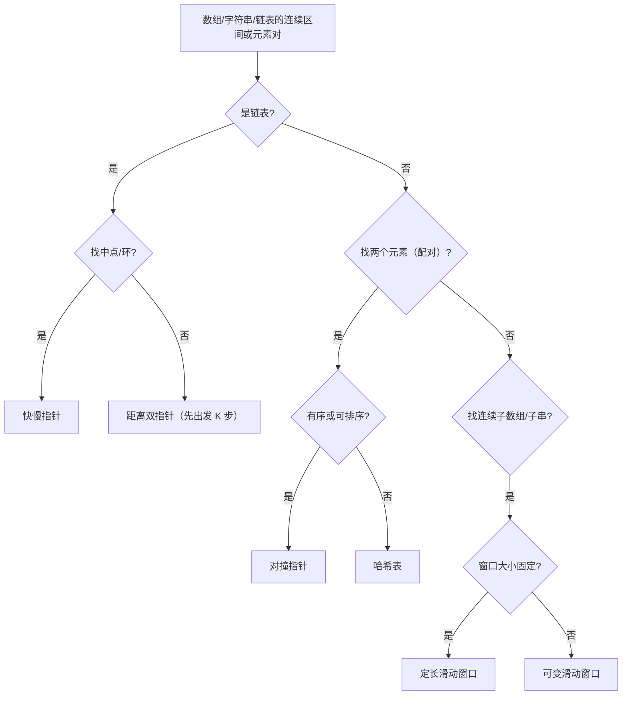

# 双指针综合通关：模式识别、算法选型与面试高频模式总结

**摘要：**

本篇是双指针专栏的收尾，把前 9 篇的内容收敛成一套可复用的"面试通关"框架。核心有三：**其一，三大模型的判断决策树**——用"数据结构 + 目标"两个问题，就能定下大方向；**其二，常见陷阱盘点**——"无序数组用对撞""收缩条件写反""去重的 off-by-one"是失分重灾区；**其三，复杂度速查与练习清单**。全文用 Go 语言给出关键代码，并逐层追问：如何一眼识别题型、三大模型各自的"单调性"来源是什么、以及面试中如何组织表达。掌握本篇，你就把整个双指针专栏的知识串成了一条线。

---

## 第 1 章 三大模型的判断决策树

### 1.1 两个问题定方向

**"数据结构是什么？目标是什么？"**——这两个问题，就能定下双指针模型：

### 1.2 三条判据

**归纳成三条判据**：

1. **链表问题** → 快慢指针（找中点/环）或距离双指针（找倒数第 K）；
2. **数组/字符串的"元素对"** → 对撞指针（需有序）或哈希表；
3. **数组/字符串的"连续区间"** → 滑动窗口（定长或可变）。

**这三条，是双指针选型的第一层判断。**

### 1.3 三大模型的"单调性"来源

**这是本专栏最核心的一条认知**——**三大模型能用，都依赖某种"单调性"，而"单调性的来源"不同**：

| 模型 | 单调性来源 |
|------|-----------|
| 对撞指针 | 数组的**全局有序性** |
| 快慢指针 | 移动的**节奏差**（相对速度、先出发） |
| 滑动窗口 | 窗口内**统计量相对于窗口大小的单调性** |

**"单调性从哪来"决定了"什么时候能用"**——**这也是本专栏反复强调"先问有没有单调性"的原因。**

> [!info] 选型的第一性原理
> 双指针选型的第一性原理，是**"问题有没有单调性、单调性从哪来"**——**有序性、节奏差、窗口单调性，都是单调性的具体形态。** **理解了这一点，你就不再"凭感觉选模型"，而是"按单调性的来源选"。** 这与本专栏反复强调的"先理解问题，再选工具"一脉相承。

---

## 第 2 章 常见陷阱盘点

### 2.1 对撞指针的三个陷阱

**陷阱一，在无序数组上直接用对撞指针。** 不具备全局有序性，正确性证明失效。**解决：先排序，或用哈希表。**

**陷阱二，内层"跳过非法字符"忘了边界。** 如 Valid Palindrome 的 `while left < right && !isAlnum(...)`——**不带 `left < right` 会越界。**

**陷阱三，去重的 off-by-one。** 3Sum 的外层去重必须 `i > 0`（写成 `i >= 0` 会漏解）；内层去重要"先判断相等、再移动"。

### 2.2 快慢指针的三个陷阱

**陷阱一，判空顺序写反。** 应 `fast != nil && fast.Next != nil`（先判 `fast`）。

**陷阱二，环起点定位写错。** 相遇后应"一个从头、一个从相遇点，同速前进"。

**陷阱三，找中点时偶数长度的位置搞错。** 取决于"前半段最后"还是"后半段第一"。

### 2.3 滑动窗口的三个陷阱

**陷阱一，收缩条件写反。** 求最短"满足就收缩"，求最长"不满足才收缩"。

**陷阱二，有负数时仍用滑动窗口。** 单调性失效，须改用前缀和。

**陷阱三，`formed` 递增用 `>=` 而非 `==`。** 会重复递增（LC 76）。

**这九个陷阱，覆盖了双指针题 90% 以上的 bug。**

---

## 第 3 章 复杂度速查

### 3.1 完整复杂度表

| 模型 | 时间 | 空间 | 代表题 |
|------|------|------|--------|
| 对撞指针 | $O(n)$（已排序）/ $O(n\log n)$（需排序） | $O(1)$ | 167、15 |
| 快慢指针（环） | $O(n)$ | $O(1)$ | 141、142 |
| 快慢指针（中点） | $O(n)$ | $O(1)$ | 876 |
| 距离双指针 | $O(n)$ | $O(1)$ | 19、160 |
| 定长窗口 | $O(n)$ | $O(1)$ / $O(k)$ | 643、567 |
| 可变窗口 | $O(n)$ | $O(1)$ / $O(\vert\Sigma\vert)$ | 209、3、76 |

**这张表的价值，是"让你在面试中能快速给出复杂度"。**

### 3.2 复杂度分析的通用方法

**双指针的复杂度，都可以用同一个公式估算**：

$$\text{复杂度} = \text{指针总移动步数} \times \text{每步处理时间}$$

- **对撞指针**：两个指针共移动 $O(n)$ 步；
- **快慢指针**：快指针走 $O(n)$ 步；
- **滑动窗口**：`right` 与 `left` 各移动 $O(n)$ 步。

**"指针只朝一个方向净移动，总步数 $O(n)$"——这是双指针 $O(n)$ 的根本原因。**

### 3.3 一个值得记住的对照

**"为什么双指针是 $O(n)$"的通用论证**：

| 模型 | 为什么是 $O(n)$ |
|------|-----------------|
| 对撞指针 | 两指针相向移动，共 $O(n)$ 步 |
| 快慢指针 | 快指针走 $O(n)$ 步（慢指针更少） |
| 滑动窗口 | `right` 与 `left` 都只向右，各 $O(n)$ 步 |

**这张表说明："指针单向净移动"是双指针 $O(n)$ 的共同原因。**

> [!info] 复杂度分析的"第一性原理"
> 双指针的复杂度分析，有一个"第一性原理"——**"指针只朝一个方向净移动，总步数 $O(n)$"。** **理解了这一点，你就不再"背复杂度"，而是"估算复杂度"。** 这是本专栏"从记忆到理解"的体现。

---

## 第 4 章 面试表达与练习建议

### 4.1 面试表达的四步

**遇到双指针题，建议按这个顺序讲**：

1. **定义问题**："这是'元素对'还是'连续区间'？"；
2. **选模型**："按'数据结构 + 目标'选对撞/快慢/滑动"；
3. **讲单调性**："为什么指针可以这样移动而不回退"；
4. **讲边界**："循环条件、去重、跳字符的边界"。

**第 3 步是关键**——**它表明你理解了"为什么这样移动是正确的"，而非"套模板"。**

### 4.2 练习建议

**按模型组织练习**：

| 模型 | 必刷题 |
|------|--------|
| 对撞指针 | 167、15、11、42 |
| 快慢指针 | 141、142、876、19 |
| 滑动窗口 | 643、209、3、76 |
| 距离双指针 | 19、160、234 |

**每个模型，记住"信号、模板、边界"三件事。**

### 4.3 一个总体的判断

**双指针题的"难"，不在算法，而在"选型与边界"。** 所以备考策略应是：**选型要清晰（按'单调性来源'选），边界清单要背熟（循环条件、去重、跳字符、收缩方向）。** **这两条，覆盖了双指针题的绝大多数考点。**

---

## 第 5 章 专栏总结：三条主线

**回看整个专栏，双指针围绕三条主线**：

**主线一，"搜索空间压缩"是统一的本质。** 双指针能把 $O(n^2)$ 降到 $O(n)$，靠的是"每步排除一整批候选"。

**主线二，"单调性"是双指针的许可证。** 有序性、节奏差、窗口单调性——**没有单调性，双指针失效。**

**主线三，"边界"决定成败。** 循环条件、去重、跳字符、收缩方向——**这些细节是失分的重灾区。**

**这三条，是双指针专栏留给你的最持久的东西。**

### 5.1 一个跨专题的落点

**双指针与"其他技巧"的关系**：

| 技巧 | 与双指针的关系 |
|------|---------------|
| 哈希表 | 无序数组的"两数之和"替代方案 |
| 二分查找 | 同样依赖有序性（找单一位置 vs 找一对） |
| 前缀和 | 有负数时替代滑动窗口 |
| 单调栈/队列 | 处理"窗口极值"等滑动窗口无法处理的统计量 |
| 排序 | 对撞指针的前提 |

**这张表说明："双指针"是"序列处理"的一个中枢**——**它与哈希、二分、前缀和、单调栈都有联系。**

---

## 小结

本篇把双指针专栏收敛成一套"面试通关"框架：**三大模型的判断决策树**（按"数据结构 + 目标"选）、**九个常见陷阱**（对撞/快慢/滑动各三个）、以及**复杂度速查与练习清单**。三者合起来，构成"从选型到实现到优化"的完整链条。

贯穿全篇的核心认知有两条。其一，**"单调性从哪来"决定了"双指针能不能用"**——有序性、节奏差、窗口单调性，是三种不同的来源。其二，**"边界决定成败"**——循环条件、去重、收缩方向，是失分重灾区。**把这两条握住，你面对任何双指针题，都有了从选型到实现的完整思路。**

至此，双指针专栏告一段落。**双指针是"序列处理"的基础工具**——它与线性表（数组/链表）、字符串、滑动窗口共享同一套"用指针运动编码位置信息"的内核。**愿你带着这套思维，从容应对每一道双指针题。**

---

## 参考资料

1. LeetCode 167. Two Sum II. https://leetcode.cn/problems/two-sum-ii-input-array-is-sorted/
2. LeetCode 15. 3Sum. https://leetcode.cn/problems/3sum/
3. LeetCode 142. Linked List Cycle II. https://leetcode.cn/problems/linked-list-cycle-ii/
4. LeetCode 76. Minimum Window Substring. https://leetcode.cn/problems/minimum-window-substring/

---

> [!note] 思考题
> 1. 请用"数据结构 + 目标"两个问题，判断本专栏 10 道题各自的模型。
> 2. 三大模型的"单调性"分别来自哪里？请各举一例。
> 3. 为什么"指针单向净移动"能保证 $O(n)$？请对三种模型分别论证。
> 4. 请列出双指针的九个常见陷阱，并说明各自的后果。
> 5. "有负数时改用前缀和"——请设计一道题验证这一判断。
