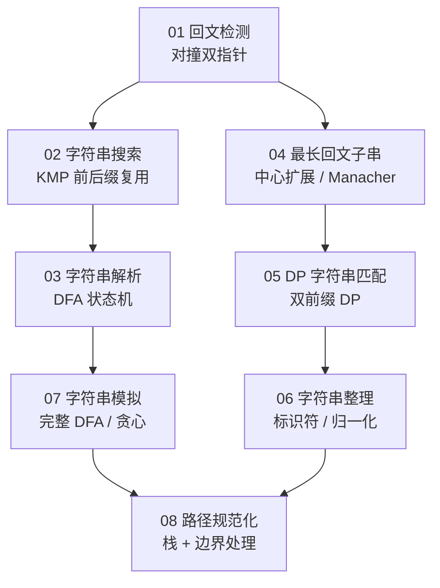

# 字符串专栏导览：从回文到 DP 匹配的六条主线

**摘要：**

字符串是面试中出现频率仅次于数组与链表的数据类型。与数组不同，字符串题的难点**不仅是算法本身，还在于各种字符集、编码、边界状态的精细处理**——很多看似简单的题（如 `atoi`、Valid Number）在细节上极易翻车；而另一些题（如正则匹配、最长回文子串）则涵盖动态规划的经典范式。本专栏覆盖 LeetCode 高频字符串题，按**回文、搜索、解析、匹配、整理、模拟**六条主线组织，系统构建字符串题的解题框架。全文示例代码统一使用 Go 语言。读完本专栏，你将掌握"见型知法"的能力——遇到字符串题时，能迅速判断它属于哪条主线、该用什么技巧。

---

## 专栏定位

**讨论范围**：字符串的回文检测、搜索匹配、解析模拟、动态规划匹配、整理分组、路径规范化。不展开 Trie、后缀数组等进阶结构（仅在延伸处提及）。

**写作取向**：每篇从"朴素解法"或"约束"出发推导优化解，重点回答**为什么这样解**；对每种技巧，交代其适用前提、失效场景与边界反例。

**语言约定**：示例代码以 **Go** 为主。Go 的字符串与字节切片、`strings` 包，恰好能让"字符 vs 字节""切分 vs 扫描"这些细节写得格外清晰。

---

## 专栏目录

| 序号 | 文章标题 | 核心话题 | 覆盖 LeetCode 题目 |
|------|----------|----------|--------------------|
| 01 | 回文检测：Valid Palindrome 与双指针范式 | 对撞双指针、跳字符边界、回文变体 | 125、680、9 |
| 02 | 字符串搜索：Implement strStr 与 KMP 算法深度解析 | 前后缀复用、`next` 数组、线性复杂度证明 | 28、459 |
| 03 | 字符串解析：atoi、Add Binary 与进位模拟 | DFA 建模、溢出预判、大数加法模板 | 8、67、415 |
| 04 | 最长回文子串：中心扩展与 Manacher 算法 | 枚举中心、四种解法演进、镜像利用 | 5 |
| 05 | 动态规划字符串匹配：正则表达式与通配符 | 双前缀 DP、`*` 的语义差异 | 10、44 |
| 06 | 字符串整理：最长公共前缀、异位词与计数说 | 纵向扫描、标识符函数、游程编码 | 14、49、38 |
| 07 | 字符串模拟：Valid Number、整数与罗马互转 | 完整 DFA、贪心正确性 | 65、12、13 |
| 08 | 路径规范化与边界处理：Simplify Path 与 Length of Last Word | 栈处理分量、路径遍历攻击 | 71、58 |

合计覆盖 **20 余道高频面试题**。

---

## 阅读路径

专栏的组织逻辑是**先建立"字符处理"的基础，再沿"搜索 → 解析 → DP 匹配 → 整理 → 模拟"逐层深入**：

---

## 贯穿全专栏的三条主线

**主线一，"逐字符处理 + 边界周全"。** 字符串题的一大特点就是"算法不难、细节很多"（LC 125、8、58 都是如此）。**处理字符串时，"边界 case 是否周全"往往比"算法是否巧妙"更能决定成败。**

**主线二，"复用已算出的结果"。** KMP 复用前缀信息、Manacher 复用回文信息、DP 复用子问题——**字符串算法里最高级的优化，都是"不要重复计算已经知道的东西"。**

**主线三，"找对枚举对象 / 规范形式"。** 枚举"中心"而非"子串"（LC 5）、找"标识符函数"（LC 49）、用"状态表"表达规则（LC 65）——**很多字符串题的突破口，是"换一个更合适的表示"。**

---

## 专栏阅读建议

1. **第 01 篇必读**：对撞双指针是字符串题的通用起点。
2. **搜索与解析（02、03）**：KMP 与 DFA 是两个"必须理解原理"的算法。
3. **DP 匹配（05）**：字符串 DP 的最难范式，重点理解"双前缀"框架。
4. **整理与模拟（06-08）**：相对轻松，但边界细节最多。
5. **亲自动手**：每篇讲完，建议先不看代码，自己在 LeetCode 上独立实现一遍。

---

## 关联专栏

- **线性表专栏**（[[01 线性表全景：数组与链表的本质与工程权衡]]）：字符串本质是"字符数组"，双指针、哈希等技巧与数组通用。
- **滑动窗口专栏**（[[01 滑动窗口算法原理全景：从暴力枚举到 O(n) 的思维跃迁]]）：LC 76（最小覆盖子串）是字符串 + 滑动窗口的综合题。
- **动态规划专栏**（[[01 动态规划思想导论：从暴力递归到记忆化搜索再到 DP 表]]）：本专栏第 05 篇的字符串 DP 是其特化。
- **栈与队列专栏**（[[01 栈的基础应用：括号匹配、最长有效括号与逆波兰表达式]]）：本专栏第 08 篇的路径规范化用栈处理分量。
