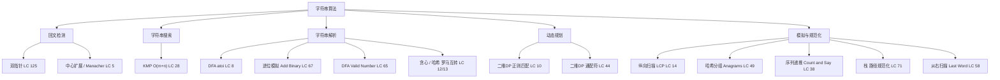

# 路径规范化与边界处理：Simplify Path 与 Length of Last Word

**摘要：**

这是字符串专栏的收尾篇，覆盖两道工程气息浓厚的题：LeetCode 71（Simplify Path）与 58（Length of Last Word）。**前者是 Unix 文件系统路径规范化的精简实现**——用栈处理 `.`（当前目录）、`..`（上级目录）与普通目录名三类分量，Python 的 `os.path.normpath`、Java 的 `Path.normalize()` 背后都是类似逻辑；**后者是字符串末尾扫描的细节题**——从右往左跳过尾部空格、再计数最后一个单词。两道题都能一次写对，关键在于**把各类边界在动笔前想清楚**。本文用 Go 语言实现，并逐层追问：为什么 `..` 用栈处理、路径规范化在安全领域为什么重要（路径遍历攻击）、以及"从右往左扫描"为什么比"从左往右"更适合本题。篇末附有字符串专栏的全局复习。

---

## 第 1 章 LeetCode 71：Simplify Path

### 1.1 题目

**LeetCode 71 - Simplify Path**（中等）

给你一个 Unix 风格的绝对路径（以 `/` 开头），把它转化为更简洁的规范路径。规则：以单斜杠开头；目录名之间只有一个斜杠；不能以 `/` 结尾（根目录 `"/"` 除外）；`.` 表示当前目录；`..` 表示上级目录。

```text
"/home/"          → "/home"
"/../"            → "/"（根目录再 .. 还是根）
"/home//foo/"     → "/home/foo"（多个 / 等同）
"/a/./b/../../c/" → "/c"
```

### 1.2 思路：按 `/` 切分，用栈处理三类分量

**按 `/` 分割路径**，得到一个个分量，对每个分量做处理：

| 分量 | 操作 |
|------|------|
| `""` 或 `"."` | 忽略（空串是多个 `/` 之间产生的，`.` 是当前目录） |
| `".."` | 若栈非空，弹出栈顶（返回上级） |
| 其他（普通目录名） | 压入栈 |

最后把栈中元素用 `/` 连接，开头补 `/`：

```go
func simplifyPath(path string) string {
    parts := strings.Split(path, "/")
    stack := []string{}

    for _, part := range parts {
        switch part {
        case "..":
            if len(stack) > 0 {
                stack = stack[:len(stack)-1] // 返回上级
            }
        case "", ".":
            // 忽略空串与当前目录
        default:
            stack = append(stack, part) // 普通目录
        }
    }
    return "/" + strings.Join(stack, "/")
}
```

**注意 Go 的切片当栈**：`stack = append(stack, x)` 压栈、`stack = stack[:len(stack)-1]` 弹栈、`strings.Join(stack, "/")` 从栈底到栈顶拼接（无需反转）。**这与 Java 里"用 `Deque` 且注意迭代方向"不同——Go 的切片天然是"从底到顶"的顺序。**

**手动验证** `"/a/./b/../../c/"`：

```text
split("/") → ["", "a", ".", "b", "..", "..", "c", ""]
""   → 忽略
"a"  → stack=["a"]
"."  → 忽略
"b"  → stack=["a","b"]
".." → 弹出 "b" → stack=["a"]
".." → 弹出 "a" → stack=[]
"c"  → stack=["c"]
""   → 忽略
结果："c" → "/c" ✓
```

**边界情况**：

```text
"/../"   → ["", "..", ""]，".." 时栈空不操作 → "/"
"/home/" → ["", "home", ""]，"home" 压栈 → "/home"
```

**复杂度**：时间 $O(n)$、空间 $O(n)$。

### 1.3 不用 split 的双指针解法

`strings.Split` 会产生一个额外切片，也可以用双指针手动切割分量：

```go
func simplifyPathManual(path string) string {
    n := len(path)
    stack := []string{}
    i := 0
    for i < n {
        for i < n && path[i] == '/' { // 跳过 '/'
            i++
        }
        if i == n {
            break
        }
        start := i
        for i < n && path[i] != '/' { // 提取分量
            i++
        }
        part := path[start:i]
        if part == ".." {
            if len(stack) > 0 {
                stack = stack[:len(stack)-1]
            }
        } else if part != "." {
            stack = append(stack, part)
        }
    }
    return "/" + strings.Join(stack, "/")
}
```

**两种方法正确性等价**：`split` 更简洁，双指针更省内存。**"用 split 还是手写切分"，取决于是否在意那次额外分配**——与第 06 篇"纵向扫描 vs 横向扫描"是同一种取舍。

---

## 第 2 章 LeetCode 58：Length of Last Word

### 2.1 题目

**LeetCode 58 - Length of Last Word**（简单）

给你一个由单词与空格组成的字符串，返回**最后一个**单词的长度。单词指仅由字母组成、不含空格的最大子串。

```text
"Hello World"                   → 5
"   fly me   to the moon  "     → 4
"luffy is still joyboy"         → 6
```

### 2.2 思路：从右往左扫描

```go
func lengthOfLastWord(s string) int {
    i := len(s) - 1
    // 跳过尾部空格
    for i >= 0 && s[i] == ' ' {
        i--
    }
    // 向左数单词长度
    length := 0
    for i >= 0 && s[i] != ' ' {
        length++
        i--
    }
    return length
}
```

**手动验证** `"   fly me   to the moon  "`：

```text
i=24（末尾）→ 跳过两个空格 → i=22（'n'）
从 i=22 向左数：'n','o','o','m' → length=4，到 i=17（空格）停
返回 4 ✓
```

**复杂度**：时间 $O(n)$、空间 $O(1)$。

### 2.3 为什么"从右往左"更适合本题

**题目要的是"最后一个单词"，所以从右往左扫描，只需"跳过尾部空格 + 数一个单词"就结束了。** 若从左往右，则要"遍历整个串、维护'当前单词长度'与'最后单词长度'"，**多做了一倍的工作**。

**"从目标所在的一端开始扫描"，是一个值得记住的优化直觉**——它与第 01 篇"双指针从两端夹逼"、栈与队列专栏"从右往左找上一个更大元素"是同一种"选对扫描方向"的思路。

### 2.4 常见陷阱

**陷阱一，没有跳过尾部空格就直接数。** 若写成"遇到尾部空格就立刻停"，`"moon  "` 会返回 0。

**陷阱二，用 `split(" ")` 而非按连续空格分割。** `"fly me   to"` 用 `split(" ")` 会产生空字符串元素，最后一个元素可能不是想要的单词。**用双指针扫描或按"连续空格"分割，更健壮。**

> [!warning] 生产避坑：分割符要"连续"处理
> 用单个空格做分隔符时，**连续空格会产生空串元素**。Go 的 `strings.Fields` 会按"任意空白"分割并自动忽略空串——**这正是"按连续分隔符切分"的标准做法。** 凡是"按分隔符切分"的场景，都要想清楚"连续分隔符怎么办"。

---

## 第 3 章 工程映射：栈与路径规范化

### 3.1 文件系统里的路径规范化

**Simplify Path 不只是一道算法题，而是 Unix 文件系统路径处理的核心逻辑：**

- **Python**：`os.path.normpath("/a/./b/../../c/")` → `"/c"`；
- **Java NIO**：`Paths.get("/a/./b/../../c/").normalize()` → `/c`；
- **Web 服务器**：解析 URL 路径时，先规范化再路由。

**它们背后的逻辑，与本篇的"栈 + 三类分量"完全一致。**

### 3.2 路径遍历攻击（Path Traversal）

**这道题的 `..` 处理，在安全领域是"路径遍历漏洞"的核心。** 若服务器不正确地处理用户输入的 `../` 序列，攻击者可以访问不应暴露的文件：

```text
用户请求: GET /static/../../../etc/passwd
若不规范化，可能读到 /etc/passwd
```

**正确的防御是**：在处理文件路径前，**先用"栈算法"把路径规范化**，再检查"规范化后的路径是否在允许的目录范围内"。**这正是 Simplify Path 的工程意义**——它是"路径安全"的第一道防线。

**换句话说，这道"算法题"其实是一个"安全组件"的核心。** 理解了这一点，你做题时就会多一层警觉：**凡是处理用户输入的路径/文件名，都要先规范化、再校验。**

> [!info] 从"算法题"到"安全防线"
> 很多算法题都有"工程/安全"背景，Simplify Path 就是一个典型。**它提醒我们：一个看似简单的字符串处理，在真实系统里可能关系到安全。** 这种"从题到工程/安全"的联想，能让你在面试中展现更深的视野——**"这题在生产里对应什么"往往比"这题怎么写"更能打动面试官。**

---

## 第 4 章 字符串专栏总复习

恭喜你完成了字符串专栏的全部内容。回顾一下 8 篇覆盖的知识体系：



### 4.1 各篇内容索引

| 篇号 | 文章 | 题目 | 核心技巧 |
|------|------|------|---------|
| [[01 回文检测：Valid Palindrome 与双指针范式]] | 双指针范式 | LC 125、680、9 | 对撞双指针 |
| [[02 字符串搜索：Implement strStr 与 KMP 算法深度解析]] | KMP | LC 28、459 | 前后缀复用 |
| [[03 字符串解析：atoi、Add Binary 与进位模拟]] | DFA + 进位模拟 | LC 8、67 | 状态机、进位 |
| [[04 最长回文子串：中心扩展与 Manacher 算法]] | 中心扩展 + Manacher | LC 5 | 枚举中心、镜像 |
| [[05 动态规划字符串匹配：正则表达式与通配符]] | 二维 DP | LC 10、44 | 双前缀 DP |
| [[06 字符串整理：最长公共前缀、异位词与计数说]] | 纵向扫描 + 哈希 | LC 14、49、38 | 标识符函数 |
| [[07 字符串模拟：Valid Number、整数与罗马互转]] | DFA + 贪心 | LC 65、12、13 | 状态表、贪心 |
| [[08 路径规范化与边界处理：Simplify Path 与 Length of Last Word]] | 栈 + 双指针 | LC 71、58 | 栈处理分量 |

### 4.2 高频考点

**必须能手写的算法**：

1. **KMP（LC 28）**：`next` 数组构建 + 匹配逻辑；
2. **中心扩展（LC 5）**：奇偶中心的 `2n-1` 枚举；
3. **字符串 DP（LC 10/44）**：状态定义 `dp[i][j]` + 初始化 + 转移；
4. **路径规范化（LC 71）**：栈 + 三类分量处理。

**必须能解释原理的算法**：

1. **Manacher**：镜像利用 + 右边界维护；
2. **DFA（LC 65）**：状态定义 + 转移表；
3. **质数哈希（LC 49）**：唯一分解定理作为哈希函数。

### 4.3 字符串专栏的三条主线

回看整个专栏，字符串题其实围绕三条主线：

**主线一，"逐字符处理 + 边界周全"。** 字符串题的一大特点就是"算法不难、细节很多"（LC 125、8、58 都是如此）。**处理字符串时，"边界 case 是否周全"往往比"算法是否巧妙"更能决定成败。**

**主线二，"复用已算出的结果"。** KMP 复用前缀信息、Manacher 复用回文信息、DP 复用子问题——**字符串算法里最高级的优化，都是"不要重复计算已经知道的东西"。**

**主线三，"找对枚举对象/规范形式"。** 枚举"中心"而非"子串"（LC 5）、找"标识符函数"（LC 49）、用"状态表"表达规则（LC 65）——**很多字符串题的突破口，是"换一个更合适的表示"。**

> [!note] 专栏后续方向
> 字符串专栏到此结束。建议的下一步方向：
> - **滑动窗口**：LC 76（最小覆盖子串）是字符串 + 滑动窗口的综合题；
> - **Trie（前缀树）**：字符串集合的高效搜索结构，与 LCP 问题密切相关；
> - **树与图**：BFS/DFS、最短路径、拓扑排序（与字符串题共享 DP 思维）。

---

## 第 5 章 延伸：字符串边界处理的通用模式

字符串题的一大特点是"算法不难、细节很多"。本章把散落在各篇的"边界处理"经验归纳成几条通用模式。

### 5.1 模式一：空输入与单元素

**任何字符串题，都要先处理"空串"与"单字符"两个极端**：

- 空串：是回文吗（第 01 篇）？公共前缀是空吗（第 06 篇）？匹配空模式吗（第 05 篇）？
- 单字符：最简非空情形，检验"循环是否执行、返回值是否正确"。

**这两个极端，是"边界三件套"的前两件**（第三件是"单元素/单孩子"，见二叉树专栏）。

### 5.2 模式二：跳字符/分隔符的循环必须带边界保护

**"跳过某类字符"的内层循环，必须带"不超过另一端"的保护**：

```go
for left < right && skip(s[left]) { left++ } // 必须带 left < right
```

**否则当"全是待跳字符"时，指针会越界**（第 01 篇的 `" "`、第 08 篇的路径全 `/`）。**这是"跳字符"类代码的第一条纪律。**

### 5.3 模式三：连续分隔符要"合并处理"

**用单个分隔符切分时，连续分隔符会产生空元素**：

- `split(" ")` 在 `"a  b"` 上产生 `["a", "", "b"]`；
- 正确做法是"按连续分隔符切分"（`strings.Fields`、或手写双指针跳过）。

**第 06 篇（LC 49 频率编码）、第 08 篇（LC 58 单词切分）都踩过这个坑。**

### 5.4 模式四：末尾的"收尾结算"不能漏

**很多字符串/数值处理，在循环结束后还有一步"收尾"**：

- atoi：末尾的数字（第 03 篇）；
- Add Binary：最后的进位（第 03 篇）；
- 基本计算器：末尾的数字（栈与队列专栏第 07 篇）。

**"循环内处理了大部分，循环结束后还有一件事"是这类题的共性**——**漏掉收尾，是字符串/数值题的经典 bug。**

### 5.5 四条模式的统一视角

把四条模式归纳一下：

| 模式 | 核心 | 典型出处 |
|------|------|---------|
| 空/单元素 | 先处理极端 | 全专栏 |
| 跳字符带边界 | 防越界 | 第 01、08 篇 |
| 连续分隔符合并 | 防空元素 | 第 06、08 篇 |
| 末尾收尾 | 防漏结算 | 第 03 篇等 |

**它们的共同点，是"在'结构边界'处格外小心"**——空、单、连续、末尾，都是"结构发生突变"的地方。**而 bug，恰恰最爱藏在这些地方。**

> [!info] 字符串题的"细节清单"
> 字符串题的难度，八成在"边界是否周全"。**把上面四条模式做成一份"自查清单"，每写完一道字符串题就过一遍，能拦下绝大多数 bug。** 这与二叉树专栏"边界三件套"、栈与队列专栏"自测清单"是同一做法——**把经验结构化成清单，比"凭感觉检查"可靠得多。**

---

## 第 6 章 字符串题的面试策略与常见追问

### 6.1 面试中的四步流程

**遇到字符串题，按这个流程走**：

1. **先列边界**：空串、单字符、全是空格、含多字节字符、溢出——**在动笔前列出来**；
2. **再定模式**：这题属于哪条主线（回文/搜索/解析/匹配/整理/模拟）？该用什么技巧？
3. **给出解法**：先给"清晰版"，再给"优化版"；
4. **主动补边界**：说明"空串会怎样、多字节会怎样"。

**第 1、4 步是字符串题的特色**——**因为字符串题的 bug 八成在边界，所以"边界意识"是它的核心考点。**

### 6.2 常见追问与应对

**追问一："能否不用额外空间？"** 答：多数字符串题都能改成原地（双指针跳字符、`[]byte` 原地改写）。**但 Go 的字符串不可变，原地改写需先转 `[]byte`。**

**追问二："输入含多字节字符怎么办？"** 答：先转 `[]rune`，按字符而非字节处理。

**追问三："能否提前返回？"** 答：判定类题（回文、匹配）都能"一旦确定就返回"，这往往比"处理完再判断"更快。

**追问四："这题在生产里对应什么？"** 答：路径规范化对应"路径遍历防御"、DFA 对应"词法分析/JSON 解析"、KMP 对应"文本搜索"、异位词分组对应"数据归一化"。**主动说出这些，能展现工程视野。**

**第 4 个追问尤其值得准备**——**"这题在生产里对应什么"是最能体现"深度"的一类问题**，而本专栏几乎每篇都给出了答案。

### 6.3 一个总体的建议

**字符串题的"难"，不在算法，而在"细节"。** 所以备考策略应是：**算法思路要清晰（知道每类题该用什么），但更要"把边界清单背熟"**——空、单、连续分隔符、末尾收尾、多字节、溢出。**这六条，覆盖了字符串题绝大多数 bug。**

> [!info] 字符串题的"反直觉"
> 很多人以为字符串题"简单"（毕竟只是处理文字），结果在面试里翻车——**因为他们低估了"细节"的分量。** 字符串题真正的考察点是"**你能不能在简单的问题上做到零 bug**"——**这恰恰是工程能力的核心：把简单的事做对，比把复杂的事做出来更难。** 理解了这一点，你就会以"严谨"而非"轻视"的态度对待字符串题。

---

## 第 8 章 字符串算法的设计模式总结

### 8.1 六大设计模式

**回顾整个专栏，字符串题其实只用了六种设计模式**：

| 模式 | 适用信号 | 代表题 |
|------|---------|--------|
| 对撞双指针 | "两端比较""回文""反转" | 125、344、234 |
| 滑动窗口 | "子串满足某约束" | 438、3、76 |
| 哈希 / 频率数组 | "查找""分组""判重" | 1、49、242 |
| 动态规划（双前缀） | "两个串的匹配/编辑" | 10、44、72 |
| 有限状态机 | "逐字符解析、规则复杂" | 8、65 |
| 栈 | "嵌套""路径分量" | 71、20、394 |

**这张表的价值，是"看到信号 → 想到模式"**——**它把"该用什么"从"灵感"变成了"查表"。**

### 8.2 "信号 → 模式"的对照

**具体来说，看到这些信号就该想到对应模式**：

- 看到"回文""两端" → **对撞双指针**；
- 看到"连续子串满足约束" → **滑动窗口**；
- 看到"存在性""频次""分组" → **哈希 / 频率数组**；
- 看到"两个字符串匹配/编辑距离" → **双前缀 DP**；
- 看到"逐字符解析、状态多" → **状态机**；
- 看到"嵌套""上级目录" → **栈**。

**"信号识别"是算法熟练度的直接体现**——**它比"会写代码"更重要，因为它决定了"你有没有想到正确的方向"。**

### 8.3 为什么"模式"比"题目"重要

**题目是无限的，模式是有限的。** 记住 20 道题的解法，遇到第 21 道可能还是懵；**但记住 6 种模式，遇到新题就能"归类 → 套模式"。**

**这与本专栏反复强调的"看穿共性"一脉相承**——**异位词分组与同构字符串是同一模式（哈希归一化）、正则与通配符是同一模式（双前缀 DP）、Valid Number 与 atoi 是同一模式（状态机）。** **识别出"它们同源"，你就把"多道题"压缩成了"一个模式"。**

### 8.4 一个总体的建议

**备考字符串题，建议"按模式而非按题目"组织复习**：

1. 把做过的题按"六大模式"归类；
2. 对每个模式，记住"它的信号、它的模板、它的边界"；
3. 遇到新题，先"归类"，再"套模板"，最后"补边界"。

**"归类 → 套模板 → 补边界"这三步，是应对任何字符串题的通用流程。**

> [!info] 从"刷题"到"建模式"
> 刷题的最终目标，不是"做过的题都会"，而是"**建立起一套可以套用到新题的模式库**"。**当你的脑子里有"六种模式"而非"二十道题"时，你就从"刷题者"变成了"会解题者"。** 这是本专栏最想帮你完成的转变——**从记忆到归纳，从题目到模式。**

---

## 第 10 章 从字符串到工程：一个总结

### 10.1 字符串题与工程实践的对应

**回顾整个专栏，字符串题几乎每一道都能对应一个工程场景**：

| 算法题 | 工程场景 |
|--------|---------|
| LC 71 路径规范化 | 路径遍历防御、URL 规范化 |
| LC 65 Valid Number | 词法分析、配置校验 |
| LC 28 KMP | 文本搜索（grep、编辑器） |
| LC 10 正则匹配 | 正则引擎（RE2、PCRE） |
| LC 49 异位词分组 | 数据归一化、去重 |
| LC 38 Count and Say | 游程编码（RLE） |
| LC 3/76 滑动窗口 | 日志分析、流处理 |
| LC 125 回文 | 输入校验 |

**这张表说明：字符串算法不是"象牙塔"，而是"工程实践的抽象"。** **理解了这层对应，你做题时就会多一层"这在实际里是什么"的视角。**

### 10.2 三条可迁移的能力

**本专栏真正想留给你的，是三条可迁移的能力**：

**能力一，"边界周全"。** 字符串题的 bug 八成在边界——**"先列边界清单、再写代码"这一习惯，可以迁移到任何"处理输入"的工作**（API 设计、数据校验、协议实现）。

**能力二，"复用已算结果"。** KMP、Manacher、DP 的核心都是"不重复计算"——**这是算法优化的第一原则，也适用于任何性能优化**（缓存、预处理、索引）。

**能力三，"选对表示"。** 状态表（DFA）、标识函数（哈希）、双前缀（DP）——**很多问题的突破口，是"换一个更合适的表示"**。**这在工程里对应"数据建模"——选对模型，问题就简化了。**

### 10.3 一个跨领域的观察

**字符串是"序列"的一种**——**数组、链表、字符串，本质都是"有序的元素集合"。** 因此：

- **双指针**：字符串、数组、链表通用；
- **滑动窗口**：字符串、数组通用；
- **DP**：字符串、数组、序列通用；
- **哈希**：一切"按值查找"通用。

**理解了"字符串 = 序列"，你就能把字符串题的技巧，迁移到数组、链表、乃至任何序列结构上。** **这也是为什么本专栏反复与线性表专栏对照——它们共享同一批基础技巧。**

> [!info] 从"字符串"到"序列"
> 字符串不是孤立的数据类型——**它是"序列"的一个实例，与数组、链表共享同一批技巧。** 本专栏的很多"字符串专属"技巧（KMP、Manacher），其实是"序列算法"在字符串上的特化。**理解了这一点，你就把"字符串算法"融入了"序列算法"这一更大的框架**——**而这，正是算法学习"从点到面"的关键一步。**

### 10.4 结语

**字符串专栏到此结束。** 从回文检测到 DP 匹配，从 KMP 到状态机，我们走过了字符串算法的主要领域。**但真正的收获，不是这 8 篇的知识点，而是"面对一个陌生的字符串问题，知道该往哪想"的能力**——**这正是本专栏反复强调的"见型知法"。**

**愿你带着这份"见型知法"，从容应对每一道字符串题。**

---

## 第 11 章 常见误区与自测方法

### 5.1 四个高频误区

**误区一，LC 71 的 `..` 在栈空时仍弹出。** 应先判空。

**误区二，LC 71 把 `.` 也压栈。** `.` 应忽略。

**误区三，LC 58 没跳过尾部空格就数。** 会返回 0。

**误区四，LC 58 用 `split(" ")` 而非"连续空格分割"。** 会产生空串元素。

### 5.2 一套自测用例

| 用例 | 检验什么 |
|------|---------|
| `"/"` | 根目录 |
| `"/../"` | 根目录下的 `..` |
| `"/.../"` | `...` 是普通目录名（不是 `..`） |
| `"a"` | 无空格（单单词） |
| `"   "` | 全空格 |

**其中 `"/.../"` 最值得测**——`...` 是合法的目录名，**只有 `..` 才是上级目录**。它专治"把 `...` 误当 `..`"这类错误。

---

## 第 12 章 一句话带走

**如果只能从本篇带走一句话，那就是：**"字符串题的分水岭，是'边界是否周全'。"

- **Simplify Path**：`..` 在栈空时不弹、`.` 要忽略、`...` 是普通目录；
- **Length of Last Word**：要先跳尾部空格、要处理"连续空格"。

**这些细节，没有一个是"算法难点"，但漏掉任何一个都会错。** **字符串题考的，正是"在简单问题上做到零 bug"这一工程能力。**

**而两道题的工程意义，也值得记住**：Simplify Path 是**"路径遍历防御"**的核心；Length of Last Word 的"从右扫描"是**"选对扫描方向"**的范例。**它们提醒我们：算法题往往对应真实工程/安全场景。**

> [!note] 一个可复用的判断
> 遇到字符串题，**先列边界清单**：空串、单字符、全空格、连续分隔符、末尾收尾、多字节字符。**这六条过一遍，绝大多数 bug 就拦下了。** 这就是字符串题的"自查六问"。

---

## 第 13 章 复杂度速查

| 题目 | 时间 | 空间 | 关键点 |
|------|------|------|--------|
| LC 71 Simplify Path | $O(n)$ | $O(n)$ | 栈处理三类分量 |
| LC 58 Length of Last Word | $O(n)$ | $O(1)$ | 从右扫描 |

**两道题都是 $O(n)$**——**字符串题的复杂度往往"看着简单"，但"边界周全"才是难点。** **记住这一点，你就不会在字符串题上"轻敌"。**

> [!note] 一个总体判断
> 遇到"路径/单词"类题，**先想"用栈还是用扫描"**——路径分量有"嵌套语义"（`..` 回退），用栈；单词只是"分段"，用扫描。**"有没有嵌套语义"，决定了该不该用栈。**

---

## 小结

本篇用两道题收束了字符串专栏。Simplify Path 用栈处理路径分量，是文件系统路径规范化的精简实现——**它在安全领域对应"路径遍历攻击"的防御**；Length of Last Word 则展示了"从右往左扫描"这一选对方向的优化。两道题的共同点，是**"边界处理决定成败"**。

作为专栏收尾，本篇还汇总了字符串题的三条主线：**"逐字符处理 + 边界周全"、"复用已算出的结果"、"找对枚举对象/规范形式"**。**这三条，是字符串专栏留给你的最持久的东西**——它们不针对任何具体题，而是面对陌生字符串问题时的通用视角。

**再补充一段落点。** 作为专栏收尾，本篇两道题的分量不只在"算法"，更在"工程意义"——Simplify Path 是"路径遍历防御"的核心，Length of Last Word 是"选对扫描方向"的范例。**它们提醒我们：很多算法题都对应真实工程/安全场景，做题时多问一句"这在生产里是什么"，往往能加深理解。** 而字符串专栏的三条主线（边界周全、复用结果、选对表示），也在这两道题里各有体现——**它们不是孤立的技巧，而是贯穿始终的思维。**

**再看一个更深的落点。** 字符串专栏的三条主线——"边界周全""复用结果""选对表示"——其实是"算法素养"的三个侧面：**边界周全对应"工程严谨"，复用结果对应"性能意识"，选对表示对应"抽象能力"。** 而这三者，恰恰是"会写代码"与"会解决问题"之间的差距。**把这三条内化，你收获的就不只是字符串题，而是一套可迁移的解题素养。**

**最后再强调一点"练习方法"。** Simplify Path 要练到"一次写对"——**尤其是 `..` 在栈空时不弹、`.` 要忽略、`...` 是普通目录这三处。** 而 Length of Last Word 要练到"从右扫描一次到位"——**先跳尾部空格、再数单词。** 这两道题都是"一次写对"的好素材。

**最后，留一道值得回味的思考题。** 若把 Simplify Path 改成"支持相对路径"（不以 `/` 开头），规则要怎么变？**答案是"栈空时的 `..` 要保留"**——因为相对路径可以"先上再下"，不像绝对路径"上到根就停"。**这个思考题说明："绝对/相对"这一约束，直接改变了 `..` 的处理规则。** 读题时先确认"绝对还是相对"，能避免踩坑。

---

## 参考资料

1. LeetCode 71. Simplify Path. https://leetcode.cn/problems/simplify-path/
2. LeetCode 58. Length of Last Word. https://leetcode.cn/problems/length-of-last-word/
3. OWASP. *Path Traversal*. https://owasp.org/www-community/attacks/Path_Traversal
4. Sedgewick, R., & Wayne, K. *Algorithms* (4th ed.). Addison-Wesley, 2011. 第 5.3 节"子串搜索"。

---

> [!note] 思考题
> 1. 为什么 `..` 要用栈处理？若改用"计数"（记录当前深度），能处理 `"a/../../b"` 吗？
> 2. 路径遍历攻击（Path Traversal）是如何利用 `..` 的？规范化为什么能防御它？
> 3. Length of Last Word 为什么"从右往左"比"从左往右"更优？请比较两者访问的字符数。
> 4. `"/.../"` 与 `"/../"` 的处理结果有何不同？为什么？
> 5. 请用"字符串专栏的三条主线"重新分析第 05 篇（正则/通配符 DP），说明它落在哪条主线上。
