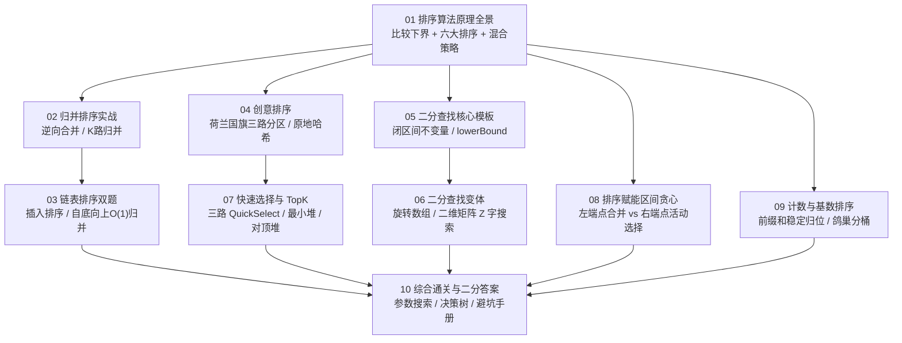

# 排序与查找专栏导览：从原理到 LeetCode 面试通关

**摘要：**

排序（Sorting）与查找（Searching）是算法世界的基石：前者付出预处理代价为无序数据**创造单调性**，后者利用有序契约在搜索空间上**消费单调性**。本专栏面向备战技术面试与追求工程深度的研发人员，拒绝孤立地死记硬背模板，而是沿着"信息论下界 $\to$ 分治与分区原子操作 $\to$ 二分不变量与答案空间二分 $\to$ 排序赋能贪心与非比较线性排序"的推导主线，将 25 余道高频 LeetCode 题目串联成一张严密的认知网络。全专栏示例代码统一采用 **Golang** 实现。

---

## 专栏定位与设计主线

在算法面试中，排序与查找很少以"请默写一个快速排序"这样直白的方式考察，而是演化为三条更具区分度的考察脉络：
1. **拆解排序算法的内部核心算子**：譬如将归并排序的 `merge` 拆出来考多路有序链表合并与外部排序（第 02、03 篇），将快速排序的 `partition` 拆出来考荷兰国旗三路划分与期望 $O(n)$ 的快速选择 TopK（第 04、07 篇）；
2. **利用排序作为其他算法的放大器**：先通过排序消除二维区间或多变量问题的一个自由度，使原本无法下手的局部贪心或扫描线算法获得全局最优性（第 08 篇），或利用值域先验特征打破 $\Omega(n \log n)$ 比较下界（第 04、09 篇）；
3. **广义单调性上的二分折半**：从显式有序数组的上下界定位（第 05 篇），推广到部分有序的旋转数组与二维矩阵（第 06 篇），直至无序问题在"答案值域空间"上的二分搜索（第 10 篇）。

---

## 专栏目录

| 序号 | 文章标题 | 核心话题 | 覆盖代表题目（LeetCode） |
|------|----------|----------|--------------------------|
| 01 | [[01 排序算法原理全景：从 O(n²) 到 O(nlogn) 的演进之路]] | 比较树 $\Omega(n\log n)$ 下界证明、六大排序时空与稳定性、缓存亲和性与混合排序（pdqsort/TimSort） | 概念原理与综合实现篇 |
| 02 | [[02 归并排序实战三连：有序数组与有序链表的合并艺术]] | 逆向双指针防覆盖、链表哑节点合并、多路归并（最小堆 vs 分治两两合并）、逆序对计数 | 88、21、23、LCR 170 |
| 03 | [[03 链表排序双题精讲：插入排序与归并排序的链表实现]] | 链表断链与重连纪律、快慢指针截断中点、自底向上倍增步长 $O(1)$ 空间归并 | 147、148 |
| 04 | [[04 创意排序：荷兰国旗问题与桶排序思想]] | 三路快排分区不变量、原地哈希（下标即桶）、摆动排序与重复数查找 | 75、41、442、448、324 |
| 05 | [[05 二分查找核心模板：从基础到左右边界锁定]] | 闭区间与半开区间不变量、`lowerBound` 统一求上下界、防溢出与死循环诊断 | 704、35、34、69、278 |
| 06 | [[06 二分查找的变体：旋转有序数组与有序矩阵]] | 旋转数组"必有一半有序"定理、重复元素退化分析、二维矩阵一维展平与右上角 Z 字搜索 | 33、81、153、162、74、240 |
| 07 | [[07 快速选择与 TopK 问题：期望 O(n) 的奇妙算法]] | 最小堆守门员模型、三路随机化 QuickSelect 几何级数证明、BFPRT、频次桶与对顶堆 | 215、347、692、973、703、295 |
| 08 | [[08 排序在非排序题中的妙用：区间合并与贪心]] | 左端点排序（合并/并发峰值扫描线）vs 右端点排序（最大不相交/最少穿刺）、交换论证 | 56、57、252、253、435、452、986、1288 |
| 09 | [[09 计数排序与基数排序：线性时间排序的边界与代价]] | 前缀和稳定计数排序、LSD/MSD 基数排序、鸽巢原理空桶定理、值域截断 | 164、274、1122 |
| 10 | [[10 排序与查找综合通关：面试高频模式总结]] | 答案值域二分（最小化最大值）、模式识别矩阵、选型决策树、四大死循环诊断手册 | 875、410、287 及全专栏复盘 |

---

## 阅读路径图

---

## 关联专栏

- **线性表专栏**（[[01 线性表全景：数组与链表的本质与工程权衡]]）：数组连续内存的随机访问与缓存亲和性，是快速排序与二分查找得以成立的物理前提；链表指针重连则是第 02、03 篇的直接基础。
- **双指针专栏**（[[01 双指针算法全景：核心直觉、三大模型与面试考频分析]]）：对撞指针、同向快慢指针与本专栏的归并合并、荷兰国旗三指针、二维矩阵 Z 字搜索共享"利用单调性削减搜索空间"的内核。
- **分治与贪心专栏**（[[01 分治法基础：递归树与主定理——分治的思维骨架]]）：本专栏的归并排序、快速选择与第 08 篇的区间调度，是分治与贪心在序列与区间上的典型投影。
