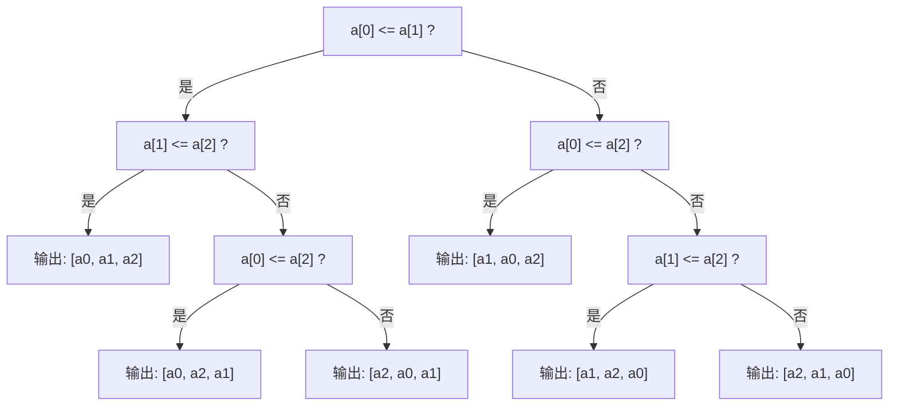

# 排序算法原理全景：从 O(n²) 到 O(nlogn) 的演进之路

**摘要：**

排序是计算机科学中研究最透彻、工程应用最广泛的算法领域。从关系型数据库的 `ORDER BY` 算子、搜索引擎倒排索引的归并，到分布式计算框架 MapReduce 与 Spark 的 Shuffle 阶段，排序无处不在。然而在算法面试中，许多候选人能背出六七种排序的平均时间复杂度，却答不出三个更本质的问题：**为什么基于比较的排序算法永远无法在最坏情况下突破 $O(n \log n)$？为什么同为 $O(n \log n)$，快速排序在内存中比堆排序快得多，而插入排序在小数组上又能反超快速排序？现代工业级标准库（如 Go 的 `pdqsort` 与 Java/Python 的 `TimSort`）又是如何将这些算法熔为一炉的？** 本文从逆序对（Inversion）与决策树的信息论下界出发，完整梳理从 $O(n^2)$ 到 $O(n \log n)$ 的演进脉络，给出六大基础排序的 Golang 标准实现与工程级选型框架。

---

## 第 1 章 排序的数学本质：消除逆序对与信息论下界

### 1.1 什么是排序：排列、逆序对与稳定性契约

从形式化定义看，给定一个包含 $n$ 个元素的序列 $A = [a_0, a_1, \ldots, a_{n-1}]$，排序就是寻找一个下标排列（Permutation）$\pi$，使得重排后的序列满足单调非递减关系：

$$a_{\pi(0)} \le a_{\pi(1)} \le \cdots \le a_{\pi(n-1)}$$

但这个静态结果定义并没有告诉我们"排序过程到底在干什么"。要看清排序的动态本质，必须引入组合数学中**逆序对（Inversion）**的概念：如果下标满足 $i < j$ 而数值满足 $a_i > a_j$，则称数对 $(i, j)$ 构成一个逆序对。
- 一个已经完全升序排列的数组，其逆序对数量为 $0$；
- 一个完全严格降序排列的数组，任意两个元素都构成逆序对，逆序对总数达到最大值 $\binom{n}{2} = \frac{n(n-1)}{2}$；
- 一组随机打乱的数组，任意两个元素构成逆序对的概率为 $1/2$，因此**随机数组的期望逆序对数量为 $\frac{n(n-1)}{4} = \Theta(n^2)$**。

从这个视角看，**任何排序算法的物理过程，本质上都是一场"将逆序对数量从初始值消减到 0"的战役**。这立刻揭示了为什么所有只靠"交换相邻元素"工作的排序算法（如冒泡排序、插入排序），其平均与最坏时间复杂度都逃不出 $\Theta(n^2)$ 的宿命——因为**每交换一次相邻的两个元素 $(a_j, a_{j+1})$，最多只能消灭 $1$ 个逆序对**。面对随机数组里 $\Theta(n^2)$ 个逆序对，每次只消灭 1 个，哪怕不计比较开销，单单交换次数就必然是 $\Theta(n^2)$。要想突破 $O(n^2)$ 的铁幕，算法就必须具备**跨距离远投交换**的能力，使一次交换或一次移动能够同时消灭一大批逆序对——这正是希尔排序、归并排序、快速排序与堆排序诞生的根本动机。

与此同时，当序列中存在相等元素 $a_i = a_j$（且原始下标 $i < j$）时，排序还面临一份重要的附加契约——**稳定性（Stability）**：如果排序后 $a_i$ 依然保证排在 $a_j$ 前面，则称该排序算法是稳定的。初学者常以为稳定性无关紧要，因为两个数字 `5` 谁在前谁在后看不出区别；但在真实的工程系统里，我们排的往往是携带十几个字段的业务对象（如订单结构体）。当用户在表格界面上先按"下单时间升序"排好，再点击按"订单状态"排序时，**只有稳定的排序算法才能保证同一状态下的订单依然保持着之前的下单时间顺序**。

### 1.2 比较排序的理论下界：为什么 $\Omega(n \log n)$ 是不可逾越的墙

既然远距离交换能突破 $O(n^2)$，我们能不能进一步发明一种每次只靠比较两个元素大小、但在最坏情况下只需 $O(n)$ 次比较的通用排序算法？

答案是**绝对不能**。这一结论可以用**决策树模型（Decision Tree Model）**给出严密的数学证明：
1. $n$ 个互异元素共有 $n!$ 种可能的初始排列，每一种排列都需要唯一的一种重排动作才能归位；
2. 在比较模型下，算法获取输入序列次序信息的唯一手段是执行形如 `a[i] <= a[j]` 的二元比较。每一次比较就像在二叉树的一个内部节点上做了一次左转或右转的二选一分支；
3. 当算法终止并输出有序序列时，它走到了决策树的某个叶子节点。为了让全部 $n!$ 种不同输入都能走出各自正确的重排路径，这棵二叉决策树**至少必须拥有 $n!$ 个叶子节点**；
4. 一棵高度为 $h$（即最坏比较次数为 $h$）的二叉树，最多只能拥有 $2^h$ 个叶子节点。由此得出不等式：

$$2^h \ge n! \implies h \ge \log_2(n!)$$

利用微积分对对数阶乘做下界放缩（仅取后一半因子 $\ge n/2$），或者直接调用斯特林公式（Stirling's Approximation）$n! \approx \sqrt{2\pi n}\left(\frac{n}{e}\right)^n$：

$$h \ge \log_2(n!) > \frac{n}{2} \log_2\left(\frac{n}{2}\right) = \Omega(n \log n)$$



如上图所示，仅对 $n = 3$ 个元素排序，共有 $3! = 6$ 种可能结果，二叉决策树高度至少为 $\lceil \log_2 6 \rceil = 3$（最坏需要比较 3 次）。这一定理宣告：**归并排序与堆排序的 $O(n \log n)$ 最坏时间复杂度，在比较模型下已经抵达了宇宙的终极上限**；任何想要突破 $O(n \log n)$ 的企图，都必须放弃"仅靠两两比较"的限制，转而利用元素的值域与位权特征（详见本专栏第 09 篇）。

---

## 第 2 章 $O(n^2)$ 排序家族：为什么插入排序能在工业库中幸存

虽然冒泡排序（Bubble Sort）、选择排序（Selection Sort）与插入排序（Insertion Sort）在渐进复杂度上同属 $O(n^2)$ 梯队，但它们在工程世界里的命运却天差地别：前两者几乎只活在教科书里，而插入排序却作为所有工业级标准库排序（Go `pdqsort`、Java/Python `TimSort`、C++ `std::sort`）的底层收尾算子，每天在全世界运行数万亿次。为什么会有如此悬殊的待遇？我们来逐一对比它们的内部机制。

### 2.1 冒泡排序与选择排序的致命短板

冒泡排序通过一轮又一轮地扫描未排序前缀，只要相邻元素满足 `nums[j] > nums[j+1]` 就立刻交换，把当前轮次的最大值像水底气泡一样推到右侧末尾。即使加上布尔标志 `swapped` 在提前有序时退出，它在乱序输入下的每一次逆序消除都伴随着**三次内存赋值（一次完整交换）**，写内存次数极高。

选择排序则走了另一个极端：第 $i$ 轮扫描 `[i, n-1]` 找出最小值的下标 `minIdx`，然后只做一次交换 `swap(nums[i], nums[minIdx])`。它的优点是**总交换次数严格封顶在 $n - 1$ 次**；但它有两个致命伤：
1. **对输入的有序度完全失明（Non-adaptive）**：哪怕丢给它一个已经 $100\%$ 排好序的数组，为了确认 `nums[i]` 是剩余部分的最小值，它依然要老老实实把后面所有元素扫一遍，比较次数恒定为 $\frac{n(n-1)}{2}$；
2. **跨距交换破坏稳定性**：考虑数组 `[3a, 3b, 1]`（用下标区分两个相等的 `3`）。第一轮选择排序找到全局最小值 `1`，直接将它与首位的 `3a` 跨距交换，数组变成 `[1, 3b, 3a]`——原本排在前面的 `3a` 瞬间被甩到了 `3b` 后面，稳定性荡然无存。

```go
package main

// bubbleSort 冒泡排序（含提前终止标志）
func bubbleSort(nums []int) {
	n := len(nums)
	for i := 0; i < n-1; i++ {
		swapped := false
		for j := 0; j < n-1-i; j++ {
			if nums[j] > nums[j+1] {
				nums[j], nums[j+1] = nums[j+1], nums[j]
				swapped = true
			}
		}
		if !swapped {
			break // 本轮无任何逆序相邻对，说明全局已有序
		}
	}
}

// selectionSort 选择排序（交换次数 O(n)，但不稳定且无自适应性）
func selectionSort(nums []int) {
	n := len(nums)
	for i := 0; i < n-1; i++ {
		minIdx := i
		for j := i + 1; j < n; j++ {
			if nums[j] < nums[minIdx] {
				minIdx = j
			}
		}
		nums[i], nums[minIdx] = nums[minIdx], nums[i]
	}
}
```

### 2.2 插入排序：自适应性、低常数与缓存局部性的三冠王

插入排序维护一条清晰的循环不变量：**在第 $i$ 轮开始时，左半前缀 `nums[0..i-1]` 已经处于有序状态**。本轮只需抽出 `key = nums[i]`，在左侧有序区里从右往左寻找第一个小于等于 `key` 的位置插入：

```go
package main

// insertionSort 插入排序：工业级混合排序的小数组收尾基石
func insertionSort(nums []int) {
	for i := 1; i < len(nums); i++ {
		key := nums[i]
		j := i - 1
		// 注意：严格大于 key 才后移，相等时停止，从而保证稳定性
		for j >= 0 && nums[j] > key {
			nums[j+1] = nums[j] // 单次平移赋值，比完整 swap 省去两次写操作
			j--
		}
		nums[j+1] = key
	}
}
```

仔细审视这段不到 15 行的代码，它集齐了三项极其强悍的工程品质：
1. **精确正比于逆序对数量的自适应性（Adaptivity）**：内层 `for` 循环每执行一次后移 `nums[j+1] = nums[j]`，恰好消灭 $1$ 个逆序对。设原数组的逆序对总数为 $I$，则插入排序的总比较次数与移动次数严格为 $O(n + I)$。当数组已经基本有序（$I = O(n)$）时，插入排序会自动退化为 **$O(n)$ 的线性时间算法**；
2. **单次平移代替三次交换**：内层循环只做单向覆盖 `nums[j+1] = nums[j]`，直到最后才把 `key` 落座，写内存开销只有冒泡排序的三分之一；
3. **极致的指令精简与 Cache Line 亲和**：没有递归调用栈帧，没有辅助数组分配，访问下标 `j` 与 `j+1` 紧挨在同一条 64 字节的 CPU Cache Line 内。当数组长度 $n \le 24$（或 32）时，$\log_2 n$ 与 $n$ 仅差几倍，插入排序凭借极小的常数因子，实测速度全面压倒快速排序与归并排序。

### 2.3 希尔排序：打破 $O(n^2)$ 铁幕的第一次跨距尝试

既然插入排序唯一的软肋是"每次平移只跨 1 步、只消 1 个逆序对"，1959 年 Donald Shell 提出了一个天才的改进——**希尔排序（Shell Sort，又称缩小增量排序）**。

它的核心思想是：先不要急着做步长为 $1$ 的精细插入排序，而是先选定一个较大的步长序列 $gap_k > gap_{k-1} > \cdots > gap_1 = 1$（譬如 Knuth 序列 $gap = 1, 4, 13, 40, \ldots, \frac{3^k - 1}{2}$）。在步长为 $gap$ 的那一轮，我们将下标模 $gap$ 同余的元素看作一组独立的子序列，对每个子序列执行跨步长为 $gap$ 的插入排序。

- 在早期 $gap$ 很大时，一个位于数组末尾的极小元素，只需跳寥寥几步就能直接飞越半个数组来到前端，**每一次跨距交换都能一口气消灭多达 $2 \cdot gap - 1$ 个逆序对**；
- Moreover，数学上可以证明：一个已经满足 "$g$-有序"（即任意 `nums[i] <= nums[i+g]`）的数组，再经过一轮 "$h$-排序"后，它**依然保持 "$g$-有序"**，前期跨步排序的成果绝不会被后续更小步长的排序破坏；
- 等到最后一轮 $gap = 1$ 时，整个数组已经处于高度近似有序（逆序对数量极少）的状态，此时的普通插入排序只需做极少量的局部微调即可在接近 $O(n)$ 时间内收官。

```go
package main

// shellSort 使用 Knuth 增量序列 (3^k - 1)/2 的希尔排序，时间复杂度 O(n^(3/2))
func shellSort(nums []int) {
	n := len(nums)
	gap := 1
	for gap < n/3 {
		gap = 3*gap + 1 // 1, 4, 13, 40, 121, ...
	}

	for gap >= 1 {
		// 对步长为 gap 的各交错子序列执行跨步插入排序
		for i := gap; i < n; i++ {
			key := nums[i]
			j := i - gap
			for j >= 0 && nums[j] > key {
				nums[j+gap] = nums[j]
				j -= gap
			}
			nums[j+gap] = key
		}
		gap /= 3
	}
}
```

希尔排序在人类算法史上第一次用纯原地、零递归的方式打破了比较排序必须在 $O(n^2)$ 徘徊的迷信（使用 Knuth 序列最坏时间可达 $O(n^{3/2})$，Sedgewick 序列更可达 $O(n^{4/3})$），在栈空间极度受限的嵌入式固件中至今仍有一席之地。

---

## 第 3 章 $O(n \log n)$ 三巨头：归并、快排与堆排的三角博弈

为了跨越“每次相邻移动只消 1 个逆序对”的屏障，归并排序、快速排序与堆排序分别从**分治合并**、**分治划分**与**树形选择**三个方向将时间复杂度压到了 $\Theta(n \log n)$。

### 3.1 归并排序：先易后难的分治与绝对稳定

归并排序（Merge Sort）由冯·诺依曼于 1945 年发明，它走的是**"切分极简、合并出力"**的路线：切分阶段连元素大小都不看，直接一刀切在正中间 `mid = left + (right - left) / 2`；等左右两半分别递归排好序后，再用双指针把两个有序子数组合二为一。

为什么归并排序能打破 $O(n^2)$？在 `merge` 过程中，当左半游标 `temp[i]` 大于右半游标 `temp[j]` 时，由于左半部分 `temp[i..mid]` 是升序排列的，`temp[j]` 不仅小于 `temp[i]`，而且**同时小于 `temp[i..mid]` 里的全部 `mid - i + 1` 个元素**。把 `temp[j]` 填入结果数组的这一步操作，一次性就跨越式地消灭了 `mid - i + 1` 个逆序对（这也是本专栏第 02 篇用归并排序在 $O(n \log n)$ 时间内统计逆序对总数的数学依据）。

```go
package main

// mergeSort 顶层入口：预分配单一辅助切片，避免递归途中频繁申请内存
func mergeSort(nums []int) {
	if len(nums) <= 1 {
		return
	}
	temp := make([]int, len(nums))
	var sortRange func(left, right int)
	sortRange = func(left, right int) {
		if left >= right {
			return
		}
		mid := left + (right-left)/2
		sortRange(left, mid)
		sortRange(mid+1, right)
		// 优化：若左半最大值已 <= 右半最小值，说明本段已自然有序，跳过 merge
		if nums[mid] <= nums[mid+1] {
			return
		}
		mergeRange(nums, left, mid, right, temp)
	}
	sortRange(0, len(nums)-1)
}

func mergeRange(nums []int, left, mid, right int, temp []int) {
	copy(temp[left:right+1], nums[left:right+1])
	i, j, k := left, mid+1, left
	for i <= mid && j <= right {
		// 关键：<= 保证了左右相等时优先取左半元素，维护稳定性
		if temp[i] <= temp[j] {
			nums[k] = temp[i]
			i++
		} else {
			nums[k] = temp[j]
			j++
		}
		k++
	}
	for i <= mid {
		nums[k] = temp[i]
		i++
		k++
	}
	// 注：若右半 j 有剩余，它们原本就在 nums 的对应末尾位置上，无需再拷
}
```

请注意上面工程级实现的三个关键细节：
1. **全局复用单一 `temp` 数组**：绝不在每次 `merge` 时调用 `make([]int, ...)`，否则 $O(n \log n)$ 的时间会被 GC 内存分配开销拖垮；
2. **`nums[mid] <= nums[mid+1]` 提前短路**：如果左半尾元素已经小于等于右半首元素，拼接后天然有序，直接省去整层拷贝；
3. **右半剩余免拷贝**：因为我们是先把 `nums` 拷入 `temp` 再写回 `nums`，如果左半 `i` 先耗尽，右半剩余的 `temp[j..right]` 原本就一字不差地躺在 `nums[k..right]` 里，无需再写。

### 3.2 快速排序：先难后易的原地分区与退化防御

与归并排序恰好相反，快速排序（QuickSort）走的是**"划分出力、合并免做"**的路线：它在递归前先花 $O(n)$ 时间做一次原地分区（Partition），把小于基准值 `pivot` 的全扔到左边、大于 `pivot` 的全扔到右边；一旦左右两边各自递归排好，整个数组天然就已经全局有序，无需任何合并动作。

为什么同为 $O(n \log n)$，快速排序在内存中通常比归并排序快 2 到 3 倍？
- **零辅助数组来回搬运**：归并排序每一层都要把数据从 `nums` 拷到 `temp` 再写回 `nums`，读写内存带宽翻倍；快排全程在原数组上用双指针就地交换；
- **极佳的顺序访存局部性**：快排分区游标沿着连续内存线性推进，硬件预取器（Hardware Prefetcher）命中率接近 $100\%$。

但朴素快排有两个著名的阿喀琉斯之踵：**其一，在已有序/逆序数组上若固定选首尾作 `pivot`，分区极度偏斜（一边 0 个、一边 $n-1$ 个），退化为 $O(n^2)$；其二，在全相等或大量重复元素数组上，二路分区同样会把相等元素全挤向一侧，退化为 $O(n^2)$**。

因此，现代面试与生产中唯一合格的手写快排，是**随机化选基准 + 荷兰国旗三路分区（3-Way QuickSort）**：

```go
package main

import "math/rand"

// quickSort3Way 随机化三路快速排序：同时免疫有序/逆序退化与重复元素退化
func quickSort3Way(nums []int, left, right int) {
	if left >= right {
		return
	}

	// 随机选取 pivot，粉碎有序/逆序恶意分布
	pivotIdx := left + rand.Intn(right-left+1)
	pivot := nums[pivotIdx]

	// 三路分区不变量：
	// [left, lt-1]   < pivot
	// [lt, i-1]     == pivot
	// [i, gt]        待扫描
	// [gt+1, right]  > pivot
	lt, i, gt := left, left, right
	for i <= gt {
		if nums[i] < pivot {
			nums[lt], nums[i] = nums[i], nums[lt]
			lt++
			i++
		} else if nums[i] > pivot {
			nums[i], nums[gt] = nums[gt], nums[i]
			gt--
		} else {
			i++
		}
	}

	// 等于 pivot 的中间段 [lt, gt] 已永久归位，只需递归严格小于和严格大于的两侧
	quickSort3Way(nums, left, lt-1)
	quickSort3Way(nums, gt+1, right)
}
```

### 3.3 堆排序：$O(1)$ 空间与最坏 $O(n \log n)$ 的保底卫士

如果既不允许归并排序那样的 $O(n)$ 额外数组，又绝对不允许快速排序那样哪怕百万分之一概率的 $O(n^2)$ 最坏退化，唯一能同时满足**最坏时间 $O(n \log n)$** 与**额外空间严格 $O(1)$** 的比较排序，就是**堆排序（Heap Sort）**。

堆排序把原数组直接看作一棵完全二叉树（下标 `i` 的左孩子为 `2*i+1`，右孩子为 `2*i+2`），分为两个阶段：
1. **Floyd 自底向上原地建大顶堆（耗时严格 $O(n)$）**：从最后一个非叶子节点 `n/2 - 1` 开始，倒序往根节点 `0` 依次执行 `siftDown`（下沉）。为什么是 $O(n)$ 而不是 $O(n \log n)$？因为树中最底层占总数一半的叶子节点高度为 0（下沉 0 步），倒数第二层占总数 $1/4$ 的节点最多下沉 1 步，倒数第三层占 $1/8$ 的节点最多下沉 2 步……总步数上界为：
   $$\sum_{h=1}^{\lfloor \log_2 n \rfloor} \left\lceil \frac{n}{2^{h+1}} \right\rceil \cdot h < n \sum_{h=1}^{\infty} \frac{h}{2^{h+1}} = n \cdot 1 = O(n)$$
2. **逐个交换堆顶与末尾并下沉恢复（耗时 $O(n \log n)$）**：每次大顶堆的堆顶 `nums[0]` 必为当前未排序前缀 `[0..end]` 的最大值，将 `nums[0]` 与 `nums[end]` 交换（最大值归位到右侧），再将缩减后的前缀 `[0..end-1]` 的新堆顶下沉恢复堆序。

```go
package main

// heapSort 原地堆排序：时间恒为 O(n log n)，额外空间严格 O(1)
func heapSort(nums []int) {
	n := len(nums)
	// 第一阶段：Floyd 自底向上 O(n) 建大顶堆
	for i := n/2 - 1; i >= 0; i-- {
		siftDown(nums, i, n)
	}
	// 第二阶段：依次将堆顶最大值交换到尾部 i 处，并对剩余 [0, i) 恢复堆序
	for i := n - 1; i > 0; i-- {
		nums[0], nums[i] = nums[i], nums[0]
		siftDown(nums, 0, i)
	}
}

func siftDown(nums []int, i, size int) {
	for {
		largest := i
		left, right := 2*i+1, 2*i+2
		if left < size && nums[left] > nums[largest] {
			largest = left
		}
		if right < size && nums[right] > nums[largest] {
			largest = right
		}
		if largest == i {
			break
		}
		nums[i], nums[largest] = nums[largest], nums[i]
		i = largest
	}
}
```

既然堆排序在最坏时间和空间复杂度上双双满分，为什么它没能取代快速排序成为默认首选？症结在于两处硬件级劣势：
- **CPU 缓存极不友好**：当数组规模达到百万级时，`siftDown` 每走一步都要从下标 `i` 跳到 `2*i+1`，跨度随层数指数级倍增，几乎每一次比较都跨越不同的 Cache Line 甚至内存页（TLB Miss）；
- **存在大量"先抬升再压下"的冗余比较**：在第二阶段，我们每次把堆底末尾那个本来就很小的元素 `nums[i]` 强行换到堆顶 `nums[0]`，然后又花 $\log n$ 次比较把它一路下沉回底层，做了大量可预见的比较功。

---

## 第 4 章 工业级标准库的智慧：混合排序（Hybrid Sort）

读到这里，你会发现插入排序、归并排序、快速排序与堆排序就像四位偏科的工匠：没有一个人是全能冠军，但每个人的长板都恰好能补上另一个人的短板。现代编程语言的标准库排序，无一例外都是将它们组合编排的**混合排序算法（Hybrid Sorting Algorithm）**：

| 维度 | 插入排序 | 归并排序 | 快速排序 | 堆排序 |
|------|----------|----------|----------|--------|
| 最好 / 平均 / 最坏时间 | $O(n)$ / $O(n^2)$ / $O(n^2)$ | 恒为 $O(n \log n)$ | $O(n \log n)$ / $O(n \log n)$ / $O(n^2)$ | 恒为 $O(n \log n)$ |
| 额外空间复杂度 | $O(1)$ | $O(n)$（数组）/ $O(1)$（链表） | $O(\log n)$ | $O(1)$ |
| 稳定性 | 稳定 | 稳定 | 不稳定 | 不稳定 |
| CPU 缓存亲和性 | 极高 | 中等 | 高 | 低 |
| 在混合排序中的分工 | 小子区间（$n \le 24$）或近乎有序时的收尾加速 | 需要严格稳定排序（如 `TimSort`）时的主干 | 不需稳定排序（如 `pdqsort`）时的主干 | 快排递归过深或分区恶化时的保底熔断器 |

1. **Go 标准库的 `pdqsort`（Pattern-Defeating Quicksort）**：Go 1.19+ 的 `sort.Slice` 与 `slices.Sort` 采用 Orson Peters 设计的 `pdqsort`。它以快速排序为骨架，结合了三大武器：当子区间长度 $\le 24$ 时直接切入插入排序；当检测到大量相等元素时切入三路分区；当发现坏分区次数超过 $\lfloor \log_2 n \rfloor$ 阈值时，立刻切换为**堆排序**兜底，从而在保持快排极致速度的同时，严格担保最坏时间复杂度为 $O(n \log n)$、额外空间 $O(\log n)$。
2. **Python 与 Java 对象数组的 `TimSort`**：当排序需要**稳定性**契约时（如 `slices.SortStableFunc` 或 `Arrays.sort(Object[])`），标准库采用 `TimSort`。它先顺着数组扫描识别出天然有序的连续子段（称为 `Run`，若长度不足 32 则用二分插入排序补齐到 32），再用栈维护这些 `Run` 并按类似斐波那契平衡条件执行归并，在真实业务常见的"局部已排好序"数据上能跑出接近 $O(n)$ 的惊人速度。
3. **海量磁盘数据的外部归并排序（External Merge Sort）与败者树**：当待排序的数据规模达到 100GB、而可用内存只有 4GB 时，依赖随机访存的快速排序与堆排序因频繁触发磁盘随机 I/O（寻道时间毫秒级）而彻底瘫痪。此时的工业标准是**外部多路归并**：先每次读入 4GB 数据在内存中排好序写回磁盘，生成 25 个有序归并段（Run File）；再为每个文件分配一个小的输入流缓冲区，利用一棵容量为 25 的**最小堆**或**败者树（Loser Tree）**在内存中做 25 路流式归并。败者树相比最小堆的精妙之处在于，每次替换冠军节点后向上调整时，只需与父节点保存的"本场败者"比一次（共 $\log_2 k$ 次比较），而不必像二叉堆那样在左右孩子之间再比一次（共 $2 \log_2 k$ 次比较），在比较开销昂贵的字符串或复合键外排中能直接砍掉一半的 CPU 比较耗时。

---

## 第 5 章 常见误区与边界自检

1. **误判选择排序与快速排序的稳定性**：记住判断稳定性的金标准——**是否存在跨过中间元素的长距离交换**。冒泡排序与插入排序只做相邻元素的交换或平移，相等元素绝不会互相跨越，故稳定；选择排序、快速排序、堆排序都包含跨距交换，故均不稳定；归并排序虽有跨段合并，但通过 `temp[i] <= temp[j]` 保证了左半优先，故稳定。
2. **手写归并排序漏写等号丧失稳定性**：在 `mergeRange` 中，如果把 `if temp[i] <= temp[j]` 误写成了严格小于 `if temp[i] < temp[j]`，那么当左右两半出现相等元素时，右半的元素就会抢先排到左半元素前面，原本稳定的归并排序瞬间变成不稳定排序。
3. **快排单边递归栈溢出风险**：即便保证了平均 $O(n \log n)$，若在极端情况下递归栈过深，也可采用"每次只对较短的一侧递归，对较长的一侧改用循环迭代（尾递归消除）"的技巧，将快排的最坏栈空间严格锁死在 $O(\log n)$。
4. **自定义比较器违反严格弱序（Strict Weak Ordering）引发崩溃**：在 Go 的 `sort.Slice(s, func(i, j int) bool)` 中，传入的比较函数必须代表严格小于（`<`）而非小于等于（`<=`）。如果误把比较器写成了 `s[i] <= s[j]`，当遇到两个相等元素时，`less(i, j)` 和 `less(j, i)` 会同时返回 `true`，破坏了反对称性契约，在快排分区游标推进时极易造成游标越过边界而触发运行时数组越界 panic。
5. **浮点数包含 `NaN` 时的排序异常**：根据 IEEE 754 标准，`NaN` 与任何浮点数（包括它自身）比较 `<` 或 `>` 均返回 `false`。如果待排切片中混入了 `math.NaN()`，普通比较器 `a < b` 会把 `NaN` 当作既不小于也不大于任何数的幽灵元素，导致分区失灵。因此在排浮点数时，标准库 `slices.Sort` 会专门通过 `isNaN(a) && !isNaN(b)` 将所有 `NaN` 统一归拢到数组最前端，并单独处理 `-0.0` 与 `+0.0` 的符号位次序，确保在任意浮点输入下均满足严格弱序公理与可重复的确定性结果。

---

## 小结

本章从逆序对与决策树模型出发，建立了排序算法的全局坐标系：
- 相邻交换每次只消 1 个逆序对，注定了冒泡与插入排序平均 $\Theta(n^2)$ 的格局；但插入排序凭借 $O(n + I)$ 的自适应性与极低常数，稳坐小数组与近乎有序场景的头把交椅；
- 二叉决策树的叶子数下界 $2^h \ge n!$ 锁死了比较排序 $\Omega(n \log n)$ 的理论天花板；
- 归并（稳定、链表友好但数组需 $O(n)$ 空间）、快排（原地、缓存友好但需随机化+三路分区防退化）、堆排（原地且最坏 $O(n \log n)$ 但缓存跳跃）构成了比较排序的铁三角，并在工业级混合排序 `pdqsort` 与 `TimSort` 中实现了完美合流。

下一篇 [[02 归并排序实战三连：有序数组与有序链表的合并艺术]] 将深入归并排序的心脏——`merge` 算子，看它如何在有序数组原地合并、多路有序链表合并与逆序对统计中大显身手。

---

## 参考资料

1. Cormen, T. H., et al. *Introduction to Algorithms* (4th ed.). MIT Press, 2022. Chapters 2, 6, 7, 8.
2. Knuth, D. E. (1998). *The Art of Computer Programming, Volume 3: Sorting and Searching* (2nd ed.). Addison-Wesley.
3. Peters, O. (2021). *Pattern-defeating Quicksort (pdqsort)*. https://github.com/orlp/pdqsort
4. Peters, T. (2002). *Timsort description*. Python Mailing List / CPython `Objects/listsort.txt`.

---

> [!note] 思考题
> 1. 设一个长度为 $n$ 的数组逆序对数量为 $I$，将整个数组反转后的逆序对数量为 $I'$。请证明 $I + I' = \frac{n(n-1)}{2}$（无重复元素时），并据此推导随机排列的期望逆序对数量为什么恰好是 $\frac{n(n-1)}{4}$。
> 2. 希尔排序（Shell Sort）是插入排序的改进版：它先以步长 $gap$（如 $n/2, n/4, \ldots, 1$）对相距 $gap$ 的子序列做插入排序。为什么前期用大步长做几次粗糙的插入排序，就能让最后一轮 $gap = 1$ 的标准插入排序运行得飞快？
> 3. 在堆排序的第二阶段，每次把堆顶最大值换到末尾后，新的堆顶来自原先的堆底（往往是很小的元素），下沉时几乎必然一路沉到底层。Floyd 曾提出一种"先不与父节点比较而是一路下沉到底，再向上微调上浮（Bounce）"的优化，它能把每次下沉的比较次数从 $2 \log_2 n$ 降到多少？
