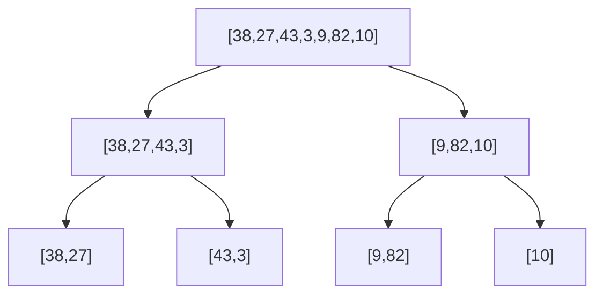
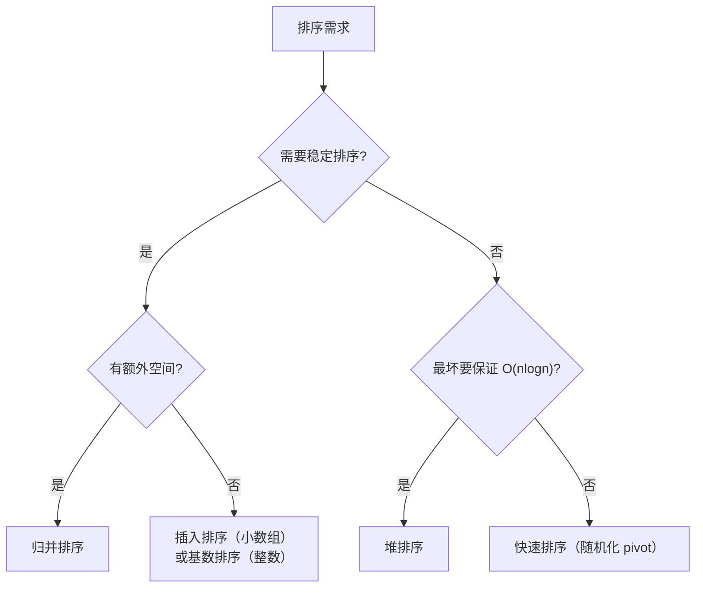

# 排序算法原理全景：从 O(n²) 到 O(nlogn) 的演进之路

**摘要：**

排序是计算机科学中研究最深入、应用最广泛的算法领域之一。从数据库的 `ORDER BY`，到分布式框架的 Shuffle 阶段，排序无处不在。本文不讲具体题目，而是系统梳理各类排序算法的**演进逻辑与底层原理**——为什么会出现这个算法、它解决了什么前辈算法的问题、它自身的局限在哪里。**核心结论有三条：比较排序的理论下界是 $\Omega(n\log n)$；插入排序是"小数组的王者"；而现代标准库用的是"混合排序"（如 TimSort）。** 本文用 Go 语言给出六种排序的实现，并逐层追问：为什么快排实践最快却理论最坏、建堆为什么是 $O(n)$ 而非 $O(n\log n)$、以及"稳定性"在工程里为什么重要。理解这条演进脉络，面试时的算法选型就不再是靠感觉。

---

## 第 1 章 排序问题的本质与下界

### 1.1 排序在排什么

**形式化定义**：给定序列 $A = [a_1,\dots,a_n]$，找到排列 $\pi$，使 $a_{\pi(1)} \le a_{\pi(2)} \le \cdots \le a_{\pi(n)}$。

**这个定义包含两个隐藏约束**：

**约束一，比较模型。** 通常只允许通过"比较两个元素的大小关系"获取信息。**绝大多数排序算法（归并、快排、堆排）都在这个模型下工作。**

**约束二，稳定性的意义。** 若两个元素 $a_i = a_j$（$i<j$），排序后 $a_i$ 仍在 $a_j$ 前面，则称算法**稳定**。**稳定性在纯数字排序中无关紧要，但在"按多个字段排序对象"时至关重要**——如"先按姓名排、再按年龄稳定排"，可保证同年龄段内姓名有序。

### 1.2 比较排序的理论下界

**一个极重要的结论：任何基于比较的排序，最坏情况下至少需要 $\Omega(n\log n)$ 次比较。**

**证明思路**：对 $n$ 个元素排序，共有 $n!$ 种输入排列，每种对应一个唯一输出。任何比较排序本质上是执行一棵**决策树**——每次比较是内部节点、产生两个分支，叶节点是输出。

要正确处理所有 $n!$ 种输入，决策树至少需要 $n!$ 个叶节点。高度为 $h$ 的二叉树最多 $2^h$ 个叶节点，故：

$$2^h \ge n! \implies h \ge \log_2(n!)$$

由 Stirling 近似，$\log_2(n!) = \Theta(n\log n)$——**故最坏情况下界是 $\Omega(n\log n)$。**

> [!info] 核心概念：决策树模型
> 决策树模型是分析比较排序下界的标准工具。**它告诉我们，归并排序与堆排序的 $O(n\log n)$ 已经是最优的**——没有任何基于比较的排序能在最坏情况下做得更好。**这也解释了计数排序、基数排序为何能突破 $O(n\log n)$：它们不在比较模型内，而是利用了元素值的额外信息。**

### 1.3 演进的两条主线

**主线一，减少比较次数**：从插入排序的 $O(n^2)$ 到归并/堆排序的 $O(n\log n)$，触及理论下界。

**主线二，利用元素特征突破下界**：当值域有限（如 0-255）时，计数排序、基数排序可做到 $O(n)$ 或 $O(nk)$，代价是额外空间。

---

## 第 2 章 $O(n^2)$ 排序：简单的代价

### 2.1 冒泡排序

```go
func bubbleSort(nums []int) {
    n := len(nums)
    for i := 0; i < n-1; i++ {
        swapped := false
        for j := 0; j < n-1-i; j++ {
            if nums[j] > nums[j+1] {
                nums[j], nums[j+1] = nums[j+1], nums[j]
                swapped = true
            }
        }
        if !swapped {
            break // 一次遍历没有交换，说明已有序
        }
    }
}
```

**复杂度**：最好 $O(n)$（已有序，`swapped` 优化）、平均/最坏 $O(n^2)$；**稳定**。

**本质问题**：每次交换只让一个元素"冒泡"一步，逆序元素必须一步一步走到正确位置，效率极低。

### 2.2 插入排序：小数组的王者

```go
func insertionSort(nums []int) {
    for i := 1; i < len(nums); i++ {
        key := nums[i]
        j := i - 1
        for j >= 0 && nums[j] > key {
            nums[j+1] = nums[j] // 后移，腾空间
            j--
        }
        nums[j+1] = key // 插入
    }
}
```

**复杂度**：最好 $O(n)$、平均/最坏 $O(n^2)$；空间 $O(1)$；**稳定**。

**插入排序有一个被忽视的优点**：**对近似有序的数组非常快**——若每个元素距离最终位置不超过 $k$，则时间是 $O(nk)$。**这就是为什么标准库在遇到小数组时会切换到插入排序。**

> [!note] 设计哲学：混合排序策略
> 现代工业级排序（Java 的 TimSort、Python 的 Timsort）都会综合多种策略：**对小数组用插入排序（常数因子小）、检测已有序区间利用其有序性、大数组用归并排序保证 $O(n\log n)$ 最坏情况。** **理解每种算法的适用场景，才能真正理解这些工程决策。**

### 2.3 选择排序：简单但不稳定

```go
func selectionSort(nums []int) {
    n := len(nums)
    for i := 0; i < n-1; i++ {
        minIdx := i
        for j := i + 1; j < n; j++ {
            if nums[j] < nums[minIdx] {
                minIdx = j
            }
        }
        nums[i], nums[minIdx] = nums[minIdx], nums[i]
    }
}
```

**复杂度**：始终 $O(n^2)$（无论输入是否有序）；**不稳定**（交换会打乱相同元素的相对顺序）。

**唯一优点**：交换次数恰好 $O(n)$。**在"交换代价远大于比较代价"的场景下（如元素是大型对象），它的交换开销最小。**

---

## 第 3 章 $O(n\log n)$ 排序：分治与结构利用

### 3.1 归并排序：稳定与分治的典范

```go
func mergeSort(nums []int) []int {
    if len(nums) <= 1 {
        return nums
    }
    mid := len(nums) / 2
    left := mergeSort(nums[:mid])
    right := mergeSort(nums[mid:])
    return merge(left, right)
}

func merge(a, b []int) []int {
    res := make([]int, 0, len(a)+len(b))
    i, j := 0, 0
    for i < len(a) && j < len(b) {
        if a[i] <= b[j] { // <= 保证稳定性
            res = append(res, a[i])
            i++
        } else {
            res = append(res, b[j])
            j++
        }
    }
    res = append(res, a[i:]...)
    res = append(res, b[j:]...)
    return res
}
```

**复杂度**：$O(n\log n)$（无论最好/平均/最坏）；空间 $O(n)$；**稳定**。

**归并排序有一个明显缺点：需要 $O(n)$ 额外空间。** **但对链表来说，"合并"只需改指针、不需额外空间——所以链表排序通常首选归并排序**（第 03 篇）。

**递归树分析**：



**每层总工作量都是 $O(n)$（合并所有子数组），共 $\log n$ 层，总时间 $O(n\log n)$。**

### 3.2 快速排序：实践最快，理论最坏

```go
func quickSort(nums []int, left, right int) {
    if left >= right {
        return
    }
    pivot := partition(nums, left, right)
    quickSort(nums, left, pivot-1)
    quickSort(nums, pivot+1, right)
}

func partition(nums []int, left, right int) int {
    // 随机选 pivot，避免最坏情况
    randIdx := left + rand.Intn(right-left+1)
    nums[randIdx], nums[right] = nums[right], nums[randIdx]
    pivot := nums[right]
    i := left - 1 // i 是"小于等于 pivot"区域的右边界
    for j := left; j < right; j++ {
        if nums[j] <= pivot {
            i++
            nums[i], nums[j] = nums[j], nums[i]
        }
    }
    nums[i+1], nums[right] = nums[right], nums[i+1] // pivot 归位
    return i + 1
}
```

**复杂度**：平均 $O(n\log n)$、最坏 $O(n^2)$（pivot 每次都选到极值）；空间 $O(\log n)$（递归栈，最坏 $O(n)$）；**不稳定**。

**为什么快排实践比归并快？** 三点：**缓存友好**（顺序访问 vs 频繁拷贝）、**无需额外空间**（原地分区）、**常数因子小**（分区操作简洁）。

> [!warning] 生产避坑：快排的最坏情况
> 快排最怕"近似有序的数组"——不加随机化、每次选最后一个元素作 pivot，在有序输入上递归深度达 $O(n)$，导致栈溢出或 $O(n^2)$。**解决方案：随机化 pivot，或"三数取中"（取 left、right、mid 的中位数作 pivot）。** **还有"大量相同元素"也会触发最坏情况——需用"三路分区"。**

### 3.3 堆排序：$O(n\log n)$ 且 $O(1)$ 空间

```go
func heapSort(nums []int) {
    n := len(nums)
    // 建堆：从最后一个非叶节点开始下沉
    for i := n/2 - 1; i >= 0; i-- {
        siftDown(nums, i, n)
    }
    // 提取排序
    for i := n - 1; i > 0; i-- {
        nums[0], nums[i] = nums[i], nums[0] // 最大值放末尾
        siftDown(nums, 0, i)                // 恢复堆性质
    }
}

func siftDown(nums []int, i, size int) {
    for {
        largest := i
        left, right := 2*i+1, 2*i+2
        if left < size && nums[left] > nums[largest] {
            largest = left
        }
        if right < size && nums[right] > nums[largest] {
            largest = right
        }
        if largest == i {
            break
        }
        nums[i], nums[largest] = nums[largest], nums[i]
        i = largest
    }
}
```

**复杂度**：$O(n\log n)$（无论输入，非常稳定）；空间 $O(1)$；**不稳定**。

**堆排序结合了"时间最优"与"空间最优"，但实践比快排慢**——**原因在缓存不友好**：堆的访问模式是跳跃式的（父节点到子节点的下标跳跃），与 CPU 缓存的局部性背道而驰。

> [!note] 设计哲学：建堆为什么是 $O(n)$ 而非 $O(n\log n)$
> 直觉上"向空堆插入 $n$ 个元素"是 $O(n\log n)$。**但"从数组原地建堆"（从最后一个非叶节点向上下沉）是 $O(n)$。** 数学分析：高度为 $h$ 的节点最多 $\lceil n/2^{h+1}\rceil$ 个，下沉代价 $O(h)$，求和：
> $$\sum_{h=0}^{\lfloor\log n\rfloor} \lceil n/2^{h+1}\rceil \cdot O(h) = O\left(n\sum_{h=0}^{\infty} h/2^h\right) = O(n)$$
> **这个 $O(n)$ 建堆性质，是堆排序被低估的优势之一。**

---

## 第 4 章 面试选型决策

### 4.1 横向对比

| 维度 | 插入排序 | 归并排序 | 快速排序 | 堆排序 |
|------|----------|----------|----------|--------|
| 平均时间 | $O(n^2)$ | $O(n\log n)$ | $O(n\log n)$ | $O(n\log n)$ |
| 最坏时间 | $O(n^2)$ | $O(n\log n)$ | $O(n^2)$ | $O(n\log n)$ |
| 空间 | $O(1)$ | $O(n)$ | $O(\log n)$ | $O(1)$ |
| 稳定性 | 稳定 | 稳定 | 不稳定 | 不稳定 |
| 缓存友好 | 极好 | 一般 | 好 | 差 |
| 实践速度 | 小数组最快 | 中等 | 大数组最快 | 慢于快排 |

### 4.2 选型决策树



### 4.3 常见面试问题

**Q：链表如何排序？** **链表首选归并排序**——因为"合并"在链表上天然是 $O(1)$ 空间的（只需改指针）。**快排的随机访问在链表上不再适用。**

**Q：元素范围已知（如 0-100），如何更快排序？** 用**计数排序**：统计每个值的出现次数，再按顺序输出。时间 $O(n+k)$、空间 $O(k)$。

**Q：快排 vs 归并，面试选哪个？** **数组优先快排**（加随机化，实践更好）；**链表只选归并**；**需要稳定只选归并**。**归并的边界条件更容易写对。**

---

## 第 5 章 排序的工程应用

### 5.1 标准库的排序实现

**`sort.Ints`（Go）**：底层是 **pdqsort**（Pattern-Defeating Quicksort）——它是"快排 + 堆排 + 插入排序"的混合体：**检测到"分区不平衡"时切换到堆排序（保证最坏 $O(n\log n)$）、小数组切换插入排序。**

**Java 的 `Arrays.sort(int[])`**：**双轴快速排序**（Dual-Pivot Quicksort），选两个 pivot 分成三段，比传统单轴快排减少约 10% 比较；子数组长度 < 47 时退化为插入排序。

**Java 的 `Arrays.sort(Object[])`**：**TimSort**（归并 + 插入的混合）——**先扫描数组找到已有序的"运行（run）"，再对 run 执行归并。** 最好情况接近 $O(n)$，最坏 $O(n\log n)$，且始终稳定。

**为什么对象数组用 TimSort、基本类型用快排？** **对象数组要求稳定性**（Java 规范），而基本类型的值语义不需要（两个 `int` 3 完全等价）。**在不需要稳定性时，快排的实践性能更优。**

### 5.2 大数据场景

**外部排序**：当数据量超过内存（如 100GB 日志），需外部排序——**它是归并排序的自然推广**：先把数据分成能装入内存的小块、各自排序后写回磁盘（"归并段"），再对所有归并段多路归并（用优先队列选最小元素）。**Hadoop MapReduce 的 Shuffle、数据库的 `ORDER BY` + 外排，本质上都是外部归并排序。**

**并行排序**：多核环境下，把数组分成 $p$ 段（$p$ 为核心数）、各自排序后归并。**这是 Java `Arrays.parallelSort` 的思路。**

> [!info] 核心概念：排序网络
> 在硬件加速场景（GPU 排序、FPGA），常用**排序网络**实现固定宽度的高速排序。**排序网络是一组预先确定的"比较-交换"操作序列，不依赖数据值，可高度并行化。** **Bitonic Sort（双调排序）是最著名的并行排序网络之一**，常用于 GPU 排序。

---

## 第 6 章 常见陷阱

### 6.1 稳定性认知错误

**陷阱**：认为选择排序稳定。**真相**：考虑 `[3, 3*, 1]`，一轮后变 `[1, 3*, 3]`——**两个 3 的相对顺序被破坏。**

### 6.2 快排最坏情况的触发条件

**陷阱**：以为只有"全逆序"才触发。**真相**：任何"pivot 每次都选到极值"的情况都会触发——**数组有序、或大量相同元素，都会触发。** **解决方案：随机化 pivot + 三路分区。**

### 6.3 递归深度与栈溢出

**陷阱**：递归版在大数组（$10^7$）上可能栈溢出。**真相**：归并深度约 $\log_2(10^7)\approx 23$ 层（安全）；**未优化的快排在有序输入上最坏 $10^7$ 层（危险）。** **解决方案：随机化 pivot，或改迭代版。**

### 6.4 "原地"的含义

**陷阱**：认为归并不能原地。**真相**：确实存在 $O(1)$ 空间的原地归并（如块归并），但实现极复杂、常数大，**不在面试范围内**。**通常说归并是 $O(n)$ 空间，指标准实现；而堆排序是真正 $O(1)$ 的原地排序。**

### 6.5 一个可复用的判断

**遇到"排序"需求，按这个顺序问**：

1. **需要稳定吗？** 需要则归并（或 TimSort）；
2. **需要保证最坏 $O(n\log n)$ 吗？** 需要则堆排（或 pdqsort）；
3. **数据规模多大？** 小数组用插入排序；
4. **值域已知吗？** 已知可用计数/基数排序。

**这四问，能定下排序算法的选型。**

---

## 小结

本文从排序的理论下界出发，梳理了各类算法的演进逻辑：**$O(n^2)$ 算法**（冒泡、插入、选择）适合小数组或近似有序场景，**插入排序是其中最有工程价值的**；**$O(n\log n)$ 算法**（归并、快排、堆排）触及比较模型下界，各有取舍（归并稳定但费空间、快排实践最快但有最坏情况、堆排最坏有保证且 $O(1)$ 空间但缓存不友好）；**线性时间排序**（计数、基数、桶）突破下界，但依赖值域信息。

贯穿全篇的核心认知有两条。其一，**"$O(n\log n)$ 是比较排序的下界"**——归并与堆排已经最优，而计数/基数排序靠"不在比较模型内"突破它。其二，**"没有最好的排序，只有最合适的排序"**——**标准库用"混合排序"（TimSort、pdqsort），正是"按场景选策略"的体现。** **把这两条握住，你面对任何排序需求，都能先问"要稳定吗、要最坏保证吗、规模多大"。**

下一篇 [[02 归并排序实战三连：有序数组与有序链表的合并艺术]] 将把归并的"合并"操作，落到三道具体题上——有序数组的合并、有序链表的合并、K 个有序链表的合并。

---

## 参考资料

1. Cormen, T. H., et al. *Introduction to Algorithms* (4th ed.). MIT Press, 2022. 第 2 章"排序"、第 6-8 章"堆排序/快速排序/线性时间排序"。
2. Sedgewick, R., & Wayne, K. *Algorithms* (4th ed.). Addison-Wesley, 2011. 第 2 章"排序"。
3. Peters, T. (2002). *Timsort*. Python 的排序实现。
4. Go 标准库. `sort` 包（pdqsort 实现）。https://pkg.go.dev/sort

---

> [!note] 思考题
> 1. 为什么比较排序的下界是 $\Omega(n\log n)$？请用决策树模型说明。
> 2. 插入排序为什么是"小数组的王者"？它的"近似有序"优势从何而来？
> 3. 快排为什么实践比归并快？请从"缓存、空间、常数因子"三方面说明。
> 4. 建堆为什么是 $O(n)$ 而非 $O(n\log n)$？请用求和式说明。
> 5. 标准库为什么用"混合排序"？TimSort 与 pdqsort 各自混合了哪些算法？
