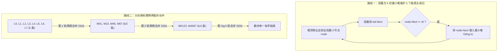

# 归并排序实战三连：有序数组与有序链表的合并艺术

**摘要：**

归并排序（Merge Sort）之所以在分治算法体系中占据核心地位，不仅在于它提供了恒定 $O(n \log n)$ 且稳定的排序能力，更在于它的核心算子——**合并两个或多个有序序列（Merge）**——本身就是一个威力无穷的独立武器。无论是在数组尾部原地合并而不覆盖未读数据、在单链表上仅靠指针重连完成零空间分配合并，还是在 $k$ 个有序流之间做多路归并，乃至利用合并过程中的跨段跳跃在 $O(n \log n)$ 时间内统计逆序对总数（LeetCode LCR 170）与右侧小于当前元素的个数（LeetCode 315），其底层逻辑全都系于 `merge` 算子一身。本文围绕 LeetCode 88、21、23、LCR 170 与 315 五道经典题，系统拆解归并算子在数组、链表与分治计数三大维度的推导过程与 Golang 实现。

---

## 第 1 章 数组的逆向原地合并：为什么从后往前填能零覆盖

### 1.1 LeetCode 88：合并两个有序数组（Merge Sorted Array）

**题目描述**：给你两个按**非递减顺序**排列的整数数组 `nums1` 和 `nums2`，另有两个整数 $m$ 和 $n$，分别表示 `nums1` 和 `nums2` 中的有效元素数目。请你合并 `nums2` 到 `nums1` 中，使合并后的数组同样按非递减顺序排列。注意：最终合并后的数组不应由函数返回，而是存储在长度为 $m + n$ 的数组 `nums1` 中（其后 $n$ 个位置初始填 `0` 作为预留空位）。

#### 1.1.1 正向合并的覆写困境与逆向双指针的不变量证明

如果照搬标准归并排序里的正向合并，用游标 `i = 0` 指代 `nums1` 头部、游标 `j = 0` 指代 `nums2` 头部，谁小就把谁写进 `nums1[k]`（`k` 从 `0` 开始），会发生什么？一旦 `nums2[0]` 比 `nums1[0]` 小，写入 `nums1[0]` 的瞬间，原本住在 `nums1[0]` 里的有效元素就被无情覆盖抹掉了。为了保住它，你不得不先开辟一个长度为 $m$ 的辅助数组把 `nums1` 的前 $m$ 个元素备份出来，额外空间复杂度退化为 $O(m)$。

不妨换个方向思考：**既然 `nums1` 的前半段 `[0, m-1]` 住满了人，而它的后半段 `[m, m+n-1]` 全是空置的预留房，我们为什么不从最大的元素开始，从右往左（从下标 `m + n - 1` 往 `0`）倒着填呢？**

设三个游标：
- `i` 指向 `nums1` 当前剩余有效元素的最右端（初始为 `m - 1`）；
- `j` 指向 `nums2` 当前剩余有效元素的最右端（初始为 `n - 1`）；
- `k` 指向 `nums1` 当前待写入空位的最右端（初始为 `m + n - 1`）。

每次比较 `nums1[i]` 与 `nums2[j]`，将较大者写入 `nums1[k]`，并将对应游标与 `k` 左移一格。这里有一个值得严密证明的安全性质：**写入位置 `k` 会不会追上并覆盖尚未读取的 `nums1[i]`？**

我们在任意时刻算一下 `k` 与 `i` 的下标差：由于每轮循环 `k` 必减 1，且 `i` 和 `j` 中恰有一个减 1，故恒有恒等式：

$$k = i + j + 1$$

只要循环还在进行（即 `nums2` 尚未耗尽，`j >= 0`），就必然有 $j + 1 \ge 1$，从而：

$$k = i + (j + 1) \ge i + 1 > i$$

也就是说，**只要 `nums2` 里还有元素没安置完，写指针 `k` 就永远严格处于读指针 `i` 的右侧**，绝不可能发生踩踏覆盖；而一旦 `j < 0`（`nums2` 已全部安置完毕），剩下的 `nums1[0..i]` 原本就已经坐在它们最终该坐的正确位置上，连搬都不用搬，算法直接收工：

```go
package main

// merge 逆向双指针原地合并两个有序数组
// 时间复杂度：O(m + n)，额外空间复杂度：O(1)
func merge(nums1 []int, m int, nums2 []int, n int) {
	i, j, k := m-1, n-1, m+n-1

	// 只要 nums2 还有元素未归位，就继续比对；若 nums2 先耗尽，nums1 剩余前缀天然就位
	for j >= 0 {
		if i >= 0 && nums1[i] > nums2[j] {
			nums1[k] = nums1[i]
			i--
		} else {
			nums1[k] = nums2[j]
			j--
		}
		k--
	}
}
```

请注意上面代码的极简写法：外层循环条件只需写 `for j >= 0`（而不是写完 `for i >= 0 && j >= 0` 之后再补一个 `for j >= 0` 的收尾循环）。因为当 `i < 0`（`nums1` 的有效元素已全部搬到右侧）时，内层 `if i >= 0 && ...` 自动为假，直接走 `else` 分支把 `nums2` 剩余元素依次拷入 `nums1` 头部，一气呵成。

---

## 第 2 章 链表的二路与多路合并：哑节点、最小堆与分治归并

### 2.1 LeetCode 21：合并两个有序链表（Merge Two Sorted Lists）

当数据结构从连续内存的数组切换为分散引用的单链表时，"合并"非但没有变难，反而摆脱了数组归并必须开辟 $O(n)$ 辅助空间的束缚——**因为链表合并只需改动节点的 `Next` 指针指向，完全不需要新建任何数据节点**。

唯一需要注意的是头节点的边界处理：在尚未比较 `l1.Val` 与 `l2.Val` 之前，我们不知道新链表的头节点究竟是 `l1` 还是 `l2`。如果不用技巧，就必须先写一段 `if-else` 初始化 `head` 指针，再进入主循环。而引入一个栈上分配的**哨兵哑节点（Dummy Node）**作为虚拟表头，让尾游标 `tail` 从 `dummy` 出发一路向后挂载较小节点，就能将首节点与后续节点的挂载逻辑彻底统一：

```go
package main

type ListNode struct {
	Val  int
	Next *ListNode
}

// mergeTwoLists 使用哨兵哑节点原地合并两个升序链表
// 时间复杂度：O(m + n)，额外空间复杂度：O(1)
func mergeTwoLists(l1 *ListNode, l2 *ListNode) *ListNode {
	var dummy ListNode // 栈上值分配，避免堆内存逃逸
	tail := &dummy

	for l1 != nil && l2 != nil {
		if l1.Val <= l2.Val {
			tail.Next = l1
			l1 = l1.Next
		} else {
			tail.Next = l2
			l2 = l2.Next
		}
		tail = tail.Next
	}

	// 将尚未耗尽的那条链表整串直接挂在 tail 末尾，O(1) 收尾
	if l1 != nil {
		tail.Next = l1
	} else {
		tail.Next = l2
	}
	return dummy.Next
}
```

注意这里用 `var dummy ListNode` 声明值类型再取地址 `&dummy`，相比 `&ListNode{}` 更容易被 Go 编译器的逃逸分析判定为栈上分配，达到真正的零堆内存开销；此外，当一条链表耗尽时，另一条链表的剩余部分本就处于有序串联状态，只需一次指针赋值 `tail.Next = l1` 即可整串接上，比数组合并必须逐个拷贝剩余元素更加轻快。

### 2.2 LeetCode 23：合并 K 个升序链表（Merge k Sorted Lists）

**题目描述**：给你一个链表数组 `lists`，每个链表都已经按升序排列。请你将所有链表合并到一个升序链表中，返回合并后的链表。设链表总条数为 $k$，所有链表的节点总数为 $N$。

#### 2.2.1 为什么"逐一两两合并"是劣质解法

初学者最容易想到的是：先拿 `lists[0]` 和 `lists[1]` 合并成新链表 $R$，再拿 $R$ 和 `lists[2]` 合并，依此类推合并 $k - 1$ 次。

不妨算一下这种"滚雪球式"顺序合并的复杂度。假设每条链表平均长度为 $n = N / k$：
- 第 1 次合并两条长 $n$ 的链表，遍历 $2n$ 个节点；
- 第 2 次拿长 $2n$ 的结果与第 3 条长 $n$ 的链表合并，遍历 $3n$ 个节点；
- ……
- 第 $k-1$ 次合并遍历 $kn$ 个节点。

总遍历次数为 $\sum_{i=2}^{k} i \cdot n = \Theta(k^2 n) = \Theta(kN)$。**第一条链表的节点被反反复复扫描了 $k - 1$ 遍**，当 $k$ 很大（譬如 $k = 10000$）时，耗时退化到平方级。

要消除这种不对称的重复扫描，有两条复杂度同为 $O(N \log k)$ 的正途：



#### 2.2.2 正途一：最小堆维护 K 路前沿（$O(N \log k)$ 时间，$O(k)$ 空间）

在二路合并中，我们每次只需比较 `l1` 和 `l2` 两个表头；在 $k$ 路合并中，我们需要在 $k$ 个当前表头节点组成的"前沿集合（Frontier）"里，快速挑出值最小的那个节点。将全部非空链表的首节点塞入一个容量至多为 $k$ 的**最小堆**，每次弹出堆顶最小节点 `node` 挂入结果链末尾，若 `node.Next != nil` 则将其后继推入堆中。每个节点进堆出堆各一次，总时间严格为 $O(N \log k)$，堆空间 $O(k)$：

```go
package main

import "container/heap"

type NodeMinHeap []*ListNode

func (h NodeMinHeap) Len() int           { return len(h) }
func (h NodeMinHeap) Less(i, j int) bool { return h[i].Val < h[j].Val }
func (h NodeMinHeap) Swap(i, j int)      { h[i], h[j] = h[j], h[i] }
func (h *NodeMinHeap) Push(x any)        { *h = append(*h, x.(*ListNode)) }
func (h *NodeMinHeap) Pop() any {
	old := *h
	n := len(old)
	x := old[n-1]
	*h = old[:n-1]
	return x
}

func mergeKListsHeap(lists []*ListNode) *ListNode {
	h := make(NodeMinHeap, 0, len(lists))
	for _, l := range lists {
		if l != nil {
			h = append(h, l)
		}
	}
	heap.Init(&h) // Floyd O(k) 建堆

	var dummy ListNode
	tail := &dummy
	for h.Len() > 0 {
		smallest := heap.Pop(&h).(*ListNode)
		tail.Next = smallest
		tail = tail.Next
		if smallest.Next != nil {
			heap.Push(&h, smallest.Next)
		}
	}
	return dummy.Next
}
```

#### 2.2.3 正途二：锦标赛分治两两合并（$O(N \log k)$ 时间，$O(1)$ 空间）

另一条正途是把 $k$ 条链表像网球锦标赛一样**两两配对合并**：第 1 轮把 `lists[0]` 与 `lists[1]`、`lists[2]` 与 `lists[3]`……配对合并，链表条数减半为 $\lceil k/2 \rceil$，这一轮每个节点恰好只参与一次合并，总耗时 $O(N)$；第 2 轮继续两两配对减半为 $\lceil k/4 \rceil$，耗时仍是 $O(N)$……一共只需进行 $\lceil \log_2 k \rceil$ 轮，总时间同样是 $O(N \log k)$。

更妙的是，如果在原切片 `lists` 上按步长 `interval = 1, 2, 4, ...` 原地覆写配对结果，连递归栈都不用，额外空间复杂度直接压到 **$O(1)$**：

```go
package main

// mergeKListsDivide 原地步长倍增分治合并 K 个有序链表
// 时间复杂度：O(N log k)，额外空间复杂度：O(1)
func mergeKListsDivide(lists []*ListNode) *ListNode {
	k := len(lists)
	if k == 0 {
		return nil
	}

	for interval := 1; interval < k; interval *= 2 {
		for i := 0; i+interval < k; i += interval * 2 {
			lists[i] = mergeTwoLists(lists[i], lists[i+interval])
		}
	}
	return lists[0]
}
```

对比两条正途：**分治两两合并**在内存中常数更小且零额外空间分配；而**最小堆多路归并**则具备"流式在线输出"的能力——当 $k$ 个输入不是内存链表，而是来自 $k$ 台远程机器的 gRPC 流或磁盘上的 $k$ 个大文件时，你不可能先把两个远程流从头到尾合并落盘再合下一个，此时最小堆维护 $k$ 路游标是分布式查询引擎（如 TiDB / ClickHouse 的 `MergeSort` 算子）的唯一选择。

---

## 第 3 章 归并分治的高阶威力：逆序对与右侧较小元素计数

`merge` 算子除了能把两个有序段合成一个有序段，还能顺便完成一项极其惊艳的统计任务：**在 $O(n \log n)$ 时间内，统计跨越左右两个半区的大小关系对数**。

### 3.1 LeetCode LCR 170：交易逆序对的总数（Reverse Pairs in Array）

**题目描述**：在数组 `record` 中，如果前面一个数字大于后面的数字（即 $i < j$ 且 `record[i] > record[j]`），则这两个数字组成一个逆序对。请返回数组中逆序对的总数。

暴力双重循环枚举所有 $(i, j)$ 需要 $O(n^2)$。利用归并排序分治：任何一对下标 $(i, j)$（$i < j$），在将区间 `[left, right]` 从中点 `mid` 一分为二时，必然且唯一属于以下三种位置关系之一：
1. $i$ 和 $j$ 都在左半区 `[left, mid]` 内（由左半递归统计并返回）；
2. $i$ 和 $j$ 都在右半区 `[mid+1, right]` 内（由右半递归统计并返回）；
3. **$i$ 在左半区 `[left, mid]`，$j$ 在右半区 `[mid+1, right]`（跨越中点的逆序对，在 `merge` 过程中顺手统计）**。

当左右两半都已经各自按升序排好后，我们在 `merge` 双指针推进时，一旦发现左半当前元素严格大于右半当前元素（`temp[i] > temp[j]`），由于左半区间 `temp[i..mid]` 是升序递增的，这意味着**从 `temp[i]` 到 `temp[mid]` 的全部 `mid - i + 1` 个左半元素，统统都严格大于当前这个 `temp[j]`**。于是，将 `temp[j]` 放入合并数组的那一刻，我们无需逐一比对，直接一行 `count += mid - i + 1` 就能把以 `temp[j]` 为右端点的全部跨区逆序对一网打尽：

```go
package main

// reversePairs 利用归并排序在 O(n log n) 时间内精确统计逆序对总数
func reversePairs(record []int) int {
	n := len(record)
	if n <= 1 {
		return 0
	}
	temp := make([]int, n)

	var sortAndCount func(left, right int) int
	sortAndCount = func(left, right int) int {
		if left >= right {
			return 0
		}
		mid := left + (right-left)/2
		count := sortAndCount(left, mid) + sortAndCount(mid+1, right)
		if record[mid] <= record[mid+1] {
			return count // 左半最大值 <= 右半最小值，跨区逆序对必为 0
		}

		copy(temp[left:right+1], record[left:right+1])
		i, j, k := left, mid+1, left
		for i <= mid && j <= right {
			if temp[i] <= temp[j] {
				record[k] = temp[i]
				i++
			} else {
				record[k] = temp[j]
				// temp[i..mid] 均大于 temp[j]，一次性累加 mid - i + 1 个逆序对
				count += mid - i + 1
				j++
			}
			k++
		}
		for i <= mid {
			record[k] = temp[i]
			i++
			k++
		}
		return count
	}
	return sortAndCount(0, n-1)
}
```

### 3.2 LeetCode 315：计算右侧小于当前元素的个数（索引数组归并）

如果题目更进一步，不再只求全数组逆序对的**总和**，而是要求返回一个数组 `counts`，其中 `counts[idx]` 精确记录**每个原始位置 `idx` 右侧有多少个小于它的元素**（LeetCode 315），归并排序还能应付吗？

难点在于：归并排序在不断交换重排元素的位置，排完之后元素早就离开了它最初的下标 `idx`。解决办法非常优雅——**对"原始下标"（或者 `{val, origIdx}` 结构体）进行归并排序**。

这一次，我们在 `merge` 时换一个累加视角（统计每个左半元素 `temp[i]` 跨过了多少个右半元素）：
- 当左半的 `temp[i]` 被选中放入合并数组时（即 `temp[i].val <= temp[j].val` 或右半已耗尽），说明右半区间 `[mid+1, j-1]` 里的这 `j - (mid + 1)` 个元素全都严格小于 `temp[i].val`，且已经先于 `temp[i]` 出列了；
- 于是直接令 `counts[temp[i].origIdx] += j - (mid + 1)`。

```go
package main

type indexedVal struct {
	val int
	idx int
}

// countSmaller 索引归并排序求每个元素右侧严格小于它的元素个数
func countSmaller(nums []int) []int {
	n := len(nums)
	counts := make([]int, n)
	if n <= 1 {
		return counts
	}

	items := make([]indexedVal, n)
	for i, v := range nums {
		items[i] = indexedVal{val: v, idx: i}
	}
	temp := make([]indexedVal, n)

	var mergeSortIdx func(left, right int)
	mergeSortIdx = func(left, right int) {
		if left >= right {
			return
		}
		mid := left + (right-left)/2
		mergeSortIdx(left, mid)
		mergeSortIdx(mid+1, right)
		if items[mid].val <= items[mid+1].val {
			return
		}

		copy(temp[left:right+1], items[left:right+1])
		i, j, k := left, mid+1, left
		for i <= mid && j <= right {
			if temp[i].val <= temp[j].val {
				// 右半已出列的 [mid+1 .. j-1] 共 j-(mid+1) 个元素均严格小于 temp[i]
				counts[temp[i].idx] += j - (mid + 1)
				items[k] = temp[i]
				i++
			} else {
				items[k] = temp[j]
				j++
			}
			k++
		}
		for i <= mid {
			// 右半全部 (right - mid) 个元素均已出列且严格小于 temp[i]
			counts[temp[i].idx] += right - mid
			items[k] = temp[i]
			i++
			k++
		}
	}

	mergeSortIdx(0, n-1)
	return counts
}
```

这套"归并分治 + 跨区双指针批量统计"的范式，还可以无缝解决 **LeetCode 493（翻转对：统计 $i < j$ 且 `nums[i] > 2 * nums[j]`）** 与 **LeetCode 327（区间和的个数）**，被誉为归并排序在算法竞赛与硬核面试中的皇冠明珠。

### 3.3 进阶剖析：翻转对（LeetCode 493）与"统计、合并两阶段分离"范式

为什么刚才提到 **LeetCode 493（翻转对：求满足 $i < j$ 且 `nums[i] > 2 * nums[j]` 的数对数量）** 时，需要特别小心？

在前面的逆序对（LCR 170）中，触发计数的条件是 `nums[i] > nums[j]`，而归并合并时决定谁先放入结果数组的条件恰好也是 `nums[i] <= nums[j]`——**计数条件与归并比较条件完全重合**，因此我们可以把 `count += mid - i + 1` 直接塞在 `merge` 循环的 `else` 分支里顺手做掉。

然而在翻转对问题中，触发计数的条件变成了 **`nums[i] > 2 * nums[j]`**，这与归并排序按 `nums[i] <= nums[j]` 合并的条件**不再重合**（譬如左半元素是 `5`，右半元素是 `3`，合并时 `3 < 5` 所以 `3` 先出列，但 `5` 并不大于 `2 * 3 = 6`，不能触发翻转对计数）。如果强行把计数揉在合并循环里，指针推进就会顾此失彼。

解决这一脱钩矛盾的通用架构是**"先独立双指针统计，再标准双指针合并"**的两阶段分离范式：
1. 在 `merge` 函数开头，此时左半区间 `nums[left..mid]` 与右半区间 `nums[mid+1..right]` 均已各自升序排列；
2. **第一阶段（纯粹统计跨区翻转对）**：维护左游标 `i` 从 `left` 遍历到 `mid`，同时维护一个**单调不回退**的右游标 `j`（初始为 `mid + 1`）。由于 `nums[i]` 随着 `i++` 单调递增，能让 `nums[i] > 2 * nums[j]` 成立的右半区前缀右界 `j` 也必然单调向右推进，绝不回退。当 `j` 停下时，右半区间 `[mid + 1, j - 1]` 内的全部 `j - (mid + 1)` 个元素都满足条件，累加进 `count`。整个统计阶段 `i` 和 `j` 各走一遍，耗时严格 $O(right - left)$；
3. **第二阶段（纯粹标准合并）**：按部就班地执行标准的 `nums[i] <= nums[j]` 双指针归并，把左右两半合并成升序区间供上层调用者使用。

```go
package main

// reversePairs493 统计与合并两阶段分离，解决广义线性不等式数对统计（LeetCode 493）
func reversePairs493(nums []int) int {
	n := len(nums)
	if n <= 1 {
		return 0
	}
	temp := make([]int, n)

	var sortAndCount func(left, right int) int
	sortAndCount = func(left, right int) int {
		if left >= right {
			return 0
		}
		mid := left + (right-left)/2
		count := sortAndCount(left, mid) + sortAndCount(mid+1, right)

		// 第一阶段：利用左右半区各自的单调性，同向双指针独立统计 nums[i] > 2*nums[j]
		j := mid + 1
		for i := left; i <= mid; i++ {
			for j <= right && int64(nums[i]) > 2*int64(nums[j]) {
				j++
			}
			count += j - (mid + 1)
		}

		// 第二阶段：标准归并合并
		copy(temp[left:right+1], nums[left:right+1])
		p1, p2, k := left, mid+1, left
		for p1 <= mid && p2 <= right {
			if temp[p1] <= temp[p2] {
				nums[k] = temp[p1]
				p1++
			} else {
				nums[k] = temp[p2]
				p2++
			}
			k++
		}
		for p1 <= mid {
			nums[k] = temp[p1]
			p1++
			k++
		}
		return count
	}
	return sortAndCount(0, n-1)
}
```

### 3.4 延伸实战：区间和的个数（LeetCode 327，前缀和 + 归并分治）

再往前迈一步，就能攻克困难题 **LeetCode 327：区间和的个数（Count of Range Sum）**——给定一个可能包含正数、负数和零的整数数组 `nums`，以及两个整数 `lower` 和 `upper`，求有多少个连续子数组 `nums[i..j]` 的元素之和落在闭区间 `[lower, upper]` 内。

由于数组中存在负数，子数组和随窗口扩大并不单调，滑动窗口完全失效（详见双指针专栏）。但如果我们先花 $O(n)$ 构造**前缀和数组 `prefix`**（其中 `prefix[0] = 0`，`prefix[k]` 表示前 $k$ 个元素之和），那么子数组 `nums[i..j]` 的和落在 `[lower, upper]` 内，就等价于：

$$\text{对于 } 0 \le i < j \le n, \quad lower \le prefix[j] - prefix[i] \le upper$$

变形一下，对于右半区的每个 `prefix[j]`，我们要在左半区寻找满足 $prefix[j] - upper \le prefix[i] \le prefix[j] - lower$ 的 `prefix[i]` 个数；或者反过来，对于左半区的每个 `prefix[i]`，在已升序的右半区寻找满足 **`prefix[i] + lower <= prefix[j] <= prefix[i] + upper`** 的下标范围 `[lowPtr, highPtr)`。

由于在归并阶段，左半区 `prefix[left..mid]` 和右半区 `prefix[mid+1..right]` 都是**单调递增**的，当左半游标 `i` 从 `left` 向右推进时，对应的右半区下界游标 `lowPtr`（第一个 $\ge prefix[i] + lower$ 的位置）与上界游标 `highPtr`（第一个 $> prefix[i] + upper$ 的位置）也**必然单调向右滑动，绝不回退**。于是同样套用"第一阶段三指针滑动统计 `highPtr - lowPtr`、第二阶段标准归并 `prefix` 数组"的模板，在 $O(n \log n)$ 时间内一举拿下：

```go
package main

// countRangeSum 前缀和转化 + 归并分治双游标区间统计（LeetCode 327）
func countRangeSum(nums []int, lower int, upper int) int {
	n := len(nums)
	prefix := make([]int64, n+1)
	for i, v := range nums {
		prefix[i+1] = prefix[i] + int64(v)
	}
	temp := make([]int64, n+1)

	var mergeCount func(left, right int) int
	mergeCount = func(left, right int) int {
		if left >= right {
			return 0
		}
		mid := left + (right-left)/2
		count := mergeCount(left, mid) + mergeCount(mid+1, right)

		// 第一阶段：对左半每个 prefix[i]，维护右半满足 [prefix[i]+lower, prefix[i]+upper] 的窗口 [lo, hi)
		lo, hi := mid+1, mid+1
		for i := left; i <= mid; i++ {
			for lo <= right && prefix[lo]-prefix[i] < int64(lower) {
				lo++
			}
			for hi <= right && prefix[hi]-prefix[i] <= int64(upper) {
				hi++
			}
			count += hi - lo
		}

		// 第二阶段：标准归并合并 prefix[left..right]
		copy(temp[left:right+1], prefix[left:right+1])
		p1, p2, k := left, mid+1, left
		for p1 <= mid && p2 <= right {
			if temp[p1] <= temp[p2] {
				prefix[k] = temp[p1]
				p1++
			} else {
				prefix[k] = temp[p2]
				p2++
			}
			k++
		}
		for p1 <= mid {
			prefix[k] = temp[p1]
			p1++
			k++
		}
		return count
	}
	return mergeCount(0, n)
}
```

### 3.5 工程视角：归并算子在 LSM-Tree 与列式存储中的统治地位

跳出算法题，第 2 章与第 3 章剖析的二路/多路归并算子，正是现代大数据存储引擎的脊梁：
- **LSM-Tree（Log-Structured Merge-Tree，如 RocksDB、LevelDB、Cassandra）的 Compaction 机制**：写入数据时先在内存跳表（MemTable）中排好序，刷盘生成不可变的有序文件 SSTable；后台 Compaction 线程所做的唯一工作，就是拿着我们在 LeetCode 23 中写的**最小堆多路归并算子**，把多层 SSTable 流式合并为更大的一层有序文件，并在合并途中顺手丢弃已被标记删除（Tombstone）或被新版本覆盖的旧 Key；
- **外部归并中的自然归并段（Natural Merge Sort）与胜者树/败者树**：当合并路数 $k$ 达到上百路时，工业界用定长数组实现的完全二叉树——**败者树（Loser Tree）**替代标准二叉堆，消除每次下沉时左右兄弟之间的比较，使每个元素产出的比较次数严格等于 $\log_2 k$。

### 3.6 深度追问：数组归并能不能做到 $O(1)$ 额外空间（原地归并）？

在面试中，当候选人答出"数组归并排序需要 $O(n)$ 辅助空间、链表归并排序只需 $O(1)$ 空间"后，面试官有时会抛出一个极具深度的追问：**"如果给你两个相邻的有序子数组 `nums[left..mid]` 和 `nums[mid+1..right]`，且绝对不允许分配任何辅助切片，怎么原地完成合并？"**

这属于算法领域著名的**原地归并（In-Place Merge）**问题。虽然工业界最先进的块归并排序（Block Merge Sort / GrailSort，利用数组内部自带的 $\sqrt{n}$ 个重复元素或交换缓冲区）能在 $O(n \log n)$ 时间与 $O(1)$ 空间内完成，但它的代码长达数百行；而在面试现场，你需要掌握的是两种可手写的原地归并思想：

1. **手摇算法（三重反转旋转法 / Trinity Rotation）**：
   - 找到左半段中第一个大于 `nums[mid+1]` 的位置 `i`，以及右半段中所有小于 `nums[i]` 的连续前缀 `nums[mid+1 .. j-1]`；
   - 此时区间 `nums[i .. mid]` 与 `nums[mid+1 .. j-1]` 需要整体互换位置。怎么在 $O(1)$ 空间内把两段不等长的相邻子数组 `[A | B]` 变成 `[B | A]`？答案是我们在字符串与数组旋转中学过的**三次反转（Three-Reversal Trick）**：先反转 `A`，再反转 `B`，最后将 `A + B` 整体反转；
   - 旋转完成后，原本属于右半段的这批较小元素全部归位到了 `[i .. i + (j - mid - 1) - 1]`，接下来将左边界推进到新位置继续递归或迭代。
2. **ShellSort 式的跨步缩减合并**：
   - 将左右两段拼成的区间视为一个已有两段有序的序列，直接以初始步长 $gap = \lceil (right - left + 1) / 2 \rceil$ 开始，每次令 $gap = \lceil gap / 2 \rceil$ 执行跨步比较交换，可在 $O(n \log n)$ 时间、$O(1)$ 空间内完成合并。

### 3.7 衍生实战：查找和最小的 K 对数字——多路归并的隐式矩阵建模（LeetCode 373）

多路归并（LeetCode 23）不仅能合并显式给出的 $k$ 条链表，还能合并**隐式生成的 $k$ 条虚拟有序流**。

以 **LeetCode 373：查找和最小的 K 对数字**为例：给定两个以非递减顺序排列的整数数组 `nums1` 和 `nums2`，以及一个整数 $k$，定义数对 $(u, v)$ 由第一个数组中的一个元素和第二个数组中的一个元素组成，请找出和最小的 $k$ 个数对。

如果把所有 $m \times n$ 个数对全部生成出来再求 TopK，时间与空间高达 $O(mn)$，当 $m = n = 10^5$ 而 $k = 1000$ 时会直接内存爆炸。但如果我们把每个 `nums1[i]` 与整個 `nums2` 组成的数对看作一条虚拟的升序链表：
- 第 $0$ 条虚拟链表：`(nums1[0], nums2[0]) -> (nums1[0], nums2[1]) -> (nums1[0], nums2[2]) -> ...`
- 第 $1$ 条虚拟链表：`(nums1[1], nums2[0]) -> (nums1[1], nums2[1]) -> (nums1[1], nums2[2]) -> ...`
- ……
- 第 $i$ 条虚拟链表：`(nums1[i], nums2[0]) -> (nums1[i], nums2[1]) -> ...`

由于 `nums1` 和 `nums2` 都是升序的，这 $\min(m, k)$ 条虚拟链表各自内部都是**严格非递减**的。于是问题瞬间化归为 **LeetCode 23（合并 $\min(m, k)$ 条有序链表，只弹出前 $k$ 个节点即停）**，时间复杂度驟降至 $O(k \log(\min(m, k)))$：

```go
package main

import "container/heap"

type pairItem struct {
	i, j int // 对应数对 (nums1[i], nums2[j])
	sum  int
}

type pairMinHeap []pairItem

func (h pairMinHeap) Len() int           { return len(h) }
func (h pairMinHeap) Less(a, b int) bool { return h[a].sum < h[b].sum }
func (h pairMinHeap) Swap(a, b int)      { h[a], h[b] = h[b], h[a] }
func (h *pairMinHeap) Push(x any)        { *h = append(*h, x.(pairItem)) }
func (h *pairMinHeap) Pop() any {
	old := *h
	n := len(old)
	x := old[n-1]
	*h = old[:n-1]
	return x
}

// kSmallestPairs 将二元数对和转化为 min(m, k) 条虚拟升序链表的 K 路归并
// 时间复杂度：O(k log(min(m, k)))，空间复杂度：O(min(m, k))
func kSmallestPairs(nums1 []int, nums2 []int, k int) [][]int {
	m, n := len(nums1), len(nums2)
	limit := min(m, k)
	h := make(pairMinHeap, limit)
	// 先把前 min(m, k) 条虚拟链表的首节点 (i, 0) 放入堆中
	for i := 0; i < limit; i++ {
		h[i] = pairItem{i: i, j: 0, sum: nums1[i] + nums2[0]}
	}
	heap.Init(&h)

	res := make([][]int, 0, k)
	for len(res) < k && h.Len() > 0 {
		cur := heap.Pop(&h).(pairItem)
		res = append(res, []int{nums1[cur.i], nums2[cur.j]})
		// 将第 cur.i 条虚拟链表的下一个节点 (cur.i, cur.j + 1) 推入堆中
		if cur.j+1 < n {
			heap.Push(&h, pairItem{
				i:   cur.i,
				j:   cur.j + 1,
				sum: nums1[cur.i] + nums2[cur.j+1],
			})
		}
	}
	return res
}
```

这套"把二元组合空间拆成 $k$ 条单调虚拟链表再做多路归并"的建模技巧，同样能直接通杀 **LeetCode 378（有序矩阵中第 K 小的元素）**、**LeetCode 786（第 K 个最小的素数分数）**以及 **LeetCode 264（丑数 II）**。

---

## 第 4 章 常见误区与边界自检

1. **LC 88 逆向合并遗漏 `nums1` 先耗尽的情形**：当 `nums1` 的有效元素全比 `nums2` 大时，`i` 会先减到 `-1`，此时 `nums2` 剩余的较小元素尚未拷入 `nums1` 头部。务必检查 `i < 0` 时是否继续将 `nums2[0..j]` 拷完。
2. **LC 23 将 `nil` 空链表推入最小堆**：输入 `lists` 中可能包含空的子链表（如 `[[]]` 或 `[nil, [1]]`）。在初始化堆时，必须先加 `if l != nil` 过滤，否则 `Less` 函数解引用 `h[i].Val` 时会直接触发空指针 panic。
3. **逆序对统计中的等号方向错误**：在 LCR 170 与 LC 315 中，当 `temp[i] == temp[j]` 时，它们**不构成**严格逆序对。因此必须令 `temp[i] <= temp[j]` 时先让左半 `temp[i]` 出列，这样才能保证当走入 `else` 分支（或统计右半已出列个数）时，比对的双方是严格大于关系。
4. **翻转对（LC 493）与区间和（LC 327）中的 32 位整型溢出**：在 LC 493 的判定条件 `nums[i] > 2 * nums[j]` 中，若 `nums[j]` 取到 $2^{30}$ 以上或 $-2^{30}$ 以下，直接乘以 $2$ 在 32 位有符号整数下会立刻溢出反转；同理在 LC 327 中，$n$ 个整数累加的前缀和 `prefix[k]` 极易超出 32 位整数范围。因此在涉及倍乘或前缀和的归并统计题中，务必显式转换为 `int64` 再做比较与加减。
5. **多路归并虚拟矩阵（LC 373）重复入堆问题**：在解 LC 373（和最小的 K 对数字）时，如果一开始只把 `(0, 0)` 一个节点放入堆，每次弹出 `(i, j)` 后同时将 `(i + 1, j)` 和 `(i, j + 1)` 两个邻居推入堆中，那么 `(1, 1)` 就会被 `(1, 0)` 和 `(0, 1)` 各自推入一次，导致结果出现重复数对且必须额外维护一个二维 `visited` 哈希表去重。而像本文 3.7 节那样**先把前 $\min(m, k)$ 行的首列 `(i, 0)` 全部入堆，每次弹出 `(i, j)` 后只单向推进列号推入 `(i, j + 1)`**，则每条虚拟链表各自独立前进，天然零重复、无需任何 `visited` 集合。此外，在初始化堆时切记将行数截断为 `min(m, k)` 而非全量 `m`，因为前 $k$ 小的数对绝不可能用到第 $k$ 行以后的元素，这一步截断能在 $m \gg k$ 时将建堆开销从 $O(m)$ 进一步压至 $O(k)$，使整个算法的时间与空间复杂度严格只与 $k$ 相关，即便面对两数组长度均为十万而 $k = 10$ 的悬殊场景也能瞬间返回。
6. **归并排序辅助数组切片拷贝范围差一错误**：在手写 `mergeRange(nums, left, mid, right, temp)` 时，将原数组数据备份到辅助数组的语句必须写为 `copy(temp[left:right+1], nums[left:right+1])`（因为 Go 切片右界是开区间，`right+1` 才能包含 `nums[right]` 本身），若误写成 `temp[left:right]` 则每次合并都会漏掉区间最右侧的元素，导致排序结果彻底失真。

---

## 小结

本章围绕归并排序的核心算子 `merge`，完成了从基础合并到高阶分治计数的三级跳：
- **空间复用级（LC 88、LC 21）**：数组利用尾部预留空位从后往前写，依靠 $k = i + j + 1 > i$ 保证零覆盖；链表利用哨兵哑节点消除首节点特判，实现 $O(1)$ 空间指针缝合；
- **多路扩展级（LC 23）**：用容量为 $k$ 的最小堆或步长倍增的锦标赛分治，将 $k$ 路合并从劣质的 $O(kN)$ 降为最优的 $O(N \log k)$；
- **分治统计级（LCR 170、LC 315）**：利用左右半区内部已有序的单调性，在 `merge` 游标移动的一瞬间批量结算整段跨区逆序关系。

下一篇 [[03 链表排序双题精讲：插入排序与归并排序的链表实现]] 将把目光聚焦在单链表本身，看如何在完全失去下标随机访问能力的链表结构上，写出零栈空间开销的 $O(n \log n)$ 自底向上归并排序。

---

## 参考资料

1. Knuth, D. E. (1998). *The Art of Computer Programming, Volume 3: Sorting and Searching* (2nd ed.). Section 5.2.4: Sorting by Merging.
2. Cormen, T. H., et al. *Introduction to Algorithms* (4th ed.). MIT Press, 2022. Problem 2-4: Inversions.

---

> [!note] 思考题
> 1. 在 LeetCode 88（合并两个有序数组）中，如果规定所有相等元素必须保持它们在原数组中的相对次序（即 `nums1` 中的元素排在 `nums2` 中相等元素的前面），那么从后往前合并时，当 `nums1[i] == nums2[j]`，应该优先把哪一个放入 `nums1[k]`？
> 2. 在 LeetCode 493（翻转对：统计 $i < j$ 且 `nums[i] > 2 * nums[j]`）中，为什么不能像 LCR 170 那样把计数逻辑直接塞进 `temp[i] <= temp[j]` 的合并循环里，而必须在合并循环之前先单独用一组同向双指针扫一遍左右半区完成计数？
> 3. 如果有 $k$ 个有序数组，每个数组长度差异极大（譬如有一个长 100 万，其余 99 个长度只有 10），对比"最小堆多路归并"、"固定顺序两两分治"与"每次挑当前最短的两个数组合并（哈夫曼树贪心合并）"，哪一种的总比较次数最少？
