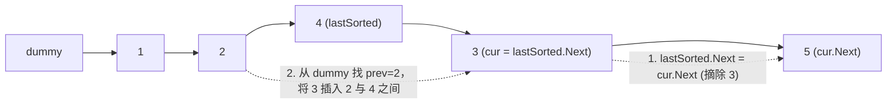
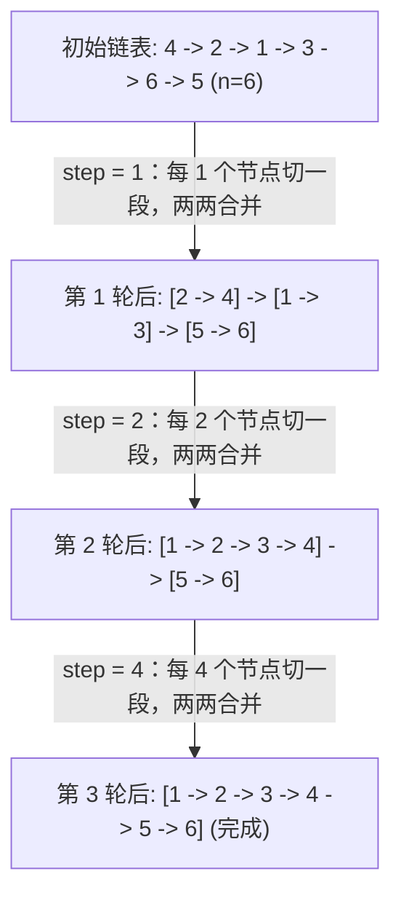

# 链表排序双题精讲：插入排序与归并排序的链表实现

**摘要：**

当待排序的数据载体从连续内存的数组换成离散引用的单链表（Singly Linked List）时，排序算法的势力版图会发生一次剧烈的洗牌：原本在数组上叱咤风云的快速排序，因失去 $O(1)$ 随机抽样与双向对撞寻址能力而束手束脚；原本空间最优的堆排序，因无法通过下标算式 `2*i + 1` 直接定位父子节点而寸步难行；反倒是原本在数组上因需要 $O(n)$ 辅助空间而抱憾的**归并排序**，在链表上摇身一变，成了既能保证最坏 $O(n \log n)$ 时间、又能通过自底向上倍增迭代做到**严格 $O(1)$ 额外空间**的唯一真神。本文围绕 LeetCode 147（对链表进行插入排序）与 LeetCode 148（排序链表），深入拆解链表指针重连的防断链纪律、尾节点提前短路优化、快慢指针截断中点的偶数陷阱，以及工业级自底向上链表归并排序的完整推导与 Golang 实现。

---

## 第 1 章 为什么链表改写了排序算法的选型规则

### 1.1 数组与链表在排序操作上的物理鸿沟

在数组上设计排序算法时，我们习以为常地享用着两项免费特权：一是**按下标 $O(1)$ 随机访问任意位置**（这使得二分找中点、三数取中选 `pivot`、堆的父子跳跃都不费吹灰之力）；二是**指针既能 `i++` 向右走，也能 `j--` 向左退**（这使得插入排序从右往左找插入点、快速排序 Hoare 相向分区极其自然）。

然而在单链表 `type ListNode struct { Val int; Next *ListNode }` 上，这两项特权同时被剥夺了：
1. **只能顺着 `Next` 单向往前走，无法后退**：在数组插入排序中，当前元素 `nums[i]` 是从已排序区间的最右端 `i - 1` 往左扫；而在单链表里，由于没有 `Prev` 指针，一旦发现当前节点需要插入到前面，你只能从已排序链表的**表头 `dummy`** 重新出发，一步步从左往右找插入点；
2. **定位中点必须付出 $O(n)$ 遍历代价，但插入/移动节点只需 $O(1)$ 改指针**：数组插入一个元素需要把后面整片内存向右平移一格；而单链表把一个节点摘下来插到任意已知前驱节点 `prev` 后面，只需要三次指针赋值，零内存分配、零数据搬移。

| 排序算法 | 在数组上的表现 | 在单链表上的境遇 | 链表场景推荐度 |
|----------|----------------|------------------|----------------|
| 插入排序 | $O(n^2)$，支持从右往左反向寻找插入点 | $O(n^2)$，必须维护有序区尾指针 `lastSorted`，否则每次需从表头正向扫描 | 小链表或近乎有序链表可用（LC 147） |
| 归并排序 | $O(n \log n)$，合并阶段必须分配 $O(n)$ 辅助数组 | **$O(n \log n)$，合并仅改 `Next` 指针，自底向上迭代版额外空间严格 $O(1)$** | **绝对首选（LC 148 及 C++ `std::list::sort`）** |
| 快速排序 | 期望 $O(n \log n)$，双向相向分区缓存极佳 | 只能用单向三链表拆分（小于链、等于链、大于链），随机取 `pivot` 仍需 $O(n)$ 遍历 | 特殊考察时可写，但综合不如归并稳定 |
| 堆排序 | $O(n \log n)$，完全二叉树隐式存储于数组下标 | 无法用下标算父子节点，若外建指针堆则额外耗费 $O(n)$ 空间 | 不适用 |

理解了这张对照表，我们就明白为什么在面试中被问到"如何对单链表排序"时，标准答案永远是以归并排序为核心。但在进入归并排序之前，我们先通过 LeetCode 147 把链表节点"摘除与重插"的基本功练到炉火纯青。

---

## 第 2 章 LeetCode 147：对链表进行插入排序与 `lastSorted` 短路优化

### 2.1 题目描述与朴素拆链法的缺陷

**题目描述**：给定单个链表的头节点 `head`，使用插入排序对链表进行排序，并返回排序后链表的头节点。

许多教材给出过一种"另起炉灶"的朴素写法：新建一个只有 `dummy` 节点的空链表代表"已排序区"，然后顺着原链表 `cur` 挨个把节点摘下来，每次都从 `dummy` 头节点出发，找到第一个 `prev.Next.Val > cur.Val` 的位置插进去。

这种写法逻辑虽然简单，却丢掉了插入排序最核心的灵魂——**对已排序输入的 $O(n)$ 自适应性**。试想：如果传进来的链表原本就是升序排列的 `[1 -> 2 -> 3 -> 4 -> 5]`，朴素写法每次为了把最大的节点插到已排序链表的末尾，都得从 `dummy` 一路从头走到尾，导致在**已经完全排好序的链表上居然退化成了最坏的 $O(n^2)$**（而数组插入排序在已有序输入上是 $O(n)$）。

### 2.2 维护已排序区尾指针 `lastSorted`：夺回 $O(n)$ 最好复杂度

怎样才能让单链表的插入排序在近似有序输入上同样享受 $O(n)$ 的极速？

秘密在于**始终维护已排序区间的最后一个节点指针 `lastSorted`**（初始为 `head`），而待插入的节点就是它紧邻的下一个节点 `cur = lastSorted.Next`：



每次考察 `cur` 时，先让它跟已排序区的守门员 `lastSorted` 比一下大小：
1. **如果 `lastSorted.Val <= cur.Val`（顺序正常）**：说明 `cur` 本来就比前面所有已排好序的节点都大，它直接留在原位即可，只需把 `lastSorted` 向右推进一格（`lastSorted = lastSorted.Next`），**耗时 $O(1)$，连一根指针都不用改**；
2. **如果 `lastSorted.Val > cur.Val`（发现逆序）**：说明 `cur` 需要往前插。此时我们才从 `dummy` 出发向右寻找第一个满足 `prev.Next.Val > cur.Val` 的前驱节点 `prev`，然后执行标准的三步摘除重插：
   - 第一步（跨过 `cur` 缝合原链）：`lastSorted.Next = cur.Next`（此时 `lastSorted` 天然就是 `cur` 在原链表中的前驱，帮我们把链表后半段稳稳接住，绝不断链）；
   - 第二步（`cur` 后继指向插入点右侧）：`cur.Next = prev.Next`；
   - 第三步（插入点前驱指向 `cur`）：`prev.Next = cur`。

```go
package main

// insertionSortList 维护 lastSorted 尾指针的链表插入排序
// 最好时间复杂度（已有序）：O(n)；平均/最坏时间复杂度：O(n^2)；空间复杂度：O(1)
func insertionSortList(head *ListNode) *ListNode {
	if head == nil || head.Next == nil {
		return head
	}

	var dummy ListNode
	dummy.Next = head
	lastSorted := head // 已排序前缀的尾节点
	cur := head.Next   // 当前待插入的节点

	for cur != nil {
		if lastSorted.Val <= cur.Val {
			// 顺序已经正确，直接扩充已排序区右界，O(1) 短路
			lastSorted = lastSorted.Next
		} else {
			// 发现逆序，从 dummy 起寻找第一个严格大于 cur.Val 的节点前驱 prev
			// 注意：用 <= 跳过相等节点，确保相等元素插在后面，维持排序稳定性
			prev := &dummy
			for prev.Next.Val <= cur.Val {
				prev = prev.Next
			}
			// 三步指针手术：将 cur 从 lastSorted 后摘下，嵌入 prev 与 prev.Next 之间
			lastSorted.Next = cur.Next
			cur.Next = prev.Next
			prev.Next = cur
		}
		// 下一轮待处理的节点永远是 lastSorted 的直接后继
		cur = lastSorted.Next
	}
	return dummy.Next
}
```

请细细品味最后一行 `cur = lastSorted.Next` 的统一美感：无论本轮走的是 `if` 分支（`lastSorted` 前进了一步）还是 `else` 分支（原本在 `lastSorted` 后面的 `cur` 被拔走插到了前面，`lastSorted.Next` 已经指向了原链表的下一个未处理节点），下一轮要考察的新节点**永远都是 `lastSorted.Next`**。而且在 `else` 分支寻找 `prev` 时，由于已知 `lastSorted.Val > cur.Val`，内层循环 `for prev.Next.Val <= cur.Val` 必然在到达 `lastSorted` 之前停下，甚至连 `prev.Next != nil` 的判空检查都可以省去。

---

## 第 3 章 LeetCode 148：链表归并排序（从自顶向下到 $O(1)$ 空间自底向上）

**题目描述**：给你链表的头节点 `head`，请将其按升序排列并返回排序后的链表。**进阶要求：在 $O(n \log n)$ 时间复杂度和常数级 $O(1)$ 空间复杂度下完成排序。**

### 3.1 自顶向下递归版与"两节点死循环"陷阱

如果我们先写出最直观的自顶向下（Top-Down）递归归并排序，框架分为三步：用快慢指针找到链表中点并将链表一刀剪成左右两段 $\to$ 递归排序左段与右段 $\to$ 调用第 02 篇的 `mergeTwoLists` 合并。

但凡是手写过这段代码的人，十有八九都在下面这个细节上栽过跟头：**快慢指针找中点时，初始状态应该写 `slow, fast := head, head` 还是 `slow, fast := head, head.Next`？**

不妨拿一个只有 **2 个节点**的链表 `head = [2 -> 1]` 来做现场实验：
- **错误写法（`slow, fast := head, head`）**：进入循环 `for fast != nil && fast.Next != nil`，走一步后 `slow` 停在第 2 个节点 `1` 上，`fast` 变为 `nil` 退出循环。此时如果把 `slow` 当作右半段的起点（或者断链），你会发现左半段还是 `[2 -> 1]`（长度 2），右半段是 `nil`（长度 0）——**问题规模从 2 变成了 2，毫无缩减，递归立刻陷入无限死循环直至栈溢出**。
- **正确写法（`slow, fast := head, head.Next`）**：让快指针抢先站在 `head.Next` 上。当链表只有 2 个节点 `[2 -> 1]` 时，`fast.Next` 为 `nil`，循环根本不执行，`slow` 稳稳停在第 1 个节点 `2`（即**左半段的尾节点**）上。随后我们令 `mid := slow.Next`（即第 2 个节点 `1` 作为右半段头节点），并立刻执行 **`slow.Next = nil`** 将左右两段物理剪断，左半段长度 1、右半段长度 1，完美对半切开：

```go
package main

// sortListTopDown 自顶向下递归归并排序链表
// 时间复杂度：O(n log n)，额外空间复杂度：O(log n) 递归调用栈
func sortListTopDown(head *ListNode) *ListNode {
	if head == nil || head.Next == nil {
		return head
	}

	// 关键：fast 从 head.Next 出发，确保偶数节点时 slow 停在左半段的尾节点
	slow, fast := head, head.Next
	for fast != nil && fast.Next != nil {
		slow = slow.Next
		fast = fast.Next.Next
	}

	mid := slow.Next
	slow.Next = nil // 物理剪断左半段与右半段的连接

	left := sortListTopDown(head)
	right := sortListTopDown(mid)
	return mergeTwoLists(left, right)
}
```

### 3.2 自底向上倍增迭代版：彻底消灭递归栈的 $O(1)$ 空间神作

自顶向下递归版虽然优雅，但它消耗了 $O(\log n)$ 的系统调用栈空间，严格来说没有完全满足进阶要求的"$O(1)$ 常数级额外空间"。为什么我们需要递归栈？因为自顶向下是"先一路对半切到底（需要用栈记住每一层切开的断点），再从底往上合"。

既然最终合并是从长度为 `1` 的单节点段开始的，我们何不**直接跳过递归切分，从一开始就按步长 `step = 1, 2, 4, 8, ...` 自底向上（Bottom-Up）一轮轮在链表上原地切段、原地合并**？



要把自底向上链表归并写得滴水不漏，关键是封装一个职责纯粹的辅助算子 **`split(head *ListNode, step int) *ListNode`**：
- **功能契约**：给定一段链表的起点 `head`，从它开始往后数 `step` 个节点，**将第 `step` 个节点的 `Next` 指针置为 `nil`（完成物理断链）**，并返回原链表第 `step + 1` 个节点的指针（即下一段的起点 `nextSubHead`）。若剩余节点不足 `step` 个，则不断链，直接返回 `nil`。

有了 `split` 算子，外层按 `step = 1, 2, 4...` 倍增循环时，内层的切段合并就像流水线切香肠一样清晰：
1. `left := cur`（第一段起点）；
2. `right := split(left, step)`（切下长度为 `step` 的 `left` 段，拿到第二段起点 `right`）；
3. `cur = split(right, step)`（切下长度为 `step` 的 `right` 段，拿到后续未处理链表的起点赋给 `cur`）；
4. 将 `left` 与 `right` 合并后挂到上一组的尾巴 `prevTail` 后面，并把 `prevTail` 推进到本组合并结果的末尾：

```go
package main

// sortList 自底向上倍增归并排序链表
// 时间复杂度：O(n log n)，额外空间复杂度：严格 O(1)
func sortList(head *ListNode) *ListNode {
	if head == nil || head.Next == nil {
		return head
	}

	// 1. 统计链表总长度 n
	n := 0
	for p := head; p != nil; p = p.Next {
		n++
	}

	var dummy ListNode
	dummy.Next = head

	// 2. 按步长 step = 1, 2, 4, 8... 倍增迭代，共 ceil(log2 n) 轮
	for step := 1; step < n; step <<= 1 {
		prevTail := &dummy
		cur := dummy.Next

		for cur != nil {
			left := cur
			right := splitList(left, step) // 切出左段 [left]，返回右段起点
			cur = splitList(right, step)   // 切出右段 [right]，返回下一对的起点

			// 合并 left 与 right，挂载到 prevTail 之后，并推进 prevTail 到合并段末尾
			mergedHead, mergedTail := mergeAndGetTail(left, right)
			prevTail.Next = mergedHead
			prevTail = mergedTail
		}
	}
	return dummy.Next
}

// splitList 从 head 出发保留前 step 个节点并断链，返回第 step+1 个节点
func splitList(head *ListNode, step int) *ListNode {
	if head == nil {
		return nil
	}
	for i := 1; i < step && head.Next != nil; i++ {
		head = head.Next
	}
	nextHead := head.Next
	head.Next = nil // 物理截断当前段尾部
	return nextHead
}

// mergeAndGetTail 合并两个有序链表，同时返回合并后的头节点与尾节点
func mergeAndGetTail(l1, l2 *ListNode) (*ListNode, *ListNode) {
	var dummy ListNode
	tail := &dummy
	for l1 != nil && l2 != nil {
		if l1.Val <= l2.Val {
			tail.Next = l1
			l1 = l1.Next
		} else {
			tail.Next = l2
			l2 = l2.Next
		}
		tail = tail.Next
	}
	if l1 != nil {
		tail.Next = l1
	} else {
		tail.Next = l2
	}
	// 将 tail 推进到整条合并链表的真正末尾，方便下一组直接挂载
	for tail.Next != nil {
		tail = tail.Next
	}
	return dummy.Next, tail
}
```

---

## 第 4 章 拓展思考：单链表上能不能写三路快速排序？

如果面试官偏要打破砂锅问到底："我知道链表排序首选归并，但如果题目明确要求用**快速排序**思想排单链表，该怎么写才不会因为指针不能后退而卡壳？"

在单链表上写快排，绝不能模仿数组上的左右双指针相向交换（因为右指针无法 `j--` 后退），也不要去交换节点里的 `Val` 字段（在真实工程中，链表节点往往是重型结构体，只改值不改指针属于作弊）。最地道、最符合链表物理特性的做法是**三链表分流法**：
1. 选定表头（或随机走一步）的节点值作为 `pivot`；
2. 准备三个哨兵哑节点 `lessDummy`、`equalDummy`、`greaterDummy`；
3. 顺序遍历原链表，将每个节点按 `node.Val` 与 `pivot` 的大小关系，直接尾插挂载到小于链、等于链或大于链的末尾（全程只改 `Next` 指针，耗时 $O(n)$，$O(1)$ 节点分配）；
4. 递归排序小于链与大于链（等于链已经全部相等，无需递归），最后把"排好序的小于链 $\to$ 等于链 $\to$ 排好序的大于链"首尾串联起来即可。

```go
package main

// quickSortList 单链表的三路分流快速排序（纯改指针，不交换节点 Val）
func quickSortList(head *ListNode) *ListNode {
	if head == nil || head.Next == nil {
		return head
	}

	pivot := head.Val
	var lessDummy, equalDummy, greaterDummy ListNode
	lessTail, equalTail, greaterTail := &lessDummy, &equalDummy, &greaterDummy

	for cur := head; cur != nil; cur = cur.Next {
		if cur.Val < pivot {
			lessTail.Next = cur
			lessTail = cur
		} else if cur.Val == pivot {
			equalTail.Next = cur
			equalTail = cur
		} else {
			greaterTail.Next = cur
			greaterTail = cur
		}
	}
	// 重要：将三条子链的末尾全部置空，防止旧指针残留形成环路
	lessTail.Next = nil
	equalTail.Next = nil
	greaterTail.Next = nil

	sortedLess := quickSortList(lessDummy.Next)
	sortedGreater := quickSortList(greaterDummy.Next)

	// 串联 sortedLess -> equalChain -> sortedGreater
	equalTail.Next = sortedGreater
	if sortedLess == nil {
		return equalDummy.Next
	}
	p := sortedLess
	for p.Next != nil {
		p = p.Next
	}
	p.Next = equalDummy.Next
	return sortedLess
}
```

请注意上面代码中第 25–27 行的三句 `Tail.Next = nil`：由于原链表节点身上的 `Next` 指针还挂着旧的邻居，分流结束后如果不把三条子链的尾巴剪干净，立刻就会在链表里制造出致命的环形引用（Cycle）。

### 4.2 工业级标准库揭秘：为什么 `std::list::sort` 用"二进制进位归并器"

在第 3.2 节的自底向上倍增归并中，我们先遍历了一遍链表算出总长度 $n$，然后外层循环按 `step = 1, 2, 4, ...` 每次从头到尾扫描整条链表。这引出了一个有趣的系统级追问：**在 C++ STL 的 `std::list::sort` 或 Linux 内核的 `list_sort`（`lib/list_sort.c`）中，为什么它们不预先算长度 $n$，也不用 `step` 外层循环，而是用一个长度为 64 的指针数组 `counter[0..63]`（或位掩码 `pending`）来归并？**

原因有二：
1. **消除预先求长度 $n$ 的整趟冷缓存扫描**：当链表长达百万节点时，先从头到尾数一遍 `n`，意味着在真正开始排序前就先把全部节点在 CPU 缓存里冲刷淘汰了一遍；
2. **最大化局部缓存热度（Cache Temporal Locality）**：如果按 `step = 1` 把第一百万个节点合并完，再回过头从第 1 个节点开始做 `step = 2` 的合并，第 1 个节点早就从 L1/L2 Cache 里被驱逐到主存了。

而"二进制进位归并器（Binary Counter Merge）"的工作方式，就像一个二进制加法器：
- 准备一个长度为 64 的槽位数组 `bin[0..63]`，规定第 `k` 号槽位 `bin[k]` 要么为空（`nil`），要么存放一条**长度恰好为 $2^k$ 的有序子链表**；
- 每次从原链表头部摘下 **1 个节点**（长度 $2^0 = 1$），准备放入 `bin[0]`：
  - 若 `bin[0]` 为空，直接放入；
  - 若 `bin[0]` 非空，将新节点与 `bin[0]` 合并成一条长度为 $2^1 = 2$ 的有序链表，清空 `bin[0]`，拿着这条长 $2$ 的链表去敲 `bin[1]` 的门（即向高位进位）；
  - 若 `bin[1]` 也非空，继续合并成长度为 $2^2 = 4$ 的链表向 `bin[2]` 进位，直到遇到一个空槽坐下为止；
- 当原链表所有节点摘完后，把 `bin[0..63]` 里所有非空槽位从小到大依次合并收尾。

这套设计的绝妙之处在于：**刚刚摘下来的两个相邻节点，趁着它们还热乎地躺在 CPU L1 缓存里，当场就完成了 `step = 1`、`step = 2`、`step = 4` 的连续多级合并**，并且 64 个槽位足以容纳 $2^{64}$ 个节点，额外空间依然是严格的 $O(1)$：

```go
package main

// sortListCounter 二进制进位归并器（Linux 内核 list_sort / STL std::list::sort 核心思想）
// 无需预先遍历求长度，缓存时间局部性极佳，时间 O(n log n)，空间 O(1)
func sortListCounter(head *ListNode) *ListNode {
	if head == nil || head.Next == nil {
		return head
	}

	// bin[k] 存放长度为 2^k 的有序子链表，64 个槽位足以覆盖任意内存规模
	var bin [64]*ListNode
	maxBin := 0

	cur := head
	for cur != nil {
		// 摘下当前单节点 carry（长度 2^0 = 1）
		carry := cur
		cur = cur.Next
		carry.Next = nil

		// 模拟二进制加法器逢二进一：只要 bin[k] 非空，就合并并向 k+1 进位
		k := 0
		for bin[k] != nil {
			carry = mergeTwoLists(bin[k], carry)
			bin[k] = nil
			k++
		}
		bin[k] = carry
		if k > maxBin {
			maxBin = k
		}
	}

	// 将所有槽位中残留的有序子链表由小到大合并为最终结果
	var res *ListNode
	for k := 0; k <= maxBin; k++ {
		if bin[k] != nil {
			res = mergeTwoLists(res, bin[k])
		}
	}
	return res
}
```

### 4.3 延伸实战：部分有序链表的合并与分隔链表（LeetCode 86 & 328）

在链表排序家族中，还有两道直接考察"多链表分流与缝合"的高频题，它们可以看作第 4.1 节链表快排分流算子的独立抽出：
- **LeetCode 86（分隔链表 / Partition List）**：给你一个链表的头节点 `head` 和一个特定值 `x`，请你对链表进行分隔，使得所有**小于** `x` 的节点都出现在**大于或等于** `x` 的节点之前，且**应当保留两个分区中每个节点的初始相对位置（即要求稳定分区）**。
  - 这道题在数组上如果要求 $O(1)$ 额外空间且保持稳定，难如登天（这也是为什么数组快速排序不稳定）；但在单链表上，只需准备 `smallDummy` 和 `largeDummy` 两个虚拟头节点，顺着原链表扫一遍，`< x` 的挂入 `smallTail`、`>= x` 的挂入 `largeTail`，最后令 **`largeTail.Next = nil`**（斩断尾部防环）、`smallTail.Next = largeDummy.Next`，即可在 $O(n)$ 时间、$O(1)$ 空间内完成**绝对稳定的原地二路分区**。
- **LeetCode 328（奇偶链表 / Odd Even Linked List）**：将奇数下标节点排在前面、偶数下标节点排在后面，保持相对顺序。原理完全相同：按链表下标位置奇偶分流为两条子链，最后首尾相接。

```go
package main

// partition LeetCode 86：单链表的稳定二路分区，时间 O(n)，空间 O(1)
func partition(head *ListNode, x int) *ListNode {
	var smallDummy, largeDummy ListNode
	smallTail, largeTail := &smallDummy, &largeDummy

	for cur := head; cur != nil; cur = cur.Next {
		if cur.Val < x {
			smallTail.Next = cur
			smallTail = cur
		} else {
			largeTail.Next = cur
			largeTail = cur
		}
	}
	// 铁律：必须将后半段尾节点的 Next 置空，否则若原末尾节点 < x，largeTail.Next 仍指向它，形成死循环环路
	largeTail.Next = nil
	smallTail.Next = largeDummy.Next
	return smallDummy.Next
}
```

### 4.4 深度进阶：自然归并排序（Natural Merge Sort）在链表上的极致优化

无论是 3.2 节的步长倍增迭代归并，还是 4.2 节的二进制进位归并器，它们在一开始都机械地把链表切成长度为 $1$ 的单节点原子段，完全无视了原链表中本来就已经存在的有序子段。

试想：如果一条长达十万节点的链表，是由两段各长五万节点的升序链表拼接而成的，步长倍增归并依然会傻乎乎地先按 `step = 1, 2, 4, ...` 切碎再合并 $\log_2(100000) \approx 17$ 轮。而在单链表上实现**自然归并排序（Natural Merge Sort，即链表版的 TimSort 核心）**其实极其简单且零空间开销：
1. 定义辅助函数 `nextRun(head *ListNode) (runHead, runTail, nextHead *ListNode)`：从 `head` 出发，只要满足 `cur.Val <= cur.Next.Val`，就顺着指针一直往后走，把这一整段**天然非递减的连续子链表（Natural Run）**作为一个整体切下来，将 `runTail.Next` 置为 `nil`，并返回下一段的起点 `nextHead`；
2. 在每一大轮外层循环中，从 `dummy.Next` 出发，每次调用两次 `nextRun` 切出相邻的两个天然有序段 `run1` 和 `run2`：
   - 如果切出 `run1` 后发现 `run2 == nil` 且这是本轮的第 1 对，说明**整条链表已经只剩下一个完整的有序段了**，算法立即提前终止返回；
   - 否则将 `run1` 与 `run2` 合并挂到 `prevTail` 之后。

```go
package main

// sortListNatural 链表自然归并排序：自动识别天然升序段，在已有序/局部有序链表上达 O(n)
func sortListNatural(head *ListNode) *ListNode {
	if head == nil || head.Next == nil {
		return head
	}

	// cutNaturalRun 切出从 start 开始的最长连续非递减子链，截断尾部并返回下一段起点
	cutNaturalRun := func(start *ListNode) (*ListNode, *ListNode) {
		if start == nil {
			return nil, nil
		}
		p := start
		for p.Next != nil && p.Val <= p.Next.Val {
			p = p.Next
		}
		next := p.Next
		p.Next = nil
		return start, next
	}

	var dummy ListNode
	dummy.Next = head

	for {
		prevTail := &dummy
		cur := dummy.Next
		mergeCount := 0

		for cur != nil {
			left, nextCur := cutNaturalRun(cur)
			right, afterRight := cutNaturalRun(nextCur)
			cur = afterRight

			if right == nil {
				// 本轮末尾只剩单段，直接挂上
				prevTail.Next = left
				break
			}
			mergeCount++
			mergedHead, mergedTail := mergeAndGetTail(left, right)
			prevTail.Next = mergedHead
			prevTail = mergedTail
		}
		// 若整轮扫描连一次双段合并都没发生，说明全链表已合成单一升序段
		if mergeCount == 0 {
			break
		}
	}
	return dummy.Next
}
```

如果原链表包含 $r$ 个天然升序段（Runs），自然归并排序只需要合并 $\lceil \log_2 r \rceil$ 轮，总时间复杂度为 **$O(n + n \log r)$**：在完全有序链表（$r = 1$）上仅需扫描一遍即告结束（耗时 $O(n)$），在最坏逆序链表（$r = n$）上也不过是标准的 $O(n \log n)$，且额外空间严格保持 $O(1)$，兼具了插入排序的 $O(n)$ 最好情况自适应性与归并排序的 $O(n \log n)$ 最坏情况保证。

---

## 第 5 章 常见误区与边界自检

1. **链表切段或分流后忘记将尾节点 `Next` 置为 `nil`**：这是链表排序题（无论是归并切中点、`splitList` 还是三路快排分流）排名第一的死循环元凶。记住铁律：**凡是把一条链表拆成多段，每一段的新尾节点必须显式执行 `.Next = nil`**。
2. **插入排序未维护 `lastSorted` 导致有序输入退化**：在 LC 147 中，若每次把 `cur` 摘下后不依赖 `lastSorted` 缝合原链，不仅要在有序输入上多跑 $O(n^2)$ 次无谓扫描，还极易在修改 `cur.Next` 时弄丢原链表的后半截。
3. **自底向上归并每轮开始时未从 `dummy.Next` 重新取头**：在第 1 轮（`step = 1`）合并完成后，原链表的表头 `head` 很可能因为比第 2 个节点大而不再是首节点了。因此每一轮外层循环都必须以 `cur := dummy.Next` 作为起点，绝不能再引用旧的 `head` 变量。
4. **链表合并后的悬空尾指针引发无限环路**：在调用 `splitList` 将链表切出 `left` 与 `right` 两段并调用 `mergeAndGetTail` 合并后，`mergedTail.Next` 在函数内部已经指向 `nil`；但如果开发者手写合并逻辑时，把最后剩余的节点挂上去后没有确保整条合并链表的末尾 `Next == nil`，或者在 `partition`（LC 86）中忘记执行 `largeTail.Next = nil`，原链表末尾节点携带的旧后继指针就会把链表重新指回前面的某个节点，在后续遍历结果链表时触发永不终止的死循环。
5. **混淆"交换节点值"与"重连节点指针"的工程契约**：在面试手写 LC 147 或 LC 148 时，有些候选人投机取巧，只交换或覆写两个 `ListNode` 内部的 `Val` 整数，而不改动 `Next` 指针。这在面试官眼中通常是不可接受的——因为在操作系统内核（如 Linux `struct list_head` 侵入式链表）或数据库缓冲池中，链表节点往往嵌入在庞大的业务结构体内部，或者外部有其他指针（如哈希表索引、迭代器句柄）直接持有该节点的内存地址，篡改节点内部负载会导致外部引用关系错乱且拷贝大对象成本高昂，唯有通过纯指针重连改变拓扑结构才是链表排序的工程正道。
6. **双向链表（Doubly Linked List）排序时的前驱指针 `Prev` 同步遗漏**：如果面试官将单链表升级为双向链表（含 `Prev` 和 `Next`），归并排序依然是 $O(n \log n)$ 的最优解，但在 `mergeTwoLists` 每次执行 `tail.Next = node` 的同时，必须成对补上 `node.Prev = tail`，并在整条链表合并完成后将新表头的 `Prev` 显式置为 `nil`，否则反向遍历时会顺着残留的旧 `Prev` 指针跳入乱序深渊。
7. **带环链表直接送入归并排序引发死循环**：无论是自顶向下快慢指针找中点，还是自底向上统计链表长度 $n$，都隐含假设输入是一条以 `nil` 结尾的无环单链表（Acyclic List）。在生产系统中，若上游传入的链表可能因异常操作存在环路，直接调用 `sortList` 会在求长度或找中点阶段陷入无限循环；此时应在入口处结合 Floyd 判圈法或最大步数阈值做防御性校验。

---

## 小结

本章完整攻克了单链表上的排序难题：
- **链表插入排序（LC 147）**依靠 `lastSorted` 尾指针守住已排序区右界，将顺位节点 $O(1)$ 短路放行，把乱序节点三步摘除重插；
- **链表归并排序（LC 148）**是链表排序的皇冠：自顶向下递归版靠 `fast = head.Next` 精准停在左半尾节点并剪断；自底向上迭代版靠 `splitList` 与 `mergeAndGetTail` 算子按 $1, 2, 4 \ldots$ 步长倍增合并，达成了时间 $O(n \log n)$、额外空间严格 $O(1)$ 的理论最优；
- **链表三路快排**则展示了如何用三条虚拟头尾链表替代数组的双向相向分区。

下一篇 [[04 创意排序：荷兰国旗问题与桶排序思想]] 将回到数组主场，探索当数组元素具备特殊值域约束时，如何用三指针分区与原地哈希把排序和查找的时间压到极致的 $O(n)$、空间压到 $O(1)$。

---

## 参考资料

1. Cormen, T. H., et al. *Introduction to Algorithms* (4th ed.). MIT Press, 2022. Chapter 2 & Chapter 10 (Linked Lists).
2. Sedgewick, R., & Wayne, K. (2011). *Algorithms* (4th ed.). Addison-Wesley. Section 2.2: Mergesort (Bottom-up mergesort).
3. GCC libstdc++ `std::list::sort` implementation (`bits/list.tcc`, bottom-up merge sort using array of carry lists).

---

> [!note] 思考题
> 1. 在自顶向下归并排序（3.1 节）中，如果链表有 4 个节点 `1 -> 2 -> 3 -> 4`，初始化 `slow, fast := head, head.Next` 与 `slow, fast := head, head`，循环结束时 `slow` 分别停在第几个节点？为什么 4 个节点时两种写法都不会死循环，偏偏到了 2 个节点时后者就会死循环？
> 2. C++ STL 的 `std::list::sort` 采用了一种比先数链表总长度 `n` 更巧妙的自底向上归并写法：它维护一个长度为 64 的指针数组 `counter[0..63]`（类似二进制加法器，`counter[i]` 存放长度为 $2^i$ 的有序链表段），每从原链表摘下一个节点就往 `counter[0]` 合并并向高位进位。这种设计与本文 3.2 节的写法相比，在未知长度的流式链表上有什么优势？
> 3. 在第 4 章的单链表三路快排中，为什么串联结果时只需要遍历 `sortedLess` 找尾巴，而不需要遍历 `equalDummy.Next` 找尾巴？
