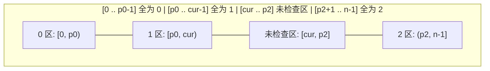

# 创意排序：荷兰国旗问题与桶排序思想

**摘要：**

在算法面试中，有一类题目要求你在 $O(n)$ 线性时间且 $O(1)$ 常数级额外空间的严苛约束下完成重排或查找。既然不能用耗时 $O(n \log n)$ 的通用比较排序，又不能开耗时 $O(n)$ 但耗空间 $O(n)$ 的外部哈希表或计数数组，破局点究竟在哪里？答案在于**将原数组自身的下标空间改造为分桶容器**。本文深入拆解两类极具巧思的原地（In-Place）算法范式：其一是由图灵奖得主 Edsger Dijkstra 提出的**荷兰国旗三路分区（Dutch National Flag Problem，LeetCode 75）**及其向虚拟索引摆动排序（LeetCode 324）的延伸；其二是利用下标 `[0, n-1]` 与正整数值域 `[1, n]` 的双射关系实现的**原地哈希归位与正负号标记（LeetCode 41、442、448）**。全文提供严格的循环不变量证明、均摊复杂度分析与 Golang 实现。

---

## 第 1 章 荷兰国旗问题：三指针维护的四段式循环不变量

### 1.1 从 Dijkstra 的三色鹅卵石说起

1976 年，Edsger Dijkstra 在其名著 *A Discipline of Programming* 中提出了著名的**荷兰国旗问题（Dutch National Flag Problem）**：假设有一排杂乱摆放的红、白、蓝三色鹅卵石（对应数字 `0`、`1`、`2`），每次只允许检查一颗鹅卵石的颜色，或者交换两颗鹅卵石的位置，如何用**最少次数（仅一遍扫描）**的检查与交换，把它们排成红、白、蓝三段相连的荷兰国旗？

在 LeetCode 75（颜色分类 / Sort Colors）中，最容易想到的做法是跑两遍扫描的计数排序：第一遍数出 `0`、`1`、`2` 各有几个，第二遍按个数把数组重写一遍。但面试官紧接着就会提出两个追问：
1. **如果数组里装的不是孤零零的整数 `0, 1, 2`，而是携带了业务数据的复合结构体（只能交换两个元素，不能直接用字面量 `0, 1, 2` 覆写），计数覆写法还管用吗？**
2. **能不能只遍历数组一遍（One-Pass），在 $O(1)$ 额外空间下原地排好？**

要在一遍扫描内把三种元素归拢到左、中、右三个区域，单靠传统的左右双指针是不够的（双指针只能维护两段分界），必须引入**三个游标指针**，将整个数组实时切分为四个具有严格契约的区间。

### 1.2 循环不变量设计：为什么左换要前进、右换必须原地待命

设数组长度为 $n$，我们定义三个整型游标 `p0`、`cur`、`p2`，并在整个循环过程中死死守住以下四段**循环不变量（Loop Invariant）**：



- **红色区 `[0, p0)`**：全部存放已经确认的 `0`（故 `p0` 指向 `0` 区右侧的第一个位置，即 `1` 区的头部）；
- **白色区 `[p0, cur)`**：全部存放已经确认的 `1`；
- **未知待检区 `[cur, p2]`**：尚未检查的元素（`cur` 是当前正在审视的游标，`p2` 是未知区的右端边界）；
- **蓝色区 `(p2, n-1]`**：全部存放已经确认的 `2`。

初始时，`p0 = 0, cur = 0, p2 = n - 1`，此时红、白、蓝三个已确认区全为空集，未知区覆盖全数组 `[0, n-1]`，不变量天然成立。只要未知区尚未耗尽（即 **`cur <= p2`**），我们就审视 `nums[cur]` 的值，通过交换将未知区长度 `p2 - cur + 1` 严格缩减 1：

1. **若 `nums[cur] == 1`**：它本来就属于白色区，直接令 `cur++`，白色区右边界向右扩张一格，不变量保持；
2. **若 `nums[cur] == 0`**：它属于红色区，我们将 `nums[cur]` 与 `nums[p0]` 交换，然后**同时执行 `p0++` 和 `cur++`**；
3. **若 `nums[cur] == 2`**：它属于蓝色区，我们将 `nums[cur]` 与 `nums[p2]` 交换，然后**只执行 `p2--`，而 `cur` 原地不动**。

初学者在这里最容易困惑的问题是：**为什么跟左边的 `p0` 交换完之后，`cur` 可以放心地直接 `cur++`（不用再检查换过来的那个数）；而跟右边的 `p2` 交换完之后，`cur` 却必须原地待命？**

答案就写在我们的循环不变量里：
- 当 `cur` 与 `p0` 交换时，`p0` 坐在哪里？如果 `p0 < cur`，根据不变量，`[p0, cur)` 是白色区，**住在 `nums[p0]` 里的元素百分之百是一个已经检查过的 `1`**，换到 `cur` 位置后天然成为白色区的新尾巴，根本无需二次检查；如果 `p0 == cur`（说明白色区目前为空），那就是自己跟自己交换，换完脚下是 `0`，`p0` 和 `cur` 同步加一，依然滴水不漏。
- 反观当 `cur` 与 `p2` 交换时，`p2` 坐在未知区 `[cur, p2]` 的最右端，**住在 `nums[p2]` 里的元素是一个从没见过世面的"盲盒"**——它可能是 `0`，可能是 `1`，也可能是另一个 `2`。如果冒然执行 `cur++`，这个盲盒就会直接混入 `[p0, cur)` 的白色区里，把不变量彻底摧毁。

```go
package main

// sortColors 荷兰国旗三指针一遍扫描原地排序
// 时间复杂度：O(n)，额外空间复杂度：O(1)
func sortColors(nums []int) {
	p0, cur, p2 := 0, 0, len(nums)-1

	for cur <= p2 {
		switch nums[cur] {
		case 0:
			nums[p0], nums[cur] = nums[cur], nums[p0]
			p0++
			cur++
		case 1:
			cur++
		case 2:
			nums[cur], nums[p2] = nums[p2], nums[cur]
			p2--
			// cur 保持不动，下一轮继续审视从 p2 换过来的盲盒元素
		}
	}
}
```

### 1.3 进阶延伸：摆动排序 II 与三路分区 + 虚拟索引（LeetCode 324）

荷兰国旗三路分区的威力远不止于排 `0, 1, 2`。在 **LeetCode 324：摆动排序 II（Wiggle Sort II）**中，给定一个无序数组，要求将其重新排列成 `nums[0] < nums[1] > nums[2] < nums[3]...` 的高低交错形态，且进阶要求 $O(n)$ 时间与 $O(1)$ 额外空间。

这道题正是"**快速选择找中位数 + 荷兰国旗三路分区 + 奇偶虚拟地址映射**"的三合一杰作：
1. 先用本专栏第 07 篇的三路快速选择，在 $O(n)$ 时间内找出数组的中位数 `midVal`；
2. 如果我们希望大于 `midVal` 的数全部坐进奇数下标 `1, 3, 5...`（山峰），小于 `midVal` 的数全部坐进偶数下标 `0, 2, 4...`（山谷），并且让等于 `midVal` 的数尽可能分散在两头以防相邻碰撞，只需要定义一个**虚拟下标映射函数 `idx(i) = (1 + 2*i) % (n | 1)`**：
   - 当逻辑游标 `i` 从 `0` 走到 `n/2 - 1` 时，`idx(i)` 依次访问所有奇数物理下标 `1, 3, 5...`；
   - 当逻辑游标 `i` 从 `n/2` 走到 `n - 1` 时，`idx(i)` 自动折返访问所有偶数物理下标 `0, 2, 4...`；
3. 在这层虚拟下标视图上直接跑一遍以 `midVal` 为基准的荷兰国旗三路分区（将 `> midVal` 归入左段奇数槽，`== midVal` 归入中段，`< midVal` 归入右段偶数槽），即可在 $O(n)$ 时间内完成摆动重排。

为什么当数组中存在多个等于中位数 `midVal` 的元素时，必须把 `> midVal` 放在奇数下标前端、`< midVal` 放在偶数下标后端，从而迫使相等的 `midVal` 分别落座在奇数槽的末尾与偶数槽的开头（即物理数组的一头一尾）？

不妨拿一个包含半数相等元素的反例 `[4, 5, 5, 6]`（中位数为 `5`）来体会：如果按常规升序把两个 `5` 挨着排在中间，再做简单穿插会拼出 `[4, 5, 5, 6]`（中间两个 `5` 相撞失败）；只有让偶数槽先放较大的一侧或将相等的 `5` 拆到物理下标的首尾两端，拼成 `[5, 6, 4, 5]`，才能完美满足 `5 < 6 > 4 < 5`。下面的完整 Go 实现展示了如何将三路快速选择与虚拟索引三路分区无缝衔接：

```go
package main

import "math/rand"

// wiggleSort LeetCode 324：快速选择找中位数 + 虚拟地址映射荷兰国旗三路分区
// 期望时间复杂度：O(n)，额外空间复杂度：O(1)
func wiggleSort(nums []int) {
	n := len(nums)
	if n <= 1 {
		return
	}

	// 1. 使用第 07 篇的三路快速选择，原地将中位数置于 nums[n/2]
	midIdx := n / 2
	l, r := 0, n-1
	for l <= r {
		piv := nums[l+rand.Intn(r-l+1)]
		lt, i, gt := l, l, r
		for i <= gt {
			if nums[i] < piv {
				nums[lt], nums[i] = nums[i], nums[lt]
				lt++
				i++
			} else if nums[i] > piv {
				nums[i], nums[gt] = nums[gt], nums[i]
				gt--
			} else {
				i++
			}
		}
		if midIdx >= lt && midIdx <= gt {
			break
		} else if midIdx < lt {
			r = lt - 1
		} else {
			l = gt + 1
		}
	}
	midVal := nums[midIdx]

	// 2. 虚拟索引映射函数：将逻辑下标 0..n-1 映射为物理下标 1, 3, 5..., 0, 2, 4...
	// 其中 n|1 是大于等于 n 的最小奇数
	vIdx := func(i int) int {
		return (1 + 2*i) % (n | 1)
	}

	// 3. 在虚拟索引视图上执行荷兰国旗三路分区：
	// 逻辑左区放 > midVal（对应物理奇数峰位），逻辑右区放 < midVal（对应物理偶数谷位）
	p0, cur, p2 := 0, 0, n-1
	for cur <= p2 {
		actualCur := vIdx(cur)
		if nums[actualCur] > midVal {
			actualP0 := vIdx(p0)
			nums[actualP0], nums[actualCur] = nums[actualCur], nums[actualP0]
			p0++
			cur++
		} else if nums[actualCur] < midVal {
			actualP2 := vIdx(p2)
			nums[actualCur], nums[actualP2] = nums[actualP2], nums[actualCur]
			p2--
		} else {
			cur++
		}
	}
}
```

---

## 第 2 章 原地哈希：把数组自身变成零空间开销的桶

### 2.1 LeetCode 41：缺失的第一个正数（First Missing Positive）

**题目描述**：给你一个未排序的整数数组 `nums`，请你找出其中没有出现的最小正整数。**请你实现时间复杂度为 $O(n)$ 并且只使用常数级别 $O(1)$ 额外空间的解决方案。**

#### 2.1.1 鸽巢原理锁定答案值域

初看这道题，数组里既有负数、又有零、又有高达 $2^{31}-1$ 的大整数，且不允许开辟外部哈希表。怎么在 $O(1)$ 空间内知道哪个正整数没出现？

破局的第一步，是用**鸽巢原理（Pigeonhole Principle）**给答案的范围套上紧箍咒：数组的长度一共只有 $n$。如果把最理想的 $n$ 个正整数 $1, 2, 3, \ldots, n$ 一个不落地全部填满整个数组，那么缺失的第一个正整数就是 **$n + 1$**；只要数组里混入了任何一个负数、`0`、大于 $n$ 的数或者重复数，那么 $1$ 到 $n$ 之间就必然至少有一个数字没能进场，此时缺失的第一个正整数必然落在闭区间 **$[1, n]$** 之内。

无论哪种情况，**我们真正需要追踪存在性的候选数字，永远只有 $1, 2, \ldots, n$ 这 $n$ 个正整数**，而原数组 `nums` 恰好拥有下标 `0, 1, ..., n - 1` 这 $n$ 个格子。

#### 2.1.2 "萝卜回坑"的原地交换与均摊 $O(n)$ 复杂度证明

既然有 $n$ 个候选正整数 $[1, n]$，又有 $n$ 个数组格子 $[0, n-1]$，我们直接规定一条**户籍制度**：
> **正整数 $v$（满足 $1 \le v \le n$）的法定座位是下标 $v - 1$（即应当满足 `nums[v - 1] == v`）。至于小于等于 $0$ 或大于 $n$ 的数字，属于无户籍流民，暂住在哪里都无所谓。**

我们从左往右遍历每个下标 `i`：只要发现当前坐在 `nums[i]` 上的数字 $v = nums[i]$ 是一个有户籍的正整数（$1 \le v \le n$），且它法定座位 `nums[v - 1]` 上坐着的还不是 $v$（即 **`nums[nums[i] - 1] != nums[i]`**），我们就把 `nums[i]` 与 `nums[v - 1]` 交换，把 $v$ 送回它自己的老家去；换回来的新 `nums[i]` 继续在 `for` 循环里接受审查，直到当前位置坐上正确的 `i + 1` 或坐上一个流民为止。

```go
package main

// firstMissingPositive 原地哈希归位法求缺失的第一个正整数
// 时间复杂度：严格 O(n)，额外空间复杂度：O(1)
func firstMissingPositive(nums []int) int {
	n := len(nums)

	for i := 0; i < n; i++ {
		// 只要当前元素属于 [1, n]，且它的目标座位 nums[i]-1 上还没坐着正确的数，就持续交换送它归位
		for nums[i] >= 1 && nums[i] <= n && nums[nums[i]-1] != nums[i] {
			targetIdx := nums[i] - 1
			nums[i], nums[targetIdx] = nums[targetIdx], nums[i]
		}
	}

	// 第二遍扫描：第一个户口与本人不符（nums[i] != i+1）的位置，对应的 i+1 即为答案
	for i := 0; i < n; i++ {
		if nums[i] != i+1 {
			return i + 1
		}
	}
	// 若 1..n 全部在位，则缺失的第一个正整数是 n+1
	return n + 1
}
```

这里有两个必须向面试官讲透的硬核追问：

**追问一：为什么内层判断必须写 `nums[nums[i] - 1] != nums[i]`，而不是写 `nums[i] != i + 1`？**
假设数组是 `[1, 1]`。当 `i = 1` 时，`nums[1] = 1`，它確實不等于 `i + 1 = 2`；但如果我们去看它想去的目标座位 `targetIdx = 1 - 1 = 0`，会发现 `nums[0]` 上早就坐着一个真真切切的 `1` 了。如果只判断 `nums[i] != i + 1` 就无脑交换，两个 `1` 就会在下标 `0` 和 `1` 之间永无休止地来回互换，当场死循环。因此，判断条件必须是**"目标座位 `nums[i] - 1` 上是否已经坐着正确的数值"**。

**追问二：外层有个 `for` 循环，内层又套了个 `for` 循环，时间复杂度为什么是 $O(n)$ 而不是 $O(n^2)$？**
这是**均摊分析（Amortized Analysis）**的经典考题：请注意，内层循环每执行一次交换，都**至少会让 1 个原本不在法定座位上的数字 $v$ 永久坐进它的法定座位 `nums[v - 1]`**，且一旦坐正（满足 `nums[targetIdx] == targetIdx + 1`），后续任何交换都绝不会再把它请出来。全数组一共只有 $n$ 个座位，因此**在整个算法的生命周期内，内层交换语句最多只能成功执行 $n$ 次**。外层循环走 $n$ 步，内层交换累计不超过 $n$ 次，总时间复杂度是板上钉钉的 $O(n)$。

---

## 第 3 章 原地哈希的三大变体：交换归位、负号借位与累加借位

掌握了"下标 `[0, n-1]` 与值域 `[1, n]` 一一映射"的原地哈希内核后，一整串困扰无数人的数组限定 $O(1)$ 空间题都能迎刃而解。实际上，利用原数组记录状态有三种常用手法：

### 3.1 变体一：寻找数组中所有消失的数字（LeetCode 448）与所有重复的数据（LeetCode 442）

**LeetCode 448** 给出长度为 $n$、元素均在 $[1, n]$ 内的数组，求 $[1, n]$ 中所有未出现的数字；**LeetCode 442** 在同样条件下（每个元素出现 1 次或 2 次），求所有出现 **2 次**的数字。

两道题都可以直接照搬第 2.1.2 节的"萝卜回坑交换法"：一轮交换归位结束后，遍历数组，凡是满足 `nums[i] != i + 1` 的位置，`i + 1` 就是**消失的数字（LC 448）**，而此时鸠占鹊巢坐在该位置上的 `nums[i]` 就是**重复的数字（LC 442）**——同一套归位代码，同时解出两道题：

```go
package main

// findDuplicates & findDisappearedNumbers 统一模板：原地交换归位后一次清点
func findDuplicates(nums []int) []int {
	n := len(nums)
	for i := 0; i < n; i++ {
		for nums[nums[i]-1] != nums[i] {
			target := nums[i] - 1
			nums[i], nums[target] = nums[target], nums[i]
		}
	}
	var res []int
	for i, v := range nums {
		if v != i+1 {
			res = append(res, v) // 若改为 append(res, i+1) 即为 LC 448 消失的数字
		}
	}
	return res
}
```

### 3.2 变体二：借用正负符号位（Sign Flipping）实现零交换标记

除了物理交换元素位置，原地哈希还有第二种更轻巧的姿势——**借用元素的正负符号位（Sign Bit）充当布尔哈希表**。

既然原数组里的所有数字都是正数 $[1, n]$，那么每个数字 `nums[j]` 头顶上的**正负号**就是完全闲置的 1 bit 存储空间。当我们扫描到数值 $x = |nums[i]|$ 时，不去搬动它，而是直接找到它对应的户籍下标 `idx = x - 1`，**把 `nums[idx]` 变成负数 `-|nums[idx]|`**，以此盖章表示："数字 $x$ 已经来报到过了"：
- 在 LC 448（找消失的数字）中，全部盖章结束后，哪一个下标 `i` 处的数字 `nums[i]` **依然是正数**，就说明从头到尾没人给下标 `i` 盖过章，数字 `i + 1` 未曾出现；
- 在 LC 442（找出现两次的数字）中，给 `nums[idx]` 盖章前先看一眼：如果 `nums[idx]` **已经是负数**了，说明之前已经有另一个相同的 $x$ 来盖过一次章了，当场抓获重复数 $x$：

```go
package main

// findDuplicatesSignFlip 借用正负号充当 1-bit 布尔标记，零交换找重复数
func findDuplicatesSignFlip(nums []int) []int {
	var res []int
	for _, v := range nums {
		if v < 0 {
			v = -v // 读取真实数值时必须先取绝对值
		}
		idx := v - 1
		if nums[idx] < 0 {
			res = append(res, v) // 已被标记过负数，说明第二次出现
		} else {
			nums[idx] = -nums[idx] // 首次出现，翻转符号位盖章
		}
	}
	return res
}
```

### 3.3 原地计数第三式：借用商与余数（Modulo Encoding）在单格内存两个数

除了"萝卜回坑交换法"与"正负号 1-bit 翻转法"，如果题目不仅问你"某个数有没有出现"，还要求你在 $O(1)$ 额外空间下**精确统计 `[1, n]` 中每个数字出现了多少次**（譬如某个数可能出现 3 次、5 次，此时 1 个正负号 bit 只能区分 0 和 1，不够用了），还能原地哈希吗？

答案是**利用带余除法 $A = q \cdot B + r$，在一个整型格子里同时编码"原始数值"与"出现频次"两个信息**。

选取基数 $B = n + 1$（先把所有 `[1, n]` 减一映射到 `[0, n-1]`，此时每个位置上的原始值 $r = nums[i]$ 都严格满足 $0 \le r < B$）：
- 当我们扫描到下标 `i` 时，怎么读出 `nums[i]` 被别人累加污染之前的**原始值**？只需对 $B$ 取模：`origVal := nums[i] % B`；
- 拿到 `origVal` 后，怎么给它对应的目标桶 `nums[origVal]` 记上一笔计数？只需给 `nums[origVal]` **加上一个基数 $B$**：`nums[origVal] += B`（注意：加上 $B$ 的整数倍，丝毫不会改变 `nums[origVal] % B` 的余数，因此后续走到 `origVal` 位置时依然能无损读出它的原始值）；
- 一轮扫描结束后，位置 `idx` 上的数字 `nums[idx]` 包含了两部分信息：它的余数 `nums[idx] % B` 是最初住在这里的数字，而它的**商 `nums[idx] / B` 就是数值 `idx + 1` 在全数组中出现的精确次数**。

```go
package main

// countFrequenciesInPlace 利用商与余数编码，在 O(1) 额外空间内精确统计 1..n 每个数的出现频次
func countFrequenciesInPlace(nums []int) {
	n := len(nums)
	base := n + 1

	// 第一步：通过加 base 累加计数，通过 % base 无损读取原值
	for i := 0; i < n; i++ {
		origVal := nums[i] % base
		targetIdx := origVal - 1
		nums[targetIdx] += base
	}

	// 第二步：通过 / base 即可读出每个数值 (i+1) 的精确出现次数
	// 若需还原原数组，只需令 nums[i] = nums[i] % base 即可
	for i := 0; i < n; i++ {
		freq := nums[i] / base
		_ = freq // 此处 freq 即为数字 (i + 1) 的出现次数
	}
}
```

这种"除留余数双值编码"技巧，在 **LeetCode 189（轮转数组）**、**LeetCode 289（生命游戏：用低 bit 存当前细胞生死、高 bit 存下一代生死）**中也是实现原地状态演化的核心套路。唯一需要留意的是算术上界：在最坏情况下（全数组都是同一个数），目标格子会被累加 $n$ 次 `base`，峰值达到 $n \cdot (n + 1) + n \approx n^2$，在 64 位 `int` 下只要 $n \le 3 \times 10^9$ 就绝无溢出之虞。

### 3.4 拓展实战：二路与三路原地分区的衍生题族（LC 905、922、2161）

回到第 1 章的分区思想，面试中还有一组高频衍生题，可以作为分区不变量的试金石：
- **LeetCode 905（按奇偶排序数组）**：将所有偶数移到数组前半部分，所有奇数移到后半部分。这是荷兰国旗简化为**两色（0 和 1）**的特例——只需维护左游标 `even = 0` 和右游标 `odd = n - 1`，相向夹逼交换即可，$O(n)$ 时间、$O(1)$ 空间；
- **LeetCode 922（按奇偶排序数组 II）**：数组中一半奇数一半偶数，要求偶数坐在偶数下标 `0, 2, 4...`，奇数坐在奇数下标 `1, 3, 5...`。只需维护两个同向步进为 2 的游标：`evenIdx = 0`（专管偶数槽）与 `oddIdx = 1`（专管奇数槽）。当 `nums[evenIdx]` 是偶数时 `evenIdx += 2`；一旦发现 `nums[evenIdx]` 坐了奇数，就去 `oddIdx` 找一个坐错位置的偶数换过来，并令 `oddIdx += 2`：

```go
package main

// sortArrayByParityII 双步长游标原地奇偶归位，时间 O(n)，空间 O(1)
func sortArrayByParityII(nums []int) []int {
	n := len(nums)
	oddIdx := 1
	for evenIdx := 0; evenIdx < n; evenIdx += 2 {
		if nums[evenIdx]%2 == 1 {
			// 偶数槽上发现了奇数，推进 oddIdx 找到奇数槽上的偶数与之交换
			for nums[oddIdx]%2 == 1 {
				oddIdx += 2
			}
			nums[evenIdx], nums[oddIdx] = nums[oddIdx], nums[evenIdx]
		}
	}
	return nums
}
```

### 3.5 延伸思考：如果禁止修改原数组，如何用 $O(1)$ 空间找重复数？

在面试中，当你漂亮地用"萝卜回坑交换法"或"正负号翻转法"解出缺失数/重复数后，面试官往往会微笑着加上最后一道紧箍咒：**"如果输入数组 `nums` 是只读的（Const / Read-Only，绝对不准交换元素或改写正负号），且长度为 $n + 1$，所有数字都在 $[1, n]$ 之间（即 LeetCode 287 寻找重复数），你还能在 $O(1)$ 额外空间内找出那个重复数吗？"**

一旦禁止修改原数组，前面三种原地哈希手法（交换、改符号、加基数）就全被封死了。但请仔细观察数组下标 `[0, n]` 与元素值域 `[1, n]` 的映射关系：如果我们把**下标 $i$ 看作图中的一个节点，把 `nums[i]` 看作一条从节点 $i$ 指向节点 `nums[i]` 的有向边**，即构造迭代函数 $f(i) = \text{nums}[i]$：
- 由于下标 `0` 不在值域 $[1, n]$ 内，没有任何边的终点指向 `0`，因此节点 `0` 是一个入度为 0 的纯起点；
- 如果存在两个不同的下标 $i \neq j$ 具有相同的元素值 $\text{nums}[i] == \text{nums}[j] == v$，那就意味着节点 $i$ 和节点 $j$ 的出边**共同指向了同一个节点 $v$**；
- 在从 `0` 出发顺着 $x \to \text{nums}[x]$ 不断跳转的路径上，那个被两条边同时指向的节点 $v$（即重复的数字），恰恰就是**有向链表环路的入口节点（Cycle Entry）**。

如此一来，"只读数组找重复数"瞬间化归为了本系列双指针专栏精讲的 **LeetCode 142（环形链表 II：Floyd 龟兔赛跑判圈算法）**，在严格不触碰原数组一分一毫、额外空间 $O(1)$ 的条件下，以 $O(n)$ 时间完美破解：

```go
package main

// findDuplicateReadOnly 将数组映射为隐式链表 i -> nums[i]，用 Floyd 判圈法找环入口
// 时间复杂度：O(n)，额外空间复杂度：O(1)，且严格不修改原数组
func findDuplicateReadOnly(nums []int) int {
	slow, fast := nums[0], nums[nums[0]]
	for slow != fast {
		slow = nums[slow]
		fast = nums[nums[fast]]
	}

	// 第二阶段：finder 从起点 0 出发，slow 从相遇点出发，同速前进必在环入口（重复数）相遇
	finder := 0
	for finder != slow {
		finder = nums[finder]
		slow = nums[slow]
	}
	return finder
}
```

### 3.6 四种原地重排与标记手法的全景总结

| 原地技巧 | 适用前提 | 核心操作 | 优势与局限 |
|----------|----------|----------|------------|
| 荷兰国旗三指针 | 值域仅含 3 类（或按阈值分为小于/等于/大于三类） | 维护 `[0, p0)`、`[p0, cur)`、`(p2, n-1]` 边界交换 | 一遍扫描完成物理分区，不改变元素自身数值，但不稳定 |
| 萝卜回坑交换法 | 寻找 $[1, n]$ 内的缺失/重复数，允许打乱原顺序 | `for nums[nums[i]-1] != nums[i]` 持续交换归位 | 物理意义最直观，归位后可同时读出缺失数与重复数 |
| 正负号翻转法 | 元素初始全为正数（或全同号）且属 $[1, n]$ | 读取时取绝对值 `abs(v)`，标记时令 `nums[v-1] = -abs(...)` | 无需内层循环交换，且若在结尾把负号还原，可无损恢复原数组 |
| 商余双值编码法 | 元素属 $[1, n]$ 且需精确统计多次出现频次 | 原值 `nums[i] % (n+1)`，计数累加 `nums[idx] += n+1` | 单格存储原值与频次双重信息，需注意 $n^2$ 是否超出整型上限 |

---

## 第 4 章 常见误区与边界自检

1. **荷兰国旗 `cur` 与 `p2` 交换后错误递增 `cur`**：再次强调，从右界 `p2` 换过来的元素尚未经过检验，分支 `case 2` 中绝不可写 `cur++`。
2. **荷兰国旗循环终止条件写成了 `cur < n`**：由于 `(p2, n-1]` 已经是排好的 `2` 区，一旦 `cur` 跨过 `p2` 继续往右走，就会把已经归位的 `2` 重新跟前面的元素乱换一通。循环条件必须严格写为 `for cur <= p2`。
3. **正负号标记法读取当前元素时忘记取绝对值**：在 3.2 节中，随着扫描推进，靠右侧的某些元素可能已经被前面的数字盖章改成了负数。因此当游标走到右侧读取 `v` 时，必须先取绝对值 `if v < 0 { v = -v }` 还原其真实数值，再去计算 `idx = v - 1`，否则负数下标会直接引发数组越界 panic。
4. **正负号标记法遇到 `0` 或负数元素时的盲区**：由于 `0` 的相反数还是 `0`（`-0 == 0`），正负号翻转法无法在存有 `0` 的槽位上区分"是否被盖过章"。如果在 LeetCode 41（缺失的第一个正数）中想用正负号标记法代替萝卜回坑交换法，必须先做一步预处理扫描：先把数组中所有小于等于 `0` 的数字统一改写为一个绝对不可能成为答案的正数哨兵 **`n + 1`**，待全数组都变成严格正数后，再执行负号盖章与正数查漏。
5. **原地分区破坏元素相对顺序（非稳定性）**：无论是荷兰国旗三指针交换（LC 75）还是双指针相向奇偶交换（LC 905），跨距交换都会打乱同类别元素原有的先后顺序。如果题目明确要求"将所有负数移到非负数前面，且保持负数内部、非负数内部原有的相对顺序不变，同时限制 $O(1)$ 额外空间"（如 LeetCode 2161 的原地版），三指针直接交换就不再适用，此时必须借用第 02 篇提及的"分治归并 + 三次反转手摇旋转"方能在 $O(n \log n)$ 时间、$O(1)$ 空间内实现稳定分区。
6. **在只读切分视图或并发共享切片上误用原地哈希**：由于萝卜回坑交换法、正负号翻转法与商余编码法全部依赖对输入切片 `nums` 的原地写入，在生产环境中若上游传入的是与其他协程共享底层数组的只读切片视图，原地修改会引发严重的数据竞争（Data Race）。面试中写出原地哈希解法后，主动向面试官补充"若调用方要求保持输入切片不可变（Immutable），可在结尾通过二次扫描将负号取绝对值或取模还原，或退一步使用位图（Bitset）耗费 $n/8$ 字节空间"，能充分体现工程严谨性。

---

## 小结

本章展示了当我们对数据的"值域结构"拥有先验洞察时，如何四两拨千斤地绕过通用排序：
- **荷兰国旗问题（LC 75）**用三个游标维护四段式循环不变量，在单次扫描中将三类元素原地归拢，并构成了现代三路快速排序与快速选择的基石；
- **缺失的第一个正数（LC 41）及重复/消失数系列（LC 442、448）**先用鸽巢原理将有效值域锁定在 $[1, n]$，再通过"萝卜回坑交换"或"正负号借位"，把原数组自身变成了零空间开销的哈希桶。

从下一篇 [[05 二分查找核心模板：从基础到左右边界锁定]] 开始，我们将进入本专栏的下半场——**查找算法**，用同样严密的"区间循环不变量"思维，彻底终结二分查找的边界死循环噩梦。

---

## 参考资料

1. Dijkstra, E. W. (1976). *A Discipline of Programming*. Prentice-Hall. Chapter 14: The problem of the Dutch national flag.
2. Bentley, J., & McIlroy, M. D. (1993). *Engineering a sort function*. Software: Practice and Experience, 23(11), 1249–1265.

---

> [!note] 思考题
> 1. 如果数组中有**四种**颜色（`0, 1, 2, 3`），能否模仿荷兰国旗问题，在 $O(1)$ 额外空间和一次或两次扫描内完成原地排序？需要维护几个指针、几段不变量？
> 2. 在 LeetCode 41（缺失的第一个正数）中，如果不用"萝卜回坑交换法"，而是想借用 3.2 节的"正负号标记法"，但原数组里本来就混有负数和 `0`，应该先做怎样的一步预处理来清除所有原有的非正数干扰？（提示：把所有 $\le 0$ 的数先统一改写成哪个正整数最安全？）
> 3. 如果不允许使用整数除法和浮点运算，在正负号标记法之外，还可以通过"给 `nums[idx]` 累加 `(n + 1)`、读取真实旧值时取模 `nums[i] % (n + 1)`、统计出现次数时整除 `nums[i] / (n + 1)`"来实现原地计数。这种方法有什么潜在的算术風險？
