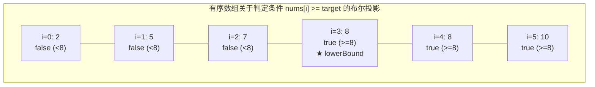

# 二分查找核心模板：从基础到左右边界锁定

**摘要：**

计算机科学巨匠 Donald Knuth 曾感叹："尽管第一篇二分查找论文在 1946 年就已发表，但直到 1962 年才有人写出第一个没有 Bug 的二分查找实现。"Jon Bentley 在《编程珠玑》中也记录道，他在贝尔实验室请专业程序员限时编写二分查找，90% 的代码存在边界漏解、数组越界或死循环。为什么一个思想简单到连小学生玩"猜数字"都懂的折半算法，落到代码里却成了面试翻车的重灾区？根源在于许多写代码的人靠死记硬背四五套零散模板，却从未理清**区间开闭契约（Interval Contract）**与**单调布尔阶跃函数**的本质。本文用一套高度统一、永不死循环的**双闭区间下界（`lowerBound`）框架**，将精确查找、插入位置、重复元素左右边界以及整数开方等全部基础变体一统江湖，并给出严密的循环不变量证明与 Golang 实现。

---

## 第 1 章 二分查找的第一性原理：从找"值"升维到找"分界线"

### 1.1 为什么背"精确查找模板"应付不了真实面试

在入门教材里，二分查找通常被描述为：在一个无重复元素的升序数组 `nums` 中寻找目标值 `target`，取中点 `mid`，若 `nums[mid] == target` 则立刻返回 `mid`（即 LeetCode 704）。

但这套"遇到相等就立刻返回"的朴素写法，一旦走上真实考场就会立刻碰壁：
- 如果数组中有 100 个重复的 `8`，`nums[mid] == 8` 只能告诉你撞见了其中一个 `8`，却根本不知道第一个 `8`（左边界）和最后一个 `8`（右边界）在哪里；
- 如果数组中根本没有 `target`，题目要求你返回"第一个大于等于 `target` 的元素位置"（如 LeetCode 35 搜索插入位置）或"最后一个小于 `target` 的元素位置"，朴素写法在循环结束返回 `-1` 时，手里的信息已经被丢弃了。

要彻底终结这种"一题一模板"的混乱，我们需要完成一次关键的认知升维：**不要把二分查找看作"在数组里找某个特定数值"，而要把它看作"在一个单调的布尔函数 $f(i)$ 上，寻找从 `false` 跃迁为 `true` 的分界点（下界 `lowerBound`）"**。



如上图所示，给定升序数组 `nums = [2, 5, 7, 8, 8, 10]` 和 `target = 8`，如果我们对每个下标 $i$ 提问："是否满足 `nums[i] >= 8`？"，那么整个数组就会投影为一个前半段全为 `false`（红色区）、后半段全为 `true`（蓝色区）的阶跃序列：

$$\underbrace{\text{false}, \text{false}, \text{false}}_{\text{全部 } < \text{target}}, \underbrace{\mathbf{\text{true}}, \text{true}, \text{true}}_{\text{全部 } \ge \text{target}}$$

在这个视图下，所有的二分查找问题，本质上都是在寻找**第一个 `true` 出现的下标（记作 `lowerBound(nums, target)`）**。

### 1.2 双闭区间 `[left, right]` 的循环不变量证明

为了把这根"红蓝分界线"精准找出来，且绝对不发生任何死循环或越界，我们全程固定采用**双闭区间 `[left, right]`** 约定。

什么是"双闭区间 `[left, right]` 的循环不变量"？它的意思是：**在每一次 `for` 循环开始前，下标处于 `[0, left - 1]` 内的所有元素，都已经确认是 `false`（严格小于 `target`）；下标处于 `[right + 1, n - 1]` 内的所有元素，都已经确认是 `true`（大于等于 `target`）；而目前唯一尚未查明身份的未知区域，就是闭区间 `[left, right]`**。

根据这一条不变量，代码的每一行都不再需要记忆，而是直接由逻辑推导出来：
1. **初始化**：一开始没有任何元素被查明身份，未知区覆盖全数组，故 `left = 0, right = n - 1`；
2. **循环继续条件**：什么时候未知区 `[left, right]` 才算彻底查完（变为空集）？注意这是双闭区间，当 `left == right` 时，区间 `[left, left]` 里**还装着 1 个尚未查明身份的元素**，绝不能提前退出。只有当 `left > right`（即 `left == right + 1`）时，未知区才真正为空，因此循环条件必然是 **`for left <= right`**；
3. **中点计算与状态转移**：取未知区中点 `mid = left + (right - left) / 2`：
   - 如果 `nums[mid] < target`（即 `mid` 处为 `false`）：由于数组单调非递减，`mid` 及其左侧的所有元素必然全为 `false`，`[left, mid]` 整段并入左侧红色已确认区，未知区缩减为 **`[mid + 1, right]`**，故令 **`left = mid + 1`**；
   - 如果 `nums[mid] >= target`（即 `mid` 处为 `true`）：`mid` 及其右侧的所有元素必然全为 `true`，`[mid, right]` 整段并入右侧蓝色已确认区，未知区缩减为 **`[left, mid - 1]`**，故令 **`right = mid - 1`**；
4. **终止时的指针位置**：当循环退出时，必有 `left == right + 1`。根据我们的循环不变量，`[0, left - 1]` 全是 `< target`（红色），而 `[right + 1, n - 1]`（即 `[left, n - 1]`）全是 `>= target`（蓝色）。由此可见，**循环结束时的 `left`（等价于 `right + 1`），分毫不差地停在第一个 `>= target` 的元素下标上**（若全数组所有元素都 `< target`，则 `left` 最终走出右界停在 `n` 上，表示应当插入在数组末尾）。

```go
package main

// lowerBound 双闭区间标准模板：返回有序数组 nums 中第一个 >= target 的元素下标
// 若所有元素均 < target，则返回 len(nums)
// 时间复杂度：O(log n)，空间复杂度：O(1)
func lowerBound(nums []int, target int) int {
	left, right := 0, len(nums)-1 // 未知闭区间 [left, right]

	for left <= right { // 区间非空时持续折半
		mid := left + (right-left)/2 // 防加法溢出
		if nums[mid] < target {
			left = mid + 1 // [left, mid] 均 < target，未知区缩减为 [mid+1, right]
		} else {
			right = mid - 1 // [mid, right] 均 >= target，未知区缩减为 [left, mid-1]
		}
	}
	// 退出时 left == right + 1：
	// [0, left-1] 均 < target，[left, n-1] 均 >= target
	return left
}
```

> [!info] 为什么这套闭区间模板能从根源上免疫死循环？
> 请看它的两个分支：一个写的是 `left = mid + 1`，另一个写的是 `right = mid - 1`。由于 `mid` 必然落在 `[left, right]` 之内，无论走哪一个分支，未知区间的长度 `right - left + 1` 在每一轮循环后都**至少严格减少 1**。一个有限的正整数每轮至少减 1，必然在有限步内减到 0 并退出循环，从数学上彻底消灭了死循环的任何可能性。

---

## 第 2 章 一个 `lowerBound` 统合四大不等式边界

一旦拥有了求"第一个 `>= target`"的 `lowerBound(nums, target)`，在整数有序数组上，其余三种不等式边界根本不需要另写新模板，只需做一次简单的算术等价代换即可全部导出：

| 查找目标 | 数学等价关系（整数域） | 直接调用 `lowerBound` 的表达式 | 越界（无解）判定条件 |
|----------|------------------------|--------------------------------|----------------------|
| 第一个 `>= x` 的位置（下界） | 原定义 | `idx := lowerBound(nums, x)` | `idx == len(nums)` |
| 第一个 `> x` 的位置（上界 `upperBound`） | 整数域中 `v > x` 等价于 `v >= x + 1` | `idx := lowerBound(nums, x + 1)` | `idx == len(nums)` |
| 最后一个 `< x` 的位置 | 第一个 `>= x` 的位置往左退一格 | `idx := lowerBound(nums, x) - 1` | `idx == -1`（即 `0` 号元素已 `>= x`） |
| 最后一个 `<= x` 的位置 | 第一个 `> x` 的位置往左退一格 | `idx := lowerBound(nums, x + 1) - 1` | `idx == -1`（即 `0` 号元素已 `> x`） |

看懂这张表，你会体验到一种豁然开朗的通透感：**四类看似繁杂的二分边界，本质上只是同一条红蓝分界线的左邻右舍**：
- 分界线右侧紧贴着的第 1 个格点，就是"第一个满足者"（`lowerBound`）；
- 分界线左侧紧贴着的第 1 个格点，就是"最后一个不满足者"（`lowerBound - 1`）。

（注：若元素类型为浮点数，或担心 `x == math.MaxInt` 时 `x + 1` 触发整数溢出，只需将 `lowerBound` 内部的比较符号 `nums[mid] < target` 改为 `nums[mid] <= target`，即得到独立的 `upperBound` 函数。）

---

## 第 3 章 实战演练：从精确查找到范围锁定与隐式二分

### 3.1 LeetCode 704（二分查找）与 LeetCode 35（搜索插入位置）

有了 `lowerBound`，**LeetCode 35（搜索插入位置）**的代码直接就是一行 `return lowerBound(nums, target)`——因为按顺序插入 `target` 的位置，根据定义就是原数组中第一个 `>= target` 的下标。

而**LeetCode 704（精确二分查找）**只需先调 `idx := lowerBound(nums, target)`，再检查 `idx` 是否越界以及 `nums[idx]` 是否真的等于 `target` 即可（当然也可以在循环内部遇到 `nums[mid] == target` 时提前返回）：

```go
package main

// searchInsert LeetCode 35：搜索插入位置，即标准 lowerBound
func searchInsert(nums []int, target int) int {
	return lowerBound(nums, target)
}

// search LeetCode 704：精确查找 target 的下标，不存在则返回 -1
func search(nums []int, target int) int {
	idx := lowerBound(nums, target)
	if idx == len(nums) || nums[idx] != target {
		return -1
	}
	return idx
}
```

### 3.2 LeetCode 34：在排序数组中查找元素的第一个和最后一个位置

**题目描述**：给你一个按照非递减顺序排列的整数数组 `nums`，和一个目标值 `target`。请你找出给定目标值在数组中的开始位置和结束位置。如果数组中不存在目标值 `target`，返回 `[-1, -1]`。

套用第 2 章的转换公式：
1. 开始位置（第一个 `== target` 的下标）：先找第一个 `>= target` 的下标 `start := lowerBound(nums, target)`。如果 `start == len(nums)`（说明全数组都小于 `target`）或者 `nums[start] != target`（说明第一个大于等于它的数直接跳到了比 `target` 更大的数，数组里根本没有 `target`），直接返回 `[-1, -1]`；
2. 结束位置（最后一个 `== target` 的下标）：既然 `target` 已经确认存在，那么最后一个 `== target` 的位置，必然就是"最后一个 `<= target` 的位置"，即 `end := lowerBound(nums, target + 1) - 1`。

```go
package main

// searchRange 两次调用同一个 lowerBound 锁定重复元素的起止区间
// 时间复杂度：O(log n)，空间复杂度：O(1)
func searchRange(nums []int, target int) []int {
	start := lowerBound(nums, target)
	if start == len(nums) || nums[start] != target {
		return []int{-1, -1}
	}
	// 既然 start 存在，end 必然也存在且 >= start
	end := lowerBound(nums, target+1) - 1
	return []int{start, end}
}
```

我们用 `nums = [5, 7, 7, 8, 8, 10], target = 8` 手动验证一下这两次调用的轨迹：
- **第一次调用 `lowerBound(nums, 8)`**：
  - 初始 `left = 0, right = 5`；
  - `mid = 2`（`nums[2] = 7 < 8`）$\to$ `left = 3`；
  - `mid = 4`（`nums[4] = 8 >= 8`）$\to$ `right = 3`；
  - `mid = 3`（`nums[3] = 8 >= 8`）$\to$ `right = 2`；
  - 循环因 `left(3) > right(2)` 退出，返回 `start = 3`（即第一个 `8` 的下标）。
- **第二次调用 `lowerBound(nums, 9)`**：
  - 初始 `left = 0, right = 5`；
  - `mid = 2`（`7 < 9`）$\to$ `left = 3`；
  - `mid = 4`（`8 < 9`）$\to$ `left = 5`；
  - `mid = 5`（`10 >= 9`）$\to$ `right = 4`；
  - 循环退出返回 `5`（第一个 `>= 9` 的元素 `10` 的下标），减一得 `end = 4`（即最后一个 `8` 的下标）。
- 最终返回 `[3, 4]`，全程共用同一个 10 行函数，零心智负担。

### 3.3 延伸实战：x 的平方根（LeetCode 69）与第一个错误的版本（LeetCode 278）

这套红蓝分界线模型不仅能查数组，还能直接查整数区间：
- **LeetCode 278（第一个错误的版本）**：版本号从 `1` 到 `n`，调用 API `isBadVersion(v)` 返回布尔值，求第一个 `true`。这简直就是把 `lowerBound` 的底层抽象直接搬上了台面：在闭区间 `[1, n]` 上二分，若 `!isBadVersion(mid)` 则 `left = mid + 1`，否则 `right = mid - 1`，退出时返回 `left`。
- **LeetCode 69（x 的平方根）**：给你一个非负整数 `x`，计算并返回 `x` 的算术平方根的整数部分（向下取整）。这等价于在闭区间 `[0, x]` 中寻找**最后一个满足 $m^2 \le x$ 的整数 $m$**。根据第 2 章表格，"最后一个满足条件（`true`）的位置"，在循环退出时恰好就是 **`right`**（即 `left - 1`）：

```go
package main

// mySqrt 二分查找最后一个满足 mid*mid <= x 的整数
func mySqrt(x int) int {
	left, right := 0, x
	for left <= right {
		mid := left + (right-left)/2
		if mid*mid <= x {
			left = mid + 1 // mid 满足 <= x，尝试更大的值
		} else {
			right = mid - 1 // mid*mid > x，必须缩小
		}
	}
	// 循环退出时，[0, left-1] (即 [0, right]) 均满足 m^2 <= x，故 right 为最大合法整数
	return right
}
```

### 3.4 进阶实战一：找到 K 个最接近的元素——对"窗口左端点"二分（LeetCode 658）

二分查找不仅能找单个元素下标，还能直接在数组中**锁定一个定长滑动窗口的起始位置**。

以 **LeetCode 658：找到 K 个最接近的元素**为例：给定一个排序好的数组 `arr`，以及两个整数 `k` 和 `x`，从数组中找到最靠近 `x`（两数之差绝对值最小；差值相同时选较小者）的 `k` 个数，并按升序返回。

很多人的第一反应是：先用 `lowerBound` 找到最接近 `x` 的那个单点，再用左右双指针像中心扩散一样往两边挑 $k$ 个数，耗时 $O(\log n + k)$。但能不能一步到位，直接把时间压到纯粹的 **$O(\log(n - k))$**？

请注意一个极其关键的结构事实：**由于原数组是有序的，最终挑出来的"最接近 `x` 的 $k$ 个连续元素"，必然是原数组中某个长度为 $k$ 的连续子数组 `arr[mid .. mid+k-1]`**。
- 一个长度为 $k$ 的窗口，其左端点 `mid` 的合法取值范围是闭区间 **`[0, n - k]`**；
- 假设当前考察左端点为 `mid` 的窗口 `arr[mid .. mid+k-1]`，以及它右移一格后的候选窗口 `arr[mid+1 .. mid+k]`。这两个窗口绝大部分元素完全重合，唯一的区别在于**左边缘的 `arr[mid]`** 与**右边缘外侧的 `arr[mid+k]`** 谁更靠近 `x`；
- 我们直接比较 `x - arr[mid]` 与 `arr[mid+k] - x`（注意不要加绝对值，这能天然处理 `x` 在两者同侧的退化情况）：
  1. **若 `x - arr[mid] > arr[mid+k] - x`**：说明左边缘 `arr[mid]` 离 `x` 更远（更劣），放弃 `arr[mid]` 而纳入 `arr[mid+k]` 会让窗口整体更贴近 `x`。不仅如此，所有比 `mid` 更靠左的起点都会包含更远的左端元素，因此最优左端点必然在 **`[mid + 1, right]`**，令 `left = mid + 1`；
  2. **若 `x - arr[mid] <= arr[mid+k] - x`**：说明 `arr[mid]` 比 `arr[mid+k]` 更近（或等距且数值更小），无需再往右移，最优左端点在 **`[left, mid]`**，令 `right = mid - 1`。

```go
package main

// findClosestElements 直接在窗口左端点空间 [0, n-k] 上二分，查找复杂度 O(log(n-k))
func findClosestElements(arr []int, k int, x int) []int {
	left, right := 0, len(arr)-k-1

	for left <= right {
		mid := left + (right-left)/2
		// 比较当前窗口左端 arr[mid] 与右移一格新纳入的 arr[mid+k] 谁离 x 更远
		if x-arr[mid] > arr[mid+k]-x {
			left = mid + 1 // arr[mid] 更劣，窗口左端点必须右移
		} else {
			right = mid - 1 // arr[mid] 更优或等距，窗口左端点无需超过 mid
		}
	}
	return arr[left : left+k]
}
```

### 3.5 进阶实战二：奇偶下标对齐性质二分——有序数组中的单一元素（LeetCode 540）

再看一道把"红蓝阶跃函数"玩出花来的巧题——**LeetCode 540：有序数组中的单一元素**。给你一个仅由整数组成的有序数组，其中每个元素都会出现两次，唯独有一个数只会出现一次。请在 $O(\log n)$ 时间和 $O(1)$ 空间内找出这个单一元素。

初看之下，数组虽然有序，但我们事先根本不知道要找的那个单一元素数值是多少，没有 `target` 怎么比大小？

洞察藏在**成对元素的奇偶下标奇偶性（Parity Invariant）**里：
- 在那个落单的元素出现**之前**，所有成对的元素都是完美的两两一组：第 1 对坐在下标 `(0, 1)`，第 2 对坐在 `(2, 3)`，第 3 对坐在 `(4, 5)`……也就是说，**在单一元素左侧，每一个偶数下标 `2k` 都必然与它紧邻的奇数下标 `2k + 1` 相等（`nums[2k] == nums[2k+1]`）**；
- 一旦那个只占 1 个格子的单一元素插进来，它后面所有成对元素的座位就全部被往后挤歪了 1 格，变成了 `(奇, 偶)` 配对——也就是说，**在单一元素所在处及其右侧，偶数下标 `2k` 必然不等于 `nums[2k+1]`（反而等于 `nums[2k-1]`）**。

看，红蓝阶跃分界线又浮现出来了：我们对偶数下标（可通过位运算 `mid &^ 1` 或 `mid ^ 1` 巧妙对齐配对伙伴）提问："是否满足 `nums[mid] != nums[mid^1]`？"
- 前半段（单一元素左侧）全为 `false`（`nums[mid] == nums[mid^1]`）；
- 后半段（从单一元素所在偶数下标开始）全为 `true`（`nums[mid] != nums[mid^1]`）；
- 第一个 `true` 所在的下标，就是那个落单的元素：

```go
package main

// singleNonDuplicate 利用奇偶下标配对错位构造阶跃函数，O(log n) 锁定落单元素
func singleNonDuplicate(nums []int) int {
	// 单一元素必然落在某个偶数下标上，我们对偶数下标的半数编号 [0, n/2 - 1] 二分
	left, right := 0, len(nums)/2-1

	for left <= right {
		mid := left + (right-left)/2
		if nums[mid*2] == nums[mid*2+1] {
			// (偶, 奇) 依然成对相等，说明单一元素还在右侧
			left = mid + 1
		} else {
			// 配对已错位，说明单一元素在 mid*2 或其左侧
			right = mid - 1
		}
	}
	return nums[left*2]
}
```

### 3.6 拓展对比：指数查找（Exponential Search）在无界流中的妙用

如果面试官问："如果一个升序数组长度是无穷大的（或者是一个不支持 `len()`、只支持按下标 `get(i)` 读取的流，如 LeetCode 702 搜索长度未知的有序数组），你连初始右边界 `right = n - 1` 都不知道，怎么二分？"

答案是**指数查找（Exponential Search，又称倍增查找 Galloping Search）**：
1. **倍增探界阶段**：从 `bound = 1` 开始，只要 `get(bound) < target`，就把 `bound` 不断乘 2（`1, 2, 4, 8, 16...`），直到第一次发现 `get(bound) >= target`（假设发生在第 $k$ 步，此时 $\text{bound} = 2^k$）；
2. **闭区间二分阶段**：既然前一步 `get(bound/2) < target` 而当前 `get(bound) >= target`，说明目标值必然被夹在闭区间 **`[bound/2 + 1, bound]`** 之内。接下来在这个已知上下界的区间上调一次标准 `lowerBound` 即可。

假设目标值的真实下标是 $idx$，倍增阶段最多走 $\lceil \log_2(idx) \rceil$ 步，随后的二分阶段也只走 $\lceil \log_2(idx) \rceil$ 步，总时间复杂度为 **$O(\log(idx))$**——当目标值本身就靠在数组前端（$idx \ll n$）时，指数查找甚至比全数组二分 $O(\log n)$ 还要快得多（这也是第 01 篇提到的 `TimSort` 在合并归并段时用来批量跳过前缀元素的 `Galloping Mode` 核心算子）。

```go
package main

// ArrayReader 模拟 LeetCode 702 的无界只读有序流接口（越界时返回 2^31 - 1）
type ArrayReader interface {
	Get(index int) int
}

// searchUnbounded 指数查找（倍增探界 + 闭区间二分），时间复杂度 O(log(targetIdx))
func searchUnbounded(reader ArrayReader, target int) int {
	if reader.Get(0) == target {
		return 0
	}

	// 1. 倍增探界：以 1, 2, 4, 8... 指数级扩张右界，直至框住 target
	left, right := 0, 1
	for reader.Get(right) < target {
		left = right + 1
		right <<= 1
	}

	// 2. 在已锁定的有限闭区间 [left, right] 内执行标准二分
	for left <= right {
		mid := left + (right-left)/2
		val := reader.Get(mid)
		if val == target {
			return mid
		} else if val < target {
			left = mid + 1
		} else {
			right = mid - 1
		}
	}
	return -1
}
```

### 3.7 进阶实战三：有效三角形的个数与二分 vs 双指针权衡（LeetCode 611）

在有序数组上找满足不等式条件的元素范围，也是 `lowerBound` 的拿手好戏。以 **LeetCode 611：有效三角形的个数**为例：给定一个包含非负整数的数组 `nums`，返回其中可以组成三角形三条边的三元组个数。

将数组升序排列后，若三条边下标满足 $i < j < k$（即 $nums[i] \le nums[j] \le nums[k]$），由于较小两边之和大于最大边即可构成三角形，充要条件简化为单一不等式：

$$nums[k] < nums[i] + nums[j]$$

当我们固定前两条边 $i$ 和 $j$ 时，第三条边 $k$ 的合法下标范围就是区间 `[j + 1, n - 1]` 中所有严格小于 `nums[i] + nums[j]` 的位置。根据第 2 章的转换表，"最后一个 `< x` 的位置"就是 **`lowerBound(nums[j+1:], nums[i] + nums[j]) - 1`**，用一次二分即可在 $O(\log n)$ 内算出合法的 $k$ 的个数，总体耗时 $O(n^2 \log n)$（若进一步观察到当 $j$ 递增时 `nums[i] + nums[j]` 单调递增，右界 $k$ 亦可单调右移不回退，从而演进为双指针专栏的 $O(n^2)$ 做法）。这种"先写 `lowerBound` 稳拿 $O(n^2 \log n)$ 保底，再顺势推导同向双指针 $O(n^2)$"的递进策略，在面试场上极其稳健。

### 3.8 进阶实战四：插值查找（Interpolation Search）与均匀分布下的 $O(\log \log n)$

既然二分查找每次都雷打不动地切在正中间 `mid = left + (right - left) / 2`，有没有可能切得更聪明一点？

想象你翻一本按字母 `A` 到 `Z` 排列的厚词典查单词 `"apple"`：你绝不会先从词典正中间的字母 `M` 翻起，而是会本能地翻开最前面约 $1/26$ 的书页；查 `"zoo"` 时则会直接翻到最后几页。把这种利用**数值线性比例**来估算目标下标的直觉写成公式，就是**插值查找（Interpolation Search）**：

$$mid = left + \left\lfloor \frac{target - nums[left]}{nums[right] - nums[left]} \times (right - left) \right\rfloor$$

当数组元素近似服从**均匀分布（Uniform Distribution）**时，插值查找每次能将搜索区间长度从 $m$ 直接压缩到 $\sqrt{m}$ 量级，平均时间复杂度达到惊人的 **$O(\log \log n)$**（对十亿个均匀整数查找仅需约 5 次探测）。但它的软肋同样明显：一旦数据分布极不均匀（如指数增长序列 `1, 2, 4, 8, ..., 2^30`），线性插值算出的 `mid` 每次都严重偏离中点，最坏时间复杂度会直接崩塌到 $O(n)$。这也从侧面印证了二分查找固定取中点 `1/2` 的伟大之处——**它放弃了对数据分布形态的任何侥幸假设，换取了无论面对何种恶意分布都坚如磐石的 $\lceil \log_2 n \rceil$ 最坏上界保证**。

---

## 第 4 章 三大区间流派的全景对照明细

虽然笔者强烈建议在面试中固定使用**双闭区间 `[left, right]`**，但为了让你在阅读标准库源码（如 Go 的 `sort.Search` 采用左闭右开 `[0, n)`）或与他人交流时游刃有余，下面将二分查找的三大主流区间写法并列对比：

| 对比维度 | 双闭区间 `[left, right]`（本文主推） | 左闭右开区间 `[left, right)`（`sort.Search`） | 双开区间 `(left, right)` |
|----------|--------------------------------------|----------------------------------------------|--------------------------|
| 初始边界 | `left = 0, right = n - 1` | `left = 0, right = n` | `left = -1, right = n` |
| 循环继续条件 | `for left <= right` | `for left < right` | `for left + 1 < right` |
| 左侧不满足时更新 | `left = mid + 1` | `left = mid + 1` | `left = mid` |
| 右侧满足时更新 | `right = mid - 1` | `right = mid` | `right = mid` |
| 循环退出时的指针关系 | `left == right + 1` | `left == right` | `left + 1 == right` |
| 第一个 `>= target` 的返回值 | `left`（或 `right + 1`） | `left`（或 `right`） | `right` |

请注意：无论选择哪一种流派，**初始边界、循环条件、左右更新步长**这四项都是由该流派的区间开闭定义唯一锁死的配套组件，**绝对禁止跨流派混搭**（譬如把双闭区间的 `for left <= right` 与左闭右开的 `right = mid` 混在一起，当 `left == right` 且满足条件时就会原地踏步死循环）。

---

## 第 5 章 常见误区与边界自检

1. **`mid = (left + right) / 2` 的加法溢出**：在 32 位整数环境下，若数组长度或值域二分上界超过 $2^{30}$（约 10.7 亿），当 `left` 和 `right` 同时位于右半区时，`left + right` 会突破 $2^{31} - 1$ 变成负数，引发数组负数下标越界 panic。务必养成肌肉记忆写 `mid := left + (right - left) / 2`（或无符号右移 `int(uint(left+right) >> 1)`，Go 标准库 `sort.Search` 正是用的后者）。
2. **`lowerBound` 返回值未做越界检查直接访问 `nums[idx]`**：当目标值 `target` 比数组中所有元素都大时，`lowerBound` 返回的是 `len(nums)`。如果接下来要判断元素是否等于 `target`，必须先检查 `idx < len(nums)`，再利用短路求值判断 `nums[idx] == target`。
3. **乘法判定的整数溢出**：在类似 `mySqrt`（LC 69）或矩阵二分题中，在 32 位整型语言里写 `mid * mid <= x`，当 `mid` 达到 $50000$ 以上时平方就会溢出。在 Go 的 64 位架构下 `int` 为 64 位故对于 $x \le 2^{31}-1$ 安全，但在 32 位环境或 $x$ 可达 $2^{62}$ 时，应改写为除法形式 `mid <= x / mid`（注意先特判 `mid == 0`）。
4. **在浮点二分中沿用整数的 `+1 / -1` 步进**：当二分查找的舞台从离散的整数下标切换到连续的实数域（譬如求高次方程的根、计算几何中的最小覆盖圆半径，或求精度达 $10^{-7}$ 的实数平方根）时，区间 `[left, right]` 内有无穷多个实数，若写成 `left = mid + 1` 就会把区间 `(mid, mid + 1)` 内的真正实数解直接跨过去漏掉。因此实数二分的铁律是：**分支更新直接写 `left = mid` 与 `right = mid`，且为了避免浮点数尾数精度耗尽导致的 `mid == left` 死循环，最稳妥的控制方式是不写 `for right - left > eps`，而是直接固定循环迭代次数（如 `for iter := 0; iter < 100; iter++`）**——因为每迭代 100 次，区间宽度就会缩小到原来的 $2^{-100} \approx 7.8 \times 10^{-31}$，早已超越了 64 位双精度浮点数（`float64` 仅 53 位有效尾数，约 $10^{-16}$ 相对精度）所能表达的物理极限，既绝对精确又百分之百免疫死循环。
5. **用二分查找代替哈希表处理高频单点精确查询**：虽然二分查找在有序数组上只需 $O(\log n)$ 时间且零额外空间，但如果业务场景是"对同一个静态集合发起数百万次纯等值存在性查询（Exact Match）"，且内存充裕，那么哈希表的 $O(1)$ 均摊查询依然更快；二分查找真正的不可替代性在于**范围查询（Range Query，即 `upperBound - lowerBound`）、前驱后继查询（Predecessor / Successor，如 `lowerBound` 与 `lowerBound - 1`）以及无法预存的隐式单调函数求逆**。
6. **在单链表或跳表外强行套用下标二分**：二分查找之所以能在 $O(\log n)$ 时间内完成，前提是底层存储支持 **$O(1)$ 随机访问 `nums[mid]`**。如果底层是普通单链表，每次定位中点 `mid` 都必须从 `left` 顺着指针走 $(right - left) / 2$ 步，总时间复杂度会从 $O(\log n)$ 退化为 $n/2 + n/4 + n/8 + \cdots = O(n)$，比直接从头线性扫描还要慢。要在链式结构上实现 $O(\log n)$ 折半查找，必须引入多层前进指针（即 Redis 有序集合底层采用的**跳表 Skip List**）或二叉搜索树。
7. **在 LeetCode 658（找到 K 个最接近的元素）中误对比较式取绝对值**：在 3.4 节比较窗口左边缘 `x - arr[mid]` 与右移新元素 `arr[mid+k] - x` 时，绝对不能写成 `abs(x - arr[mid]) > abs(arr[mid+k] - x)`。试想当 `arr = [1, 1, 2, 2, 2, 2, 2, 3, 3], x = 3, k = 3` 且当前窗口落在全为 `2` 的平坦区 `arr[mid] == arr[mid+k] == 2` 时，取绝对值会导致两边相等 `|3 - 2| == |2 - 3|`，从而错误地向左收缩 `right = mid - 1`（远离了右侧的 `3`）；而不取绝对值时，左边 `x - arr[mid] = 1` 严格大于右边 `arr[mid+k] - x = -1`，能正确驱动窗口向右朝 `3` 所在的方向推进。此外，注意该题二分的搜索对象是窗口左端点 `mid`，故初始右边界必须严格设为 `len(arr) - k - 1`（双闭区间），从而保证在最后一次比较中访问 `arr[mid+k]` 时下标最大为 `len(arr) - 1`，绝不发生数组越界异常。

```go
package main

// sqrtFloat64 实数域二分标准写法：固定迭代次数，彻底规避浮点精度死循环与 +1 漏解
func sqrtFloat64(x float64) float64 {
	if x <= 0 {
		return 0
	}
	left, right := 0.0, max(1.0, x) // 注意当 0 < x < 1 时，平方根大于 x 本身，故右界至少取 1.0
	for iter := 0; iter < 100; iter++ {
		mid := left + (right-left)/2
		if mid*mid <= x {
			left = mid
		} else {
			right = mid
		}
	}
	return left
}
```

---

## 小结

本章用"区间循环不变量"与"单调布尔阶跃函数"两大支柱，将二分查找化繁为简：
- 抛弃"遇到相等即返回"的狭隘视角，把二分查找统一定义为求阶跃函数第一个 `true` 的位置 `lowerBound`；
- 在双闭区间 `[left, right]` 下，依靠 `left = mid + 1` 与 `right = mid - 1` 的严格缩减，从数学上杜绝死循环，并在退出时由 `left` 给出第一個 `>= target`、由 `right` 给出最后一个 `< target`；
- 通过 `target + 1` 与下标 `- 1` 的等价转换，仅凭一个 10 行的 `lowerBound` 函数即可通杀四大不等式边界，彻底告别死记硬背四套不同边界模板的痛苦。

下一篇 [[06 二分查找的变体：旋转有序数组与有序矩阵]] 将探讨当全局单调性被打破（数组被旋转截断、存在局部峰值，或扩展为二维矩阵）时，如何依然依靠"每步排除一半"的思想维持对数级查找效率。

---

## 参考资料

1. Bentley, J. (1999). *Programming Pearls* (2nd ed.). Addison-Wesley. Column 4: Writing Correct Programs.
2. Knuth, D. E. (1998). *The Art of Computer Programming, Volume 3: Sorting and Searching* (2nd ed.). Section 6.2.1: Searching an Ordered Table.
3. Bloch, J. (2006). *Extra, Extra - Read All About It: Nearly All Binary Searches and Mergesorts are Broken*. Google AI Blog.
4. Go Standard Library `sort/search.go`. https://pkg.go.dev/sort#Search

---

> [!note] 思考题
> 1. Go 标准库的 `sort.Search(n int, f func(int) bool) int` 采用的是第 4 章表格中的"左闭右开 `[0, n)`"模板。请写出它的 10 行内部实现，并证明为什么在 `mid = int(uint(i+j) >> 1)`（向下取整）的前提下，写 `i = mid + 1` 和 `j = mid` 绝对不会发生死循环？
> 2. 如果一个升序数组中包含大量重复元素，且已知目标值 `target` 在数组中出现的次数 $k$ 非常大（譬如占了数组的一半），除了用两次 `lowerBound` 分别找左右边界（共耗时 $2 \log_2 n$），还有什么办法能在第一次二分撞见某个等于 `target` 的位置后，缩小左右边界二分的初始范围？
> 3. 在浮点域上求 $\sqrt{x}$（要求精度达到 $10^{-7}$）时，为什么不能再写 `left = mid + 1`，而应该直接令 `left = mid` 或 `right = mid`，并将循环终止条件设为固定迭代 100 次或 `right - left > 1e-7`？
