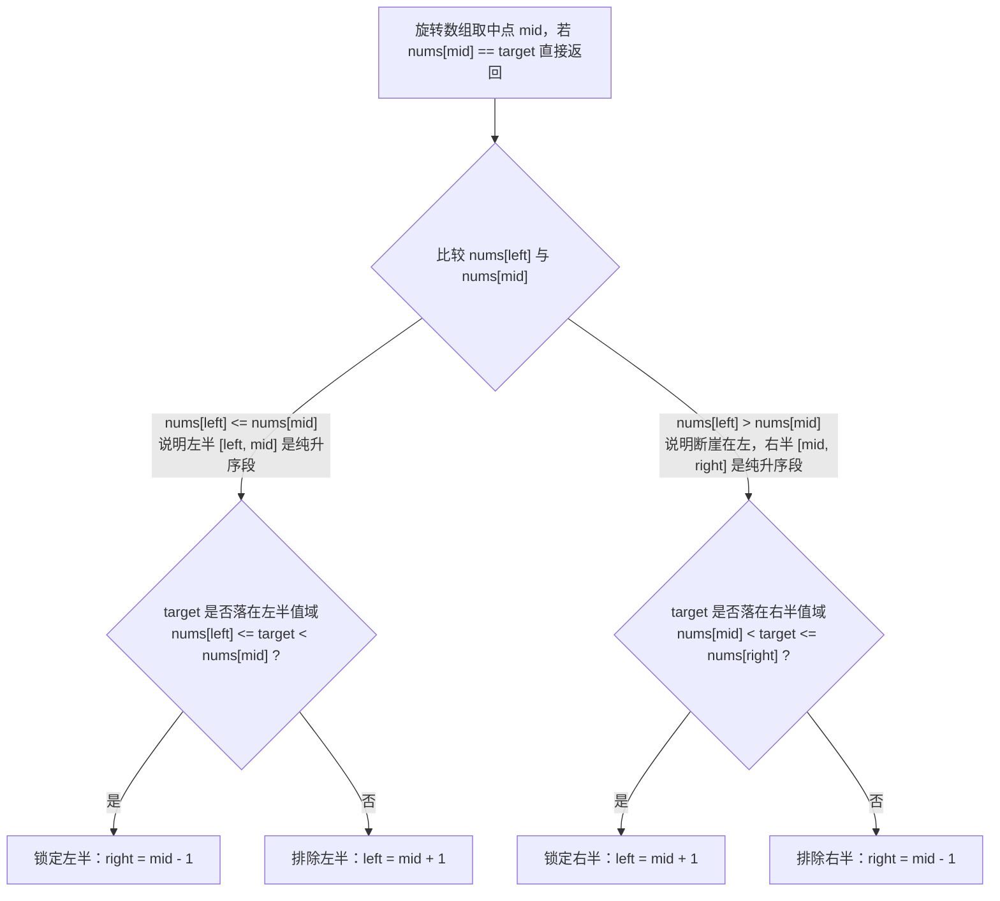
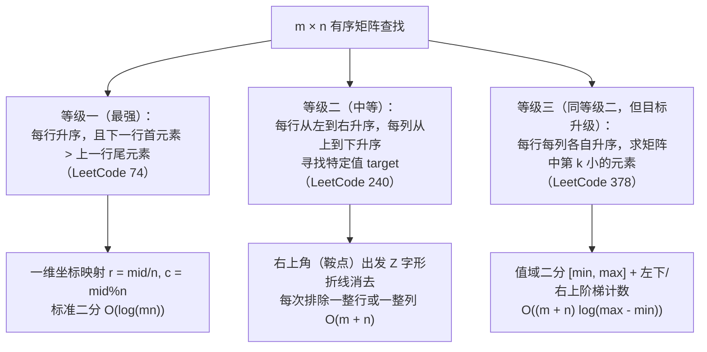

# 二分查找的变体：旋转有序数组与有序矩阵

**摘要：**

许多初学者形成了一个思维定势："只有当整个一维数组从头到尾排好序时，才能使用二分查找。"然而在算法面试中，高频出现的往往是那些**全局单调性被打破或维度发生升维**的变形题——或是把升序数组拦腰截断再前后对调的**旋转排序数组**（LeetCode 33、81、153），或是连局部有序都不保证、只要求找出任意一个局部极大值的**寻找峰值**（LeetCode 162），或是扩展到二维平面的**有序矩阵搜索**（LeetCode 74、240、378）。本文深入揭示二分查找更深层的本质：**二分的充要条件从来不是"全局有序"，而是"在观察中点 `mid` 之后，拥有一条确凿的逻辑判据，能够百分之百断定答案在哪一侧（或者哪一侧绝对没有答案）"**。全文配齐七道代表性题目的推导证明与 Golang 实现。

---

## 第 1 章 旋转有序数组：两段单调区间的二分定位

### 1.1 旋转数组的几何结构与"必有一半有序"定理

将一个原本严格升序的数组 `[0, 1, 2, 4, 5, 6, 7]` 在某个未知轴点处切开并左右互换，得到 `[4, 5, 6, 7, 0, 1, 2]`，这就是**旋转排序数组（Rotated Sorted Array）**。

如果把它的数值画在坐标系里，你会看到两条斜率向上的线段：**左高坡段** `[4, 5, 6, 7]` 与**右低谷段** `[0, 1, 2]`，并且在交界处（从 `7` 到 `0`）存在唯一一个"断崖式下跌"的旋转点。更重要的是，由于原数组是升序的，**左高坡段的最小元素（即左端点 `nums[0] = 4`）依然严格大于右低谷段的最大元素（即右端点 `nums[n-1] = 2`）**。

当我们取区间 `[left, right]` 的中点 `mid` 时，那处唯一的"断崖"不可能同时既在 `[left, mid]` 里、又在 `[mid, right]` 里。由此得出旋转数组二分的第一定理：
> **对任意区间 `[left, right]` 及其中心点 `mid`，左半区间 `[left, mid]` 与右半区间 `[mid, right]` 之中，至少有一个半区是不包含断崖的纯粹升序区间。**



### 1.2 LeetCode 33：搜索旋转排序数组（无重复元素）

**题目描述**：整数数组 `nums` 按升序排列，数组中的值**互不相同**。在传递给函数之前，`nums` 在预先未知的某个下标上进行了旋转。给你旋转后的数组 `nums` 和一个整数 `target`，如果 `nums` 中存在这个目标值则返回它的下标，否则返回 `-1`。要求时间复杂度为 $O(\log n)$。

既然"必有一半是纯升序段"，而**一个纯升序段的值域范围就是 `[段首, 段尾]`**，我们的策略极其清晰——**永远先拿那个纯升序半区的首尾端点去卡 `target`**：
1. 若 `nums[left] <= nums[mid]`（注意因为 `mid = left + (right-left)/2` 向下取整，当 `left == right - 1` 时 `mid` 会等于 `left`，所以这里必须写 **`<=`**）：左半 `[left, mid]` 是纯升序段。我们立刻检查 `target` 是否落在 `[nums[left], nums[mid])` 之间——若是，则答案必在左半，令 `right = mid - 1`；若否，则左半绝无答案，令 `left = mid + 1`；
2. 若 `nums[left] > nums[mid]`：右半 `[mid, right]` 是纯升序段。我们检查 `target` 是否落在 `(nums[mid], nums[right]]` 之间——若是，令 `left = mid + 1`；若否，令 `right = mid - 1`。

```go
package main

// search LeetCode 33：在无重复元素的旋转排序数组中二分搜索 target
// 时间复杂度：O(log n)，空间复杂度：O(1)
func search(nums []int, target int) int {
	left, right := 0, len(nums)-1

	for left <= right {
		mid := left + (right-left)/2
		if nums[mid] == target {
			return mid
		}

		// 1. 先判定哪一半是纯升序区间（注意此处必须是 <=，处理 left == mid 的双元素情形）
		if nums[left] <= nums[mid] {
			// 左半 [left, mid] 纯升序，用左半首尾卡 target
			if nums[left] <= target && target < nums[mid] {
				right = mid - 1
			} else {
				left = mid + 1
			}
		} else {
			// 右半 [mid, right] 纯升序，用右半首尾卡 target
			if nums[mid] < target && target <= nums[right] {
				left = mid + 1
			} else {
				right = mid - 1
			}
		}
	}
	return -1
}
```

### 1.3 LeetCode 81：搜索旋转排序数组 II（含重复元素时的信息坍缩）

如果旋转数组中包含**重复元素**（LeetCode 81），上面的代码在什么情况下会失灵？

考虑两个输入：`A = [1, 0, 1, 1, 1]` 和 `B = [1, 1, 1, 0, 1]`，我们要找 `target = 0`。
第一轮 `left = 0, right = 4, mid = 2`。你会发现，无论是数组 `A`（断崖在左半）还是数组 `B`（断崖在右半），它们表现出来的特征都是完全一样的：

$$\text{nums}[left] == \text{nums}[mid] == \text{nums}[right] == 1$$

此时，左端点、中点、右端点全都是 `1`，你根本无法通过比较 `nums[left]` 与 `nums[mid]` 来判断断崖究竟在左边还是右边——**重复元素抹平了高低落差，导致二分判定所需的信息坍缩了**。

面对这种 `nums[left] == nums[mid] && nums[mid] == nums[right]` 的僵局，怎么破？既然 `nums[mid]` 已经确认不等于 `target`（否则前面已经返回 `true` 了），那么与 `nums[mid]` 相等的 `nums[left]` 和 `nums[right]` 也绝对不等于 `target`。我们只需将左右边界各向内收缩一格（**`left++; right--`**），剥掉这层遮挡视线的相等外壳，下一轮继续二分即可：

```go
package main

// searchWithDup LeetCode 81：含重复元素的旋转排序数组搜索
// 平均时间复杂度：O(log n)，最坏时间复杂度（全相等除一个外）：O(n)
func searchWithDup(nums []int, target int) bool {
	left, right := 0, len(nums)-1

	for left <= right {
		mid := left + (right-left)/2
		if nums[mid] == target {
			return true
		}

		// 当左、中、右三点同值时，无法判断哪半边有序，直接剥离左右边界
		if nums[left] == nums[mid] && nums[mid] == nums[right] {
			left++
			right--
			continue
		}

		if nums[left] <= nums[mid] {
			if nums[left] <= target && target < nums[mid] {
				right = mid - 1
			} else {
				left = mid + 1
			}
		} else {
			if nums[mid] < target && target <= nums[right] {
				left = mid + 1
			} else {
				right = mid - 1
			}
		}
	}
	return false
}
```

> [!warning] 理论认知：为什么含重复元素时最坏复杂度必然是 $\Omega(n)$
> 当数组是 `[1, 1, 1, ..., 1, 0, 1, ..., 1]`（$n-1$ 个 `1` 里藏着唯一一个 `0`）时，那个 `0` 可能藏在任意一个下标上。在你没有刚好抽中 `0` 所在下标之前，你看到的任何采样点永远都是 `1`，没有任何比较能帮你排除掉一半位置。因此任何基于比较的算法在这种极端输入下都至少要检查 $\Omega(n)$ 个位置，退化为 $O(n)$ 是信息论决定的必然，而非算法写得不够好。

### 1.4 LeetCode 153：寻找旋转排序数组中的最小值

如果题目不是找特定值 `target`，而是直接让你找出旋转数组中的**最小元素**（即断崖谷底，LeetCode 153），该拿 `nums[mid]` 跟谁比？

很多初学者习惯拿 `nums[mid]` 跟左端点 `nums[left]` 比，结果发现非常别扭：因为如果 `nums[left] < nums[mid]`，当区间尚未旋转（如 `[1, 2, 3, 4, 5]`）时最小值在左边，而当区间已旋转（如 `[4, 5, 6, 1, 2]`）时最小值又在右边，情况分裂了。

**诀窍在于：找谷底时，永远拿 `nums[mid]` 跟右端点（或者数组最末尾元素）比**：
- 如果 `nums[mid] > nums[right]`：说明 `mid` 站在左高坡上，而 `right` 在右低谷里，断崖谷底**必然在 `mid` 的严格右侧 `[mid + 1, right]`**，令 `left = mid + 1`；
- 如果 `nums[mid] < nums[right]`：说明从 `mid` 到 `right` 是一段平滑上升的斜坡，`mid` 右侧的 `[mid + 1, right]` 全都比 `nums[mid]` 大，绝不可能是最小值（但 `mid` 本身可能是谷底），故令 `right = mid`（或在闭区间下对比 `nums[n-1]`）：

```go
package main

// findMin LeetCode 153：寻找旋转排序数组中的最小值
func findMin(nums []int) int {
	n := len(nums)
	left, right := 0, n-1
	last := nums[n-1] // 以数组最后一个元素作为左右两段的天然分水岭

	// 左高坡段全部 > last（false），右低谷段全部 <= last（true）
	// 最小值即为右低谷段的第一个元素（即第一个 <= last 的下标）
	for left <= right {
		mid := left + (right-left)/2
		if nums[mid] > last {
			left = mid + 1
		} else {
			right = mid - 1
		}
	}
	return nums[left]
}
```

看上面的代码：我们直接以数组末尾元素 `last = nums[n-1]` 为标杆——左高坡上的所有数都严格大于 `last`（记为 `false`），右低谷里的所有数都小于等于 `last`（记为 `true`）。于是"找旋转数组最小值"，瞬间又坍缩成了第 05 篇讲过的**标准 `lowerBound`（找第一个 `<= last` 的位置）**，连一行特殊逻辑都不需要。

### 1.5 LeetCode 154：寻找旋转排序数组中的最小值 II（含重复元素时的右界剥离）

紧接着看含重复元素的版本——**LeetCode 154**。当数组中存在相等元素时，如果我们拿 `nums[mid]` 与当前区间右端点 `nums[right]` 比大小（采用左闭右开 `[left, right)` 或向 `right` 靠拢的闭区间），会遇到三种情况：
1. **`nums[mid] > nums[right]`**：`mid` 必在左高坡，`right` 必在右低谷，最小值一定在 `[mid + 1, right]` 内，故令 `left = mid + 1`；
2. **`nums[mid] < nums[right]`**：`mid` 到 `right` 单调不减，`right` 及 `mid` 右侧的元素不可能是唯一最小值，故令 `right = mid`；
3. **`nums[mid] == nums[right]`**：此时无法判断 `mid` 是在左高坡还是右低谷。但请注意一个极其优美的性质——**既然 `nums[mid]` 与 `nums[right]` 数值完全相等，即便 `nums[right]` 恰好就是全局最小值，在它左边的 `nums[mid]` 也替它保留了一个一模一样的最小值副本**。因此，直接丢弃右端点（令 **`right--`**）绝对不会丢失全局最小值：

```go
package main

// findMinWithDup LeetCode 154：含重复元素的旋转数组最小值
func findMinWithDup(nums []int) int {
	left, right := 0, len(nums)-1
	for left < right {
		mid := left + (right-left)/2
		if nums[mid] > nums[right] {
			left = mid + 1
		} else if nums[mid] < nums[right] {
			right = mid
		} else {
			// nums[mid] == nums[right]：有 nums[mid] 保底，安全丢弃右端点
			right--
		}
	}
	return nums[left]
}
```

---

## 第 2 章 彻底抛弃有序性：爬坡法寻找局部峰值（LeetCode 162）

如果数组连"两段有序"都不是，完全是一个乱序起伏的山脉数组 `nums`（已知相邻元素不相等 `nums[i] != nums[i+1]`，且假设数组边界外 `nums[-1] = nums[n] = -∞`），要求在 $O(\log n)$ 时间内找出**任意一个峰值元素**（即严格大于左右邻居的元素，LeetCode 162），二分查找凭什么还能奏效？

凭的是微积分里的罗尔定理在离散序列上的投影——**"人往高处走，必有一座山峰在前方等你"**。

我们在区间中点 `mid` 处观察它与右邻居 `mid + 1` 的局部坡度：
1. **如果 `nums[mid] < nums[mid + 1]`（当前处于上坡路段 $\nearrow$）**：既然从 `mid` 往 `mid + 1` 是在往上走，而数组最右端边界外 `nums[n] = -∞` 最终必然要往下跌，那么在 `[mid + 1, n - 1]` 这段区间里，高度不可能永远上升而不回落，**右侧必然至少存在一座山峰**。因此我们可以安全地抛弃左半区，令 `left = mid + 1`；
2. **如果 `nums[mid] > nums[mid + 1]`（当前处于下坡路段 $\searrow$）**：同理，从 `mid + 1` 往左看是上坡，而最左端边界外 `nums[-1] = -∞`，说明**在 `[0, mid]` 这段区间里必然至少存在一座山峰**，令 `right = mid - 1`（或半开区间 `right = mid`）：

```go
package main

// findPeakElement 顺着上坡方向二分，在完全无序数组中 O(log n) 锁定局部峰值
func findPeakElement(nums []int) int {
	// 在 [0, n-2] 中寻找第一个满足 nums[i] > nums[i+1]（开始下坡）的位置
	left, right := 0, len(nums)-2
	for left <= right {
		mid := left + (right-left)/2
		if nums[mid] < nums[mid+1] {
			left = mid + 1 // 上坡，峰顶必在右侧 [mid+1, ...]
		} else {
			right = mid - 1 // 下坡，mid 本身或其左侧必有峰顶
		}
	}
	return left
}
```

这道题是打破"二分必须有序"思维枷锁的最佳教具：**哪怕数组整体杂乱无章，只要局部斜率能给出"哪一侧百分之百存在解"的存在性担保，二分查找就能照常运行**。

### 2.2 进阶延伸：山脉数组的峰顶与目标查找（LeetCode 852 & 1095）

如果题目给出的是一座严格先升后降的"山脉数组"（Mountain Array，即存在唯一的峰顶 `peak`，左侧 `0..peak` 严格递增，右侧 `peak..n-1` 严格递减）：
- **找峰顶（LeetCode 852）**：直接调用上面 2.1 节的 `findPeakElement` 即可在 $O(\log n)$ 内锁定唯一的峰顶下标 `peak`；
- **在山脉数组中查找目标值 `target`（LeetCode 1095）**：先花一次二分找到峰顶 `peak`，此时山脉被峰顶切成了左坡 `[0, peak]`（纯升序）与右坡 `[peak+1, n-1]`（纯降序）两段。先在左坡跑一遍升序二分找 `target`，若未找到，再在右坡跑一遍降序二分（比较符号反过来）找 `target`。三次二分合计 $3 \log_2 n$ 次查询，清晰工整。

### 2.3 升维打击：寻找二维峰值 II（LeetCode 1901）

如果把"无序数组找局部峰值"升维到二维平面——给定一个无序的 $m \times n$ 矩阵 `mat`（四周边界外视为 `-1`，且相邻格子数值不等），要求在 **$O(m \log n)$** 时间内找出任意一个严格大于其上下左右四个邻居的峰值格子（LeetCode 1901），该怎么折半？

如果随便在中间列 `midCol` 挑一个格子，它往上可能变大、往右也可能变大，走着走着就容易在二维平面里兜圈子。**破局的钥匙是：在中间列 `midCol` 上，直接花 $O(m)$ 时间找出该列的全局最大值所在行 `maxRow`**。

为什么找一列的最大值如此神奇？因为 `mat[maxRow][midCol]` 既然已经是第 `midCol` 列的冠军了，它**天然严格大于它的上邻居和下邻居**——垂直方向的威胁被瞬间清零。接下来只需看它在水平方向上与左邻居 `mat[maxRow][midCol-1]`、右邻居 `mat[maxRow][midCol+1]` 的关系：
- 若它比左右邻居都大，当场命中二维峰值 `[maxRow, midCol]`；
- 若右邻居比它更大（`mat[maxRow][midCol+1] > mat[maxRow][midCol]`），说明右半矩阵至少存在一个比整个 `midCol` 列所有元素都大的山峰，后续哪怕在右半矩阵的某列继续找列最大值，那个列最大值也绝不可能在往左回退时被 `midCol` 挡住，因此**右半矩阵百分之百存在二维峰值**，令 `leftCol = midCol + 1`；反之令 `rightCol = midCol - 1`：

```go
package main

// findPeakGrid 二维峰值查找：对列号二分 + 每次线性扫描列最大值，时间复杂度 O(m log n)
func findPeakGrid(mat [][]int) []int {
	m, n := len(mat), len(mat[0])
	leftCol, rightCol := 0, n-1

	for leftCol <= rightCol {
		midCol := leftCol + (rightCol-leftCol)/2
		// 1. 找出 midCol 这一列的最大值所在行 maxRow，天然满足大于上下邻居
		maxRow := 0
		for r := 1; r < m; r++ {
			if mat[r][midCol] > mat[maxRow][midCol] {
				maxRow = r
			}
		}

		// 2. 比较水平方向左右邻居，向更高的一侧折半推进
		leftVal := -1
		if midCol > 0 {
			leftVal = mat[maxRow][midCol-1]
		}
		rightVal := -1
		if midCol+1 < n {
			rightVal = mat[maxRow][midCol+1]
		}

		if mat[maxRow][midCol] > leftVal && mat[maxRow][midCol] > rightVal {
			return []int{maxRow, midCol}
		} else if rightVal > mat[maxRow][midCol] {
			leftCol = midCol + 1
		} else {
			rightCol = midCol - 1
		}
	}
	return nil
}
```

---

## 第 3 章 二维矩阵上的三种有序等级与三种搜索范式

当查找空间从一维数组扩展为 $m \times n$ 的二维矩阵时，根据题目给定的"行与列之间的有序强度"，共有三级由强到弱的形态，对应三种截然不同的最优算法：



### 3.1 等级一：全局蛇形有序矩阵的一维展平二分（LeetCode 74）

**LeetCode 74（搜索二维矩阵）**规定：每行从左到右升序，且**每行的第一个整数大于前一行的最后一个整数**。

这意味着如果你把矩阵的每一行首尾相接拼成一条长为 $m \times n$ 的纸带，它就是一条**严格单调的一维有序数组**。我们根本不需要真的去分配内存拼接数组，只需在虚拟的一维下标 `mid`（范围 `[0, m*n - 1]`）上二分，在读取元素时通过整除与取模公式实时换算为二维坐标：

$$row = \lfloor mid / n \rfloor, \quad col = mid \bmod n$$

```go
package main

// searchMatrix LeetCode 74：二维坐标实时映射的一维二分，时间复杂度 O(log(mn))
func searchMatrix(matrix [][]int, target int) bool {
	m, n := len(matrix), len(matrix[0])
	left, right := 0, m*n-1

	for left <= right {
		mid := left + (right-left)/2
		val := matrix[mid/n][mid%n]
		if val == target {
			return true
		} else if val < target {
			left = mid + 1
		} else {
			right = mid - 1
		}
	}
	return false
}
```

### 3.2 等级二：行列独立有序矩阵的右上角鞍点消去法（LeetCode 240）

到了 **LeetCode 240（搜索二维矩阵 II）**，"下一行首元素大于上一行尾元素"的强约束被撤掉了，只保证**每行从左到右升序、每列从上到下升序**。此时矩阵按行展平后不再单调，等级一的映射法失效。

如果对每一行单独做一次二分查找，耗时是 $O(m \log n)$。能不能做得更妙？

请你观察矩阵四个角的元素性质：
- 如果站在**左上角 `(0, 0)`**：它是全矩阵的最小值，往右走变大、往下走也变大。当 `target > matrix[0][0]` 时，你既不敢排除第 0 行、也不敢排除第 0 列，二路皆通意味着无法剪枝；
- 如果站在**右上角 `(0, n - 1)`**（或者左下角 `(m - 1, 0)`）：奇迹发生了——**右上角的元素，既是它所在第 `r` 行的最大值，又是它所在第 `c` 列的最小值**（就像马鞍的鞍点，往左走单调变小，往下走单调变大）：
  1. 若 `matrix[r][c] > target`：既然连第 `c` 列的最小值都已经比 `target` 大了，那么第 `c` 列下方的所有元素必然全都大于 `target`，**第 `c` 列整列宣告死刑**，令 `c--` 向左退一列；
  2. 若 `matrix[r][c] < target`：既然连第 `r` 行的最大值都比 `target` 小，那么第 `r` 行左侧的所有元素必然全都小于 `target`，**第 `r` 行整行宣告死刑**，令 `r++` 向下进一行。

每一次比较都干脆利落地砍掉一整行或一整列，最多走 $m + n$ 步必然水落石出，时间复杂度 $O(m + n)$，空间 $O(1)$（这实际上与本系列双指针篇第 01 章讲过的"在二维搜索空间上从右上角开始消去整行整列"是完全同构的数学模型）：

```go
package main

// searchMatrixII LeetCode 240：从右上角鞍点出发的 Z 字形行列消去搜索，时间复杂度 O(m + n)
func searchMatrixII(matrix [][]int, target int) bool {
	if len(matrix) == 0 || len(matrix[0]) == 0 {
		return false
	}
	m, n := len(matrix), len(matrix[0])
	r, c := 0, n-1 // 站在右上角：本行最大、本列最小

	for r < m && c >= 0 {
		val := matrix[r][c]
		if val == target {
			return true
		} else if val > target {
			c-- // 当前列最小值已 > target，排除整列
		} else {
			r++ // 当前行最大值已 < target，排除整行
		}
	}
	return false
}
```

### 3.3 等级三：有序矩阵中的第 K 小元素——值域二分 + 阶梯计数（LeetCode 378）

如果在等级二的矩阵（每行每列各自升序）上，不再是找某个给定的 `target`，而是要求找出矩阵中**第 $k$ 小的元素**（LeetCode 378），该如何将"二分"与"Z 字形折线"结合起来？

矩阵中最小的元素在左上角 `lo = matrix[0][0]`，最大的元素在右下角 `hi = matrix[n-1][n-1]`。第 $k$ 小的元素必然等于值域 `[lo, hi]` 中**第一个满足"矩阵中小于等于 `mid` 的元素个数 $\ge k$"的整数 `mid`**。

而对于任意给定的候选数值 `mid`，怎么在矩阵里快速数出有多少个元素 $\le mid$？利用 3.2 节的左下角（或右上角）阶梯游走：从左下角 `(n - 1, 0)` 出发，若 `matrix[r][c] <= mid`，说明当前第 `c` 列从第 `0` 行到第 `r` 行的全部 `r + 1` 个元素都 $\le mid$，一次性累加 `count += r + 1` 并向右迈一步 `c++`；反之若 `matrix[r][c] > mid`，则向上退一步 `r--`。单次计数仅需 $O(n)$ 步，配合外层值域二分，总时间复杂度仅为 $O(n \log(\max - \min))$，且额外空间严格 $O(1)$（显著优于 $O(k \log n)$ 的最小堆归并方案）：

```go
package main

// kthSmallest 值域二分 + 左下角阶梯线性计数求有序矩阵第 k 小元素
func kthSmallest(matrix [][]int, k int) int {
	n := len(matrix)
	lo, hi := matrix[0][0], matrix[n-1][n-1]

	countLessEqual := func(mid int) int {
		count := 0
		r, c := n-1, 0 // 从左下角出发
		for r >= 0 && c < n {
			if matrix[r][c] <= mid {
				count += r + 1 // 当前列上方 r+1 个元素全部 <= mid
				c++
			} else {
				r--
			}
		}
		return count
	}

	for lo <= hi {
		mid := lo + (hi-lo)/2
		if countLessEqual(mid) >= k {
			hi = mid - 1
		} else {
			lo = mid + 1
		}
	}
	return lo
}
```

### 3.4 进阶追问：当矩阵极度扁平（$m \ll n$）时，如何融合 Z 字消去与二分跳跃？

在第 3.2 节的 LeetCode 240（搜索二维矩阵 II）中，右上角鞍点消去法的复杂度是 $O(m + n)$。当矩阵接近正方形（$m \approx n$）时，它比"对每一行单独做二分查找"的 $O(m \log n)$ 更快；但如果面试官给出一个极端扁平的矩阵——譬如只有 $m = 2$ 行，却有 $n = 10^7$ 列——此时右上角一步步 `c--` 往左挪最坏要走 $10^7$ 步，而对 2 行各做一次二分只需 $2 \times \log_2(10^7) \approx 48$ 步。

能不能把右上角鞍点消去的"二维剪枝"与一维二分的"对数跳跃"融合在一起？

答案是肯定的：**在右上角 `(r, c)` 处，当发现 `matrix[r][c] > target` 需要向左移动列游标 `c` 时，不要傻乎乎地一次只减 1（`c--`），而是直接在第 `r` 行的 `[0, c - 1]` 范围内做一次二分查找（或指数倍增查找），一步跳到第 `r` 行中最后一个 `<= target` 的列下标上**；同理，当发现 `matrix[r][c] < target` 需要向下移动行游标 `r` 时，直接在第 `c` 列的 `[r + 1, m - 1]` 范围内二分跳到第一个 `>= target` 的行下标上。

更进一步，如果每次在较长的维度上取中点将矩阵一分为二，并在较短的维度上二分找到分界点，从而每次丢弃四分之一个子矩阵（二维分治二分），其时间复杂度可以严格收敛到 **$O\left(m \log\left(\frac{n}{m} + 1\right)\right)$**（假设 $m \le n$）：当 $m = 1$ 时它自动表现为 $O(\log n)$ 的标准一维二分，当 $m = n$ 时它又自动收敛为 $O(n)$ 的线性鞍点消去，在任意长宽比下均达到信息论下界：

```go
package main

// searchMatrixHybrid 融合鞍点消去与行内二分跳跃，兼顾方形矩阵与极端扁平矩阵
func searchMatrixHybrid(matrix [][]int, target int) bool {
	if len(matrix) == 0 || len(matrix[0]) == 0 {
		return false
	}
	m, n := len(matrix), len(matrix[0])
	r, c := 0, n-1

	for r < m && c >= 0 {
		if matrix[r][c] == target {
			return true
		} else if matrix[r][c] > target {
			// 在第 r 行的 [0, c-1] 内二分寻找最后一个 <= target 的列下标
			lo, hi := 0, c-1
			for lo <= hi {
				mid := lo + (hi-lo)/2
				if matrix[r][mid] <= target {
					lo = mid + 1
				} else {
					hi = mid - 1
				}
			}
			c = hi // 一步跨过整片大于 target 的后缀列
		} else {
			// 在第 c 列的 [r+1, m-1] 内二分寻找第一个 >= target 的行下标
			lo, hi := r+1, m-1
			for lo <= hi {
				mid := lo + (hi-lo)/2
				if matrix[mid][c] < target {
					lo = mid + 1
				} else {
					hi = mid - 1
				}
			}
			r = lo // 一步跨过整片小于 target 的前缀行
		}
	}
	return false
}
```

### 3.5 本章七道变体题的统一决策坐标

将本章涵盖的旋转数组、局部峰值与二维矩阵归纳起来，你会发现它们全都在回答同一个问题——**"观察采样点之后，凭什么排除掉一部分搜索空间"**：

| 题目 | 结构特征 | 采样点与参照物 | 排除一半（或一行/列）的逻辑依据 | 时间复杂度 |
|------|----------|----------------|----------------------------------|------------|
| LC 33 旋转数组搜索 | 两段升序，无重复 | `nums[mid]` vs `nums[left]` | 必有一半纯升序，用有序半区的首尾端点卡 `target` | $O(\log n)$ |
| LC 81 旋转数组搜索 II | 两段升序，有重复 | 同上，特判三点同值 | 当 `left == mid == right` 时同时剥离 `left++` 与 `right--` | 平均 $O(\log n)$，最坏 $O(n)$ |
| LC 153/154 旋转最小值 | 两段升序找谷底 | `nums[mid]` vs `nums[right]` | 高于右端则谷底在右；低于右端则谷底在左；相等则 `right--` | $O(\log n)$（重复最坏 $O(n)$） |
| LC 162 寻找峰值 | 任意无序，相邻不等 | `nums[mid]` vs `nums[mid+1]` | 边界为 $-\infty$，顺着上坡方向走必有峰顶 | $O(\log n)$ |
| LC 1901 二维峰值 II | 无序矩阵，四周 $-\infty$ | 中间列的最大值 vs 左右邻格 | 列最大值已消灭垂直方向威胁，向水平更大的一侧折半 | $O(m \log n)$ |
| LC 74 二维矩阵 I | 全局蛇形升序 | `matrix[mid/n][mid%n]` | 展平后等价于一维升序数组 | $O(\log(mn))$ |
| LC 240 二维矩阵 II | 行升序、列升序 | 右上角鞍点 `(r, c)` | 行最大且列最小：大于 `target` 砍列，小于 `target` 砍行 | $O(m + n)$ |
| LC 378 有序矩阵第 K 小 | 行升序、列升序 | 值域 `mid` + 左下角阶梯计数 | 计数函数 `count(mid) >= k` 在值域 `[min, max]` 上单调 | $O(n \log(\max - \min))$ |

---

## 第 4 章 常见误区与边界自检

1. **LC 33 判断左半有序时漏写等号（把 `nums[left] <= nums[mid]` 写成 `<`）**：当搜索区间只剩 2 个元素（如 `[3, 1], target = 1`）时，`left = 0, right = 1`，向下取整算出的 `mid = 0`。此时 `nums[left] == nums[mid] == 3`，左半区间 `[0, 0]` 只有 1 个元素，天然是有序的。如果漏写等号误入 `else` 分支，就会把乱序的右半当成有序，直接漏掉答案 `1`。
2. **LC 240 从左上角或右下角出发**：左上角是"行最小且列最小"，右下角是"行最大且列最大"，在这两个角上观察完大小后，两个移动方向的单调性相同，无法排除任何一行或一列。必须选**右上角**（行最大、列最小）或**左下角**（行最小、列最大）。
3. **LC 378 担忧"值域二分算出的 `lo` 会不会不在矩阵中"**：有人担心按数值二分出的数万一不是矩阵里的真实元素怎么办？请回想 `lowerBound` 的定义：如果一个数 $x$ 不在矩阵里，那么矩阵中 $\le x$ 的元素个数一定等于 $\le x - 1$ 的元素个数；因此**第一个**让计数达到 $\ge k$ 的阈值 `lo`，在走过从 $lo - 1$ 到 $lo$ 的那一格时必然使计数发生了跃升，说明矩阵里必定实实在在地存在着等于 `lo` 的元素。
4. **在包含负数的值域二分中直接用 `(lo + hi) / 2` 向零取整引发死循环**：在 LeetCode 378（有序矩阵第 K 小元素）中，矩阵元素完全可能是负数（譬如 `lo = -5, hi = -4`）。在 Go 语言中，整数除法 `-9 / 2` 是**向零截断（Truncate toward zero）**，结果等于 `-4`（即向更大的一侧偏了，等价于向上取整），而在正数时 `9 / 2 = 4` 又是向下取整。如果写成 `(lo + hi) / 2`，正负区间上的取整方向不一致；而写成 **`mid := lo + (hi - lo) / 2`**，由于 `hi - lo >= 0` 非负，`(hi - lo) / 2` 永远是严格向下取整，无论 `lo` 和 `hi` 是正是负都能保证 `mid` 偏向 `lo` 一侧，兼具防溢出与取整方向一致性两大优势。
5. **在寻找峰值（LC 162）中访问 `nums[mid+1]` 越界**：在 2.1 节的爬坡二分中，比较条件是 `nums[mid] < nums[mid+1]`。如果把初始右边界设成了 `right = n - 1`，当搜索收敛到最右端 `left = n - 1, right = n - 1` 时，`mid = n - 1`，此时访问 `nums[mid+1]`（即 `nums[n]`）就会当场触发下标越界 panic。因此凡是循环内部需要访问 `mid + 1` 的二分，初始右边界必须设为 **`right = n - 2`**（若前 `n - 1` 个位置全都满足 `< nums[i+1]` 一路上坡，退出循环时 `left` 自然等于 `n - 1`，即最后一个元素就是峰顶）。

---

## 小结

本章将二分查找从单一的一维有序数组解放到了更广阔的半序与多维空间：
- **旋转数组（LC 33、81、153）**利用"断崖只有一处、必有一半纯升序"的性质，先定位有序半区再用首尾端点卡位；
- **寻找峰值（LC 162）**彻底抛弃全局有序，仅凭局部斜率与边界负无穷的夹逼保证，顺着上坡方向折半锁峰；
- **二维矩阵搜索（LC 74、240、378）**则根据有序强度分级施策：全局蛇形有序用 `/ n` 与 `% n` 展平二分；行列独立有序用右上角鞍点每次消去一行或一列；求第 $k$ 小则将值域二分与阶梯计数完美缝合。

下一篇 [[07 快速选择与 TopK 问题：期望 O(n) 的奇妙算法]] 将回到无序数组的顺序统计量问题，探讨如何利用快速排序的分区思想在期望 $O(n)$ 时间内直取第 $k$ 大元素。

---

## 参考资料

1. Cormen, T. H., et al. *Introduction to Algorithms* (4th ed.). MIT Press, 2022.
2. Frederickson, G. N., & Johnson, D. B. (1984). *Generalized selection and ranking: sorted matrices*. SIAM Journal on Computing, 13(1), 14–30.

---

> [!note] 思考题
> 1. 在 LeetCode 154（寻找旋转排序数组中的最小值 II，允许包含重复元素）中，当我们拿 `nums[mid]` 与 `nums[right]` 比较且遇到 `nums[mid] == nums[right]` 时，为什么执行 `right--` 绝对是安全的（不会把全局唯一的最小值给丢掉）？
> 2. 在二维矩阵峰值问题（LeetCode 1901：寻找峰值 II，给定一个无序的 $m \times n$ 矩阵，找出任意一个严格大于上下左右四个邻居的格子，要求时间复杂度 $O(m \log n)$）中，如何将本章 2.1 节的一维爬坡二分推广到二维？（提示：对列号二分，每次先花 $O(m)$ 找出中间列的最大值，再看它与左右邻列的大小关系）
> 3. 在 LeetCode 240（搜索二维矩阵 II）中，当矩阵非常扁平（譬如 $m = 2$ 行，而 $n = 1000000$ 列）时，右上角 Z 字形搜索的最坏复杂度 $O(m + n)$ 与"对每一行单独做二分查找"的 $O(m \log n)$ 相比，哪一个更快？有没有办法将两者结合（在行/列移动时用二分跳跃代替每次 `+1 / -1`）？
