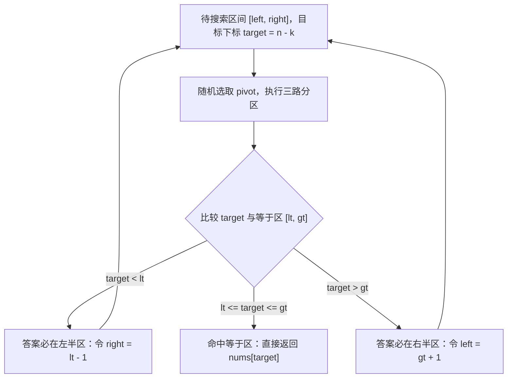

# 快速选择与 TopK 问题：期望 O(n) 的奇妙算法

**摘要：**

当你面对一个装满百万条请求延迟记录的数组，只想找出其中排在第 99 百分位的那一个数值，或者挑出延迟最高的前 10 个异常样本时，是否有必要先把整整一百万条记录从头到尾排得井井有条？直觉告诉我们，全量排序做了大量无用功——为了确定第 $k$ 名是谁，我们并不需要知道第 1 名与第 2 名谁更靠前，也不需要关心最后十万名之间的先后次序。本文围绕 TopK 与顺序统计量（Order Statistics）问题展开，系统剖析从全量排序的 $O(n \log n)$、最小堆（Min-Heap）的 $O(n \log k)$，到快速选择（QuickSelect）期望 $O(n)$、再到桶排序（Bucket Sort）与 BFPRT 确定性线性时间算法的完整演进脉络，并结合 LeetCode 215、347、973、703 四道代表性题目给出 Golang 实现与边界推导。

---

## 第 1 章 顺序统计量与"不必排完"的智慧

### 1.1 问题定义与信息论视角

在算法设计里，求一个无序集合中第 $k$ 小或第 $k$ 大的元素，统称为**顺序统计量（Order Statistics）**问题；与之密切相关的，是求最大或最小的 $k$ 个元素的 **TopK 问题**。这两类问题在工程与面试中无处不在，譬如监控系统的分位数（P50、P95、P99）计算、搜索引擎的召回截断、推荐系统的粗排过滤。

最朴素的做法是先对数组做一次全量排序，然后直接按下标读取答案。若使用快速排序或归并排序，时间复杂度为 $O(n \log n)$。但这引出了一个核心追问：**全量排序产出的信息量，远远超出了问题本身索取的信息量**。全量排序确立了全部 $n$ 个元素之间的全序关系（Total Order），相当于回答了 $n$ 个位置上每一个位置是谁；而顺序统计量问题只需要确立某一个分界点（Pivot），使得分界点左侧的元素都不大于它、右侧的元素都不小于它，至于左右两侧内部如何排列，完全无关紧要。

这就好比学校要从一万名考生里划定前 100 名的录取分数线：如果把一万人的试卷按分数从第 1 名排到第 10000 名，固然能直接看到第 100 名的分数；但更聪明的阅卷组长会先随机抽一份试卷作为基准线，把高于基准线的归到左堆、低于基准线的归到右堆——如果左堆恰好有 99 人，那这份基准试卷的分数就是录取线；如果左堆有 300 人，那就只需要在这 300 人里继续划分子堆，剩下的 9700 份试卷连看都不用再看一眼。

### 1.2 三条技术路线的横向权衡

围绕"减少无用功"这一核心目标，计算机科学发展出了三条截然不同的技术路线，它们各自削减了不同维度的开销：

| 路线 | 时间复杂度（平均） | 时间复杂度（最坏） | 额外空间 | 是否修改原数组 | 是否支持流式（Online） | 核心思想 |
|------|-------------------|-------------------|----------|----------------|------------------------|----------|
| 全量排序 | $O(n \log n)$ | $O(n \log n)$ | $O(\log n)$ | 是 | 否 | 确立全部元素的全序关系 |
| 容量为 $k$ 的堆 | $O(n \log k)$ | $O(n \log k)$ | $O(k)$ | 否 | 是 | 只维护前 $k$ 名的动态淘汰池 |
| 快速选择（三路随机化） | $O(n)$ | $O(n^2)$（极低概率） | $O(1)$（迭代） | 是 | 否 | 分区后只向包含目标的一侧深入 |
| BFPRT（中位数的中位数） | $O(n)$ | $O(n)$ | $O(\log n)$ | 是 | 否 | 精心构造基准值以保证最坏淘汰比例 |

这四条路线没有绝对的优劣，只有场景的契合度。接下来我们沿着"堆维护淘汰池 $\to$ 快速选择单侧剪枝 $\to$ 频次桶映射"的顺序，逐一拆解它们的推导过程与实现细节。

---

## 第 2 章 最小堆：用容量为 K 的门槛守住前 K 名

### 2.1 为什么找"最大 K 个"反而要用"最小堆"

初学者接触 TopK 问题时，最容易犯的直觉错误是："既然要找最大的 $k$ 个元素，那就建一个最大堆（Max-Heap）吧。"

不妨算一笔账。如果把 $n$ 个元素全部塞进一个最大堆，或者用 $O(n)$ 的 Floyd 建堆法原地把整个数组建成最大堆，然后再连续执行 $k$ 次 `Pop` 取出前 $k$ 大元素，时间复杂度是 $O(n + k \log n)$。当静态数组已在内存中且允许全量建堆时，这个复杂度相当不错；但如果 $n$ 是十亿条流式到达的日志（无法一次性装入内存），或者我们不想触碰那 $n$ 个元素的原始存储，全量最大堆就无能为力了。

换一个视角：我们只准备 $k$ 把椅子，用来坐目前为止见过的"最强的 $k$ 个人"。每当第 $i$ 个候选人走过来时，他只需要跟这 $k$ 把椅子里**最弱的那个人**（即第 $k$ 名，门槛守门员）比试一场：

1. 如果新来的人连守门员都打不过（`num <= heap[0]`），那他绝无可能进入前 $k$ 名，直接淘汰；
2. 如果新来的人比守门员强（`num > heap[0]`），守门员就被踢出局，新来的人坐下，然后这 $k$ 个人内部重新选出最弱的一个当新守门员。

请注意，这里我们需要在 $O(1)$ 时间内看到"当前 $k$ 个人里最弱的那个"，并在 $O(\log k)$ 时间内完成"踢出最弱者、插入新强者"的调整——这恰恰是**最小堆（Min-Heap）**的看家本领。同理，如果要找**最小的 $k$ 个元素**，守门员就变成了"当前 $k$ 个最小元素里最大的那个"，此时反而应该使用**最大堆**。

### 2.2 Go 语言实现与下沉替换优化

在 Go 标准库中，`container/heap` 提供了堆接口，但对于纯粹的整数最小堆，直接手写一个定长切片的 `siftDown`（下沉）与 `siftUp`（上浮）不仅代码更短，而且有一个重要的常数级优化：**当堆已满且新元素大于堆顶时，无需先 `Pop` 再 `Push`（那会触发一次下沉加一次上浮），而是直接把堆顶元素改写为新元素，再做一次 `siftDown` 即可**。

```go
package main

// findKthLargestHeap 使用容量为 k 的最小堆求第 k 大元素
// 时间复杂度：O(n log k)，空间复杂度：O(k)
func findKthLargestHeap(nums []int, k int) int {
	heap := make([]int, 0, k)

	var siftUp func(i int)
	siftUp = func(i int) {
		for i > 0 {
			parent := (i - 1) / 2
			if heap[parent] <= heap[i] {
				break
			}
			heap[parent], heap[i] = heap[i], heap[parent]
			i = parent
		}
	}

	var siftDown func(i, size int)
	siftDown = func(i, size int) {
		for {
			smallest := i
			left, right := 2*i+1, 2*i+2
			if left < size && heap[left] < heap[smallest] {
				smallest = left
			}
			if right < size && heap[right] < heap[smallest] {
				smallest = right
			}
			if smallest == i {
				break
			}
			heap[i], heap[smallest] = heap[smallest], heap[i]
			i = smallest
		}
	}

	for _, num := range nums {
		if len(heap) < k {
			heap = append(heap, num)
			siftUp(len(heap) - 1)
		} else if num > heap[0] {
			// 新元素比堆顶（守门员）更大，直接覆盖堆顶并下沉，省去一次上浮
			heap[0] = num
			siftDown(0, k)
		}
	}
	return heap[0]
}
```

> [!info] 工程权衡：流式与只读场景的首选
> 最小堆方案最宝贵的性质有两条：其一，它对输入数据只做顺序扫描，**不修改原数组**；其二，它的内存占用严格封顶在 $O(k)$，哪怕输入是无穷无尽的实时数据流（Streaming Data），也能在任意时刻以 $O(1)$ 时间报出当前的第 $k$ 大值。

---

## 第 3 章 快速选择：分治剪枝与三路分区

### 3.1 从快速排序到快速选择

如果数据已经静态地躺在内存里，且允许原地修改数组，我们能否把 $O(n \log k)$ 里的 $\log k$ 也彻底抹掉？

回顾快速排序（QuickSort）的分区过程：选定一个基准值 `pivot` 后，经过一轮线性扫描，数组被划分为左、中、右三段。在传统快排里，接下来要对左段和右段**同时**发起递归调用，递归树每一层的总工作量都是 $O(n)$，共 $\log n$ 层，于是总耗时 $O(n \log n)$。

然而在 LeetCode 215（数组中的第 K 个最大元素）中，我们的目标仅仅是定位升序排列后下标为 $target = n - k$ 的那个元素。当一轮分区结束时，基准值所在区间的下标范围 $[lt, gt]$ 已经完全确定，它们在最终有序数组里的位置**永久固定**了：



这意味着，每次分区之后，我们**永远只需要进入左半区或右半区中的某一个**，另一半连同它内部的所有乱序元素被整块丢弃。这种"只走单支"的分治，就是 Tony Hoare 在 1961 年与快速排序一同提出的**快速选择（QuickSelect）**算法。

### 3.2 为什么期望时间是严格的 O(n)

为什么"砍掉一个分支"就能把 $O(n \log n)$ 变成 $O(n)$？直觉上，既然还要递归 $O(\log n)$ 层，为什么总时间不是 $O(n \log n)$？

关键在于**每一层的工作量不再是恒定的 $n$，而是按几何级数衰减**。假设随机选出的 `pivot` 大约落在区间正中间，那么：
- 第 1 轮分区扫描 $n$ 个元素；
- 第 2 轮只进入其中一半，扫描 $n/2$ 个元素；
- 第 3 轮扫描 $n/4$ 个元素……

把所有轮次的扫描次数加起来，是一个收敛的几何级数：

$$n + \frac{n}{2} + \frac{n}{4} + \frac{n}{8} + \cdots < 2n = O(n)$$

更严谨地看，哪怕随机选出的 `pivot` 没有恰好落在正中间，只要它落在区间中间 $50\%$ 的位置（即分位点在 $[1/4, 3/4]$ 之间，这一事件发生的概率恰好是 $1/2$），留下的子区间长度就至多是原区间的 $3/4$。平均每两次随机分区就有一次能把问题规模乘上 $3/4$，期望总比较次数依然满足：

$$E[T(n)] \le n + E[T(3n/4)] \le n \cdot \sum_{i=0}^{\infty} \left(\frac{3}{4}\right)^i = 4n = O(n)$$

### 3.3 致命陷阱：为什么二路分区在重复元素下会退化为 O(n²)

许多教材给出的快速选择模板使用的是传统的单边 Lomuto 二路分区（将 `<= pivot` 的放左边，`> pivot` 的放右边）。这种写法在面对**包含大量重复元素**的测试用例（譬如一个包含十万个 `1` 的数组，求中位数）时，哪怕加了随机化选 `pivot`，也会必然退化为 $O(n^2)$。

原因何在？当数组全是 `1` 时，无论随机选哪个位置作为 `pivot`，选出来的基准值都是 `1`；二路分区会把其余全部 $n-1$ 个 `1` 统统归入左半区（或右半区），每次分区只能把区间长度从 $n$ 缩减到 $n-1$。一共要缩减 $n/2$ 次，总比较次数变成 $(n) + (n-1) + \cdots + (n/2) = \Theta(n^2)$。

要彻底根治这一退化，必须结合本专栏第 04 篇讲过的**荷兰国旗三路分区（3-Way Partition）**，将区间划分为严格小于（`< pivot`）、等于（`== pivot`）、严格大于（`> pivot`）三段：

```go
package main

import "math/rand"

// findKthLargest 使用随机化三路快速选择（迭代版）求第 k 大元素
// 期望时间复杂度：O(n)，额外空间复杂度：O(1)
func findKthLargest(nums []int, k int) int {
	n := len(nums)
	target := n - k // 转化为升序排列下的目标下标
	left, right := 0, n-1

	for left <= right {
		// 1. 随机选取基准值，抵御有序/逆序恶意输入
		pivotIdx := left + rand.Intn(right-left+1)
		pivot := nums[pivotIdx]

		// 2. 荷兰国旗三路分区：
		// [left, lt-1]   < pivot
		// [lt, i-1]     == pivot
		// [i, gt]        未检查
		// [gt+1, right]  > pivot
		lt, i, gt := left, left, right
		for i <= gt {
			if nums[i] < pivot {
				nums[lt], nums[i] = nums[i], nums[lt]
				lt++
				i++
			} else if nums[i] > pivot {
				nums[i], nums[gt] = nums[gt], nums[i]
				gt--
			} else {
				i++
			}
		}

		// 3. 根据 target 与 [lt, gt] 的位置关系剪枝
		if target >= lt && target <= gt {
			return nums[target]
		} else if target < lt {
			right = lt - 1
		} else {
			left = gt + 1
		}
	}
	return -1
}
```

当全数组都是 `1` 时，第一轮三路分区结束后，`lt = 0`、`gt = n - 1`，目标下标 `target` 直接命中 `[lt, gt]` 区间，算法**一轮即告结束**，耗时严格 $O(n)$。同时，上述代码采用 `for left <= right` 循环代替递归，将额外空间复杂度从 $O(\log n)$ 压到了严格的 $O(1)$。

不妨以 `nums = [3, 2, 3, 1, 2, 4, 5, 5, 6], k = 4`（$n = 9$，求第 4 大，即升序目标下标 `target = 9 - 4 = 5`）做一次手动推演：
- **第 1 轮**：搜索区间 `[0, 8]`。假设随机选出的基准值为 `pivot = 3`。三路分区扫描结束后，小于 `3` 的元素 `[1, 2, 2]` 落在下标 `[0, 2]`，等于 `3` 的元素 `[3, 3]` 落在下标 `[3, 4]`（即 `lt = 3, gt = 4`），大于 `3` 的元素 `[4, 5, 5, 6]` 落在下标 `[5, 8]`。此时比较 `target = 5` 与 `[lt, gt] = [3, 4]`，发现 `target > gt`，说明目标必然在右半区，于是直接丢弃左侧的 `0..4`，令 `left = gt + 1 = 5`。
- **第 2 轮**：搜索区间缩减为 `[5, 8]`，对应子数组 `[4, 5, 5, 6]`。假设随机选出 `pivot = 5`。三路分区后，`4` 落在下标 `5`，两个 `5` 落在 `[6, 7]`（`lt = 6, gt = 7`），`6` 落在下标 `8`。此时 `target = 5 < lt = 6`，于是丢弃 `6..8`，令 `right = lt - 1 = 5`。
- **第 3 轮**：搜索区间只剩下 `[5, 5]`，`lt = gt = 5`，命中 `target = 5`，直接返回 `nums[5] = 4`。整个过程只扫描了 $9 + 4 + 1 = 14$ 次元素，连右半区内部的两个 `5` 和 `6` 都没再去细分。

### 3.4 理论补完：BFPRT 算法如何消掉"期望"二字

如果面试官追问："随机化三路快速选择的期望时间是 $O(n)$，但理论上如果随机数生成器极其倒霉，每次都选到极值，最坏情况仍是 $O(n^2)$。有没有办法不用随机数，在**最坏情况**下也严格做到 $O(n)$？"

答案是 1973 年由 Blum、Floyd、Pratt、Rivest、Tarjan 五位图灵奖级学者联合发表的 **BFPRT 算法（又称 Median of Medians，中位数的中位数）**。它的唯一改动在于选 `pivot` 的方式：
1. 将当前区间的 $n$ 个元素每 5 个分成一组，共 $\lceil n/5 \rceil$ 组；
2. 对每一组内部用插入排序（仅 5 个元素，常数次比较）找出组内中位数；
3. 递归调用 BFPRT，找出这 $\lceil n/5 \rceil$ 个组内中位数的真正中位数 $M$，将 $M$ 作为 `pivot` 进行分区。

为什么选出来的 $M$ 一定是个好基准？因为在 $\lceil n/5 \rceil$ 个组里，有一半的组其中位数小于等于 $M$，而在这些组里，每组至少有 3 个元素小于等于该组中位数。因此，全区间至少有 $\frac{3}{10}n$ 个元素小于等于 $M$，同理至少有 $\frac{3}{10}n$ 个元素大于等于 $M$。这意味着每次分区后，子问题规模最坏也不过是 $\frac{7}{10}n$。递推式变为：

$$T(n) \le T\left(\frac{n}{5}\right) + T\left(\frac{7n}{10}\right) + O(n)$$

由于 $\frac{1}{5} + \frac{7}{10} = \frac{9}{10} < 1$，每一层的总工作量依然按几何级数衰减，最坏时间复杂度严格为 $O(n)$。

这里常有一个数学追问：**为什么 BFPRT 非要每 5 个元素分一组，每 3 个分一组不行吗？** 不妨算一下：如果每 3 个元素分一组，共有 $n/3$ 个组，其中一半的组（$n/6$ 组）每组有 2 个元素小于等于 $M$，于是只能保证至少 $\frac{2}{6}n = \frac{1}{3}n$ 个元素小于等于 $M$，留下的子区间最坏有 $\frac{2}{3}n$ 个元素。此时递推式变为 $T(n) \le T(n/3) + T(2n/3) + O(n)$，注意 $\frac{1}{3} + \frac{2}{3} = 1$，递归树每一层的总工作量不再衰减，总时间会退化回 $O(n \log n)$。因此，5 是使得分组中位数递归项与剩余子区间递归项系数之和严格小于 1 的最小奇数。不过 BFPRT 的常数因子较大（递归了两次），工程实践中几乎总是使用随机化快速选择，或者在递归深度超限时回退到堆排序（即 C++ `std::nth_element` 采用的 IntroSelect 策略）。

---

## 第 4 章 衍生实战：高频元素、空间近邻与流式 TopK

### 4.1 LeetCode 347：前 K 个高频元素（堆 vs 计数桶）

**题目描述**：给你一个整数数组 `nums` 和一个整数 `k`，请返回其中出现频率前 `k` 高的元素。

这道题在原始元素与 TopK 之间加了一层转换：**比较的依据不是元素值本身，而是元素出现的频次（Frequency）**。因此第一步必然是用哈希表做一次 $O(n)$ 的频次统计，得到唯一元素集合及其频次映射 `freq[num]`。

接下来对频次做 TopK，有两条截然不同的路径：
- **路径一（最小堆 / 快速选择）**：对哈希表中的 $m$ 个唯一元素（$m \le n$），用容量为 $k$ 的最小堆维护频次最高的 $k$ 项，时间复杂度 $O(n + m \log k)$；或用快速选择按频次分区，期望时间 $O(n)$。
- **路径二（桶排序思想）**：注意到一个隐藏的值域约束——**任何一个元素出现的频次，最小是 $1$，最大绝不可能超过数组总长度 $n$**。既然排序键值（频次）是落在 $[1, n]$ 内的整数，我们直接开一个长度为 $n+1$ 的桶数组 `buckets`，让 `buckets[f]` 存放所有出现频次恰好为 $f$ 的元素，然后从下标 $n$ 往 $1$ 倒序收集够 $k$ 个元素即可，时间复杂度严格 $O(n)$，且无需任何比较操作。

```go
package main

// topKFrequent 使用频次桶实现严格 O(n) 的前 K 高频元素提取
func topKFrequent(nums []int, k int) []int {
	freq := make(map[int]int)
	for _, num := range nums {
		freq[num]++
	}

	// buckets[f] 存放出现次数恰好为 f 的所有数字
	buckets := make([][]int, len(nums)+1)
	for num, f := range freq {
		buckets[f] = append(buckets[f], num)
	}

	res := make([]int, 0, k)
	for f := len(nums); f >= 1 && len(res) < k; f-- {
		for _, num := range buckets[f] {
			res = append(res, num)
			if len(res) == k {
				break
			}
		}
	}
	return res
}
```

这里还要提防一道紧邻的变体题——**LeetCode 692：前 K 个高频单词**。该题要求"按频次由高到低返回前 $k$ 个单词；若频次相同，则按字典序由小到大排列"。注意：一旦引入"第二排序关键字（字典序）"且要求淘汰出局时保留字典序较小者，**最小堆的比较器（Less 函数）就必须把两个维度的方向反过来写**——在淘汰池里，"最弱的守门员"是**频次最低**的那个；若频次相同，则是**字典序最大**的那个（因为它最应该被踢出前 $k$ 名）：

```go
// 在最小堆中判断元素 a 是否比 b "更弱"（更应该浮到堆顶被淘汰）
// 频次更小者更弱；频次相同时，字典序更大者更弱
func weaker(wordA string, freqA int, wordB string, freqB int) bool {
	if freqA != freqB {
		return freqA < freqB
	}
	return wordA > wordB
}
```

最后从容量为 $k$ 的最小堆里依次弹出元素时，弹出顺序是从第 $k$ 名到第 1 名，只需把结果切片首尾翻转一次，即可得到从第 1 名到第 $k$ 名的精确次序。

### 4.2 LeetCode 973：最接近原点的 K 个点

**题目描述**：给定平面上的一组点 `points[i] = [xi, yi]`，返回距离原点 $(0, 0)$ 最近的 $k$ 个点。

欧氏距离为 $\sqrt{x^2 + y^2}$，由于平方根函数在非负实数域上严格单调递增，比较距离大小等价于直接比较**距离平方** $x^2 + y^2$，从而彻底避开浮点数运算与精度误差。

本题要求返回"前 $k$ 小的所有点"（顺序不限）。这正好展示了**快速选择处理"前 K 个元素"时的天然优势**：当快速选择将下标 `k - 1`（或 `k`）定位准确后，下标 `0` 到 `k - 1` 之间的所有元素，天然就是距离最小的 $k$ 个点，直接返回切片 `points[:k]` 即可，无需对这 $k$ 个点内部再做排序。

```go
package main

import "math/rand"

func kClosest(points [][]int, k int) [][]int {
	distSq := func(p []int) int {
		return p[0]*p[0] + p[1]*p[1]
	}

	left, right := 0, len(points)-1
	target := k - 1

	for left <= right {
		pivotIdx := left + rand.Intn(right-left+1)
		pivotDist := distSq(points[pivotIdx])

		lt, i, gt := left, left, right
		for i <= gt {
			d := distSq(points[i])
			if d < pivotDist {
				points[lt], points[i] = points[i], points[lt]
				lt++
				i++
			} else if d > pivotDist {
				points[i], points[gt] = points[gt], points[i]
				gt--
			} else {
				i++
			}
		}

		if target >= lt && target <= gt {
			break
		} else if target < lt {
			right = lt - 1
		} else {
			left = gt + 1
		}
	}
	return points[:k]
}
```

### 4.3 LeetCode 703：数据流中的第 K 大元素

当题目变成一个持续调用 `Add(val int) int` 的在线类（LeetCode 703）时，快速选择不再适用——因为每次新元素到达若都重新跑一遍 QuickSelect，单次查询代价高达 $O(n)$，$m$ 次到达的总耗时将膨胀到 $O(mn)$。此时第 2 章构建的定长最小堆便是唯一正解：初始化时将初始数组塞入容量为 $k$ 的最小堆，此后每次 `Add(val)` 只需与堆顶比大小，单次操作严格 $O(\log k)$。

```go
package main

import "container/heap"

type IntMinHeap []int

func (h IntMinHeap) Len() int           { return len(h) }
func (h IntMinHeap) Less(i, j int) bool { return h[i] < h[j] }
func (h IntMinHeap) Swap(i, j int)      { h[i], h[j] = h[j], h[i] }
func (h *IntMinHeap) Push(x any)        { *h = append(*h, x.(int)) }
func (h *IntMinHeap) Pop() any {
	old := *h
	n := len(old)
	x := old[n-1]
	*h = old[:n-1]
	return x
}

type KthLargest struct {
	k    int
	heap *IntMinHeap
}

func Constructor(k int, nums []int) KthLargest {
	h := &IntMinHeap{}
	heap.Init(h)
	kl := KthLargest{k: k, heap: h}
	for _, num := range nums {
		kl.Add(num)
	}
	return kl
}

func (kl *KthLargest) Add(val int) int {
	if kl.heap.Len() < kl.k {
		heap.Push(kl.heap, val)
	} else if val > (*kl.heap)[0] {
		// 直接改写堆顶并触发 Fix，比 Pop+Push 少一次上浮
		(*kl.heap)[0] = val
		heap.Fix(kl.heap, 0)
	}
	return (*kl.heap)[0]
}
```

这里有一个值得留意的标准库细节：`heap.Fix(kl.heap, 0)` 在 Go 标准库 `container/heap` 内部会先尝试 `down` 再尝试 `up`，因为位置 `0` 已经是根节点，`up` 会立即返回，从而只执行一次高度为 $\log k$ 的下沉，比连续调用 `heap.Pop` 与 `heap.Push` 节省了一半的树高遍历与一次切片重分配。

### 4.4 进阶延伸：数据流的中位数与"对顶堆"模型（LeetCode 295）

如果流式场景里要求的不是固定的第 $k$ 大，而是随着元素总数 $n$ 动态移动的**中位数（即第 $\lfloor n/2 \rfloor$ 大）**，单个定长最小堆就捉襟见肘了——因为堆的门槛容量 $k = \lfloor n/2 \rfloor$ 每来两个元素就会涨一格，被早先淘汰掉的元素有可能重新成为中位数候选。

解决这一矛盾的经典结构是**对顶堆（Dual-Heap）**：既然单侧淘汰会丢失候选，我们就把迄今为止见过的全部元素一分为二，用一个**最大堆 `lower`** 存放较小的一半元素，用一个**最小堆 `upper`** 存放较大的一半元素，并始终维持两条结构不变量（Invariants）：
1. **有序分界不变量**：`lower` 的堆顶（较小半区的最大值）小于等于 `upper` 的堆顶（较大半区的最小值）；
2. **尺寸平衡不变量**：`0 <= len(lower) - len(upper) <= 1`，即较小半区的元素个数要么与较大半区相等（总数为偶），要么恰好多 1 个（总数为奇）。

这就好比一个沙漏：上半截是倒置的最小堆（底部尖端是较大半区的最小值），下半截是正置的最大堆（顶部尖端是较小半区的最大值），两颗堆顶在沙漏细腰处针锋相对。中位数永远就卡在沙漏的细腰处，查询时间严格 $O(1)$，每次插入新元素只需在两个堆之间做一次 $O(\log n)$ 的平衡传递：

```go
package main

import "container/heap"

type MedianFinder struct {
	lower IntMaxHeap // 存较小的一半，堆顶为该半区最大值
	upper IntMinHeap // 存较大的一半，堆顶为该半区最小值
}

type IntMaxHeap []int

func (h IntMaxHeap) Len() int           { return len(h) }
func (h IntMaxHeap) Less(i, j int) bool { return h[i] > h[j] }
func (h IntMaxHeap) Swap(i, j int)      { h[i], h[j] = h[j], h[i] }
func (h *IntMaxHeap) Push(x any)        { *h = append(*h, x.(int)) }
func (h *IntMaxHeap) Pop() any {
	old := *h
	n := len(old)
	x := old[n-1]
	*h = old[:n-1]
	return x
}

func (mf *MedianFinder) AddNum(num int) {
	// 先入 lower，再把 lower 的最大值推入 upper，确保有序分界不变量
	heap.Push(&mf.lower, num)
	heap.Push(&mf.upper, heap.Pop(&mf.lower))

	// 若 upper 元素多于 lower，则回拨一个给 lower，维持尺寸平衡不变量
	if mf.upper.Len() > mf.lower.Len() {
		heap.Push(&mf.lower, heap.Pop(&mf.upper))
	}
}

func (mf *MedianFinder) FindMedian() float64 {
	if mf.lower.Len() > mf.upper.Len() {
		return float64(mf.lower[0])
	}
	return float64(mf.lower[0]+mf.upper[0]) / 2.0
}
```

---

## 第 5 章 工程视角：从内省选择到海量数据的分位数

### 5.1 标准库里的 IntroSelect

在工业级标准库（譬如 C++ STL 的 `std::nth_element`）中，求顺序统计量既不用纯粹的随机化 QuickSelect，也不用常数沉重的 BFPRT，而是采用 David Musser 在 1997 年提出的 **内省选择（IntroSelect）**：算法主体依然使用快速高效的三路或 Hoare 分区 QuickSelect，同时维护一个计数器，监控"糟糕分区"（譬如连续多次子区间缩减比例不足 $7/8$）的次数或递归深度；一旦发现退化苗头，立即切换为 BFPRT 或堆选择保底。这种"乐观主路径 + 悲观熔断兜底"的工程哲学，与 Go 标准库 `slices.Sort` 采用的 `pdqsort` 如出一辙。

### 5.2 内存受限与分布式环境下的 TopK / 分位数

当面试从算法题延伸到系统设计——譬如"有 100 亿个 64 位整数存放在磁盘文件里，单机内存只有 1GB，如何找出精确的第 $k$ 大元素或 Top 100"——单机内存中的 QuickSelect 就无法直接施展了，此时有两条工程路线：

1. **流式最小堆 + 归并汇总（适用于小 $k$ 的 TopK）**：若 $k = 100$，单机顺序扫描磁盘文件，用容量为 100 的最小堆过滤，内存占用可忽略不计；若是分布式集群，每台 Worker 机器各自用最小堆算出本地的 Top 100，再把各节点的 100 个候选发往汇总节点做一次合并筛选。
2. **值域分段计数（适用于大 $k$ 如中位数）**：若求 100 亿个数的中位数（$k = 5 \times 10^9$），堆放不下内存。此时可利用 64 位整数的高 16 位将值域划分为 $2^{16} = 65536$ 个桶，第一遍扫描磁盘只统计每个桶内落入的元素个数（仅需 $65536 \times 8\text{B} = 512\text{KB}$ 内存）；扫描结束后按桶累加计数，立刻就能锁定中位数必然落在哪一个桶里；第二遍扫描磁盘只把属于该桶的元素读入内存，再做一次内存级 QuickSelect 即可精确命中。

---

## 第 6 章 常见误区与边界自检

1. **"第 K 大"与"第 K 小"的下标换算差一错误**：在长度为 $n$ 的升序数组中，最小元素（第 1 小）在下标 `0`，第 $k$ 小在下标 `k - 1`；最大元素（第 1 大）在下标 `n - 1`，**第 $k$ 大在下标 `n - k`**。动笔前务必用 `n = 5, k = 1`（第 1 大即下标 4）口算核对。
2. **求前 K 小却误用最小堆**：牢记"守门员原则"——守住前 $k$ 大的门槛，需要淘汰最弱者，用**最小堆**；守住前 $k$ 小的门槛，需要淘汰最大者，用**最大堆**。
3. **忽略重复元素对二路分区的致命打击**：手写 QuickSelect 时，若只写单指针 Lomuto 分区，在 LeetCode 215 的全重复元素用例上会直接超时（TLE）。务必使用三路分区或 Hoare 双指针相向分区。
4. **对顶堆先入堆未做交叉过滤**：在 LeetCode 295 中，新元素 `num` 不能因为 `len(lower) == len(upper)` 就直接塞进 `lower`，因为它可能比 `upper` 里的元素还要大。必须遵循"先过 `lower` 筛选最大者送入 `upper`，再按长度回拨"的交叉推入纪律，才能保证有序分界不变量。

---

## 小结

TopK 与顺序统计量问题的演进，体现了算法设计中"按需索取信息"的精髓：
- 全量排序索取了全序关系，代价 $O(n \log n)$；
- 最小堆只维护前 $k$ 名的集合与门槛，代价 $O(n \log k)$，换来了流式处理与零原数组侵入；
- 快速选择只定位分界点，每次砍掉一半搜索空间，以期望 $O(n)$ 的代价在静态数组上达到理论最优；
- 当排序键本身的值域受限时（如频次落在 $[1, n]$），计数桶排序直接绕过比较，达到确定性的 $O(n)$。

下一篇 [[08 排序在非排序题中的妙用：区间合并与贪心]] 将跳出"为排序而排序"的框架，探讨为什么在区间合并、会议室调度与活动选择问题中，先花 $O(n \log n)$ 把数据排好序，反而能让原本无从下手的全局组合问题迎刃而解。

---

## 参考资料

1. Hoare, C. A. R. (1961). *Algorithm 65: Find*. Communications of the ACM, 4(7), 321–322.
2. Blum, M., Floyd, R. W., Pratt, V., Rivest, R. L., & Tarjan, R. E. (1973). *Time bounds for selection*. Journal of Computer and System Sciences, 7(4), 448–461.
3. Cormen, T. H., et al. *Introduction to Algorithms* (4th ed.). MIT Press, 2022. Chapter 9: Medians and Order Statistics.
4. Musser, D. R. (1997). *Introspective Sorting and Selection Algorithms*. Software: Practice and Experience, 27(8), 983–993.

---

> [!note] 思考题
> 1. 为什么在求"最大的 $k$ 个元素"时，使用容量为 $k$ 的最小堆耗时 $O(n \log k)$，而把全部 $n$ 个元素原地建成最大堆再弹出 $k$ 次耗时 $O(n + k \log n)$？当 $k$ 与 $n$ 满足什么关系时后者反而更快？
> 2. 在快速选择中，如果分区完成时发现目标下标 `target < lt`，为什么可以直接丢弃 `[lt, right]` 区间，而不需要修改 `target` 的值？如果改用返回相对排名（第 $k$ 小）的递归写法，进入右半区时 $k$ 应该如何更新？
> 3. 如果一个数组有 100 亿个 64 位整数存放在磁盘文件里，内存只有 1GB，如何找出其中的中位数？（提示：结合分桶计数与值域二分）
