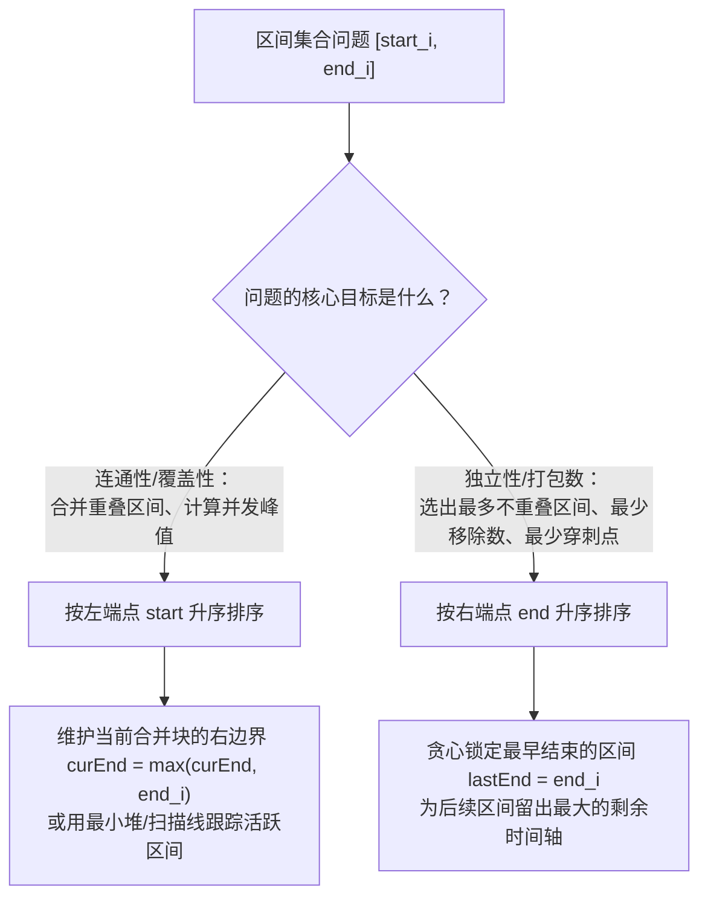

# 排序在非排序题中的妙用：区间合并与贪心

**摘要：**

在算法面试中，有一大类题目从题面上看与"排序"毫无瓜葛——它们或是要求合并重叠的日程表，或是询问最多能参加几场互不冲突的宣讲会，或是计算最少需要准备几间会议室、最少用几支箭引爆所有气球。但只要试图在原始无序的区间集合上直接寻找最优解，算法就会立刻陷入 $O(n^2)$ 两两比对甚至指数级回溯的泥潭。本文深入剖析**区间调度（Interval Scheduling）与区间合并**问题，揭示"排序作为预处理"如何赋予无序集合单向扫描的单调性，重点辨析**按左端点排序**与**按右端点排序**这两条截然不同的贪心路线各自解决什么问题，并通过交换论证（Exchange Argument）严格证明贪心选择性质，配齐 LeetCode 56、57、252、253、435、452 六道经典题目的 Golang 实现。

---

## 第 1 章 为什么区间题的第一步几乎总是排序

### 1.1 二维自由度的降维打击

一个一维标量数字只有一个自由度（它的大小），而一个区间 $I_i = [start_i, end_i]$ 天然拥有**两个自由度**：左端点 $start_i$ 与右端点 $end_i$。当 $n$ 个区间杂乱无章地堆在数组里时，任意两个区间 $I_i$ 与 $I_j$ 之间的空间关系有六种可能（完全在左、左交叠、包含、被包含、右交叠、完全在右）。如果在无序状态下直接处理，为了确认某个区间与谁重叠，你不得不拿它去跟其余 $n-1$ 个区间逐一比对，时间复杂度保底是 $O(n^2)$。

排序在这里扮演的角色，是一次**消除一个自由度的降维打击**。当我们花费 $O(n \log n)$ 的代价，把所有区间按照左端点升序排列（即保证 $start_1 \le start_2 \le \cdots \le start_n$）之后，"后一个区间的起点一定不早于前一个区间的起点"就成了铁律。此时，两个相邻区间 $I_1$ 与 $I_2$ 是否重叠，原本需要双向检查的逻辑：

$$\max(start_1, start_2) \le \min(end_1, end_2)$$

瞬间坍缩成了一个只看单侧的极简不等式：

$$start_2 \le end_1$$

这就好比整理一摞散乱的火车票：如果车票按发车时间先后排好，你只需要顺着看"下一趟车的发车时间是否早于上一趟车的到达时间"，就能立刻发现哪两趟车行程冲突；而如果车票是乱序抓在手里的，你每看一张新票，都得跟手里已经看过的每一张票重新核对一遍起止时刻。

### 1.2 左端点排序 vs 右端点排序：核心分野

很多候选人在考场上知道"区间题要先排序"，却经常在"到底按左端点排还是按右端点排"上抓阄碰运气。实际上，这两种排序方式对应着两类完全不同的物理目标：



- **按左端点（起点）排序**：适用于**合并（Merge）与并发度（Concurrency）**问题。因为我们要沿着时间轴从左往右把所有粘连在一起的区间焊接成一整块，按起点排序能保证所有可能与当前块粘连的区间必然紧挨着出现，绝不会隔着一个不相交的区间之后又跳出一个能跟前面粘连的区间。
- **按右端点（终点）排序**：适用于**最大不相交子集（Maximum Disjoint Set）与最小点覆盖（Minimum Stabbing）**问题。因为我们要选出尽可能多的互不冲突的区间，谁越早结束，谁占用的未来时间轴就越少，留给后续候选区间的生存空间就越大。

先把这条分野刻在脑子里，下面我们分别从这两条主线切入具体题目。

---

## 第 2 章 按左端点排序：区间合并与三段式插入

### 2.1 LeetCode 56：合并区间（Merge Intervals）

**题目描述**：以数组 `intervals` 表示若干个区间的集合，其中单个区间为 `intervals[i] = [start_i, end_i]`。请你合并所有重叠的区间，并返回一个不重叠的区间数组，该数组需恰好覆盖输入中的所有区间。

#### 2.1.1 循环不变量与正确性证明

我们将所有区间按左端点 `start` 升序排列。维护一个结果切片 `merged`，它的最后一个元素 `merged[len(merged)-1]` 代表"当前正在生长的合并区间" $[curStart, curEnd]$。遍历到新区间 $[start_i, end_i]$ 时，由于排序保证了 $curStart \le start_i$，只有两种情况：

1. **发生重叠（$start_i \le curEnd$）**：新区间与当前合并区间粘连。此时合并后的新起点仍然是 $curStart$，而新终点必须取两者的较大值：
   $$curEnd = \max(curEnd, end_i)$$
   为什么要取 `max` 而不是直接令 `curEnd = end_i`？因为左端点有序并不代表右端点也有序，完全可能出现"大区间吞并小区间"的情形，譬如 `[1, 10]` 后面紧跟着 `[2, 5]`，合并后的右边界必须保持 `10` 而不能缩水成 `5`。
2. **完全断开（$start_i > curEnd$）**：新区间在当前合并区间的严格右侧。不仅如此，由于后续所有区间的左端点都 $\ge start_i > curEnd$，这意味着**当前合并区间 $[curStart, curEnd]$ 已经彻底封口，未来绝不可能再与任何后续区间发生重叠**。于是当前合并区间正式定型，我们将 $[start_i, end_i]$ 作为新的生长区间压入 `merged` 尾部。

```go
package main

import "sort"

// merge 合并所有重叠区间
// 时间复杂度：O(n log n) 瓶颈在排序；额外空间复杂度：O(log n) 排序栈
func merge(intervals [][]int) [][]int {
	if len(intervals) <= 1 {
		return intervals
	}

	// 按左端点升序排列
	sort.Slice(intervals, func(i, j int) bool {
		return intervals[i][0] < intervals[j][0]
	})

	merged := make([][]int, 0, len(intervals))
	merged = append(merged, intervals[0])

	for i := 1; i < len(intervals); i++ {
		last := merged[len(merged)-1]
		cur := intervals[i]

		if cur[0] <= last[1] {
			// 存在重叠，原地延展当前合并块的右边界
			if cur[1] > last[1] {
				last[1] = cur[1]
			}
		} else {
			// 完全断开，开启新的合并块
			merged = append(merged, cur)
		}
	}
	return merged
}
```

请注意代码中的一个工程技巧：我们在一开始就直接把 `intervals[0]` 放进了 `merged`，每次重叠时直接修改 `merged[len(merged)-1][1]`。这样不仅省去了单独维护 `curStart` 和 `curEnd` 两个局部变量，而且彻底消除了"循环结束后忘记把最后一个合并区间补进结果集"这一高频笔误。

### 2.2 LeetCode 57：插入区间（Insert Interval）

**题目描述**：给你一个**无重叠**的、按照区间起始端点排序的区间列表 `intervals`，在列表中插入一个新的区间 `newInterval`，合并所有重叠区间后返回仍然按起始端点排序的列表。

如果直接把 `newInterval` 追加到 `intervals` 末尾再调用上一题的 `merge`，耗时是 $O(n \log n)$，辜负了题目给出的"输入本身已有序且无重叠"这一强条件。利用已知有序性，我们可以把整个数组自然切分为三段，用一次 $O(n)$ 的线性扫描直接完成：

1. **第一段（严格在 `newInterval` 左侧，无交集）**：满足 `intervals[i][1] < newInterval[0]`，即旧区间的右端点连新区间的左端点都够不着，原封不动推入结果集；
2. **第二段（与 `newInterval` 发生交集）**：既然第一段已经排除了所有严格在左的区间，那么接下来只要满足 `intervals[i][0] <= newInterval[1]`（旧区间的左端点没有越过新区间的右端点），就必然与 `newInterval` 重叠。我们不断用这些重叠区间去撑大 `newInterval` 的左右边界：
   $$newInterval[0] = \min(newInterval[0], intervals[i][0])$$
   $$newInterval[1] = \max(newInterval[1], intervals[i][1])$$
   当这一段循环结束时，把膨胀完毕的 `newInterval` 推入结果集；
3. **第三段（严格在 `newInterval` 右侧，无交集）**：剩下的所有区间满足 `intervals[i][0] > newInterval[1]`，原封不动推入结果集。

```go
package main

// insert 在已有序无重叠区间列表中插入新区间，时间复杂度严格 O(n)
func insert(intervals [][]int, newInterval []int) [][]int {
	res := make([][]int, 0, len(intervals)+1)
	i, n := 0, len(intervals)

	// 第一段：严格在 newInterval 左侧且不重叠
	for i < n && intervals[i][1] < newInterval[0] {
		res = append(res, intervals[i])
		i++
	}

	// 第二段：所有与 newInterval 重叠的区间，融合进 newInterval
	for i < n && intervals[i][0] <= newInterval[1] {
		if intervals[i][0] < newInterval[0] {
			newInterval[0] = intervals[i][0]
		}
		if intervals[i][1] > newInterval[1] {
			newInterval[1] = intervals[i][1]
		}
		i++
	}
	res = append(res, newInterval)

	// 第三段：严格在 newInterval 右侧的剩余区间
	for i < n {
		res = append(res, intervals[i])
		i++
	}
	return res
}
```

---

## 第 3 章 并发度峰值：会议室调度与扫描线思想

### 3.1 LeetCode 252 & 253：从"有无冲突"到"最多几间房"

**会议室 I（LeetCode 252）**问的是：给定一系列会议时间 `[start_i, end_i]`，一个人能否参加全部会议？这等价于判断集合中是否存在任意两个区间重叠。按左端点排序后，只需检查相邻两场会议是否满足 `intervals[i][0] < intervals[i-1][1]`（注意 `[5, 10]` 与 `[10, 15]` 端点相接不算冲突，可以无缝赶场），耗时 $O(n \log n)$。

真正有深度的是**会议室 II（LeetCode 253）**：如果所有会议都必须如期举行，最少需要开辟多少间会议室？

从物理意义上看，最少需要的会议室总数，等于**整个时间轴上同时正在开会的最大重叠次数（并发度峰值）**。围绕这个本质，我们可以导出两种异曲同工的 $O(n \log n)$ 解法。

#### 3.1.1 解法一：按开始时间排序 + 最小堆维护最早释放时间

想象你是行政前台，手里有一串按开始时间排好序的会议申请单。每当一场新会议 `[start, end]` 要开始时，你肯定优先看**目前正在开会的那些房间里，哪一间最早散会**。
- 如果最早散会的那间房，其结束时间 `minEnd <= start`，说明在这场新会议开始前，那间房已经腾空了，直接把新会议安排进去，并把该房间的结束时间更新为 `end`；
- 如果连最早散会的那间房都还没开完（`minEnd > start`），说明眼下所有已开辟的房间全在忙，只能新开一间会议室。

要在 $O(1)$ 时间内查到"所有在用房间里最早的结束时间"，并在 $O(\log k)$ 时间内完成更新，数据结构自然又是**最小堆**。

```go
package main

import (
	"container/heap"
	"sort"
)

type EndMinHeap []int

func (h EndMinHeap) Len() int           { return len(h) }
func (h EndMinHeap) Less(i, j int) bool { return h[i] < h[j] }
func (h EndMinHeap) Swap(i, j int)      { h[i], h[j] = h[j], h[i] }
func (h *EndMinHeap) Push(x any)        { *h = append(*h, x.(int)) }
func (h *EndMinHeap) Pop() any {
	old := *h
	n := len(old)
	x := old[n-1]
	*h = old[:n-1]
	return x
}

func minMeetingRoomsHeap(intervals [][]int) int {
	if len(intervals) == 0 {
		return 0
	}
	sort.Slice(intervals, func(i, j int) bool {
		return intervals[i][0] < intervals[j][0]
	})

	h := &EndMinHeap{}
	heap.Init(h)

	for _, iv := range intervals {
		if h.Len() > 0 && (*h)[0] <= iv[0] {
			// 复用最早腾出的会议室，直接改写堆顶并 Fix
			(*h)[0] = iv[1]
			heap.Fix(h, 0)
		} else {
			// 所有在用会议室均未结束，开辟新房间
			heap.Push(h, iv[1])
		}
	}
	return h.Len()
}
```

#### 3.1.2 解法二：事件拆解与扫描线（Sweep-Line）双指针

如果我们只关心"需要几间房"，而不关心"具体哪场会议进了哪间房"，连最小堆都可以省去。

每场会议 `[start_i, end_i]` 不过是时间轴上的两个事件：在 `start_i` 时刻借走一间房（并发数 `+1`），在 `end_i` 时刻归还一间房（并发数 `-1`）。把哪场开始与哪场结束的绑定关系彻底拆开，将全部 $n$ 个开始时间放入数组 `starts` 升序排列，全部 $n$ 个结束时间放入数组 `ends` 升序排列。

用指针 `i` 扫描 `starts`，指针 `endPtr` 扫描 `ends`：每当 `starts[i] < ends[endPtr]` 时，说明在最早的一场在开会议结束之前，又有一场新会议开始了，净增一间房；反之若 `starts[i] >= ends[endPtr]`，说明有一场旧会议先结束了，它的房间正好移交给当前这场新会议，`endPtr++` 即可，房间总数不增：

```go
package main

import "sort"

// minMeetingRoomsSweep 扫描线双数组解法，时间 O(n log n)，常数极小
func minMeetingRoomsSweep(intervals [][]int) int {
	n := len(intervals)
	starts := make([]int, n)
	ends := make([]int, n)
	for i, iv := range intervals {
		starts[i] = iv[0]
		ends[i] = iv[1]
	}
	sort.Ints(starts)
	sort.Ints(ends)

	rooms, endPtr := 0, 0
	for i := 0; i < n; i++ {
		if starts[i] < ends[endPtr] {
			rooms++
		} else {
			endPtr++
		}
	}
	return rooms
}
```

这种"把二维区间拆成一维入场/离场事件排序扫描"的思想，在计算几何与图形学里被称为**扫描线算法（Sweep-Line Algorithm）**，也是处理"天际线问题（LeetCode 218）"、"拼车（LeetCode 1094）"、"航班预订统计（LeetCode 1109）"的统一底座。

---

## 第 4 章 按右端点排序：最大不相交子集与交换论证

### 4.1 LeetCode 435：无重叠区间（活动选择问题）

**题目描述**：给定一个区间的集合 `intervals`，返回需要移除区间的最小数量，使剩余区间互不重叠（端点相接如 `[1, 2]` 与 `[2, 3]` 不算重叠）。

求"最少移除多少个区间"，等价于它的对偶问题：**最多能保留多少个互不重叠的区间**？设最多能保留 $count$ 个，那么最少移除数就是 $n - count$。

这个问题在算法教材里有一个鼎鼎大名的名字——**活动选择问题（Activity Selection Problem）**。面对一堆起止时间各异的活动，如何挑出数量最多的一组互不冲突的活动？我们来对比三种直觉上的贪心候选策略：

1. **候选策略 A（按开始时间最早优先）**：反例极易构造——如果有一个从早上 8 点一直开到晚上 10 点的马拉松会议 `[1, 100]`，按开始时间最早选了它，后面 `[2, 3], [4, 5], [6, 7]` 全得报废；
2. **候选策略 B（按持续时间最短优先）**：反例同样存在——若有三个区间 `[1, 5], [4, 7], [6, 10]`，最短的是中间的 `[4, 7]`（长度 3），一旦选了 `[4, 7]`，左右两边的 `[1, 5]` 和 `[6, 10]` 全被卡死，只能选 1 个，而选左右两个能选 2 个；
3. **正确策略 C（按结束时间最早优先）**：将所有区间**按右端点 `end` 升序排列**，无脑选第一个区间（全局结束最早的区间），然后依次向后扫描，只要后续区间的左端点 `start >= lastEnd`，就立刻选入并更新 `lastEnd`。

#### 4.1.1 交换论证（Exchange Argument）：为什么选"最早结束"一定最优

为什么按右端点排序的贪心策略绝不会错？我们用贪心算法最核心的证明武器——**交换论证（Exchange Argument）**来给出严格证明：

设贪心策略选出的区间序列（按结束时间递增）为 $G = \{g_1, g_2, \ldots, g_k\}$，而某个全局最优解选出的不相交区间序列（同样按结束时间递增排列）为 $O = \{o_1, o_2, \ldots, o_m\}$（其中 $m \ge k$）。
- 看第一个区间：因为 $g_1$ 是全集里结束时间最早的区间，所以必有 $end(g_1) \le end(o_1)$；
- 如果 $g_1 \neq o_1$，我们把最优解 $O$ 里的 $o_1$ 强行替换成 $g_1$，得到新集合 $O' = \{g_1, o_2, \ldots, o_m\}$。这个 $O'$ 合法吗？由于 $O$ 内部原本互不重叠，有 $end(o_1) \le start(o_2)$；而 $end(g_1) \le end(o_1)$，传递可得 $end(g_1) \le start(o_2)$。也就是说，**用结束更早的 $g_1$ 替换 $o_1$，绝对不会侵犯 $o_2$ 的领地，新集合 $O'$ 依然是元素个数为 $m$ 的合法最优解**；
- 归纳地对第 $2, 3, \ldots, k$ 个位置重复上述替换，可以将最优解的前 $k$ 项全部替换为贪心解 $G$。若 $m > k$，则意味着在 $g_k$ 结束之后还存在一个合法区间 $o_{k+1}$，但贪心算法在扫描时只要遇到 `start >= end(g_k)` 的区间是必选的，这与贪心算法在 $g_k$ 处终止相矛盾。因此必有 $m = k$，贪心解就是全局最优解。$\square$

```go
package main

import "sort"

// eraseOverlapIntervals 求使剩余区间互不重叠所需移除的最小区间数
// 时间复杂度：O(n log n)，空间复杂度：O(log n) 排序栈
func eraseOverlapIntervals(intervals [][]int) int {
	if len(intervals) <= 1 {
		return 0
	}

	// 核心：按右端点（结束时间）升序排序
	sort.Slice(intervals, func(i, j int) bool {
		return intervals[i][1] < intervals[j][1]
	})

	kept := 1
	lastEnd := intervals[0][1]

	for i := 1; i < len(intervals); i++ {
		if intervals[i][0] >= lastEnd {
			// 与已选的最后一个区间不冲突，贪心纳入
			kept++
			lastEnd = intervals[i][1]
		}
	}
	return len(intervals) - kept
}
```

### 4.2 LeetCode 452：用最少数量的箭引爆气球（区间穿刺对偶）

**题目描述**：在二维空间中有许多球形气球，给出了每个气球在水平方向上的直径区间 $[x_{start}, x_{end}]$。一支弓箭可以沿着 $x$ 轴从任意点 $x$ 垂直向上射出，若 $x_{start} \le x \le x_{end}$，则该气球被引爆。求引爆所有气球所需的最小弓箭数。

这道题在组合数学里称为**区间图的最小团覆盖 / 最小点穿刺（Minimum Stabbing Problem）**，它与 LeetCode 435 恰恰构成了一对精妙的**对偶定理**：
- 如果原集合中存在 $k$ 个**两两互不重叠**的气球，那么一支箭绝不可能同时射穿它们中的任意两个，因此我们**至少需要 $k$ 支箭**；
- 反过来，如果我们按右端点升序排列，第一支箭射在何处最划算？既然第一个气球 $[start_1, end_1]$ 必须被射爆，这支箭的坐标 $x$ 必须满足 $x \le end_1$；为了顺便捎带上尽可能多的后续气球，这支箭应该**紧贴着第一个气球的右边缘射出（即 $x = end_1$）**。所有满足 $start_i \le end_1$ 的气球都会被这第一支箭一穿而过，直到遇到第一个满足 $start_i > end_1$ 的气球（它与第一个气球互不重叠），才不得不射出第二支箭（擦着该气球的右边缘射出）。

你会惊讶地发现：LeetCode 452 求最少弓箭数的代码，和 LeetCode 435 求最多保留不重叠区间数的代码**几乎一模一样**，唯一的区别仅仅在于边界条件——LeetCode 435 中 `[1, 2]` 与 `[2, 3]` 共享端点不算重叠（条件为 `intervals[i][0] >= lastEnd`），而 LeetCode 452 中 `[1, 2]` 与 `[2, 3]` 共享端点 $x = 2$ 可以被同一支箭射爆（需要新箭的条件为严格大于 `points[i][0] > lastEnd`）：

```go
package main

import "sort"

// findMinArrowShots 求引爆所有气球的最少弓箭数
func findMinArrowShots(points [][]int) int {
	if len(points) == 0 {
		return 0
	}

	sort.Slice(points, func(i, j int) bool {
		return points[i][1] < points[j][1]
	})

	arrows := 1
	arrowPos := points[0][1] // 第一支箭紧贴着最早结束的气球右边缘射出

	for i := 1; i < len(points); i++ {
		if points[i][0] > arrowPos {
			// 当前气球左边缘严格在上一支箭右侧，必须新射一支箭
			arrows++
			arrowPos = points[i][1]
		}
	}
	return arrows
}
```

### 4.3 进阶延伸一：区间列表的交集（LeetCode 986）

如果给我们两个**已经按左端点排好序、且各自内部互不相交**的区间列表 `firstList` 和 `secondList`，要求找出它们所有的交集（LeetCode 986），排序赋予的单调性还能帮我们做什么？

对于当前考察的两个区间 $A = [a_0, a_1]$ 和 $B = [b_0, b_1]$，它们的交集左端点必然是 $\max(a_0, b_0)$，交集右端点必然是 $\min(a_1, b_1)$。只要 $\max(a_0, b_0) \le \min(a_1, b_1)$，这一对区间就产出一个有效交集。

更关键的是下一步**双指针谁该往前走**：比较两者的右端点 $a_1$ 与 $b_1$。假设 $a_1 < b_1$，由于 `secondList` 内部互不相交且按起点升序，排在 $B$ 后面的下一个区间 $B'$ 其左端点必然大于 $b_1$，从而更加大于 $a_1$——这意味着**右端点较小的区间 $A$ 已经不可能再与 `secondList` 中的任何后续区间产生交集**，因此直接令指向 $A$ 的指针前进一格；反之若 $b_1 \le a_1$，则令指向 $B$ 的指针前进一格。

```go
package main

// intervalIntersection 求两个有序不相交区间列表的交集，时间复杂度 O(m + n)
func intervalIntersection(firstList [][]int, secondList [][]int) [][]int {
	var res [][]int
	i, j := 0, 0

	for i < len(firstList) && j < len(secondList) {
		lo := max(firstList[i][0], secondList[j][0])
		hi := min(firstList[i][1], secondList[j][1])

		if lo <= hi {
			res = append(res, []int{lo, hi})
		}

		// 谁的右端点更早结束，谁就不可能再与对方后续区间相交，指针前移
		if firstList[i][1] < secondList[j][1] {
			i++
		} else {
			j++
		}
	}
	return res
}
```

### 4.4 进阶延伸二：区间完全覆盖问题（LeetCode 1024 视频拼接）

前面讨论了"合并重叠区间"（求并集）、"最多不重叠区间"（求独立集）、"最少点穿刺"（求点覆盖）。区间家族还有第四位重要成员——**用最少数量的区间完全覆盖目标线段 $[0, T]$**（LeetCode 1024 视频拼接 / LeetCode 1326 灌溉花园水龙头）。

面对这类"区间覆盖"问题，排序策略又该如何设计？
我们要从 $0$ 开始一路无缝拼接到 $T$。假设当前已经成功覆盖到了位置 `curEnd`（初始为 `0`），下一步必须从所有满足**左端点 $\le curEnd$** 的候选区间里，挑一个**右端点延伸得最远**的区间接上去。因此，最自然的排序方式是**按左端点升序排列**；在扫描过程中，用内层循环扫过所有满足 `clips[i][0] <= curEnd` 的区间，贪心维护它们所能达到的最大右边界 `nextEnd = max(nextEnd, clips[i][1])`，一旦耗尽所有能接上的候选区间，就跨出一步令 `curEnd = nextEnd`、步数加一。这实质上就是将区间覆盖问题归约为了跳跃游戏（Jump Game II）：

```go
package main

import "sort"

// videoStitching 求覆盖 [0, time] 所需的最少区间数
func videoStitching(clips [][]int, time int) int {
	sort.Slice(clips, func(i, j int) bool {
		return clips[i][0] < clips[j][0]
	})

	steps := 0
	curEnd, nextEnd := 0, 0
	i, n := 0, len(clips)

	for curEnd < time {
		// 在所有左端点能与当前已覆盖边界 curEnd 衔接的区间中，找延伸最远的右端点
		for i < n && clips[i][0] <= curEnd {
			if clips[i][1] > nextEnd {
				nextEnd = clips[i][1]
			}
			i++
		}
		// 若最大右边界毫无推进，说明出现了断层，无法覆盖
		if nextEnd == curEnd {
			return -1
		}
		curEnd = nextEnd
		steps++
	}
	return steps
}
```

### 4.5 进阶延伸三：删除被覆盖区间与"第二关键字逆序"技巧（LeetCode 1288）

在按左端点排序的区间题里，还有一个极其重要却常被忽略的排序细节：**当两个区间的左端点相同时，右端点应该按升序排还是按降序排？**

以 **LeetCode 1288：删除被覆盖区间**为例：给定区间列表，若区间 $[a, b]$ 被区间 $[c, d]$ 完全覆盖（即 $c \le a$ 且 $b \le d$），则删除 $[a, b]$，返回剩余区间数。

假设有两个左端点相同的区间 `[1, 4]` 和 `[1, 8]`。如果我们只按左端点升序排、或者左端点相同时按右端点**升序**排，那么 `[1, 4]` 会排在 `[1, 8]` 前面——当我们顺着扫描到 `[1, 8]` 时，才发现它反过来把前面已经保留的 `[1, 4]` 给覆盖了，不得不回头去删前面的区间。

反过来，如果规定**左端点升序，左端点相同时按右端点降序排列**，那么 `[1, 8]` 必然排在 `[1, 4]` 前面。此时在从左往右的扫描过程中，新来的区间左端点一定 $\ge$ 前面区间的左端点；一旦它的右端点 $\le$ 前面维护的最大右边界 `maxRight`，它就**必然被前面那个区间完全吞没**（左边更靠右或持平、右边又没能突围出去）。这一"左升右降"的双关键字排序技巧，也是解决"俄罗斯套娃信封问题（LeetCode 354）"的核心钥匙：

```go
package main

import "sort"

// removeCoveredIntervals 左端点升序、右端点降序，一次遍历剔除所有被完全覆盖的区间
func removeCoveredIntervals(intervals [][]int) int {
	sort.Slice(intervals, func(i, j int) bool {
		if intervals[i][0] != intervals[j][0] {
			return intervals[i][0] < intervals[j][0] // 左端点升序
		}
		return intervals[i][1] > intervals[j][1] // 左端点相同时，右端点降序（长区间在前）
	})

	kept := 0
	maxRight := -1
	for _, iv := range intervals {
		// 由于左端点已不小于前面的区间，只有右端点严格突围才算未被覆盖
		if iv[1] > maxRight {
			kept++
			maxRight = iv[1]
		}
	}
	return kept
}
```

### 4.6 五大区间贪心模型的全景对照

行文至此，我们可以将面试中几乎所有的区间贪心题收敛为一张五维对照表：

| 模型名称 | 代表题目 | 排序规则 | 贪心核心状态与动作 |
|----------|----------|----------|--------------------|
| 区间合并（Union） | LC 56 合并区间 | 按**左端点**升序 | 若 `cur.start <= last.end` 则吞并延展 `last.end = max(last.end, cur.end)` |
| 并发峰值（Concurrency） | LC 253 会议室 II | 按**左端点**升序（或起止事件拆分排序） | 最小堆维护在用房间的最早结束时间，若 `minEnd <= cur.start` 则复用 |
| 最大不相交 / 最小穿刺 | LC 435 无重叠区间、LC 452 射气球 | 按**右端点**升序 | 优先锁定最早结束的区间 `lastEnd`，为右侧留出最大余量 |
| 最小区间覆盖（Cover） | LC 1024 视频拼接 | 按**左端点**升序 | 在所有满足 `start <= curEnd` 的候选里，贪心选 `end` 最大者跨出一步 |
| 区间包含剔除（Containment） | LC 1288 删除被覆盖区间 | **左端点升序 + 右端点降序** | 维护 `maxRight`，只有 `cur.end > maxRight` 才算突围成功 |

---

## 第 5 章 常见误区与边界自检

1. **左端点排序与右端点排序混用**：合并区间（LC 56）若误按右端点排序，遇到 `[[1, 10], [2, 3], [4, 5]]`（按右端点排为 `[2, 3], [4, 5], [1, 10]`），前两个 `[2, 3]` 和 `[4, 5]` 会被误判为断开，直到最后才发现 `[1, 10]` 把它们全包住了，导致无法仅靠与最后一个块比对完成合并。反过来，无重叠区间（LC 435）若按左端点排序且不维护回退替换，就会掉进第 4.1 节举出的 `[1, 100]` 马拉松区间陷阱。
2. **闭区间与开区间端点相接的语义审题**：区间题动笔前第一件事是看清题目对 `a[1] == b[0]` 的定义——在 LC 56（合并区间）和 LC 452（射气球）里，端点相接视为**重叠/可共用**；在 LC 252/253（会议室）和 LC 435（无重叠区间）里，前一场 10 点结束与后一场 10 点开始视为**不冲突**。
3. **比较器减法溢出风险**：在 Java 或 C++ 中习惯写 `(a, b) -> a[0] - b[0]` 的读者，遇到 LeetCode 452 的极端测试用例 `[[-2147483646, -2147483645], [2147483646, 2147483647]]` 时，负数减正数会触发 32 位有符号整数下溢反转，导致排序彻底乱序。在 Go 语言中，务必始终使用关系运算符 `points[i][1] < points[j][1]`，绝不要用减法判断大小。

---

## 小结

本章通过六道区间经典题，展示了"排序作为算法预处理"的深层威力：
- 排序本身不是目的，它的价值在于**消除区间左端点或右端点的无序自由度**，从而让局部贪心决策具备全局最优性；
- 当问题聚焦于**连通与合并**（LC 56）或**时间轴推进的并发峰值**（LC 252、253）时，按**左端点**升序排列，维护右边界延展或最小堆；
- 当问题聚焦于**最多不相交打包**（LC 435）或**最少点穿刺覆盖**（LC 452）时，按**右端点**升序排列，贪心锁定最早结束的右边界。

下一篇 [[09 计数排序与基数排序：线性时间排序的边界与代价]] 将回到排序算法本身，探讨当我们跳出"两两比较"的牢笼、利用元素的值域与位权特征时，如何突破 $\Omega(n \log n)$ 的信息论下界，并用鸽巢原理攻克困难题 Maximum Gap。

---

## 参考资料

1. Kleinberg, J., & Tardos, É. (2005). *Algorithm Design*. Pearson. Chapter 4: Greedy Algorithms (Interval Scheduling & Interval Partitioning).
2. Cormen, T. H., et al. *Introduction to Algorithms* (4th ed.). MIT Press, 2022. Chapter 15: Greedy Algorithms (An activity-selection problem).
3. Golumbic, M. C. (2004). *Algorithmic Graph Theory and Perfect Graphs* (2nd ed.). Elsevier. (Interval Graphs and Clique Covers).

---

> [!note] 思考题
> 1. 在 LeetCode 435（无重叠区间）中，如果坚持按照**左端点升序**排序，能否依然通过一次线性扫描求出最少移除数量？（提示：当发现当前区间与上一个保留区间重叠时，应该淘汰哪一个？）
> 2. 会议室 II（LeetCode 253）得出"最少需要的会议室数量等于同一时刻的最大重叠区间数"，这一结论在图论中对应区间图（Interval Graph）的什么性质？如果所有区间排在一个环状时间轴上（如跨午夜的 24 小时循环班次），贪心策略还能直接照搬吗？
> 3. 在扫描线双数组解法（3.1.2 节）中，当 `starts[i] == ends[endPtr]` 时，代码走的是 `else` 分支（`endPtr++`）。如果题目规定"前一场会议结束的同一分钟不能立刻开始下一场会议，必须间隔至少 1 分钟"，代码只需改动哪一个符号？
