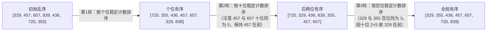

# 计数排序与基数排序：线性时间排序的边界与代价

**摘要：**

在本专栏第 01 篇中，我们曾用决策树模型严格证明：任何仅靠两两比较元素大小来决定次序的排序算法，在最坏情况下的比较次数绝不可能低于 $\Omega(n \log n)$。既然有这条铁律横亘在前，为什么计数排序（Counting Sort）、桶排序（Bucket Sort）与基数排序（Radix Sort）却号称能在 $O(n)$ 的线性时间内排好数组？答案并不在于它们推翻了信息论，而在于它们**跳出了比较模型的契约**——它们把元素值本身直接当作数组下标或哈希分桶的地址，用一次寻址直接获得多路分支信息。本文深入剖析这三类非比较排序的底层机制、前缀和稳定化技巧、适用边界与隐藏代价，并结合 LeetCode 164（最大间距）与 LeetCode 274（H 指数）展示鸽巢原理（Pigeonhole Principle）与值域裁剪在算法面试中的精妙运用。

---

## 第 1 章 为什么非比较排序能突破 O(n log n) 下界

### 1.1 比较树 vs 多路寻址树

回顾比较排序下界 $\Omega(n \log n)$ 的推导过程：每一次大小比较 `a < b` 只能回答一个"是或否"的二元问题，相当于在决策树上走了一次二分支，产生至多 $\log_2 2 = 1\text{ bit}$ 的信息量；而要从 $n!$ 种可能的输入排列里唯一锁定正确的有序排列，一共需要 $\log_2(n!) = \Theta(n \log n)\text{ bits}$ 的信息量，因此至少要比较 $\Theta(n \log n)$ 次。

非比较排序之所以能绕开这道墙，是因为它**利用了随机访问内存（RAM）模型下的地址计算能力**。当我们执行 `count[nums[i]]++` 时，CPU 并没有拿 `nums[i]` 去跟别的数字比大小，而是直接把 `nums[i]` 的整数值乘上字节宽度、加上基地址，一步跳到了对应的内存槽位上。如果值域大小是 $k$，这相当于决策树上的一个节点瞬间长出了 $k$ 个分支，一次内存寻址就榨取了 $\log_2 k\text{ bits}$ 的位置信息。

这就好比整理一万封信件：如果信封上只写了收件人姓名而没有邮政编码，分拣员只能把信件两两比对按字母顺序排列，这是比较排序；但如果每封信上都印着 00 到 99 的两位邮区编号，分拣员只需要在面前摆上 100 个邮袋，抓起一封信看一眼编号就精准扔进对应的邮袋里，一万封信只需过手一遍就能按邮区分拣完毕。

### 1.2 三类线性时间排序的边界与代价

天下没有免费的午餐。跳出比较模型换取线性时间，必然要支付额外的**先验假设代价**与**空间代价**：

| 算法 | 对输入数据的先验要求 | 时间复杂度 | 额外空间复杂度 | 是否稳定 | 退化或失效场景 |
|------|----------------------|------------|----------------|----------|----------------|
| 计数排序（Counting Sort） | 整数（或可映射为整数），值域跨度 $k = \max - \min$ 较小 | $O(n + k)$ | $O(n + k)$（稳定版）或 $O(k)$（覆写版） | 稳定（前缀和版） | 当 $k \gg n$（如数组仅有 5 个数但包含 $10^9$）时，时间与内存直接爆炸 |
| 桶排序（Bucket Sort） | 元素在区间 $[\min, \max]$ 内近似均匀分布 | 期望 $O(n + k)$，最坏 $O(n \log n)$ 或 $O(n^2)$ | $O(n + k)$ | 取决于桶内排序 | 当所有元素高度聚集在同一个桶内时，退化为单桶的比较排序 |
| 基数排序（Radix Sort） | 整数或定长字符串，可按基数 $b$ 拆分为 $d$ 个位权（Digit） | $O(d \cdot (n + b))$ | $O(n + b)$ | 稳定 | 当位数 $d$ 很大或键长极不均匀时，$d \cdot n$ 常数甚至劣于 $n \log n$ |

理解这张表的关键在于：**线性时间排序的复杂度表达式里，除了样本数 $n$，永远还挂着一个与数据特征相关的参数（值域跨度 $k$ 或位数 $d$）**。只有当 $k = O(n)$ 或 $d = O(1)$ 时，它们才真正是线性的。

---

## 第 2 章 计数排序：从频次覆写到前缀和稳定归位

### 2.1 朴素频次覆写版及其缺陷

如果待排序数组 `nums` 里装的仅仅是纯数字（譬如 `[2, 0, 2, 1, 1, 0]`），最简单的计数排序只需统计每个数值出现的次数，然后按数值从小到大依次把数字写回原数组：

```go
package main

// countingSortBasic 朴素计数排序（仅适用于纯标量，不保留原对象身份）
func countingSortBasic(nums []int) {
	if len(nums) <= 1 {
		return
	}
	minVal, maxVal := nums[0], nums[0]
	for _, v := range nums {
		if v < minVal {
			minVal = v
		}
		if v > maxVal {
			maxVal = v
		}
	}

	k := maxVal - minVal + 1
	count := make([]int, k)
	for _, v := range nums {
		count[v-minVal]++
	}

	idx := 0
	for valOffset, c := range count {
		for c > 0 {
			nums[idx] = valOffset + minVal
			idx++
			c--
		}
	}
}
```

这里用到了一个基本的工程技巧：**偏移量对齐（Offset Shifting）**。当数组中存在负数或最小值很大（譬如值域在 $[10000, 10100]$）时，直接用 `nums[i]` 作下标要么越界报错、要么白白浪费前 10000 个槽位；减去 `minVal` 后，所有元素都紧凑地映射到 $[0, \max - \min]$ 区间内。

但请注意，上面这种"数出几个就重新造几个数字填回去"的做法，在面对**複合对象（Struct）排序**或者作为**基数排序的子过程**时是完全不可用的——因为它把原有的元素抹掉重写了，丢失了元素携带的其余字段，也不具备**稳定性（Stability）**。

### 2.2 前缀和定位与倒序回填：为什么能保证稳定性

如何在保留原对象的前提下，用计数数组直接算出每个元素在有序结果中的精确下标？答案是**对计数数组求前缀和（Prefix Sum）**。

设 `count[v]` 原本表示"值等于 $v$ 的元素个数"。当我们从左往右执行累加 `count[v] += count[v-1]` 之后，`count[v]` 的物理含义就变成了：

$$\text{值小于等于 } v \text{ 的元素总个数}$$

这句话一旦换算成 0-indexed 的数组下标，就是一个极其美妙的定位公式：**如果小于等于 $v$ 的元素一共有 $m$ 个，那么所有等于 $v$ 的元素在最终有序数组里，必然占据下标区间 $[x, m - 1]$，其中最后一个等于 $v$ 的元素一定坐在下标 `m - 1`（即 `count[v] - 1`）的位置上**。

于是，我们**从后往前（从 `n - 1` 到 `0`）**倒序扫描原数组 `nums`：
- 遇到原数组靠后的一个等于 $v$ 的元素，就把它放进结果数组的 `count[v] - 1` 位置，随后令 `count[v]--`；
- 下一次再遇到原数组里靠前的一个等于 $v$ 的元素时，它就会被放进更新后的 `count[v] - 1`（即前一个同值元素的紧邻左侧）。

**后出现的同值元素坐在右边，先出现的同值元素坐在左边**——原有的相对次序分毫不差地保留了下来，这就是稳定版计数排序的全部秘密：

```go
package main

type Item struct {
	Key     int
	Payload string
}

// stableCountingSort 稳定计数排序：保留相同 Key 元素的原始相对顺序
func stableCountingSort(items []Item, minKey, maxKey int) []Item {
	n := len(items)
	if n <= 1 {
		return items
	}

	k := maxKey - minKey + 1
	count := make([]int, k)
	for _, it := range items {
		count[it.Key-minKey]++
	}

	// 1. 求前缀和：count[v] 表示 Key <= v+minKey 的元素总数
	for i := 1; i < k; i++ {
		count[i] += count[i-1]
	}

	// 2. 倒序遍历原数组，确保相同 Key 的元素按原相对次序落座
	output := make([]Item, n)
	for i := n - 1; i >= 0; i-- {
		idx := items[i].Key - minKey
		count[idx]--
		output[count[idx]] = items[i]
	}
	return output
}
```

---

## 第 3 章 基数排序：用稳定性撬动大值域

### 3.1 LSD 基数排序的推导：为什么必须从低位排到高位

当整数的值域跨度达到 $10^9$ 甚至 $2^{64}$ 时，计数排序所需的 $O(k)$ 空间彻底失灵。此时**基数排序（Radix Sort）**登场：既然一个 32 位整数一口气看全貌有 $2^{32}$ 种可能，那我们就把它拆成 4 个字节（每个字节值域仅 $[0, 255]$），或者拆成 10 个十进制位（每位值域仅 $[0, 9]$），**每次只按其中一位做稳定计数排序**。

这里有一个令许多初学者困惑的顺序问题：我们日常比较两个数字（如 `345` 和 `319`）的大小，明明是从最高位（百位）往最低位（个位）看的；为什么 **LSD（Least Significant Digit，最低位优先）基数排序**却反其道而行之，非要**从个位排到百位**？

原因在于：LSD 基数排序是一套**全量共排、逐轮覆盖**的流水线。在第 $r$ 轮按第 $r$ 位排序完成后，接下来第 $r+1$ 轮会把**所有元素混在一起**按更高一位重新排序。要想在第 $r+1$ 轮排完之后依然得出正确的全局顺序，必须满足两条铁律：
1. 如果两个数在高位（第 $r+1$ 位）数字**不同**，高位大的数必须排在后面（这由第 $r+1$ 轮排序本身保证）；
2. 如果两个数在高位（第 $r+1$ 位）数字**相同**，它们之间的先后次序必须由低位（前 $r$ 轮已经排好的次序）决定——**这就要求第 $r+1$ 轮排序绝对不能打乱同值元素在前 $r$ 轮确立的相对顺序，即每一轮按位排序必须是稳定的**。



如果反过来从最高位往最低位做全量混合排序（而不分桶隔离），那么排个位的时候，个位小的 `831` 就会排到个位大的 `129` 前面，把百位早就排好的成果彻底冲毁。当然，如果从最高位开始排，并且在按百位排完后把百位相同的数字关进独立的子桶里、后续只在各子桶内部递归按十位排，那就是 **MSD（Most Significant Digit）基数排序**，常见于字符串字典序排序与 Trie 树构建。

### 3.2 Go 语言实现（以 10 为基数与以 256 为基数的工程选择）

```go
package main

// radixSort 非负整数的 LSD 基数排序
// 时间复杂度：O(d * (n + 10))，其中 d 为最大值的十进制位数；空间复杂度：O(n)
func radixSort(nums []int) {
	n := len(nums)
	if n <= 1 {
		return
	}

	maxVal := nums[0]
	for _, v := range nums {
		if v > maxVal {
			maxVal = v
		}
	}

	output := make([]int, n)
	// exp = 1, 10, 100, ... 依次提取个位、十位、百位
	for exp := 1; maxVal/exp > 0; exp *= 10 {
		var count [10]int
		for _, v := range nums {
			digit := (v / exp) % 10
			count[digit]++
		}
		for i := 1; i < 10; i++ {
			count[i] += count[i-1]
		}
		for i := n - 1; i >= 0; i-- {
			digit := (nums[i] / exp) % 10
			count[digit]--
			output[count[digit]] = nums[i]
		}
		copy(nums, output)
	}
}
```

> [!info] 工程优化：为什么工业级基数排序不用 10 进制而用 256 进制
> 在上面的教学代码中，每次取一位用的是 `(v / exp) % 10`，这涉及极其昂贵的硬件整数除法指令。在生产级基数排序中，基数 $b$ 总是选为 $2^8 = 256$（即每次按 1 个 Byte 排序）：提取第 $k$ 个字节只需位运算 `(v >> (8 * k)) & 0xFF`，彻底消灭除法与取模，且一个 32 位整数固定只需 4 轮扫描即可排完。

### 3.3 MSD 基数排序与变长字符串排序（American Flag Sort）

前面讲的 LSD 基数排序非常适合**定长整数**，但如果要对一百万个**长度相差悬殊的字符串**（譬如既有长度为 2 的 `"go"`，又有长度为 200 的 URL）按字典序排序，LSD 就会显得非常笨拙——因为 LSD 必须从最长的第 200 个字符开始往前排，导致所有长度为 2 的短字符串也得跟着空跑 198 轮。

针对变长字符串，工程界更青睐 **MSD（Most Significant Digit，最高位优先）基数排序**。它的思路与人类查字典完全一致：
1. 第一轮只看所有字符串的**第 0 个字符**（首字母），用计数排序将它们分进 256 个桶里（若某个字符串在第 $d$ 层已经到达末尾，则直接排在最前面所谓的"终止桶"中）；
2. 第一轮分桶完成后，首字母不同的字符串之间的相对顺序就已经**永久确定**了（`'a'` 开头的永远在 `'b'` 开头的前面）；
3. 接下来只对每个元素个数大于 1 的子桶内部，递归地按**第 1 个字符**继续分桶；当子桶元素个数缩减到阈值（如 16 个）以下时，直接切换为原地插入排序收尾。

如果在此基础上进一步利用计数前缀和计算每个桶的起止下标，并通过循环置换直接在原数组上完成原地分桶（无需 `output` 辅助数组），就得到了著名的 **美国国旗排序（American Flag Sort）**——它是荷兰国旗三路分区（3 桶）向 256 桶的自然推广。

---

## 第 4 章 实战精讲：最大间距与 H 指数

### 4.1 LeetCode 164：最大间距（桶排序 + 鸽巢原理的巅峰之作）

**题目描述**：给定一个无序的数组 `nums`，返回数组在排序之后，相邻元素之间最大的差值。如果数组元素个数小于 2，则返回 0。**必须编写一个在 $O(n)$ 时间内运行并使用 $O(n)$ 额外空间的算法。**

#### 4.1.1 为什么鸽巢原理能帮我们省掉桶内排序

这道题如果直接用上一章的 LSD 基数排序把数组花 $O(n)$ 时间排好，再扫一遍求相邻最大差值，完全可以通过。但面试官更青睐另一种直指问题本质的解法——**基于鸽巢原理（Pigeonhole Principle）的桶设计**。

设数组有 $n$ 个元素，全局最小值为 $minVal$，全局最大值为 $maxVal$。想象这 $n$ 个点落在区间 $[minVal, maxVal]$ 上，它们把这段总长度为 $L = maxVal - minVal$ 的线段切分成了 $n - 1$ 段相邻间距。这 $n - 1$ 段间距的**平均值**是：

$$avgGap = \frac{maxVal - minVal}{n - 1}$$

根据鸽巢原理（或者说"最大值必然大于等于平均值"这一朴素公理），排序后相邻元素的**最大间距 $\Delta_{\max}$ 必然满足**：

$$\Delta_{\max} \ge \left\lceil \frac{maxVal - minVal}{n - 1} \right\rceil$$

现在，我们精心设计桶的宽度（Bucket Size）：令每个桶覆盖的左闭右开区间跨度 $d$ 恰好等于：

$$d = \max\left(1, \left\lfloor \frac{maxVal - minVal}{n - 1} \right\rfloor\right)$$

在同一个桶内部，任意两个元素之间的最大可能差值是多少？由于桶是半开区间 $[low, low + d)$，落入同一个桶内的最大元素与最小元素之差至多是 $d - 1$。而我们刚刚证明了全局最大相邻间距 $\Delta_{\max} \ge d > d - 1$。这导出了一个石破天惊的推论：

> **全局最大的相邻元素间距，绝不可能出现在同一个桶内部的两个元素之间，它必然跨越在某个非空桶的最大值与下一个非空桶的最小值之间。**

既然桶内元素之间绝不可能产生最大间距，我们根本不需要在桶里保存所有元素，更不需要对桶内元素排序——**每个桶只需要维护两个标量：落入该桶的最小值 `min` 和最大值 `max`**。最后从左往右扫描所有非空桶，用"当前非空桶的 `min` 减去前一个非空桶的 `max`"更新全局答案即可：

```go
package main

import "math"

// maximumGap 利用鸽巢原理分桶，在严格 O(n) 时间与空间内求排序后最大相邻差值
func maximumGap(nums []int) int {
	n := len(nums)
	if n < 2 {
		return 0
	}

	minVal, maxVal := nums[0], nums[0]
	for _, v := range nums {
		if v < minVal {
			minVal = v
		}
		if v > maxVal {
			maxVal = v
		}
	}
	if minVal == maxVal {
		return 0
	}

	// 桶宽 d：同桶内最大差值 <= d-1，而全局最大相邻差值 >= d，故答案必在桶间产生
	d := max(1, (maxVal-minVal)/(n-1))
	bucketCount := (maxVal-minVal)/d + 1

	bucketMin := make([]int, bucketCount)
	bucketMax := make([]int, bucketCount)
	for i := 0; i < bucketCount; i++ {
		bucketMin[i] = math.MaxInt32
		bucketMax[i] = math.MinInt32
	}

	for _, v := range nums {
		idx := (v - minVal) / d
		if v < bucketMin[idx] {
			bucketMin[idx] = v
		}
		if v > bucketMax[idx] {
			bucketMax[idx] = v
		}
	}

	maxGap := 0
	prevMax := bucketMax[0] // 第 0 号桶必然包含全局最小值 minVal，故非空
	for i := 1; i < bucketCount; i++ {
		if bucketMin[i] == math.MaxInt32 {
			continue // 跳过空桶
		}
		if bucketMin[i]-prevMax > maxGap {
			maxGap = bucketMin[i] - prevMax
		}
		prevMax = bucketMax[i]
	}
	return maxGap
}
```

### 4.2 LeetCode 274：H 指数（值域截断 + 计数排序）

**题目描述**：给你一个整数数组 `citations`，其中 `citations[i]` 表示研究者的第 $i$ 篇论文被引用的次数。一名科研人员的 $h$ 指数是指他至少发表了 $h$ 篇论文，且至少有 $h$ 篇论文的被引用次数大于等于 $h$。返回最大的 $h$。

如果先对 `citations` 排序，耗时 $O(n \log n)$。能不能用计数排序优化到 $O(n)$？

有人会问："一篇旷世神作的被引用次数 `citations[i]` 可能是 100 万次，值域这么大，怎么用计数排序？"

洞察藏在 $h$ 指数的定义里：如果这位学者一共只写了 $n = 5$ 篇论文，那么他的 $h$ 指数最大能是多少？**封顶就是 $n = 5$**。至于其中某篇论文是被引用了 5 次、100 次还是 100 万次，对计算 $h$ 指数而言毫无区别——它们都只贡献了"1 篇引用次数 $\ge 5$ 的论文"。

因此，我们可以对输入值域做一次**上界截断（Clamping）**：将所有大于 $n$ 的引用次数统统当作 $n$ 来统计，值域瞬间被压缩到了 $[0, n]$。开一个长度为 $n + 1$ 的计数数组 `count`，统计每个引用次数的论文篇数，然后从下标 $n$ 往 $0$ 倒序累加后缀和 `papers`（代表被引用次数 $\ge i$ 的论文总数），第一个满足 `papers >= i` 的下标 $i$ 就是最大的 $h$ 指数：

```go
package main

// hIndex 利用值域截断计数排序，O(n) 时间求 H 指数
func hIndex(citations []int) int {
	n := len(citations)
	count := make([]int, n+1)

	for _, c := range citations {
		if c >= n {
			count[n]++ // 超出 n 的引用次数一律截断归入第 n 号桶
		} else {
			count[c]++
		}
	}

	papers := 0
	for i := n; i >= 0; i-- {
		papers += count[i]
		if papers >= i {
			return i
		}
	}
	return 0
}
```

### 4.3 动手推演：Maximum Gap 在具体数组上的分桶轨迹

为了彻底吃透第 4.1 节中"桶宽 $d = \max(1, \lfloor (maxVal - minVal) / (n - 1) \rfloor)$"的精妙之处，我们不妨拿 `nums = [3, 6, 9, 1, 17, 10]`（共 $n = 6$ 个元素）亲手走一遍：
1. **求极值与桶宽**：扫描一遍得 $minVal = 1, maxVal = 17$。总跨度为 $17 - 1 = 16$，共 $n - 1 = 5$ 段相邻间距，因此桶宽 $d = \lfloor 16 / 5 \rfloor = 3$，总桶数 `bucketCount = 16 / 3 + 1 = 6`（编号 `0` 到 `5`），分别覆盖 `[1, 3], [4, 6], [7, 9], [10, 12], [13, 15], [16, 18]`。
2. **入桶维护桶内极值**：
   - `3`：`(3 - 1) / 3 = 0` 号桶；`1`：`(1 - 1) / 3 = 0` 号桶 $\to$ **0 号桶** `min = 1, max = 3`；
   - `6`：`(6 - 1) / 3 = 1` 号桶 $\to$ **1 号桶** `min = 6, max = 6`；
   - `9`：`(9 - 1) / 3 = 2` 号桶 $\to$ **2 号桶** `min = 9, max = 9`；
   - `10`：`(10 - 1) / 3 = 3` 号桶 $\to$ **3 号桶** `min = 10, max = 10`；
   - **4 号桶**（对应 `[13, 15]`）：没有任何元素落入，保持为**空桶**；
   - `17`：`(17 - 1) / 3 = 5` 号桶 $\to$ **5 号桶** `min = 17, max = 17`。
3. **跨桶扫描求最大差值**：
   - 0 号桶与 1 号桶之间：`bucketMin[1] - bucketMax[0] = 6 - 3 = 3`；
   - 1 号桶与 2 号桶之间：`9 - 6 = 3`；
   - 2 号桶与 3 号桶之间：`10 - 9 = 1`；
   - 跳过空的 4 号桶，直接算 3 号桶与 5 号桶之间：`bucketMin[5] - bucketMax[3] = 17 - 10 = 7`。

最终得出最大间距为 `7`。请注意：0 号桶内部虽然装了 `1` 和 `3` 两个数，但它们的差值 `3 - 1 = 2` 严格小于桶宽 `d = 3`，而跨过空桶 4 号桶的那一跳，差值必然大于桶宽 `d`，因此 0 号桶内部的顺序根本无需关心。

### 4.4 延伸实战：数组的相对排序与自定义字典计数（LeetCode 1122 & 791）

计数排序不仅能按自然数的大小顺序输出，还能**按任意给定的外部字典顺序输出**。以 **LeetCode 1122：数组的相对排序**为例：给定两个数组 `arr1` 和 `arr2`（其中 `arr2` 元素互不相同，且值域均在 $[0, 1000]$ 内），要求对 `arr1` 排序，使 `arr1` 中元素的相对顺序与 `arr2` 相同；未在 `arr2` 中出现的元素按升序放在末尾。

这简直是为计数排序量身定做的舞台：
1. 先开一个长度为 `1001` 的计数数组 `count`，把 `arr1` 所有元素的频次统计进去；
2. 第一轮按 `arr2` 给定的顺序遍历：对 `arr2` 中的每个数字 $x$，把 `count[x]` 个 $x$ 依次追加进结果数组，并将 `count[x]` 清零；
3. 第二轮从 `0` 到 `1000` 自然升序遍历 `count` 数组：将剩余非零频次的数字（即未在 `arr2` 中出现的数字）依次追加进结果数组。

```go
package main

// relativeSortArray 利用计数数组实现按外部字典序 + 自然升序的 O(n + k) 排序
func relativeSortArray(arr1 []int, arr2 []int) []int {
	var count [1001]int
	for _, x := range arr1 {
		count[x]++
	}

	res := make([]int, 0, len(arr1))
	// 1. 先按 arr2 规定的特权次序输出
	for _, x := range arr2 {
		for count[x] > 0 {
			res = append(res, x)
			count[x]--
		}
	}

	// 2. 剩余未出现在 arr2 中的元素，按 0..1000 自然升序输出
	for x := 0; x <= 1000; x++ {
		for count[x] > 0 {
			res = append(res, x)
			count[x]--
		}
	}
	return res
}
```

### 4.5 延伸实战：根据字符出现频率排序（LeetCode 451）

再看一道将"计数"与"桶"两层映射结合在一起的经典题——**LeetCode 451：根据字符出现频率排序**。给定一个字符串 `s`，请将字符串里的字符按照出现的频率降序排列（譬如 `"tree"` 排为 `"eert"` 或 `"eetr"`）。

这道题如果用比较排序，需要先统计频次再调用 `sort.Slice`，耗时 $O(n + |\Sigma| \log |\Sigma|)$；而如果用**双层计数分桶**，则能做到纯粹的线性时间：
- **第一层计数（按字符编码寻址）**：由于 ASCII 字符集大小仅为 128，开一个 `[128]int` 数组统计每个字符出现的频次 `freq[ch]`，并顺便记录最高频次 `maxFreq`；
- **第二层分桶（按频次数值寻址）**：由于最大频次 `maxFreq` 绝不超过字符串长度 $n$，开一个长度为 `maxFreq + 1` 的桶切片 `buckets`，将频次为 $f$ 的字符追加进 `buckets[f]`；
- **倒序展开**：从 `f = maxFreq` 往 `1` 倒序扫描，把 `buckets[f]` 里的每个字符重复写入 $f$ 次，即可在 $O(n)$ 时间内拼出结果：

```go
package main

import "strings"

// frequencySort 双层非比较分桶实现 O(n) 字符频次降序重排
func frequencySort(s string) string {
	var freq [128]int
	maxFreq := 0
	for i := 0; i < len(s); i++ {
		ch := s[i]
		freq[ch]++
		if freq[ch] > maxFreq {
			maxFreq = freq[ch]
		}
	}

	buckets := make([][]byte, maxFreq+1)
	for ch := 0; ch < 128; ch++ {
		if f := freq[ch]; f > 0 {
			buckets[f] = append(buckets[f], byte(ch))
		}
	}

	var sb strings.Builder
	sb.Grow(len(s))
	for f := maxFreq; f >= 1; f-- {
		for _, ch := range buckets[f] {
			for k := 0; k < f; k++ {
				sb.WriteByte(ch)
			}
		}
	}
	return sb.String()
}
```

---

## 第 5 章 工程视野：基数排序如何统治 GPU 与高性能计算

在算法课本里，基数排序似乎只是整数排序的一种冷门补充；但在现代高性能计算（HPC）、GPU 并行计算（如 NVIDIA CUB 库中的 `DeviceRadixSort`）以及列式分析数据库（ClickHouse、DuckDB）中，**按字节的基数排序（Byte-wise Radix Sort）在百万级以上数值排序中的吞吐量，往往能把 `std::sort` 或 `pdqsort` 甩开数倍**。

为什么在工业界，基数排序不仅能排无符号整数，连有符号整数（`int32` / `int64`）甚至浮点数（`float32` / `float64`）都能通吃？这里有两个极其精巧的二进制位变换技巧：

1. **有符号补码整数（Two's Complement）的无符号化映射**：32 位有符号整数的最高位（第 31 位）是符号位，`0` 代表非负，`1` 代表负数；而在除去符号位的低 31 位上，负数也是越接近 `-1` 编码值越大（如 `-2` 是 `0xFFFFFFFE`，`-1` 是 `0xFFFFFFFF`）。因此，只需把有符号整数转成 `uint32` 后**将最高位翻转（异或 `0x80000000`）**，原本最小的负数 `-2147483648`（`0x80000000`）就变成了 `0x00000000`，最大的正数 `2147483647`（`0x7FFFFFFF`）就变成了 `0xFFFFFFFF`，全值域严格保序地映射到了无符号整数空间，直接套用 4 轮 256 进制基数排序即可。
2. **IEEE 754 浮点数的字典序位变换**：IEEE 754 浮点数由 1 位符号位、8 位移码指数、23 位尾数构成。当浮点数为正数时，其二进制位按无符号整数解释的大小关系，与浮点数本身的大小关系完全一致；当浮点数为负数时，由于采用原码表示（符号位为 `1`，绝对值越大整数编码越大），顺序恰好相反。因此，转换规则只需一行位运算：**若符号位为 `0`（正数），只翻转最高位（`| 0x80000000`）；若符号位为 `1`（负数），将全部 32 位按位取反（`^uint32(0)`）**。经过这一双射变换后，十亿个 32 位浮点数就能在 4 轮纯字节基数排序下实现零分支预测失败（Branchless）的极速排序。

---

## 第 6 章 常见误区与边界自检

1. **稳定计数排序倒序回填写成了正序**：在第 2.2 节中，由于前缀和 `count[idx]` 指向的是同值元素区间的**右端末尾**，每放一个元素 `count[idx]` 就要减一（向左退一格）。因此必须从原数组末尾 `n - 1` 往 `0` 倒着扫，才能让原数组靠后的元素落在右边；若正着扫，同值元素的次序会恰好全部颠倒，变成"反稳定排序"，一旦用于基数排序就会算出错误结果。
2. **Maximum Gap 全等数组除以零**：在 LeetCode 164 中，若输入为 `[5, 5, 5, 5]`，则 `maxVal - minVal == 0`，若不加 `max(1, ...)` 保护或提前返回 `0`，后续计算 `(v - minVal) / d` 会直接触发除零 panic。
3. **带符号整数的基数排序符号位陷阱**：如果对包含负数的 32 位整数按字节做基数排序，最高字节的第 7 位是补码符号位（负数为 `1`，非负数为 `0`），按无符号字节排序会把负数排到正数后面。正确做法是在排最高位时将符号位翻转（异或 `0x80`），或将所有数预先减去最小值转为非负数。
4. **桶排序在偏态分布下的退化风险**：在普通桶排序（非 LeetCode 164 的空桶极值法）中，如果输入数据服从高度偏态的幂律分布（譬如社交网络粉丝数或长尾延迟，99% 的数据挤在 `[0, 10]`，而 1 个异常值在 `10^9`），均匀切分值域会让 99% 的元素全部掉进第 0 号桶里，导致桶排序瞬间退化为单桶内部的 $O(n \log n)$ 比较排序，白白浪费了其余所有空桶的内存。这也是为什么通用标准库从不贸然默认使用桶排序，除非调用方能够提供数据分布或值域跨度的强契约。

---

## 小结

非比较排序用"地址计算"代替"大小比对"，为我们打开了突破 $\Omega(n \log n)$ 下界的大门：
- **计数排序**利用小值域整数与数组下标的一一对应，通过前缀和与倒序回填兼顾了 $O(n + k)$ 的速度与稳定性；
- **基数排序**将大值域拆解为多个小基数位权，依靠稳定计数排序从低位到高位的逐轮传递，处理定长整数与字符串；
- **桶排序与鸽巢原理**通过精心设计桶宽或值域截断（如 LC 164 与 LC 274），将看似需要全量排序的问题化归为线性时间的分桶统计。

下一篇 [[10 排序与查找综合通关：面试高频模式总结]] 将对本专栏十篇文章做一次全景收束，提炼出考场上的模式识别表格、选型决策树与高频避坑清单。

---

## 参考资料

1. Cormen, T. H., et al. *Introduction to Algorithms* (4th ed.). MIT Press, 2022. Chapter 8: Sorting in Linear Time.
2. Knuth, D. E. (1998). *The Art of Computer Programming, Volume 3: Sorting and Searching* (2nd ed.). Addison-Wesley. Section 5.2.5: Sorting by Distribution.
3. Hirsch, J. E. (2005). *An index to quantify an individual's scientific research output*. PNAS, 102(46), 16569–16572.

---

> [!note] 思考题
> 1. 在稳定计数排序中，如果不使用前缀和，而是为每个值建一个链表（或动态切片桶）按正序追加元素、最后依次拼接，同样能保证稳定性。对比"前缀和 + 倒序回填数组"与"链表桶正序追加"，两者在内存分配与 CPU 缓存命中率上有何差异？
> 2. 在 LeetCode 164（最大间距）中，为什么第 0 号桶一定非空，且最后一个桶（第 `bucketCount - 1` 号桶）也一定非空？为什么计算相邻非空桶间距时，绝对不需要考虑同一个桶内部的 `bucketMax[i] - bucketMin[i]`？
> 3. 如果要对一百万个长度不等的英文单词按字典序排序，应该如何结合基数排序思想设计算法？（提示：对比用空格补齐后的 LSD 与按首字母递归分桶的 MSD）
