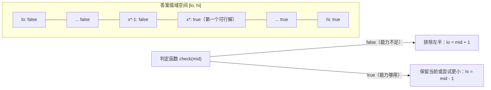
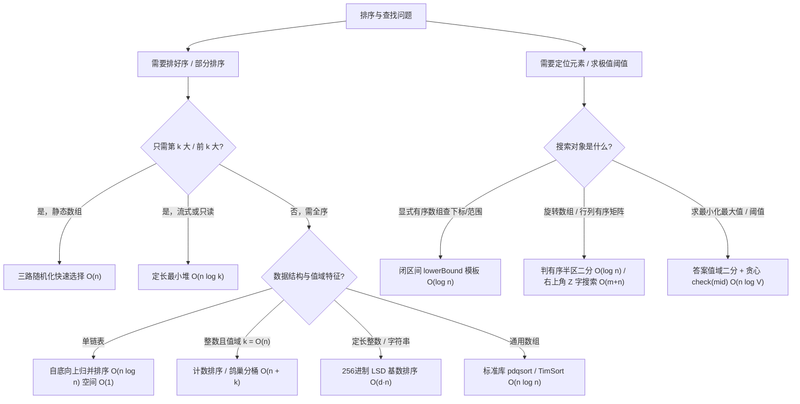

# 排序与查找综合通关：面试高频模式总结

**摘要：**

经过前九篇从比较排序理论下界、归并分治、链表指针排序、荷兰国旗与原地哈希，到二分查找不变量、旋转数组与二维矩阵、快速选择 TopK、区间贪心以及非比较线性排序的逐层剖析，本篇作为专栏收官之作，不再局限于孤立的单题解法，而是将这些技术沉淀为一套**可操作、可复用的面试通关坐标系**。本文将重点攻克二分查找最高阶的形态——**二分答案（Binary Search on Answer Space，即参数搜索）**，配齐 LeetCode 875、410、287 的 Golang 实现，并系统梳理排序与查找的全景模式识别矩阵、选型决策树、四大致命死循环陷阱与考场开口表达心法。

---

## 第 1 章 排序与查找的两大核心哲学：创造单调性与消费单调性

### 1.1 为什么排序与查找总是成对出现

如果把算法面试中的序列问题俯瞰一遍，你会发现**排序（Sorting）**与**查找（Searching）**本质上是一枚硬币的两面：
- **排序是在"创造单调性"**：它付出 $O(n \log n)$ 或 $O(n)$ 的预处理代价，消除数据在位置或数值上的无序自由度，建立起全局或局部的全序结构；
- **查找（以及双指针、贪心扫描）是在"消费单调性"**：一旦单调性建立完毕，原本需要 $O(n)$ 线性扫描的查找立刻坍缩为 $O(\log n)$ 的二分折半，原本需要 $O(n^2)$ 两两比对的区间重叠检测立刻坍缩为 $O(n)$ 的邻项合并。

这就好比图书馆编目：把十万册新书按索书号上架（排序）确实费时费力；但只要书架是有序的，不仅读者找书（二分查找）只需几步，连图书管理员清理重复复本（邻项去重）、统计某学科馆藏数量（上下界做差 `upperBound - lowerBound`）都能在瞬息之间完成。

### 1.2 全专栏问题特征与首选算法映射矩阵

在考场上读完题目后的前 30 秒，可通过下表中的特征信号直接锁定算法主方向：

| 题面特征信号 | 本质归约 | 首选算法与核心武器 | 典型代表题 |
|--------------|----------|--------------------|------------|
| 两个或多个有序序列合并 | 维护多游标的最小前沿 | 双指针（从后往前防覆盖 / 哑节点）或容量为 $k$ 的最小堆 / 分治归并 | LC 88、LC 21、LC 23 |
| 单链表要求 $O(n \log n)$ 排序且 $O(1)$ 空间 | 不支持随机访问，但改指针合并零额外空间 | 自底向上倍增步长（`size = 1, 2, 4...`）的迭代归并排序 | LC 147、LC 148 |
| 仅含 3 种离散值或需按某阈值切分为三段 | 三路分区的循环不变量 | 荷兰国旗三指针 `[0, p0)`、`[p0, i)`、`(p2, n-1]` | LC 75 |
| 长度为 $n$ 的数组找缺失正整数或重复数，限 $O(1)$ 空间 | 下标 `[0, n-1]` 与值域 `[1, n]` 的双射 | 原地哈希（把值 $v$ 交换回下标 $v-1$ 处） | LC 41、LC 442、LC 448 |
| 有序数组中找插入位置、出现次数、区间端点 | 阶跃布尔函数的分界点 | 二分查找 `lowerBound(target)` 与 `lowerBound(target + 1) - 1` | LC 704、LC 35、LC 34 |
| 部分有序（旋转数组、山脉数组）或行列有序矩阵 | 每次比较仍能排除一半或一整行/列 | 旋转数组判有序半区；二维矩阵右上角 Z 字形搜索 | LC 33、LC 81、LC 74、LC 240 |
| 静态求第 $k$ 大 / 前 $k$ 大，或流式动态维护前 $k$ 大 | 不需要全序，只需确立分界点或淘汰池 | 静态用随机化三路快速选择 $O(n)$；流式用定长最小堆 $O(n \log k)$ | LC 215、LC 347、LC 973、LC 703 |
| 无序区间求并集、并发峰值、最大不相交数、最少穿刺点 | 排序消除一个自由度以激活贪心 | 连通/峰值按**左端点**升序；独立集/穿刺按**右端点**升序 | LC 56、LC 57、LC 253、LC 435、LC 452 |
| 要求 $O(n)$ 线性时间排序，或值域跨度受限 | 跳出比较模型，用值直接寻址或利用鸽巢原理 | 计数排序（前缀和稳定版）、LSD 基数排序、鸽巢分桶 | LC 164、LC 274、LC 1122 |
| 求"最小化最大值"或"最大化最小值"，且给定候选值易验证 | 答案空间上的单调判定函数 `check(mid)` | **二分答案（参数搜索）** | LC 875、LC 410、LC 1011、LC 287 |

---

## 第 2 章 二分查找的最高阶形态：二分答案（参数搜索）

在前文第 05、06 篇中，二分查找的对象都是一个**显式存在的数组或矩阵**。然而在真正区分中高级候选人的面试题里，输入数组往往是**完全无序且绝不允许打乱顺序**的，题目却要求你求出某个最优的阈值（譬如"最慢的吃香蕉速度"、"最小化的子数组最大和"）。这类题目的通解，就是**在答案的值域空间上做二分查找（Binary Search on Answer Space）**。

### 2.1 什么时候能用"二分答案"

只要一个最优化问题同时满足以下三条性质，就可以立刻转化为二分答案：
1. **答案值域有界**：待求的最优答案 $x$ 必然落在一个可以明确算出的闭区间 $[lo, hi]$ 内；
2. **验证比求解容易**：虽然直接算出最优的 $x^*$ 很难，但如果我先猜一个具体的数值 $mid$，问你"当参数取 $mid$ 时，能不能在规定限制内完成任务"，你可以写出一个 $O(n)$ 的贪心或计数函数 `check(mid) bool` 轻松回答"能"或"不能"；
3. **判定函数具备单调性（Monotonicity）**：如果参数取 $mid$ 时能够完成任务，那么所有比 $mid$ 更宽松的参数 $x' > mid$ 也必然能完成任务；反之如果 $mid$ 完不成，所有更苛刻的 $x'' < mid$ 也必然完不成。

一旦这三条成立，`check(x)` 在值域 $[lo, hi]$ 上就呈现为一段连续的 `false` 紧接着一段连续的 `true`：**求最小可行解，本质上就是在布尔虚拟数组上求第一个 `true` 的下标（即标准的 `lowerBound`）**。



### 2.2 实战一：爱吃香蕉的珂珂（LeetCode 875）

**题目描述**：这里有 $n$ 堆香蕉，第 $i$ 堆中有 `piles[i]` 根香蕉。警卫已经离开了，将在 `h` 小时后回来。珂珂可以决定她吃香蕉的速度 `k`（单位：根/小时）。每个小时，她将会选择一堆香蕉，从中吃掉 `k` 根；如果这堆香蕉少于 `k` 根，她将吃掉这堆的所有香蕉，然后这一小时内不会再吃更多的香蕉。求她可以在 `h` 小时内吃掉所有香蕉的**最小速度 `k`**。

我们来套用二分答案的三步检验：
- **值域上下界**：速度最小不能低于 $lo = 1$；速度最大需要超过最大那一堆的根数 $\max(piles)$ 吗？不需要，因为一小时最多只能吃一堆，速度等于 $\max(piles)$ 时每堆都只需 1 小时，再快也省不下时间，故上界 $hi = \max(piles)$。
- **验证函数 `canFinish(k)`**：给定速度 `k`，吃完第 $i$ 堆需要 $\lceil piles[i] / k \rceil$ 小时。在整数运算中，正整数向上取整的标准无浮点公式是 `(piles[i] + k - 1) / k`。将所有堆的耗时累加，检查总耗时是否 $\le h$ 即可，单次验证耗时 $O(n)$。
- **单调性**：速度 `k` 越大，总耗时越短，越容易在 `h` 小时内吃完。因此直接套用闭区间 `lowerBound` 模板：

```go
package main

// minEatingSpeed 二分答案求最小可行吃香蕉速度
// 时间复杂度：O(n log(max(piles)))，空间复杂度：O(1)
func minEatingSpeed(piles []int, h int) int {
	lo, hi := 1, 0
	for _, p := range piles {
		if p > hi {
			hi = p
		}
	}

	canFinish := func(speed int) bool {
		hours := 0
		for _, p := range piles {
			hours += (p + speed - 1) / speed // 整数向上取整
			if hours > h {
				return false
			}
		}
		return true
	}

	for lo <= hi {
		mid := lo + (hi-lo)/2
		if canFinish(mid) {
			hi = mid - 1 // 当前速度可行，尝试能否更慢
		} else {
			lo = mid + 1 // 当前速度吃不完，必须提速
		}
	}
	return lo
}
```

### 2.3 实战二：分割数组的最大值（LeetCode 410，"最小化最大值"标杆）

**题目描述**：给定一个非负整数数组 `nums` 和一个整数 `k`，你需要将这个数组分成 `k` 个非空的**连续子数组**。设计一个算法使得这 `k` 个子数组各自和的最大值最小。

这道题如果正面用动态规划硬算，状态转移需要 $O(n^2 k)$ 时间。但只要看到**"使……的最大值最小（Minimize the Maximum）"**这七个字，你的脑海里就应当立刻亮起"二分答案"的信号灯：
1. **设答案为 $limit$**（即规定每个连续子数组的元素之和绝不准超过 $limit$）；
2. **值域上下界**：由于每个元素至少要放进某一个子数组里，$limit$ 绝不能小于数组中的最大单元素，故下界 $lo = \max(nums)$；而当 $k = 1$（不切分）时，整个数组合成一段，故上界 $hi = \sum nums$；
3. **贪心验证函数 `canSplit(limit)`**：给定每个桶的容量上限 `limit`，我们从左往右贪心地往当前桶里塞元素——只要再塞入 `nums[i]` 不超过 `limit`，就继续塞进当前桶（因为塞得越满，留给后面的元素越少，所需的总桶数就越少）；一旦塞入后会撑爆 `limit`，就必须封口当前桶、新开一个桶（`splits++`）。最后只需检查所需总桶数是否 $\le k$。

```go
package main

// splitArray 二分答案解决"最小化子数组最大和"（与 LC 1011 在 D 天内送达包裹完全同构）
// 时间复杂度：O(n log(sum(nums)))，空间复杂度：O(1)
func splitArray(nums []int, k int) int {
	lo, hi := 0, 0
	for _, v := range nums {
		if v > lo {
			lo = v // 下界：数组中的最大单元素
		}
		hi += v // 上界：全部元素之和
	}

	canSplit := func(limit int) bool {
		buckets := 1
		curSum := 0
		for _, v := range nums {
			if curSum+v > limit {
				buckets++
				curSum = v
				if buckets > k {
					return false
				}
			} else {
				curSum += v
			}
		}
		return true
	}

	for lo <= hi {
		mid := lo + (hi-lo)/2
		if canSplit(mid) {
			hi = mid - 1 // 容量 mid 足够分成 <= k 段，尝试压缩容量上限
		} else {
			lo = mid + 1 // 容量 mid 太小导致段数超标，必须放宽容量上限
		}
	}
	return lo
}
```

### 2.4 实战三：寻找重复数的值域二分（LeetCode 287）

**题目描述**：给定一个包含 $n + 1$ 个整数的数组 `nums`，其数字都在 $[1, n]$ 范围内（包括 $1$ 和 $n$），可知至少存在一个重复的整数。假设只有一个重复的整数，请找出这个重复的数。**要求：不修改数组 `nums`，且只使用常量级 $O(1)$ 的额外空间。**

注意这道题的苛刻限制：**不准修改原数组**（排除了排序与第 04 篇的原地哈希归位），**只准用 $O(1)$ 空间**（排除了哈希集合与计数数组）。除了本系列在快慢指针篇讲过的 Floyd 判圈法之外，它也是**值域二分 + 鸽巢原理**的绝佳范例：
- 待求的重复数字落在值域 $[1, n]$ 内，我们对**数值范围 $[1, n]$** 做二分，取中点数值 `mid = (lo + hi) / 2`；
- 遍历整个原数组，统计数组中**数值小于等于 `mid` 的元素总个数 `cnt`**；
- 如果 `[1, mid]` 这 `mid` 个数字都没有重复，那么数组里小于等于 `mid` 的元素最多只有 `mid` 个；**一旦发现 `cnt > mid`，根据鸽巢原理，重复的那个数字必然就藏在数值区间 `[1, mid]` 之中**，于是令 `hi = mid - 1`；反之若 `cnt <= mid`，说明重复数必然在 `[mid + 1, n]` 之中，令 `lo = mid + 1`：

```go
package main

// findDuplicate 值域二分 + 鸽巢计数，不修改原数组，空间 O(1)，时间 O(n log n)
func findDuplicate(nums []int) int {
	lo, hi := 1, len(nums)-1
	for lo <= hi {
		mid := lo + (hi-lo)/2
		cnt := 0
		for _, v := range nums {
			if v <= mid {
				cnt++
			}
		}
		if cnt > mid {
			hi = mid - 1 // [1, mid] 内的苹果数超过了抽屉数 mid，重复数必在左半值域
		} else {
			lo = mid + 1
		}
	}
	return lo
}
```

### 2.5 实战四："最大化最小值"与单调递减判定函数（LeetCode 1552 两球之间的磁力）

前面三道题求的都是**"最小的可行解"**（`check(mid)` 从 `false` 变为 `true` 的左边界，退出循环时返回 `lo`）。面试中还有另一半对称的二分答案题——求**"最大化最小值（Maximize the Minimum）"**，即求**最大的可行解**。

以 **LeetCode 1552：两球之间的磁力**（与经典的 POJ 2456 愤怒的奶牛完全一致）为例：在位置数组 `position` 给出的 $n$ 个空篮子里放入 $m$ 个球，要求使任意两球之间的**最小距离最大化**。

这道题完美融合了**"先排序激活贪心 + 再二分答案空间"**：
1. **排序预处理**：先把篮子坐标 `position` 按升序排列（耗时 $O(n \log n)$）；
2. **设定判定函数 `canPlace(dist)`**：如果规定任意两球间距至少为 `dist`，能不能放下 $m$ 个球？由于篮子已排好序，第一个球无脑放进最左边的 `position[0]` 一定最优（给右边留出最大空间），后续只要遇到距离上一个放球位置 $\ge dist$ 的篮子就立刻放球，最后检查放下的球数是否 $\ge m$；
3. **单调性方向与返回值**：当间距要求 `dist` 越小，越容易放够 $m$ 个球（`true`）；当 `dist` 越大，越难放够（`false`）。因此 `canPlace(dist)` 在值域 $[1, position[n-1] - position[0]]$ 上呈现为**前段全 `true`、后段全 `false`**：
   - 若 `canPlace(mid)` 为 `true`：说明间距 `mid` 可行，我们想尝试更大的间距，故向右半区推进 `lo = mid + 1`；
   - 若 `canPlace(mid)` 为 `false`：说明间距 `mid` 太大了放不下，必须缩小间距，故 `hi = mid - 1`；
   - 循环结束时 `lo == hi + 1`，此时 `lo` 跨入了第一个 `false`，而 **`hi` 恰好停在最后一个 `true`（即最大的可行间距）上**，因此最终返回 `hi`：

```go
package main

import "sort"

// maxDistance 排序 + 二分答案解决"最大化最小间距"
// 时间复杂度：O(n log n + n log(maxPos))，空间复杂度：O(log n)
func maxDistance(position []int, m int) int {
	sort.Ints(position)
	n := len(position)

	canPlace := func(dist int) bool {
		count := 1
		lastPos := position[0]
		for i := 1; i < n; i++ {
			if position[i]-lastPos >= dist {
				count++
				lastPos = position[i]
				if count >= m {
					return true
				}
			}
		}
		return false
	}

	lo, hi := 1, (position[n-1]-position[0])/(m-1)
	for lo <= hi {
		mid := lo + (hi-lo)/2
		if canPlace(mid) {
			lo = mid + 1 // 间距 mid 可行，尝试能否拉得更开
		} else {
			hi = mid - 1 // 间距 mid 太大放不下，必须收缩
		}
	}
	return hi // 返回最后一个满足 true 的上界位置 hi
}
```

### 2.6 实战五：划分线的二分——寻找两个正序数组的中位数（LeetCode 4）

作为二分查找在面试中的巅峰难题，**LeetCode 4：寻找两个正序数组的中位数**要求在 $O(\log(m + n))$ 时间内找出两个有序数组 `nums1`（长 $m$）和 `nums2`（长 $n$）合并后的中位数。

如果用第 02 篇的双指针归并，耗时是 $O(m + n)$，无法达到对数级要求。要在 $O(\log(\min(m, n)))$ 内解决，核心是把"找中位数"转化为**"在较短数组 `nums1` 上二分寻找一条分割线 $i$"**：
- 设我们在合并后的虚拟数组左半部分一共需要选出 `totalLeft = (m + n + 1) / 2` 个元素；
- 如果我们在较短数组 `nums1` 中切在下标 $i$ 处（即 `nums1` 贡献左半部分 $i$ 个元素 `nums1[0..i-1]`），那么 `nums2` 就**必须**贡献剩下的 $j = totalLeft - i$ 个元素 `nums2[0..j-1]`——**两个自由度被绑定成了一个自由度 $i$**；
- 一条分割线 $(i, j)$ 是合法的中位数分割线，当且仅当左半部分的最大值小于等于右半部分的最小值，即交叉满足：
  $$nums1[i-1] \le nums2[j] \quad \text{且} \quad nums2[j-1] \le nums1[i]$$
- 如果 $nums1[i-1] > nums2[j]$，说明 `nums1` 贡献的元素太多太偏大了，分割线 $i$ 必须往左移（`hi = i - 1`）；反之若 $nums2[j-1] > nums1[i]$，说明 $i$ 切得太靠左了，必须往右移（`lo = i + 1`）：

```go
package main

import "math"

// findMedianSortedArrays 在较短数组的分割线位置上二分，时间复杂度严格 O(log(min(m, n)))
func findMedianSortedArrays(nums1 []int, nums2 []int) float64 {
	if len(nums1) > len(nums2) {
		nums1, nums2 = nums2, nums1 // 始终在较短的数组上二分，确保 j 不会越界
	}
	m, n := len(nums1), len(nums2)
	totalLeft := (m + n + 1) / 2

	lo, hi := 0, m
	for lo <= hi {
		i := lo + (hi-lo)/2
		j := totalLeft - i

		nums1LeftMax := math.MinInt32
		if i > 0 {
			nums1LeftMax = nums1[i-1]
		}
		nums1RightMin := math.MaxInt32
		if i < m {
			nums1RightMin = nums1[i]
		}
		nums2LeftMax := math.MinInt32
		if j > 0 {
			nums2LeftMax = nums2[j-1]
		}
		nums2RightMin := math.MaxInt32
		if j < n {
			nums2RightMin = nums2[j]
		}

		if nums1LeftMax <= nums2RightMin && nums2LeftMax <= nums1RightMin {
			// 命中合法分割线
			leftMax := max(nums1LeftMax, nums2LeftMax)
			if (m+n)%2 == 1 {
				return float64(leftMax)
			}
			rightMin := min(nums1RightMin, nums2RightMin)
			return float64(leftMax+rightMin) / 2.0
		} else if nums1LeftMax > nums2RightMin {
			hi = i - 1 // i 偏大，向左收缩
		} else {
			lo = i + 1 // i 偏小，向右扩张
		}
	}
	return 0.0
}
```

---

## 第 3 章 选型决策树与复杂度总表

### 3.1 排序与查找全景决策树



### 3.2 本专栏核心算法与高频题复杂度速查

| 类别 | 算法 / 题目 | 最优时间复杂度 | 额外空间复杂度 | 稳定性 / 核心不变量 |
|------|-------------|----------------|----------------|---------------------|
| 基础比较排序 | 插入排序（Insertion Sort） | 最好 $O(n)$，平均/最坏 $O(n^2)$ | $O(1)$ | 稳定；前缀 `[0, i)` 始终有序，小数组与近似有序极快 |
| 分治比较排序 | 归并排序（Merge Sort） | 恒为 $O(n \log n)$ | 数组 $O(n)$，链表迭代 $O(1)$ | 稳定；`temp[i] <= temp[j]` 相等时左半优先 |
| 分治比较排序 | 随机化三路快排（3-Way QuickSort） | 期望 $O(n \log n)$，最坏 $O(n^2)$ | $O(\log n)$ | 不稳定；`[lo, lt)` 小于、`[lt, gt]` 等于、`(gt, hi]` 大于 |
| 树形比较排序 | 堆排序（Heap Sort） | 恒为 $O(n \log n)$（建堆 $O(n)$） | $O(1)$ | 不稳定；父节点 $i$ 大于等于子节点 $2i+1, 2i+2$ |
| 非比较排序 | 计数 / 基数 / 桶排序 | $O(n+k)$ / $O(dn)$ / 期望 $O(n)$ | $O(n+k)$ | 稳定；前缀和 `count[v]-1` 配合倒序回填保序 |
| 序列合并 | LC 88 合并数组 / LC 23 合并 K 链表 | $O(m+n)$ / $O(N \log k)$ | $O(1)$ / $O(k)$ | 数组从后往前防覆盖；K 路归并用最小堆或两两分治 |
| 原地分区归位 | LC 75 颜色分类 / LC 41 缺失正数 | $O(n)$ | $O(1)$ | 荷兰国旗三指针；原地哈希令 `nums[v-1] = v` |
| 二分查找 | LC 34/35 边界 / LC 33 旋转数组 | $O(\log n)$ | $O(1)$ | 闭区间 `[lo, hi]` 循环结束时 `lo` 即第一个满足条件者 |
| 选择与 TopK | LC 215 第 K 大 / LC 295 数据流中位数 | 期望 $O(n)$ / 单次 $O(\log n)$ | $O(1)$ / $O(n)$ | 三路快速选择单支剪枝；对顶堆维持细腰平衡 |
| 区间与贪心 | LC 56 合并 / LC 253 会议室 / LC 435 无重叠 | $O(n \log n)$ | $O(1) \sim O(n)$ | 合并按左端点排，最大不相交按右端点排 |
| 二分答案 | LC 875 吃香蕉 / LC 410 分割数组 | $O(n \log V)$（$V$ 为值域跨度） | $O(1)$ | 答案值域 `[lo, hi]` 上 `check(mid)` 呈二段单调性 |

---

## 第 4 章 考场四大高频死循环与 Bug 诊断手册

### 4.1 诊断一：二分查找死循环在最后两个元素上

**症状**：当区间只剩两个元素（`lo = 3, hi = 4`）时，循环永远退不出来。
**病因**：整数除法 `mid = lo + (hi - lo) / 2` 默认是**向下取整**，此时 `mid` 算出来等于 `lo = 3`。如果分支逻辑里写了 `lo = mid`（没有 `+1`），那么下一轮 `lo` 依然是 `3`，区间寸步未进。
**根治药方**：
- 只要全程统一使用本专栏第 05 篇推荐的**闭区间 `lowerBound` 模板**（循环条件 `lo <= hi`，两个分支严格写成 `lo = mid + 1` 和 `hi = mid - 1`），每次循环区间长度至少减 1，**从根源上杜绝任何死循环的可能**；
- 如果非要写 `lo < hi` 配合 `lo = mid` 的半开模板，则必须把中点公式改为向上取整 `mid = lo + (hi - lo + 1) / 2`。

### 4.2 诊断二：荷兰国旗与原地哈希的游标抢跑

**症状**：LeetCode 75 颜色分类排完后右侧残留 `0`，或者 LeetCode 41 缺失正数漏掉某个数字。
**病因**：
- 在荷兰国旗中，当 `nums[cur] == 2` 与右端 `p2` 交换后，换过来的 `nums[p2]` 是尚未检查过的生面孔，此时若错误地执行了 `cur++`，就会把这个生面孔直接放过；
- 在 LC 41 原地哈希中，把 `nums[i]` 换到 `nums[nums[i]-1]` 后，换回 `i` 位置的新数字同样还没归位，因此内层必须用 `for` 循环持续交换直到 `nums[i]` 不在 `[1, n]` 或已归位，绝不能用单次 `if`。

### 4.3 诊断三：链表归并排序的断链遗忘症

**症状**：LeetCode 148 链表归并排序触发栈溢出（Stack Overflow）或环形死循环。
**病因**：
1. 快慢指针找中点时，若初始化为 `slow, fast := head, head`，在只有 2 个节点的链表 `[2, 1]` 上结束时 `slow` 指向第 2 个节点，左半段长度仍是 2、右半段长度为 0，递归规模毫无缩减，直接无限递归爆栈。**正确初始化必须是 `slow, fast := head, head.Next`**；
2. 找到中点 `mid := slow.Next` 后，必须立刻执行 `slow.Next = nil` 将左右两半物理剪断，否则左半段依然拖着右半段的尾巴。

### 4.4 诊断四：二分答案上下界定窄导致漏解

**症状**：二分答案代码逻辑完全正确，但在极端用例上返回错误结果。
**病因**：下界 `lo` 设得太大或上界 `hi` 设得太小，把真正的最优解挡在了初始搜索区间 `[lo, hi]` 之外。譬如在 LC 410（分割数组的最大值）中，把下界 `lo` 设成了 `0` 而不是 `max(nums)`，导致当 `mid < max(nums)` 时，`canSplit(mid)` 里出现单个元素本身就大于桶容量 `limit` 的非法状态。
**根治药方**：定二分答案的初始上下界时，遵循**"下界取单个不可分割原子的最大体积，上界取完全不分割（或最坏单步）时的总和/极差"**这一黄金准则。譬如船运包裹（LC 1011）与分割数组（LC 410）的下界都是 `max(nums)`、上界都是 `sum(nums)`；吃香蕉（LC 875）的下界是 `1`、上界是 `max(piles)`。如果不确定紧确界，在保证 `check(mid)` 内部不越界、不除零且不溢出的前提下，适当放宽上下界（譬如令上界为 `1e9`），只会增加寥寥几次 $\log_2$ 循环，却能彻底规避漏解风险。

### 4.5 诊断五：快速选择与快排在近似有序输入下退化超时

**症状**：手写快速排序或快速选择在前 90% 测试用例上飞快，却在最后几个极端用例上触发 `Time Limit Exceeded`。
**病因**：测试集专门构造了升序、降序、全相等或"锯齿状"数组，专杀固定选 `nums[right]` 或 `nums[left]` 作 `pivot` 的单轴二路分区实现，使其递归深度膨胀至 $O(n)$、比较次数膨胀至 $O(n^2)$。
**根治药方**：凡手写快排或快速选择，**随机化选取 `pivot`（`left + rand.Intn(right-left+1)`）与荷兰国旗三路分区（`< pivot`、`== pivot`、`> pivot`）必须成对出现**——随机化专门击碎有序/逆序恶意构造，三路分区专门击碎全相等重复元素构造，两者合璧方能立于不败之地。

---

## 第 5 章 面试现场的沟通与表达心法

在真实的技术面试中，写出 AC 代码只占评分的一半，另一半取决于你如何向面试官展示**从暴力解法推导出最优解的思考轨迹**。建议遵循以下四步开口框架：

1. **先立基准（Baseline）并指出信息冗余**：
   - 面对 TopK："最直接的做法是全量排序耗时 $O(n \log n)$，但全量排序求出了所有元素的相对次序，而题目只需要第 $k$ 大这一个分界点，存在大量冗余比较，因此我们可以用三路快速选择降到期望 $O(n)$，或者用容量为 $k$ 的最小堆降到 $O(n \log k)$。"
2. **阐明预处理（排序）赋予了什么不变量**：
   - 面对区间题："无序区间有两个自由度，直接两两比对需要 $O(n^2)$。我先花 $O(n \log n)$ 按右端点升序排列，这样第一个区间就是全局最早结束的区间；根据交换论证，优先锁定它能为右侧留出最大的剩余时间轴，从而让后续 $O(n)$ 的贪心扫描具备全局最优性。"
3. **写二分前先向面试官报备区间开闭约定**：
   - 面对二分题："我采用双闭区间 `[lo, hi]` 的不变量写法，每次更新严格为 `lo = mid + 1` 或 `hi = mid - 1`，循环退出时 `lo == hi + 1`，此时 `lo` 恰好指向第一个满足条件的下界位置。"
4. **主动对比工程边界（时空权衡与数据分布）**：
   - 写完代码后主动补充一句："如果输入数据是不可修改的流式数据，刚才写的快速选择就需要换成定长最小堆；如果值域跨度已知且较小，还可以用计数桶把 $\log$ 因子进一步消掉；如果数据规模超出单机内存，则需要切换为基于归并段的外部多路归并。"这种从算法渐进复杂度自然延展到硬件内存层次结构与实时数据流形态的工程视野，正是区分普通刷题者与资深系统架构师的核心分水岭，也是本专栏希望沉淀给读者的终极思维习惯。

---

## 小结

至此，**《排序与查找》专栏全部十篇文章圆满收官**。回望这一路：
- 我们从决策树的信息论下界 $\Omega(n \log n)$ 出发，理解了插入、归并、快排、堆排在时空、稳定性与 CPU 缓存局部性上的四角权衡；
- 我们把归并的"合并艺术"与快排的"三路分区"拆解为独立的原子武器，攻克了多路链表合并、链表 $O(1)$ 空间排序、荷兰国旗、原地哈希与期望 $O(n)$ 的快速选择；
- 我们用"区间不变量"与"单调阶跃函数"统合了二分查找的所有边界变形，并将其升维到旋转数组、二维矩阵与无序问题的答案值域二分；
- 最后，我们见证了"排序激活贪心"与"非比较寻址突破下界"的巧思。

掌握了"创造单调性"与"消费单调性"这两把钥匙，无论面试题目如何变换外衣，你都能在第一眼看穿它背后的秩序本质。

---

## 参考资料

1. Cormen, T. H., et al. *Introduction to Algorithms* (4th ed.). MIT Press, 2022. Part II: Sorting and Order Statistics.
2. Bentley, J. (1999). *Programming Pearls* (2nd ed.). Addison-Wesley. Column 4: Writing Correct Programs (Binary Search) & Column 11: Sorting.
3. Sedgewick, R., & Wayne, K. (2011). *Algorithms* (4th ed.). Addison-Wesley. Chapter 2: Sorting & Chapter 3: Searching.

---

> [!note] 思考题
> 1. 对比 LeetCode 287（寻找重复数）的两种 $O(1)$ 空间解法：值域二分法（时间 $O(n \log n)$，不修改原数组）与快慢指针 Floyd 判圈法（时间 $O(n)$，不修改原数组）。为什么值域二分法虽然多了一个 $\log n$ 因子，在很多包含通用约束的变体题（如数组中某个数重复了 3 次以上且缺失了其他数）中依然稳定有效？
> 2. 在"最小化最大值"类二分答案题（如 LC 410 分割数组）中，判定函数 `canSplit(limit)` 是单调递增的；而在"最大化最小值"类问题（如 LeetCode 1552 两球之间的磁力：在 $n$ 个篮子里放 $m$ 个球，使最近两球间距最大）中，`canPlace(minDist)` 是单调递减的。后者的二分更新方向与最终返回值应该取 `lo` 还是 `hi`？
> 3. 回顾全专栏涉及的所有排序算法，为什么在数组上工程界首选 `pdqsort`（快排+堆排+插入）或 `TimSort`（归并+插入），而在单链表上却几乎众口一词地选择自底向上归并排序？请从内存寻址契约与局部性原理做一次总结对比。
