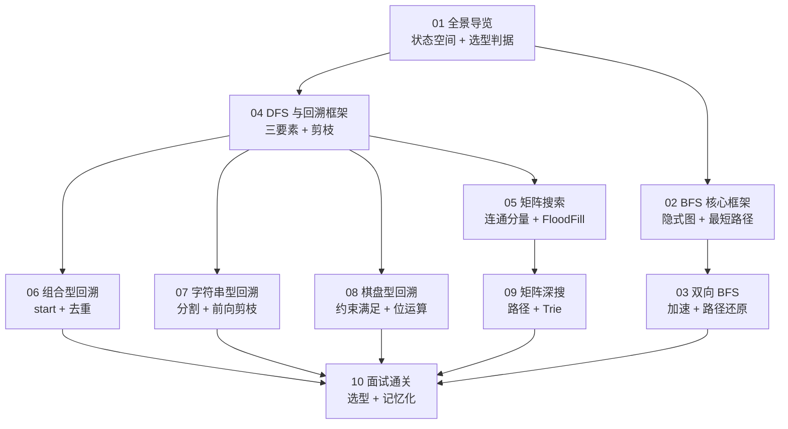

# 搜索算法专栏导览：BFS 与 DFS 面试通关

**摘要：**

本专栏面向有一定编程基础、正在备战技术面试的工程师。**讨论范围严格限定**于图/矩阵/字符串上的广度优先搜索（BFS）与深度优先搜索（DFS）两大搜索范式，重点聚焦**回溯（Backtracking）** 这一 DFS 的高频面试变体，不涉及动态规划、贪心、树的专题等领域。**核心主张只有一条：搜索题的选型取决于"目标"——要最短路径用 BFS、要所有方案用回溯（DFS）、要数量/最优用记忆化搜索（DP）。** 全文示例代码统一使用 Go 语言。读完本专栏，你将能一眼识别搜索题的类型、迅速判断该用哪种算法，并避开那些高频的边界陷阱。

---

## 专栏定位

**讨论范围**：图/矩阵/字符串上的 BFS、DFS、回溯。不覆盖 Dijkstra、A* 等带权最短路算法（仅在对比时提及）；树的专项遍历另有专栏覆盖。

**写作取向**：每篇从"朴素解法"或"约束"出发推导优化解，重点回答**为什么这样解**；对每种技巧，交代其适用前提、失效场景与边界反例。

**语言约定**：示例代码以 **Go** 为主。Go 的切片、`map`、闭包递归，恰好能让"路径复制""状态撤销""visited 标记"这些回溯/搜索的细节写得格外清晰。

---

## 专栏目录

| 序号 | 文章标题 | 核心话题 | 覆盖 LeetCode 题目 |
|------|----------|----------|--------------------|
| 01 | BFS 与 DFS 全景导览：搜索算法的本质与适用边界 | 状态空间、队列 vs 栈、完备性与最优性 | 概念篇 |
| 02 | BFS 核心框架：层序扩展与单向最短路径 | 隐式图、`visited` 时机、层序感知 | 127、433 |
| 03 | 双向 BFS 与路径还原：Word Ladder II 深度解析 | 双向 BFS、前驱图、路径枚举 | 126 |
| 04 | DFS 与回溯核心框架：状态树的系统性遍历 | 回溯三要素、剪枝、反向标记 | 130、46 |
| 05 | 矩阵 BFS/DFS：连通分量与 Flood Fill | 四/八方向、原地标记、并查集对比 | 200、695、733 |
| 06 | 组合型回溯：Combination Sum 系列与去重艺术 | `start` 参数、同层去重 vs 同枝去重 | 39、40、77、216 |
| 07 | 字符串型回溯：分割、括号生成与 IP 地址恢复 | 起点指针、前向剪枝、段数约束 | 131、22、93 |
| 08 | 棋盘型回溯：N-Queens 与数独求解 | 约束满足、位运算剪枝、约束传播 | 51、52、37 |
| 09 | 矩阵深搜：Word Search 与路径问题 | 路径回溯标记、Trie 剪枝 | 79、212、62 |
| 10 | 搜索算法面试通关：模式识别与优化策略总结 | 选型决策树、错误盘点、记忆化搜索 | 综合复习篇 |

合计覆盖 **20 余道高频面试题**。

---

## 阅读路径

专栏的组织逻辑是**先建立"状态空间"的统一认知，再沿"BFS → DFS/回溯 → 矩阵 → 收尾"逐层深入**：

---

## 贯穿全专栏的三条主线

**主线一，"状态空间"是统一的抽象。** 无论 BFS、DFS、回溯，都是在"状态空间图"上做遍历。**把问题抽象成状态空间，是解搜索题的第一步。**

**主线二，"目标"决定"算法"。** 要最短用 BFS、要全部用回溯、要数量用 DP。**"按目标选算法"，而非"凭感觉选"。**

**主线三，"边界"决定"成败"。** `visited` 时机、复制与撤销、标记是否恢复——**这些细节，是搜索题失分的重灾区。**

---

## 专栏阅读建议

1. **第 01 篇必读**：理解 BFS 与 DFS 的"性格差异"是后续一切内容的基石。很多人写 DFS 不假思索，但对"为什么这道题用 BFS 不行"说不清楚，这是面试的高频失分点。
2. **BFS 篇（02-03）**：Word Ladder 系列是 BFS 的教科书级例题，从单向到双向 BFS 的演进清晰展示了算法优化的思考路径。
3. **DFS/回溯篇（04-09）**：回溯是面试频率最高的搜索变体。建议先吃透第 04 篇的通用框架，再看各类具体题型。
4. **亲自动手**：每篇讲完，建议先不看代码，自己在 LeetCode 上独立实现一遍。

---

## 关联专栏

- **二叉树专栏**（[[01 深度优先遍历：前序、中序、后序与递归迭代统一框架]]）：树的 DFS/BFS 是搜索算法在树结构上的特化。
- **动态规划专栏**（[[01 动态规划思想导论：从暴力递归到记忆化搜索再到 DP 表]]）：本专栏第 10 篇的"记忆化搜索"是搜索与 DP 的桥。
- **线性表专栏**（[[01 线性表全景：数组与链表的本质与工程权衡]]）：回溯中的"路径复制"与链表/数组的复制操作相通。
- **栈与队列专栏**（[[01 栈的基础应用：括号匹配、最长有效括号与逆波兰表达式]]）：BFS 用队列、DFS 用栈，本专栏第 01 篇有对照。
