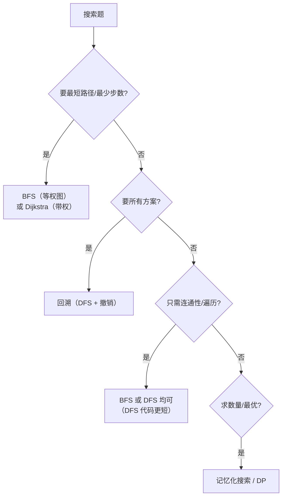

# 搜索算法面试通关：模式识别与优化策略总结

**摘要：**

本篇是搜索专栏的收尾，把前 9 篇的内容收敛成一套可复用的"面试通关"框架。核心有三：**其一，BFS/DFS 的选型决策树**——用"要不要最短路径"这一个问题，就能定下大方向；**其二，常见错误盘点**——BFS 的 `visited` 时机、回溯的"复制与撤销"、矩阵的"标记是否恢复"，这些是失分重灾区；**其三，记忆化搜索与 DP 的桥梁**——"带缓存的 DFS"如何把指数级搜索压成多项式。全文用 Go 语言实现关键代码，并逐层追问：如何一眼识别题型、如何判断"该剪枝还是该记忆化"、以及面试中如何组织表达。掌握本篇，你就把整个搜索专栏的知识串成了一条线。

---

## 第 1 章 BFS/DFS 选型决策树

### 1.1 一个问题定方向

**"要不要最短路径（最少步数/最少操作次数）？"**——这一个问题，就能定下大方向：



**这张决策树覆盖了绝大多数搜索题**——**从"要最短"到"要全部"到"只要连通"，再到"求数量"，一步步收敛。**

### 1.2 三条判据

**归纳成三条判据**：

1. **要最短路径** → BFS（等权）/ Dijkstra（带权）；
2. **要所有方案** → 回溯（DFS + 撤销）；
3. **要数量/最优** → 记忆化搜索 / DP。

**这三条，是搜索题选型的第一层判断。**

### 1.3 一个补充判断

**"状态空间多大？"**——这是第二层判断：

- **状态空间小**（如矩阵 $mn$）：DFS/BFS 直接搜；
- **状态空间大但有重叠**（如路径数）：记忆化搜索；
- **状态空间指数级且无重叠**（如全排列）：只能回溯 + 剪枝。

**"第一层判据定方向、第二层判断定优化"**——两层结合，选型就清晰了。

> [!info] 选型的第一性原理
> 搜索题选型的第一性原理，是**"问题的目标是什么"**——要最短、要全部、要数量，三种目标对应三种算法。**理解了这一点，你就不再"凭感觉选 BFS 还是 DFS"，而是"按目标选"。** 这与本专栏反复强调的"先理解问题，再选工具"一脉相承。

---

## 第 2 章 常见错误盘点

### 2.1 BFS 的四个错误

**错误一，`visited` 在出队时标记。** 会导致同一节点多次入队。**正确：入队时标记。**

**错误二，不固定 `size` 感知层数。** 无法正确处理"按层"的逻辑（如求层数）。**正确：每轮固定 `size`。**

**错误三，用 `List` 而非 `Set` 存字典。** `List.contains` 是 $O(n)$。**正确：用哈希集合。**

**错误四，双向 BFS 允许"层内互访"。** 会破坏等距性。**正确：用"本轮新增集合"隔离。**

### 2.2 回溯的四个错误

**错误一，记录结果时不复制路径。** 会被后续回溯改坏。**正确：`copy` 一份。**

**错误二，"做选择"与"撤销"不成对。** 状态残留。**正确：严格配对。**

**错误三，组合题忘了 `start`。** 会枚举出重复组合。**正确：用 `start` 保证递增。**

**错误四，去重前没排序。** 相同元素不相邻，去重失效。**正确：先排序。**

### 2.3 矩阵搜索的两个错误

**错误一，路径搜索"标记后不恢复"。** 会污染其他起点。**正确：路径搜索要恢复，连通分量不恢复。**

**错误二，Flood Fill 未处理"新旧颜色相同"。** 死循环。**正确：提前返回。**

**这十个错误，覆盖了搜索题 90% 以上的 bug。**

---

## 第 3 章 记忆化搜索：搜索与 DP 的桥梁

### 3.1 从"重复子问题"说起

**纯 DFS 在处理"有重叠子问题"的题时会重复计算。** 例如"不同路径"（LC 62）：从 `(i,j)` 到终点的路径数被反复计算。

**"记忆化搜索"就是"带缓存的 DFS"**——**用一个表记住"算过的子问题"，下次直接取：**

```go
func uniquePathsMemo(m, n int) int {
    memo := make([][]int, m)
    for i := range memo {
        memo[i] = make([]int, n)
        for j := range memo[i] {
            memo[i][j] = -1 // -1 表示未计算
        }
    }
    var dfs func(i, j int) int
    dfs = func(i, j int) int {
        if i == m-1 && j == n-1 {
            return 1
        }
        if i >= m || j >= n {
            return 0
        }
        if memo[i][j] != -1 {
            return memo[i][j] // 命中缓存
        }
        memo[i][j] = dfs(i+1, j) + dfs(i, j+1)
        return memo[i][j]
    }
    return dfs(0, 0)
}
```

**"记忆化搜索"与"自底向上 DP"是同一算法的两种写法**——**前者"从大往小递归、顺带缓存"，后者"从小往大递推"。** **它们的复杂度相同，取舍只在"可读性"与"是否容易写对转移顺序"。**

### 3.2 什么时候用记忆化搜索

**当"状态空间有重叠"时**——即"同一个子问题会被多次求解"。**判断方法：画出搜索树，看有没有重复的节点。**

**若搜索树是"树"（无重复）**——如全排列、N 皇后——**记忆化无用**（因为没有重叠）。
**若搜索树是"图"（有重复）**——如不同路径、单词拆分——**记忆化有效**（避免重复计算）。

**"搜索树是树还是图"，决定了"该不该记忆化"。**

### 3.3 回溯、记忆化、DP 的关系

| 方法 | 特点 | 适用 |
|------|------|------|
| 回溯 | 枚举所有方案，无缓存 | 搜索树无重叠 |
| 记忆化搜索 | 递归 + 缓存 | 搜索树有重叠 |
| 自底向上 DP | 递推，无递归 | 搜索树有重叠，且转移顺序清晰 |

**三者是"递进"的关系**：**回溯是"朴素搜索"，记忆化是"回溯 + 缓存"，DP 是"记忆化的自底向上版"。** **理解了这一递进，你就把"搜索"与"动态规划"连成了一条线。**

> [!info] 搜索与 DP 的统一
> 动态规划的本质，是"**带记忆化的搜索**"——它把"搜索树上的重复子问题"用一张表缓存起来。**理解了这一点，你就明白"DP 与搜索不是对立的，而是同一问题的两种视角"**（自顶向下 vs 自底向上）。**这是本专栏最想传达的一层认知。**

---

## 第 4 章 面试表达与练习建议

### 4.1 面试表达的四步

**遇到搜索题，建议按这个顺序讲**：

1. **定义状态**："状态是什么？状态空间多大？"；
2. **明确目标**："要最短、要全部、还是要数量？"；
3. **选算法**："根据目标，选 BFS / 回溯 / 记忆化搜索"；
4. **讲优化**："剪枝 / 记忆化 / 双向搜索 / Trie"。

**第 1、2 步是关键**——它们表明你"理解了问题"，而非"套模板"。

### 4.2 练习建议

**按"模式"而非"题目"复习**：

1. **BFS 最短路径**（02、03）：Word Ladder 系列；
2. **回溯框架**（04、06、07、08）：组合、分割、棋盘；
3. **矩阵搜索**（05、09）：连通分量、路径搜索；
4. **记忆化搜索**（10）：与 DP 的桥。

**每个模式，记住"信号、模板、边界"三件事。**

### 4.3 一个总体的判断

**搜索题的"难"，不在算法，而在"选型与边界"。** 所以备考策略应是：**算法选型要清晰（按目标选），边界清单要背熟（visited 时机、复制与撤销、标记是否恢复）。** **这两条，覆盖了搜索题的绝大多数考点。**

---

## 第 5 章 专栏总结：搜索的三条主线

**回看整个专栏，搜索算法围绕三条主线**：

**主线一，"状态空间"是统一的抽象。** 无论 BFS、DFS、回溯，都是在"状态空间图"上做遍历。**把问题抽象成状态空间，是解搜索题的第一步。**

**主线二，"目标"决定"算法"。** 要最短用 BFS、要全部用回溯、要数量用 DP。**"按目标选算法"，而非"凭感觉选"。**

**主线三，"边界"决定"成败"。** `visited` 时机、复制与撤销、标记是否恢复——**这些细节，是搜索题失分的重灾区。**

**这三条，是搜索专栏留给你的最持久的东西。**

---

## 第 6 章 搜索算法的完整知识地图

### 6.1 搜索家族的全景

**把本专栏涉及的所有搜索算法汇总，可以看到一张完整的"搜索地图"**：

| 算法 | 数据结构 | 适用 | 代表题 |
|------|---------|------|--------|
| BFS | 队列 | 无权图最短路径 | 127、433 |
| 多源 BFS | 队列（多源） | 多起点最近距离 | 542 |
| 0-1 BFS | 双端队列 | 边权 0/1 | — |
| 双向 BFS | 两个队列 | 已知终点的最短路 | 126 |
| Dijkstra | 优先队列 | 边权非负最短路 | — |
| DFS | 栈/递归 | 连通性、拓扑序 | 200、130 |
| 回溯 | 递归 + 撤销 | 枚举所有方案 | 39、51 |
| 记忆化搜索 | 递归 + 缓存 | 有重叠子问题 | 62 |
| Trie + DFS | Trie + 递归 | 多模式匹配 | 212 |

**这张地图的"根"，是"状态空间"**——**所有算法都是在状态空间上做遍历，只是"遍历顺序""数据结构""是否缓存"不同。**

### 6.2 搜索家族的"三个维度"

**搜索家族的差异，可以归纳成三个维度**：

**维度一，探索顺序**：按层（BFS）还是按深度（DFS）；
**维度二，是否缓存**：不缓存（朴素搜索）还是缓存（记忆化）；
**维度三，是否撤销**：不撤销（图遍历）还是撤销（回溯）。

**这三个维度的组合，覆盖了所有搜索算法**：

| 组合 | 算法 |
|------|------|
| 按层 + 不缓存 + 不撤销 | BFS |
| 按深度 + 不缓存 + 不撤销 | DFS |
| 按深度 + 不缓存 + 撤销 | 回溯 |
| 按深度 + 缓存 + 不撤销 | 记忆化搜索 |

**"三个维度的组合"是理解搜索家族的钥匙**——**它把"一堆算法"归纳成了"三个开关"。**

### 6.3 学习路径建议

**按"从基础到进阶"的顺序学习搜索**：

1. **基础**：BFS/DFS 的模板与选型（01、02）；
2. **回溯**：三要素、剪枝、去重（04、06、07、08）；
3. **矩阵**：连通分量、路径搜索（05、09）；
4. **进阶**：双向 BFS（03）、记忆化搜索（10）。

**每一层，都要"先理解'为什么'，再记'怎么做'"。**

### 6.4 一个值得记住的对照

**搜索与"其他算法范式"的关系**：

| 范式 | 与搜索的关系 |
|------|-------------|
| 动态规划 | 带记忆化的搜索 |
| 贪心 | 每步选局部最优、不回溯的搜索 |
| 分治 | 把问题拆成独立子问题（不搜索） |
| 图论 | 在"图"这一特定状态空间上搜索 |

**这张表说明："搜索"是很多算法的"共同母体"**——**DP、贪心、图论，都可以看成"搜索"的特化。** **理解了这一点，你就把"搜索"上升成了"问题求解"的通用范式。**

> [!info] 搜索是"问题求解"的通用范式
> 从"状态空间"的视角看，**动态规划、贪心、图论、回溯，都是"搜索"的不同形态**——**它们都在"状态空间"里找解，只是"策略"不同。** **理解了这一层，你就把"搜索"从一个具体算法，上升成了"问题求解"的通用范式。** 这是本专栏最想传达的认知。

### 6.5 一个可复用的判断

**遇到任何"求解"类问题，按这个顺序问**：

1. **状态是什么？** 状态空间多大？
2. **目标是什么？** 最短、全部、数量、最优？
3. **用哪个算法？** 按"三个维度"选；
4. **如何优化？** 剪枝、记忆化、双向、Trie。

**这四问，是"搜索题"的完整决策流程。**

---

## 第 7 章 搜索算法的一句话带走

### 7.1 如果只能带走一句话

**如果只能从整个搜索专栏带走一句话，那就是：**"搜索题的选型，取决于'目标'——要最短用 BFS、要全部用回溯、要数量用记忆化搜索（DP）。"

**这一句话，覆盖了搜索题 80% 以上的选型判断。** 而剩下的 20%，是"双向 BFS（已知终点）""0-1 BFS（边权 0/1）""Trie 剪枝（多模式）"这些"特定场景的加速"。

### 7.2 三句话版本

**如果能带走三句话**：

1. **"状态空间是统一的抽象"**——把问题建模成"状态 + 转移 + 目标"，是解搜索题的第一步；
2. **"目标决定算法"**——要最短、要全部、要数量，三种目标对应三种算法；
3. **"边界决定成败"**——`visited` 时机、复制与撤销、标记是否恢复，是失分重灾区。

**这三句话，分别对应"抽象""选型""实现"三个阶段。**

### 7.3 一个可复用的判断

**遇到搜索题，按这个流程走**：

1. **画状态空间**："状态是什么、相邻状态是什么、目标是什么"；
2. **定目标**："最短、全部、还是数量"；
3. **选算法**："按目标与状态空间大小选"；
4. **想优化**："剪枝、记忆化、双向、Trie"；
5. **写代码**："套模板 + 注意边界"。

**这五步，是搜索题的完整解题流程。**

### 7.4 练习建议

**按"模式"而非"题目"复习**：

| 模式 | 代表题 | 关键 |
|------|--------|------|
| BFS 最短路径 | 127、433 | `visited` 时机 |
| 双向 BFS | 126 | 层内隔离 |
| 回溯框架 | 46、78 | 复制与撤销 |
| 组合去重 | 39、40 | `start` 与去重 |
| 分割问题 | 131、93 | 起点指针 |
| 棋盘回溯 | 51、37 | 约束检测 |
| 矩阵搜索 | 200、79 | 标记是否恢复 |
| 记忆化搜索 | 62、139 | 子问题重叠 |

**每个模式，记住"信号、模板、边界"三件事。**

> [!info] 从"刷题"到"建模式"
> 搜索题的最终目标，不是"做过的题都会"，而是"**建立起一套可以套用到新题的模式库**"。**当你的脑子里有"八种模式"而非"几十道题"时，你就从"刷题者"变成了"会解题者"。** 这是本专栏最想帮你完成的转变。

### 7.5 一个跨专题的落点

**搜索算法是"递归思维"在状态空间上的展开**——**它与二叉树（递归结构）、动态规划（记忆化搜索）、分治（拆分问题）共享同一套思维内核。** **理解了搜索，你就理解了"用递归探索状态空间"这一通用范式**——它会一路迁移到图、DP、乃至一切"分层求解"的问题中。

**愿你带着这套"状态空间 + 目标选型"的思维，从容应对每一道搜索题。**

---

## 第 8 章 搜索算法的完整复杂度速查

### 8.1 完整复杂度表

**把本专栏所有算法的复杂度汇总**：

| 算法 | 时间 | 空间 | 代表题 |
|------|------|------|--------|
| BFS（图） | $O(V+E)$ | $O(V)$ | 127 |
| DFS（图） | $O(V+E)$ | $O(V)$ | 200 |
| 多源 BFS | $O(mn)$ | $O(mn)$ | 542 |
| 双向 BFS | $O(b^{d/2})$ | $O(b^{d/2})$ | 126、752 |
| 回溯（排列） | $O(n \cdot n!)$ | $O(n)$ | 46 |
| 回溯（子集） | $O(n \cdot 2^n)$ | $O(n)$ | 78 |
| 回溯（组合） | $O(k \cdot C(n,k))$ | $O(k)$ | 77 |
| 棋盘回溯 | $O(n!)$ | $O(n)$ | 51、37 |
| Trie + DFS | $O(mn \cdot 4^L)$ | $O(\sum|w_i|)$ | 212 |
| 记忆化搜索 | 多项式 | $O(\text{状态数})$ | 62、139 |

**这张表的价值，是"让你在面试中能快速给出复杂度"。**

### 8.2 复杂度分析的通用方法

**搜索算法的复杂度，都可以用同一个公式估算**：

$$\text{复杂度} = \text{状态总数} \times \text{每个状态的处理时间}$$

- **图搜索**：状态总数 $V+E$（节点 + 边）；
- **矩阵搜索**：状态总数 $mn$（格子数）；
- **回溯**：状态总数 = 搜索树大小（$n!$、$2^n$、$C(n,k)$）；
- **记忆化**：状态总数 = 不同的状态数（远小于搜索树大小）。

**"状态总数 × 每状态处理时间"这一公式，覆盖了所有搜索算法**——**这是复杂度分析的"第一性原理"。**

### 8.3 一个值得记住的对照

**"状态总数"决定复杂度的"量级"，"每状态处理时间"决定"常数"**：

| 问题 | 状态总数 | 每状态时间 | 总复杂度 |
|------|---------|-----------|---------|
| 岛屿数量 | $mn$ | $O(1)$ | $O(mn)$ |
| 全排列 | $n!$ | $O(n)$ | $O(n \cdot n!)$ |
| Word Ladder | $n$（单词数） | $O(26L^2)$ | $O(26nL^2)$ |

**这张表说明："先估状态总数、再估每状态时间"，是搜索题复杂度的通用分析方法。**

> [!info] 复杂度分析的"第一性原理"
> 搜索算法的复杂度分析，有一个"第一性原理"——**"状态总数 × 每状态处理时间"。** **理解了这一点，你就不再"背复杂度"，而是"估算复杂度"。** 这是本专栏"从记忆到理解"的又一次体现。

### 8.4 一个总体的建议

**搜索题的复杂度分析，按这个顺序做**：

1. **估状态总数**：$V+E$、$mn$、还是搜索树大小；
2. **估每状态时间**：邻居生成、约束检测的代价；
3. **相乘**：得到总复杂度；
4. **检查空间**：栈、队列、visited 的大小。

**这四步，能快速给出任何搜索题的复杂度。**

---

## 第 9 章 搜索算法的跨专题联系

### 9.1 搜索与二叉树

**二叉树的遍历（前序/中序/后序/层序），是搜索算法在"树"上的特化**——**层序是 BFS、前中后序是 DFS。** **而"树形 DP"是"在树上做后序汇总"，与"搜索 + 记忆化"同源。**

**理解了这一点，你就把"搜索"与"二叉树"打通了**——**它们共享"递归探索结构"这一内核。**

### 9.2 搜索与动态规划

**动态规划是"带记忆化的搜索"**——**它把"搜索树上的重复子问题"用一张表缓存起来。**

**"自顶向下"的记忆化搜索与"自底向上"的 DP，是同一算法的两种写法**——**理解了这一点，你就把"搜索"与"DP"统一了。**

### 9.3 搜索与栈/队列

**BFS 用队列、DFS 用栈**——**这是搜索与"栈/队列"最直接的联系。**

**更深一层，"显式栈"与"递归栈"是同一件事**——**DFS 的递归实现用"系统调用栈"，迭代实现用"显式栈"。** **理解了这一点，你就把"递归"与"迭代"统一了。**

### 9.4 一个值得记住的对照

| 专题 | 与搜索的关系 |
|------|-------------|
| 二叉树 | 树上的搜索（层序/前中后序） |
| 动态规划 | 带记忆化的搜索 |
| 栈/队列 | 搜索的两大容器 |
| 字符串 | 字符串上的搜索（KMP/Trie） |
| 线性表 | 数组/链表上的搜索（双指针/二分） |

**这张表说明："搜索"是"数据结构与算法"的"中枢"**——**它与每个专题都有联系。**

> [!info] 搜索：算法体系的中枢
> 搜索算法不是孤立专题——**它与二叉树、动态规划、栈/队列、字符串、线性表都有联系。** **理解了这些联系，你就把"搜索"放到了"算法体系"的正确位置**——**它是"在结构上探索"这一通用能力。** 这是本专栏"从点到面"的最终体现。

### 9.5 一个可复用的判断

**学习任何新算法时，问一句"它与搜索有什么关系"**——**是"搜索的优化版"（记忆化、DP）？还是"搜索的特化"（树遍历、图遍历）？** **这一问，能帮你把新算法"挂到"已有的知识网络上。**

---

## 第 10 章 搜索算法的练习清单与自测方法

### 10.1 必刷题目清单

**按模式组织，每个模式 2-3 道题**：

| 模式 | 必刷题 |
|------|--------|
| BFS 最短路径 | 127、433、752 |
| 双向 BFS | 126、752 |
| 回溯框架 | 46、78、22 |
| 组合去重 | 39、40、47 |
| 分割问题 | 131、93、139 |
| 棋盘回溯 | 51、37 |
| 矩阵搜索 | 200、130、695 |
| 矩阵路径 | 79、212、62 |
| 记忆化搜索 | 62、329、139 |

**每个模式，做到"不看题解能独立写出"。**

### 10.2 自测方法

**每道题写完后，用这份清单自查**：

| 检查项 | 对应问题 |
|--------|---------|
| BFS 的 `visited` 在入队时标记 | 重复入队 |
| BFS 是否固定 `size` | 层混淆 |
| 回溯是否复制路径 | 结果被改坏 |
| 回溯是否成对撤销 | 状态残留 |
| 矩阵标记是否恢复 | 污染其他起点 |
| 组合是否用 `start` | 重复解 |
| 去重是否先排序 | 去重失效 |

**这七条，覆盖了搜索题 90% 以上的 bug。**

### 10.3 一个值得养成的习惯

**每写完一道搜索题，问自己三个问题**：

1. **这道题属于哪个模式？** 能不能归类；
2. **它的边界有哪些？** 空、单、死路、重复；
3. **它的复杂度是多少？** 状态总数 × 每状态时间。

**"归类、查边界、算复杂度"**——这三步，是把"做过的题"变成"掌握的模式"的关键。

### 10.4 一个可复用的判断

**面试前，按这份清单过一遍**：

1. **选型判据背熟了吗？** 要最短用 BFS、要全部用回溯、要数量用 DP；
2. **边界清单背熟了吗？** `visited` 时机、复制、撤销、标记恢复；
3. **每个模式都写过吗？** 九大模式各一道。

**这三条，是搜索题的"考前清单"。**

> [!info] 从"做题"到"掌握"
> 做题的目标不是"做过多少道"，而是"**掌握了多少个可以迁移的模式**"。**每做完一道题，问"它属于哪个模式、边界有哪些、复杂度多少"，才能把"这道题"变成"一类题"。** 这是本专栏最想帮你完成的转变。

### 10.5 一个跨专题的落点

**搜索算法的练习，会同时强化"递归思维"**——**它与二叉树、动态规划的练习是互补的。** **当你能"看到一个问题就想到'这是哪个模式'"，你就从"刷题者"变成了"会解题者"。**

---

## 第 11 章 专栏收束

### 11.1 三条主线的最终回顾

**搜索专栏的三条主线**：

1. **"状态空间是统一的抽象"**——把问题建模成"状态 + 转移 + 目标"；
2. **"目标决定算法"**——要最短用 BFS、要全部用回溯、要数量用 DP；
3. **"边界决定成败"**——`visited` 时机、复制与撤销、标记是否恢复。

**这三条，是搜索专栏留给你的最持久的东西。**

### 11.2 一个跨专题的最终视角

**搜索算法是"递归思维"在状态空间上的展开**——**它与二叉树（递归结构）、动态规划（记忆化搜索）、分治（拆分问题）共享同一套思维内核。** **理解了搜索，你就理解了"用递归探索结构"这一通用范式**——**它会一路迁移到图、DP、乃至一切"分层求解"的问题中。**

### 11.3 结语

**搜索专栏到此结束。** 从 BFS 到 DFS，从回溯到记忆化，我们走过了搜索算法的主要领域。**但真正的收获，不是这些知识点，而是"面对一个陌生问题，知道该往哪想"的能力**——**这正是本专栏反复强调的"状态空间 + 目标选型"。**

**愿你带着这套思维，从容应对每一道搜索题。**

---

## 第 12 章 一句话总结

**如果只能从整个搜索专栏带走一句话，那就是：**"搜索题的选型取决于'目标'——要最短用 BFS、要全部用回溯、要数量用记忆化搜索（DP）。"

**这一句话，覆盖了搜索题 80% 以上的选型判断。** **而剩下的 20%，是"双向 BFS""0-1 BFS""Trie 剪枝"这些特定场景的加速。**

**而"边界决定成败"是搜索题的另一条铁律**——**`visited` 时机、复制与撤销、标记是否恢复，是失分重灾区。**

**愿你带着"状态空间 + 目标选型 + 边界周全"这三件武器，从容应对每一道搜索题。**

> [!note] 一句话带走
> **"要最短用 BFS、要全部用回溯、要数量用 DP；边界决定成败。"** 记住这一句，你面对任何搜索题，都有了从选型到实现的完整思路。**而"按模式而非题目复习"，是掌握搜索的最佳路径。**

---

## 小结

本篇把搜索专栏收敛成一套"面试通关"框架：**BFS/DFS 的选型决策树**（按"目标"选算法）、**常见错误盘点**（十个高频 bug）、以及**记忆化搜索与 DP 的桥梁**（"带缓存的 DFS"）。三者合起来，构成"从选型到实现到优化"的完整链条。

贯穿全篇的核心认知有两条。其一，**"目标决定算法"**——要最短、要全部、要数量，三种目标对应三种算法。其二，**"搜索与 DP 是同一问题的两种视角"**——DP 是"带记忆化的搜索"。**把这两条握住，你面对任何搜索题，都有了从选型到实现的完整思路。**

至此，数据结构与算法专栏的搜索部分告一段落。**搜索是"递归思维"在状态空间上的展开**——它与二叉树（递归结构）、动态规划（记忆化搜索）共享同一套思维内核。**愿你带着这套思维，从容应对每一道搜索题。**

**最后补充一点落点。** 搜索算法的学习，最终要落到"模式库"上——**当你的脑子里有"九种模式"而非"几十道题"时，你就从"刷题者"变成了"会解题者"。** 而"模式库"的建立，靠的是"每做完一道题就问'它属于哪个模式、边界有哪些、复杂度多少'"。**这，是本专栏最想帮你完成的转变。**

**再补充一点。** 搜索题的"选型"与"边界"是两条主线——**选型靠"目标"（要最短、要全部、要数量），边界靠"清单"（`visited` 时机、复制、撤销、标记恢复）。** 把这两条背熟，搜索题就"稳了"。**而"按模式复习"，则是把"题目"变成"能力"的关键。**

**再补充最后一点。** 搜索算法是"递归思维"在状态空间上的展开——**它与二叉树（递归结构）、动态规划（记忆化搜索）、分治（拆分问题）共享同一套思维内核。** 理解了搜索，你就理解了"用递归探索结构"这一通用范式。**而这份思维，会一路迁移到图、DP、乃至一切"分层求解"的问题中。**

---

## 参考资料

1. Cormen, T. H., et al. *Introduction to Algorithms* (4th ed.). MIT Press, 2022. 第 20 章"基本的图算法"、第 14 章"动态规划"。
2. Russell, S., & Norvig, P. *Artificial Intelligence: A Modern Approach* (4th ed.). Pearson, 2020. 第 3 章"Solving Problems by Searching"。
3. Sedgewick, R., & Wayne, K. *Algorithms* (4th ed.). Addison-Wesley, 2011. 第 4 章"图"。

---

> [!note] 思考题
> 1. 请用"要不要最短路径"这一判据，重新判断一遍本专栏 10 道题各自的算法。
> 2. 为什么"搜索树是树还是图"决定了"该不该记忆化"？
> 3. "记忆化搜索"与"自底向上 DP"是同一算法的两种写法——请各写一遍"不同路径"验证。
> 4. 请总结"回溯、记忆化、DP"三者的递进关系。
> 5. 请设计一道"需要同时用 BFS 与回溯"的题（提示：先 BFS 建图，再回溯枚举路径）。
