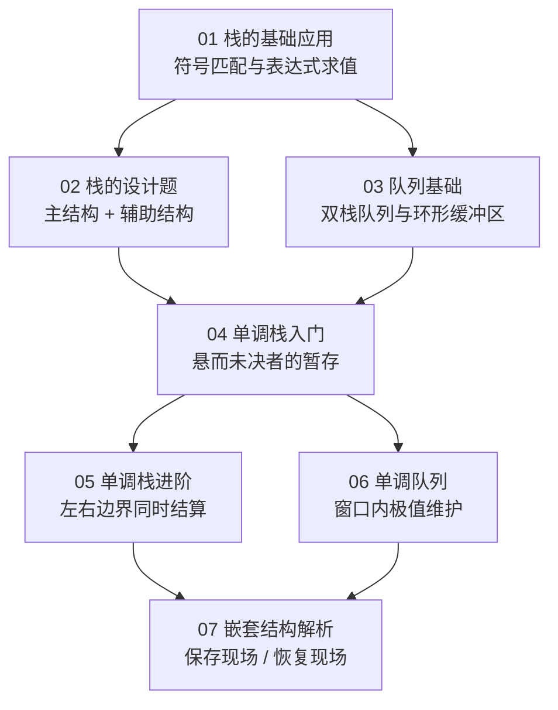

# 栈与队列专栏导览：从括号匹配到单调栈与嵌套解析

**摘要：**

本专栏面向有一定编程基础、正在备战技术面试的工程师，聚焦**栈（Stack）与队列（Queue）**这两种最基础的线性结构。它们看似简单——栈只能一端进出、队列只能一端进另一端出——却因为这份"受限"，天然适配了"最近优先"与"先进先出"这两大类问题，并催生出单调栈、单调队列这两个面试中性价比极高的进阶技术。专栏不追求背模板，而是沿着"是什么 → 为什么 → 怎么做 → 边界与反例"的推导链，把每道题背后的**解题思路**讲透。全文示例代码统一使用 Go 语言。读完本专栏，你将能判断"这道题该请出栈、队列，还是单调栈/单调队列"，并说清它为什么成立。

---

## 专栏定位

**讨论范围严格限定**：栈、队列两种线性结构，及其进阶形态——单调栈、单调队列。不涉及树、图、堆等其他结构（仅在对比时简要提及）。

**写作取向**：每篇都从"朴素解法"或"约束"出发，一步步推导出优化解，重点回答**"为什么这样解"**。对每种技巧，都力求交代它的适用前提、失效场景与边界反例。

**语言约定**：示例代码以 **Go** 为主。Go 没有内置栈与队列，但切片（slice）配合 `append` 与切片收缩，就能干净地实现两者——这一"用切片当栈/队列"的写法，恰好能让你看清结构的本质。

---

## 专栏目录

| 序号 | 文章标题 | 核心话题 | 覆盖 LeetCode 题目 |
|------|----------|----------|--------------------|
| 01 | 栈的基础应用：括号匹配、最长有效括号与逆波兰表达式 | 符号匹配、下标栈 + 哨兵、表达式求值 | 20、32、150 |
| 02 | 栈的设计题：最小栈与用队列模拟栈 | 辅助结构同步、队列模拟栈的三种方案 | 155、225 |
| 03 | 队列基础：用栈实现队列与循环队列设计 | 双栈 + 懒惰搬移、摊还分析、环形缓冲区 | 232、622 |
| 04 | 单调栈入门：每日温度与下一个更大元素 | 悬而未决者的暂存、循环数组、结算时机 | 739、496、503 |
| 05 | 单调栈进阶：柱状图中最大矩形 | 弹栈时左右边界同时结算、二维降维 | 84、85 |
| 06 | 单调队列：滑动窗口最大值 | 被盖住元素可丢弃、双端队列、DP 优化 | 239、1696 |
| 07 | 字符串嵌套解码与基本计算器 | 保存现场 / 恢复现场范式、嵌套解析 | 394、224 |

合计覆盖 **15 道高频面试题**，横跨 Google、Meta、Amazon、字节跳动、阿里等一线大厂的高频考点。

---

## 阅读路径

专栏的组织逻辑是**先建立"栈与队列"的基本直觉，再沿"设计题 → 单调栈 → 单调队列 → 嵌套解析"四条支线逐层深入**。下图给出主线脉络：

---

## 贯穿全专栏的两条主线

本专栏反复回到两条主线，它们比任何具体模板都更持久：

**主线一，栈与队列的"受限"正是它们的价值所在。** 数组能随机访问、链表能在中间插入，栈与队列却什么都不行——但恰恰是这份受限，让它们天然匹配了"最近优先"（LIFO）与"先进先出"（FIFO）两类问题。**当你在题目里发现"最近出现的东西要先被处理"或"按到达顺序处理"，栈或队列就会自己浮现。**

**主线二，一切高效的栈/队列技巧，都依赖一条"可丢弃判据"。** 单调栈之所以能把 $O(n^2)$ 降到 $O(n)$，是因为"某元素一旦遇到更大/更小者，就再也不会影响后续"；单调队列之所以能 $O(1)$ 查最值，是因为"被右边更大元素盖住的元素，永远当不成最大值"。**这类算法的正确性，全系于那个判据——能把判据讲清楚，就等于把算法讲清楚了。**

---

## 专栏阅读建议

1. **第 01 篇必读**：它是全专栏的认知底座，"栈里存什么由弹栈时的计算决定"这一原则贯穿始终。
2. **设计题（02、03）**：理解"主结构 + 辅助结构"这一组合模式，以及"摊还分析"这一复杂度工具。
3. **单调栈（04、05）**：本专栏的重点与难点。建议在 04 篇打好基础后再攻克 05 篇的"左右边界同时结算"。
4. **单调队列（06）**：与单调栈对照学习，重点理解"为什么必须用双端队列"。
5. **嵌套解析（07）**：理解"栈 = 显式化的递归调用栈"，掌握"保存现场 / 恢复现场"范式。
6. **亲自动手**：每篇讲完，建议先不看代码，自己在 LeetCode 上独立实现一遍，再对照思路检查。

---

## 关联专栏

本专栏与同目录下的其他算法专栏相互补充，可交叉阅读：

- **线性表专栏**（[[01 线性表全景：数组与链表的本质与工程权衡]]）：数组与链表是栈、队列的底层实现载体，本专栏第 03 篇的环形缓冲区即建立在其上。
- **滑动窗口专栏**（[[01 滑动窗口算法原理全景：从暴力枚举到 O(n) 的思维跃迁]]）：本专栏第 06 篇的单调队列，是"窗口内极值"这一滑动窗口特化的最优解。
- **双指针专栏**（[[01 双指针算法全景：核心直觉、三大模型与面试考频分析]]）：接雨水、盛最多水的容器等题与单调栈互为参照。
- **排序与查找专栏**（[[01 排序算法原理全景：从 O(n²) 到 O(nlogn) 的演进之路]]）：本专栏的复杂度分析（摊还）与排序专栏的复杂度讨论一脉相承。
