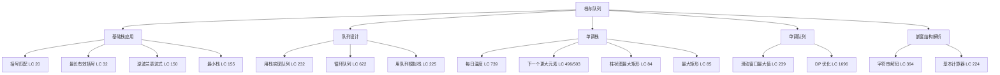

# 字符串嵌套解码与基本计算器：栈处理嵌套结构的终极范式

**摘要：**

本篇是栈与队列专栏的收尾篇，用两道经典题收束：LeetCode 394（Decode String）与 LeetCode 224（Basic Calculator）。它们共同揭示了栈处理嵌套结构的通用范式——**遇到开括号时，把"当前层的状态"压栈以保存现场；遇到闭括号时，弹栈以恢复现场，再把当前层的结果合并回去**。这个范式与递归完全同构：开括号是递归调用，闭括号是递归返回，而栈只是把隐式的调用栈显式化了。掌握它之后，括号匹配、嵌套解析、递归求值这一整类问题，都可以用同一套思维框架拆解。本文用 Go 语言完整实现，并逐层追问：为什么嵌套结构非栈不可、多位数与空格怎么处理、字符串末尾的"漏结算"如何避免；篇末附有专栏全局复习——题目索引、高频考点、知识图谱与学习路径。

---

## 第 1 章 嵌套结构：栈的终极战场

### 1.1 为什么嵌套结构非栈不可

前面几篇的栈题，处理的多是"线性的等待"（下一个更大元素）或"匹配"（括号配对）。而本篇要处理的，是**嵌套**——一层套一层的结构，如 `3[a2[c]]`、`(1+(4+5+2)-3)`。

**嵌套结构的核心困难在于"上下文切换"**：当你进入内层时，外层的"半成品状态"必须先搁置；当你离开内层时，又必须回到外层，把内层的结果接上去。**这种"进入时保存、离开时恢复"的需求，正是栈的 LIFO 语义——最近进入的内层，最先被离开。** 于是栈成了处理嵌套结构的天然工具。

### 1.2 递归与栈的等价

处理嵌套结构，其实有两条等价的路径：**递归**与**显式栈**。

递归的思路最自然：遇到 `[` 或 `(` 就"下一层"，遇到 `]` 或 `)` 就"上一层"——这正是递归调用与返回。但递归依赖语言的调用栈，深度受限于栈空间，且对"逐字符解析"这类场景不够灵活。

**显式栈则是把递归的调用栈"搬到明面上"**：每次进入内层前，手动把外层状态压栈；每次离开内层时，手动弹栈恢复。**理解了"栈 = 显式化的递归调用栈"，你就明白了为什么这两道题能用栈解，也就有了"什么时候该用栈"的判断依据。**

---

## 第 2 章 LeetCode 394：字符串解码

### 2.1 题目

**LeetCode 394 - Decode String**（中等）

给定编码字符串，按规则解码：`k[encoded_string]` 表示把 `encoded_string` 重复 `k` 次。`k` 可以是多位数，嵌套可有多层。

```text
"3[a]2[bc]"     → "aaabcbc"
"3[a2[c]]"      → "accaccacc"
"2[abc]3[cd]ef" → "abcabccdcdcdef"
```

**约束**：数字只出现在 `[` 前，字母只出现在方括号内外（不会有 `3a` 这种形式），输入保证合法。

### 2.2 思路推导：两个栈保存现场

以 `3[a2[c]]` 为例：它表示"解码 `a2[c]` 后重复 3 次"；而解码 `a2[c]` 又表示"把 `c` 重复 2 次、前面接上 `a`"。**这是一个层层嵌套的递归结构。**

用两个栈模拟递归：

- `countStack`：保存每一层的重复次数 `k`；
- `strStack`：保存每一层在遇到 `[` 之前已经构建好的字符串（外层前缀）。

**逐字符规则**：

| 当前字符 | 操作 |
|---------|------|
| 数字 | 累积多位数：`num = num*10 + digit` |
| `[` | 把 `num` 与 `current` 分别压入两个栈；重置 `num=0, current=""` |
| `]` | 弹出 `count` 与 `prev`；`current = prev + current` 重复 `count` 次 |
| 字母 | 追加到 `current` |

**关键点在于"压栈的时机"**：进入新一层时，把"这一层开始前的外层状态"（重复次数 `num`、外层已构建的字符串 `current`）压栈保存；离开这一层时，把内层结果重复后拼回外层。

### 2.3 Go 实现

```go
func decodeString(s string) string {
    var countStack []int
    var strStack []string
    var current []byte
    num := 0

    for i := 0; i < len(s); i++ {
        c := s[i]
        switch {
        case c >= '0' && c <= '9':
            num = num*10 + int(c-'0') // 累积多位数
        case c == '[':
            countStack = append(countStack, num)
            strStack = append(strStack, string(current))
            num = 0
            current = nil // 重置，进入下一层
        case c == ']':
            count := countStack[len(countStack)-1]
            countStack = countStack[:len(countStack)-1]
            prev := strStack[len(strStack)-1]
            strStack = strStack[:len(strStack)-1]
            current = []byte(prev + strings.Repeat(string(current), count))
        default:
            current = append(current, c) // 普通字母
        }
    }
    return string(current)
}
```

### 2.4 逐步模拟

```text
s = "3[a2[c]]"

'3': num=3
'[': 压栈 count=3, prev=""；num=0, current=""
'a': current="a"
'2': num=2
'[': 压栈 count=2, prev="a"；num=0, current=""
'c': current="c"
']': 弹出 count=2, prev="a"
     current = "a" + "c"×2 = "acc"
']': 弹出 count=3, prev=""
     current = "" + "acc"×3 = "accaccacc"

结果: "accaccacc" ✓
```

### 2.5 细节分析

**为什么 Go 里用 `[]byte` 而非字符串拼接？** Go 的字符串不可变，`current = current + string(c)` 会每次分配新内存。用 `[]byte` 配合 `append`，摊还代价是 $O(1)$，性能更好。**这与 Java 里"用 `StringBuilder` 而非 `String` 的 `+=`"是同一个道理**——**字符串不可变的语言，都要小心"隐式的重复分配"。**

**为什么 `strStack` 里存的是"快照"？** 因为压栈之后 `current` 立刻被重置（`current = nil`），两者指向的是不同的底层数据，互不影响。**这个"压栈即快照、随后重置"的顺序，是正确性的关键**——若先重置再压栈，压进去的就会是空串。

**复杂度**：设输出串长度为 $m$，时间 $O(m)$（每个字符处理常数次），空间 $O(m)$（栈中保存的字符串总长不超过 $m$）。

> [!warning] 生产避坑：多位数与末尾结算
> 这道题有两个极易踩的细节。其一，**数字要按多位数累积**（`num = num*10 + digit`），因为 `k` 可能是 `12`、`100` 这样的多位数，若只取单字符会算错。其二，**注意压栈时机**：必须在重置 `current` 之前把它压栈。**这类"顺序敏感"的细节，是字符串解析题的常态——它不考验算法，只考验是否每一步都清醒。**

---

## 第 3 章 LeetCode 224：基本计算器

### 3.1 题目

**LeetCode 224 - Basic Calculator**（困难）

实现一个基本计算器，计算字符串表达式的值。字符串含非负整数（可多位）、`+`、`-`、`(`、`)` 与空格。**不含乘除**，也不含直接出现的负数（但括号内可通过 `-` 间接产生负值）。

```text
"1 + 1"                → 2
" 2-1 + 2 "            → 3
"(1+(4+5+2)-3)+(6+8)"  → 23
```

### 3.2 思路推导

**不含括号时**，逐字符扫描，用 `result` 累积结果、`sign` 记录当前符号（`+1` 或 `-1`）、`num` 累积当前数字即可。**遇到运算符时，把"符号 × 数字"结算进 `result`**：`result += sign * num`。

**括号的处理是难点**。括号的作用是"括号内的子表达式先算，结果作为一个整体"。于是遇到 `(` 时，括号外的部分已经算到一半，必须先"暂停"：**把当前的 `result` 与 `sign` 压栈保存，再重置 `result=0, sign=1`，在括号内重新开始算**。遇到 `)` 时，括号内已算完（存在 `result` 里），弹出括号前的 `result_prev` 与 `sign_prev`，用 `result = result_prev + sign_prev * result` 把括号整体结果合并回外层。

**逐字符规则**：

| 当前字符 | 操作 |
|---------|------|
| 数字 | 累积：`num = num*10 + digit` |
| `+` | 结算 `result += sign*num`；`sign=1, num=0` |
| `-` | 结算 `result += sign*num`；`sign=-1, num=0` |
| `(` | 压栈 `result` 与 `sign`；重置 `result=0, sign=1, num=0` |
| `)` | 结算最后一个数字；弹栈恢复并合并 |
| 空格 | 跳过 |

```go
func calculate(s string) int {
    var stack []int
    result, sign, num := 0, 1, 0

    for i := 0; i < len(s); i++ {
        c := s[i]
        switch {
        case c >= '0' && c <= '9':
            num = num*10 + int(c-'0')
        case c == '+':
            result += sign * num
            sign, num = 1, 0
        case c == '-':
            result += sign * num
            sign, num = -1, 0
        case c == '(':
            // 保存现场：先压 result，再压 sign
            stack = append(stack, result, sign)
            result, sign, num = 0, 1, 0
        case c == ')':
            result += sign * num // 结算括号内最后一个数字
            num = 0
            sign = stack[len(stack)-1]
            prevResult := stack[len(stack)-2]
            stack = stack[:len(stack)-2]
            result = prevResult + sign*result // 合并回外层
        }
        // 空格：直接跳过
    }
    result += sign * num // 结算末尾数字（字符串末尾无运算符触发）
    return result
}
```

### 3.3 逐步模拟

```text
s = "(1+(4+5+2)-3)+(6+8)"

i=0, '(': 压栈 result=0,sign=1；result=0,sign=1,num=0
i=1, '1': num=1
i=2, '+': result=0+1*1=1；sign=1,num=0
i=3, '(': 压栈 result=1,sign=1；result=0,sign=1,num=0
i=4, '4': num=4
i=5, '+': result=0+1*4=4；sign=1,num=0
i=6, '5': num=5
i=7, '+': result=4+1*5=9；sign=1,num=0
i=8, '2': num=2
i=9, ')': result=9+1*2=11；num=0
          弹 sign=1, prevResult=1 → result=1+1*11=12
i=10,'-': result=12+1*0=12；sign=-1,num=0
i=11,'3': num=3
i=12,')': result=12+(-1)*3=9；num=0
          弹 sign=1, prevResult=0 → result=0+1*9=9
i=13,'+': result=9+1*0=9；sign=1,num=0
i=14,'(': 压栈 result=9,sign=1；result=0,sign=1,num=0
i=15,'6': num=6
i=16,'+': result=0+1*6=6；sign=1,num=0
i=17,'8': num=8
i=18,')': result=6+1*8=14；num=0
          弹 sign=1, prevResult=9 → result=9+1*14=23

末尾: result=23+1*0=23
结果: 23 ✓
```

**复杂度**：时间 $O(n)$，空间 $O(n)$（栈深最多为括号嵌套层数）。

> [!warning] 生产避坑：末尾漏结算
> 字符串末尾没有运算符，所以循环结束后必须补一句 `result += sign * num`——否则像 `"1 + 1"` 这样的表达式，最后那个 `1` 永远不会被加进去。**"循环结束后的收尾结算"是表达式解析题最经典的漏洞**，与第 01 篇 Plus One"循环跑完才处理全位进位"、第 04 篇"遍历结束处理栈中剩余"是同一类边界。

### 3.4 压栈顺序的一个细节

代码里压栈是 `append(stack, result, sign)`——先压 `result`、再压 `sign`，于是 `sign` 在栈顶。弹出时先取 `sign`、再取 `prevResult`，正好对应。**"压栈顺序"与"弹栈顺序"必须严格相反，这是所有"成对压栈"场景的通则**（与第 01 篇逆波兰"先弹右操作数"是同一类顺序意识）。**若两者顺序不一致，取出的值就会张冠李戴。**

---

## 第 4 章 "保存现场 / 恢复现场"范式

### 4.1 范式的骨架

LeetCode 394 与 224 遵循同一个结构，可以抽象成一个通用范式：

```text
遇到 '[' 或 '(':
  1. 把"当前层的状态"压栈保存（重复次数 + 字符串 / 结果 + 符号）
  2. 重置状态，开始处理"下一层（嵌套内部）"

遇到 ']' 或 ')':
  1. 完成"当前层的处理"（结算最后一个元素）
  2. 弹出"上一层的状态"
  3. 把当前层的结果合并回上一层状态
```

**这个范式与递归一一对应**：`[`/`(` 是递归调用，`]`/`)` 是递归返回。**栈只是把隐式的递归调用栈显式化了**——这也解释了为什么"能用递归解的问题，通常也能用栈解"，反之亦然。

### 4.2 判断何时需要这个范式

**当问题满足两个条件时，就适合用"压栈保存外层状态"来处理**：其一，**包含嵌套的括号**（`()`、`[]`、`{}` 皆可）；其二，**括号内的子问题结果，需要以某种方式"合并"回括号外**。前者提供了"层"的概念，后者提供了"保存/恢复"的必要性。

**这个判断标准，能帮你在一眼之间认出该用栈的嵌套题**——而不是等到写不出递归才想起来用栈。

### 4.3 范式在其他题目中的出现

| 题目 | 嵌套来源 | 压栈的状态 |
|------|---------|-----------|
| LeetCode 394（字符串解码） | `k[...]` | `(重复次数, 外层已构建字符串)` |
| LeetCode 224（基本计算器） | `(...)` | `(括号前结果, 括号前符号)` |
| LeetCode 856（括号的分数） | `(...)` | 当前层的分数 |
| LeetCode 1190（反转括号间子串） | `(...)` | 当前层已构建的字符串 |

**这张表说明：同一个范式，换一个"压栈的状态"和"合并的方式"，就能解决一整族题目。** 识别出题目属于"嵌套 + 合并"这一类，剩下要做的，就只是想清"该压什么、该怎么合并"。

---

## 第 5 章 延伸：计算器家族与更多嵌套题

### 5.1 计算器家族的三兄弟

LeetCode 有三道"基本计算器"，难度层层递进：

| 题目 | 运算符 | 难点 |
|------|-------|------|
| 224（本题） | `+`、`-`、`(`、`)` | 括号的保存/恢复 |
| 227（Basic Calculator II） | `+`、`-`、`*`、`/`，无括号 | 运算符优先级 |
| 772（Basic Calculator III） | 全部 | 优先级 + 括号 |

**227 的核心是"优先级"**：乘除的优先级高于加减，必须在遇到 `*/` 时立刻结算上一个数字。一种干净的写法是——遇到 `+/-` 时把当前数字带符号压栈，遇到 `*/` 时把栈顶弹出、与当前数字运算后再压回，最后把栈中所有数字求和：

```go
func calculateII(s string) int {
    stack := []int{}
    num, op := 0, byte('+')
    for i := 0; i <= len(s); i++ {
        var c byte
        if i < len(s) {
            c = s[i]
        }
        if c >= '0' && c <= '9' {
            num = num*10 + int(c-'0')
        } else if c == '+' || c == '-' || c == '*' || c == '/' || i == len(s) {
            switch op {
            case '+':
                stack = append(stack, num)
            case '-':
                stack = append(stack, -num)
            case '*':
                stack[len(stack)-1] *= num
            case '/':
                stack[len(stack)-1] /= num
            }
            op = c
            num = 0
        }
    }
    sum := 0
    for _, v := range stack {
        sum += v
    }
    return sum
}
```

**"遇到 `*/` 就地把栈顶运算掉"这一手，本质是"用栈把不同优先级的运算分层"**——低优先级的 `+/-` 先堆在栈里，高优先级的 `*/` 当场解决。**772 则是把 227 的优先级处理，套进 224 的括号框架里，是两者的合体。**

### 5.2 反转每对括号间的子串（LeetCode 1190）

**题目**：给定字符串 `s`（含小写字母与成对括号），反转每对匹配括号内的子串，返回最终结果。

这道题是"保存现场"范式的直接应用——**每遇到 `(`，就把当前已构建的字符串压栈、重置；每遇到 `)`，就弹出外层、把当前字符串反转后拼回**：

```go
func reverseParentheses(s string) string {
    var stack []string
    var cur []byte
    for i := 0; i < len(s); i++ {
        switch s[i] {
        case '(':
            stack = append(stack, string(cur)) // 保存现场
            cur = nil
        case ')':
            // 反转当前层，拼回外层
            for l, r := 0, len(cur)-1; l < r; l, r = l+1, r-1 {
                cur[l], cur[r] = cur[r], cur[l]
            }
            prev := stack[len(stack)-1]
            stack = stack[:len(stack)-1]
            cur = append([]byte(prev), cur...)
        default:
            cur = append(cur, s[i])
        }
    }
    return string(cur)
}
```

**与 394 的区别在于"合并方式"**：394 是"把内层重复后拼上外层"，1190 是"把内层反转后拼上外层"。**压栈/弹栈的骨架完全相同，只有"合并"这一步不同——这又一次印证了范式的价值：骨架固定，差异只在细节。**

### 5.3 括号的分数（LeetCode 856）

第 01 篇已提过这道题。它同样是"保存现场"范式——压栈的是"当前层的分数占位"，弹栈时按 `()` 得 1 分、`(A)` 得 `2A` 分合并。**它与 394、1190 一起，构成了"嵌套 + 合并"这一范式的三道变体：合并的规则分别是"重复""反转""折算分数"。**

### 5.4 三道延伸题给我们的

三道延伸题（227 优先级、1190 反转、856 分数）与主线两题（394 解码、224 计算器）合起来，覆盖了"嵌套解析"的绝大部分场景。**它们的共性是：栈负责"分层"，而每道题真正的差异，只在"压什么状态"与"怎么合并"这两点上。** 把这五点想清楚，你就拥有了一套处理嵌套结构的通用工具，而不必为每道题重新发明解法。

---

## 第 6 章 常见误区与自测方法

### 6.1 四个高频误区

**误区一：394 忘记累积多位数。** `num = num*10 + digit` 不能省，否则 `12[a]` 会被当成 `1` 和 `2` 两段。

**误区二：394 压栈与重置的顺序反了。** 必须先 `strStack.push(current)`、再 `current = nil`。

**误区三：224 末尾漏结算。** 循环结束后必须 `result += sign * num`。

**误区四：224 压栈/弹栈顺序不一致。** 压栈 `result, sign`，弹栈就要先 `sign` 后 `result`。

### 6.2 一套自测用例

| 用例 | 检验什么 |
|------|---------|
| `"12[a]"` | 394 的多位数 |
| `"3[a2[c]]"` | 394 的多层嵌套 |
| `"1 + 1"` | 224 的末尾结算 |
| `"(1+(4+5+2)-3)+(6+8)"` | 224 的多层括号 |
| `"2*3+4"`（227） | 运算符优先级 |

**其中 `"1 + 1"` 是最该测的用例**——它最简，却恰好能暴露"末尾漏结算"这一经典漏洞。**凡表达式解析题，先用一个"末尾是数字、没有运算符收尾"的最简表达式自测，能拦下相当一部分 bug。**

---

## 第 7 章 延伸：完整计算器（LeetCode 772）与栈在编译器里的身影

### 7.1 把优先级与括号合体

第 224 题（括号）与 227 题（优先级）各自解决了问题的一半。把它们合起来，就是 LeetCode 772（Basic Calculator III）——支持 `+ - * /` 与括号的完整计算器。

**合体的关键是"用一个函数处理一层括号"**：遇到 `(` 就递归进入下一层，遇到 `)` 就返回这一层的结果。每一层内部，用第 227 题的"遇 `*/` 就地运算、遇 `+/-` 压栈"处理优先级。

```go
func calculateIII(s string) int {
    i := 0
    var parse func() int
    parse = func() int {
        stack := []int{}
        num := 0
        op := byte('+')
        for i < len(s) {
            c := s[i]
            switch {
            case c >= '0' && c <= '9':
                num = num*10 + int(c-'0')
                i++
            case c == '(':
                i++
                num = parse() // 递归进入括号内，求出其值
            case c == ')':
                i++
                applyOp(&stack, op, num) // 结算本层最后一个数字
                return sumStack(stack)
            case c == ' ':
                i++
            default: // 运算符
                applyOp(&stack, op, num)
                op = c
                num = 0
                i++
            }
        }
        applyOp(&stack, op, num)
        return sumStack(stack)
    }
    return parse()
}

// applyOp：把 num 按 op 并入栈——+/- 直接入栈，*/ 就地运算栈顶
func applyOp(stack *[]int, op byte, num int) {
    switch op {
    case '+':
        *stack = append(*stack, num)
    case '-':
        *stack = append(*stack, -num)
    case '*':
        (*stack)[len(*stack)-1] *= num
    case '/':
        (*stack)[len(*stack)-1] /= num
    }
}

func sumStack(stack []int) int {
    s := 0
    for _, v := range stack {
        s += v
    }
    return s
}
```

**这道题把本篇的两条线索合成了一个整体**：`parse()` 的递归负责"括号分层"（第 224 题的范式），`applyOp` 的"就地运算"负责"优先级分层"（第 227 题的技巧）。**"括号用递归（或栈）分层、优先级用'就地运算'分层"——两层分层叠加，就是完整的表达式求值。** 而它之所以能写成这么短，全靠"递归调用栈"这一隐式的栈替我们管理了括号的上下文。

### 7.2 栈在编译器里的身影

表达式求值看似是道面试题，实则是编译器前端的核心动作。理解这一点，有助于看清"栈"在真实系统里的分量：

- **词法分析（Lexer）**：把源代码切成 token 流，本身是线性扫描，不需要栈；
- **语法分析（Parser）**：把 token 流组织成语法树。**递归下降解析器**（Recursive Descent）的递归调用栈，就是"用栈处理嵌套语法结构"的直接体现——每进入一层括号或一个子表达式，就压一层栈帧；
- **表达式求值 / 中间代码生成**：把语法树转成三地址码或后缀式（第 01 篇的逆波兰），栈在这里负责"操作数的暂存"；
- **运行时**：函数调用栈管理着每个函数的局部变量与返回地址——**它是"嵌套调用"这一结构在运行时的物理体现**。

**把这些串起来看，你会发现"栈"贯穿了从源码到运行的整条链路**，而它出现的每一次，处理的都是同一件事——**嵌套结构的上下文管理**。**这与本篇反复强调的"保存现场 / 恢复现场"范式是同一个内核，只是换了一层又一层的工程外衣。**

> [!note] 从一道面试题到一门学科
> 本篇从 LeetCode 394、224 出发，一路走到 LC 772，再到编译器的语法分析与函数调用栈。**这条路径本身就说明了一件事：一个基础的抽象（栈处理嵌套），在足够深的地方，会连接上一整片知识领域。** 算法学习最迷人的地方，恰恰在于这种"一个简单结构，向上能长出无数应用"的纵深感——**你学的从来不是一道题，而是这道题背后那个可以被反复使用的结构。**

### 7.3 与前面各篇的呼应

本篇的"保存现场 / 恢复现场"，其实是全专栏若干技巧的一个共同内核：

| 篇目 | 技巧 | 与"保存/恢复现场"的关系 |
|------|------|----------------------|
| 01 | 括号匹配、下标栈 + 哨兵 | 保存"未匹配的上下文" |
| 02 | 最小栈的辅助栈 | 保存"历史状态的最小值" |
| 04/05 | 单调栈 | 保存"等待结算的元素" |
| 06 | 单调队列 | 保存"窗口内的候选" |
| 07 | 嵌套解析 | 保存"外层未完成的上下文" |

**这些技巧的共同点，都是"把当前无法立刻处理的信息，暂存起来，等条件成熟再取用"**——而"暂存与取用"的顺序（LIFO 或 FIFO），正是栈与队列的分野。**理解了这一层，你就抓住了整个专栏的主线。**

---

## 专栏总复习

### 7.1 题目索引

| 篇数 | 主题 | 题目 | 核心知识点 |
|------|------|------|----------|
| 01 | 栈的基础应用 | LC 20 括号匹配 | 配对模型，字符栈 |
| 01 | 栈的基础应用 | LC 32 最长有效括号 | 下标栈 + 哨兵，长度差值 |
| 01 | 栈的基础应用 | LC 150 逆波兰表达式 | 操作数/运算符分流，弹栈顺序 |
| 02 | 栈的设计题 | LC 155 最小栈 | 辅助栈同步最小值，等号陷阱 |
| 02 | 栈的设计题 | LC 225 用队列模拟栈 | 双队列轮换 / 单队列旋转 |
| 03 | 队列基础 | LC 232 用栈实现队列 | 双栈 + 懒惰搬移，摊还 $O(1)$ |
| 03 | 队列基础 | LC 622 循环队列 | Ring Buffer，取模，判满判空 |
| 04 | 单调栈入门 | LC 739 每日温度 | 单调递减栈，弹栈结算差值 |
| 04 | 单调栈入门 | LC 496 下一个更大元素 I | 哈希表映射 |
| 04 | 单调栈入门 | LC 503 下一个更大元素 II | 循环数组，下标取模 |
| 05 | 单调栈进阶 | LC 84 柱状图最大矩形 | 弹栈时左右边界同时结算 |
| 05 | 单调栈进阶 | LC 85 最大矩形（二维） | 逐行累计高度，降维调用 84 |
| 06 | 单调队列 | LC 239 滑动窗口最大值 | 双端队列，队头最大，摊还 $O(n)$ |
| 07 | 嵌套结构 | LC 394 字符串解码 | 压栈保存现场，弹栈恢复现场 |
| 07 | 嵌套结构 | LC 224 基本计算器 | 括号内重置，括号后合并 |

### 7.2 高频考点与面试建议

**高频 TOP 5**（国内外大厂高频）：

1. **LC 20 括号匹配**：几乎 100% 出现在面试热身，3 分钟内写出是基本要求；
2. **LC 739 每日温度**：单调栈最高频，要求现场推导而非背模板；
3. **LC 155 最小栈**：设计题，考察"空间换时间"与辅助结构同步；
4. **LC 84 柱状图最大矩形**：困难题中频率最高，是单调栈掌握程度的分水岭；
5. **LC 239 滑动窗口最大值**：考察单调队列与摊还分析。

**最容易翻车的点**：

- **LC 32**：要用下标差值（`i - stack顶`），不是直接的高度；
- **LC 84**：哨兵的使用，以及"弹栈时左边界是新栈顶"的理解；
- **LC 394**：多位数累积；压栈与重置的顺序；
- **LC 224**：末尾的 `result += sign * num` 不能漏。

### 7.3 知识图谱



### 7.4 学习路径建议

**零基础**：从 LC 20 → LC 155 → LC 232 入手，理解栈与队列的基本性质，再进入单调栈。

**有一定基础**：从 LC 739 入手单调栈，理解"弹栈结算"后再解 LC 84；用 LC 239 掌握单调队列；最后用 LC 394/224 收尾。

**准备面试**：TOP 5（20 / 739 / 155 / 84 / 239）须做到"闭卷 10 分钟写出"；每题都要准备一套"思路讲解 → 代码实现 → 复杂度分析"的完整口述。

**进阶方向**：

- 单调栈 → 接雨水 LC 42、去除重复字母 LC 316（单调栈 + 贪心）；
- 单调队列 → DP 优化（LC 862、LC 1696）；
- 嵌套解析 → 完整计算器 LC 772、反转括号子串 LC 1190。

### 7.5 复杂度速查

| 题目 | 时间 | 空间 | 关键点 |
|------|------|------|--------|
| LC 20 括号匹配 | $O(n)$ | $O(n)$ | 最坏全为左括号 |
| LC 32 最长有效括号 | $O(n)$ | $O(n)$（栈）/ $O(1)$（双向计数） | 下标栈 + 哨兵 |
| LC 150 逆波兰求值 | $O(n)$ | $O(n)$ | 弹栈顺序：先右后左 |
| LC 155 最小栈 | 各操作 $O(1)$ | $O(n)$ | 辅助栈，`<=` 陷阱 |
| LC 232 用栈实现队列 | 摊还 $O(1)$ | $O(n)$ | 懒惰搬移 |
| LC 622 循环队列 | 各操作 $O(1)$ | $O(k)$ | 判满判空、负数取模 |
| LC 739 每日温度 | $O(n)$ | $O(n)$ | 摊还：进出栈各一次 |
| LC 84 柱状图最大矩形 | $O(n)$ | $O(n)$ | 左右边界同时结算 |
| LC 85 最大矩形 | $O(rows \times cols)$ | $O(cols)$ | 逐行降维 |
| LC 239 滑动窗口最大值 | $O(n)$ | $O(k)$ | 双端队列，被盖住即可丢 |
| LC 394 字符串解码 | $O(m)$ | $O(m)$ | $m$ 为输出长度 |
| LC 224 基本计算器 | $O(n)$ | $O(n)$ | 末尾结算 |

**这张表里出现最多的词是"摊还"与"$O(n)$"**——本专栏几乎所有难题的最优解都是线性时间，而它们的线性，大多由"每个元素至多进出容器一次"这一摊还论点保证。**记住这句话，你就抓住了本专栏复杂度分析的主线。**

---

## 专栏后记

**栈与队列专栏**至此完结。本专栏从基础应用出发，经过设计题、单调栈、单调队列，到最后的嵌套结构解析，系统覆盖了这一数据结构在算法面试中的全部高频场景。

栈与队列看起来简单，但真正的难点从来不在于"用栈还是用队列"，而在于三件事：**什么时候压栈、什么时候弹栈**（单调性的判据）；**弹栈时能获取到什么信息**（左边界、右边界、上下文状态）；**如何通过保存与恢复状态来处理嵌套**（递归与栈的等价转换）。**理解了这三点，就理解了栈这个数据结构在算法层面的本质**——它不是一堆需要记忆的模板，而是一种"用 LIFO 顺序管理上下文"的思维方式。

---

## 小结

本篇用两道题收束了嵌套结构这一主题。LeetCode 394 用两个栈分别保存"重复次数"与"外层字符串"，把 `k[...]` 的嵌套展开；LeetCode 224 用栈保存"括号前的结果与符号"，把带括号的表达式求值。两者的骨架一致——**遇到开括号保存现场、遇到闭括号恢复现场并合并**——而这个骨架与递归一一对应，栈只是把隐式的调用栈显式化了。延伸的 227（优先级）、1190（反转）、856（分数）进一步说明：嵌套题的差异，全在"压什么状态"与"怎么合并"这两点上。

贯穿全篇的核心认知有两条。其一，**嵌套结构的本质是"上下文切换"，而栈的 LIFO 恰好匹配"最近进入的层最先离开"**——这解释了为什么栈是处理嵌套的天然工具。其二，**"保存现场 / 恢复现场"是一个可迁移的范式**，识别出"嵌套 + 合并"这一特征，就能一眼认出该用栈，剩下的只是填充细节。**把这两条记住，你面对任何陌生的嵌套解析题，都有了拆解的起点。**

### 一句话带走

如果只能带走一句话，那就是：**"嵌套结构的本质是'上下文切换'，而栈是管理上下文的最简工具。"** 从字符串解码、表达式求值，到编译器的语法分析、运行时的函数调用栈，栈出现的每一次，处理的都是"进入内层时保存、离开内层时恢复"这一件事。**理解了"栈 = 显式化的递归调用栈"，你就同时理解了递归与栈这对孪生工具。**

---

> [!note] 递归还是显式栈？
> 本篇的两道题都可以写成"递归版"或"显式栈版"。**递归版代码更短、更贴近问题描述；显式栈版空间更可控、不易栈溢出。** 取舍的依据是：**嵌套深度是否可控。** 若输入保证深度有限（如本题），递归版足够优雅；若深度可能很大（如解析任意嵌套的配置），显式栈更稳妥。**这与第 12 篇反转链表的"迭代 vs 递归"取舍同源——递归的隐式成本藏在调用栈里，评估时必须把它显式地算进去。**

---

## 参考资料

1. LeetCode 394. Decode String. https://leetcode.cn/problems/decode-string/
2. LeetCode 224. Basic Calculator. https://leetcode.cn/problems/basic-calculator/
3. LeetCode 227. Basic Calculator II. https://leetcode.cn/problems/basic-calculator-ii/
4. LeetCode 772. Basic Calculator III. https://leetcode.cn/problems/basic-calculator-iii/
5. LeetCode 1190. Reverse Substrings Between Each Pair of Parentheses. https://leetcode.cn/problems/reverse-substrings-between-each-pair-of-parentheses/
6. Knuth, D. E. *The Art of Computer Programming, Vol. 1: Fundamental Algorithms*. Addison-Wesley. 第 2.2.1 节"Stacks, Queues, and Deques"。
7. Aho, A. V., Lam, M. S., Sethi, R., & Ullman, J. D. *Compilers: Principles, Techniques, and Tools* (2nd ed.). Pearson, 2006. 第 4 章"语法分析"，关于栈与递归下降的论述。

---

> [!note] 思考题
> 1. 为什么说"栈只是把递归的调用栈显式化了"？请用 LeetCode 394 说明递归与显式栈如何一一对应。
> 2. 第 224 题的压栈顺序是"先 result 后 sign"，弹出顺序必须相反。若打乱会怎样？请构造一个用例说明。
> 3. 第 227 题用"遇到 `*/` 就地把栈顶运算掉"来处理优先级。能否用"调度场算法"（第 01 篇）解？两种思路的复杂度与直观程度如何比较？
> 4. 第 394 题与 1190 题的骨架相同，只有"合并方式"不同（重复 vs 反转）。请再设计一种"合并方式"，并说明它对应一道什么样的题。
> 5. 请用"嵌套 + 合并"这一判据，判断"验证括号"（LC 20）与"最长有效括号"（LC 32）是否属于这一范式，并说明理由。
