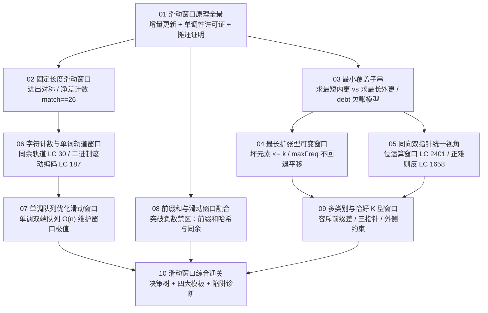

# 滑动窗口算法专栏导览：从原理到 LeetCode 面试通关

**摘要：**

在算法面试与工程系统中，"连续子数组（Subarray）"与"连续子字符串（Substring）"是最频繁出现的序列处理载体。滑动窗口（Sliding Window）并非孤立的代码套路，而是一套建立在**区间单调性**与**状态增量维护**之上的思维范式——它将暴力枚举所有子区间所需的 $O(n^2)$ 乃至 $O(n^3)$ 代价，通过右边界扩张与左边界单向不回退的摊还机制，压缩至极致的 $O(n)$ 线性时间。本专栏从滑动窗口的数学本质出发，沿"定长可逆增量 $\to$ 可变收缩黄金法则 $\to$ 不缩反扩平移 $\to$ 字符频次与单词同余轨道 $\to$ 单调双端队列极值 $\to$ 前缀和负数突围 $\to$ 恰好 K 型容斥差分"的主线逐层递进，覆盖 30 余道经典 LeetCode 题目，全专栏示例代码统一采用 **Golang** 实现。

---

## 专栏定位与核心演进脉络

很多候选人在刷滑动窗口题时陷入"见一题背一模板"的泥潭：一会儿写 `for` 循环收缩，一会儿写 `if` 平移；一会儿在收缩前更新答案，一会儿在收缩后更新答案；一旦数组里混入一个负数，整套模板瞬间失灵却不知原因为何。

本专栏旨在帮你建立三层穿透题面的底层认知：
1. **第一层（为什么能 $O(n)$）**：拆解"增量更新（Incremental Update）"与"最优左端点单调不减（Monotonicity of Optimal Left Bound）"两大支柱，理解为什么 `left` 指针永不回退；
2. **第二层（怎么选窗口形态与状态结构）**：区分定长窗口、求最短可变窗口、求最长可变窗口、求子数组个数窗口（至多型、至少型、恰好型）在收缩时机与结算位置上的精确镜像关系；
3. **第三层（当基础窗口遇到障碍如何升维）**：当窗口需要维护不可逆的极值（$\max/\min$）时，引入**单调双端队列**（第 07 篇）；当数组包含负数打破和的单调性时，引入**前缀和 + 哈希表 / 单调队列**（第 08 篇）；当约束变为不具备单侧单调性的"恰好 $K$ 类"时，引入**容斥前缀差**（第 09 篇）。

---

## 专栏目录

| 序号 | 文章标题 | 核心话题 | 覆盖代表题目（LeetCode） |
|------|----------|----------|--------------------------|
| 01 | [[01 滑动窗口算法原理全景：从暴力枚举到 O(n) 的思维跃迁]] | 暴力枚举冗余拆解、增量状态可逆性、单调性充要条件、定长与可变双引擎推导、失效边界 | 1052、1423 及概念全景 |
| 02 | [[02 固定长度滑动窗口：模板推导与三题精讲]] | 进出对称性、单循环与双阶段初始化、整数转换避浮点、频次净差计数器 `match == 26` | 643、1343、567、1456、2090、2461 |
| 03 | [[03 最小覆盖子串：可变窗口收缩条件的黄金法则]] | 最长 vs 最短镜像法则、`lastPos` 一步跳转、`need/window/formed` 与单数组 `debt` 欠账模型 | 3、76、632、340 |
| 04 | [[04 最长扩张型可变窗口：替换操作与连续性约束]] | "坏元素 $\le k$"建模、`maxFreq` 历史极值不回退证明、`if` 等宽平移替代 `while` 收缩 | 1004、1493、424、1208、2024 |
| 05 | [[05 同向双指针统一视角：快慢指针与滑动窗口的辩证关系]] | 滑动窗口与同向读写指针/快慢指针的等价变换、位运算窗口（按位与/或撤销）、正难则反窗口 | 209、904、2401、1658、713 |
| 06 | [[06 字符计数窗口：哈希表与滑动窗口的黄金组合]] | 字母异位词批处理、单词步长 $L$ 同余轨道切分、滚动哈希（Rabin-Karp）2 位编码压缩 | 438、30、187、395 |
| 07 | [[07 单调队列优化滑动窗口：O(n) 求窗口极值的艺术]] | 为什么 $\max$ 不可逆、单调双端队列"年轻且强"淘汰律、双单调队列维护绝对差限制 | 239、1438、862、1696 |
| 08 | [[08 前缀和与滑动窗口的思想融合：子数组求和类问题]] | 负数如何摧毁窗口单调性、前缀和 + 哈希表同余计数、非负化转化与滑动窗口适用分水岭 | 560、974、523、525、930 |
| 09 | [[09 多类别元素与恰好 K 型窗口：高阶滑动窗口技法]] | `恰好 K = 至多 K - 至多 K-1` 容斥定理、三指针单遍合一、窗口外侧剩余约束逆向建模 | 992、1248、1234、1358、3306 |
| 10 | [[10 滑动窗口综合通关：面试高频模式总结与难题攻破]] | 四大窗口模板速查、模式识别决策树、八大高频失分陷阱诊断、跨范式组合（二分答案+滑窗） | 全专栏复盘与综合演练 |

---

## 学习路径图

---

## 关联专栏

- **双指针专栏**（[[01 双指针算法全景：核心直觉、三大模型与面试考频分析]]）：滑动窗口是同向双指针在"维护区间聚合状态"方向上的纵深特化。
- **栈与队列专栏**（[[06 单调队列：滑动窗口最大值]]）：单调双端队列是解决滑动窗口内不可逆极值（最大值/最小值）的核心辅助结构。
- **线性表专栏**（[[01 线性表全景：数组与链表的本质与工程权衡]]）：数组连续内存的 $O(1)$ 下标寻址与前缀和预处理，构成了滑动窗口高速运行的底层基石。
