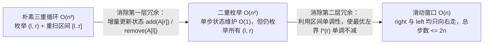
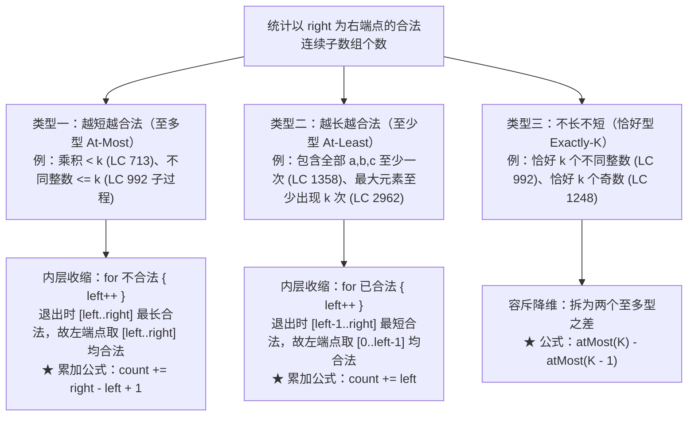

# 滑动窗口算法原理全景：从暴力枚举到 O(n) 的思维跃迁

**摘要：**

在算法面试中，凡是涉及"连续子数组（Subarray）"或"连续子字符串（Substring）"的最值与计数问题，**滑动窗口（Sliding Window）**几乎总是将时间复杂度从 $O(n^2)$ 甚至 $O(n^3)$ 压降至 $O(n)$ 的首选利器。然而，许多工程人员在面对新题时依然会陷入迷茫：为什么有的子数组题能用滑动窗口，有的却一旦套用就漏解？为什么定长窗口与可变窗口的代码结构不同？为什么求最长窗口在循环外更新答案，而求最短窗口却必须在循环内更新答案？本文作为专栏开篇，不急于堆砌具体题解，而是从暴力枚举的兩層冗余（区间重算冗余与搜索空间枚举冗余）出发，严格推导滑动窗口赖以成立的两块数学基石——**窗口状态的 $O(1)$ 可逆增量维护**与**合法性边界的单调不回退性质**，并结合 LeetCode 1052 与 1423 给出 Golang 标准范式。

---

## 第 1 章 暴力枚举的两层冗余：滑动窗口从何而来

### 1.1 连续子区间问题的数学共性

几乎所有连续子数组或子字符串问题，都可以抽象为同一个数学规划形式：给定长度为 $n$ 的序列 $A[0 \dots n-1]$，在全部 $\frac{n(n+1)}{2}$ 个非空连续子区间 $[l, r]$（满足 $0 \le l \le r < n$）构成的二维搜索空间中，找出满足谓词约束 $P(A[l \dots r])$ 的子区间，使目标函数 $f(A[l \dots r])$ 达到极值（最大长度、最小长度、最大和），或统计满足 $P$ 的子区间总个数。

如果采用最朴素的三重循环暴力法（外两层枚举所有 $l$ 和 $r$，内一层遍历 $k \in [l, r]$ 计算统计量并检验 $P$），时间复杂度高达 $O(n^3)$。当题目给出的数据规模为 $n = 10^5$ 时，$n^3 = 10^{15}$ 次操作需要计算机运行数天；即便去掉内层遍历降为 $O(n^2)$，操作次数也高达 $10^{10}$，远超评测机单秒约 $10^8$ 次基本运算的物理极限。

要将 $O(n^3)$ 一步步削减到 $O(n)$，我们必须看清暴力枚举到底在哪两个地方做了无用功：



### 1.2 第一层冗余：相邻区间的重叠重算与"增量更新"

考察定长窗口问题：求长度为 $k$ 的连续子数组的最大元素和。
暴力法在算完第一个窗口 $A[0 \dots k-1]$ 的和 $S_0 = a_0 + a_1 + \cdots + a_{k-1}$ 之后，为了求第二个窗口 $A[1 \dots k]$ 的和 $S_1$，又把 $a_1 + a_2 + \cdots + a_k$ 从头加了一遍。

请看 $S_0$ 与 $S_1$ 的构成：中间的 $k - 1$ 个元素 $a_1, a_2, \ldots, a_{k-1}$ 是**完全重合**的。从 $[0, k-1]$ 平移到 $[1, k]$，发生变化的仅仅是右边界新吸纳了一个 $a_k$，左边界吐出了一个 $a_0$：

$$S_1 = S_0 + a_k - a_0$$

这就引出了滑动窗口的**第一条核心原理——状态增量更新（Incremental State Maintenance）**：我们不再把每个子区间看作孤立的静态切片去从头统计，而是维护一个携带内部状态 `state` 的动态区间 `[left, right]`；每当右边界扩张一步时调用 $O(1)$ 的 `add(A[right])`，每当左边界收缩一步时调用 $O(1)$ 的逆操作 `remove(A[left])`。这一下就砍掉了 $O(k)$ 的内层重扫，消除了第一层冗余。

### 1.3 第二层冗余：二维下标对的全量枚举与"单调不回退"

消除了区间重算冗余后，如果是定长窗口（长度固定为 $k$），由于 $l = r - k + 1$ 与 $r$ 一一绑定，总共只有 $n - k + 1$ 个窗口，时间复杂度直接就降到了 $O(n)$。

但如果是**可变长度窗口**（譬如：给定正整数数组 `nums`，求元素和 $\ge target$ 的最短子数组，或求元素和 $\le target$ 的最长子数组），左端点 $l$ 和右端点 $r$ 是两个独立的自由度，一共有 $\frac{n(n+1)}{2} = \Theta(n^2)$ 个候选子区间。为什么滑动窗口不需要枚举全部 $\Theta(n^2)$ 个区间，只看其中至多 $2n$ 个区间就能保证绝不漏掉全局最优解？

答案在于**第二条核心原理——区间谓词的单调性（Monotonicity of Interval Predicate）**。

以"正整数数组中求和 $\le target$ 的最长子数组"为例：由于数组中所有元素均为正数（$\ge 1$），区间和函数 $S(l, r) = \sum_{i=l}^r A[i]$ 具备严格的双端单调性：
- **右端扩张单调递增**：固定 $l$，当 $r$ 增大为 $r + 1$ 时，$S(l, r + 1) > S(l, r)$（窗口越扩，和越大，越容易超标违法）；
- **左端收缩单调递减**：固定 $r$，当 $l$ 增大为 $l + 1$ 时，$S(l + 1, r) < S(l, r)$（窗口越缩，和越小，越容易恢复合法）。

现在，对于每一个右端点 $r$，设满足 $S(l, r) \le target$ 的最左（即最优、使窗口最长）起点为 $l^*(r)$。当右端点从 $r$ 向右迈一步到 $r + 1$ 时，由于新纳入了正数 $A[r+1]$，原本在 $r$ 处就已经超标不合法的所有左起点 $l < l^*(r)$，到了 $r + 1$ 处只会加得更大、更加不合法。因此必然有不等式：

$$l^*(r + 1) \ge l^*(r)$$

**最优左端点 $l^*(r)$ 是关于右端点 $r$ 的单调非递减函数**。这意味着，当外层循环将 `right` 从 `0` 一路递增到 `n - 1` 时，内层寻找最优左端点的游标 `left` **永远只需要从上一轮停下的位置继续向右走，一步都不需要往左回退**。这就把 $\Theta(n^2)$ 的二维搜索空间压缩成了一条长至多 $2n$ 的一维阶梯折线。

---

## 第 2 章 窗口状态的物理分类：可逆状态 vs 不可逆状态

一道子区间问题在确认具备单调性之后，下一步工程设计就是回答：**窗口内部到底要维护什么数据结构（State），才能让进窗 `add(x)` 和出窗 `remove(x)` 都在 $O(1)$ 时间内完成？**

按照数学运算的**可逆性（Invertibility）**，我们可以把面试中所有的窗口状态划分为四大等级：

| 状态等级 | 典型统计量 | 进窗算子 `add(x)` | 出窗逆算子 `remove(x)` | 单步开销与辅助结构 | 对应专栏篇章 |
|----------|------------|-------------------|------------------------|--------------------|--------------|
| 一级：阿贝尔群标量（直接可逆） | 区间和、非零乘积、异或和 | `sum += x` / `xor ^= x` | `sum -= x` / `xor ^= x` | $O(1)$ 时间，$O(1)$ 标量 | 第 02、04、05 篇 |
| 二级：计数映射 + 阈值聚合计数 | 字符频次、不同元素种类数 `distinct`、达标种类数 `formed` | `freq[x]++`，当 `freq[x]` 跨过阈值时更新计数器 | `freq[x]--`，当 `freq[x]` 跌破阈值时回退计数器 | $O(1)$ 时间，$O(\|\Sigma\|)$ 数组或哈希表 | 第 02、03、06、09 篇 |
| 三级：位分解计数（按位还原可逆） | 区间按位或（Bitwise OR）、按位与（AND） | 将 `x` 的二进制为 1 的各 bit 计数 `bitCnt[b]++` | 将 `x` 的二进制为 1 的各 bit 计数 `bitCnt[b]--` | $O(32) = O(1)$ 时间，`[32]int` 数组 | 第 05 篇 |
| 四级：半群极值（**不可逆**） | 窗口最大值 $\max$、窗口最小值 $\min$ | 队尾淘汰 `<= x` 的旧元素后入队 | 检查队首下标是否过期 `deque[0] == left` | 均摊 $O(1)$ 时间，**单调双端队列** | 第 07 篇 |

> [!info] 认知跃迁：为什么按位或（OR）和最大值（Max）不能直接用标量出窗？
> 初学者常犯的一个错误是：在维护窗口按位或 `winOR` 时，进窗写 `winOR |= x`，出窗却不知道怎么写（因为如果原来窗口里有两个数的第 0 位都是 `1`，移走其中一个后第 0 位应该还是 `1`，如果草率用异或抹掉就会出错）。解决方法正是上表中的**三级状态——把不可逆的布尔或运算，提升为可逆的 32 位频次加减计数 `bitCnt[32]int`**：只要 `bitCnt[b] > 0`，第 `b` 位就是 `1`。而对于数值极值 $\max/\min$，则必须借助第 07 篇的单调双端队列维护候选集。

---

## 第 3 章 固定窗口与可变窗口的三大标准引擎（Golang 实现）

为了统一全专栏的代码规范，下面用 Go 语言给出滑动窗口的三大基础标准引擎：**定长窗口引擎**、**求最长可变窗口引擎**与**求最短可变窗口引擎**。

### 3.1 引擎一：固定长度滑动窗口（入窗 $\to$ 满窗结算 $\to$ 出窗）

在固定长度窗口（宽度恒为 $k$）中，与其写两个分离的 `for` 循环（先单独写一个循环填满前 $k$ 个元素，再写第二个循环从 $k$ 滑到 $n-1$），不如采用更紧凑、零重复代码的**单循环三步范式**：
1. **右端入窗**：将 `nums[right]` 纳入窗口状态；
2. **未满窗短路**：若 `right < k - 1`，说明窗口元素个数还不足 $k$ 个，直接 `continue`；
3. **满窗结算与左端出窗**：此时窗口 `[right - k + 1 .. right]` 恰好包含 $k$ 个元素，先用当前窗口状态更新全局答案，随后立即将最老的左端元素 `nums[right - k + 1]` 移出窗口，为下一轮循环腾出空位。

#### 实战示范一：爱生气的书店老板（LeetCode 1052）

**题目描述**：书店老板有一家店打算试营业 `len(customers)` 分钟。每分钟都有一些顾客进入（`customers[i]`），如果老板在第 `i` 分钟生气（`grumpy[i] == 1`），那么这一分钟的顾客就会不满意；不生气（`grumpy[i] == 0`）则满意。老板掌握一个秘密技巧，可以让自己在**连续的 `minutes` 分钟**内不生气，但只能使用一次。请返回这一天营业下来，最多有多少客户能够感到满意。

**推导过程**：
- 把所有顾客拆成两部分：**基本盘（原本老板就不生气 `grumpy[i] == 0` 时的顾客）**与**挽回增量（原本老板生气 `grumpy[i] == 1`，但被秘密技巧覆盖而转怒为喜的顾客）**；
- 基本盘 `baseSatisfied` 是固定不变的常数，不受秘密技巧放在哪里的影响；
- 秘密技巧本质上就是一个**长度固定为 `k = minutes` 的定长滑动窗口**，它的唯一目标是：**框住一段长度为 `minutes` 的连续区间，使窗口内原本生气的顾客之和 `extraSatisfied` 最大**。

```go
package main

// maxSatisfied LeetCode 1052：不变量拆分（基本盘 + 定长窗口最大挽回增量）
// 时间复杂度：O(n)，额外空间复杂度：O(1)
func maxSatisfied(customers []int, grumpy []int, minutes int) int {
	baseSatisfied := 0
	curExtra, maxExtra := 0, 0

	for right := 0; right < len(customers); right++ {
		if grumpy[right] == 0 {
			baseSatisfied += customers[right]
		} else {
			// 1. 右端新元素入窗（仅统计原本生气可被挽回的顾客）
			curExtra += customers[right]
		}

		if right < minutes-1 {
			continue // 窗口尚未攒满 minutes 分钟
		}

		// 2. 满窗更新最大挽回增量
		if curExtra > maxExtra {
			maxExtra = curExtra
		}

		// 3. 左端最老元素 right - minutes + 1 出窗
		left := right - minutes + 1
		if grumpy[left] == 1 {
			curExtra -= customers[left]
		}
	}
	return baseSatisfied + maxExtra
}
```

#### 实战示范二：可获得的最大点数——逆向定长窗口（LeetCode 1423）

**题目描述**：几张卡牌排成一行，每张卡牌都有一个点数 `cardPoints[i]`。每次行动，你可以从行的**开头或者末尾**拿一张卡牌，最终你必须正好拿走 `k` 张卡牌。求你能获得的最大点数之和。

**推导过程（正难则反）**：
- 从数组两头合计拿走 $k$ 张卡牌，等价于**在数组正中间留下一段长度固定为 $m = n - k$ 的连续子数组不拿**；
- 因为全数组总点数 `totalSum` 是常数，要想让两头拿走的 $k$ 张牌点数之和**最大**，就等价于让中间留下的定长 $n - k$ 滑动窗口的点数之和**最小**。直接套用定长窗口引擎求最小窗口和 `minWindowSum`，返回 `totalSum - minWindowSum` 即可：

```go
package main

// maxScore LeetCode 1423：正难则反，转化为求长度为 n-k 的定长滑动窗口最小和
func maxScore(cardPoints []int, k int) int {
	n := len(cardPoints)
	totalSum := 0
	for _, pt := range cardPoints {
		totalSum += pt
	}
	winSize := n - k
	if winSize == 0 {
		return totalSum
	}

	curSum := 0
	minWinSum := totalSum
	for right := 0; right < n; right++ {
		curSum += cardPoints[right]
		if right < winSize-1 {
			continue
		}
		if curSum < minWinSum {
			minWinSum = curSum
		}
		curSum -= cardPoints[right-winSize+1]
	}
	return totalSum - minWinSum
}
```

### 3.2 引擎二与引擎三：可变窗口的"求最长"与"求最短"镜像结构

在可变窗口中，由于没有固定的宽度 $k$，左指针 `left` 完全由窗口的合法性条件驱动。请务必在脑海中将下面这两套镜像引擎的**收缩条件**与**结算位置**对比清楚：

```go
package main

// 引擎二：可变窗口【求最长】合法子区间
// 逻辑：右指针主动扩张寻找更大可能；仅当窗口被迫不合法时，左指针被动收缩清理；收缩完毕恢复合法后，在循环【外】更新最大长度
func engineLongest(nums []int) int {
	left, maxLen := 0, 0
	for right := 0; right < len(nums); right++ {
		// 1. 纳入 nums[right]，更新窗口状态
		// add(nums[right])

		// 2. 当窗口【不合法】时，持续收缩 left 直至窗口重新合法
		for /* 窗口不合法 */ false {
			// remove(nums[left])
			left++
		}

		// 3. 此时窗口保证合法，在收缩循环【外侧】更新最长答案
		if right-left+1 > maxLen {
			maxLen = right - left + 1
		}
	}
	return maxLen
}

// 引擎三：可变窗口【求最短】合法子区间
// 逻辑：右指针扩张攒够合法条件；一旦窗口【合法】，左指针主动在内层循环里记录最短候选并持续收缩压榨水分
func engineShortest(nums []int) int {
	const inf = int(1e9)
	left, minLen := 0, inf
	for right := 0; right < len(nums); right++ {
		// 1. 纳入 nums[right]，更新窗口状态
		// add(nums[right])

		// 2. 当窗口【已经合法】时，在内层循环【内部】先记录答案，再继续收缩尝试能否更短
		for /* 窗口已合法 */ false {
			if right-left+1 < minLen {
				minLen = right - left + 1
			}
			// remove(nums[left])
			left++
		}
	}
	if minLen == inf {
		return 0
	}
	return minLen
}
```

为什么这两套引擎的结算位置截然相反？
- 在**求最长**（引擎二）中，进入内层 `for` 循环时窗口是**不合法**的，只有等内层 `for` 循环把违规元素全部吐出去、退出内层循环的那一刻，窗口 `[left, right]` 才恢复合法，且是当前 `right` 下最宽的合法窗口，因此必须在外侧结算；
- 在**求最短**（引擎三）中，进入内层 `for` 循环的条件恰恰是窗口**已经合法**，每往里缩一步都在冲击更短的合法纪录；而一旦退出内层 `for` 循环，说明刚刚多吐了一个关键元素导致窗口已经变得**不合法**了，因此在循环外侧绝对不能结算。

---

## 第 4 章 滑动窗口的均摊复杂度证明与三大禁区

### 4.1 为什么嵌套了两个循环，时间复杂度依然是严格的 $O(n)$？

在面试中，当写出上面的 `for right` 嵌套 `for left` 时，必须能用一句话向面试官给出严格的**均摊分析（Amortized Analysis）**：
> 不要看单次外层迭代里内层循环跑了几步，而要看**每个元素在整個算法生命周期内的命运**——数组中的每一个元素 `nums[i]`，至多在 `right == i` 时进窗一次（耗时 $O(1)$），至多在 `left == i` 时出窗一次（耗时 $O(1)$），绝无第二次进窗或出窗的可能。因此，所有进窗操作累计执行 $n$ 次，所有出窗操作累计执行不超过 $n$ 次，总时间复杂度严格上界为 $2n \cdot O(1) = O(n)$。

### 4.2 滑动窗口的三大失效禁区（遇到时立即刹车）

掌握一个算法最高境界的标志，是清楚知道它**什么时候不能用**。以下三类场景会直接击穿滑动窗口的单调性前提：

1. **禁区一：含负数的子数组和问题（如 LC 53 最大子数组和、LC 560 和为 K 的子数组、LC 862 和至少为 K 的最短子数组）**：
   - 一旦数组中存在负数，向右扩张窗口纳入一个负数反而会让区间和变小，向左收缩窗口吐出一个负数反而会让区间和变大。此時 $l^*(r)$ 不再具有单调不减性质，普通滑动窗口直接漏解。应对方案是切换至 **Kadane 动态规划**（LC 53）、**前缀和 + 哈希表**（LC 560，详见第 08 篇）或 **前缀和 + 单调双端队列**（LC 862，详见第 07 篇）。
2. **禁区二：不要求连续的子序列（Subsequence）问题**：
   - 滑动窗口只能框住物理上连续的一段区间 `[left, right]`。如果题目允许跳着选元素（如最长递增子序列 LIS、最长公共子序列 LCS），必须改用动态规划或贪心二分。
3. **禁区三：单次窗口无法直接框定的"恰好等于 K"计数问题（如 LC 992 恰好 K 个不同整数的子数组）**：
   - 当固定右端点 `right` 时，满足"恰好 $K$ 个"的合法左起点不是单点边界，而是一段区间 `[leftMin, leftMax]`，单一 `left` 指针无法同时锁定两端。应对方案是使用第 09 篇的**容斥差分 `atMost(K) - atMost(K - 1)`** 或三指针法。

---

## 第 5 章 窗口目标的四象限与计数公式推导

在确认一道题属于滑动窗口管辖范围后，除了第 3 章展示的"求定长最值"、"求可变最长"与"求可变最短"外，面试中占比高达三分之一的题型是**统计满足条件的连续子数组/子串总个数**。

为什么在求子数组个数时，滑动窗口不需要真的把每一个子数组单独拿出来数一遍，而是每次 `right` 右移一步就能**批量结算一整批以 `right` 为右端点的合法子数组**？因为当右端点固定为 `right` 时，所有以 `right` 结尾的连续子数组，与它们的左端点 `l`（取值范围 $0 \le l \le \text{right}$）是一一对应的。根据合法性随窗口宽度的单调变化方向，计数问题精确分为三类：



### 5.1 四象限目标的完整对比矩阵

将定长窗口与可变窗口的四种目标汇总在一张表里，你会发现滑动窗口的所有变体不过是在调整同一台状态机里的三个旋钮：

| 问题目标象限 | 内层收缩触发条件 | 更新答案的时机位置 | 更新表达式 | 典型代表题目 |
|--------------|------------------|--------------------|------------|--------------|
| 定长 $k$ 求极值/计数 | `right >= k - 1` 后固定吐出左端 | 满窗时刻（出窗之前） | `ans = max(ans, state)` | LC 643、1052、1423、567 |
| 可变窗口求**最长** | `for 窗口不合法`（被动清理） | 收缩循环**外侧**（刚恢复合法） | `maxLen = max(maxLen, right - left + 1)` | LC 3、1004、1493、904 |
| 可变窗口求**最短** | `for 窗口已合法`（主动压榨） | 收缩循环**内部**（吐出前仍合法） | `minLen = min(minLen, right - left + 1)` | LC 209、76、1234 |
| 可变窗口求**至多型个数** | `for 窗口不合法` | 收缩循环**外侧** | `count += right - left + 1` | LC 713、2762、992 子函数 |
| 可变窗口求**至少型个数** | `for 窗口已合法` | 收缩循环**外侧**（`left` 停在首个非法点） | `count += left` | LC 1358、2962、2537 |

---

## 第 6 章 滑动窗口与相邻算法范式的演进关系

在知识体系中，滑动窗口并不是一座孤岛，它与前缀和、二分查找、单调栈/队列以及动态规划存在着清晰的边界与协作关系：

1. **滑动窗口 vs 前缀和 + 二分查找**：
   - 在正数数组求和 $\ge target$ 的最短子数组（LC 209）中，因为前缀和数组 `prefix[0..n]` 是严格单调递增的，我们可以对每个左起点 `l` 用二分查找 `lowerBound` 找第一个满足 `prefix[r] >= prefix[l] + target` 的右端点 `r`，耗时 $O(n \log n)$；
   - 滑动窗口之所以能把 $O(n \log n)$ 进一步压到 $O(n)$，是因为当 `l` 递增时，对应的临界右端点 `r` 也必然单调递增——**用单向继承上一轮位置的游标代替每轮重置上下界的二分查找，正是滑动窗口消除 $\log n$ 因子的本质**。
2. **滑动窗口 vs 动态规划（Kadane 算法）**：
   - 求最大子数组和（LC 53，含负数）采用的 Kadane 算法 `dp = max(nums[i], dp + nums[i])`，从某种意义上看也是一种"极端激进的滑动窗口"——只要前缀累加和 `dp < 0` 成了拖油瓶，左边界就直接一步跳到当前位置 `i` 重开炉灶；而一旦题目加上了"子数组长度不超过 $k$"的窗口宽度限制（如 **LeetCode 918：环形子数组的最大和** 或受限子序列和 LC 1425），就必须把前缀和与固定宽度 $k$ 的单调双端队列结合起来。
3. **系统工程中的滑动窗口**：
   - 从计算机网络的 TCP 流量控制窗口、API 网关的滑动时间窗限流器（Sliding Window Rate Limiter），到流式计算引擎 Flink 的 Sliding Event-Time Window 与时序数据库 Prometheus 的 `rate(metric[5m])` 区间算子，"增量维护进入窗口的新样本、驱逐滑出窗口的老样本"这一设计哲学，贯穿了从纳秒级 CPU 寄存器循环到分布式流式状态后端的每一个层级。

### 6.2 工程落地对比：分布式限流器中的"固定时间窗"vs"滑动日志窗"vs"滑动分桶窗"

为了让你在系统设计面试中也能信手拈来地迁移本章原理，不妨看一个每个后端工程师都绕不开的真实场景——**API 网关限流器（Rate Limiter：限制每个用户每秒最多 100 次请求）**：

1. **固定时间窗口计数器（Tumbling / Fixed Time Window）**：
   - 按自然秒 `[00:00, 00:01)`、`[00:01, 00:02)` 切分，每秒维护一个计数器。
   - **致命缺陷（边界突发双倍流量刺穿）**：如果攻击者在第 1 秒的最后 10 毫秒内打入 100 次请求，紧接着在第 2 秒的前 10 毫秒内又打入 100 次请求，在各自的自然秒窗口里都没超标，但在跨越边界的 `[0.99s, 1.01s]` 这短短 20 毫秒滑动窗口内，系统实际承受了 **200 次（2 倍上限）** 的瞬时洪峰。
2. **精确滑动日志窗口（Sliding Log Window，对应本章的可变滑动窗口）**：
   - 用一个队列（如 Redis ZSet）记录该用户每次请求到达的精确时间戳 `ts`。每当新请求在 `now` 时刻到达时（相当于 `right = now` 入窗），先将队列头部所有满足 `ts <= now - 1000ms` 的过期时间戳全部弹出（相当于 `for 过期 { left++ }` 收缩），再统计剩余队列长度是否 $< 100$。
   - 这种做法徹底消除了边界双倍突发漏洞，但代价是需要为每次请求保存时间戳（空间 $O(k)$）。
3. **分桶环形滑动窗口（Sliding Window Counter / Bucketed Ring Buffer，对应本章的定长窗口）**：
   - 工业界（如阿里的 Sentinel 限流组件）将 1 秒钟均分为 10 个各长 100ms 的小格子（Bucket），组成一个长度为 10 的定长环形数组。随着时间每推进 100ms，窗口向右滑动一格，把最老那个 100ms 格子的计数减掉、新格子清零复用，从而以 **严格 $O(1)$ 的固定内存（10 个整型）** 逼近精确滑动窗口的平滑限流效果。

### 6.3 考场破题五步自检表

在进入后续各篇专项攻坚之前，请将以下"滑动窗口破题五问"作为每次动笔前的标准动作：
1. **看载体**：题目求的是不是**物理连续**的子数组或子串？（若可跳过元素且不允许通过删除建模，则排除滑窗）；
2. **验单调**：当右端点固定、左端点向右缩小时，合法性条件是不是单调变化的？（若求和问题中混有负数，立刻刹车改走第 08 篇的前缀和路线）；
3. **辨形态**：窗口长度是题目给定的常数 $k$（走定长三步模板），还是动态伸缩的（走可变窗口）？
4. **定方向**：若是可变窗口，求的是**最长**（`for 不合法` 收缩，外侧更新）、**最短**（`for 已合法` 收缩，内侧更新），还是**子数组个数**（至多加 `r-l+1`、至少加 `l`、恰好做差）？
5. **选状态**：窗口内部的状态用标量、`[128]int` 数组、哈希表还是单调双端队列维护，能否保证进窗与出窗都是均摊 $O(1)$？

---

## 小结

作为专栏的第一篇，我们完成了从暴力枚举到滑动窗口的底层逻辑奠基：
- 滑动窗口用**状态增量更新（一进一出互逆操作）**消除了区间重算冗余，用**区间谓词单调性（保证 `left` 单调不回退）**消除了二维枚举冗余；
- 定长窗口遵循"入窗 $\to$ 满窗结算 $\to$ 出窗"的三步对称节拍；
- 可变窗口分为"求最长（`for 不合法` 收缩、外侧结算）"与"求最短（`for 合法` 收缩、内侧结算）"两大镜像引擎；
- 面对负数、非连续子序列与"恰好 $K$"约束时，能够迅速识别单调性断裂并切换至前缀和、单调队列或容斥差分。

下一篇 [[02 固定长度滑动窗口：模板推导与三题精讲]] 将深入固定窗口的实战腹地，攻克数值聚合、去重子数组最大和与字符排列匹配三大经典题型。

---

## 参考资料

1. Cormen, T. H., et al. *Introduction to Algorithms* (4th ed.). MIT Press, 2022. Chapter 16: Amortized Analysis.
2. Sedgewick, R., & Wayne, K. (2011). *Algorithms* (4th ed.). Addison-Wesley.

---

> [!note] 思考题
> 1. 在第 3.1 节的 LeetCode 1423（可获得的最大点数）中，除了"正难则反求中间长 $n - k$ 的窗口最小和"，能不能直接把数组首尾相接看作一个环形数组，在跨越首尾分界线的长度为 $k$ 的窗口上正向求最大和？对比两种写法在下标取模与边界处理上的优劣。
> 2. 如果一个正整数数组要求找出"元素乘积恰好等于 $K$"的子数组个数，能不能直接套用引擎二或引擎三的可变滑动窗口？为什么当数组中包含数字 `1`（乘以 `1` 乘积不变）时，单一左指针会漏掉多个合法起点？
> 3. 请用势能法（Potential Method，定义势能函数 $\Phi = \text{right} - \text{left}$）证明可变滑动窗口中内层 `for` 循环的单次均摊代价为 $O(1)$。
