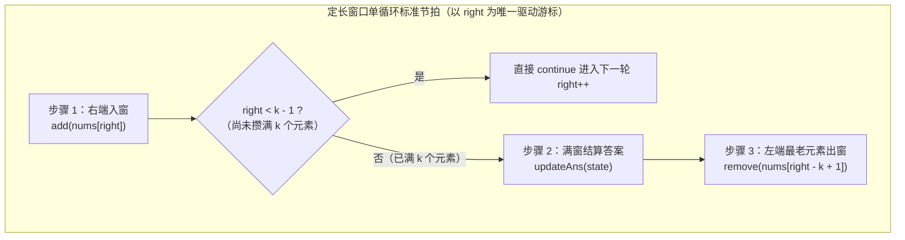

# 固定长度滑动窗口：模板推导与三题精讲

**摘要：**

固定长度滑动窗口（Fixed-Size Sliding Window）是整个滑动窗口体系的起跑线，也是大厂笔试与面试第一题的高频常客。它的形态特征极为鲜明——题目明确指定子数组或子字符串的长度恒为常数 $k$（或可等价转化为固定长度 $k$）。正因为窗口宽度锁死不变，窗口在序列上每向右平移一格，都伴随着极其优美的**"一进一出对称性（One-In, One-Out Symmetry）"**：右边界纳入下标 `right` 的同时，左边界必然吐出下标 `right - k + 1`。本文围绕五道层层递进的代表性题目——LeetCode 643（子数组最大平均数 I）、LeetCode 1343（均值达标子数组计数）、LeetCode 2461（长度为 K 的无重复子数组最大和）、LeetCode 567（字符串的排列）与 LeetCode 2134（最少交换次数组合所有 1 II，环形定长窗口），系统拆解标量累加、哈希频次去重、净差计数器 `match == 26` 以及环形数组展平四大核心技法，并给出零冗余的 Golang 实现。

---

## 第 1 章 定长窗口的对称美学与两套标准模板

### 1.1 "一进一出"的群逆元本质

在长度为 $n$ 的数组上考察所有长度为 $k$ 的连续子数组，共有 $n - k + 1$ 个窗口：
- 第 $0$ 号窗口覆盖下标闭区间 $[0, k-1]$；
- 第 $1$ 号窗口覆盖下标闭区间 $[1, k]$；
- ……
- 一般地，以 `right`（满足 $k - 1 \le \text{right} < n$）为右端点的定长窗口，其左端点恒为 **`left = right - k + 1`**，且该窗口内部的元素个数恒满足 `right - left + 1 == k`。

当窗口右端点从 `right - 1` 迈向 `right` 时，窗口内部的 $k$ 个元素有 $k - 1$ 个保持原封不动，唯一的变化是新元素 `nums[right]` 跨入右门槛、老元素 `nums[right - k]` 跨出左门槛。这意味着：**只要我们维护的窗口统计量属于一个存在逆运算的代数结构（譬如加法的逆是减法、异或的逆是异或、频次加一的逆是频次减一），每次窗口平移就只需要执行一次正向算子 `add(in)` 与一次逆向算子 `remove(out)`，单步更新时间严格恒定为 $O(1)$**。



### 1.2 两阶段分离模板 vs 单循环统一模板

在工程编码中，编写定长滑动窗口有两种完全等价的组织方式，建议读者根据状态更新的复杂程度灵活选用：

1. **写法 A（单循环统一模板，推荐用于标量与频次计数）**：
   - 只写一个 `for right := 0; right < n; right++` 循环，按上图所示的**"1. 入窗 $\to$ 2. 若 `right < k-1` 则 `continue` $\to$ 3. 满窗更新答案 $\to$ 4. 左端 `right - k + 1` 出窗"**四步走；
   - **最大优势**：`add` 逻辑在全函数里只写一次，彻底消除了"初始化循环写一套 `add`、滑动循环又复制粘贴一套 `add`"带来的漏改 Bug。
2. **写法 B（两阶段分离模板，推荐用于初始状态与差量更新不一致的场景）**：
   - 第一阶段用 `for i := 0; i < k; i++` 填满首窗口 `[0, k-1]` 并初始化 `ans`；
   - 第二阶段用 `for right := k; right < n; right++` 同时执行 `add(nums[right])` 与 `remove(nums[right - k])` 并更新 `ans`。

下面我们在五道实战题目中对照体会这两种写法的妙用。

---

## 第 2 章 标量聚合型定长窗口：均值最大化与阈值计数

### 2.1 LeetCode 643：子数组最大平均数 I（Maximum Average Subarray I）

**题目描述**：给你一个由 $n$ 个元素组成的整数数组 `nums` 和一个整数 $k$。请你找出平均数最大且长度为 $k$ 的连续子数组，并输出该最大平均数。

#### 2.1.1 推迟浮点除法与初值陷阱

既然窗口长度 $k$ 是固定正整数，那么"平均数 `sum / k` 最大"与"**窗口元素总和 `sum` 最大**"是 $100\%$ 等价的。如果在每次窗口移动时都去做一次 `float64(sum) / float64(k)` 浮点除法，不仅浪费 CPU 浮点流水线周期，还可能引入不必要的精度舍入损耗。最地道的工程写法是**全程在整数域内维护窗口和 `sum` 与最大和 `maxSum`，直到函数返回前的最后一刻才执行唯一一次浮点除法**。

此外，这里有一个新手极易踩中的**初值陷阱**：如果采用单循环模板，绝不能把 `maxSum` 随手初始化为 `0`——因为数组中的元素可能**全都是负数**（譬如 `nums = [-5], k = 1`，正确最大和是 `-5`，若 `maxSum` 初值为 `0` 就会错误返回 `0`）。因此，`maxSum` 应当初始化为 `math.MinInt64`（或在两阶段模板中直接用第一个窗口的真实和初始化）：

```go
package main

import "math"

// findMaxAverage LeetCode 643：全程整数累加，仅在返回时做一次浮点除法
// 时间复杂度：O(n)，额外空间复杂度：O(1)
func findMaxAverage(nums []int, k int) float64 {
	sum := 0
	maxSum := math.MinInt64

	for right, v := range nums {
		// 1. 右端入窗
		sum += v
		if right < k-1 {
			continue
		}
		// 2. 满窗更新最大和
		if sum > maxSum {
			maxSum = sum
		}
		// 3. 左端出窗
		sum -= nums[right-k+1]
	}
	return float64(maxSum) / float64(k)
}
```

### 2.2 LeetCode 1343：大小为 K 且平均值大于等于阈值的子数组数目

**题目描述**：给你一个整数数组 `arr` 和两个整数 `k` 和 `threshold`，请你返回长度为 `k` 且平均值大于等于 `threshold` 的子数组数目。

同样运用**化除为乘（Clearing Fractions）**的代数技巧：检验 $\frac{\text{sum}}{k} \ge \text{threshold}$，等价于在循环外预先算出整数门槛值：

$$\text{minSum} = k \times \text{threshold}$$

随后在滑动过程中只需做一次整数比较 `if sum >= minSum { count++ }`，彻底消灭除法运算：

```go
package main

// numOfSubarrays LeetCode 1343：化除为乘预先计算 minSum = k * threshold
func numOfSubarrays(arr []int, k int, threshold int) int {
	sum, count := 0, 0
	minSum := k * threshold

	for right, v := range arr {
		sum += v
		if right < k-1 {
			continue
		}
		if sum >= minSum {
			count++
		}
		sum -= arr[right-k+1]
	}
	return count
}
```

---

## 第 3 章 复合状态定长窗口：求和与无重复约束的协同（LeetCode 2461）

当定长窗口不再仅仅求纯标量和，而是同时附加了**窗口内元素互不相同（Distinct Elements）**的集合约束时，就需要将"一级标量状态 `sum`"与"二级频次映射状态 `freq`"组合起来同步维护。

### 3.1 LeetCode 2461：长度为 K 子数组中的最大和

**题目描述**：给你一个整数数组 `nums` 和一个整数 `k`。请你从 `nums` 中满足下述条件的全部子数组中找出最大子数组和：子数组的长度是 `k`，且**子数组中的所有元素各不相同**。返回满足条件的最大子数组和；如果不存在满足条件的子数组，返回 `0`。

#### 3.1.1 双状态同步进出设计

在这个长度为 $k$ 的定长窗口里，我们需要同时维护两个状态：
1. **窗口元素总和 `sum int64`**（注意数组长 $10^5$、元素达 $10^5$，和可达 $10^{10}$，必须用 `int64`）；
2. **窗口内各数字的出现频次 `freq map[int]int`**（或定长计数数组）。
   - 当右端 `v = nums[right]` 进窗时：`sum += int64(v)`，且 `freq[v]++`；
   - 当窗口攒满 $k$ 个元素（`right >= k - 1`）时，怎么在 $O(1)$ 时间内判断这 $k$ 个元素是否两两互不相同？**既然窗口里一共有 $k$ 个元素，它们两两互不相同当且仅当哈希表中的不同键个数 `len(freq) == k`**；
   - 当左端 `out = nums[right - k + 1]` 出窗时：`sum -= int64(out)`，且 `freq[out]--`；**切记：一旦 `freq[out] == 0`，必须立即调用 `delete(freq, out)` 将该键从哈希表中物理抹除**，否则死键留在表里会污染 `len(freq)` 的种类计数：

```go
package main

// maximumSubarraySum LeetCode 2461：定长窗口同步维护区间和 sum 与不同元素种类数 len(freq) == k
// 时间复杂度：O(n)，空间复杂度：O(k)
func maximumSubarraySum(nums []int, k int) int64 {
	var sum, maxSum int64
	freq := make(map[int]int, k)

	for right, v := range nums {
		// 1. 右端入窗：同步更新和与频次表
		sum += int64(v)
		freq[v]++

		if right < k-1 {
			continue
		}

		// 2. 满窗结算：仅当窗口内不同元素种类数恰好等于 k 时，才算无重复合法窗口
		if len(freq) == k && sum > maxSum {
			maxSum = sum
		}

		// 3. 左端出窗：同步扣减和与频次，频次归零必须 delete 清理死键
		out := nums[right-k+1]
		sum -= int64(out)
		freq[out]--
		if freq[out] == 0 {
			delete(freq, out)
		}
	}
	return maxSum
}
```

这套"定长窗口 + 频次表清理死键"的组合拳，同样可以直接解出 **LeetCode 2841：几乎唯一子数组的最大和**（只需把 `len(freq) == k` 改为 `len(freq) >= m`）以及 **LeetCode 219：存在重复元素 II**（维护一个宽度不超过 $k$ 的滑动哈希集合，若新元素已在集合中则返回 `true`）。

---

## 第 4 章 字符频次定长窗口：从数组比对到 $O(1)$ 净差计数器（LeetCode 567）

### 4.1 LeetCode 567：字符串的排列（Permutation in String）

**题目描述**：给你两个字符串 `s1` 和 `s2`（仅含小写英文字母），写一个函数来判断 `s2` 是否包含 `s1` 的排列。如果是，返回 `true`；否则，返回 `false`。

#### 4.1.1 为什么"包含排列"等价于"定长窗口频次向量相等"

字符串 $A$ 是字符串 $B$ 的一个排列（即字母异位词 Anagram），当且仅当两个字符串的长度相等（$|A| = |B| = k$），且 26 个小写字母在两者中出现的次数分毫不差。因此，问题直接化归为：**在 `s2` 上滑动一个长度固定为 $k = |s_1|$ 的窗口，检查是否存在某一个时刻，窗口的 26 维字符频次向量与 `s1` 的频次向量完全相等**。

在 Go 语言中，由于值类型定长数组 `[26]int` 原生支持 `==` 运算符直接按内存逐项比对，我们可以先写出极其清爽的基础版（单步比对耗时 $O(26)$，总体 $O(26 \cdot |s_2|)$）：

```go
package main

// checkInclusionArrayCompare 基础版：利用 Go 值类型数组 [26]int 直接 == 比对
func checkInclusionArrayCompare(s1 string, s2 string) bool {
	k, n := len(s1), len(s2)
	if k > n {
		return false
	}

	var need, win [26]int
	for i := 0; i < k; i++ {
		need[s1[i]-'a']++
	}

	for right := 0; right < n; right++ {
		win[s2[right]-'a']++
		if right < k-1 {
			continue
		}
		if win == need {
			return true
		}
		win[s2[right-k+1]-'a']--
	}
	return false
}
```

#### 4.1.2 进阶优化：用 `match` 计数器消掉 26 倍常数因子

如果面试官追问："上面的 `win == need` 每次都要把 26 个整数比对一遍。如果字符集不是 26 个字母，而是十万种商品 ID，每次把十万个槽位比一遍就退化成 $O(n \cdot |\Sigma|)$ 了。怎么把每次移动窗口后的相等判定压缩到严格的 **$O(1)$**？"

答案是**把两个数组 `win` 和 `need` 合并为一个净欠账数组 `diff[26]int`（定义 `diff[c] = win[c] - need[c]`），并维护一个标量计数器 `match`（记录当前在 26 个字母中有多少个字母已经满足 `diff[c] == 0`）**：
- 每次右端字符 `in` 进窗或左端字符 `out` 出窗时，只会改动 `diff` 数组里的 1 个位置 `c`；
- 我们封装一个更新辅助函数 `modify(c, delta)`：
  1. 如果修改**前** `diff[c] == 0`，说明这次增减打破了该字母原有的平衡，令 **`match--`**；
  2. 执行 `diff[c] += delta`；
  3. 如果修改**后** `diff[c] == 0`，说明这次增减刚好让该字母达到了收支平衡，令 **`match++`**；
- 如此一来，每次窗口平移只需调用两次 `modify`，随后只需判断 **`match == 26`** 即可在严格的 $O(1)$ 时间内知晓全向量是否归零：

```go
package main

// checkInclusion 进阶版：净差数组 diff + 平衡种类数 match，单步判定严格 O(1)
func checkInclusion(s1 string, s2 string) bool {
	k, n := len(s1), len(s2)
	if k > n {
		return false
	}

	var diff [26]int
	for i := 0; i < k; i++ {
		diff[s1[i]-'a']--
	}

	match := 0
	for _, d := range diff {
		if d == 0 {
			match++
		}
	}

	modify := func(c byte, delta int) {
		if diff[c] == 0 {
			match-- // 原先平衡，改动后失衡
		}
		diff[c] += delta
		if diff[c] == 0 {
			match++ // 改动后恰好归零平衡
		}
	}

	for right := 0; right < n; right++ {
		modify(s2[right]-'a', 1)
		if right < k-1 {
			continue
		}
		if match == 26 {
			return true
		}
		modify(s2[right-k+1]-'a', -1)
	}
	return false
}
```

这套 `modify(c, delta)` 配合 `match` 计数器的状态机设计，对称工整、零冗余分支，是处理一切"定长向量精确匹配"问题的终极模板。

---

## 第 5 章 环形数组上的定长窗口：最少交换次数来组合所有的 1 II（LeetCode 2134）

### 5.1 当定长窗口遇上首尾相连的环（Circular Array）

在面试中，定长滑动窗口最常见的变体障碍是**环形数组（Circular Array）**，代表题为 **LeetCode 2134：最少交换次数来组合所有的 1 II**（以及 **LeetCode 1652：拆炸弹**）：
**题目描述**：给你一个二进制**环形**数组 `nums`（即 `nums[0]` 与 `nums[n-1]` 相邻），你可以任意交换两个位置的元素。返回在数组中把所有 `1` 聚集在一起（连续排列）所需的**最少交换次数**。

#### 5.1.1 问题转化与取模越界消除

1. **转化目标**：假设全数组中一共有 $k$ 个 `1`。要想把这 $k$ 个 `1` 聚拢在某一段长度为 $k$ 的连续区域里，如果某段长度为 $k$ 的窗口内部原本就已经有了 $ones$ 个 `1` 和 $k - ones$ 个 `0`，那么我们只需要把外面的 $k - ones$ 个 `1` 跟窗口里的这 $k - ones$ 个 `0` 交换一下位置即可。因此：**最少交换次数 $=$ 总共 `1` 的个数 $k$ $-$ 长度为 $k$ 的滑动窗口内最多包含 `1` 的个数 `maxOnes`**。
2. **环形滑动窗口的下标处理**：因为数组是环形的，一个长度为 $k$ 的窗口完全可以从尾部跨越分界线延伸到头部（譬如起点在 `n - 1`，终点绕回 `k - 2`）。怎么在不复制扩容原数组（保持 $O(1)$ 空间）的前提下丝滑遍历所有 $n$ 个环形定长窗口？
   - 让虚拟右游标 `right` 从 `0` 一直走到 **`n + k - 2`**（共扫描 $n + k - 1$ 步，剛好让左端点 `left = right - k + 1` 取遍 `0, 1, ..., n - 1` 每一个可能的起点）；
   - 在读取数组元素时，一律使用取模下标 **`nums[right % n]`**，即可像在普通平直数组上一样无感滑过首尾交界处：

```go
package main

// minSwaps LeetCode 2134：环形数组上的定长滑动窗口（通过 right % n 虚拟展平，零额外空间）
// 时间复杂度：O(n)，额外空间复杂度：O(1)
func minSwaps(nums []int) int {
	n := len(nums)
	k := 0 // 全数组中 1 的总个数，即定长窗口的宽度
	for _, v := range nums {
		k += v
	}
	if k <= 1 || k == n {
		return 0
	}

	curOnes, maxOnes := 0, 0
	// 虚拟右游标走到 n + k - 2，确保左起点覆盖 0 .. n-1 全部 n 个环形窗口
	for right := 0; right < n+k-1; right++ {
		curOnes += nums[right%n]
		if right < k-1 {
			continue
		}
		if curOnes > maxOnes {
			maxOnes = curOnes
		}
		// 左端点 right - k + 1 必然落在 [0, n-1] 内，甚至无需取模
		curOnes -= nums[right-k+1]
	}
	return k - maxOnes
}
```

请看倒数第四行注释里的精妙细节：因为 `right` 的上限是 `n + k - 2`，所以左端点 `left = right - k + 1` 的取值范围恰好是从 `0` 到 `n - 1`，连 `% n` 取模运算都省掉了。

### 5.2 延伸实战一：子串的最大出现次数——为什么"长度范围 $[minSize, maxSize]$"可以直接坍缩为定长 $minSize$？（LeetCode 1297）

在面试中，有一道极具欺骗性的题目——**LeetCode 1297：子串的最大出现次数**：
**题目描述**：给你一个字符串 `s`，请你返回满足以下条件且出现次数最多的任意子串的出现次数：
1. 子串中不同字母的数目必须小于等于 `maxLetters`；
2. 子串的长度必须大于等于 `minSize` 且小于等于 `maxSize`。

很多候选人一看到"子串长度在 `[minSize, maxSize]` 之间"，就老老实实地外层枚举长度 $L \in [minSize, maxSize]$、内层跑定长滑动窗口，耗时 $O(n \cdot (maxSize - minSize) \cdot maxSize)$。

但请运用一次**子串包含单调性（Substring Dominance Property）**思考：
- 假设有一个长度較长（比如长为 `maxSize`）的合法子串 $S_{long}$ 在原串中出现了 $m$ 次；
- 那么 $S_{long}$ 的**长度为 `minSize` 的前缀子串 $S_{short}$**，在原串中出现的次数必然**大于等于 $m$ 次**（因为每次 $S_{long}$ 出现的地方，它的前缀 $S_{short}$ 都必然跟着出现一次，甚至在其他地方 $S_{short}$ 还可能单独出现）；
- 与此同时，$S_{short}$ 是 $S_{long}$ 的子串，它包含的不同字母种类数必然 $\le S_{long}$ 的不同字母种类数 $\le maxLetters$，因此 **$S_{short}$ 百分之百也是合法的**。

这导出了一个惊人的结论：**题目给出的上界参数 `maxSize` 完全是一个障眼法，全局出现次数最多的合法子串，一定可以在长度恰好等于 `minSize` 的子串中找到**。问题瞬间从"变长范围搜索"坍缩成了纯粹的**长度固定为 `k = minSize` 的定长滑动窗口**：

```go
package main

// maxFreq LeetCode 1297：利用前缀覆盖单调性忽略 maxSize，直接跑定长 minSize 窗口
// 时间复杂度：O(n * minSize)，空间复杂度：O(n * minSize)
func maxFreq(s string, maxLetters int, minSize int, maxSize int) int {
	_ = maxSize // maxSize 属于冗余约束，最短合法长度 minSize 必能取到全局最高频次
	var charCnt [26]int
	distinct := 0
	subFreq := make(map[string]int)
	maxOccurrences := 0

	for right := 0; right < len(s); right++ {
		in := s[right] - 'a'
		if charCnt[in] == 0 {
			distinct++
		}
		charCnt[in]++

		if right < minSize-1 {
			continue
		}

		left := right - minSize + 1
		if distinct <= maxLetters {
			sub := s[left : right+1]
			subFreq[sub]++
			if subFreq[sub] > maxOccurrences {
				maxOccurrences = subFreq[sub]
			}
		}

		out := s[left] - 'a'
		charCnt[out]--
		if charCnt[out] == 0 {
			distinct--
		}
	}
	return maxOccurrences
}
```

### 5.3 延伸实战二：存在重复元素 II & III——定长窗口内的哈希查重与桶归约（LeetCode 219 & 220）

定长滑动窗口除了用来求和与统计频次，还可以用来限定**两个元素的下标距离差 `|i - j| <= k`**：
- 在 **LeetCode 219（存在重复元素 II）**中，要求判断是否存在 `i != j` 使得 `nums[i] == nums[j]` 且 `|i - j| <= k`。这等价于维护一个容量至多为 $k$ 的定长滑动窗口哈希集合 `windowSet`：每次 `nums[right]` 进窗前先查 `windowSet` 中是否已存在 `nums[right]`（若存在则立刻返回 `true`），随后将其加入集合，并在 `right >= k` 时将最老的 `nums[right - k]` 从集合中移出，时间 $O(n)$、空间 $O(k)$；
- 在升级为困难题的 **LeetCode 220（存在重复元素 III）**中，条件放宽为：下标差 `|i - j| <= indexDiff` 且数值差 **`|nums[i] - nums[j]| <= valueDiff`**。
  - 在容量为 `indexDiff` 的定长滑动窗口里，怎么在 $O(1)$ 时间内判断是否存在与新元素 `x` 相差不超过 `t = valueDiff` 的数字？
  - 借用桶排序思想，令桶宽为 `w = valueDiff + 1`，将每个整数映射到桶编号 `bucketID = getBucketID(x, w)`：
    1. 若当前窗口中**同一个桶 `bucketID`** 已经有元素了，由于同桶内最大差值 $\le w - 1 = valueDiff$，直接返回 `true`；
    2. 若**相邻桶 `bucketID - 1` 或 `bucketID + 1`** 中有元素，且其与 `x` 的真实绝对差 $\le valueDiff$，也返回 `true`；
    3. 至于相隔更远的桶，差值必然 $\ge w > valueDiff$，连看都不用看。
  - 由于只要同桶撞车就立刻返回 `true`，在滑动过程中每个桶里至多只有 1 个元素，直接用一个 `map[int64]int64`（`bucketID -> val`）维护当前定长窗口内的非空桶，即可在严格的 **$O(n)$ 时间与 $O(\min(n, indexDiff))$ 空间**内攻克这道困难题：

```go
package main

// containsNearbyAlmostDuplicate LeetCode 220：定长滑动窗口 + 桶宽 (valueDiff+1) 哈希映射，时间 O(n)
func containsNearbyAlmostDuplicate(nums []int, indexDiff int, valueDiff int) bool {
	if indexDiff <= 0 || valueDiff < 0 {
		return false
	}

	w := int64(valueDiff) + 1
	// getBucketID 向下取整计算桶编号（处理负数向零截断偏移）
	getBucketID := func(x int64) int64 {
		if x >= 0 {
			return x / w
		}
		return (x+1)/w - 1
	}

	buckets := make(map[int64]int64, indexDiff+1)
	for right, v := range nums {
		x := int64(v)
		id := getBucketID(x)

		// 1. 同桶必满足差值 <= valueDiff
		if _, ok := buckets[id]; ok {
			return true
		}
		// 2. 检查左邻桶与右邻桶
		if prev, ok := buckets[id-1]; ok && x-prev <= int64(valueDiff) {
			return true
		}
		if next, ok := buckets[id+1]; ok && next-x <= int64(valueDiff) {
			return true
		}

		// 3. 当前元素入窗，并驱逐滑出 indexDiff 窗口左界的老元素所属桶
		buckets[id] = x
		if right >= indexDiff {
			outX := int64(nums[right-indexDiff])
			delete(buckets, getBucketID(outX))
		}
	}
	return false
}
```

### 5.4 本章七道定长窗口题的全景对比表

| 题目 | 定长窗口宽度 $k$ | 窗口维护状态 | 满窗判定 / 更新逻辑 | 时间 / 空间复杂度 |
|------|------------------|--------------|---------------------|-------------------|
| LC 643 子数组最大平均数 I | 给定常数 $k$ | 整型累加和 `sum` | 更新 `maxSum`，结尾统一除以 $k$ | $O(n)$ / $O(1)$ |
| LC 1343 均值达标子数组数目 | 给定常数 $k$ | 整型累加和 `sum` | 化除为乘判断 `sum >= k * threshold` | $O(n)$ / $O(1)$ |
| LC 2461 无重复子数组最大和 | 给定常数 $k$ | `sum` + 频次表 `freq` | 仅当 `len(freq) == k` 时更新 `maxSum` | $O(n)$ / $O(k)$ |
| LC 567 字符串的排列 | 模式串长 $\|s_1\|$ | 净差 `diff[26]` + `match` | 判断平衡字母种类数 `match == 26` | $O(\|s_1\| + \|s_2\|)$ / $O(1)$ |
| LC 2134 最少交换组合所有 1 | 全数组 `1` 的总数 | 窗口内 `1` 的个数 | 环形下标 `right % n` 滑至 `n + k - 2` | $O(n)$ / $O(1)$ |
| LC 1297 子串的最大出现次数 | 下界 `minSize` | 字符种类 `distinct` + 子串频次 | 前缀单调性忽略 `maxSize`，统计 `distinct <= maxLetters` | $O(n \cdot minSize)$ / $O(n \cdot minSize)$ |
| LC 220 存在重复元素 III | 下标差 `indexDiff` | 桶映射 `buckets[id] = val` | 检查同桶 `id` 及邻桶 `id-1, id+1` | $O(n)$ / $O(\min(n, k))$ |

---

## 第 6 章 常见误区与边界自检

1. **单循环模板中把"出窗"写在了"更新答案"之前**：在单循环定长窗口模板里，当 `right >= k - 1` 时，此时窗口刚刚凑满 $k$ 个元素，**必须先更新答案 `ans`，再执行左端元素 `nums[right - k + 1]` 出窗**。如果顺序写反（先出窗再更新答案），统计的就是只有 $k - 1$ 个元素的残缺窗口了。
2. **频次哈希表出窗时忘记 `delete` 归零键**：在 LeetCode 2461、438 等依赖 `len(freq)` 判断窗口内不同元素种类数的题目中，`freq[out]--` 之后若不加 `if freq[out] == 0 { delete(freq, out) }`，值为 `0` 的空壳键会一直霸占哈希表容量，导致 `len(freq)` 只增不减。
3. **最大和初始化为 `0` 导致全负数用例失败**：如 LeetCode 643 中窗口最大和可能为负数，务必将 `maxSum` 初始化为 `math.MinInt64`。
4. **出窗下标把 `right - k + 1` 与 `right - k` 搞混**：
   - 在**单循环模板**中，出窗发生在当前轮次末尾（为下一轮腾位置），当前窗口是 `[right - k + 1 .. right]`，故移出的是当前窗口的左端点 **`right - k + 1`**；
   - 在**两阶段分离模板**中，出窗发生在 `right` 已经迈入新位置之后（此时窗口从 `[right - k .. right - 1]` 变成 `[right - k + 1 .. right]`），故移出的是上一轮的左端点 **`right - k`**。固定使用单循环模板可彻底告别这一困扰。
5. **在 LeetCode 220（存在重复元素 III）中直接用 Go 的整数除法 `x / w` 计算负数桶编号**：
   - 假设桶宽 $w = 4$（即 `valueDiff = 3`），对于非负数 `[0, 1, 2, 3]`，整除 `x / 4` 都落在 `0` 号桶；
   - 如果对负数 `-1, -2, -3` 也直接做向零截断整除 `x / 4`，算出来的结果**居然也是 `0` 号桶**，这会让 `-3` 和 `+3`（真实差值为 $6 > 3$）被错误地塞进同一个 `0` 号桶里；
   - 正确的负数分桶必须向负无穷向下取整（Floor Division）：令 `[-4, -3, -2, -1]` 落在 `-1` 号桶，公式为 **`(x + 1) / w - 1`**（先把 `[-4, -1]` 右移 1 格变成 `[-3, 0]`，除以 4 得 `0`，再减 1 得 `-1`）。这一行负数桶偏移修正在所有基于值域分桶的算法中都是保命符。

### 6.2 拓展实战：串联所有单词的子串——步长为 $L$ 的多起点定长窗口（LeetCode 30 预告）

如果定长窗口滑动的最小粒度不是 1 个字符，而是长度为 $L$ 的**整个单词**（如 **LeetCode 30：串联所有单词的子串**，给定 $m$ 个长度均为 $L$ 的单词组成的数组 `words`，在 `s` 中找出恰好串联全部 $m$ 个单词的子串起点），定长窗口该如何适配？
- 窗口的总字符长度恒为 $W = m \times L$，包含的单词个数恒为 $m$；
- 我们将起始位置按照模 $L$ 的余数分为 `offset = 0, 1, ..., L - 1` 共 $L$ 条同余轨道，在每条轨道上让右指针每次跳跃一整词步长 **`right += L`**，左端出窗每次也跳跃一整词步长 `left += L`，瞬间就把单词串联问题降维成了本篇第 4 章的 **LeetCode 567（字符串的排列）**（完整实现将在第 06 篇展开）。

### 6.3 进阶实战三：滑动子数组的美丽值——定长窗口内的值域计数桶与第 X 小负数定位（LeetCode 2653）

在定长滑动窗口中，除了求和、求平均值和判重，还有一类经常出现在周赛第三题的中高难题型：**求每个长度为 $k$ 的定长窗口中"第 $x$ 小的元素"（即滑动窗口顺序统计量）**。

如果元素值域是任意大整数（如 $[-10^9, 10^9]$），求滑动窗口中位数或第 $x$ 小元素需要用到两个堆（对顶堆，加上懒惰删除，如 **LeetCode 480：滑动窗口中位数**，耗时 $O(n \log k)$）。但在 **LeetCode 2653：滑动子数组的美丽值**中，题目给出了一个极具暗示性的值域条件：**`-50 <= nums[i] <= 50`**，要求返回每个长度为 $k$ 的子数组中第 $x$ 小的**负数**（若窗口内负数个数不足 $x$ 个，则美丽值为 `0`）。

既然值域跨度只有区区 `[-50, 50]`（其中负数只有 `-50` 到 `-1` 共 50 个值），我们根本不需要动用对顶堆，直接在定长滑动窗口内维护一个长度为 101 的**值域频次桶 `cnt[101]int`**（加偏移量 `offset = 50`）：
- 右端入窗：`cnt[nums[right] + 50]++`；
- 左端出窗：`cnt[nums[right - k + 1] + 50]--`；
- 满窗查询第 $x$ 小负数：从最小的负数 `-50` 往 `-1` 顺序累加频次 `negCount += cnt[val + 50]`，一旦累加和达到 `>= x`，当前的 `val` 就是第 $x$ 小负数。单步查询最多扫描 50 个桶，总时间复杂度 $O(50 \cdot n) = O(n)$，空间 $O(1)$：

```go
package main

// getSubarrayBeauty LeetCode 2653：定长窗口 + 值域计数桶求窗口内第 x 小负数，时间 O(50n)，空间 O(1)
func getSubarrayBeauty(nums []int, k int, x int) []int {
	const offset = 50
	var cnt [101]int
	res := make([]int, 0, len(nums)-k+1)

	for right, v := range nums {
		cnt[v+offset]++
		if right < k-1 {
			continue
		}

		// 在负数区间 [-50, -1] 内从小到大累加频次，寻找第 x 小负数
		rem := x
		beauty := 0
		for val := -50; val < 0; val++ {
			rem -= cnt[val+offset]
			if rem <= 0 {
				beauty = val
				break
			}
		}
		res = append(res, beauty)

		// 左端最老元素出窗
		cnt[nums[right-k+1]+offset]--
	}
	return res
}
```

这道题再次印证了我们在《排序与查找》专栏中强调过的原则：**当定长滑动窗口需要维护顺序统计量（中位数、第 $x$ 小），而元素值域跨度很小时（如百分比延迟、年龄、温度、小整数评分），值域计数桶永远比平衡树或对顶堆简单十倍且快十倍**。反之，若值域跨度高达 $10^9$ 且无法离散化（如 **LeetCode 480：滑动窗口中位数**），则需将定长窗口拆分为"较小半区大顶堆 `lower`"与"较大半区小顶堆 `upper`"，并配合一张记录待删除过期元素的哈希表 `delayed map[int]int` 实现懒惰出窗——每当左端元素滑出窗口时，仅将其在 `delayed` 中的计数加一并调整两堆有效元素平衡计数，等到过期元素真正浮上堆顶影响中位数读取时再予以批量弹出清理，从而将单步维护代价控制在 $O(\log k)$。这种"值域受限时走计数桶数组 $O(|\Sigma|)$、值域无界时走对顶堆懒惰删除 $O(\log k)$"的双轨选型策略，构成了定长滑动窗口顺序统计量问题的完整解决方案，也是工业级流式分位数监控与实时延迟告警系统的常见底层设计模式。

---

## 小结

本章通过五道典型题目，将固定长度滑动窗口的武器库打磨成型：
- 利用 `right - k + 1` 锁死左右边界距离，以"入窗 $\to$ 满窗结算 $\to$ 出窗"的单循环节拍统合所有定长问题；
- 对标量均值与阈值问题，采用**推迟浮点除法**与**化除为乘**避免精度损失与除法开销；
- 对去重与字符排列问题，掌握 **`delete` 归零键维护 `len(freq)`** 与 **净差计数器 `match == 26`** 两大 $O(1)$ 状态维护技巧；
- 对环形数组问题，利用 `right < n + k - 1` 配合 `nums[right % n]` 实现零空间虚拟展平。

下一篇 [[03 最小覆盖子串：可变窗口收缩条件的黄金法则]] 将拆除"窗口长度固定为 $k$"的辅助轮，正式迈入可变长度滑动窗口的核心深水区。

---

## 参考资料

1. LeetCode 643 / 1343 / 567 / 2461 / 2134 Official Editorial & Solutions.
2. Bentley, J. (1999). *Programming Pearls* (2nd ed.). Addison-Wesley. Column 8: Algorithm Design Techniques.

---

> [!note] 思考题
> 1. 在 LeetCode 567（字符串的排列）中，除了本章 4.1.2 节维护净差归零个数 `match == 26` 的方法，能不能沿用双指针维护"当前窗口中所有字符频次均不超过 `s1` 需求（即 `win[c] <= need[c]`）"的可变窗口？当发现某个字符 `win[c] > need[c]` 时持续收缩 `left++`，一旦窗口长度达到 `right - left + 1 == len(s1)` 为什么就一定说明完全匹配成功了？
> 2. 在 LeetCode 220（存在重复元素 III：判断是否存在下标差 `|i - j| <= indexDiff` 且数值差 `|nums[i] - nums[j]| <= valueDiff` 的元素对）中，固定窗口的宽度为 `indexDiff`，但窗口内部需要快速查询"是否存在与新元素相差不超过 `valueDiff` 的数"。如何结合本专栏学过的**桶排序分桶思想（按桶宽 `valueDiff + 1` 映射桶 ID）**在 $O(n)$ 时间内维护这个定长窗口？
> 3. 在 LeetCode 1297（子串的最大出现次数：求满足不同字母数目 $\le maxLetters$ 且长度在 `[minSize, maxSize]` 之间的子串中出现次数最多的那个子串频次）中，为什么我们完全不需要考察长度大于 `minSize` 的窗口，只需跑一个长度固定为 `minSize` 的定长滑动窗口即可？
