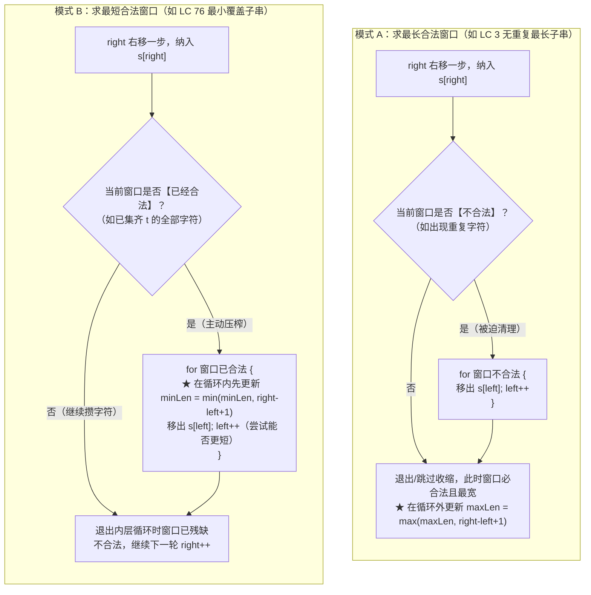

# 最小覆盖子串：可变窗口收缩条件的黄金法则

**摘要：**

如果说固定长度滑动窗口是在铺设好的铁轨上匀速滑行，那么**可变长度滑动窗口（Variable-Size Sliding Window）**就是在未知地形上通过"右探路、左收尾"的毛毛虫步态动态伸缩。在所有可变窗口题目中，**无重复字符的最长子串（LeetCode 3）**与**最小覆盖子串（LeetCode 76）**犹如两座耸立在左右两端的灯塔：前者代表了**"求最长（当窗口不合法时被动收缩，退出收缩后更新答案）"**的极值范式，后者则代表了**"求最短（当窗口已合法时主动收缩，在收缩循环内部更新答案）"**的镜像范式。本文深入剖析这两条黄金收缩法则的底层逻辑，推导从双哈希表 `need/window + formed` 到单数组净欠账 `debt` 模型的演进过程，并配齐 LeetCode 3、76、340、632 四道核心题目的 Golang 零分配实现。

---

## 第 1 章 可变窗口的双子星：为什么"求最长"与"求最短"的循环结构完全相反？

### 1.1 左指针的两种驱动哲学：被动扫地僧 vs 主动压榨者

在固定窗口中，左指针 `left = right - k + 1` 完全是右指针的影子，毫无自主权。而在可变窗口中，`right` 每向右迈出一步，窗口的宽度与内部状态都会发生改变，此时左指针 `left` 何时启动、走多少步、答案在何时记录，完全取决于我们求的是**最长合法窗口**还是**最短合法窗口**：



请仔细对照上面两幅流程图，它们揭示了可变窗口的两条黄金铁律：
1. **在模式 A（求最长合法窗口）中**：
   - 窗口越短越容易合法（譬如单字符一定无重复），窗口越扩越容易触发违规（出现重复）；
   - 因此，左指针是个**被动的"扫地僧"**——只要右指针没惹祸（窗口依然合法），左指针就一步不动，让窗口尽情变宽；只有当右指针招来了一个重复字符导致窗口**不合法**时，内层 `for 窗口不合法` 才启动，把左边元素逐个吐出，直到刚好把那个引发冲突的旧字符吐出去为止；
   - **当内层 `for` 循环结束的那一刻**，窗口刚刚恢复合法，且是以当前 `right` 结尾的最长合法子串，因此**更新 `maxLen` 必须写在 `for` 循环的外面（后面）**。
2. **在模式 B（求最短合法窗口）中**：
   - 窗口越短越难合法（字符不够覆盖目标串 $t$），窗口越扩才越容易合法；
   - 因此，左指针是个**主动的"节约压榨者"**——在窗口还没攒够 $t$ 的字符前，左指针按兵不动；一旦右指针把最后一个急需字符纳入窗口、使窗口**变得合法**，内层 `for 窗口已合法` 立刻启动：趁着当前窗口合法，**第一时间在内层循环内部记录候选最短答案**，随后立即执行 `left++` 吐掉左端字符，试探"去掉最左边这个字符后，窗口是不是依然合法（说明刚才吐掉的是个冗余字符）"；
   - **当内层 `for` 循环结束的那一刻**，说明刚刚吐掉了一个不可缺少的刚需字符，窗口已经变得**不合法**了，因此在循环外面绝对不能更新答案。

把这两条铁律想通，你就再也不会在考场上纠结"`for` 条件到底写合法还是不合法"以及"`ans` 更新到底放循环里还是放循环外"了。

---

## 第 2 章 模式 A 标杆实战：无重复字符的最长子串（LeetCode 3）

### 2.1 题目描述与两种窗口状态设计

**题目描述**：给定一个字符串 `s`（由英文字母、数字、符号和空格组成），请你找出其中不含有重复字符的**最长子串**的长度。

#### 2.1.1 解法一：频次数组 + 被动收缩循环（标准模式 A）

按照模式 A 的通用骨架，我们用一个长度为 128 的整型数组 `freq[128]int` 记录当前窗口 `[left, right]` 内每个 ASCII 字符出现的次数：
- 右端字符 `c = s[right]` 入窗，令 `freq[c]++`；
- 此时窗口有没有可能因为 `c` 的加入而出现重复？如果有重复，罪魁祸首必然且唯一就是刚刚加进来的这个字符 `c`（使得 **`freq[c] > 1`**）；
- 于是内层循环条件直接写 `for freq[c] > 1`，不断令 `freq[s[left]]--; left++`，直到把窗口里原有的那个旧 `c` 吐出去（`freq[c]` 降回 `1`），随后在外侧更新 `maxLen`：

```go
package main

// lengthOfLongestSubstringStandard 解法一：标准频次维护 + for 循环被动收缩
// 时间复杂度：O(n)（每个字符进窗出窗各一次），空间复杂度：O(1)（128 字节栈数组）
func lengthOfLongestSubstringStandard(s string) int {
	var freq [128]int
	left, maxLen := 0, 0

	for right := 0; right < len(s); right++ {
		c := s[right]
		freq[c]++

		// 只要新入窗字符 c 的频次超过 1，就持续收缩左界直至旧的 c 被移出窗口
		for freq[c] > 1 {
			freq[s[left]]--
			left++
		}

		// 此时窗口 [left..right] 保证无任何重复字符，在外侧更新最长长度
		if right-left+1 > maxLen {
			maxLen = right - left + 1
		}
	}
	return maxLen
}
```

#### 2.1.2 解法二：记录字符上次出现下标 `lastPos`，一步跳跃到位

观察解法一的内层 `for` 循环：当 `s[right]` 与窗口内部某个位置 `idx` 上的旧字符相同时，`left` 指针做的事情其实就是一步一步从当前位置走到 `idx + 1`。

既然我们早就知道"要想消除 `c` 的重复，`left` 必须跨过上一次 `c` 出现的位置 `lastPos[c]`"，为什么不直接用数组 `lastPos[128]int` 记住每个字符上一次出现的下标，遇到重复时直接一行 `left = lastPos[c] + 1` 瞬移过去，把内层 `for` 循环彻底省掉呢？

这正是面试官最希望看到的常数优化版。但写这个一步跳转版时，必须提防一个经典的**左指针倒退陷阱（以输入 `"abba"` 为例）**：
- 初始 `lastPos` 全为 `-1`，`left = 0`；
- `right = 0 ('a')`：`lastPos['a'] = 0`；
- `right = 1 ('b')`：`lastPos['b'] = 1`；
- `right = 2 ('b')`：撞见重复的 `'b'`，`left` 跳到 `lastPos['b'] + 1 = 2`，随后更新 `lastPos['b'] = 2`（此时窗口起点已经是 `left = 2`）；
- `right = 3 ('a')`：此时查表发现 `lastPos['a'] = 0`。请注意：下标 `0` 处的那个 `'a'` **早在上一轮 `left` 跳到 `2` 的时候就已经被甩在窗口外面的历史垃圾堆里了**。如果你不检查 `lastPos['a'] >= left` 就无脑执行 `left = lastPos['a'] + 1 = 1`，`left` 就会从 `2` **往左倒退回 `1`**，把中间重复的两个 `'b'` 重新圈进窗口里，算出错误长度 `3`。

因此，一步跳转的铁律是：**只有当 `lastPos[c] >= left`（即上次出现的同值字符确实还在当前窗口内部）时，才将 `left` 推进至 `lastPos[c] + 1`**（等价于写 `left = max(left, lastPos[c] + 1)`）：

```go
package main

// lengthOfLongestSubstring 解法二：记录上次出现位置实现 O(1) 一步跳转，杜绝逐格收缩
func lengthOfLongestSubstring(s string) int {
	var lastPos [128]int
	for i := range lastPos {
		lastPos[i] = -1
	}

	left, maxLen := 0, 0
	for right := 0; right < len(s); right++ {
		c := s[right]
		// 关键保护：只有当上次出现的 c 仍在当前窗口 [left..right) 内时，才向右跳跃
		if lastPos[c] >= left {
			left = lastPos[c] + 1
		}
		lastPos[c] = right
		if right-left+1 > maxLen {
			maxLen = right - left + 1
		}
	}
	return maxLen
}
```

### 2.2 延伸实战：至多包含 K 个不同字符的最长子串（LeetCode 340 & 159）

如果把 LeetCode 3 的条件从"每个字符最多出现 1 次（无重复）"改为**"窗口内最多允许出现 $K$ 种不同字符"（LeetCode 340；当 $K=2$ 时即为 LeetCode 159 与 LeetCode 904 水果成篮）**，为什么就不能再用 `lastPos` 一步跳转，而必须回归模式 A 的 `freq` 频次表了？

因为在"至多 $K$ 种不同字符"中，当新来第 $K + 1$ 种字符时，我们需要从左往右把某一种字符的**全部出现次数都吐干净（使其在窗口内的频次归零）**，才能把种类数降回 $K$。因此维护频次数组 `freq[128]int` 和当前不同字符种类数 `distinct` 是最标准、最通用的解法：

```go
package main

// lengthOfLongestSubstringKDistinct LeetCode 340：维护窗口内不同字符种类数 distinct <= k
func lengthOfLongestSubstringKDistinct(s string, k int) int {
	if k == 0 {
		return 0
	}
	var freq [128]int
	left, distinct, maxLen := 0, 0, 0

	for right := 0; right < len(s); right++ {
		in := s[right]
		if freq[in] == 0 {
			distinct++ // 新字符种类进窗
		}
		freq[in]++

		// 模式 A：当窗口不合法（种类数 > k）时被动收缩
		for distinct > k {
			out := s[left]
			freq[out]--
			if freq[out] == 0 {
				distinct-- // 该字符在窗口内彻底绝迹，种类数减一
			}
			left++
		}

		if right-left+1 > maxLen {
			maxLen = right - left + 1
		}
	}
	return maxLen
}
```

---

## 第 3 章 模式 B 巅峰之作：最小覆盖子串（LeetCode 76）

### 3.1 题目描述与多重集覆盖判定困境

**题目描述**：给你一个字符串 `s` 、一个字符串 `t` 。返回 `s` 中涵盖 `t` 所有字符的**最小子串**。如果 `s` 中不存在涵盖 `t` 所有字符的子串，则返回空字符串 `""`。注意：对于 `t` 中重复字符，我们寻找的子串中该字符数量必须不少于 `t` 中该字符的数量。

为什么这道题被公认为滑动窗口的分水岭？
因为在滑动过程中，我们需要回答的核心问题是：**"当前的窗口 `s[left .. right]`，到底有没有把目标串 `t` 里的所有字符（连同每个字符要求的频次）全部凑齐？"**
如果每次窗口移动后，我们都去遍历 128 个 ASCII 字符检查是否对所有 `c` 都有 `win[c] >= need[c]`，单步检查就要花 $O(|\Sigma|)$ 时间。为了将单步判定压缩到严格的 **$O(1)$**，业界发展出了两套同样经典的状态维护模型。

### 3.2 模型一：双数组 `need / win` + 达标种类计数器 `formed`

第一套模型按**"不同字符的种类（Unique Character Types）"**来记账：
1. 预处理目标串 `t`，统计每个字符的需求频次 `need[c]`，并统计 `t` 中一共包含多少种**不同的字符**，记为 `required`（譬如 `t = "AABC"`，则 `need['A']=2, need['B']=1, need['C']=1`，共有 **`required = 3` 种**不同字符）；
2. 在滑动过程中，维护窗口频次数组 `win[128]int` 以及已达标的字符种类数 `formed`：
   - **右端入窗 `in = s[right]`**：先执行 `win[in]++`。随后检查：如果 `need[in] > 0` 且 **`win[in] == need[in]`**（注意必须是严格等于 `==`，代表字符 `in` 的数量**刚刚从不足跨入达标线**；如果再多来几个 `in` 使 `win[in] > need[in]`，不能重复给 `formed` 加一），则令 **`formed++`**；
   - **左端收缩（当 `formed == required` 时）**：进入模式 B 的内层循环，先更新最短子串坐标 `[bestStart, bestLen]`，然后准备移出左端字符 `out = s[left]`。如果移出**前**满足 `need[out] > 0 && win[out] == need[out]`（说明当前 `out` 卡在刚刚达标的及格线上，少一个就会不及格），则令 **`formed--`**，随后执行 `win[out]--; left++`。

```go
package main

import "math"

// minWindowFormed 模型一：双数组 need/win + 达标字符种类数 formed == required
// 时间复杂度：O(|s| + |t|)，空间复杂度：O(1)
func minWindowFormed(s string, t string) string {
	if len(s) < len(t) {
		return ""
	}

	var need, win [128]int
	required := 0
	for i := 0; i < len(t); i++ {
		c := t[i]
		if need[c] == 0 {
			required++
		}
		need[c]++
	}

	left, formed := 0, 0
	bestStart, bestLen := 0, math.MaxInt32

	for right := 0; right < len(s); right++ {
		in := s[right]
		win[in]++
		// 仅在频次从 need[in]-1 跨入 need[in] 的瞬间，达标种类数加一
		if need[in] > 0 && win[in] == need[in] {
			formed++
		}

		// 模式 B：一旦全部 required 种字符均已达标，在内层循环内部记录答案并主动收缩
		for formed == required {
			if right-left+1 < bestLen {
				bestLen = right - left + 1
				bestStart = left
			}
			out := s[left]
			if need[out] > 0 && win[out] == need[out] {
				formed-- // 即将跌破达标线
			}
			win[out]--
			left++
		}
	}

	if bestLen == math.MaxInt32 {
		return ""
	}
	return s[bestStart : bestStart+bestLen]
}
```

### 3.3 模型二：单数组净欠账 `need[128]` + 总欠账字符数 `debt`（更短、更快的工业级写法）

模型一需要维护 `need` 和 `win` 两个数组，还要小心翼翼地判断 `need[c] > 0 && win[c] == need[c]`。有没有办法**只用一个数组 `need[128]int`、连 `required` 都不用算**？

这就是**单数组净欠账模型（Single-Array Debt Model）**：
- 令 `need[c]` 直接表示**"当前窗口还欠目标串 `t` 多少个字符 `c`"**，令标量 `debt = len(t)` 表示**"当前窗口总共还欠 `t` 多少个有效字符"**；
- **右端入窗 `in = s[right]`**：如果入窗前 `need[in] > 0`（说明窗口确实还欠着字符 `in`），那么这个新来的 `in` 就成功偿还了一笔有效债务，令 **`debt--`**；随后无脑执行 **`need[in]--`**（如果 `in` 根本不在 `t` 中，或者窗口里的 `in` 早就够数了，那么 `need[in]` 就会变成**负数**——负数的物理意义就是"窗口里超额富余的存款"）；
- **左端收缩（当 `debt == 0` 时）**：更新最短答案后，左端字符 `out = s[left]` 出窗，无脑执行 **`need[out]++`**。如果加完之后发现 **`need[out] > 0`**（说明把富余存款全花光了还不够，重新背上了正数债务），就令 **`debt++`**，内层循环随之终止：

```go
package main

import "math"

// minWindow 模型二：单数组净欠账 need + 总欠账 debt == 0（极简零分支冗余）
func minWindow(s string, t string) string {
	if len(s) < len(t) {
		return ""
	}

	var need [128]int
	for i := 0; i < len(t); i++ {
		need[t[i]]++
	}

	debt := len(t)
	left := 0
	bestStart, bestLen := 0, math.MaxInt32

	for right := 0; right < len(s); right++ {
		in := s[right]
		if need[in] > 0 {
			debt--
		}
		need[in]--

		for debt == 0 {
			if right-left+1 < bestLen {
				bestLen = right - left + 1
				bestStart = left
			}
			out := s[left]
			need[out]++
			if need[out] > 0 {
				debt++
			}
			left++
		}
	}

	if bestLen == math.MaxInt32 {
		return ""
	}
	return s[bestStart : bestStart+bestLen]
}
```

### 3.4 显微镜级手动推演：在 `s = "ADOBECODEBANC", t = "ABC"` 上的轨迹

我们用模型二追踪窗口是如何在"扩张攒够 `ABC`"与"收缩吐掉冗余"之间交替行进的：
1. **初始状态**：`need = {'A': 1, 'B': 1, 'C': 1}`（其余字符全为 `0`），`debt = 3, left = 0`；
2. **第 1 次扩张（`right` 从 `0` 走到 `5`，子串 `"ADOBEC"`）**：
   - `right = 0 ('A')`：`need['A']` 从 `1` 变 `0`，`debt = 2`；
   - `right = 1 ('D'), 2 ('O')`：无关字符，`need['D']` 和 `need['O']` 从 `0` 变 `-1`（存为负数富余），`debt` 保持 `2`；
   - `right = 3 ('B')`：`need['B']` 从 `1` 变 `0`，`debt = 1`；
   - `right = 4 ('E')`：`need['E'] = -1`，`debt = 1`；
   - `right = 5 ('C')`：`need['C']` 从 `1` 变 `0`，**`debt` 归零（触发第一次收缩）**：
     - 在内层循环开头，记录首个合法窗口 `"ADOBEC"`（`bestStart = 0, bestLen = 6`）；
     - 随即吐出 `left = 0 ('A')`：`need['A']` 从 `0` 变回 `1 > 0`，触发 `debt = 1`，`left` 推进至 `1` 并退出内层收缩；
3. **第 2 次扩张（`right` 从 `6` 走到 `10`，子串 `"DOBECODEBA"`）**：
   - 途中在 `right = 9 ('B')` 时又进来一个 `'B'`，使 **`need['B']` 从 `0` 变成 `-1`（说明窗口里现在攒了 2 个 `'B'`，多存了 1 个富余的 `'B'`）**；
   - 到了 `right = 10 ('A')`：把刚才欠的 `'A'` 补上了，`debt` 再次归零（触发第二次收缩）：
     - `left = 1 ('D'), 2 ('O')`：吐出后 `need` 从 `-1` 变回 `0`，不触发欠债，`left` 一路推进到 `3`；
     - `left = 3 ('B')`：吐出第一个 `'B'`，`need['B']` 从 `-1` 变回 `0 <= 0`（因为后面 `right = 9` 处还替补着一个 `'B'`），**依然不欠债**；
     - `left = 4 ('E')`：吐出后 `left` 推进到 `5`；
     - `left = 5 ('C')`：此时窗口是 `"CODEBA"`（长 6），吐出唯一的 `'C'` 后 `need['C']` 变为 `1 > 0`，`debt = 1`，`left` 停在 `6`；
4. **第 3 次扩张（`right` 走到 `12 ('C')`，子串 `"ODEBANC"`）**：
   - `'C'` 进窗使 `debt` 第三次归零；
   - 内层收缩连续吐掉 `left = 6 ('O'), 7 ('D'), 8 ('E')`，当 `left` 来到 `9` 时，窗口缩为 **`"BANC"`（`bestStart = 9, bestLen = 4`）**；随后吐掉 `left = 9 ('B')` 触发欠债退出。全局最短子串 `"BANC"` 完美锁定。

---

## 第 4 章 同构迁移：最小区间（LeetCode 632）

一旦吃透了 LeetCode 76 的内核，许多看似与字符串无关的数组/区间困难题都会瞬间原形毕露。以 **LeetCode 632：最小区间（Smallest Range Covering Elements from K Lists）**为例：
给定 $k$ 个升序排列的整数列表 `nums`，找到一个最小数值区间 `[a, b]`（即 `b - a` 最小；差相同时 `a` 最小），使得这 $k$ 个列表中的每一个列表都至少有 1 个数落在该区间内。

我们将全部 $k$ 个列表中的元素打包成 `(数值 val, 所属列表编号 groupID)`，合并排序为一个长数组 `merged`。此时，每一个列表编号 `groupID`（$0 \dots k-1$）就等价于 LC 76 目标串 `t` 里的一个必需字符，问题 100% 化归为：**在有序序列 `merged` 上用模式 B（求最短合法窗口）寻找一个覆盖全部 $k$ 个 `groupID` 的窗口 `[left, right]`，使两端数值差 `merged[right].val - merged[left].val` 最小**。

```go
package main

import "sort"

type taggedNum struct {
	val   int
	group int
}

// smallestRange LeetCode 632：将 k 个有序列表展平排序后，完全复用 LC 76 最小覆盖窗口求最小数值跨度
// 时间复杂度：O(N log N)（N 为所有列表元素总数），空间复杂度：O(N)
func smallestRange(nums [][]int) []int {
	k := len(nums)
	var merged []taggedNum
	for g, list := range nums {
		for _, v := range list {
			merged = append(merged, taggedNum{val: v, group: g})
		}
	}
	sort.Slice(merged, func(i, j int) bool {
		return merged[i].val < merged[j].val
	})

	freq := make([]int, k)
	covered := 0
	left := 0
	bestL, bestR := merged[0].val, merged[len(merged)-1].val

	for right, item := range merged {
		if freq[item.group] == 0 {
			covered++
		}
		freq[item.group]++

		// 模式 B：一旦全部 k 个组均至少有 1 个代表在窗口内，先记录最优区间再主动收缩
		for covered == k {
			curL, curR := merged[left].val, item.val
			if curR-curL < bestR-bestL || (curR-curL == bestR-bestL && curL < bestL) {
				bestL, bestR = curL, curR
			}
			outGroup := merged[left].group
			freq[outGroup]--
			if freq[outGroup] == 0 {
				covered--
			}
			left++
		}
	}
	return []int{bestL, bestR}
}
```

### 4.2 延伸实战二：删除最短的子数组使剩余数组有序——窗口外侧两端单调拼接（LeetCode 1574）

在"求最短子串/子数组"的模式 B 家族中，还有一类非常具有挑战性的变形：**题目要求删除一个最短的连续子数组 `arr[left .. right]`，使得剩下的前缀 `arr[0 .. left-1]` 与后缀 `arr[right+1 .. n-1]` 拼接起来满足某种全局性质**。最经典的代表就是 **LeetCode 1574：删除最短的子数组使剩余数组有序**。

**推导过程**：
1. 既然删掉中间一段后，剩下的左前缀 `0..i` 和右后缀 `j..n-1` 必须整体非递减，那么：
   - 左前缀 `arr[0 .. i]` 自身必须是非递减的；
   - 右后缀 `arr[j .. n-1]` 自身也必须是非递减的；
   - 且交界处必须满足 **`arr[i] <= arr[j]`**；
2. 我们先从右往左扫描，找出最长的非递减后缀起点 `right`（即 `arr[right .. n-1]` 已非递减）。如果 `right == 0`，说明全数组本来就有序，返回 `0`；否则，一个保底的候选答案是"把左边 `0 .. right-1` 全部删光"，长度为 `right`；
3. 接下来，让左游标 `left` 从 `0` 开始向右枚举非递减前缀的尾端点（必须满足 `left == 0 || arr[left-1] <= arr[left]`，一旦出现逆序则前缀断裂，直接 `break`）：
   - 对于当前合法的左端最大值 `arr[left]`，右后缀的起点 `right` 需要满足 `arr[left] <= arr[right]`；
   - 只要 `right < n && arr[left] > arr[right]`，就不断将 `right++` 向右推，直到找到第一个能接上 `arr[left]` 的后缀起点；
   - 此时中间被夹住的待删除窗口是 `(left, right)`，其长度为 **`right - left - 1`**，用它更新全局最短删除长度。由于随着 `left` 递增，`arr[left]` 单调不减，对应的后缀起点 `right` 也**单调向右推进、绝不回退**，总时间复杂度严格为 $O(n)$、额外空间 $O(1)$：

```go
package main

// findLengthOfShortestSubarray LeetCode 1574：前后缀有序单调性 + 同向双指针求最短中间删除窗口
// 时间复杂度：O(n)，额外空间复杂度：O(1)
func findLengthOfShortestSubarray(arr []int) int {
	n := len(arr)
	// 1. 寻找最长非递减后缀的起点 right
	right := n - 1
	for right > 0 && arr[right-1] <= arr[right] {
		right--
	}
	if right == 0 {
		return 0 // 全数组已有序
	}

	// 保底方案：完全不保留前缀，只留后缀 arr[right..n-1]，删掉前 right 个元素
	ans := right

	// 2. 枚举非递减前缀的右端点 left，单向推进后缀起点 right 直至 arr[left] <= arr[right]
	for left := 0; left < n; left++ {
		if left > 0 && arr[left-1] > arr[left] {
			break // 前缀本身已出现逆序，后续更大的 left 不再合法
		}
		for right < n && arr[left] > arr[right] {
			right++
		}
		// 保留前缀 [0..left] 与后缀 [right..n-1]，中间删除 (left..right) 共 right - left - 1 个元素
		if right-left-1 < ans {
			ans = right - left - 1
		}
	}
	return ans
}
```

### 4.3 延伸实战三：无限数组的最短子数组——周期商余拆解 + 模式 B 滑窗（LeetCode 2875）

如果题目让你在一个由原数组 `nums` 无限次首尾重复拼接而成的**无限数组**中，寻找元素和恰好等于 `target` 的**最短连续子数组**（**LeetCode 2875：无限数组的最短子数组**），该怎么结合模式 B？
- 设单个周期数组 `nums` 的元素总和为 `totalSum`（正整数数组），长度为 $n$；
- 当 `target` 远大于 `totalSum` 时，任何合法的最短子数组必然包含 **`k = target / totalSum` 个完整的 `nums` 周期**（贡献固定长度 $k \times n$），外加一段总和恰好等于余数 **`rem = target % totalSum`** 的跨周期残余子数组；
- 而一段不含完整周期的跨周期残余子数组，必然完全落在**两个相邻周期拼接而成的长度为 $2n$ 的双倍数组 `nums + nums`** 之内。于是问题瞬间化归为在 `2n` 长度上跑一遍基础滑动窗口求元素和为 `rem` 的最短长度，时间 $O(n)$、空间 $O(1)$。

### 4.4 本章六道"最长 vs 最短"可变窗口核心对比表

| 题目 | 模式归属 | 窗口合法判定条件 | 收缩循环条件与结算位置 | 时间 / 空间复杂度 |
|------|----------|------------------|------------------------|-------------------|
| LC 3 无重复字符的最长子串 | 模式 A（求最长） | 任意字符频次 $\le 1$ | `for freq[c] > 1` 收缩（或 `lastPos` 跳转），**外侧**更新 `maxLen` | $O(n)$ / $O(\|\Sigma\|)$ |
| LC 340 至多 K 种字符最长子串 | 模式 A（求最长） | 不同字符种类 `distinct <= k` | `for distinct > k` 收缩，**外侧**更新 `maxLen` | $O(n)$ / $O(\|\Sigma\|)$ |
| LC 76 最小覆盖子串 | 模式 B（求最短） | `formed == required` 或 `debt == 0` | `for debt == 0` 收缩，**内侧**先更新 `bestLen` 再吐左端 | $O(\|s\|+\|t\|)$ / $O(1)$ |
| LC 632 最小区间 | 模式 B（求最短） | 覆盖全部 $k$ 个列表组号 `covered == k` | `for covered == k` 收缩，**内侧**更新最小数值差 `curR - curL` | $O(N \log N)$ / $O(N)$ |
| LC 1574 删除最短子数组使有序 | 外侧拼接最短删除 | 前缀有序、后缀有序且 `arr[left] <= arr[right]` | 枚举合法 `left`，推进 `right` 至 `>= arr[left]`，更新 `right-left-1` | $O(n)$ / $O(1)$ |
| LC 2875 无限数组最短子数组 | 周期商余 + 最短滑窗 | 商 `k * n` + 双倍数组窗口和 `== target % sum` | `for winSum >= rem` 收缩，命中 `== rem` 时更新最短残余长 | $O(n)$ / $O(1)$ |

---

## 第 5 章 常见误区与边界自检

1. **在模式 A（LC 3）中用 `lastPos` 跳转时漏掉 `lastPos[c] >= left` 检查**：如 2.1.2 节反例 `"abba"` 所示，不检查下界会导致 `left` 指针向左倒退，把已淘汰的重复字符重新圈入窗口。
2. **在模式 B（LC 76）中将 `win[in] == need[in]` 写成 `>=`**：`formed` 统计的是达标的**字符种类数**，一种字符只有在刚好跨过及格线的那一刻才贡献 1 次 `formed++`；若写成 `>=`，同一个字符超额进入窗口时会反复累加 `formed`，谎报其他未达标字符的进度。
3. **在求最短窗口时把答案更新写在收缩循环外面**：退出 `for formed == required`（或 `for debt == 0`）时，窗口刚刚吐掉了一个关键字符，处于**非法残缺状态**。求最短窗口必须在进入收缩循环内部的第一行（吐出左端字符之前）更新 `bestLen`。
4. **在 Go 语言中频繁切片拷贝 vs 记录起止下标 `(bestStart, bestLen)` 的性能差异**：在 LeetCode 76 的内层收缩循环中，每当发现更短的合法窗口 `right - left + 1 < bestLen` 时，千万不要写 `bestStr = string([]byte(s[left : right+1]))` 去做深拷贝，而是只用两个整型变量更新 **`bestLen = right - left + 1` 和 `bestStart = left`**，直到整个函数结束返回前的最后一刻才执行唯一一次切片 `s[bestStart : bestStart+bestLen]`。

### 5.2 进阶实战四：无限数组的最短子数组完整实现与商余证明（LeetCode 2875）

为了将第 4.3 节提出的"周期商余拆解 + 模式 B 最短滑动窗口"落到实处，下面给出 **LeetCode 2875：无限数组的最短子数组**的完整推导与 Go 代码。

为什么当余数 `rem = target % totalSum` 确定后，我们只需要在**两个周期拼接成的长度为 $2n$ 的范围**内运行滑动窗口，而不需要看三个周期？
- 反证法：假设有一段和等于 `rem`（其中 $0 \le rem < totalSum$）的子数组，其长度居然达到或超过了 $n$；
- 既然它的长度 $\ge n$，那它内部至少完整包含了 $1$ 个长度为 $n$ 的周期，其元素之和必然 $\ge totalSum > rem$，这与它的和等于 $rem$ 直接矛盾；
- 因此，**和等于 `rem` 的最短残余子数组，其长度必然严格小于 $n$**。一个起点在第一个周期 `[0 .. n-1]` 内、长度严格小于 $n$ 的连续子数组，其右端点最远也只能延伸到 `2n - 2`，因此扫描 `right < 2*n` 搭配 `nums[right % n]` 百分之百完备：

```go
package main

import "math"

// minSizeSubarray LeetCode 2875：全周期商提取 + 双倍数组 2n 上模式 B 求和为 rem 的最短窗口
// 时间复杂度：O(n)，额外空间复杂度：O(1)
func minSizeSubarray(nums []int, target int) int {
	n := len(nums)
	var totalSum int64
	for _, v := range nums {
		totalSum += int64(v)
	}

	fullCycles := int(int64(target) / totalSum)
	rem := int(int64(target) % totalSum)
	if rem == 0 {
		return fullCycles * n
	}

	// 在虚拟双倍数组 [0 .. 2n-1] 上寻找和恰好等于 rem 的最短子数组
	left, curSum := 0, 0
	minRemLen := math.MaxInt32

	for right := 0; right < 2*n; right++ {
		curSum += nums[right%n]
		for curSum >= rem {
			if curSum == rem && right-left+1 < minRemLen {
				minRemLen = right - left + 1
			}
			curSum -= nums[left%n]
			left++
		}
	}

	if minRemLen == math.MaxInt32 {
		return -1
	}
	return fullCycles*n + minRemLen
}
```

### 5.3 进阶实战五：删除子数组的最大得分——无重复约束下的最大窗口和（LeetCode 1695）

如果将本章第 2 章的 **LeetCode 3（无重复字符的最长子串）**中的目标函数，从"求无重复窗口的**最大长度**"改成"求无重复正整数窗口的**最大元素和**"（即 **LeetCode 1695：删除子数组的最大得分**），该如何修改代码？
- 窗口合法条件完全不变：窗口内每个数字的出现频次 `freq[v] <= 1`；
- 唯一新增的是在进窗时同步累加 `curSum += v`，在内层被动收缩循环 `for freq[v] > 1` 中同步扣减 `curSum -= nums[left]`，并在收缩循环外侧用 `curSum` 更新 `maxSum`：

```go
package main

// maximumUniqueSubarray LeetCode 1695：模式 A 无重复窗口维护最大元素和，时间 O(n)
func maximumUniqueSubarray(nums []int) int {
	var freq [10001]int
	left, curSum, maxSum := 0, 0, 0

	for _, v := range nums {
		freq[v]++
		curSum += v
		for freq[v] > 1 {
			out := nums[left]
			freq[out]--
			curSum -= out
			left++
		}
		if curSum > maxSum {
			maxSum = curSum
		}
	}
	return maxSum
}
```

### 5.4 工程实战视野：全文检索引擎中的最小匹配摘要提取（Snippet Generation）

跳出 LeetCode 题库，本章第 3 章精讲的 **LeetCode 76（最小覆盖子串）** 在搜索引擎（如 Google、Elasticsearch 的 Highlighter 高亮摘要组件）中有着完全一模一样的工业级应用：
- 当用户输入多关键词查询 `"golang" "sliding" "window"` 时，倒排索引召回了包含这三个词的一篇长文档；
- 为了在搜索结果页（SERP）展示一段最紧凑、信息密度最高的高亮文本摘要（Snippet），Highlighter 会先利用倒排偏移表提取出这三个查询词在文档中出现的所有位置序列 `(pos, termID)`（按文档位置升序排列，这正对应第 4.1 节 LeetCode 632 的归并有序序列）；
- 随后直接在该位置序列上运行**模式 B（最小覆盖窗口）**，在毫秒级时间内锁定同时涵盖用户全部查询词的最短正文片段，并截取其前后各 50 个字符加上 `<b>...</b>` 标签渲染给用户。算法题里的几十行代码，就这样在每一次搜索请求背后支撑着真实的工程体验，也为我们在处理大规模日志流的关键字上下文提取任务时提供了零额外内存分配的标准蓝本。

---

## 小结

本章确立了可变滑动窗口最核心的"最长 vs 最短"双引擎镜像法则：
- **求最长窗口（LC 3、LC 340）**：右指针扩窗，当窗口**不合法**时进入 `for` 循环被动收缩，在循环**外侧**更新最大长度；
- **求最短窗口（LC 76、LC 632）**：右指针扩窗，当窗口**已合法**时进入 `for` 循环，在循环**内部**先更新最小长度再主动收缩；
- 通过单数组净欠账 `need[128]`（正数欠债、负数富余）与总欠账 `debt` 标量，可在 $O(|s| + |t|)$ 时间与严格 $O(1)$ 栈空间内解决一切多重集覆盖问题。

下一篇 [[04 最长扩张型可变窗口：替换操作与连续性约束]] 将深入探索模式 A（求最长窗口）中一个极为精妙的变形——当窗口允许执行至多 $k$ 次修改/替换操作时，为什么左指针甚至不需要 `for` 循环收缩，只需用 `if` 让窗口"只扩不缩、等宽平移"就能直取全局最优。

---

## 参考资料

1. LeetCode 3. Longest Substring Without Repeating Characters.
2. LeetCode 76. Minimum Window Substring.
3. Cormen, T. H., et al. *Introduction to Algorithms* (4th ed.). MIT Press, 2022.

---

> [!note] 思考题
> 1. 在第 3.3 节的单数组净欠账模型 `minWindow` 中，为什么一个完全不在目标串 `t` 中出现的无关字符（如 `'Z'`），在进窗执行 `need['Z']--`、出窗执行 `need['Z']++` 的全过程中，绝对不会使 `need['Z'] > 0` 成立？
> 2. 如果把 LeetCode 76 的要求改为：求 `s` 中包含 `t` 所有字符、且**长度恰好等于 `len(t)`** 的最短子串，这个问题退化成了第 02 篇的哪一道题？
> 3. 在 LeetCode 3（无重复字符的最长子串）中，如果不仅要求返回最长长度，还要求把所有达到该最长长度的无重复子串全部打印出来，需要对 `bestStart` 的记录逻辑做怎样的微调？
