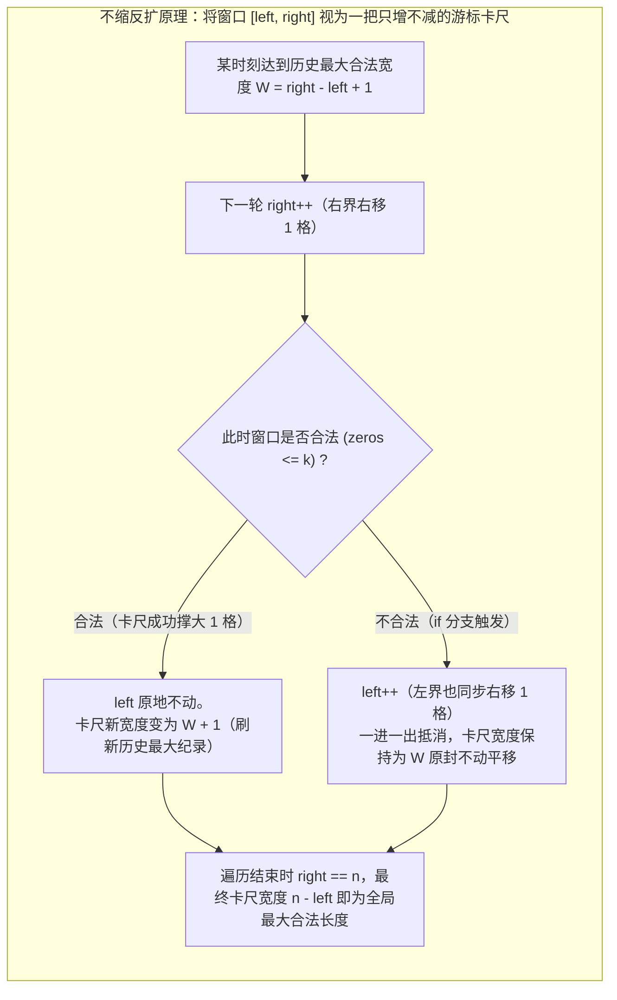

# 最长扩张型可变窗口：替换操作与连续性约束

**摘要：**

在可变滑动窗口家族中，有一类极具迷惑性的高频题型：题目不再要求窗口内的原始元素天然满足某种纯净性质，而是赋予你一张**"最多可执行 $k$ 次修改（翻转、替换、删除或消耗预算）的特权卡"**，问你经过操作后能得到的最长连续合法子数组或子串有多长。本文将代表这一范式的五道经典题目——LeetCode 1004（最大连续 1 的个数 III）、LeetCode 1493（删掉一个元素以后全为 1 的最长子数组）、LeetCode 424（替换后的最长重复字符）、LeetCode 2024（考试的最大困扰度）与 LeetCode 1208（尽可能使字符串相等）——统一收敛于**"窗口内坏元素代价 $\le k$"**的不变量模型之下，并从数学上严格证明为什么在仅求最大窗口长度时，可以用 **`if` 单步等宽平移（不缩反扩，Non-shrinking Window）**以及**历史最高频次 `maxFreq` 不回退**这两项反直觉优化，将代码复杂度与运行常数双双压至极限。

---

## 第 1 章 从"动态修改操作"到"静态坏元素计数"的等价转化

### 1.1 为什么不能在窗口里真的去修改元素？

初学者拿到"最多可以把 $k$ 个 `0` 翻转为 `1`"（LC 1004）或"最多可以把 $k$ 个字母替换成别的字母"（LC 424）时，第一反应往往是："我到底该挑哪 $k$ 个位置去改？如果真的把数组里的 `0` 改写成 `1` 了，等窗口滑过去之后怎么还原？"

滑动窗口建模的第一步，就是**把"主动执行修改动作"翻译成"被动容忍窗口内的坏元素（Exceptions / Bad Elements）"**：
- **在翻转 0 为 1（LC 1004）中**：如果你想把窗口 `nums[left .. right]` 全部变成清一色的 `1`，你需要翻转几个位置？显然，窗口里有几个 `0`，你就必须翻转几次。因此，"最多翻转 $k$ 次能把窗口全变成 `1`"，在数学上 $100\%$ 等价于一条静态计数谓词：
  $$\text{窗口内 } 0 \text{ 的个数 } zeros \le k$$
- **在删掉 1 个元素全为 1（LC 1493）中**：删掉 1 个元素后全为 `1`，等价于窗口内最多允许包含 $1$ 个 `0`（即 $zeros \le 1$），且删除后的有效长度为 $(right - left + 1) - 1 = right - left$；
- **在替换 $k$ 个字符使全串字母相同（LC 424）中**：想用最少的替换次数把窗口 `s[left .. right]` 里的所有字符变成同一种字母，最优策略必然是**保留窗口内原本出现次数最多的那个主流字母（设其频次为 `maxFreq`），而把其余所有的非主流字母（异类坏元素）全部替换成主流字母**。因此，窗口合法的充要条件就是：
  $$\text{异类字符个数} = (right - left + 1) - maxFreq \le k$$

看，一旦完成这层转化，我们根本不需要去修改原数组或原字符串里的任何一个字符，所有问题都坍缩成了上一篇学过的**模式 A（求最长合法窗口）**。

---

## 第 2 章 基础演进：翻转 K 个 0（LC 1004）与删掉 1 个元素（LC 1493）

### 2.1 LeetCode 1004：最大连续 1 的个数 III

**题目描述**：给定一个二进制数组 `nums` 和一个整数 `k`，假设最多可以翻转 `k` 个 `0`，则返回数组中连续 `1` 的最大个数。

#### 2.1.1 解法一：标准 `for` 循环收缩法

维护窗口内 `0` 的计数器 `zeros`。右指针 `right` 每纳入一个 `0` 就令 `zeros++`；一旦 `zeros > k`（坏元素超标，窗口不合法），就用内层 `for zeros > k` 持续推进 `left++`（若吐出的是 `0` 则 `zeros--`），退出内层循环后用 `right - left + 1` 更新最大长度：

```go
package main

// longestOnesStandard LeetCode 1004 解法一：标准 for 循环收缩至合法后更新最大长度
// 时间复杂度：O(n)，额外空间复杂度：O(1)
func longestOnesStandard(nums []int, k int) int {
	left, zeros, maxLen := 0, 0, 0

	for right, v := range nums {
		if v == 0 {
			zeros++
		}
		for zeros > k {
			if nums[left] == 0 {
				zeros--
			}
			left++
		}
		if right-left+1 > maxLen {
			maxLen = right - left + 1
		}
	}
	return maxLen
}
```

#### 2.1.2 解法二："只扩不缩"的 `if` 等宽平移优化（为什么不需要 `for` 和 `maxLen`？）

现在请你思考一个极其深刻的问题：在上面的 `longestOnesStandard` 中，如果我们把内层的 `for zeros > k` 直接改成 **`if zeros > k`**（即当窗口不合法时，左指针 `left` **最多只走 1 步**，并不保证把 `zeros` 缩回到 $\le k$），并且在循环里连 `maxLen` 变量都不维护，最后直接返回 `len(nums) - left`，为什么结果居然也是 $100\%$ 正确的？



这就是滑动窗口中著名的**"游标卡尺平移法则（Non-shrinking Caliper Principle）"**：
1. 我们的唯一目标是求**全局最长的合法窗口宽度**，而完全不关心那些比历史最大宽度更短的窗口是否合法；
2. 假设在某一步，窗口曾合法地达到了宽度 $W$。在随后的步进中，每轮外层循环让 `right` 右移 1 格（试图把宽度撑大到 $W + 1$）：
   - 如果此时 `zeros <= k`（合法），`if` 分支不执行，`left` 原地不动，窗口宽度成功增长为 **$W + 1$**；
   - 如果此时 `zeros > k`（不合法），`if` 分支执行一次 `left++`，左边界和右边界各往右走了 1 格，**窗口宽度 $right - left + 1$ 保持为 $W$ 丝毫未变**；
3. 换言之，窗口宽度 `right - left` 在整个循环过程中是一把**只增不减的棘轮尺子**——合法时尺子拉长 1 格，不合法时尺子保持原长向右平移 1 格。当 `right` 走完整个数组停在 `n` 时，这把尺子的最终跨度 **`len(nums) - left`**，分毫不差就是历史上达到过的最大合法长度：

```go
package main

// longestOnes LeetCode 1004 解法二：游标卡尺 if 平移法（零内层循环、免维护 maxLen）
func longestOnes(nums []int, k int) int {
	left, zeros := 0, 0
	for _, v := range nums {
		zeros += 1 - v // v==0 时加 1，v==1 时加 0
		if zeros > k {
			zeros -= 1 - nums[left]
			left++
		}
	}
	return len(nums) - left
}
```

### 2.2 LeetCode 1493：删掉一个元素以后全为 1 的最长子数组

**题目描述**：给你一个二进制数组 `nums`，你需要从中**删掉一个元素**。请你在删掉元素的结果数组中，返回最长的且只包含 `1` 的非空子数组的长度（如果整个数组全是 `1`，也必须删掉一个 `1`）。

这直接就是 $k = 1$ 时的 LeetCode 1004，唯一的区别是因为**必须强制删掉 1 个元素**，一个包含 $m$ 个元素的合法窗口 `[left .. right]`（其中至多含 1 个 `0`），在删掉那个 `0`（或全为 `1` 时删掉其中一个 `1`）之后，剩下的 `1` 的个数为 $(right - left + 1) - 1 = right - left$。套用上面的游标卡尺平移法，结尾返回 **`len(nums) - left - 1`** 即可，代码短到只需 10 行：

```go
package main

// longestSubarray LeetCode 1493：至多容忍 1 个 0 的游标卡尺平移，结尾减 1（强制删除一个元素）
func longestSubarray(nums []int) int {
	left, zeros := 0, 0
	for _, v := range nums {
		if v == 0 {
			zeros++
		}
		if zeros > 1 {
			if nums[left] == 0 {
				zeros--
			}
			left++
		}
	}
	return len(nums) - left - 1
}
```

---

## 第 3 章 进阶核心：替换后的最长重复字符（LeetCode 424）

### 3.1 题目描述与动态主流字符的挑战

**题目描述**：给你一个仅由大写英文字母组成的字符串 `s` 和一个整数 `k`。你可以选择字符串中的任一字符，并将其更改为任何其他大写英文字符，该操作最多可执行 `k` 次。返回执行上述操作后，包含相同字母的最长子字符串的长度。

在 LC 1004 中，"好元素"固定是 `1`，"坏元素"固定是 `0`。然而在 LC 424 中，26 个大写字母人人平等，谁都有可能成为窗口里的"主流好元素"：
- 当窗口是 `"AAAB"` 时，主流字母是 `'A'`（频次 3），坏元素是 `'B'`（1 个）；
- 当窗口滑到 `"ABBB"` 时，主流字母变成了 `'B'`（频次 3），坏元素变成了 `'A'`（1 个）。

设当前窗口 `[left .. right]` 内出现次数最多的字母频次为 `maxFreq`，则需要将异类字母全部替换为主流字母的最小操作次数为：

$$\text{replaceNeeded} = (right - left + 1) - maxFreq$$

合法条件即为 $(right - left + 1) - maxFreq \le k$。

### 3.2 为什么 `maxFreq` 只需要在进窗时调大、在出窗时完全不需要调小？

当右指针 `right` 纳入字符 `in = s[right]` 时，令 `freq[in]++`，并用 `maxFreq = max(maxFreq, freq[in])` 在 $O(1)$ 时间内更新最高频次。

真正的灵魂拷问发生在窗口不合法（`right - left + 1 - maxFreq > k`）、左指针执行 `freq[s[left]]--; left++` 的那一刻：**如果被左指针移出窗口的 `s[left]` 恰好就是刚才创造了 `maxFreq` 的那个主流字符，此时窗口内的真实最高频次其实已经变成了 `maxFreq - 1`，为什么我们的代码里根本不去重新扫描 26 个字母把 `maxFreq` 减一，而是放任 `maxFreq` 保持历史最高值不变？**

请结合第 2.1.2 节的"游标卡尺法则"来推导：
1. 假设截至目前为止，我们见过的最大合法窗口宽度为 $W$，它是由当时的历史最高频次 $M$（即 `maxFreq = M`）加上 $k$ 次替换凑出来的：$W = M + k$；
2. 现在请问：**未来在什么条件下，我们才有可能找到一个长度严格大于 $W$（即至少达到 $W + 1 = M + k + 1$）的新合法窗口？**
3. 根据公式 $\text{新合法宽度} \le \text{新主流频次} + k$，要想让新合法宽度达到 $M + k + 1$，**新窗口里的主流字符频次就必须至少达到 $M + 1$（即严格打破历史最高纪录 `maxFreq = M`）**；
4. 在没有任何字符的频次达到 $M + 1$ 之前，无论当前窗口里的真实最高频次是 $M - 1$ 还是 $M - 5$，它都**绝对不可能创造出比 $W$ 更长的合法窗口**；而与此同时，只要 `maxFreq` 维持在 $M$，当 `right` 右移 1 格使窗口长度变为 $W + 1 = M + k + 1$ 时，条件 `(right - left + 1) - maxFreq > k`（即 $M + k + 1 - M > k$）就必然成立，从而强制触发 `left++`，把窗口宽度死死锁在 $W$ 上等宽平移，既不会错误地让窗口变宽（不会高估答案），又能在未来某个字符真正达到 $M + 1$ 时第一时间更新 `maxFreq` 并允许窗口扩张（不会低估答案）。$\square$

```go
package main

// characterReplacement LeetCode 424：历史最高频次 maxFreq 不回退 + 游标卡尺 if 平移
// 时间复杂度：严格 O(n)（无 26 字母重扫开销），额外空间复杂度：O(1)
func characterReplacement(s string, k int) int {
	var freq [26]int
	left, maxFreq := 0, 0

	for right := 0; right < len(s); right++ {
		in := s[right] - 'A'
		freq[in]++
		if freq[in] > maxFreq {
			maxFreq = freq[in] // 仅在新纳入字符打破历史最高频次纪录时更新
		}

		// 若当前窗口宽度减去历史最高频次 > k，则左边界同步右移 1 格（保持历史最大宽度平移）
		if (right-left+1)-maxFreq > k {
			freq[s[left]-'A']--
			left++
		}
	}
	return len(s) - left
}
```

> [!warning] 边界警示：什么时候不能用"`maxFreq` 不回退 + `if` 平移"？
> 请牢记，"`maxFreq` 不回退 + `if` 平移"之所以成立，是因为题目**只要求返回全局最长窗口的标量长度**，不关心平移途中停留的窗口是否真的合法。如果题目改为**"统计所有满足替换次数 $\le k$ 的合法子串总个数"**，那么在每个 `right` 处我们都必须知道当前真实合法的最左起点 `left` 在哪里（以便累加 `right - left + 1`），此时就必须用 `for` 循环彻底收缩，并在出窗时老老实实花 $O(26)$ 重新求当前窗口的真实最大频次。

---

## 第 4 章 同源扩展：考试的最大困扰度（LC 2024）与预算内相等子串（LC 1208）

### 4.1 LeetCode 2024：考试的最大困扰度（二元字符集的 LC 424）

**题目描述**：一位老师正在出一场由 $n$ 道判断题构成的考试，每道题的答案为 `'T'` 或 `'F'`，给定字符串 `answerKey`。老师想最大化连续相同答案（全 `'T'` 或全 `'F'`）的长度，最多允许执行 `k` 次修改操作。

很多教程教你写一个辅助函数 `maxConsecutiveChar(ch byte)`，分别对 `'T'` 跑一遍、再对 `'F'` 跑一遍（扫描字符串两遍）。但既然你已经掌握了 LC 424，你会一眼看穿：**这道题不就是字母表只有 `{'T', 'F'}` 两个字母的 LeetCode 424 吗？**
在只有 `'T'` 和 `'F'` 的窗口里，"异类坏元素的个数"直接就是 `'T'` 的个数 `cntT` 与 `'F'` 的个数 `cntF` 中的较小值 `min(cntT, cntF)`。只要 `min(cntT, cntF) > k`，就让左边界 `left++` 平移一格，仅需**单遍扫描**即可搞定：

```go
package main

// maxConsecutiveAnswers LeetCode 2024：单遍扫描同时追踪 T 与 F，min(cntT, cntF) > k 时平移
func maxConsecutiveAnswers(answerKey string, k int) int {
	left, cntT, cntF := 0, 0, 0

	for right := 0; right < len(answerKey); right++ {
		if answerKey[right] == 'T' {
			cntT++
		} else {
			cntF++
		}
		if min(cntT, cntF) > k {
			if answerKey[left] == 'T' {
				cntT--
			} else {
				cntF--
			}
			left++
		}
	}
	return len(answerKey) - left
}
```

### 4.2 LeetCode 1208：尽可能使字符串相等（带权替换代价窗口）

**题目描述**：给你两个长度相同的字符串 `s` 和 `t`。将 `s` 中的第 `i` 个字符变到 `t` 中的第 `i` 个字符需要 `|s[i] - t[i]|` 的开销（开销可能为 0），也就是两个字符的 ASCII 码值的差的绝对值。用于变更字符串的最大预算是 `maxCost`。在转化字符串时，总开销应当小于等于该预算，这也意味着字符串的转化可能是不完全的。如果你可以将 `s` 的子字符串转化为它在 `t` 中对应的子字符串，则返回可以转化的最大长度。

这道题把"每个坏元素固定消耗 1 次机会"，升级为了**"第 `i` 个位置消耗非负权重 `cost[i] = |s[i] - t[i]|` 的预算"**。由于绝对值开销 `cost[i] >= 0` 非负，窗口和的单调性依然完好无损。直接用游标卡尺平移法维护窗口总开销 `curCost`，当 `curCost > maxCost` 时平移 `left++`：

```go
package main

// equalSubstring LeetCode 1208：非负带权开销下的游标卡尺平移窗口，时间 O(n)，空间 O(1)
func equalSubstring(s string, t string, maxCost int) int {
	absDiff := func(a, b byte) int {
		d := int(a) - int(b)
		if d < 0 {
			return -d
		}
		return d
	}

	left, curCost := 0, 0
	for right := 0; right < len(s); right++ {
		curCost += absDiff(s[right], t[right])
		if curCost > maxCost {
			curCost -= absDiff(s[left], t[left])
			left++
		}
	}
	return len(s) - left
}
```

### 4.3 进阶延伸：最高频元素的频数——排序 + 前缀差补齐代价滑窗（LeetCode 1838）

将"预算内修改元素使窗口内元素全相同"的思想推向高潮的，是 **LeetCode 1838：最高频元素的频数（Frequency of the Most Frequent Element）**：
**题目描述**：元素的频数是该元素在数组中出现的次数。给你一个整数数组 `nums` 和一个整数 `k`。在一步操作中，你可以选择 `nums` 的一个下标，并将该下标对应元素的值**增加 1**。执行最多 `k` 次操作后，返回数组中最高频元素的最大可能频数。

**推导过程**：
1. 因为只能把元素**调大（`+1`）**而不能调小，要想花最少的 `+1` 操作把一批数字变成同一个目标值，这批数字必然是**排序后紧挨在目标值左侧的一段连续子数组 `nums[left .. right]`**，且最终统一变成的目标值就是该子数组的最大值（右端点 **`nums[right]`**）；
2. 将原数组 `nums` 升序排列后，假设窗口从 `[left .. right - 1]` 扩张到 `[left .. right]`，为了让前面已有的 `right - left` 个元素也从旧目标值 `nums[right - 1]` 同步拔高到新目标值 `nums[right]`，窗口所需的总增补操作次数 `totalOps` 会增加多少？
   $$\Delta \text{ops} = (nums[right] - nums[right-1]) \times (right - left)$$
3. 当 `totalOps > k` 时，移出左端元素 `nums[left]` 可节省出 `nums[right] - nums[left]` 次操作。直接套用可变滑动窗口即可在 $O(n \log n)$ 时间内拿下：

```go
package main

import "sort"

// maxFrequency LeetCode 1838：排序使相近元素相邻 + 滑动窗口维护拔高至 nums[right] 的总递增代价
func maxFrequency(nums []int, k int) int {
	sort.Ints(nums)
	left := 0
	var totalOps int64
	maxFreq := 1

	for right := 1; right < len(nums); right++ {
		// 将窗口内原有的 (right - left) 个元素从 nums[right-1] 同步抬升至 nums[right]
		totalOps += int64(nums[right]-nums[right-1]) * int64(right-left)

		for totalOps > int64(k) {
			totalOps -= int64(nums[right] - nums[left])
			left++
		}
		if right-left+1 > maxFreq {
			maxFreq = right - left + 1
		}
	}
	return maxFreq
}
```

---

## 第 5 章 深度拓展：分组位置滑窗与逆向取走字符约束

### 5.1 找出最长等值子数组——按数值分组后的位置差滑动窗口（LeetCode 2831）

在前面的 LeetCode 424（替换后的最长重复字符）和 LeetCode 1493（删掉一个元素以后全为 1 的最长子数组）中，元素种类只有 26 种字母或 2 种数字。如果题目升级为：**给定一个包含任意大整数的数组 `nums` 和一个整数 `k`，你最多可以从数组中删除 `k` 个元素，请返回删除后剩余数组中包含相同元素的最长等值子数组长度（LeetCode 2831：找出最长等值子数组）**？

这道题有两种互补的滑动窗口视角：
1. **视角一（完全照搬 LC 424 的 `maxFreq` 不回退游标卡尺法）**：用哈希表 `freq map[int]int` 统计当前窗口内各整数频次，维护历史最高频次 `maxFreq`。只要当前窗口内需要删除的异类元素个数 `(right - left + 1) - maxFreq > k`，就让左边界 `left++` 平移一格，最终最大等值子数组长度直接就是 **`maxFreq`**；
2. **视角二（按相同数值分组索引列表 `posList` + 在索引列表上跑滑动窗口）**：
   - 将相同数值 $v$ 在原数组中出现的所有下标收集到一个升序切片 `posList = [idx_0, idx_1, ..., idx_{m-1}]` 中；
   - 如果我们想把从 `posList[left]` 到 `posList[right]` 这 **`right - left + 1` 个相同数字 $v$** 连成一片，中间夹杂了多少个必须被删掉的异类数字？
   - 原数组中从物理下标 `posList[left]` 到物理下标 `posList[right]` 一共有 `posList[right] - posList[left] + 1` 个格子，其中有 `right - left + 1` 个格子本来就是数字 $v$，因此**中间夹杂的异类数字个数恰好等于两个差值相减**：
     $$\text{deletedCount} = (\text{posList}[right] - \text{posList}[left]) - (right - left)$$
   - 对每个数值的 `posList` 独立跑一遍 `for (posList[right] - posList[left]) - (right - left) > k { left++ }`，即可用 `right - left + 1` 更新全局答案：

```go
package main

// longestEqualSubarray LeetCode 2831：按数值归集下标列表 + 下标差减去元素个数 <= k 滑动窗口
// 时间复杂度：O(n)，空间复杂度：O(n)
func longestEqualSubarray(nums []int, k int) int {
	posMap := make(map[int][]int)
	for idx, v := range nums {
		posMap[v] = append(posMap[v], idx)
	}

	maxEqualLen := 0
	for _, posList := range posMap {
		left := 0
		for right := 0; right < len(posList); right++ {
			// 原数组物理跨度 (posList[right] - posList[left]) 减去同值个数差 (right - left) 即为中间需删除的异类元素数
			for (posList[right]-posList[left])-(right-left) > k {
				left++
			}
			if right-left+1 > maxEqualLen {
				maxEqualLen = right - left + 1
			}
		}
	}
	return maxEqualLen
}
```

这套**"在同值元素的下标数组 `posList` 上，利用 `(posList[r] - posList[l]) - (r - l)` 直接算出中间异类空隙总数"**的技巧，在处理稀疏同值元素合并（如 **LeetCode 1703：得到连续 K 个 1 的最少相邻交换次数**）时同样是核心杀招。

### 5.2 逆向思维窗口：每种字符至少取 K 个（LeetCode 2516）

再看思考题中提到的经典变形——**LeetCode 2516：每种字符至少取 K 个**：
**题目描述**：给你一个由字符 `'a'`、`'b'`、`'c'` 组成的字符串 `s` 和一个非负整数 `k`。每分钟，你可以选择取走 `s` **最左侧**还是**最右侧**的那个字符。你必须取走每种字符**至少 `k` 个**，返回需要的最少分钟数；如果无法取到，则返回 `-1`。

- **正难则反转化**：从字符串两端取走最少的字符，使得取走的字符中 `'a', 'b', 'c'` 均 $\ge k$；等价于**在字符串正中间留下一段最长的连续子串（滑动窗口），使得窗口内部包含的 `'a', 'b', 'c'` 个数分别不超过 `total['a'] - k`、`total['b'] - k`、`total['c'] - k`**。
- 一旦完成这步转化，窗口内部的每个字符上限就变成了固定的非负常数 `limit[c] = total[c] - k`。只要右指针 `right` 纳入字符 `c` 导致 `win[c] > limit[c]`，就收缩 `left++`，在 $O(n)$ 时间、$O(1)$ 空间内瞬间破解：

```go
package main

// takeCharacters LeetCode 2516：正难则反，转化为求中间保留各字符 <= total[c]-k 的最长滑动窗口
func takeCharacters(s string, k int) int {
	var total [3]int
	for i := 0; i < len(s); i++ {
		total[s[i]-'a']++
	}
	if total[0] < k || total[1] < k || total[2] < k {
		return -1
	}

	limit := [3]int{total[0] - k, total[1] - k, total[2] - k}
	var win [3]int
	left, maxKeep := 0, 0

	for right := 0; right < len(s); right++ {
		c := s[right] - 'a'
		win[c]++
		for win[c] > limit[c] {
			win[s[left]-'a']--
			left++
		}
		if right-left+1 > maxKeep {
			maxKeep = right - left + 1
		}
	}
	return len(s) - maxKeep
}
```

### 5.3 常见误区与边界自检

1. **在求"合法子串个数"或"最短窗口"时滥用 `if` 平移优化**：再次强调，第 2.1.2 节的 `if` 平移（不缩反扩）和第 3.2 节的 `maxFreq` 不回退，**仅在题目唯一目标是求全局最长窗口长度时有效**。一旦题目要求统计合法子数组总数或求最短窗口，必须老老实实用 `for` 循环把不合法状态彻底收缩干净。
2. **在 LeetCode 1493 中全 `1` 数组忘记减 `1`**：题目要求"必须删掉一个元素"，当输入为 `[1, 1, 1]` 时，虽然窗口里 `0` 的个数为 `0 <= 1`，但也必须删掉一个 `1`，返回长度应为 `2` 而非 `3`。使用 `right - left`（或结尾 `len(nums) - left - 1`）可天然覆盖全 `1` 边界。
4. **在 LeetCode 2831（找出最长等值子数组）中混淆"原数组窗口总长"与"同值元素保留长"**：在其它替换类题目（如 LC 424、LC 1004）中，坏元素是被**替换**成了好元素，因此答案是包含坏元素在内的整个窗口宽度 `right - left + 1`；而在 LC 2831 中，异类坏元素是被**物理删除**扔掉的，因此答案只能算留下来的同值好元素个数 `maxFreq`（或在索引列表 `posList` 上的窗口元素个数 `right - left + 1`），绝不能把被删掉的 `k` 个异类元素也算进最终长度里。
5. **在 LeetCode 2516（每种字符至少取 K 个）中未先校验全串字符总数是否 $\ge k$**：若原字符串中某字符总出现次数 `total[c] < k`，则 `limit[c] = total[c] - k` 会算出负数，必须在进入滑动窗口前先拦截返回 `-1`，同时还要特判 `k == 0` 时一分钟都无需耗费、直接返回 `0`。

### 5.4 延伸实战三：得到连续 K 个 1 的最少相邻交换次数——中位数贪心 + 位置差窗口（LeetCode 1703）

在第 5.1 节（找出最长等值子数组 LC 2831）中，我们学会了把原数组中所有相同元素（譬如所有的 `1`）所在的下标提取到一个升序数组 `pos = [p_0, p_1, ..., p_{m-1}]` 中，并发现了神仙公式：**原数组中 `pos[i]` 与 `pos[j]` 之间夹杂的 `0` 的个数，恰好等于 `(pos[j] - pos[i]) - (j - i)`**。

这一技巧的巅峰应用，是困难题 **LeetCode 1703：得到连续 K 个 1 的最少相邻交换次数**：
- 令转化数组 `g[i] = pos[i] - i`（物理意义是：第 `i` 个 `1` 前面累计共有多少个 `0`）；
- 要把连续 $k$ 个 `1`（对应 `pos[left .. right]`，其中 `right = left + k - 1`）通过相邻交换聚拢到一起，所需的最小总交换次数，等价于**在 `g[left .. right]` 中选一个基准点使所有点到它的绝对距离之和最小**；
- 根据本专栏多次提到的**中位数定理（Median Minimizes $L_1$ Distance）**，最优集结基准点必然是窗口中点 `mid = left + k/2` 处的 `g[mid]`；
- 于是问题化归为在 `g` 数组上跑一个宽度固定为 $k$ 的滑动窗口，利用 `g` 的前缀和在 $O(1)$ 时间内算出窗口左半部分与右半部分到中位数 `g[mid]` 的距离和，总体耗时 $O(n)$。

### 5.5 延伸实战四：无重复字符与至多 K 次替换的流式内存优化思考

在面试中，如果面试官问："在 LeetCode 1493（删掉一个元素全为 1）或 LeetCode 1004（翻转 $k = 1$ 个 0）中，如果输入是一个无限长的 `0/1` 比特流（无法把整个数组保存在内存里供 `nums[left]` 回头读取），怎么用 $O(1)$ 内存算最长长度？"
- 当 $k = 1$ 时，窗口里最多只允许有 1 个 `0`。我们根本不需要保存整个数组，只需维护两个整型变量：`prevOnes`（上一个 `0` 左侧紧邻的连续 `1` 个数）与 `curOnes`（当前正在累加的连续 `1` 个数）；
- 遇到 `1` 时 `curOnes++`；遇到 `0` 时，说明上一个 `0` 被挤出窗口了，令 `prevOnes = curOnes, curOnes = 0`；每一步用 `prevOnes + curOnes` 更新最大值即可。这正是第 01 篇思考题中提到的"滑动窗口与有限状态自动机（DP）在流式场景下的等价转换"。更一般地，如果流式场景允许翻转至多 $k$ 个 `0`（其中 $k \ll n$），我们只需维护一个容量固定为 $k + 1$ 的环形队列（Ring Buffer）记录最近遇到的 $k + 1$ 个 `0` 的流式偏移下标，即可将空间复杂度从保存整条流的 $O(n)$ 压缩至严格的 $O(k)$。

```go
package main

// minMoves1703 LeetCode 1703：转化数组 g[i] = pos[i] - i + 定长 k 窗口中位数距离和
func minMoves1703(nums []int, k int) int {
	var g []int
	for idx, v := range nums {
		if v == 1 {
			g = append(g, idx-len(g))
		}
	}
	m := len(g)
	prefix := make([]int, m+1)
	for i, v := range g {
		prefix[i+1] = prefix[i] + v
	}

	ans := int(1e18)
	for left := 0; left+k <= m; left++ {
		right := left + k - 1
		mid := left + k/2
		median := g[mid]
		// 左半 [left .. mid-1] 到 median 的距离和 + 右半 [mid+1 .. right] 到 median 的距离和
		leftCost := median*(mid-left) - (prefix[mid] - prefix[left])
		rightCost := (prefix[right+1] - prefix[mid+1]) - median*(right-mid)
		if leftCost+rightCost < ans {
			ans = leftCost + rightCost
		}
	}
	return ans
}
```

---

## 第 6 章 本章八道"修改/容错型最长窗口"全景对比

| 题目 | 允许的操作与预算 | 窗口内的"坏元素/代价"表达式 | 合法判定条件 | 最优时间 / 额外空间 |
|------|------------------|-----------------------------|--------------|---------------------|
| LC 1004 最大连续 1 的个数 III | 最多翻转 $k$ 个 `0` | 窗口内 `0` 的个数 `zeros` | `zeros <= k` | $O(n)$ / $O(1)$ |
| LC 1493 删掉一元素全为 1 | 必须删除 1 个元素 | 窗口内 `0` 的个数 `zeros` | `zeros <= 1`（结果长减 1） | $O(n)$ / $O(1)$ |
| LC 424 替换后的最长重复字符 | 最多替换 $k$ 个字母 | 异类字母数 `(r - l + 1) - maxFreq` | `(r - l + 1) - maxFreq <= k` | $O(n)$ / $O(1)$ |
| LC 2024 考试的最大困扰度 | 最多修改 $k$ 个 `'T'/'F'` | 少数派个数 `min(cntT, cntF)` | `min(cntT, cntF) <= k` | $O(n)$ / $O(1)$ |
| LC 1208 尽可能使字符串相等 | 总转化代价 $\le maxCost$ | 窗口内累加绝对差 `curCost` | `curCost <= maxCost` | $O(n)$ / $O(1)$ |
| LC 1838 最高频元素的频数 | 最多执行 $k$ 次 `+1` | 排序后抬升至 `nums[right]` 的总差额 | `totalOps <= k` | $O(n \log n)$ / $O(1)$ |
| LC 2831 找出最长等值子数组 | 最多删除 $k$ 个异类元素 | 同值下标差 `(pos[r]-pos[l]) - (r-l)` | 中间异类空隙数 `<= k` | $O(n)$ / $O(n)$ |
| LC 2516 每种字符至少取 K 个 | 两端取最少使各 $\ge k$ | 中间保留窗口各字符数 `win[c]` | `win[c] <= total[c] - k` | $O(n)$ / $O(1)$ |

---

## 小结

本章完整拆解了"带修改特权的最长滑动窗口"这一高频题族：
- 核心建模技巧是将动态的"翻转/替换/删除/递增操作"，转化为静态的**"窗口内违规代价 $\le k$"**；
- 深入证明了**游标卡尺平移法则（`if` 代替 `for`）**与**历史极值 `maxFreq` 不回退**在仅求最大窗口长度时的严格正确性，使代码从双层循环坍缩为单层无分支平移；
- 通过 LC 1838 展示了当原数组无序时，如何先通过排序让数值相近的元素在位置上相邻，再嫁接滑动窗口维护拉平代价。

下一篇 [[05 同向双指针统一视角：快慢指针与滑动窗口的辩证关系]] 将把视野拉宽，探讨同向双指针与滑动窗口在数学上的统一性，并攻克按位与/按位或位运算窗口（LC 2401）等进阶难题。

---

## 参考资料

1. LeetCode 424 / 1004 / 1493 / 1208 / 2024 / 1838 Official Editorial.
2. Bentley, J. (1999). *Programming Pearls* (2nd ed.). Addison-Wesley.

---

> [!note] 思考题
> 1. 在 LeetCode 1838（最高频元素的频数）中，我们能不能也把内层的 `for totalOps > int64(k)` 改成 `if totalOps > int64(k)`（游标卡尺平移法）？请验证当 `left` 只右移 1 步时，下一轮计算 `(nums[right] - nums[right-1]) * (right - left)` 是否依然准确无误？
> 2. 在 LeetCode 1493（删掉一个元素以后全为 1 的最长子数组）中，如果不使用滑动窗口，而是用动态规划维护以位置 `i` 结尾的"未曾删除过元素的连续 1 长度 `dp0`"和"已经删除过 1 个元素的连续 1 长度 `dp1`"，状态转移方程该如何写？如果输入是无限长的数据流，滑动窗口与 `dp0/dp1` 状态机哪一个更省内存（提示：滑动窗口需要记住 `nums[left]`）？
> 3. 在 LeetCode 2516（每种字符至少取 K 个：每次只能从字符串最左端或最右端取走一个字符，问最少取多少分钟能使 `'a', 'b', 'c'` 均至少取到 $k$ 个）中，如何结合"正难则反"将其转化为本章的"中间窗口坏元素不超标"的最长滑动窗口问题？
