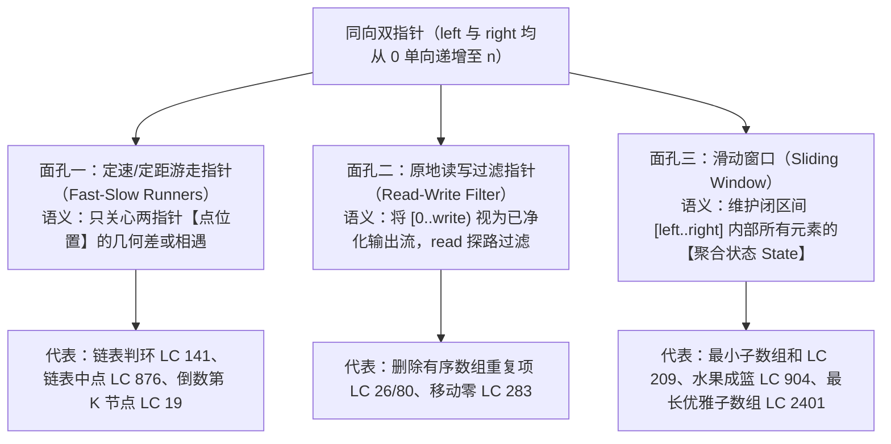
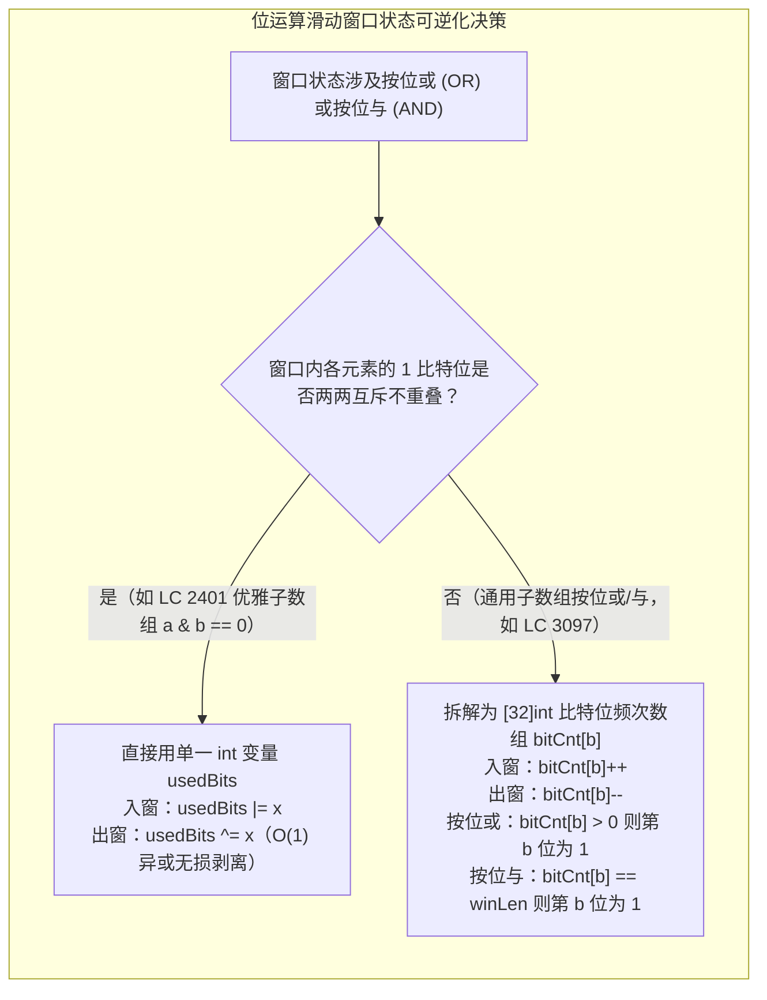

# 同向双指针统一视角：快慢指针与滑动窗口的辩证关系

**摘要：**

在算法学习中，许多读者将"快慢指针"、"同向双指针"与"滑动窗口"当作三个割裂的知识点来记忆。实际上，如果剥去题目表象的外衣，它们在数学上共享完全相同的骨架——**两个游标从同一侧出发同向推进，利用问题关于区间端点的单调性，将 $O(n^2)$ 的回退搜索压缩为最多 $2n$ 步的单向滑行**。本文从同向双指针的统一视角出发，系统辨析游走型快慢指针、原地覆写型读写指针与区间聚合型滑动窗口之间的演化关系，并通过五道涵盖标量求和、种类限制、位运算互斥与按位或可逆计数的经典题目——LeetCode 209（长度最小的子数组）、LeetCode 904（水果成篮）、LeetCode 2401（最长优雅子数组）、LeetCode 3097（或值至少为 K 的最短子数组 II）与 LeetCode 1658（将 x 减到 0 的最小操作数）——展示如何将滑动窗口从简单的加减法扩展到位运算（Bitwise Manipulation）与逆向思维领域。

---

## 第 1 章 同向双指针的三副面孔：游走、覆写与窗口

### 1.1 为什么说滑动窗口是同向双指针的高阶形态？

在序列结构上，只要两个指针 `left`（或 `slow`）与 `right`（或 `fast`）都从左端起点 `0` 出发、且在整个生命周期内**只向右走绝不后退**，它们就构成了一对**同向双指针（Same-Direction Two Pointers）**。根据两个指针之间维护的**物理语义**不同，同向双指针呈现出三副层层递进的面孔：



| 对比维度 | 游走型快慢指针 | 原地读写双指针 | 滑动窗口 |
|----------|----------------|----------------|----------|
| 关注焦点 | 两个游标**点本身**的相遇或间距 | `[0, write)` **前缀区间**的元素归位 | **`[left, right]` 闭区间**的整体聚合属性 |
| 是否有"出窗"撤销操作 | 无（走过即忘） | 无（单向覆盖写入） | **有**（`left++` 时必须从窗口状态中精确撤销 `nums[left]` 的贡献） |
| 单调性依赖来源 | 固定步速比（$2:1$）或固定步差 $k$ | 保留元素相对顺序不变（`write <= read`） | 固定 `right` 时，窗口聚合属性随 `left` 增大而单调变化 |

看清这张表，你就抓住了滑动窗口区别于普通快慢指针的唯一核心特征：**滑动窗口不仅要移动 `left` 和 `right` 两个点，还必须在 `[left, right]` 这段橡皮筋拉伸和收缩时，实时维护橡皮筋内部所有元素的聚合状态（和、种类数、位掩码），且 `left++` 时的撤销算子 `remove(nums[left])` 必须与 `right++` 时的纳入算子 `add(nums[right])` 严格互逆**。

---

## 第 2 章 标量求和与二分对照：长度最小的子数组（LeetCode 209）

### 2.1 题目描述与正整数单调性根基

**题目描述**：给定一个含有 $n$ 个**正整数**的数组和一个正整数 `target` 。找出该数组中满足其总和大于等于 `target` 的长度最小的**连续子数组**，并返回其长度。如果不存在符合条件的子数组，返回 `0`。

#### 2.1.1 为什么"正整数"三个字是滑动窗口的生死线？

在动笔写代码之前，请先养成审视数据范围的习惯：本题明确指出 `1 <= nums[i] <= 10^4`（**全为正整数**）。
因为每一个元素都 $> 0$，所以：
- 当 `right` 向右扩展纳入 `nums[right]` 时，窗口和 `sum` **严格增大**（离满足 `>= target` 更近）；
- 当 `left` 向右收缩吐出 `nums[left]` 时，窗口和 `sum` **严格减小**。

假设当右端点停在 `right` 时，我们通过收缩 `left` 找到了以 `right` 结尾的最后一个（最靠右的）满足 `sum >= target` 的左起点 $l^*$。那么对于下一轮更大的右端点 `right + 1`，有没有可能需要用一个比 $l^*$ 更靠左的起点 $l' < l^*$ 才能凑出全局最短子数组？
**绝无可能**——因为即便 `[l', right + 1]` 合法，它的长度 $(right + 1) - l' + 1$ 也严格大于上一轮已经记录过的合法窗口 `[l', right]` 的长度（更大于 `[l*, right]` 的长度）。因此 `left` 永远不需要回退，直接套用第 03 篇的**模式 B（求最短合法窗口：当 `sum >= target` 时在内层循环内更新答案并收缩）**即可在 $O(n)$ 时间内解决：

```go
package main

import "math"

// minSubArrayLen LeetCode 209：正整数数组上的模式 B（求最短合法窗口），时间 O(n)，空间 O(1)
func minSubArrayLen(target int, nums []int) int {
	left, sum := 0, 0
	minLen := math.MaxInt32

	for right, v := range nums {
		sum += v
		// 模式 B：一旦窗口合法 (sum >= target)，在内层循环内先记录最短长度，再主动收缩压榨水分
		for sum >= target {
			if right-left+1 < minLen {
				minLen = right - left + 1
			}
			sum -= nums[left]
			left++
		}
	}

	if minLen == math.MaxInt32 {
		return 0
	}
	return minLen
}
```

### 2.2 进阶追问：如何写出题目要求的 $O(n \log n)$ 前缀和 + 二分查找解法？

LeetCode 209 的题面专门有一道进阶追问："如果你已经实现 $O(n)$ 时间复杂度的解法，请尝试设计一个 $O(n \log n)$ 时间复杂度的解法。"
为什么面试官有时会反过来让你写一个更慢的 $O(n \log n)$ 解法？因为他在考察你**是否理解前缀和数组在正数输入下的单调性，以及滑动窗口究竟是如何把二分查找的 $\log n$ 优化掉的**。

构造前缀和数组 `prefix[0..n]`（其中 `prefix[i]` 表示前 $i$ 个元素之和）。因为 `nums[i] > 0`，所以 `prefix` 数组是一个**严格单调递增**的有序数组。
对于每一个固定的左端点 `left`（$0 \le left < n$），我们要找最小的右端点 `right`，使得子数组和 `prefix[right+1] - prefix[left] >= target`，移项即：

$$\text{prefix}[right + 1] \ge \text{prefix}[left] + target$$

在一个严格递增的数组 `prefix` 中，寻找**第一个大于等于 `need = prefix[left] + target` 的下标**，这不就是我们在《排序与查找》专栏第 05 篇烂熟于心的 **`lowerBound`** 吗？

```go
package main

import (
	"math"
	"sort"
)

// minSubArrayLenBinarySearch LeetCode 209 进阶要求：前缀和 + 二分查找 lowerBound，时间 O(n log n)
func minSubArrayLenBinarySearch(target int, nums []int) int {
	n := len(nums)
	prefix := make([]int, n+1)
	for i, v := range nums {
		prefix[i+1] = prefix[i] + v
	}

	minLen := math.MaxInt32
	for left := 0; left < n; left++ {
		need := prefix[left] + target
		// 在有序的 prefix[left+1 .. n] 中二分查找第一个 >= need 的位置
		idx := sort.SearchInts(prefix, need)
		if idx <= n {
			if idx-left < minLen {
				minLen = idx - left
			}
		}
	}

	if minLen == math.MaxInt32 {
		return 0
	}
	return minLen
}
```

把上面两段代码放在一起对比：在 `minSubArrayLenBinarySearch` 中，随着 `left` 从 `0` 递增到 `n - 1`，目标值 `need = prefix[left] + target` 也是严格递增的，因此二分查找到的位置 `idx` 必然也是**单调递增、从不回退**的。既然 `idx` 从不回退，我们根本没必要每一轮都用 `sort.SearchInts` 在 `[0, n]` 上重头折半查找，直接用一个单向往右走的指针 `right` 顺着推过去——**从 $O(n \log n)$ 的前缀和二分，去掉无谓的区间重置，自然而然就蜕变成了 $O(n)$ 的滑动窗口**。

---

## 第 3 章 种类数约束窗口：水果成篮（LeetCode 904）

### 3.1 题目本质：披着田园外衣的"至多 2 种不同元素最长子数组"

**题目描述**：正在探访一家农场，农场从左到右种植了一排果树，用整数数组 `fruits` 表示，其中 `fruits[i]` 是第 `i` 棵树上的水果种类。你只有**两个篮子**，每个篮子只能装**单一类型**的水果，且你必须从某棵树开始**每棵树连续采摘**，一旦遇到第三种水果且无法装入篮子时就必须停止。返回你可以收集的水果的最大数目。

剥掉"果树"与"篮子"的故事外壳，这道题的数学表述只有一句话：**在整数数组 `fruits` 中，找出至多包含 2 种不同整数的最长连续子数组长度**（即第 03 篇 LeetCode 159 的整数数组版）。

在 Go 语言实现时，有一个价值千金的性能细节：题目给出的水果种类编号满足 `0 <= fruits[i] < len(fruits)`（即都在 $[0, n-1]$ 范围内）。因此，**用长度为 $n$ 的定长切片 `freq := make([]int, len(fruits))` 配合标量种类计数器 `distinct`，比使用 `map[int]int` 要快出整整 5 倍**（消除了哈希计算、桶扩容与 `delete` 开销）：

```go
package main

// totalFruit LeetCode 904：定长切片频次表 + distinct 计数器维护至多 2 种水果的最长窗口
// 时间复杂度：O(n)，空间复杂度：O(n)
func totalFruit(fruits []int) int {
	freq := make([]int, len(fruits)+1)
	left, distinct, maxPicked := 0, 0, 0

	for right, f := range fruits {
		if freq[f] == 0 {
			distinct++
		}
		freq[f]++

		// 模式 A：种类数突破 2 时被动收缩
		for distinct > 2 {
			out := fruits[left]
			freq[out]--
			if freq[out] == 0 {
				distinct--
			}
			left++
		}

		if right-left+1 > maxPicked {
			maxPicked = right - left + 1
		}
	}
	return maxPicked
}
```

---

## 第 4 章 位运算滑动窗口：从互斥异或撤销到 32 位频次拆解

滑动窗口不仅能处理加减法与频次统计，在近年来的大厂笔试与周赛中，**位运算（Bitwise AND / OR / XOR）滑动窗口**已跃升为区分中高级选手的核心题型。根据窗口内二进制位是否允许重叠，位运算窗口分为两套截然不同的状态维护机制。

### 4.1 机制一：二进制位完全互斥下的 $O(1)$ 异或撤销——最长优雅子数组（LeetCode 2401）

**题目描述**：给你一个由正整数组成的数组 `nums`。如果 `nums` 的子数组中位于**不同位置**的每对元素按位与（`&`）的结果均为 `0`，则称该子数组为**优雅子数组（Nice Subarray）**。返回最长优雅子数组的长度。

#### 4.1.1 为什么两两按位与为 0 等价于"位集两两不相交"？

如果暴力检查窗口 `[left, right]` 内新加入的元素 `nums[right]` 是否与窗口内已有的 `right - left` 个元素两两按位与均为 `0`，单步需要比对 $O(k)$ 次（不过由于正整数只有 30 个二进制位，鸽巢原理保证优雅子数组长度至多为 30）。但我们能不能做到**严格 $O(1)$ 判断、$O(1)$ 入窗、$O(1)$ 出窗**？

把每个整数看作它二进制表示中所有为 `1` 的比特位（Bit Positions）组成的集合：
- 两个数 `a & b == 0`，意味着 `a` 和 `b` 没有任何一个公共的 `1` 比特位（两个集合交集为空）；
- 窗口 `[left, right]` 内所有元素两两按位与均为 `0`，意味着**窗口内所有元素的 `1` 比特位集合两两互不相交——在 0 到 30 的每一个比特位上，窗口里最多只有 1 个元素在该位上是 `1`**；
- 因此，我们可以用一个整型变量 **`usedBits`**（等于窗口内所有元素的**按位或 `|`**）来代表当前窗口所有已被占用的比特位大集合：
  1. **冲突检测（$O(1)$）**：当右端新元素 `nums[right]` 准备进窗时，怎么知道它跟窗口里现有的所有元素有没有公共 `1` 比特位？只需算一次 **`(usedBits & nums[right]) != 0`**——如果不为 `0`，说明发生比特位撞车（窗口不合法），必须收缩左边界；
  2. **左端出窗撤销（$O(1)$）**：在一般数组上，按位或 `|` 是不可逆的；但在合法的优雅子数组窗口内部，由于**每个为 `1` 的比特位是由窗口内唯一一个元素独占的**，当左端元素 `nums[left]` 离开窗口时，要把属于它的那些 `1` 比特位从 `usedBits` 中抹除，直接执行**按位异或 `usedBits ^= nums[left]`**（或按位与反码 `usedBits &^= nums[left]`）即可 100% 无损撤销；
  3. **右端入窗合并（$O(1)$）**：冲突清零后，执行 **`usedBits |= nums[right]`** 将新元素的比特位并入集合：

```go
package main

// longestNiceSubarray LeetCode 2401：位掩码状态维护 + 独占比特位异或撤销，时间 O(n)，空间 O(1)
func longestNiceSubarray(nums []int) int {
	left, usedBits, maxLen := 0, 0, 0

	for right, v := range nums {
		// 只要新元素 v 与窗口内已占用的比特位集合发生冲突，就持续从左端异或剥离旧元素
		for (usedBits & v) != 0 {
			usedBits ^= nums[left]
			left++
		}
		// 此时 v 与窗口内所有元素比特位互不相交，安全并入集合
		usedBits |= v
		if right-left+1 > maxLen {
			maxLen = right - left + 1
		}
	}
	return maxLen
}
```

### 4.2 机制二：二进制位允许重叠下的 32 位频次数组拆解——或值至少为 K 的最短子数组 II（LeetCode 3097）

如果题目**不再要求比特位互斥**，而是直接问你：给定非负整数数组 `nums` 和整数 `k`，求出**按位或（Bitwise OR）结果至少为 `k` 的最短非空子数组长度**（**LeetCode 3097**，同构于 **LeetCode 2411：按位或最大的最小子数组长度**），还能用 `usedBits ^= nums[left]` 出窗吗？

**绝对不能**。因为在普通子数组中，完全可能有两个元素 `nums[0] = 3 (011₂)` 和 `nums[1] = 1 (001₂)` 在第 0 位上都是 `1`。当左端 `nums[0]` 出窗时，因为 `nums[1]` 还在窗口里，窗口按位或的第 0 位**必须依然保持为 `1`**；如果你执行异或 `usedBits ^= nums[0]`，就会把第 0 位错误地清零成 `0`。

怎样让"不可逆的按位或（以及按位与）"变成可逆的滑动窗口状态？
这就是本专栏第 01 篇第 2 章提到的**三级状态——将 32 位整数拆解为长度为 32 的比特位频次数组 `bitCnt[32]int`**：
- `bitCnt[b]` 记录当前窗口内有多少个元素在第 `b` 个二进制位上是 `1`；
- **右端 `x` 入窗**：遍历 $b \in [0, 30]$，若 `(x >> b) & 1 == 1`，则令 `bitCnt[b]++`；
- **左端 `x` 出窗**：遍历 $b \in [0, 30]$，若 `(x >> b) & 1 == 1`，则令 `bitCnt[b]--`；
- **还原窗口按位或值 `calcOR()`**：只要 `bitCnt[b] > 0`，结果整数的第 `b` 位就是 `1`（即 `orVal |= 1 << b`）。

由于区间越长，参与按位或的元素越多，按位或的结果数值必然**单调不减**，完全符合第 03 篇的模式 B（求最短合法窗口）：

```go
package main

import "math"

// minimumSubarrayLength LeetCode 3097：用 [32]int 比特频次数组将不可逆按位或转化为可逆加减状态
// 时间复杂度：O(30 * n) = O(n)，空间复杂度：O(1)
func minimumSubarrayLength(nums []int, k int) int {
	if k == 0 {
		return 1
	}

	var bitCnt [32]int
	addOrRemove := func(x int, delta int) int {
		orVal := 0
		for b := 0; b < 31; b++ {
			if (x>>b)&1 == 1 {
				bitCnt[b] += delta
			}
			if bitCnt[b] > 0 {
				orVal |= 1 << b
			}
		}
		return orVal
	}

	left := 0
	minLen := math.MaxInt32
	for right, v := range nums {
		curOR := addOrRemove(v, 1)
		// 模式 B：一旦窗口按位或值 >= k，在内层循环内记录最短长度并主动收缩
		for left <= right && curOR >= k {
			if right-left+1 < minLen {
				minLen = right - left + 1
			}
			curOR = addOrRemove(nums[left], -1)
			left++
		}
	}

	if minLen == math.MaxInt32 {
		return -1
	}
	return minLen
}
```



请看上图右下角的精辟总结：用 `bitCnt[32]int` 不仅能维护窗口**按位或**（只要 `bitCnt[b] > 0` 则该位为 `1`），还能顺手维护窗口**按位与（Bitwise AND）**——**只要 `bitCnt[b] == right - left + 1`（即窗口内每一个元素在第 `b` 位上全都是 `1`），窗口按位与结果的第 `b` 位就是 `1`**。一招鲜，吃遍所有位运算子数组题。

---

## 第 5 章 逆向窗口建模：将 x 减到 0 的最小操作数（LeetCode 1658）

在同向双指针与滑动窗口的应用中，还有一类题目表面上看是让你用左右两个相向指针从数组两端往中间拿元素，但因为两端选择存在分支，直接用相向双指针会陷入贪心局部最优陷阱。

以 **LeetCode 1658：将 x 减到 0 的最小操作数**为例：给你一个正整数数组 `nums` 和一个整数 `x`。每一次操作时，你应当移除数组 `nums` 最左边或最右边的元素，然后从 `x` 中减去该元素的值。请返回可以将 `x` 恰好减到 `0` 的最小操作数；如果不能，返回 `-1`。

- **为什么不能直接用首尾对撞指针贪心挑较大者？** 试想 `nums = [1, 1, 4, 2, 3], x = 5`，首尾分别是 `1` 和 `3`；更极端地，若左边是 `[2, 3]`，右边是 `[4, 2]`，贪心先拿右边的 `4` 就死胡同了，而拿左边的 `2 + 3 = 5` 只需 2 步。
- **正难则反化归为同向滑动窗口**：从数组两端移除最少的元素使其和为 `x`，等价于**在数组中间保留一段最长的连续子数组 `[left, right]`，使其元素之和恰好等于 `target = sum(nums) - x`**。由于 `nums` 全为正整数，中间窗口和关于 `left` 和 `right` 严格单调，直接用同向双指针维护 `winSum`，当 `winSum > target` 时 `left++`，当 `winSum == target` 时用 `n - (right - left + 1)` 更新最小操作数即可。

```go
package main

// minOperations LeetCode 1658：正难则反，将两端移除最少元素转化为求中间和为 sum-x 的最长滑动窗口
// 时间复杂度：O(n)，额外空间复杂度：O(1)
func minOperations(nums []int, x int) int {
	total := 0
	for _, v := range nums {
		total += v
	}
	target := total - x
	if target < 0 {
		return -1
	}
	if target == 0 {
		return len(nums)
	}

	left, winSum, maxKeep := 0, 0, -1
	for right, v := range nums {
		winSum += v
		for winSum > target {
			winSum -= nums[left]
			left++
		}
		if winSum == target && right-left+1 > maxKeep {
			maxKeep = right - left + 1
		}
	}

	if maxKeep == -1 {
		return -1
	}
	return len(nums) - maxKeep
}
```

### 5.2 延伸实战一：乘积小于 K 的子数组——同向双指针的后缀批量计数（LeetCode 713）

如果把本章第 2 章的 LeetCode 209（正整数数组求和 $\ge target$ 的最短子数组）改为：**给定正整数数组 `nums` 和整数 `k`，求连续子数组元素乘积严格小于 `k` 的子数组总个数（LeetCode 713）**，同向双指针如何从"求最值"切换到"求个数"？

- 同样因为 `nums[i] >= 1` 全为正整数，窗口扩大时乘积 `prod` 单调不减，窗口缩小时乘积 `prod` 单调不增；
- 当 `k <= 1` 时，由于正整数乘积至少为 `1`，不可能严格小于 `1`，直接特判返回 `0`（防止内层 `left` 越过 `right`）；
- 当 `k > 1` 时，对每个 `right`，内层循环 `for prod >= k { prod /= nums[left]; left++ }` 将窗口缩至合法。此时 `[left .. right]` 的乘积已经 `< k`，那么以 `right` 为右端点、起点取在 `[left .. right]` 内的全部 **`right - left + 1` 个后缀子数组**乘积必然也 `< k`，直接累加 `ans += right - left + 1`：

```go
package main

// numSubarrayProductLessThanK LeetCode 713：正整数乘积单调性 + right-left+1 批量计数
func numSubarrayProductLessThanK(nums []int, k int) int {
	if k <= 1 {
		return 0
	}
	left, prod, count := 0, 1, 0
	for right, v := range nums {
		prod *= v
		for prod >= k {
			prod /= nums[left]
			left++
		}
		count += right - left + 1
	}
	return count
}
```

### 5.3 延伸实战二：按位或最大的最小子数组长度——位运算窗口的右端枚举与最早贡献位（LeetCode 2411）

在第 4.2 节中我们学习了用 `bitCnt[32]int` 维护窗口按位或。另一道经典的位运算同向双指针/窗口题是 **LeetCode 2411：按位或最大的最小子数组长度**（对于每个左起点 `i`，找出从 `i` 开始按位或能够达到最大可能值的最短子数组长度）。

这道题展示了位运算窗口的一条极其重要的数学性质：
- 从固定起点 `i` 向右扩展子数组时，按位或的结果 `orVal` 每发生变化，**至少会新点亮 1 个原本为 `0` 的二进制比特位（从 `0` 变成 `1`）**；
- 一个 30 位非负整数最多只有 **30 个比特位**可以被点亮。这意味着，以任意位置为端点的所有子数组，其不同的按位或结果**最多只有 30 种**；
- 如果我们从右往左倒序枚举左端点 `left`，维护一个长度为 31 的数组 `lastBitPos[b]`（记录第 `b` 个比特位在 `[left .. n-1]` 中**最靠左（最早）出现为 `1` 的下标**），那么要想凑齐所有能点亮的比特位，右端点 `right` 只需要延伸到所有已被点亮比特位的 `lastBitPos[b]` 的最大值即可，耗时严格 $O(30 \cdot n) = O(n)$、额外空间 $O(1)$：

```go
package main

// smallestSubarrays LeetCode 2411：维护每个比特位最早出现为 1 的右边界下标，时间 O(30n)，空间 O(1)
func smallestSubarrays(nums []int) []int {
	n := len(nums)
	ans := make([]int, n)
	var lastBitPos [31]int
	for b := range lastBitPos {
		lastBitPos[b] = -1
	}

	for left := n - 1; left >= 0; left-- {
		maxRight := left
		for b := 0; b < 31; b++ {
			if (nums[left]>>b)&1 == 1 {
				lastBitPos[b] = left
			} else if lastBitPos[b] > maxRight {
				maxRight = lastBitPos[b]
			}
		}
		ans[left] = maxRight - left + 1
	}
	return ans
}
```

### 5.4 常见误区与边界自检

1. **在位运算异或撤销（LC 2401）中误将 `usedBits ^= nums[left]` 套用到非互斥子数组**：只有当窗口合法条件保证了"窗口内任意两元素 `a & b == 0`（无共享比特位）"时，异或才能代表集合差集；一旦允许比特位重叠（如 LC 3097），必须使用 `bitCnt[32]int` 频次数组。
2. **在正难则反窗口（LC 1658）中漏判 `target < 0` 或 `target == 0`**：当全数组总和 `total < x`（即 `target < 0`）时，若不提前返回 `-1`，内层收缩循环 `for winSum > target`（由于 `winSum >= 0 > target`）会把 `left` 推过 `right + 1` 触发越界 panic。
3. **在乘积窗口（LC 713）中漏判 `k <= 1`**：同理，正整数乘积恒 $\ge 1$，当 `k <= 1` 时内层 `for prod >= k` 会导致 `left` 越界，必须在函数首行拦截。

### 5.5 进阶实战三：找到最接近目标值的函数值——按位与（Bitwise AND）窗口的单调收缩（LeetCode 1521 / 3171）

在第 4.2 节中我们详细实现了**按位或（OR）**窗口，那么它的孪生兄弟——**按位与（Bitwise AND）**窗口呢？
以 **LeetCode 3171：找到按位或最接近 K 的子数组**（以及同构的 **LeetCode 1521：找到最接近目标值的函数值**，求子数组按位与 `AND(l..r)` 与目标值 `k` 的最小绝对差 `|AND(l..r) - k|`）为例：

请你观察子数组按位与运算 `AND(l, r) = nums[l] & nums[l+1] & ... & nums[r]` 的单调性方向：
- **与加法和按位或完全相反**，参与按位与的数字越多，`1` 比特位被抹成 `0` 的机会就越大，因此**随着窗口扩大，按位与的值单调非递增（越扩越小）；随着左指针 `left++` 收缩，按位与的值单调非递减（越缩越大）**；
- 既然单调性依然稳如泰山（只是方向反过来了），我们同样可以用长度为 32 的比特频次数组 `bitCnt[32]int` 维护当前窗口 `[left .. right]` 的按位与值 **`curAND`**（当且仅当 **`bitCnt[b] == right - left + 1`**，即窗口内的每一个数在第 `b` 位上全都是 `1` 时，`curAND` 的第 `b` 位才是 `1`）：
  1. 右端 `nums[right]` 入窗后，算出 `curAND`，并用 `|curAND - k|` 更新全局最小差值；
  2. **何时触发内层 `left++` 收缩？** 当 **`curAND < k`**（即窗口太宽导致按位与的值已经跌破了目标值 `k`；此时如果再往右扩，`curAND` 只会变得更小、离 `k` 更远）时，启动内层循环 `for left <= right && curAND < k` 吐出 `nums[left]` 使 `curAND` 回升，并在每次回升后都更新一次 `|curAND - k|` 的最小值。

```go
package main

import "math"

// minimumDifferenceAND LeetCode 1521：用 [32]int 维护窗口按位与，利用越扩越小单调性在 curAND < k 时收缩
// 时间复杂度：O(30 * n) = O(n)，额外空间复杂度：O(1)
func minimumDifferenceAND(nums []int, k int) int {
	var bitCnt [32]int
	calcAND := func(winLen int) int {
		if winLen <= 0 {
			return math.MaxInt32
		}
		res := 0
		for b := 0; b < 31; b++ {
			// 按位与为 1 的充要条件：窗口内全部 winLen 个元素在该比特位上均为 1
			if bitCnt[b] == winLen {
				res |= 1 << b
			}
		}
		return res
	}

	modify := func(x int, delta int) {
		for b := 0; b < 31; b++ {
			if (x>>b)&1 == 1 {
				bitCnt[b] += delta
			}
		}
	}

	abs := func(x int) int {
		if x < 0 {
			return -x
		}
		return x
	}

	left := 0
	minDiff := math.MaxInt32

	for right, v := range nums {
		modify(v, 1)
		curAND := calcAND(right - left + 1)
		if d := abs(curAND - k); d < minDiff {
			minDiff = d
		}

		// 当按位与已经小于 k 时，继续扩窗只会更小，必须收缩 left 让按位与回升逼近 k
		for left < right && curAND < k {
			modify(nums[left], -1)
			left++
			curAND = calcAND(right - left + 1)
			if d := abs(curAND - k); d < minDiff {
				minDiff = d
			}
		}
	}
	return minDiff
}
```

把第 4.2 节的按位或（`bitCnt[b] > 0` 即为 `1`，越扩越大）与本节的按位与（`bitCnt[b] == winLen` 即为 `1`，越扩越小）对照掌握，位运算子数组这一整个大类的题目就再也没有任何盲区了。

### 5.6 延伸思考：LogTrick——为什么以 `right` 结尾的所有子数组，不同的按位或/按位与结果至多只有 30 个？

在研究完第 4.2 节（按位或窗口 LC 3097）和第 5.5 节（按位与窗口 LC 1521）后，如果题目连单调性条件都撤掉——譬如要求**统计全数组中所有连续子数组的按位或结果一共有多少种不同的数值**（**LeetCode 898：子数组按位或操作**），或者将按位与跟异或混合在一起，滑动窗口还能升级吗？

这就引出了位运算子数组领域的终极武器——**LogTrick（前缀位集压缩法）**：
- 当固定右端点 `right`，将左端点 `l` 从 `right` 往 `0` 倒退延伸时，子数组 `nums[l .. right]` 的按位或结果是单调递增的，且每发生一次数值跃变，至少要把 30 个二进制位中的某一位从 `0` 变成 `1`；
- 因此，对于固定的 `right`，无论左端点 `l` 在 `0 .. right` 之间怎么取，**算出来的不同按位或数值最多只有 31 种**（每一种对应一段连续的左端点区间 `[l_start, l_end]`）；
- 我们只需维护一个长度不超过 31 的切片保存上一轮 `right - 1` 的所有不同按位或结果（或 `(val, leftBound)` 区间对），在新元素 `nums[right]` 到达时，将切片中每个旧值或上 `nums[right]` 并原地利用**同向读写双指针去重合并**，即可在 $O(30 \cdot n)$ 时间内穷尽全数组 $\Theta(n^2)$ 个子数组的全部位运算状态，无论是求按位或、按位与还是最大公约数（GCD，同样每步至少除以 2，至多 $\log_2(\max)$ 种结果）子数组问题，LogTrick 都提供了统一的对数级状态压缩通道，堪称同向双指针思想在半群代数结构上的优雅延伸。

---

## 第 6 章 本章核心题型与状态可逆化对比表

| 题目 | 窗口类型 | 窗口维护状态 | 入窗 `add(x)` | 出窗 `remove(x)` | 时间 / 空间复杂度 |
|------|----------|--------------|---------------|------------------|-------------------|
| LC 209 长度最小的子数组 | 模式 B（求最短） | 标量累加和 `sum` | `sum += x` | `sum -= x` | $O(n)$ / $O(1)$ |
| LC 904 水果成篮 | 模式 A（求最长） | `freq[]` + 种类数 `distinct` | `freq[x]++`（0变1则 `distinct++`） | `freq[x]--`（1变0则 `distinct--`） | $O(n)$ / $O(n)$ |
| LC 2401 最长优雅子数组 | 模式 A（求最长） | 互斥位掩码 `usedBits` | `usedBits \|= x` | `usedBits ^= x`（独占位异或清零） | $O(n)$ / $O(1)$ |
| LC 3097 或值至少 K 最短子数组 | 模式 B（求最短） | 比特计数 `bitCnt[32]` | 各为 1 的位 `bitCnt[b]++` | 各为 1 的位 `bitCnt[b]--` | $O(n)$ / $O(1)$ |
| LC 1658 将 x 减到 0 最小操作 | 逆向模式 A（求最长） | 中间保留窗口和 `winSum` | `winSum += x` | `winSum -= x`（命中 `sum-x` 更新） | $O(n)$ / $O(1)$ |

---

## 小结

本章从同向双指针的统一视角出发，打通了标量、集合与位运算三大领域的滑动窗口建模：
- 厘清了游走型快慢指针、原地覆写型读写指针与区间状态型滑动窗口的三层递进关系；
- 通过 LC 209 对照了 $O(n \log n)$ 前缀和二分与 $O(n)$ 滑动窗口的演进，证明了滑动窗口本质上是利用单调性省去了每轮二分上下界的重置；
- 攻克了位运算滑动窗口的两大流派：比特位互斥时用 `usedBits ^= x` 直接 $O(1)$ 异或撤销（LC 2401）；比特位重叠时用 `[32]int` 频次数组将按位或/按位与还原为可逆加减法（LC 3097）。

下一篇 [[06 字符计数窗口：哈希表与滑动窗口的黄金组合]] 将聚焦字符串领域的高阶匹配——探索如何将滑动窗口从单字符粒度升级为定长单词粒度（LC 30），以及如何利用 Rabin-Karp 滚动位编码在 $O(1)$ 时间内完成定长基因序列查重（LC 187）。

---

## 参考资料

1. LeetCode 209 / 904 / 2401 / 3097 / 1658 Official Editorial.
2. Warren, H. S. (2012). *Hacker's Delight* (2nd ed.). Addison-Wesley. (Bitwise operations and properties).

---

> [!note] 思考题
> 1. 在 LeetCode 2401（最长优雅子数组）中，由于题目给定 `1 <= nums[i] <= 10^9`（小于 $2^{30}$），任意一个合法优雅子数组的最大可能长度绝不可能超过多少？为什么？
> 2. 在第 4.2 节的 LeetCode 3097（或值至少为 K 的最短子数组 II）中，如果把条件从"按位或 $\ge k$"改为"**按位与（Bitwise AND）$\le k$** 的最短子数组"，随着窗口扩大，窗口按位与的结果是单调递增还是单调递减？还满足滑动窗口的单调性条件吗？
> 3. 在 LeetCode 1004 / 904 这类模式 A（求最长合法窗口）题中，每当右指针停在 `right` 并完成内层收缩后，`right - left + 1` 不仅可以用来更新最大长度，如果把它累加起来 `total += right - left + 1`，算出来的总和代表什么物理意义？
