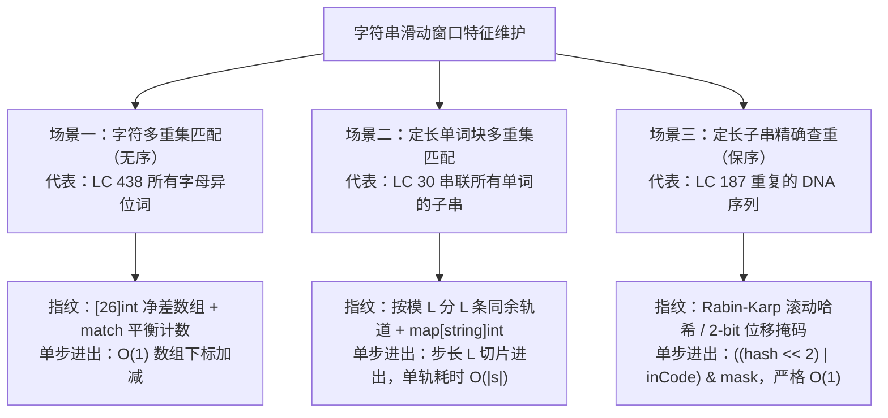

# 字符计数窗口：哈希表与滑动窗口的黄金组合

**摘要：**

字符串处理是滑动窗口在面试与工程中最庞大的应用领地。直接比较两个长度为 $k$ 的子串是否相等或互为排列需要 $O(k)$ 时间，而滑动窗口与哈希表（或频次向量、滚动哈希编码）的结合，能够将字符串的整体特征压缩为一个支持 $O(1)$ 增量更新的指纹状态。本文围绕四道从字符级、单词级到比特编码级层层递进的经典题目——LeetCode 438（找到字符串中所有字母异位词）、LeetCode 30（串联所有单词的子串）、LeetCode 187（重复的 DNA 序列）与 LeetCode 395（至少有 K 个重复字符的最长子串）——系统讲解净差计数器 `match == 26`、模单词长度 $L$ 的同余轨道滑动、2-bit 滚动位掩码哈希（Rolling Bitmask Hash）以及外层枚举字符种类数重建单调性四大核心技术，并给出高性能 Golang 实现。

---

## 第 1 章 字符串窗口的三类指纹：频次向量、单词映射与滚动哈希

### 1.1 为什么字符串滑动窗口离不开哈希与编码？

在数值数组中，窗口移动一格时，进出窗口的是两个整数，加减法天然就是 $O(1)$ 的。但在字符串问题中，题目往往要求判断窗口子串 `s[left .. right]` 是否满足某种复杂的结构等价性：
1. **无序字符多重集等价（字母异位词 / Anagram）**：不关心字符排列顺序，只要求 26 个字母各自出现的频次完全一致（如 LC 438、LC 567）；
2. **定长单词块多重集等价（Word Concatenation）**：将长度为 $L$ 的单词视为不可分割的原子块，要求窗口内 $m$ 个连续单词块组成的多重集与给定的词表 `words` 完全一致（如 LC 30）；
3. **严格保序子串相等（Exact Substring Match / Deduplication）**：要求窗口子串的字符顺序与内容一字不差地重复出现过（如 LC 187 重复的 DNA 序列、LC 1044 最长重复子串）。

如果每次窗口右移一格，都把窗口子串切出来从头统计一遍频次或重算一遍字符串哈希，单步耗时就是 $O(k)$，总时间退化回 $O(nk)$。要维持滑动窗口 $O(n)$ 的复杂度尊严，我们必须为这三类问题设计各自的 **$O(1)$ 增量指纹（Incremental Fingerprint）**：



---

## 第 2 章 字符级多重集窗口：找到字符串中所有字母异位词（LeetCode 438）

### 2.1 题目描述与双方案对比

**题目描述**：给定两个字符串 `s` 和 `p`（仅包含小写字母），找到 `s` 中所有 `p` 的**异位词**的子串，返回这些子串的起始索引。

这道题是第 02 篇 LeetCode 567（字符串的排列）的"全量收集版"——窗口长度固定为 $k = |p|$，每当窗口频次向量与 `p` 完全匹配时，将当前窗口左端点 `left = right - k + 1` 追加进结果切片 `res`。

在 Go 语言中，我们既可以利用值类型数组 `[26]int` 原生支持 `==` 比较的特性写出 20 行的极简版（耗时 $O(26 \cdot |s|)$），也可以采用**净差数组 `diff[26]int` + 零差值字母种类数 `match`** 写出与字符集大小无关的严格 $O(|s| + |p|)$ 版本。下面直接给出工业级净差计数器实现：

```go
package main

// findAnagrams LeetCode 438：定长窗口 + 净差计数器 match == 26，严格 O(|s| + |p|) 时间
func findAnagrams(s string, p string) []int {
	n, k := len(s), len(p)
	if n < k {
		return nil
	}

	var diff [26]int
	for i := 0; i < k; i++ {
		diff[p[i]-'a']--
	}

	match := 0
	for _, d := range diff {
		if d == 0 {
			match++
		}
	}

	modify := func(c byte, delta int) {
		if diff[c] == 0 {
			match--
		}
		diff[c] += delta
		if diff[c] == 0 {
			match++
		}
	}

	var res []int
	for right := 0; right < n; right++ {
		// 1. 右端入窗
		modify(s[right]-'a', 1)
		if right < k-1 {
			continue
		}
		// 2. 满窗检查：26 个字母净差全部归零则记录左端点
		left := right - k + 1
		if match == 26 {
			res = append(res, left)
		}
		// 3. 左端出窗
		modify(s[left]-'a', -1)
	}
	return res
}
```

### 2.2 另一种精巧视角：用可变窗口"不允许超标"统一解决异位词

除了上面的定长窗口写法，LeetCode 438 和 567 还有一种非常漂亮的**可变窗口写法**：
- 我们维护欠账数组 `need[26]int`（初始为 `p` 中各字母频次）；
- 当右指针纳入 `in = s[right] - 'a'` 时，令 `need[in]--`；
- **一旦发现 `need[in] < 0`**（说明字符 `in` 在当前窗口里出现的次数**超过了 `p` 的需求**，或者 `in` 根本不在 `p` 中），就立刻启动内层循环 `for need[in] < 0 { need[s[left]-'a']++; left++ }`，把左边界推到把那个多余的 `in` 吐出去为止；
- 请想一想：经过这番清理后，窗口 `[left .. right]` 满足什么不变量？**窗口内每一个字符的数量都绝不超过 `p` 的需求（即对所有字符都有 `win[c] <= p_need[c]`）**。既然没有任何一个字符超标，那么**当且仅当窗口的总长度 `right - left + 1` 恰好达到 `len(p)` 时，窗口里的每个字符数量必然不多不少正好等于 `p` 的需求**。这种写法连 `match` 计数器都省掉了，而且能直接平移复用到下一章的单词串联题中。

---

## 第 3 章 单词级同余轨道窗口：串联所有单词的子串（LeetCode 30）

### 3.1 题目描述与步长对齐难题

**题目描述**：给定一个字符串 `s` 和一个字符串数组 `words`。`words` 中所有字符串**长度相同**（设单个单词长度为 $L$，单词总个数为 $m$）。`s` 中的**串联子串**是指一个包含 `words` 中所有字符串以任意顺序排列连接起来的子串（总长度为 $W = m \times L$）。返回所有串联子串在 `s` 中的起始索引。

#### 3.1.1 为什么可以按 `offset = 0 .. L-1` 拆分为 $L$ 条独立滑动窗口？

如果把长度为 $L$ 的单词看作一个"大号字符"，这道题就完全等价于上一章的 **LeetCode 438（找所有字母异位词）**：词表 `words` 就是模式串 `p`（包含 $m$ 个大号字符），我们要在 `s` 中找所有长度为 $m$ 个大号字符的异位词窗口。

唯一的障碍是：在字符串 `s` 中，合法串联子串的起始下标 `start` 未必是 $L$ 的整数倍（它可以从下标 `0` 开始，也可以从下标 `1`、`2`……开始）。
如果我们对每一个下标 `0, 1, ..., |s| - W` 都独立切分 $m$ 个单词去查表，每次耗时 $O(m \cdot L)$，总耗时高达 $O(|s| \cdot m \cdot L)$。

怎么利用滑动窗口的"一进一出"消除中间 $m - 1$ 个单词的重复切分？
注意：**起始下标为 `0` 的窗口 `[0, W)` 与起始下标为 `L` 的窗口 `[L, W + L)`，它们内部的单词切分网格是完全对齐的**——后者相比前者，仅仅是右边新进来了 1 个单词 `s[W : W+L]`，左边移出去了 1 个旧单词 `s[0 : L]`。

因此，我们只需按照起始下标模 $L$ 的余数，将全部可能的起点划分为 **`offset = 0, 1, ..., L - 1` 共 $L$ 条互不干扰的同余轨道**：
- 在第 `offset` 条轨道上，左指针 `left` 和右指针 `right` 全部初始化为 `offset`，且**每次步进的跨度固定为 `L`（即 `right += L`、`left += L`）**；
- 在单条轨道内部，我们直接套用第 2.2 节讲过的**"不允许任何单词超标"**的可变窗口技巧：
  1. 右端切出新单词 `w = s[right : right+L]`；
  2. **情况 A（`w` 根本不在词表 `need` 中）**：一个非法外星单词混进来了，它所在位置左侧的所有窗口全部报废。直接清空当前窗口哈希表 `clear(win)`，`matched = 0`，并将左起点一步跳到该非法单词之后：**`left = right + L`**；
  3. **情况 B（`w` 在词表 `need` 中）**：令 `win[w]++, matched++`。若此时该单词数量超标（**`win[w] > need[w]`**），就用内层循环不断从左端吐出长度为 $L$ 的旧单词 `out = s[left : left+L]`（`win[out]--; matched--; left += L`），直到 `win[w] <= need[w]` 恢复合法；
  4. **满窗命中检查**：因为没有任何单词超标，只要当前窗口内的有效单词总数 **`matched == m`**，当前的 `left` 就必然是一个合法串联子串的起始下标：

```go
package main

// findSubstring LeetCode 30：按模 wordLen 划分同余轨道 + 单词级滑动窗口
// 时间复杂度：O(|s| * wordLen)，空间复杂度：O(m * wordLen)
func findSubstring(s string, words []string) []int {
	n := len(s)
	m := len(words)
	if n == 0 || m == 0 {
		return nil
	}
	wLen := len(words[0])
	totalLen := m * wLen
	if n < totalLen {
		return nil
	}

	need := make(map[string]int, m)
	for _, w := range words {
		need[w]++
	}

	var res []int
	// 枚举 0 .. wLen-1 共 wLen 条同余切分轨道
	for offset := 0; offset < wLen; offset++ {
		win := make(map[string]int, m)
		left := offset
		matched := 0 // 当前窗口内已纳入的合法单词总个数

		for right := offset; right+wLen <= n; right += wLen {
			inWord := s[right : right+wLen]

			// 若遇到不在词表中的非法单词，整段窗口直接作废重置，left 跳过该非法词
			if need[inWord] == 0 {
				clear(win)
				matched = 0
				left = right + wLen
				continue
			}

			// 纳入合法单词
			win[inWord]++
			matched++

			// 若 inWord 频次超标，持续从左端以步长 wLen 吐出单词直至恢复 <= need[inWord]
			for win[inWord] > need[inWord] {
				outWord := s[left : left+wLen]
				win[outWord]--
				matched--
				left += wLen
			}

			// 在无任何单词超标的不变量下，单词总数达到 m 即代表完全匹配
			if matched == m {
				res = append(res, left)
			}
		}
	}
	return res
}
```

请对比第 2.2 节与上面这段 `findSubstring`：借由"非词表单词直接重置 + 超标单词 `for win[inWord] > need[inWord]` 收缩"的设计，我们彻底省去了维护复杂的 `formed` 达标种类加减分支，代码逻辑如刀切豆腐般干净利落。

---

## 第 4 章 滚动位编码窗口：重复的 DNA 序列（LeetCode 187）

### 4.1 题目描述与四进制 2-Bit 无损压缩推导

**题目描述**：DNA 序列由一系列核苷酸组成，缩写为 `'A'`, `'C'`, `'G'` 和 `'T'`。给定一个表示 DNA 序列的字符串 `s`，请找出并返回所有在 DNA 分子中出现**不止一次**的**长度为 10** 的序列（子字符串）。

#### 4.1.1 为什么用 20-Bit 整数滚动哈希能彻底消灭子串哈希开销？

如果用 `map[string]int` 直接统计每个长度为 10 的切片 `s[i : i+10]` 的出现次数，虽然在 Go 中字符串切片共享底层字节数组（不拷贝内存），但每次 `map` 查找依然需要对全部 10 个字节计算一次哈希函数并比对 10 个字节，耗时 $O(10 \cdot n)$。

注意到一个极为特殊的领域约束：**DNA 序列的字母表大小只有 $4$（`'A', 'C', 'G', 'T'`）**。
在信息论中，表示 4 种状态只需要 $\log_2 4 = 2\text{ bits}$ 的二进制位：
- `'A'` $\to$ `00₂ (0)`
- `'C'` $\to$ `01₂ (1)`
- `'G'` $\to$ `10₂ (2)`
- `'T'` $\to$ `11₂ (3)`

那么，一个长度为 $10$ 的 DNA 子串，拼在一起一共只有 **$10 \times 2 = 20\text{ bits}$**，完全可以无损地塞进一个普通的 32 位整型变量 `windowCode` 的低 20 位里（且由于是双射编码，**碰撞概率严格为 $0$**）。
当长度为 10 的定长窗口向右滑动一格时：
1. **右端新字符入窗**：将 `windowCode` 左移 2 位腾出最低 2 bit，并按位或上新字符的 2-bit 编码：`(windowCode << 2) | code(s[right])`；
2. **左端最老字符出窗**：原本排在第 10 个位置（最高位第 18、19 位）的老字符，在左移 2 位后被推到了第 20、21 位。我们只需按位与上一个低 20 位全为 `1` 的掩码 **`mask = (1 << 20) - 1`**（即 `0xFFFFF`），就能在 1 个 CPU 时钟周期内将滑出窗口的老字符彻底清零；
3. 更妙的是，由于 20-bit 整数的值域只有 $2^{20} = 1,048,576$，我们甚至连 `map[int]int` 都可以不用，直接开一个定长数组或紧凑切片记录频次，速度达到物理极限：

```go
package main

// findRepeatedDnaSequences LeetCode 187：2-bit 四进制滚动位编码 + 20-bit 掩码截断，严格 O(n)
func findRepeatedDnaSequences(s string) []string {
	n := len(s)
	if n <= 10 {
		return nil
	}

	var charCode [128]int
	charCode['A'] = 0
	charCode['C'] = 1
	charCode['G'] = 2
	charCode['T'] = 3

	const (
		k    = 10
		mask = (1 << (2 * k)) - 1 // 低 20 位全 1 掩码 0xFFFFF
	)

	seenCount := make(map[int]int, n-k+1)
	windowCode := 0
	var res []string

	for right := 0; right < n; right++ {
		// 1. 左移 2 位纳入新字符，并用 20-bit 掩码自动抹除滑出左界的老字符
		windowCode = ((windowCode << 2) | charCode[s[right]]) & mask

		if right < k-1 {
			continue
		}

		// 2. 满 10 个字符后登记编码频次；仅在频次刚达到 2 时收集答案，天然去重
		seenCount[windowCode]++
		if seenCount[windowCode] == 2 {
			res = append(res, s[right-k+1:right+1])
		}
	}
	return res
}
```

### 4.2 推广至通用多项式滚动哈希（Rabin-Karp 算法）

如果字符集不是 $2$ 的幂次（譬如 26 个小写字母），或者窗口长度 $k$ 达到了上百甚至上千（无法无损塞进 64 位整数），上面的位移编码就会自然推广为通用的 **Rabin-Karp 多项式滚动哈希（Polynomial Rolling Hash）**：
将长度为 $k$ 的窗口子串视为一个以 $B$（如 $B = 131$ 或 $13331$）为基数、模大素数 $M$（如 $10^9 + 7$）或利用 `uint64` 自然溢出的多项式：

$$H(s[l \dots r]) = \left(\sum_{i=0}^{k-1} s[l+i] \cdot B^{k-1-i}\right) \bmod M$$

预先算出最高位权值 $P = B^{k-1} \bmod M$。当窗口右移一格（吐出 $s[l]$、纳入 $s[r+1]$）时，新哈希值可通过一减一乘一加在 $O(1)$ 时间内递推得出：

$$H_{\text{new}} = \big((H_{\text{old}} - s[l] \cdot P) \cdot B + s[r+1]\big) \bmod M$$

这也是解决 **LeetCode 1044（最长重复子串：二分答案长度 $k$ + Rabin-Karp 定长窗口查重）** 与 **LeetCode 2156（查找给定哈希值的子串）** 的标准工业武器。

---

## 第 5 章 人工重建单调性：至少有 K 个重复字符的最长子串（LeetCode 395）

### 5.1 为什么"每个字符频次 $\ge k$"直接滑窗会失去单调性？

作为本章压轴，我们审视一道极具启发性的字符频次题——**LeetCode 395：至少有 K 个重复字符的最长子串**：
**题目描述**：给你一个字符串 `s` 和一个整数 `k`，请你找出 `s` 中的最长子串，要求该子串中的**每一类出现过的字符，其出现次数都不少于 `k`**。

初学者拿到这道题，往往想直接套一层可变滑动窗口。但当你尝试写内层 `for` 收缩条件时，立刻会撞上一堵墙：
- 假设 $k = 3$，当前窗口是 `"aaab"`（`'a'` 有 3 个，`'b'` 有 1 个），此时窗口因为 `'b'` 不足 3 个而不合法；
- 请问：**此时应该收缩左指针 `left++` 吗？**
  - 如果你收缩 `left++`，吐掉的可是左边的 `'a'`（把本来已经达标的 `'a'` 给拆散了），而万一 `right` 后面紧跟着还有两个 `'b'`，原本 `"aaabbb"` 能拼出长 6 的最优解就被你毁了；
  - 如果你不收缩 `left++`，那 `left` 永远停在 `0`，万一整个字符串后面再也没有第二个 `'b'` 了，这个孤零零的 `'b'` 就像一颗老鼠屎一样永远留在窗口里，左边的 `"aaa"` 或右边的合法子串反而被错过了。

**问题的根源在于："所有出现字符的频次均 $\ge k$"这一复合谓词，对于窗口扩张既可能变好（把原本不足 $k$ 个的字符补齐到 $k$ 个）、又可能变坏（新引入一种只有 1 个的新字符），它不具备单调性**。

### 5.2 外层枚举窗口允许的字符种类上限 $T \in [1, 26]$

怎么给一个原本不单调的问题**人工注入单调性**？
注意到字符串仅由小写英文字母组成，任何非空子串中包含的**不同字符种类数 `unique`**，必然是 $1, 2, \ldots, 26$ 这 26 个整数中的一个。
如果我们把问题拆成 26 个子问题：**在第 $T$ 个子问题（$1 \le T \le 26$）中，我们强行规定"窗口内允许存在的不同字符种类数绝不能超过 $T$"**：
- 一旦加上了 `unique <= T` 这道紧箍咒，左指针的收缩条件瞬间恢复了 $100\%$ 的单调性：**只要 `unique > T`，因为扩大窗口只会让种类数更多，所以此时别无选择，必须收缩 `left++` 直到把某一种字符彻底吐干净（使 `unique` 降回 $T$）**；
- 在每个 `right` 处完成收缩后，如果当前窗口内的不同字符种类数 `unique` **恰好等于**频次已达标（$\ge k$）的字符种类数 `atLeastK`，说明窗口内存在的每一种字符都满了 $k$ 个，用 `right - left + 1` 更新全局答案即可：

```go
package main

// longestSubstring LeetCode 395：外层枚举窗口字符种类上限 1..26 重建收缩单调性
// 时间复杂度：O(26 * n) = O(n)，额外空间复杂度：O(1)
func longestSubstring(s string, k int) int {
	maxLen := 0
	// 统计全串实际包含的字符种类数，作为外层枚举上界
	var globalSeen [26]bool
	totalUnique := 0
	for i := 0; i < len(s); i++ {
		if !globalSeen[s[i]-'a'] {
			globalSeen[s[i]-'a'] = true
			totalUnique++
		}
	}

	for maxAllowedUnique := 1; maxAllowedUnique <= totalUnique; maxAllowedUnique++ {
		var freq [26]int
		left, unique, satisfied := 0, 0, 0

		for right := 0; right < len(s); right++ {
			in := s[right] - 'a'
			if freq[in] == 0 {
				unique++
			}
			freq[in]++
			if freq[in] == k {
				satisfied++
			}

			// 单调收缩条件：一旦窗口内字符种类数超过本轮上限 maxAllowedUnique，必须收缩左边界
			for unique > maxAllowedUnique {
				out := s[left] - 'a'
				if freq[out] == k {
					satisfied--
				}
				freq[out]--
				if freq[out] == 0 {
					unique--
				}
				left++
			}

			// 当窗口内所有出现过的字符种类均已满足频次 >= k 时，更新答案
			if unique == satisfied && right-left+1 > maxLen {
				maxLen = right - left + 1
			}
		}
	}
	return maxLen
}
```

### 5.3 进阶实战一：统计完全子字符串——分段隔离 + 枚举字符种类数 $T \in [1, 26]$（LeetCode 2953）

为了巩固第 5.2 节"外层枚举窗口字符种类数 $T$ 以重建单调性"的高阶范式，我们来看周赛压轴困难题 **LeetCode 2953：统计完全子字符串**：
**题目描述**：给你一个字符串 `word` 和一个整数 `k`。如果 `word` 的一个子串 `s` 满足以下两个条件，我们称它是**完全子字符串**：
1. `s` 中**每种出现过的字符恰好出现 `k` 次**；
2. 相邻字符在字母表中的顺序至多相差 `2`（即 `|s[i] - s[i+1]| <= 2`）。

**破题推导**：
1. **第一步（按条件 2 分段隔离）**：如果在原字符串中某两个相邻字符满足 `|word[i] - word[i-1]| > 2`，那么任何合法的完全子字符串都**绝对不可能跨越 `i - 1` 与 `i` 之间的鸿沟**。因此，我们先用一次线性扫描在所有满足 `|word[i] - word[i-1]| > 2` 的断点处把 `word` 切分成若干个彼此独立的合法子段 `seg`，对每个子段分别统计后求和；
2. **第二步（在单个子段内部枚举字符种类数 $T \in [1, 26]$）**：既然要求窗口内每种出现过的字符都**恰好出现 $k$ 次**，那么如果窗口里一共包含 $T$ 种不同的字符，**这个窗口的总长度就必然固定等于 $W = T \times k$**。
3. 看清楚这个推论的威力了吗？在 LeetCode 395（至少 $k$ 次）中，枚举 $T$ 后内层是一个可变窗口；而在本题（**恰好 $k$ 次**）中，枚举 $T$ 后，**内层直接坍缩成了一个宽度固定为 $W = T \times k$ 的定长滑动窗口**。我们只需在长度为 $T \times k$ 的定长窗口里维护"频次恰好等于 $k$ 的字符种类数 `exactK`"，每当 `exactK == T` 时答案加一即可，时间复杂度严格为 $O(26 \cdot n)$：

```go
package main

// countCompleteSubstrings LeetCode 2953：相邻差 > 2 切分独立段 + 枚举种类数 T=1..26 跑定长 T*k 窗口
// 时间复杂度：O(26 * n)，空间复杂度：O(1)
func countCompleteSubstrings(word string, k int) int {
	absDiff := func(a, b byte) int {
		d := int(a) - int(b)
		if d < 0 {
			return -d
		}
		return d
	}

	// countSeg 统计单个已满足相邻字母差 <= 2 的子段内的完全子串数
	countSeg := func(seg string) int {
		m := len(seg)
		total := 0
		for t := 1; t <= 26 && t*k <= m; t++ {
			winSize := t * k
			var freq [26]int
			exactK := 0 // 窗口内频次恰好等于 k 的字符种类数

			modify := func(c byte, delta int) {
				if freq[c] == k {
					exactK--
				}
				freq[c] += delta
				if freq[c] == k {
					exactK++
				}
			}

			for right := 0; right < m; right++ {
				modify(seg[right]-'a', 1)
				if right < winSize-1 {
					continue
				}
				if exactK == t {
					total++
				}
				modify(seg[right-winSize+1]-'a', -1)
			}
		}
		return total
	}

	ans := 0
	n := len(word)
	for i := 0; i < n; {
		start := i
		i++
		for i < n && absDiff(word[i], word[i-1]) <= 2 {
			i++
		}
		ans += countSeg(word[start:i])
	}
	return ans
}
```

### 5.4 进阶实战二：查找给定哈希值的子串——逆向秦九韶滚动哈希消去模除法（LeetCode 2156）

在第 4.2 节讲到 Rabin-Karp 多项式滚动哈希时，很多同学在实际写带取模 `modulo` 的题目时会遇到一个数论痛点：当正向滑动需要减去最高位老字符 `s[left] * power^(k-1) % m`、再整体除以 `power` 时，在模 `m` 意义下做除法需要求乘法逆元（若 `power` 与 `m` 不互质，连逆元都不存在）。

以 **LeetCode 2156：查找给定哈希值的子串**为例：题目定义长度为 $k$ 的子串哈希函数为**最低位权值在左、最高位权值在右**：

$$\text{hash}(s[l \dots l+k-1]) = \left(\sum_{j=0}^{k-1} \text{val}(s[l+j]) \cdot p^j\right) \bmod m$$

如果从左往右正向滑，移出 $s[l]$ 后剩下的各项需要整体除以 $p$，而 $p$ 与 $m$ 未必互质，无法求逆元。
**破局巧思是：把滑动窗口改为从右往左（从 `n - 1` 往 `0`）逆向滑动**。
当窗口从 `[i+1 .. i+k]` 向左滑一格变为 `[i .. i+k-1]` 时：
1. 最右边的老字符 `s[i+k]` 恰好带着最高次幂 $p^{k-1}$（或先减再乘时为 $p^k$），直接用减法 `(curHash * p - val(s[i+k]) * p^k + val(s[i])) % m` 即可消掉，**全程只有乘法和加减法，连一次除法或逆元都不需要**：

```go
package main

// subStrHash LeetCode 2156：从右往左逆向滚动哈希，利用秦九韶乘法彻底规避模除法逆元
func subStrHash(s string, power int, modulo int, k int, hashValue int) string {
	n := len(s)
	p := int64(power)
	mod := int64(modulo)
	var curHash int64
	var pk int64 = 1 // 记录 p^k % mod

	// 1. 先从右往左计算最右侧末尾窗口 s[n-k : n] 的哈希值与 p^k
	for i := n - 1; i >= n-k; i-- {
		curHash = (curHash*p + int64(s[i]-'a'+1)) % mod
		if i > n-k {
			pk = (pk * p) % mod
		}
	}

	bestStart := -1
	if int(curHash) == hashValue {
		bestStart = n - k
	}

	// 2. 窗口从右往左滑动：每次吐出右端 s[i+k]（权值 pk），乘 p 后纳入左端新字符 s[i]（权值 1）
	for i := n - k - 1; i >= 0; i-- {
		outVal := int64(s[i+k] - 'a' + 1)
		inVal := int64(s[i] - 'a' + 1)
		curHash = ((curHash-outVal*pk)%mod + mod) % mod
		curHash = (curHash*p + inVal) % mod
		if int(curHash) == hashValue {
			bestStart = i // 从右往左不断覆盖，最终留下的必为最靠左的合法起点
		}
	}
	return s[bestStart : bestStart+k]
}
```

### 5.5 常见误区与边界自检

1. **在 `modify(c, delta)` 维护 `match` 计数器时，进出窗判断顺序写反**：记住统一范式——**在修改频次之前先检查是否原本处于平衡态（若是则 `match--`），修改频次之后再检查是否刚刚进入平衡态（若是则 `match++`）**。把这两句封装成统一的 `modify(c, delta)` 闭包函数，能 100% 避免进窗和出窗手写两套顺序相反的 `if` 引发 Bug。
2. **在滚动哈希做模减法 `(a - b) % mod` 时忘记加 `+ mod` 非负修正**：在 Go 语言中，`(curHash - outVal * pk) % mod` 可能算出负数，必须写为 `((curHash - outVal*pk) % mod + mod) % mod`。
3. **单模数滚动哈希的生日攻击碰撞风险与双哈希（Double Hashing）防御**：在 **LeetCode 1044：最长重复子串**（字符串长度达 $3 \times 10^4$）这类使用二分答案 + Rabin-Karp 滚动哈希查重的困难题中，如果我们只选一个 $10^9 + 7$ 量级的模数 $M$，根据**生日悖论（Birthday Paradox）**，只需约 $\sqrt{M} \approx 31622$ 个子串就会以超过 $50\%$ 的高概率发生哈希碰撞（即两个不同子串算出了相同的哈希值），在力扣专门构造的防哈希（Anti-Hash）测试用例上直接报错。工程与竞赛中的根治方法有两种：
   - **方法 A（双模数双基数哈希）**：同时维护两组互质的 `(base1, mod1)` 与 `(base2, mod2)`，将两个 32 位哈希值拼成一个 `uint64`（`key := (uint64(h1) << 32) | uint64(h2)`）作为 `map` 的键，使有效模数空间达到 $10^{18}$，碰撞概率降至 $10^{-9}$ 以下；
   - **方法 B（哈希桶命中后二次校验原始切片）**：在 `map[uint64]int` 中记录该哈希值上次出现的起始下标 `prevIdx`，当 `curHash` 命中时，再补一行 `s[prevIdx : prevIdx+k] == s[left : left+k]` 做真实字符串内容比对，即可在保持 $O(n)$ 期望时间的同时达到 $100\%$ 零误判确定性。

### 5.6 延伸思考：生物信息学与大规模文本去重中的 K-mer 滑动窗口与 NtHash

本章第 4 章探讨的 **LeetCode 187（重复的 DNA 序列）**，在计算生物学与基因组组装（Genome Assembly，如 De Bruijn 图构建）中被称为 **$k$-mer 频次统计问题**。在真实的基因测序流水线中，一条人类染色体序列长达上亿个碱基，需要统计长度 $k = 31$ 或 $k = 64$ 的 $k$-mer：
- 当 $k \le 32$ 时，直接用 64 位无符号整数 `uint64`（每个碱基占 2 bit）配合本章的位移掩码 `((code << 2) | base) & mask` 即可零碰撞精确编码；
- 当 $k > 32$ 时，生物信息学界广泛使用 **NtHash（基于循环位移 `bits.RotateLeft64` 与异或表查询的滚动哈希）**：由于异或运算天然自逆（$x \oplus x = 0$），将滑出左界的碱基编码循环左移 $k$ 位后直接异或进当前哈希值，就能在不做任何乘除法的前提下实现超长 DNA 窗口的 $O(1)$ 滚动更新。同理，在分布式存储系统（如 rsync 增量同步协议与 BorgBackup 内容寻址分块 Content-Defined Chunking）中，也正是通过维护一个宽度为 48 字节的 Rabin 指纹或 Buzhash 滑动窗口，当滚动哈希的低 13 位恰好全为 `0` 时触发切块边界，从而在文件头部插入几个字节后避免后续全量分块偏移错位，实现高效的网络同步与去重存储。此外，在大规模代码克隆检测与抄袭查重引擎（如斯坦福大学的 Moss 算法）中，还会将本章的 Rabin-Karp 滚动哈希与下一篇的滑动窗口最小值（Winnowing 指纹提取算法）结合起来，从每 $w$ 个连续哈希值中挑选最小值作为文档骨架特征，达成抗噪声干扰的局部文本指纹检索。

---

## 第 6 章 本章六道字符与哈希窗口核心对比

| 题目 | 匹配粒度 | 核心窗口状态与哈希技巧 | 单调性来源 | 时间 / 空间复杂度 |
|------|----------|------------------------|------------|-------------------|
| LC 438 找所有字母异位词 | 单字符多重集 | `diff[26]` + 零差种类数 `match == 26` | 定长窗口 $k = \|p\|$ | $O(\|s\|+\|p\|)$ / $O(1)$ |
| LC 30 串联所有单词的子串 | 长为 $L$ 的单词块 | 模 $L$ 分 $L$ 条轨道 + `win[w] <= need[w]` | 同余轨道内步长 $L$ 禁止单词超标 | $O(\|s\| \cdot L)$ / $O(m \cdot L)$ |
| LC 187 重复的 DNA 序列 | 长为 10 的保序子串 | 2-bit 四进制编码 + 20-bit 滚动掩码 `0xFFFFF` | 定长窗口 $k = 10$ | $O(n)$ / $O(n)$ |
| LC 395 至少 K 重复最长子串 | 每种字符频次 $\ge k$ | 外层枚举种类上限 $T \in [1..26]$ + `unique == satisfied` | 固定种类上限 $T$ 后 `unique > T` 单调可缩 | $O(26n)$ / $O(1)$ |
| LC 2953 统计完全子字符串 | 每种字符频次 $== k$ | 相邻差 $>2$ 分段 + 枚举 $T$ 跑定长 $T \cdot k$ 窗口 | 固定种类数 $T$ 后合法窗口长必为 $T \cdot k$ | $O(26n)$ / $O(1)$ |
| LC 2156 查找给定哈希值子串 | 长为 $k$ 的多项式哈希 | 从右往左逆向滚动哈希，消去最高次幂 $p^k$ | 定长窗口 $k$ 逆向平移避开模除法逆元 | $O(n)$ / $O(1)$ |

---

## 小结

本章全面展示了哈希表、位编码与滑动窗口在字符串领域的深度融合：
- 对于**字符级异位词（LC 438）**，用净差数组与 `match` 计数器消除每次 26 维向量比对；
- 对于**单词级串联（LC 30）**，通过模 $L$ 的同余轨道拆解，将步长为 $L$ 的单词滑动转化为字符级滑动窗口；
- 对于**定长子串精确查重（LC 187）**，利用 2-bit 位移与掩码截断实现零碰撞、零切片分配的 $O(1)$ 滚动哈希；
- 对于**缺乏天然单调性的频次下界问题（LC 395）**，通过外层枚举 `1..26` 种字符上限，在子问题内部人工重建了滑动窗口的单调收缩条件。

下一篇 [[07 单调队列优化滑动窗口：O(n) 求窗口极值的艺术]] 将攻克滑动窗口中另一座硬核高山——当窗口需要实时维护不可逆的最大值与最小值时，如何借助单调双端队列做到均摊 $O(1)$ 的极值更新。

---

## 参考资料

1. Karp, R. M., & Rabin, M. O. (1987). *Efficient randomized pattern-matching algorithms*. IBM Journal of Research and Development, 31(2), 249–260.
2. LeetCode 438 / 30 / 187 / 395 Official Editorial.

---

> [!note] 思考题
> 1. 在 LeetCode 30（串联所有单词的子串）中，如果词表 `words` 中各个单词的**长度不相同**（譬如既有长 2 的 `"ab"` 又有长 5 的 `"hello"`），还能用本章第 3 章的"模 $L$ 同余轨道滑动窗口"吗？为什么？
> 2. 在 LeetCode 2953（统计完全子字符串：要求子串中每种字符恰好出现 $k$ 次，且相邻字符字母表距离不超过 2）中，如何结合本章第 5 章 LeetCode 395 的"枚举窗口内包含的不同字符种类数 $T \in [1, 26]$"，将可变窗口进一步收紧为宽度固定为 $T \times k$ 的定长窗口？
> 3. 在 Rabin-Karp 滚动哈希中，如果为了避免大素数取模的除法指令而直接利用 `uint64` 的自然溢出（即模 $2^{64}$），为什么基数 $B$ 必须选为一个**奇数**（如 $131$ 或 $13331$）而绝不能选为偶数？
