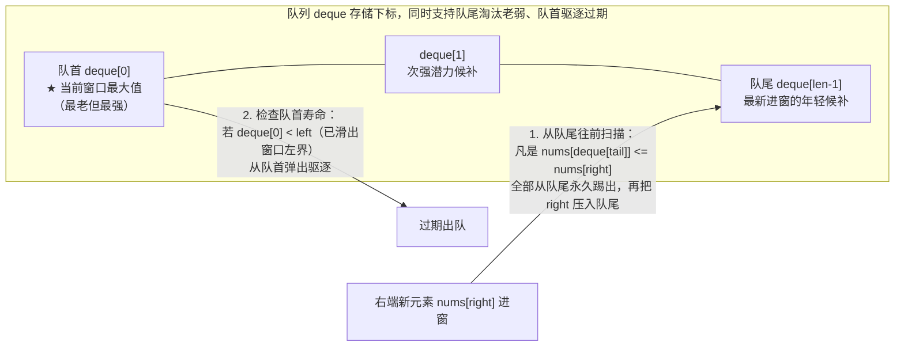

# 单调队列优化滑动窗口：O(n) 求窗口极值的艺术

**摘要：**

在本专栏第 01 篇建立的窗口状态分类体系中，加减法、异或与频次计数之所以能轻松实现 $O(1)$ 的一进一出维护，是因为它们在代数上具备**逆运算（Invertibility）**。然而，当窗口需要实时维护**最大值（Maximum）或最小值（Minimum）**时，$\max$ 与 $\min$ 运算天然不可逆——一旦当前窗口的最大值从左边界滑出，你无法通过简单的算术逆运算从旧的 `maxVal` 推算出窗口里剩下的"第二大值"是谁。为了在不退化回 $O(nk)$ 暴力重扫、甚至不引入 $O(n \log k)$ 堆/平衡树的前提下达成严格的 $O(n)$ 线性时间，计算机科学家设计了**单调双端队列（Monotonic Deque）**。本文从"生存期与竞争力双重支配（Dominance Principle）"的第一性原理出发，完整推导单调双端队列的三条循环不变量，并深入拆解五道从定长极值、可变极差限制、前缀和负数最短子数组到受限跳跃动态规划优化的代表性题目——LeetCode 239、1438、2762、862 与 1696，全部给出零冗余的 Golang 实现。

---

## 第 1 章 为什么需要单调双端队列：破除 $\max$ 运算的不可逆魔咒

### 1.1 朴素重扫、优先队列（堆）与平衡树的局限

考察经典的 **LeetCode 239：滑动窗口最大值（Sliding Window Maximum）**：给定一个整数数组 `nums`，有一个大小为 $k$ 的定长滑动窗口从最左侧滑到最右侧，返回每个窗口中的最大值。

如果我们只用一个整型变量 `curMax` 记录当前窗口的最大值：
- 当右端新元素 `nums[right]` 进窗时，更新非常愉快：`curMax = max(curMax, nums[right])`；
- 但当左端最老元素 `nums[right - k + 1]` 出窗时，如果它恰好等于 `curMax`，灾难就降临了——因为其他元素谁排第二、谁排第三的信息在刚才被 `max` 覆盖时早就丢失了。在单调递减数组 `[9, 8, 7, 6, 5, 4]` 上，每次出窗的都是当前最大值，迫使你每次都重新扫描剩下的 $k - 1$ 个元素，总时间复杂度退化为 $\Theta(nk)$。

有人会想到："能不能用一个最大堆（Max-Heap）或红黑树（如 C++ `std::multiset`、Java `TreeMap`）来存窗口里的 $k$ 个元素？"
- 如果用最大堆：进窗 `Push` 耗时 $O(\log k)$，查询堆顶最大值 $O(1)$；当左端元素出窗时，我们可以采用**懒惰删除（Lazy Deletion）**——不在它出窗的那一刻去堆中间删它，而是等它某天浮到堆顶成为最大值时，检查它的下标是否已经 `< right - k + 1`，若已过期则 `Pop` 丢弃。但即便如此，在单调递增数组上，堆中会堆积全部 $n$ 个元素，总时间复杂度为 $O(n \log n)$（用支持按位置删除的索引堆或平衡树则为 $O(n \log k)$），始终挂着一个 $\log$ 因子，且在 Go 语言标准库中没有内置红黑树，手写堆代码也较为繁琐。

怎样把这个 $\log k$ 彻底抹除，做到**单步均摊严格 $O(1)$、总体严格 $O(n)$**？

### 1.2 核心洞察："比你年轻还比你强，你就永远没机会当老大"

让我们观察滑动窗口里的两个元素下标 $i$ 和 $j$，假设 **$i < j$**（即 $i$ 比 $j$ 更早进入窗口，从而也必然比 $j$ **更早离开窗口**），且数值上满足 **`nums[i] <= nums[j]`**（即 $j$ 的数值不小于 $i$）。

现在请问：**从 $j$ 进入窗口的这一刻起，在当前窗口以及未来的任何一个后续窗口里，下标 $i$ 还有没有哪怕一丝一毫的机会成为窗口最大值？**

**绝对没有**。因为只要 $i$ 还在窗口里，比它晚到的 $j$ 就一定也在窗口里；而 `nums[j] >= nums[i]`，$j$ 在数值和寿命两个维度上对 $i$ 构成了**全方位的碾压（帕累托支配，Pareto Dominance）**。这就好比团队里来了一位比老员工更年轻（离退休更远）、能力还更强的超级新人，那么在评选"团队最强者"时，这位老员工从今往后就再也不可能当选了，我们可以当场把老员工的名字从"最强候选人名单"里永久划掉。



### 1.3 单调双端队列的三条黄金不变量

当我们每次在新元素 `nums[right]` 进窗前，都把队列末尾所有满足 `nums[idx] <= nums[right]` 的旧下标全部从队尾踢出去，留下的候选队列 `deque` 就天然满足三条严密的**循环不变量**：
1. **下标严格单调递增**：`deque[0] < deque[1] < ... < deque[len-1]`（越靠队首越老，越靠队尾越年轻）；
2. **对应元素值严格单调递减**：`nums[deque[0]] > nums[deque[1]] > ... > nums[deque[len-1]]`（因为所有左侧小于等于右侧的旧元素都已经被淘汰了）；
3. **有效边界约束**：队列中所有下标均属于当前窗口 `[left, right]`（一旦队首最老的 `deque[0] < left`，立即从队首弹出）。

由不变量 2 和 3 直接得出：**在任意时刻，队首元素 `nums[deque[0]]` 永远就是当前窗口 `[left, right]` 的最大值**；而如果把队尾淘汰条件反过来（踢出所有 `>= nums[right]` 的旧下标），队列就变成**单调递增双端队列**，队首 `nums[deque[0]]` 永远就是当前窗口的**最小值**。

---

## 第 2 章 定长窗口极值标杆：滑动窗口最大值（LeetCode 239）

### 2.1 Go 语言标准实现（切片模拟双端队列）

在 Go 语言中，完全不需要使用 `container/list` 双向链表（链表节点逐个堆分配会导致严重的 Cache Miss），直接用一个预分配容量的整型切片 `deque := make([]int, 0, n)` 即可高效充当双端队列：
- 队尾入队：`deque = append(deque, right)`；
- 队尾弹出：`deque = deque[:len(deque)-1]`；
- 队首弹出：`deque = deque[1:]`（由于整个生命周期内 `right` 只追加 $n$ 次，底层数组最多分配一次，切片头指针右移 `deque[1:]` 是纯粹的 $O(1)$ 指针偏移，零内存拷贝）：

```go
package main

// maxSlidingWindow LeetCode 239：单调递减双端队列 O(n) 求定长窗口最大值
// 时间复杂度：严格 O(n)（每个下标最多进队一次、出队一次），空间复杂度：O(n)
func maxSlidingWindow(nums []int, k int) []int {
	n := len(nums)
	if n == 0 || k == 0 {
		return nil
	}

	res := make([]int, 0, n-k+1)
	deque := make([]int, 0, n) // 存储下标，对应元素值严格单调递减

	for right, v := range nums {
		// 1. 队尾淘汰：凡是比新元素 v 小或相等的旧候选，在寿命与数值上被双重碾压，永久踢出
		for len(deque) > 0 && nums[deque[len(deque)-1]] <= v {
			deque = deque[:len(deque)-1]
		}
		deque = append(deque, right)

		// 2. 队首过期驱逐：若队首最大值下标已滑出当前定长窗口左界 right - k + 1，将其弹出
		if deque[0] < right-k+1 {
			deque = deque[1:]
		}

		// 3. 满窗结算：当窗口凑满 k 个元素时，队首即为当前窗口最大值
		if right >= k-1 {
			res = append(res, nums[deque[0]])
		}
	}
	return res
}
```

### 2.2 灵魂细节问答：为什么队列里必须存"下标 `right`"而不是直接存"数值 `nums[right]`"？

在面试白板上，大约有三分之一的候选人会随手写出 `deque = append(deque, nums[right])`（往队列里存数值而非下标）。
这样做会遇到什么麻烦？
1. 如果只存数值，当窗口右移需要检查队首最大值是否已经滑出左边界时，你只能写 `if deque[0] == nums[right-k] { deque = deque[1:] }`；
2. 此时如果在队尾淘汰时你写的是严格小于 `<`（允许相等元素共存），或者你在可变窗口里一次连续移动了多步 `left++`，只靠数值相等很容易搞乱"当前队首的这个 `5` 到底是刚刚过期在 `left` 处的那个 `5`、还是窗口中间另一个还没过期的 `5`"；
3. 而一旦队列里统一存**数组下标 `right`**，一个下标不仅唯一标识了它的诞生时间（通过 `deque[0] < left` 即可 $100\%$ 无歧义地判定是否过期），还能随时通过 `nums[deque[0]]` 在 $O(1)$ 时间内读出它的数值——**存下标永远是单调栈与单调队列的黄金铁律**。

### 2.3 另一种无队列解法：分块前后缀极值预处理（Sparse Table 思想）

如果面试官追问："除了单调双端队列，还有没有另一种完全不用队列或栈、甚至支持 SIMD 向量化加速的严格 $O(n)$ 解法？"
答案是**将数组按窗口大小 $k$ 分块（Chunking by Size $k$）**：
- 把原数组每 $k$ 个元素切成一个块：`[0 .. k-1]`, `[k .. 2k-1]`, ...；
- 预处理两个长度为 $n$ 的数组：
  - `prefixMax[i]`：表示 `i` 所在块内从**块首到 `i`** 的前缀最大值；
  - `suffixMax[i]`：表示 `i` 所在块内从**`i` 到块尾**的后缀最大值；
- 对于任意一个跨度为 $k$ 的窗口 `[left, right]`（其中 `right = left + k - 1`），它要么恰好对齐在一个块上，要么横跨两个相邻块的交界线——窗口左半截 `[left .. 块尾]` 的最大值就是 **`suffixMax[left]`**，窗口右半截 `[新块首 .. right]` 的最大值就是 **`prefixMax[right]`**。因此任意窗口的最大值直接就是一行无分支算式：
  $$\max(\text{suffixMax}[left], \text{prefixMax}[right])$$

---

## 第 3 章 双单调队列协同：可变窗口内的最大最小极差约束

当题目不再是定长窗口，而是要求找出满足**"子数组内任意两元素绝对差 $\le limit$"**的最长子数组或子数组个数时，单调队列就正式与第 03 篇的可变滑动窗口合体了。

### 3.1 LeetCode 1438：绝对差不超过限制的最长连续子数组

**题目描述**：给你一个整数数组 `nums` ，和一个表示限制的整数 `limit`，请你返回最长连续子数组的长度，该子数组中的任意两个元素之间的绝对差必须小于或者等于 `limit`。

#### 3.1.1 为什么需要同时维护递减队列 `maxQ` 与递增队列 `minQ`？

一个子数组 `nums[left .. right]` 中"任意两个元素的绝对差 $\le limit$"，当且仅当该子数组的**最大值减去最小值 $\le limit$**：

$$\max_{k \in [left, right]} \text{nums}[k] - \min_{k \in [left, right]} \text{nums}[k] \le limit$$

随着窗口扩大，窗口内的最大值只会变大或不变，最小值只会变小或不变，因此极差 `max - min` 是关于窗口宽度的**单调非递减函数**——窗口越宽极差越大（越容易超标），窗口越窄极差越小（越容易合法），完全满足可变滑动窗口的单调性前提。

为了在 $O(1)$ 时间内同时拿到当前窗口的最大值和最小值，我们并排维护两个双端队列：
1. **单调递减队列 `maxQ`**：队尾踢出 `<= nums[right]`，队首 `nums[maxQ[0]]` 为当前窗口最大值；
2. **单调递增队列 `minQ`**：队尾踢出 `>= nums[right]`，队首 `nums[minQ[0]]` 为当前窗口最小值；
3. **内层收缩**：当 `nums[maxQ[0]] - nums[minQ[0]] > limit` 时，说明窗口极差超标，必须将 `left++` 右移（若移动前发现 `maxQ[0] == left` 则弹出 `maxQ` 队首，若 `minQ[0] == left` 则弹出 `minQ` 队首），直至极差重新 $\le limit$：

```go
package main

// longestSubarray1438 LeetCode 1438：双单调队列（maxQ 递减 + minQ 递增）维护可变窗口极差 <= limit
// 时间复杂度：O(n)，空间复杂度：O(n)
func longestSubarray1438(nums []int, limit int) int {
	var maxQ, minQ []int
	left, maxLen := 0, 0

	for right, v := range nums {
		// 1. 维护单调递减队列 maxQ（队首为窗口最大值）
		for len(maxQ) > 0 && nums[maxQ[len(maxQ)-1]] <= v {
			maxQ = maxQ[:len(maxQ)-1]
		}
		maxQ = append(maxQ, right)

		// 2. 维护单调递增队列 minQ（队首为窗口最小值）
		for len(minQ) > 0 && nums[minQ[len(minQ)-1]] >= v {
			minQ = minQ[:len(minQ)-1]
		}
		minQ = append(minQ, right)

		// 3. 模式 A：当窗口最大值 - 最小值 > limit 时被动收缩 left
		for nums[maxQ[0]]-nums[minQ[0]] > limit {
			if maxQ[0] == left {
				maxQ = maxQ[1:]
			}
			if minQ[0] == left {
				minQ = minQ[1:]
			}
			left++
		}

		if right-left+1 > maxLen {
			maxLen = right - left + 1
		}
	}
	return maxLen
}
```

### 3.2 LeetCode 2762：不间断子数组（双单调队列 + 至多型子数组计数）

**题目描述**：给你一个下标从 0 开始的整数数组 `nums`。如果子数组中任意一对元素满足 `0 <= |nums[i] - nums[j]| <= 2`，则称其为不间断子数组。返回不间断子数组的**总数目**。

看清楚了吗？这道题的合法条件就是 **`limit = 2` 时的 LeetCode 1438**，唯一的区别是从"求最长合法窗口长度"改成了"求所有合法子数组的总个数"。
由于"极差 $\le 2$"属于第 01 篇第 5 章总结的**类型一：越短越合法（至多型）**，在每一轮外层 `right` 完成收缩后，所有以 `right` 为右端点、左端点取在 `[left .. right]` 之间的子数组全部合法，直接将上一题倒数第三行的更新语句替换为 **`totalCount += int64(right - left + 1)`** 即可一字不差地通过：

```go
package main

// continuousSubarrays LeetCode 2762：limit=2 的双单调队列 + right-left+1 批量计数
func continuousSubarrays(nums []int) int64 {
	var maxQ, minQ []int
	left := 0
	var totalCount int64

	for right, v := range nums {
		for len(maxQ) > 0 && nums[maxQ[len(maxQ)-1]] <= v {
			maxQ = maxQ[:len(maxQ)-1]
		}
		maxQ = append(maxQ, right)

		for len(minQ) > 0 && nums[minQ[len(minQ)-1]] >= v {
			minQ = minQ[:len(minQ)-1]
		}
		minQ = append(minQ, right)

		for nums[maxQ[0]]-nums[minQ[0]] > 2 {
			if maxQ[0] == left {
				maxQ = maxQ[1:]
			}
			if minQ[0] == left {
				minQ = minQ[1:]
			}
			left++
		}

		totalCount += int64(right - left + 1)
	}
	return totalCount
}
```

---

## 第 4 章 单调队列的王牌进阶：攻克含负数最短子数组（LC 862）与滑窗 DP（LC 1696）

单调双端队列的威力绝不仅限于直接求原数组极值，它还能在**前缀和序列**与**动态规划状态序列**上人工重建单调性。

### 4.1 进阶一：和至少为 K 的最短子数组——前缀和 + 单调递增队列克服负数逆序（LeetCode 862）

在第 05 篇的 LeetCode 209 中，因为数组全是正数，求"和 $\ge k$ 的最短子数组"只需两个普通指针。但到了困难题 **LeetCode 862**，数组中**允许包含负数**，普通滑动窗口因单调性破裂而彻底失效。

设前缀和数组为 $P[0 \dots n]$（其中 $P[i] = \sum_{m=0}^{i-1} \text{nums}[m]$）。我们要寻找最短的区间 $[l, r)$（满足 $0 \le l < r \le n$），使得：

$$P[r] - P[l] \ge k$$

当我们在外层从左往右枚举右端点 $r$ 时，希望在左边已经见过的候选起点集合 $\{l < r\}$ 中，找一个满足 $P[l] \le P[r] - k$ 且下标 $l$ 尽可能大的起点。我们用一个双端队列 `deque` 存放左侧候选起点下标 $l$，会发现两条完美的支配淘汰法则：

1. **队尾淘汰（为什么必须保持 `P[deque]` 严格单调递增？）**：
   - 假设队列末尾已有一个旧起点 $l_1 < r$，而当前到达的 $r$ 由于中间经过了负数，使得 **$P[r] \le P[l_1]$**；
   - 请问：对于未来任何一个更靠右的终点 $r' > r$，旧起点 $l_1$ 还有没有可能比新起点 $r$ 更好？
   - **绝无可能**——因为 $P[r] \le P[l_1]$，用 $r$ 作减数算出来的子数组和 $P[r'] - P[r]$ **更大（更容易达到 $\ge k$）**，且 $r > l_1$ 下标更靠右，算出来的子数组长度 $r' - r$ **更短**。旧起点 $l_1$ 在"和的大小"与"区间短度"两个维度上被 $r$ 彻底碾压，直接从**队尾**永久弹出。经过这一步淘汰，队列里的前缀和 `P[deque[0]] < P[deque[1]] < ...` 被人为改造成了**严格单调递增序列**；
2. **队首结算并弹出（为什么达标后可以直接扔掉队首？）**：
   - 因为队首 `deque[0]` 是当前队列里前缀和最小的下标，如果连 `P[r] - P[deque[0]] >= k` 都满足了，我们立刻用 `r - deque[0]` 更新最短长度；
   - 更新完之后，**`deque[0]` 使命终结，直接从队首永久弹出**（因为未来的 $r' > r$ 与 `deque[0]` 配对只会更长，不会更短）：

```go
package main

// shortestSubarray LeetCode 862：前缀和 + 单调递增双端队列攻克含负数最短子数组和 >= k
// 时间复杂度：严格 O(n)，空间复杂度：O(n)
func shortestSubarray(nums []int, k int) int {
	n := len(nums)
	prefix := make([]int64, n+1)
	for i, v := range nums {
		prefix[i+1] = prefix[i] + int64(v)
	}

	ans := n + 1
	deque := make([]int, 0, n+1) // 存放前缀和下标 l，维持 prefix[l] 严格单调递增

	for r := 0; r <= n; r++ {
		// 1. 队首达标即结算弹出：prefix[r] - prefix[deque[0]] >= k
		for len(deque) > 0 && prefix[r]-prefix[deque[0]] >= int64(k) {
			if r-deque[0] < ans {
				ans = r - deque[0]
			}
			deque = deque[1:]
		}

		// 2. 队尾淘汰劣质起点：若 prefix[队尾] >= prefix[r]，队尾旧起点在数值与位置上被 r 双重支配
		for len(deque) > 0 && prefix[deque[len(deque)-1]] >= prefix[r] {
			deque = deque[:len(deque)-1]
		}
		deque = append(deque, r)
	}

	if ans > n {
		return -1
	}
	return ans
}
```

### 4.2 进阶二：单调队列优化动态规划——跳跃游戏 VI（LeetCode 1696）

单调双端队列在动态规划（DP）中还有一个专门的名字——**单调队列优化 DP**。以 **LeetCode 1696：跳跃游戏 VI**（以及 **LeetCode 1425：带限制的子序列和**）为例：
给你一个下标从 0 开始的整数数组 `nums` 和一个整数 `k`。你一开始站在下标 `0` 处，每一步最多可以往前跳 $k$ 步（即从 $j$ 跳到 $i$ 需满足 $i - k \le j < i$），得分为经过的所有格子数值之和，求到达终点 `n - 1` 的最大得分。

写出状态转移方程：设 `dp[i]` 表示到达下标 `i` 的最大得分，则它必然是从前 $k$ 个格子 `[i - k .. i - 1]` 中 `dp` 值最大的那个格子跳过来：

$$dp[i] = \text{nums}[i] + \max_{j \in [\max(0, i-k) \dots i-1]} dp[j]$$

看这个 $\max_{j \in [i-k \dots i-1]} dp[j]$：这不就是在求**长度固定为 $k$ 的滑动窗口在 `dp` 数组上的窗口最大值**吗？
如果每次花 $O(k)$ 暴力枚举前驱 $j$，总耗时 $O(nk)$ 超时；而直接用一个单调递减双端队列维护最近 $k$ 个位置的 `dp` 最大值，单步转移瞬间降为 $O(1)$，总体耗时严格 $O(n)$：

```go
package main

// maxResult LeetCode 1696：单调递减双端队列维护前 k 步 dp 最大值，将 O(nk) DP 降至 O(n)
func maxResult(nums []int, k int) int {
	n := len(nums)
	dp := make([]int, n)
	dp[0] = nums[0]

	deque := make([]int, 0, n)
	deque = append(deque, 0)

	for i := 1; i < n; i++ {
		// 1. 驱逐距离超过 k 步的过期前驱下标
		if deque[0] < i-k {
			deque = deque[1:]
		}
		// 2. 队首即为 [i-k .. i-1] 范围内的最大 dp 值
		dp[i] = nums[i] + dp[deque[0]]

		// 3. 将当前 dp[i] 压入单调递减队列尾部
		for len(deque) > 0 && dp[deque[len(deque)-1]] <= dp[i] {
			deque = deque[:len(deque)-1]
		}
		deque = append(deque, i)
	}
	return dp[n-1]
}
```

### 4.3 进阶三：预算内的最多机器人数目——单调队列最大值 + 可变窗口和的复合约束（LeetCode 2398）

在周赛与大厂机试中，单调队列还常与普通滑动窗口的累加和结合成**复合代价函数**。以 **LeetCode 2398：预算内的最多机器人数目**为例：
你有 $n$ 个机器人，给你两个下标从 0 开始的整数数组 `chargeTimes` 和 `runningCosts` ，以及一个整数 `budget`。运行 `[left .. right]` 这 $m = right - left + 1$ 个连续机器人的总开销定义为：

$$\text{cost}(left, right) = \max_{i \in [left, right]} \text{chargeTimes}[i] + (right - left + 1) \times \sum_{i=l}^r \text{runningCosts}[i]$$

要求返回在总开销不超过 `budget` 的前提下，最多可以连续运行的机器人数目。

**单调性与双状态设计**：
1. 当窗口扩大时，$\max(\text{chargeTimes})$ 单调不减，窗口长度 $(right - left + 1)$ 单调递增，正整数累加和 $\sum \text{runningCosts}$ 也单调递增——**三项全都是非负单调不减的，因此复合总开销 $\text{cost}(left, right)$ 关于窗口宽度具备 $100\%$ 的单调性**；
2. 我们在可变滑动窗口内同时维护两个状态：
   - 用**单调递减双端队列 `maxQ`** 实时维护窗口内的最大充电时间 `chargeTimes[maxQ[0]]`；
   - 用整型标量 **`sumRun`** 实时维护窗口内的运行成本之和；
3. 一旦 `len(maxQ) > 0 && chargeTimes[maxQ[0]] + (right - left + 1) * sumRun > budget`，就进入模式 A 的内层收缩循环：若 `maxQ[0] == left` 则弹出队首，同时令 `sumRun -= runningCosts[left]; left++`：

```go
package main

// maximumRobots LeetCode 2398：单调递减队列维护最大充电时间 + 累加和维护运行成本，时间 O(n)
func maximumRobots(chargeTimes []int, runningCosts []int, budget int64) int {
	var maxQ []int
	var sumRun int64
	left, maxCount := 0, 0

	for right := 0; right < len(chargeTimes); right++ {
		// 1. 右端入窗：维护 chargeTimes 的单调递减队列与 runningCosts 的累加和
		for len(maxQ) > 0 && chargeTimes[maxQ[len(maxQ)-1]] <= chargeTimes[right] {
			maxQ = maxQ[:len(maxQ)-1]
		}
		maxQ = append(maxQ, right)
		sumRun += int64(runningCosts[right])

		// 2. 模式 A：当复合开销 max(charge) + k * sum(run) > budget 时被动收缩 left
		for len(maxQ) > 0 && int64(chargeTimes[maxQ[0]])+int64(right-left+1)*sumRun > budget {
			if maxQ[0] == left {
				maxQ = maxQ[1:]
			}
			sumRun -= int64(runningCosts[left])
			left++
		}

		if right-left+1 > maxCount {
			maxCount = right - left + 1
		}
	}
	return maxCount
}
```

### 4.4 进阶四：绝对差限制下的带约束跳石子与满足不等式的最大值（LeetCode 1499）

单调队列维护极值的另一个经典变形是 **LeetCode 1499：满足不等式的最大值**：给定按横坐标 $x_i$ 严格递增排列的二维点集 `points[i] = [x_i, y_i]` 和整数 $k$，求满足 $1 \le i < j \le n$ 且 **$x_j - x_i \le k$** 的点对中，$y_i + y_j + |x_i - x_j|$ 的最大值。

由于 $i < j$ 且 $x$ 递增，有 $|x_i - x_j| = x_j - x_i$。将含 $i$ 的项与含 $j$ 的项彻底分离（变量分离法）：

$$y_i + y_j + (x_j - x_i) = \mathbf{(x_j + y_j) + (y_i - x_i)}$$

看这个分离后的式子：当我们从左往右枚举右点 $j$（此时 $x_j + y_j$ 是已知常数）时，我们要在所有满足 **`x_j - x_i <= k`**（即横坐标距离窗口宽度不超过 $k$）的左侧点 $i < j$ 中，找出 **`y_i - x_i` 的最大值**。
这直接就是一个以横坐标差 $x_j - x_i \le k$ 为窗口宽度的**滑动窗口最大值问题**：用一个单调递减双端队列维护 $(x_i, y_i - x_i)$，先从队首弹出所有满足 `x_j - q[0].x > k` 的过期点，再用队首最大的 `q[0].diff + x_j + y_j` 更新答案，最后在队尾淘汰所有 `diff <= y_j - x_j` 的旧点后将 $j$ 入队，时间复杂度严格 $O(n)$。

### 4.5 常见误区与边界自检

1. **在 `maxSlidingWindow`（LC 239）中先取队首结算、后驱逐过期元素**：在每一轮 `right` 中，必须**先检查并弹出过期队首 `if deque[0] < right - k + 1`**，然后再读取 `nums[deque[0]]` 作为当前窗口最大值；如果顺序反过来，就会把刚刚滑出左边界的上古最大值继续算作当前窗口的答案。
2. **在可变窗口 + 单调队列（LC 1438、2398）中，先执行了 `left++` 再判断 `maxQ[0] == left`**：如果在内层收缩循环里先把 `left` 加了 1，那么判断队首是否过期的条件就必须写成 `if maxQ[0] < left`；如果写在 `left++` 之前，则写成 `if maxQ[0] == left`。推荐固定写成 `if maxQ[0] == left { maxQ = maxQ[1:] }` 后紧跟 `left++`，语义最清晰。
3. **在单调队列优化 DP（LC 1696、1425）中漏放初始状态下标 `0`**：在跳跃游戏 VI（LC 1696）中，起点下标 `0` 是后续 `1..k` 步的合法转移前驱，因此必须在进入 `for i := 1; i < n; i++` 循环前先初始化 `dp[0] = nums[0]` 并将下标 `0` 压入双端队列 `deque = append(deque, 0)`；否则第 1 步读取 `deque[0]` 时就会触发空切片越界 panic。

### 4.6 延伸设计题：支持 $O(1)$ 查询最大值的队列（剑指 Offer 59-II / LCR 184 设计自助结算系统）

单调双端队列不仅能耦合在滑动窗口循环里，还能单独抽离封装为一个通用的工业级数据结构——**支持均摊 $O(1)$ `MaxValue()` 的 FIFO 队列（MaxQueue）**。
它的内部由两个队列协同工作：
- **主数据队列 `dataQ []int`**：原封不动地按先进先出顺序保存所有入队元素；
- **辅助单调递减双端队列 `maxQ []int`**：
  - 当调用 `PushBack(value)` 时：`dataQ` 正常尾插；`maxQ` 从队尾踢出所有 `< value`（注意此处用严格小于 `<`，以便相等的最大值各自保留一份副本，免去存下标）的元素后，将 `value` 尾插进 `maxQ`；
  - 当调用 `PopFront()` 时：弹出 `dataQ` 队首 `front`；若 `front == maxQ[0]`，则同步弹出 `maxQ` 队首；
  - 当调用 `MaxValue()` 时：直接返回 `maxQ[0]`，耗时严格 $O(1)$：

```go
package main

// MaxQueue 支持 O(1) PushBack、PopFront 与 MaxValue 的队列结构
type MaxQueue struct {
	dataQ []int
	maxQ  []int // 单调非递增双端队列
}

func ConstructorMaxQueue() MaxQueue {
	return MaxQueue{}
}

func (q *MaxQueue) MaxValue() int {
	if len(q.maxQ) == 0 {
		return -1
	}
	return q.maxQ[0]
}

func (q *MaxQueue) PushBack(value int) {
	q.dataQ = append(q.dataQ, value)
	// 注意：不存下标直接存值时，队尾淘汰必须用严格小于 <，保留相等最大值的多份计数
	for len(q.maxQ) > 0 && q.maxQ[len(q.maxQ)-1] < value {
		q.maxQ = q.maxQ[:len(q.maxQ)-1]
	}
	q.maxQ = append(q.maxQ, value)
}

func (q *MaxQueue) PopFront() int {
	if len(q.dataQ) == 0 {
		return -1
	}
	val := q.dataQ[0]
	q.dataQ = q.dataQ[1:]
	if val == q.maxQ[0] {
		q.maxQ = q.maxQ[1:]
	}
	return val
}
```

将这道题与《栈与队列》专栏的 **最小栈（MinStack，LC 155）** 对照：因为栈是后进先出（LIFO），新压入的元素一定比老元素先弹出，所以辅助栈只需单向压入 `min(curMin, x)` 即可；而队列是先进先出（FIFO），后进来的强元素会熬死前面所有的弱元素，因此辅助结构必须支持从队尾向前淘汰弱者，即升格为**单调双端队列**。

---

## 第 5 章 本章七道单调队列核心题型对比表

| 题目 | 窗口类型 | 队列维护对象与单调方向 | 队首弹出条件 | 队尾淘汰条件 | 时间 / 空间 |
|------|----------|------------------------|--------------|--------------|-------------|
| LC 239 滑动窗口最大值 | 定长 $k$ | `nums[i]` 单调递减 | `q[0] < right - k + 1`（过期） | `nums[tail] <= nums[right]` | $O(n)$ / $O(n)$ |
| LC 1438 绝对差限制最长子数组 | 可变求最长 | `maxQ` 递减 + `minQ` 递增 | `max - min > limit` 时移出 `left` | `<= v` 与 `>= v` 双向维护 | $O(n)$ / $O(n)$ |
| LC 2762 不间断子数组 | 可变求个数 | 同 LC 1438（`limit = 2`） | `max - min > 2` 时移出 `left` | 同上，外侧加 `right - left + 1` | $O(n)$ / $O(n)$ |
| LC 862 和至少为 K 最短子数组 | 前缀和最短 | 前缀和 `P[l]` 单调递增 | `P[r] - P[q[0]] >= k`（达标即弹） | `P[tail] >= P[r]`（消除负数逆序） | $O(n)$ / $O(n)$ |
| LC 1696 跳跃游戏 VI | 滑窗优化 DP | 状态值 `dp[j]` 单调递减 | `q[0] < i - k`（超出跳跃步幅） | `dp[tail] <= dp[i]` | $O(n)$ / $O(n)$ |
| LC 2398 预算内最多机器人数 | 可变求最长 | `maxQ` 递减维护充电时间 + `sumRun` | `max(charge) + k*sum > budget` 移出 `left` | `charge[tail] <= charge[right]` | $O(n)$ / $O(n)$ |
| LC 1499 满足不等式的最大值 | 坐标距离 $\le k$ | `y_i - x_i` 单调递减 | `x_j - x_{q[0]} > k`（超出距离 $k$） | `(y-x)[tail] <= y_j - x_j` | $O(n)$ / $O(n)$ |
| LCR 184 队列的最大值 | 动态 FIFO 队列 | 主队列 `dataQ` + 单调非递增 `maxQ` | `PopFront` 值等于 `maxQ[0]` 时同步弹出 | `maxQ[tail] < value`（严格小于） | 均摊 $O(1)$ / $O(n)$ |

### 5.2 进一步视野：环形子数组的最大和——长度受限为 $n$ 的前缀和单调队列（LeetCode 918）

最后回答思考题中的经典关联：在 **LeetCode 918：环形子数组的最大和**中，给定长度为 $n$ 的环形整数数组 `nums`（含负数），求非空环形子数组的最大可能和。
把原数组复制一份接在末尾，构成长度为 $2n$ 的破环成链数组 `A[0 .. 2n-1]`。此时任何一个合法的非空环形子数组，都对应 `A` 中一段**长度在 `[1, n]` 之间**的连续子数组 `A[l .. r-1]`（满足 $r - n \le l < r$），其元素和为：

$$P[r] - P[l]$$

为了在固定右端点 $r$ 时最大化 $P[r] - P[l]$，我们需要在宽度为 $n$ 的滑动窗口 $l \in [\max(0, r-n) \dots r-1]$ 内找出**最小的前缀和 $P[l]$**。这直接就是一个宽度固定为 $n$ 的**滑动窗口最小值问题**——用一个单调递增双端队列维护前缀和下标 $l$，队首过期条件为 `deque[0] < r - n`，队尾淘汰条件为 `P[deque[tail]] >= P[r]`，即可用同一套单调队列框架将环形数组最大和与 LC 862 彻底统一起来，这也是单调双端队列在受限区间极值问题中跨越正负边界的终极形态。

---

## 小结

本章完整揭示了单调双端队列如何成为滑动窗口处理极值问题的核武器：
- 依靠**"比你年轻还比你强，你就永无出头之日"**的寿命-竞争力双重支配原则，单调队列在队尾淘汰无望候选、在队首驱逐过期下标，将不可逆的 $\max/\min$ 维护摊还到了严格的 $O(1)$；
- 在需要同时卡住上下界的极差问题（LC 1438、2762）中，用一递减、一递增两个单调队列并驾齐驱；
- 在含负数最短子数组（LC 862）与定步幅动态规划（LC 1696）中，单调队列进一步升维到前缀和序列与 DP 状态序列上，人工筛出单调候选集。

下一篇 [[08 前缀和与滑动窗口的思想融合：子数组求和类问题]] 将系统剖析当滑动窗口遭遇"负数"与"精确等于 $K$"两大禁区时，如何用前缀和与同余哈希接管战场。

---

## 参考资料

1. Cormen, T. H., et al. *Introduction to Algorithms* (4th ed.). MIT Press, 2022.
2. LeetCode 239 / 1438 / 2762 / 862 / 1696 Official Editorial.

---

> [!note] 思考题
> 1. 在 LeetCode 239（滑动窗口最大值）的队尾淘汰条件中，如果把 `nums[deque[len(deque)-1]] <= v` 改写为严格小于 `< v`（即保留相等元素的旧下标），算法的正确性与时间复杂度会受到影响吗？
> 2. 在 LeetCode 918（环形子数组的最大和）中，除了用"总和减去最小子数组和"的Trick，如果将原数组复制一份拼接成长度为 $2n$ 的数组，问题就转化为"长度不超过 $n$ 的连续子数组最大和"，即求 $\max_{r - n \le l < r} (P[r] - P[l])$。如何用本章的单调递增队列在 $O(n)$ 时间内直接求出这个带宽度限制的最大前缀和差？
> 3. 请设计一个支持 `PushBack(x)`、`PopFront()` 和 $O(1)$ 时间查询队列最大值 `MaxValue()` 的队列结构（剑指 Offer 59-II 队列的最大值）。
