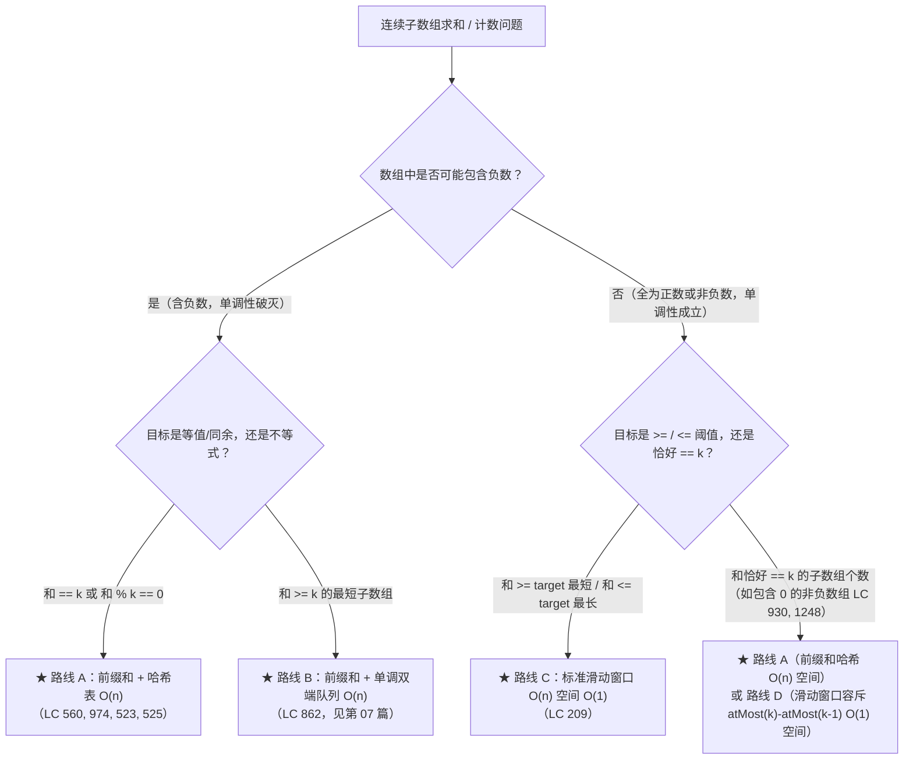

# 前缀和与滑动窗口的思想融合：子数组求和类问题

**摘要：**

在算法面试中，求"连续子数组之和满足某条件"的题目占据了半壁江山，但初学者最容易掉进的陷阱就是**不分青红皂白地拿滑动窗口去套所有子数组求和题**。当数组中混入**负数**（如 LeetCode 560 和为 K 的子数组），或者条件要求子数组和是某个数的倍数（如 LeetCode 974、523），滑动窗口赖以生存的"扩窗和必增、缩窗和必减"单调性瞬间崩塌。本文深入剖析**前缀和 + 哈希表（Prefix Sum + Hash Map）**这一与滑动窗口双峰并峙的子数组核心范式，揭示它是如何通过 $S(l, r) = P[r+1] - P[l]$ 的代数变换将"区间求和"降维为"两点前缀差配对"的，并结合 LeetCode 560、974、523、525、930、1248 六道代表性题目，给出前缀和哈希与滑动窗口的精确分水岭及 Golang 实现。

---

## 第 1 章 为什么滑动窗口在负数与等值计数面前会失灵？

### 1.1 一个让滑动窗口彻底瘫痪的三元素反例

假设题目要求统计数组中和等于 $k = 2$ 的连续子数组个数（LeetCode 560），输入数组为 `nums = [2, -1, 1, 2]`。
如果你试图用滑动窗口 `left, right` 来找所有和为 $2$ 的子数组，请看当 `left = 0, right = 0`（此时子数组 `[2]` 的和已经等于 $2$）时，你面临的死局：
- 如果你选择**收缩左指针 `left++`**：那么以 `left = 0` 为起点、更长的合法子数组 `[2, -1, 1]`（下标 `0..2`，和也是 $2$）就永远被你错过了；
- 如果你选择**不收缩 `left` 而继续扩张 `right++`**：那么当 `right` 走到 `3`（子数组 `[2, -1, 1, 2]`，和为 $4$）再收缩 `left` 时，中间的 `[1, 2]` 等组合又会与之前的路径交错混乱。

**症结何在？**
滑动窗口之所以能丢弃左端点 `left`（执行 `left++` 永不回头），前提是**未来当 `right` 变得更大时，旧的 `left` 必然会导致窗口和单调变大（或单调变小），绝不可能重新拐回来等于目标值 $k$**。然而一旦数组里有了**负数**（甚至只要有 **`0`**），前缀和曲线就不再是严格单调上升的阶梯，而是一条上下起伏的波浪线——同一个水平高度值 $P$ 可能在波浪线上反复出现多次，单一的 `left` 游标根本无法分身记住历史上所有处于同一高度的左起点。



### 1.2 前缀和的降维魔法：把"区间"变成"两个点之差"

既然滑动窗口无法应对起伏的负数序列，**前缀和（Prefix Sum）**提供了另一条完全不依赖单调性的代数通道。

定义长度为 $n + 1$ 的前缀和序列 $P[0 \dots n]$：
- $P[0] = 0$（代表不包含任何元素的空前缀）；
- $P[i] = \text{nums}[0] + \text{nums}[1] + \cdots + \text{nums}[i-1]$（代表前 $i$ 个元素之和）。

于是，原数组中任意一段连续子数组 `nums[l .. r]`（$0 \le l \le r < n$）的元素之和，都可以通过一次减法在 $O(1)$ 时间内精确表示为：

$$\sum_{k=l}^r \text{nums}[k] = P[r + 1] - P[l]$$

现在，题目要求寻找满足"子数组和等于 $k$"的区间 `[l, r]`，等价于解方程：

$$P[r + 1] - P[l] = k \iff \mathbf{P[l] = P[r + 1] - k} \quad (0 \le l \le r)$$

请看移项后的式子 $P[l] = P[r + 1] - k$：**当我们在外层循环从左往右遍历右端点 $r$（此时当前前缀和为 `curPrefix = P[r+1]`）时，想要知道以 $r$ 为右端点、和等于 $k$ 的子数组有多少个，完全等价于询问："在 $r$ 左侧已经出现过的历史前缀和 $P[0], P[1], \ldots, P[r]$ 当中，数值恰好等于 `curPrefix - k` 的一共有几个？"**

要在 $O(1)$ 时间内查出历史上某个数值出现了几次，数据结构自然就是**哈希表 `cntMap[prefixVal] -> 出现次数`**。这本质上就是把"子数组和等于 $k$"化归为了我们在数组篇第一天就学过的 **Two Sum（两数之差等于 $k$）**。

---

## 第 2 章 前缀和 + 哈希表四大经典实战

### 2.1 LeetCode 560：和为 K 的子数组（Subarray Sum Equals K）

**题目描述**：给你一个整数数组 `nums`（可能包含正数、负数和 0）和一个整数 `k` ，请你统计并返回该数组中和为 `k` 的子数组的个数。

#### 2.1.1 为什么必须在循环前执行哨兵初始化 `cntMap[0] = 1`？

在编写前缀和哈希代码时，有一行生死攸关的初始化语句：**`cntMap[0] = 1`**。
为什么在还没扫描任何一个数组元素之前，哈希表里就已经有了 1 个前缀和为 `0` 的记录？
因为根据定义，空前缀 $P[0] = 0$ 占据了下标 $l = 0$ 的位置。当右端点走到 $r$ 时，如果从数组最开头第 `0` 号元素一直加到第 `r` 号元素的**整段前缀子数组 `nums[0 .. r]` 本身之和恰好就等于 `k`**（即 `curPrefix == k`），那么此时我们要去哈希表里查找的目标值是 `curPrefix - k = 0`。如果一开始没有把 $P[0] = 0$ 登记进 `cntMap[0] = 1`，所有从下标 `0` 开始的合法子数组就会被全部漏统计。

同时请注意循环体内的两步严格顺序：**必须先查表累加 `ans += cntMap[curPrefix - k]`，再将当前前缀和登记入表 `cntMap[curPrefix]++`**。如果顺序颠倒（先登记再查表），当目标值 `k == 0` 时，就会把 `curPrefix - 0 == curPrefix`（即刚刚登记进去的自己跟自己相减，对应长度为 0 的空子数组）错误地算作 1 个非空合法子数组：

```go
package main

// subarraySum LeetCode 560：前缀和 + 哈希表频次统计（无视正负零，通杀一切等值子数组和）
// 时间复杂度：O(n)，空间复杂度：O(n)
func subarraySum(nums []int, k int) int {
	cntMap := make(map[int]int, len(nums)+1)
	cntMap[0] = 1 // 核心哨兵：代表 P[0] = 0（空前缀）已出现 1 次

	curPrefix, total := 0, 0
	for _, v := range nums {
		curPrefix += v
		// 1. 先查询历史前缀和中等于 curPrefix - k 的个数
		if c, ok := cntMap[curPrefix-k]; ok {
			total += c
		}
		// 2. 再将当前前缀和登记入表，供后续右端点配对
		cntMap[curPrefix]++
	}
	return total
}
```

### 2.2 LeetCode 974：和可被 K 整除的子数组（同余定理 + 负数取模修正）

**题目描述**：给定一个整数数组 `nums` 和一个整数 `k`，返回其中元素之和可被 `k` 整除的非空子数组的数目。

#### 2.2.1 同余定理化归与 Go 语言负数取模陷阱

子数组 `nums[l .. r]` 的和能被 $k$ 整除，用前缀和表示即为：

$$(P[r + 1] - P[l]) \bmod k = 0 \iff \mathbf{P[r + 1] \bmod k == P[l] \bmod k}$$

这就是初等数论中的**同余定理（Congruence Theorem）**：两个整数之差能被 $k$ 整除，当且仅当这两个整数除以 $k$ 的**余数完全相同**。

但当数组中存在负数时，在 Go、C/C++、Java 等语言中直接写 `curPrefix % k` 会踩中一个致命陷阱：
- 在数学同余定义中，余数的取值范围必须严格落在非负区间 **`[0, k - 1]`** 内（譬如 $-2 = (-1) \times 5 + 3$，故 $-2 \bmod 5 = 3$，它与 $+3 \bmod 5 = 3$ 同余，因为 $3 - (-2) = 5$ 能被 $5$ 整除）；
- 而在 Go 语言中，取模运算符 `%` 的结果符号与被除数相同，即 **`-2 % 5` 算出来等于 `-2`**。如果不把 `-2` 修正为 `+3`，`P[l] = -2` 与 `P[r+1] = 3` 就无法在同一个桶里配对成功。

因此，在含负数同余问题中，计算标准非负余数的黄金公式是：

$$\text{mod} = ((curPrefix \bmod k) + k) \bmod k$$

而且，由于余数的取值范围严格局限在 `[0, k - 1]` 之间（题目中 $k \le 10^4$），我们甚至不需要用 `map[int]int`，直接开一个长度为 $k$ 的定长切片 `modCnt := make([]int, k)` 作计数桶，速度更快、内存更省：

```go
package main

// subarraysDivByK LeetCode 974：前缀和同余定理 + 负数取模非负化修正
// 时间复杂度：O(n)，空间复杂度：O(k)
func subarraysDivByK(nums []int, k int) int {
	modCnt := make([]int, k)
	modCnt[0] = 1 // P[0] = 0 的余数为 0

	curPrefix, total := 0, 0
	for _, v := range nums {
		curPrefix += v
		// 将可能为负的余数统一映射到 [0, k-1] 正余数空间
		mod := (curPrefix%k + k) % k
		total += modCnt[mod]
		modCnt[mod]++
	}
	return total
}
```

### 2.3 LeetCode 523：连续的子数组和（同余 + 长度至少为 2 的最早下标映射）

**题目描述**：给你一个整数数组 `nums` 和一个整数 `k` ，如果 `nums` 有一个**好的子数组**返回 `true`，否则返回 `false`。一个好的子数组定义为：**长度至少为 2**，且子数组元素总和为 `k` 的倍数。

这道题与上一题（LC 974）同样使用同余定理 `P[r+1] % k == P[l] % k`，但有两个关键差异：
1. **哈希表的 Value 不再存"出现次数"，而是存"该余数第一次（最早）出现的下标 `firstIdx`"**；
2. **为什么只存最早出现的下标，后续遇到相同余数时绝不覆盖更新？** 因为题目要求子数组长度 `(r + 1) - l >= 2`，为了让子数组长度尽可能大、最容易满足 `>= 2`，左端点 `l`  당연히是越靠左（越早出现）越好；
3. **哨兵初始化**：空前缀 $P[0] = 0$ 对应的余数 `0`，其虚拟元素下标应设为 **`-1`**（即 `firstIdxMap[0] = -1`）。这样当第 `0` 号和第 `1` 号元素之和就已经能被 $k$ 整除时（此时当前下标 `i = 1`），长度算出来是 `1 - (-1) = 2 >= 2`，分毫不差地判定为合法：

```go
package main

// checkSubarraySum LeetCode 523：前缀和同余 + 哈希表记录余数最早出现下标（贪心最大化长度）
func checkSubarraySum(nums []int, k int) bool {
	if len(nums) < 2 {
		return false
	}

	firstIdx := make(map[int]int, len(nums)+1)
	firstIdx[0] = -1 // 哨兵：空前缀位于下标 -1

	curPrefix := 0
	for i, v := range nums {
		curPrefix += v
		mod := (curPrefix%k + k) % k
		if prevIdx, ok := firstIdx[mod]; ok {
			if i-prevIdx >= 2 {
				return true
			}
			// 注意：若 i - prevIdx < 2（即等于 1），绝不能用当前的 i 覆盖更早的 prevIdx。
		} else {
			firstIdx[mod] = i
		}
	}
	return false
}
```

### 2.4 LeetCode 525：连续数组（将 0/1 个数相等转化为前缀和为 0）

如果题目根本没提"求和"，而是问你：给定一个二进制数组 `nums`，找到含有**相同数量的 `0` 和 `1`** 的最长连续子数组，并返回该子数组的长度（**LeetCode 525：连续数组**），怎么用前缀和解决？

只需做一步极其巧妙的**正负抵消赋权变换**：
> **把数组里所有的 `0` 看作 `-1`，把所有的 `1` 看作 `+1`。**

如此一来，一段子数组中"`0` 的数量与 `1` 的数量相等"，就 $100\%$ 等价于这段子数组的**加权元素总和等于 `0`**（即 $P[r+1] - P[l] == 0 \iff P[r+1] == P[l]$）。直接套用上一题（LC 523）"哈希表记录每个前缀和最早出现下标 `firstIdx`"的模板，遇到相同前缀和时用 `i - prevIdx` 更新最大长度即可：

```go
package main

// findMaxLength LeetCode 525：将 0 视作 -1、1 视作 +1，转化为寻找前缀和相等的最远下标对
func findMaxLength(nums []int) int {
	firstIdx := make(map[int]int, len(nums)+1)
	firstIdx[0] = -1

	curSum, maxLen := 0, 0
	for i, v := range nums {
		if v == 1 {
			curSum++
		} else {
			curSum--
		}
		if prevIdx, ok := firstIdx[curSum]; ok {
			if i-prevIdx > maxLen {
				maxLen = i - prevIdx
			}
		} else {
			firstIdx[curSum] = i
		}
	}
	return maxLen
}
```

这套"`+1 / -1` 赋权抵消 + 前缀和最早下标哈希"的模型，同样能直接秒杀 **LeetCode 1124：表现良好的最长时间段**（劳累天数 `> 8` 小时记 `+1`、否则记 `-1`，求前缀和差 $> 0$ 的最长子数组）以及 **面试题 17.05：字母与数字**。

---

## 第 3 章 前缀和哈希 vs 滑动窗口的正面交锋（LC 1248 & LC 930）

当数组中**所有元素均为非负数**，且要求统计"和恰好等于 $k$"的子数组个数时——譬如 **LeetCode 1248：统计「优美子数组」**（将奇数看作 `1`、偶数看作 `0`，求和恰好为 $k$ 的子数组个数）与 **LeetCode 930：和相同的二元子数组**（给定只含 `0` 和 `1` 的数组，求和恰好为 `goal` 的子数组个数）——此时**前缀和哈希**与**滑动窗口（容斥差分 / 三指针）**两条路线都能走通。我们该如何抉择？

### 3.1 两种解法在 LeetCode 1248 上的同台对比

1. **路线一（前缀和 + 定长计数数组，时间 $O(n)$，空间 $O(n)$）**：
   - 将每个数对 2 取模（`v & 1`），奇数数量前缀和 `oddPrefix` 的取值范围在 $[0, n]$ 之间。用长度为 $n + 1$ 的切片 `cnt := make([]int, n+1)` 代替 `map`，初始化 `cnt[0] = 1`，每次累加 `cnt[oddPrefix - k]`。
2. **路线二（滑动窗口容斥差分 `atMost(k) - atMost(k-1)`，时间 $O(n)$，空间严格 $O(1)$）**：
   - 因为奇数个数随窗口扩大单调不减（全为非负数 `0` 或 `1`），直接写一个 10 行的辅助函数 `atMostKOdd(nums, k)` 统计"奇数个数 $\le k$ 的子数组总数"，返回 `atMostKOdd(nums, k) - atMostKOdd(nums, k - 1)`，**彻底消灭了 $O(n)$ 的哈希表或计数数组内存分配**。

```go
package main

// numberOfSubarraysPrefix 路线一：前缀和计数数组，时间 O(n)，空间 O(n)
func numberOfSubarraysPrefix(nums []int, k int) int {
	cnt := make([]int, len(nums)+1)
	cnt[0] = 1
	oddPrefix, total := 0, 0

	for _, v := range nums {
		oddPrefix += v & 1
		if oddPrefix >= k {
			total += cnt[oddPrefix-k]
		}
		cnt[oddPrefix]++
	}
	return total
}

// numberOfSubarraysWindow 路线二：滑动窗口容斥作差，时间 O(n)，额外空间严格 O(1)
func numberOfSubarraysWindow(nums []int, k int) int {
	atMost := func(limit int) int {
		if limit < 0 {
			return 0
		}
		left, odds, count := 0, 0, 0
		for right, v := range nums {
			odds += v & 1
			for odds > limit {
				odds -= nums[left] & 1
				left++
			}
			count += right - left + 1
		}
		return count
	}
	return atMost(k) - atMost(k-1)
}
```

### 3.2 选型铁律总结

| 场景特征 | 首选方案 | 核心理由 |
|----------|----------|----------|
| 数组包含**负数**，求和 `== k` 或 `% k == 0` | **前缀和 + 哈希表** | 负数打破单调性，滑动窗口（含容斥差分）彻底失效 |
| 数组**全非负**（如 `0/1` 数组或正整数），求和 `== k` | **滑动窗口容斥差分**（或前缀和） | 滑动窗口可将额外空间从 $O(n)$ 压至 **$O(1)$** |
| 求正负抵消平衡（如 `0` 和 `1` 数量相等） | **`+1/-1` 赋权 + 前缀和哈希** | 赋权后引入了 `-1`，转化为前缀和相等的最远距离 |
| 数组含**负数**，求和 **`>= k`** 的最短子数组 | **前缀和 + 单调双端队列**（LC 862） | 哈希表只能查等值 `==`，不等式 `>=` 需单调队列维护下凸壳 |

---

## 第 4 章 常见误区与边界自检

1. **漏写空前缀哨兵 `cntMap[0] = 1` 或 `firstIdx[0] = -1`**：记住，在"统计个数"题（LC 560、974、1248）中，哨兵代表空前缀出现了 **1 次**（`cntMap[0] = 1`）；而在"求最长/最短子数组长度"题（LC 523、525）中，哨兵代表空前缀位于**下标 `-1`**（`firstIdx[0] = -1`）。把 `cntMap[0] = 1` 和 `firstIdx[0] = -1` 混淆是考场高频笔误。
2. **在求最长子数组的 `firstIdx` 哈希表中，每次遇到相同前缀和都错误更新了下标**：在 LC 523 和 LC 525 中，只有当 `!ok`（该前缀和/余数**历史上第一次出现**）时才写入 `firstIdx[curSum] = i`；如果已存在则绝不能覆盖，否则左端点右移会让子数组变短。
3. **在 LC 930（和相同的二元子数组）中用容斥差分 `atMost(goal) - atMost(goal - 1)` 时未处理 `goal == 0`**：当 `goal == 0` 时，`goal - 1 = -1`，必须在 `atMost(limit)` 函数第一行加上 **`if limit < 0 { return 0 }`** 保护，否则内层循环 `for sum > -1` 会把 `left` 推过 `right` 导致越界 panic。

---

## 第 5 章 深度拓展：使数组和能被 P 整除、二维子矩阵与前缀异或窗口

### 5.1 实战五：使数组和能被 P 整除——最近下标映射与同余移项（LeetCode 1590）

在第 2.3 节的 LeetCode 523（连续的子数组和）中，因为求的是**是否存在长度 $\ge 2$ 的子数组**（越长越容易满足），所以哈希表里记录的是每个余数**最早**出现的下标，遇到相同余数时绝不覆盖。

反过来，如果题目要求**移除一个最短的子数组（不允许移除整个数组），使得剩余元素的和能被 $p$ 整除**（**LeetCode 1590：使数组和能被 P 整除**），哈希表应该怎么存？
1. **同余目标转化**：设全数组所有元素的总和模 $p$ 的余数为 `targetRem = totalSum % p`。如果 `targetRem == 0`，一刀不用切，直接返回 `0`；否则，要想让剩下的元素和模 $p$ 为 $0$，**被我们切掉的那段连续子数组 `nums[l .. r]`，其元素之和模 $p$ 的余数必须恰好等于 `targetRem`**：
   $$(P[r + 1] - P[l]) \bmod p \equiv \text{targetRem} \pmod p$$
2. **移项锁定目标前驱余数**：将上式移项，对于当前右端点前缀和余数 `curRem = P[r+1] % p`，我们要在左侧寻找的前缀和余数 `needRem = P[l] % p` 满足：
   $$\text{needRem} = (\text{curRem} - \text{targetRem} + p) \bmod p$$
3. **存储最近（最晚）下标以最小化长度**：因为我们要切掉的子数组长度 `(r + 1) - l` **越短越好**，所以左起点 $l$ 必然是**越靠右（离当前的 $r$ 越近）越好**。因此，这一次我们在哈希表 `lastIdxMap` 中每一步都**无条件用当前下标覆盖更新 `lastIdxMap[curRem] = r + 1`**，永远保持记录该余数最近一次出现的位置：

```go
package main

// minSubarray LeetCode 1590：同余移项 + 哈希表实时覆盖记录最近下标以最小化删除长度
// 时间复杂度：O(n)，空间复杂度：O(min(n, p))
func minSubarray(nums []int, p int) int {
	totalRem := 0
	for _, v := range nums {
		totalRem = (totalRem + v) % p
	}
	if totalRem == 0 {
		return 0
	}

	n := len(nums)
	minLen := n // 注意不允许移除整个数组，故最终若 minLen == n 则返回 -1
	lastIdx := make(map[int]int, n+1)
	lastIdx[0] = 0 // P[0] = 0 位于前缀下标 0

	curRem := 0
	for i, v := range nums {
		curRem = (curRem + v) % p
		needRem := (curRem - totalRem + p) % p
		if prev, ok := lastIdx[needRem]; ok {
			if (i+1)-prev < minLen {
				minLen = (i + 1) - prev
			}
		}
		// 关键：因为求最短子数组，无条件用最新的前缀下标 i+1 覆盖旧下标
		lastIdx[curRem] = i + 1
	}

	if minLen == n {
		return -1
	}
	return minLen
}
```

请将 LC 974（统计同余子数组**个数** $\to$ 存频次 `modCnt[mod]++`）、LC 523（求**最长**同余子数组 $\to$ 只存最早下标，不覆盖）与 LC 1590（求**最短**同余子数组 $\to$ 每次覆盖存最晚下标）放在一起对比，前缀和哈希表的三种形态便尽在掌握。

### 5.2 实战六：升维至二维矩阵——元素和为目标值的子矩阵数量（LeetCode 1074）

如果面试官把一维数组扩展为 $m \times n$ 的二维整数矩阵 `matrix`（含负数），要求统计所有元素之和等于 `target` 的非空子矩阵数量（**LeetCode 1074**），该如何降维？

核心技巧是**"枚举行上下边界 `top` 与 `bottom` + 列向压扁为一维数组 + 复用 LeetCode 560"**：
- 外层用两重循环固定子矩阵的上边界行号 `top`（$0 \le top < m$）和下边界行号 `bottom`（$top \le bottom < m$）；
- 当 `bottom` 向下扩展一行时，将第 `bottom` 行的每一列元素累加进一维数组 `colSum[0 .. n-1]` 中（此时 `colSum[c]` 代表第 `c` 列从 `top` 行到 `bottom` 行的竖条元素之和）；
- 现在，一个上下边界固定为 `[top, bottom]`、左右边界为 `[leftCol, rightCol]` 的二维子矩阵之和，就**完全等于一维数组 `colSum` 在区间 `[leftCol .. rightCol]` 上的连续子数组之和**。直接对 `colSum` 调用一次第 2.1 节的 `subarraySum(colSum, target)`，即可在 $O(m^2 n)$ 时间内解决：

```go
package main

// numSubmatrixSumTarget LeetCode 1074：上下行边界枚举压扁为一维列和 + 前缀和哈希 (LC 560)
// 时间复杂度：O(m^2 * n)，空间复杂度：O(n)
func numSubmatrixSumTarget(matrix [][]int, target int) int {
	m, n := len(matrix), len(matrix[0])
	total := 0

	for top := 0; top < m; top++ {
		colSum := make([]int, n)
		for bottom := top; bottom < m; bottom++ {
			for c := 0; c < n; c++ {
				colSum[c] += matrix[bottom][c]
			}
			// 对压扁后的一维数组 colSum 运行 LC 560 前缀和哈希计数
			total += subarraySum(colSum, target)
		}
	}
	return total
}
```

### 5.3 实战七：从加法前缀和到异或前缀状态压缩——找出最长的超赞子字符串（LeetCode 1542 & 1371）

前缀和思想不仅适用于加法（逆运算是减法），还能直接推广到**按位异或（XOR，逆运算是异或自身）**，用来解决一切涉及**"子串中各字符出现次数的奇偶性（Parity）"**问题：
- 在 **LeetCode 1371：每个元音包含偶数次的最长子字符串**中，我们只关心 5 个元音字母 `'a','e','i','o','u'` 在子串中出现次数是奇数还是偶数。用一个 5-bit 二进制状态掩码 `mask`（范围 `0..31`）表示前缀中 5 个元音的奇偶性：每遇到一个元音，就将对应 bit 翻转（`mask ^= 1 << bit`）。一段子串内 5 个元音全部出现偶数次，当且仅当右端点前缀掩码与左端点前缀掩码**完全相等（`mask[r+1] == mask[l]`）**；
- 在升级为困难题的 **LeetCode 1542：找出最长的超赞子字符串**中，给定数字字符串 `s`（仅含 `'0'..'9'`），要求找出最长的子串，使其经过重排后能成为**回文串**。
  - 一个子串能重排成回文串，当且仅当 `0..9` 这 10 个数字中，**至多只有 1 个数字出现奇数次**（其余全部出现偶数次）；
  - 用 10-bit 掩码 `mask`（范围 `0..1023`）维护前缀奇偶性。对于当前前缀掩码 `curMask`，合法的历史左端点掩码要么与它完全相等（`prevMask == curMask`，对应全为偶数次），要么与它恰好只相差 1 个 bit（`prevMask == curMask ^ (1 << d)`，其中 $d \in [0, 9]$，对应数字 $d$ 出现奇数次）。用长度为 1024 的定长数组记录每个状态最早出现的下标，即可在 $O(10 \cdot n)$ 时间内拿下：

```go
package main

// longestAwesome LeetCode 1542：10-bit 前缀异或奇偶状态压缩 + 允许至多 1 位差异的最早下标查找
// 时间复杂度：O(10 * n)，空间复杂度：O(2^10) = O(1)
func longestAwesome(s string) int {
	var firstIdx [1024]int
	for i := range firstIdx {
		firstIdx[i] = -2 // -2 表示该状态从未出现过，-1 留给空前缀哨兵
	}
	firstIdx[0] = -1

	curMask, maxLen := 0, 0
	for i := 0; i < len(s); i++ {
		digit := s[i] - '0'
		curMask ^= 1 << digit

		// 情况 1：子串长度为偶数，0..9 全部出现偶数次（prevMask == curMask）
		if firstIdx[curMask] != -2 {
			if i-firstIdx[curMask] > maxLen {
				maxLen = i - firstIdx[curMask]
			}
		} else {
			firstIdx[curMask] = i
		}

		// 情况 2：子串长度为奇数，恰好只有一个数字 d 出现奇数次（prevMask == curMask ^ (1<<d)）
		for d := 0; d < 10; d++ {
			targetMask := curMask ^ (1 << d)
			if firstIdx[targetMask] != -2 {
				if i-firstIdx[targetMask] > maxLen {
					maxLen = i - firstIdx[targetMask]
				}
			}
		}
	}
	return maxLen
}
```

### 5.4 实战八：表现良好的最长时间段——前缀和差 $> 0$ 与单调递减栈（LeetCode 1124）

在第 2.4 节我们提到，当把劳累的一天（工作小时数 $> 8$）记为 `+1`、不劳累的一天记为 `-1` 后，**LeetCode 1124：表现良好的最长时间段**就转化为：**在一个由 `+1` 和 `-1` 组成的数组中，找出元素总和严格大于 `0`（即 $P[r] - P[l] > 0$）的最长连续子数组长度**。

请注意这道题与 LeetCode 525（和**等于** `0` 的最长子数组）的本质差异：
- 求 $P[r] - P[l] == 0$ 是**等值匹配**，用哈希表查 `firstIdx[P[r]]` 即可；
- 求 $P[r] - P[l] > 0$（即 $P[l] < P[r]$）是**不等式偏序匹配**，哈希表无法直接查"所有严格小于 $P[r]$ 的历史前缀和中最靠左的下标 $l$"。

此时有两种同样精妙的 $O(n)$ 解法：
1. **利用 `+1 / -1` 连续变化特性的哈希表法**：
   - 若当前前缀和 `P[r] > 0`，说明从下标 `0` 到当前的整段前缀 `[0 .. r-1]` 之和就已经大于 `0`，长度直接就是 $r$（不可能比从头开始更长了）；
   - 若当前前缀和 `P[r] <= 0`，由于每次只加 `+1` 或 `-1`（前缀和是连续变化的，不会跳过中间整数），在所有满足 $P[l] \le P[r] - 1 < 0$ 的历史前缀和里，**第一次出现 `P[r] - 1` 的位置必然比第一次出现 `P[r] - 2` 的位置更早（因为要从 `0` 跌到 `P[r] - 2`，途中必然先经过 `P[r] - 1`）**。因此我们只需要在 `firstIdx` 哈希表中查 **`P[r] - 1`** 的最早出现位置即可；
2. **通用任意整数下的单调递减栈法（同构于 LeetCode 962 最大宽度坡）**：
   - 第一步从左往右扫描 $P[0 \dots n]$，维护一个前缀和严格单调递减的候选左端点下标栈 `stack`；
   - 第二步从右往左倒序枚举右端点 $r = n \dots 1$，只要 `P[r] > P[stack[top]]`，就弹出栈顶并用 `r - stack[top]` 更新最大长度。这套单调栈解法哪怕元素不是 `+1 / -1` 而是任意正负整数都 $100\%$ 适用：

```go
package main

// longestWPI LeetCode 1124：前缀和 + 单调递减栈 + 逆向扫描求 P[r] - P[l] > 0 的最大跨度 r - l
func longestWPI(hours []int) int {
	n := len(hours)
	prefix := make([]int, n+1)
	stack := []int{0} // 单调递减栈，存放候选左端点下标 l

	for i, h := range hours {
		if h > 8 {
			prefix[i+1] = prefix[i] + 1
		} else {
			prefix[i+1] = prefix[i] - 1
		}
		// 仅当前缀和创下新低时才可能成为最优左起点
		if prefix[i+1] < prefix[stack[len(stack)-1]] {
			stack = append(stack, i+1)
		}
	}

	maxLen := 0
	// 从右往左倒序枚举右端点 r，与栈顶匹配获取最大宽度
	for r := n; r > 0; r-- {
		for len(stack) > 0 && prefix[r] > prefix[stack[len(stack)-1]] {
			l := stack[len(stack)-1]
			stack = stack[:len(stack)-1]
			if r-l > maxLen {
				maxLen = r - l
			}
		}
	}
	return maxLen
}
```

请仔细品味 `longestWPI` 中的单调栈淘汰法则：**为什么从左往右收集候选左起点 $l$ 时，只要满足 $P[l_2] \ge P[l_1]$（其中 $l_1 < l_2$），后面的 $l_2$ 就毫无价值？** 因为 $l_1$ 不仅下标更靠左（能构成的区间更长），而且前缀和数值更小（更容易让 $P[r] - P[l_1] > 0$ 成立）。这与第 07 篇 LeetCode 862（求**最短**子数组，故保留更靠右的下标，淘汰左侧更大的前缀和）恰好构成了一对"求最长用单调栈、求最短用单调队列"的绝代双骄。

### 5.6 延伸对比：二维差分数组与前缀和的互逆性（LeetCode 2536 & 2132）

正如滑动窗口有"右进左出"的可逆性，前缀和也有它的逆运算搭档——**差分数组（Difference Array）**。
- 当我们需要**频繁查询静态数组的区间和**时，先用 $O(n)$ 构造前缀和数组，随后每次区间查询 `sum(l, r) = P[r+1] - P[l]` 只需 $O(1)$；
- 反过来，当我们需要**频繁对某段区间 `[l, r]` 内的所有元素统一加上常数 `d`**（如 **LeetCode 1109：航班预订统计**、**LeetCode 1094：拼车**），最后再一次性读取最终数组时，我们在差分数组 `diff` 上每次只需执行两次 $O(1)$ 点修改：**`diff[l] += d; diff[r+1] -= d`**，全部修改完毕后对 `diff` 求一次前缀和即可还原整个数组。
- 在二维网格问题 **LeetCode 2132：用邮票贴满网格图**中，更是将"二维前缀和 $O(1)$ 判断 $h \times w$ 邮票窗口内是否有障碍物"与"二维差分数组 $O(1)$ 标记邮票覆盖区域"完美结合在了一起，充分体现了前缀和与差分作为一对互逆线性算子在区间批处理中的威力。

### 5.5 本章八道前缀和与窗口融合题型全景总表

| 题目 | 区间约束条件 | 前缀状态定义 | 哈希表 Key -> Value 语义 | 时间 / 空间 |
|------|--------------|--------------|--------------------------|-------------|
| LC 560 和为 K 的子数组 | $\sum == k$（含负数） | 累加和 $P[i]$ | `prefix -> 出现次数`（哨兵 `0:1`） | $O(n)$ / $O(n)$ |
| LC 974 和可被 K 整除 | $\sum \bmod k == 0$ | 正余数 `(P[i]%k+k)%k` | `mod -> 出现次数`（哨兵 `0:1`） | $O(n)$ / $O(k)$ |
| LC 523 连续的子数组和 | $\sum \bmod k == 0$ 且长 $\ge 2$ | 正余数 `(P[i]%k+k)%k` | `mod -> 最早下标`（哨兵 `0:-1`，不覆盖） | $O(n)$ / $O(\min(n,k))$ |
| LC 1590 使数组和被 P 整除 | 移除最短使剩余被 $P$ 整除 | 正余数 `P[i] % p` | `mod -> 最晚下标`（哨兵 `0:0`，实时覆盖） | $O(n)$ / $O(\min(n,p))$ |
| LC 525 连续数组 | `0` 与 `1` 个数相等最长 | `0` 记 `-1`、`1` 记 `+1` | `sum -> 最早下标`（哨兵 `0:-1`） | $O(n)$ / $O(n)$ |
| LC 1248 / 930 优美/二元子数组 | 非负数组和恰好 $== k$ | 奇数个数 / 元素和 | 前缀频次表 或 滑窗容斥 `atMost(k)-atMost(k-1)` | $O(n)$ / $O(1)$ |
| LC 1371 / 1542 偶元音/超赞回文 | 字符频次奇偶性约束 | 5-bit / 10-bit 异或掩码 | `mask -> 最早下标`（哨兵 `0:-1`） | $O(\|\Sigma\| \cdot n)$ / $O(2^{\|\Sigma\|})$ |

---

## 小结

本章打通了子数组求和问题中"滑动窗口"与"前缀和哈希"的任督二脉：
- 当单调性完好（全非负）时，滑动窗口以 $O(1)$ 空间的绝对优势统治不等式最值与容斥计数；
- 当负数登场或涉及整除同余时，前缀和通过 $P[r+1] - P[l]$ 的代数解耦，配合哈希表计数（`cntMap[0] = 1`）或最早下标记忆（`firstIdx[0] = -1`），在完全无视单调性的情况下照样维持 $O(n)$ 的线性时间复杂度。

下一篇 [[09 多类别元素与恰好 K 型窗口：高阶滑动窗口技法]] 将深入挖掘刚刚在 3.1 节初露锋芒的"**恰好 K 型窗口**"与"**三指针同向合并**"技法，攻克滑动窗口计数领域的最高阶难题。

---

## 参考资料

1. LeetCode 560 / 974 / 523 / 525 / 930 / 1248 Official Editorial.
2. Cormen, T. H., et al. *Introduction to Algorithms* (4th ed.). MIT Press, 2022.

---

> [!note] 思考题
> 1. 在 LeetCode 560（和为 K 的子数组）中，如果规定所有元素均为**严格正整数**（$\ge 1$，连 `0` 都没有），为什么此时甚至不需要用 `atMost(k) - atMost(k-1)` 跑两遍滑动窗口，直接跑**一遍**标准滑动窗口（当 `sum > k` 时 `left++`，当 `sum == k` 时 `count++`）就完全正确？一旦允许数组中出现 `0`，为什么单遍滑动窗口就会漏解？
> 2. 在二维矩阵问题 LeetCode 1074（元素和为目标值的子矩阵数量，矩阵含负数）中，如何将"枚举行上下边界 `r1, r2` 压缩列和"与本章的 LeetCode 560 结合，在 $O(m^2 n)$ 时间内解决？
> 3. 在 LeetCode 1590（使数组和能被 P 整除：移除最短子数组使剩余元素和能被 $P$ 整除）中，设全数组总和模 $P$ 的余数为 $rem$，这等价于寻找最短子数组使其和模 $P$ 余数恰好为 $rem$。此时哈希表里存储的下标应该取"最早出现"还是"最晚（最近）出现"？
