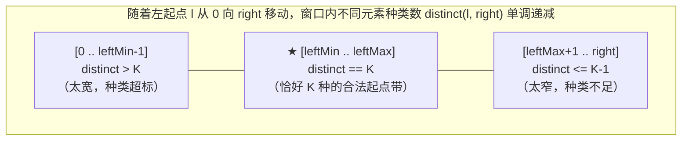

# 多类别元素与恰好 K 型窗口：高阶滑动窗口技法

**摘要：**

在前八篇文章中，滑动窗口能够直接运转的根本原因，是窗口谓词属于**单侧不等式约束**——或是求满足"元素种类数 $\le K$"（越短越合法，至多型）的窗口，或是求满足"覆盖目标字符集 $\ge T$"（越长越合法，至少型）的窗口。然而在算法面试的压轴题中，命题人最热衷设置的障碍是**"恰好等于 $K$（Exactly $K$）"**型约束——譬如求恰好包含 $K$ 个不同整数的子数组个数（LeetCode 992）、每个元音至少出现一次且恰好包含 $K$ 个辅音的子串个数（LeetCode 3306）。由于"恰好等于 $K$"既不满足越短越合法、也不满足越长越合法，单一左指针在面对一段连续合法的左起点区间 `[leftMin, leftMax]` 时陷入两难。本文系统推导攻克此类高阶窗口的三大核武器：**容斥前缀差分（`atMost(K) - atMost(K-1)` 与 `atLeast(K) - atLeast(K+1)`）**、**三指针单遍同步维护**以及**窗口外侧剩余频次逆向约束（LeetCode 1234）**，并配齐 LeetCode 992、1234、1358、2537、3306 五道压轴题的 Golang 实现。

---

## 第 1 章 为什么"恰好 K"型问题会让单次滑动窗口卡壳？

### 1.1 区间合法性的几何解剖：单点分界 vs 区间带

让我们固定右端点 `right`，将左端点 `l` 从 `0`（最长窗口）一路向右移动到 `right`（单元素最短窗口），观察窗口内"不同整数的种类数 `distinct(l, right)`"是如何变化的：
- 随着 `l` 从 `0` 增大到 `right`，窗口越来越窄，包含的元素越来越少，因此 `distinct(l, right)` 是一个关于 `l` 的**单调非递增阶梯函数**；
- 如果题目问的是**"至多 $K$ 种"**（`distinct <= K`）：只要找到第一个使 `distinct(l, right) <= K` 成立的左分界点 `leftMin`，那么从 `leftMin` 往右直到 `right` 的所有共 **`right - leftMin + 1` 个起点**必然全部满足 `<= K`；
- 如果题目问的是**"至少 $K$ 种"**（`distinct >= K`）：只要找到第一个使 `distinct(l, right) < K` 的失效点 `leftAfterMax`，那么从 `0` 往右直到 `leftAfterMax - 1` 的所有共 **`leftAfterMax` 个起点**必然全部满足 `>= K`；
- 但如果题目问的是**"恰好 $K$ 种"**（`distinct == K`）：由于数组中存在重复元素，使 `distinct(l, right) == K` 成立的左起点 `l` 既不是一段前缀 `[0 .. x]`，也不是一段后缀 `[y .. right]`，而是**夹在中间的一段水平台阶闭区间 `[leftMin .. leftMax]`**。



如上图所示，当固定 `right` 时，要想算出中间那段金色台阶 `[leftMin .. leftMax]` 里包含了多少个下标（即 `leftMax - leftMin + 1`），如果只维护**一个**左指针 `left`：
- 让 `left` 停在 `leftMin` 吧，你不知道右边的 `leftMax` 在哪；
- 让 `left` 一路缩到 `leftMax` 吧，下一轮 `right + 1` 纳入一个已在窗口内的重复元素时，合法的左边界其实还应该从 `leftMin` 开始算，而你的单指针早就把 `[leftMin .. leftMax - 1]` 丢掉了（无法回退）。

看清了这个几何本质，两条破局大道便呼之欲出：
1. **代数容斥差分法（拆成两次单指针滑窗相减）**：
   - 注意到 `[leftMin .. right]`（共 `right - leftMin + 1` 个点）是所有满足 **`distinct <= K`（至多 $K$ 种）** 的起点集合；
   - 而 `[leftMax + 1 .. right]`（共 `right - leftMax` 个点）是所有满足 **`distinct <= K - 1`（至多 $K - 1$ 种）** 的起点集合；
   - 两个集合相减，剩下的分毫不差就是中间那段满足 **`distinct == K`（恰好 $K$ 种）** 的起点集合：
     $$\text{Exactly}(K) = \text{AtMost}(K) - \text{AtMost}(K - 1)$$
2. **三指针单遍同步法（同时维护 `leftMin` 与 `leftAfterMax` 两个左游标）**：
   - 在同一次 `right` 遍历中，直接派驻两个左指针：`left1` 专门卡住 `distinct <= K` 的左边界 `leftMin`，`left2` 专门卡住 `distinct <= K - 1` 的左边界 `leftMax + 1`；每轮直接累加 **`left2 - left1`**。

---

## 第 2 章 恰好 K 型标杆实战：K 个不同整数的子数组（LeetCode 992）

### 2.1 题目描述与容斥差分实现

**题目描述**：给定一个正整数数组 `nums` 和一个整数 `k`，返回 `nums` 中「好子数组」的数目。如果 `nums` 的某个子数组中不同整数的个数恰好为 `k`，则称其为「好子数组」。其中 `1 <= nums[i], k <= nums.length`。

#### 2.1.1 解法一：`atMost(k) - atMost(k - 1)` 容斥差分（结构最清晰，考场首选）

我们只需编写一个极其标准的"至多 $K$ 种不同整数的子数组计数"函数 `atMostK(nums, k)`：
- 由于题目给定 `1 <= nums[i] <= len(nums)`，我们直接分配一个长度为 `len(nums) + 1` 的切片 `freq` 代替 `map[int]int`；
- 外层 `right` 纳入 `nums[right]`，当 `distinct > k` 时内层 `for` 循环收缩 `left++`；
- 退出内层循环后，累加 **`count += right - left + 1`**；
- 主函数直接一行 `return atMostK(nums, k) - atMostK(nums, k - 1)` 收工：

```go
package main

// subarraysWithKDistinct LeetCode 992 解法一：容斥差分 atMost(k) - atMost(k-1)
// 时间复杂度：O(n)，空间复杂度：O(n)
func subarraysWithKDistinct(nums []int, k int) int {
	return atMostK(nums, k) - atMostK(nums, k-1)
}

func atMostK(nums []int, k int) int {
	if k <= 0 {
		return 0
	}
	freq := make([]int, len(nums)+1)
	left, distinct, total := 0, 0, 0

	for right, v := range nums {
		if freq[v] == 0 {
			distinct++
		}
		freq[v]++

		for distinct > k {
			out := nums[left]
			freq[out]--
			if freq[out] == 0 {
				distinct--
			}
			left++
		}
		// 此时左端点取 [left .. right] 共 right - left + 1 个子数组均满足种类数 <= k
		total += right - left + 1
	}
	return total
}
```

#### 2.1.2 解法二：三指针单遍扫描（合并双左界 `left1` 与 `left2`）

如果面试官追问："能不能只扫描数组一遍，就把结果算出来？"
我们可以同时维护两个左游标 `left1`（维护窗口 `freq1` 满足 `distinct1 <= k`）和 `left2`（维护窗口 `freq2` 满足 `distinct2 <= k - 1`，即当 `distinct2 >= k` 时持续收缩直至 `< k`）。在每一轮 `right` 处，满足"至多 $k$ 种"的最左起点是 `left1`，而第一个变成"不足 $k$ 种（即 $\le k-1$ 种）"的起点是 `left2`，因此左起点落在 **`[left1 .. left2 - 1]`** 之间的全部 **`left2 - left1` 个子数组**，其种类数必然恰好等于 $k$：

```go
package main

// subarraysWithKDistinctThreePtr LeetCode 992 解法二：三指针单遍扫描直接锁定左起点区间 [left1, left2)
func subarraysWithKDistinctThreePtr(nums []int, k int) int {
	n := len(nums)
	freq1 := make([]int, n+1)
	freq2 := make([]int, n+1)
	left1, left2 := 0, 0
	d1, d2 := 0, 0
	total := 0

	for _, v := range nums {
		if freq1[v] == 0 {
			d1++
		}
		freq1[v]++

		if freq2[v] == 0 {
			d2++
		}
		freq2[v]++

		// left1 收缩至恰好满足 d1 <= k（第一个合法左起点）
		for d1 > k {
			out1 := nums[left1]
			freq1[out1]--
			if freq1[out1] == 0 {
				d1--
			}
			left1++
		}
		// left2 收缩至恰好满足 d2 <= k-1（第一个不足 k 种的越界点）
		for d2 >= k {
			out2 := nums[left2]
			freq2[out2]--
			if freq2[out2] == 0 {
				d2--
			}
			left2++
		}

		// 夹在 [left1 .. left2-1] 之间的左起点，对应子数组种类数必然恰好等于 k
		total += left2 - left1
	}
	return total
}
```

---

## 第 3 章 "至少型（At-Least）"计数模型及其与"恰好型"的复合

### 3.1 至少型计数模板：`ans += left` 的黄金推导

在第 1.1 节中我们看到，与"至多型（越短越合法，外侧加 `right - left + 1`）"对称的，是**"至少型（At-Least，越长越合法）"**计数问题。

我们在下面两道高频代表题上检验"至少型"模板：
1. **LeetCode 1358：包含所有三种字符的子字符串数目**：给定只含 `'a', 'b', 'c'` 的字符串 `s`，返回 `'a', 'b', 'c'` **至少各出现一次**的子字符串数目；
2. **LeetCode 2537：统计好子数组的数目**：给你一个整数数组 `nums` 和一个整数 `k`，如果一个子数组中**至少有 `k` 对**下标 `(i, j)` 满足 `i < j` 且 `nums[i] == nums[j]`，则称其为好子数组，返回好子数组数目。

这两道题都属于标准的**越长越合法（至少型）**：
- 内层收缩循环的条件是 **`for 当前窗口已满足条件`**，不断将 `left++` 右移；
- 当退出内层 `for` 循环时，`[left .. right]` 刚刚变得**不满足**条件，而它的前一步 **`[left - 1 .. right]` 是以 `right` 结尾的最短合法窗口**；
- 既然 `[left - 1 .. right]` 都已经满足了"至少"条件，那么左端点取遍 **`0, 1, 2, ..., left - 1` 的全部 `left` 个更长子数组**必然统统满足条件，因此外层直接累加 **`ans += left`** 即可：

```go
package main

// numberOfSubstrings LeetCode 1358：至少包含 a,b,c 各一次的子串数（至少型计数模板 ans += left）
func numberOfSubstrings(s string) int {
	var cnt [3]int
	left, ans := 0, 0

	for right := 0; right < len(s); right++ {
		cnt[s[right]-'a']++
		for cnt[0] > 0 && cnt[1] > 0 && cnt[2] > 0 {
			cnt[s[left]-'a']--
			left++
		}
		// 0 .. left-1 共 left 个起点全部合法
		ans += left
	}
	return ans
}

// countGood LeetCode 2537：窗口内相等元素对数 pairs >= k 的好子数组数目
func countGood(nums []int, k int) int64 {
	freq := make(map[int]int)
	left := 0
	var pairs, ans int64

	for _, v := range nums {
		// 新纳入一个 v，与窗口内已有的 freq[v] 个相同元素新配出 freq[v] 对
		pairs += int64(freq[v])
		freq[v]++

		for pairs >= int64(k) {
			out := nums[left]
			freq[out]--
			// 移出一个 out，损失掉与剩余 freq[out] 个相同元素的配对
			pairs -= int64(freq[out])
			left++
		}
		ans += int64(left)
	}
	return ans
}
```

### 3.2 当"至少型"与"恰好型"出现在同一个窗口：元音辅音字符串计数 II（LeetCode 3306）

如果一道题同时包含**两个方向不同的约束**——譬如 **LeetCode 3306：元音辅音字符串计数 II**，要求统计满足以下两条的子串数目：
1. 每个元音字母（`'a', 'e', 'i', 'o', 'u'`）**至少**出现一次（至少型，越长越合法）；
2. 辅音字母的个数**恰好**等于 $k$（恰好型，不长不短）。

怎么把这两个冲突的约束拧成一股绳？
既然第一个条件（元音至少各 1 次）天然是"**至少型**"，我们就不要把第二个条件拆成两个"至多型"，而是用对称的**至少型容斥差分公式**：

$$\text{恰好 } k \text{ 个辅音} = (\text{至少 } k \text{ 个辅音}) - (\text{至少 } k + 1 \text{ 个辅音})$$

定义一个纯"至少型"辅助函数 `atLeast(s, k)`：统计**"五个元音至少各出现 1 次，且辅音个数至少为 $k$"**的子串总数。在这个辅助函数内部，两个条件全都是清一色的"越长越合法（至少型）"，直接用上一节的 `ans += left` 模板 20 行搞定，最后返回 **`atLeast(s, k) - atLeast(s, k + 1)`**：

```go
package main

// countOfSubstrings LeetCode 3306：利用至少型容斥 atLeast(k) - atLeast(k+1) 统一元音与辅音约束
func countOfSubstrings(word string, k int) int64 {
	return atLeastVowelAndConsonant(word, k) - atLeastVowelAndConsonant(word, k+1)
}

func atLeastVowelAndConsonant(word string, k int) int64 {
	isVowel := func(b byte) bool {
		return b == 'a' || b == 'e' || b == 'i' || b == 'o' || b == 'u'
	}

	var vowelCnt [128]int
	vowelTypes, consonants := 0, 0
	left := 0
	var ans int64

	for right := 0; right < len(word); right++ {
		in := word[right]
		if isVowel(in) {
			if vowelCnt[in] == 0 {
				vowelTypes++
			}
			vowelCnt[in]++
		} else {
			consonants++
		}

		// 两个条件同为"至少型"：当 5 种元音集齐 且 辅音数 >= k 时，持续右推 left
		for vowelTypes == 5 && consonants >= k {
			out := word[left]
			if isVowel(out) {
				vowelCnt[out]--
				if vowelCnt[out] == 0 {
					vowelTypes--
				}
			} else {
				consonants--
			}
			left++
		}
		ans += int64(left)
	}
	return ans
}
```

请对比第 2.1 节与第 3.2 节，你会领悟到容斥差分的对称大美：
- 当其他伴随约束是"越短越合法"时，用 **`atMost(K) - atMost(K - 1)`**（内层累加 `right - left + 1`）；
- 当其他伴随约束是"越长越合法"时，用 **`atLeast(K) - atLeast(K + 1)`**（内层累加 `left`）。

---

## 第 4 章 多类别逆向窗口：替换子串得到平衡字符串（LeetCode 1234）

### 4.1 题目描述与"窗口外侧不超标"充要条件

**题目描述**：有一个只含有 `'Q'`, `'W'`, `'E'`, `'R'` 四种字符的字符串 `s`，且长度为 $n$（$n$ 是 4 的倍数）。如果在该字符串中，这四种字符都恰好出现 $m = n / 4$ 次，那么它就是一个「平衡字符串」。给你一个这样的字符串 `s`，请通过**替换一个连续子串**的方式，使原字符串 `s` 变成一个「平衡字符串」。返回待替换子串的**最小可能长度**。

#### 4.1.1 为什么判断合法性要看"窗口外面"而不是"窗口里面"？

初学者做这道题时，往往拼命去算"窗口里面需要包含几个多出来的 `'Q'`、几个多出来的 `'W'`"。其实换个角度看**留在窗口外面的字符**，逻辑会简单十倍：
- 假设我们选定将子串 `s[left .. right]` 挖掉，换成任意我们想要的字符去填补缺口；
- 请问：**在什么情况下，无论我们怎么改写 `s[left .. right]`，都绝对不可能把整个字符串变成平衡字符串？**
- 答案是：**当留在窗口外面的某一种字符（比如 `'Q'`）的数量已经超过了 $m = n / 4$ 时**。因为我们只能改动窗口里面的字符，窗口外面的字符是不可触碰的铁板；既然外面的 `'Q'` 已经超过 $n / 4$ 个了，那最终全串的 `'Q'` 就必然超过 $n / 4$ 个，神仙也救不活；
- 反过来，**只要留在窗口外面的四种字符 `'Q', 'W', 'E', 'R'` 的数量全都小于等于 $m = n / 4$**，那么外侧每种字符距离目标 $m$ 的缺口之和，必然恰好等于窗口的长度 `right - left + 1`，我们百分之百可以通过把窗口内部改写成相应数量的缺口字符使全串达到平衡。

因此，我们直接用一个数组 `outsideCnt` 维护**当前留在窗口外侧的各字符频次**：
- 初始时窗口为空，全串都在外侧；若此时外侧四种字符都已经 `<= m`（即恰好等于 $m$），直接返回 `0`；
- 当 `right` 右移将 `s[right]` 圈进待替换窗口时，意味着 `s[right]` 离开了外侧，令 **`outsideCnt[s[right]]--`**；
- 一旦外侧四种字符全部满足 `<= m`（窗口合法），进入模式 B（求最短合法窗口）：记录 `right - left + 1` 的最小值，随后将 `s[left]` 吐出窗口归还给外侧（**`outsideCnt[s[left]]++; left++`**）：

```go
package main

// balancedString LeetCode 1234：监控窗口外侧剩余频次均 <= n/4 的模式 B 最短滑动窗口
// 时间复杂度：O(n)，额外空间复杂度：O(1)
func balancedString(s string) int {
	n := len(s)
	m := n / 4
	var outside [128]int
	for i := 0; i < n; i++ {
		outside[s[i]]++
	}

	isBalanced := func() bool {
		return outside['Q'] <= m && outside['W'] <= m && outside['E'] <= m && outside['R'] <= m
	}
	if isBalanced() {
		return 0
	}

	minLen := n
	left := 0
	for right := 0; right < n; right++ {
		// s[right] 进入待替换窗口，相当于从外侧扣除
		outside[s[right]]--

		// 模式 B：只要外侧四种字符均不超标，当前窗口即可通过替换达成全局平衡，先记录最短再收缩
		for left <= right && isBalanced() {
			if right-left+1 < minLen {
				minLen = right - left + 1
			}
			outside[s[left]]++ // s[left] 移出待替换窗口，归还给外侧
			left++
		}
	}
	return minLen
}
```

---

## 第 5 章 深度拓展：单数组三指针合一、完全子数组与等值对容斥

### 5.1 单频次表下的三指针合一法（零双倍内存开销解 LC 992 & LC 1248）

在第 2.1.2 节的 `subarraysWithKDistinctThreePtr` 中，为了维护 `left1` 和 `left2` 两个左边界，我们开了 `freq1` 和 `freq2` 两个独立的频次数组。
如果在内存极度受限的场景下，面试官问你：**"能不能只用 1 个频次数组 `freq`，在单遍扫描中算出恰好包含 $k$ 个不同整数的子数组个数？"**

让我们重新审视固定 `right` 时满足 `distinct == k` 的左起点区间 `[leftFar .. leftNear]`：
- `leftFar` 是当前合法的**最远（最靠左）左端点**；
- `leftNear` 是当前合法的**最近（最靠右）左端点**——也就是从 `leftNear` 再往右走一步（吐掉 `nums[leftNear]`），窗口里的不同整数种类数就会从 $k$ 跌落为 $k - 1$（这意味着 **`nums[leftNear]` 在窗口 `[leftNear .. right]` 中的出现次数恰好等于 `1`**）；
- 因此，我们只需维护一个频次数组 `freq`（记录窗口 `[leftNear .. right]` 内的元素频次）：
  1. 当新元素 `nums[right]` 进窗导致 `distinct > k` 时，说明旧的 `leftFar` 已经由于种类超标而整体失效了。我们先吐掉 `nums[leftNear]`（此时 `distinct` 降回 $k$），并将 `leftNear++`，同时把最远左界重置对齐到 **`leftFar = leftNear`**；
  2. 紧接着，只要发现当前 `leftNear` 指向的数字在窗口里**不止 1 个**（即 **`freq[nums[leftNear]] > 1`**），说明吐掉它根本不会减少窗口内的整数种类数，我们就果断执行 `freq[nums[leftNear]]--; leftNear++`，把 `leftNear` 一路向右推到第一个频次为 `1`（独苗）的位置停下；
  3. 此时，若 `distinct == k`，从 `leftFar` 到 `leftNear` 之间的全部 **`leftNear - leftFar + 1` 个起点**，其对应的子数组种类数全都恰好等于 $k$：

```go
package main

// subarraysWithKDistinctSingleFreq LeetCode 992 终极单频次表三指针实现：压缩冗余前缀法
// 时间复杂度：严格单遍 O(n)，空间复杂度：仅需单份 freq 切片
func subarraysWithKDistinctSingleFreq(nums []int, k int) int {
	freq := make([]int, len(nums)+1)
	leftFar, leftNear := 0, 0
	distinct, total := 0, 0

	for _, v := range nums {
		if freq[v] == 0 {
			distinct++
		}
		freq[v]++

		// 1. 若引入新种类导致 distinct > k，淘汰当前独苗 leftNear，并将远端锚点 leftFar 重置到新 leftNear
		if distinct > k {
			freq[nums[leftNear]]--
			distinct--
			leftNear++
			leftFar = leftNear
		}

		// 2. 只要 leftNear 处的元素在窗口内有重复副本 (freq > 1)，就向右压缩至独苗位置
		for freq[nums[leftNear]] > 1 {
			freq[nums[leftNear]]--
			leftNear++
		}

		// 3. 若已凑齐 k 种，则 [leftFar .. leftNear] 之间的所有左起点均合法
		if distinct == k {
			total += leftNear - leftFar + 1
		}
	}
	return total
}
```

请细细品味上面这段代码：当 `right` 纳入一个已经在窗口内存在的元素（未引入第 $k+1$ 种新元素）时，第 1 步 `if distinct > k` 根本不触发，**远端锚点 `leftFar` 稳稳留在原地不动**，而 `leftNear` 则在第 2 步中自动把左侧多余的重复前缀压缩掉，使得 `leftNear - leftFar + 1` 直接就是那段金色台阶 `[leftMin .. leftMax]` 的精确宽度。

### 5.2 延伸实战一：统计完全子数组的数目——当"恰好等于全集种类数 $U$"退化为纯"至少型"（LeetCode 2799）

在思考题中我们提到了 **LeetCode 2799：统计完全子数组的数目**：给你一个由正整数组成的数组 `nums`。如果数组中的某个子数组满足"**子数组中不同元素的数目恰好等于整个数组中不同元素的数目 $U$**"，则称其为完全子数组，返回完全子数组的数目。

很多同学一看到"恰好等于 $U$"，就条件反射地去写 `atMost(U) - atMost(U - 1)`。
但请停下来想一秒钟：**一个子数组里包含的不同元素种类数，有没有可能严格大于全数组的不同元素种类数 $U$？**
**绝无可能**——因为子数组是全数组的子集，任何子数组的种类数天然满足 `distinct <= U`（因此 `atMost(U)` 直接等于全部 $\frac{n(n+1)}{2}$ 个子数组）。
这意味着，"种类数**恰好等于 $U$**"，在这里 $100\%$ 等价于"种类数**至少为 $U$（$\ge U$）**"，它根本不需要做容斥减法，直接套用本章第 3.1 节的**至少型计数模板（内层 `for distinct == U` 收缩，外侧累加 `ans += left`）**一遍即可算出：

```go
package main

// countCompleteSubarrays LeetCode 2799：全集种类数 U 为天然上界，恰好 U 等价于至少 U（直接 ans += left）
func countCompleteSubarrays(nums []int) int {
	var seen [2001]bool
	totalUnique := 0
	for _, v := range nums {
		if !seen[v] {
			seen[v] = true
			totalUnique++
		}
	}

	var freq [2001]int
	left, distinct, ans := 0, 0, 0
	for _, v := range nums {
		if freq[v] == 0 {
			distinct++
		}
		freq[v]++

		for distinct == totalUnique {
			out := nums[left]
			freq[out]--
			if freq[out] == 0 {
				distinct--
			}
			left++
		}
		ans += left
	}
	return ans
}
```

### 5.3 延伸实战二：统计最大元素出现至少 K 次的子数组（LeetCode 2962）与字符至少出现 K 次的子字符串 I（LeetCode 3325）

"至少型计数模板 `ans += left`"在周赛与机试中的出场率极高，再看两道直接秒杀的同构题：
1. **LeetCode 2962：统计最大元素出现至少 K 次的子数组**：
   - 先扫一遍数组找出全局最大值 `maxVal`；
   - 随后运行滑动窗口，维护窗口内等于 `maxVal` 的元素个数 `cntMax`。内层循环条件为 **`for cntMax == k`**（或 `>= k`）：只要窗口里已经攒够了 $k$ 个最大值，就持续将 `left++` 右移，退出内层循环后在外侧执行 **`ans += int64(left)`**，10 行代码搞定；
2. **LeetCode 3325：字符至少出现 K 次的子字符串 I**：
   - 给你字符串 `s` 和整数 `k`，返回满足"**至少有一个字符出现至少 `k` 次**"的子字符串总数；
   - 注意这里的逻辑连接词是"**至少有一个字符** $\ge k$"（即窗口最高频次 $\ge k$），随着窗口扩大，最高频次单调不减，完全符合"越长越合法（至少型）"；
   - 右端字符 `c = s[right] - 'a'` 入窗后，若引发冲突，必然且唯一是因为刚进来的这个 `c` 达到了 `freq[c] == k`；因此内层收缩条件直接写 **`for freq[c] >= k { freq[s[left]-'a']--; left++ }`**，外侧累加 `ans += left` 即可：

```go
package main

// countSubarraysMaxK LeetCode 2962：统计最大元素出现至少 k 次的子数组数目（至少型模板 ans += left）
func countSubarraysMaxK(nums []int, k int) int64 {
	maxVal := nums[0]
	for _, v := range nums {
		if v > maxVal {
			maxVal = v
		}
	}

	left, cntMax := 0, 0
	var ans int64
	for _, v := range nums {
		if v == maxVal {
			cntMax++
		}
		for cntMax >= k {
			if nums[left] == maxVal {
				cntMax--
			}
			left++
		}
		ans += int64(left)
	}
	return ans
}
```

### 5.4 延伸实战三：区间子数组个数——最大值落在闭区间 $[L, R]$ 内的容斥转化（LeetCode 795 & 2444）

在"恰好 $K$ 型"容斥思想的辐射范围内，还有一类不统计元素个数、而是限定**子数组最大值（或最小值）必须恰好落在某个区间或等于某个定值**的经典题：
1. **LeetCode 795：区间子数组个数**：给你一个整数数组 `nums` 和两个整数 `left` 及 `right`。找出 `nums` 中连续、非空且其中**最大元素在范围 `[left, right]` 内**的子数组个数。
   - **容斥推导**："子数组的最大元素落在 `[left, right]` 内"，等价于"**子数组的所有元素都 $\le right$（即最大元素 $\le right$）**"，并且"**不满足所有元素都 $\le left - 1$（即至少有一个元素 $\ge left$）**"。
   - 设辅助函数 `countMaxAtMost(nums, bound)` 统计"所有元素均 $\le bound$ 的连续子数组个数"。因为一旦遇到一个 `> bound` 的元素，它就像一堵断头墙一样把左右隔断，我们只需维护当前连续 `<= bound` 的元素长度 `curLen`（遇到 `<= bound` 则 `curLen++` 并累加 `total += curLen`，遇到 `> bound` 则清零 `curLen = 0`）。
   - 最终答案直接就是 **`countMaxAtMost(nums, right) - countMaxAtMost(nums, left - 1)`**，时间 $O(n)$、空间 $O(1)$：

```go
package main

// numSubarrayBoundedMax LeetCode 795：最大值落在 [left, right] 转化为 atMost(right) - atMost(left-1)
func numSubarrayBoundedMax(nums []int, left int, right int) int {
	countAtMost := func(bound int) int {
		curLen, total := 0, 0
		for _, v := range nums {
			if v <= bound {
				curLen++
				total += curLen
			} else {
				curLen = 0
			}
		}
		return total
	}
	return countAtMost(right) - countAtMost(left-1)
}
```

2. **LeetCode 2444：统计定界子数组的数目（困难）**：给你一个整数数组 `nums` 和两个整数 `minK` 以及 `maxK`。定界子数组是同时满足"**子数组最小值恰好等于 `minK`**"且"**子数组最大值恰好等于 `maxK`**"的子数组，求定界子数组的数目。
   - **三游标位置锚定法**：遍历右端点 `right`，同时维护三个最近位置下标：
     - `badPos`：最近一次出现**越界非法元素**（即 `< minK` 或 `> maxK`）的下标（初值为 `-1`），任何合法子数组的左端点必须严格大于 `badPos`（即 `l >= badPos + 1`）；
     - `lastMinPos`：最近一次出现 `== minK` 的下标；
     - `lastMaxPos`：最近一次出现 `== maxK` 的下标；
   - 要想让子数组 `[l .. right]` 内同时包含至少一个 `minK` 和至少一个 `maxK`，左端点 `l` 必须满足 **`l <= min(lastMinPos, lastMaxPos)`**；
   - 结合下界 `l >= badPos + 1` 与上界 `l <= min(lastMinPos, lastMaxPos)`，以 `right` 结尾的定界子数组个数直接就是：
     $$\max\big(0, \min(\text{lastMinPos}, \text{lastMaxPos}) - \text{badPos}\big)$$
   - 这道 Hard 压轴题用三个整型游标在单遍扫描、严格 $O(1)$ 空间内即可迎刃而解：

```go
package main

// countSubarrays2444 LeetCode 2444：三位置游标锁定合法左起点区间 (badPos, min(lastMin, lastMax)]
func countSubarrays2444(nums []int, minK int, maxK int) int64 {
	badPos, lastMin, lastMax := -1, -1, -1
	var ans int64

	for right, v := range nums {
		if v < minK || v > maxK {
			badPos = right
		}
		if v == minK {
			lastMin = right
		}
		if v == maxK {
			lastMax = right
		}
		// 合法左起点落在 [badPos + 1 .. min(lastMin, lastMax)] 之间
		upper := min(lastMin, lastMax)
		if upper > badPos {
			ans += int64(upper - badPos)
		}
	}
	return ans
}
```

### 5.5 常见误区与边界自检

1. **在 `atMost(k) - atMost(k - 1)` 中未处理 `k - 1 == 0`（或 `< 0`）**：当题目传入 `k = 1` 时，`atMost(k - 1)` 传入的是 `0`。必须在 `atMost(nums, k)` 函数入口处写明 `if k <= 0 { return 0 }`（若统计量允许为 0，如 LC 930 和为 0，则写 `if k < 0 { return 0 }`），防止内层收缩越界。
2. **混淆"至多型容斥"与"至少型容斥"的符号**：
   - `Exactly(K) = AtMost(K) - AtMost(K - 1)`（大集合 `<= K` 减去小集合 `<= K-1`）；
   - `Exactly(K) = AtLeast(K) - AtLeast(K + 1)`（大集合 `>= K` 减去小集合 `>= K+1`）。千万不要把第二个减数写反导致算出负数。

---

## 第 6 章 本章高阶滑动窗口技法全景对比

| 技法模型 | 代表题目 | 单调性转化手段 | 核心更新算式 | 时间 / 空间 |
|----------|----------|----------------|--------------|-------------|
| 至多型容斥差分 | LC 992 K 个不同整数子数组、LC 1248 优美子数组 | `Exactly(K) = AtMost(K) - AtMost(K-1)` | 在 `AtMost` 内加 `right - left + 1` | $O(n)$ / $O(n)$ 或 $O(1)$ |
| 至少型批量计数 | LC 1358 包含三字符子串、LC 2537 好子数组数目 | 内层 `for 已合法` 收缩至刚越界 | 在外侧直接加 `left` | $O(n)$ / $O(1)$ 或 $O(n)$ |
| 至少型容斥差分 | LC 3306 元音辅音计数 II | `Exactly(K) = AtLeast(K) - AtLeast(K+1)` | 在 `AtLeast` 内加 `left` | $O(n)$ / $O(1)$ |
| 三指针单遍合一 | LC 992 / LC 3306 单遍版 | `left1` 卡上限、`left2` 卡下限 | 外侧直接加 `left2 - left1` | $O(n)$ / $O(n)$ |
| 窗口外侧剩余约束 | LC 1234 替换子串得平衡串、LC 1574 最短删除有序 | 入窗令 `outside--`，出窗令 `outside++` | 模式 B 内侧更新 `minLen` | $O(n)$ / $O(1)$ |
| 单数组三指针合一 | LC 992 空间优化版 | 远端锚点 `leftFar` + 近端去重 `leftNear` | 外侧加 `leftNear - leftFar + 1` | $O(n)$ / 单份数组 |
| 极值定界三位置游标 | LC 2444 统计定界子数组 | 记录最近越界点 `badPos` 与最近极值点 `lastMin/Max` | 外侧加 `min(lastMin, lastMax) - badPos` | $O(n)$ / $O(1)$ |

### 6.2 深入思考：为什么"容斥差分"与"位置游标锚定"本质上是同一枚硬币的两面？

回顾本章走过的全部高阶题目，无论是第 2 章的 `atMost(K) - atMost(K - 1)`，第 3 章的 `atLeast(K) - atLeast(K + 1)`，还是第 5.4 节 LeetCode 2444 的 `min(lastMinPos, lastMaxPos) - badPos`，它们在几何上做的全都是同一件事：
> **当右端点固定在 `right` 时，所有合法的左端点 `l` 必然构成一段连续的整数闭区间 `[L_min(right), L_max(right)]`（若无解则该区间为空）。**
> - **`L_min(right)`（最左合法边界）**：由所有的**"至多型（上限）约束"**共同决定——比如"不能包含越界元素（`l >= badPos + 1`）"、"不同整数不能超过 $K$ 个"；
> - **`L_max(right)`（最右合法边界）**：由所有的**"至少型（下限）约束"**共同决定——比如"必须至少包含一个 `minK` 和一个 `maxK`（`l <= min(lastMin, lastMax)`）"、"不同整数必须至少有 $K$ 个"；
> - 一旦你用两个滑动指针（或位置游标）分别锁定了左界 `L_min` 和右界 `L_max`，当前 `right` 贡献的合法子数组个数永远就是 **`max(0, L_max - L_min + 1)`**。这就是统摄一切计数类滑动窗口题的**终极元定理（Meta-Theorem of Counting Windows）**。

### 6.3 延伸实战四：美丽子字符串的数目——前缀频次与同余容斥的跨界交响（LeetCode 2949）

当"多类别频次相等"与"乘积整除"在同一个窗口内碰撞时，还会诞生诸如 **LeetCode 2949：统计美丽子字符串 II** 这样的跨界好题：
- 要求子串中元音字母个数 `V` 与辅音字母个数 `C` **完全相等（`V == C`）**，且 **`(V * C) % k == 0`**；
- 第一条约束 `V == C` 正是我们在第 08 篇学过的"`+1 / -1` 赋权前缀和相等（`prefixDiff[r] == prefixDiff[l]`）"；
- 第二条约束由于 `V == C` 且子串长度 $L = V + C = 2V$，转化为 $V^2 \equiv 0 \pmod k$。通过质因数分解求出满足 $d^2 \equiv 0 \pmod k$ 的最小正整数步长 $d$，那么 `V = (r - l) / 2` 是 $d$ 的倍数就等价于**下标 `r` 与 `l` 模 $2d$ 同余（`r % (2d) == l % (2d)`）**；
- 将二维复合键 `(prefixDiff, idx % (2d))` 存入哈希表统计频次，便把多类别平衡约束与数论周期约束融合成了一次 $O(n)$ 扫描。

### 6.4 考场快速判断：我该写"双函数容斥"还是"三指针单遍"？

在真实的 45 分钟算法面试中，如果遇到 LeetCode 992（恰好 $K$ 个不同整数）、LeetCode 1248（恰好 $K$ 个奇数）或 LeetCode 3306（元音辅音计数 II）：
1. **强烈建议第一版直接写"双函数容斥（`atMost(K) - atMost(K - 1)` 或 `atLeast(K) - atLeast(K + 1)`）"**：
   - 为什么？因为 `atMost(K)` 和 `atLeast(K)` 内部只有一个 `left` 指针、一套频次表、一条单向收缩条件，在紧张的高压环境下**几乎不可能写错边界**，5 分钟即可写出 bug-free 代码并通过所有测试；
2. **写完双函数容斥后，再主动向面试官口述或展示"单数组三指针合一法（5.1 节）"**：
   - 说明通过维护 `leftFar`（最远锚点）与 `leftNear`（剥离重复副本后的独苗近点），可以把两次遍历合并为单遍扫描、省掉第二份频次表内存。这种"先稳拿满分、再主动秀出空间极限优化"的答题节奏，在面试评价体系中永远是最高分档位。

---

## 小结

本章攻克了滑动窗口领域最具思维挑战性的高阶题型：
- 揭示了"恰好 $K$ 型"问题因合法左起点形成区间带 `[leftMin, leftMax]` 而无法用单一左游标直接界定的几何原因；
- 建立了**至多型容斥（`atMost(K) - atMost(K-1)`）**与**至少型容斥（`atLeast(K) - atLeast(K+1)`）**两套对称差分武器，使复合约束（如 LC 3306）迎刃而解；
- 通过 LC 1234 展示了当窗口内部操作自由度过高时，如何通过监控**窗口外侧剩余状态**完成降维打击。

下一篇 [[10 滑动窗口综合通关：面试高频模式总结与难题攻破]] 将对整个滑动窗口专栏十篇文章进行总复盘，给出考场 30 秒模式识别决策树、五大标准 Go 模板与八大高频 Bug 诊断清单。

---

## 参考资料

1. LeetCode 992 / 1234 / 1358 / 2537 / 3306 Official Editorial.
2. Graham, R. L., Knuth, D. E., & Patashnik, O. (1994). *Concrete Mathematics* (2nd ed.). Addison-Wesley.

---

> [!note] 思考题
> 1. 在第 2.1.2 节的三指针法 `subarraysWithKDistinctThreePtr` 中，能否进一步优化掉 `freq2` 数组，只用**同一个频次数组 `freq`** 配合三个指针？（提示：让 `left1` 指向窗口中第一个使种类数等于 $K$ 的位置，而让 `left2` 在种类数不变的前提下向右跳过所有 `freq[nums[left2]] > 1` 的冗余前缀元素）
> 2. 在 LeetCode 2799（统计完全子数组的数目：求不同元素个数等于整个数组不同元素个数 $U$ 的子数组数目）中，为什么不需要用 `atMost(U) - atMost(U-1)`，直接用第 3.1 节的"至少型"模板（求不同元素个数 $\ge U$ 的子数组数）就能一遍算出？
> 3. 在 LeetCode 1234（替换子串得到平衡字符串）中，如果原字符串在循环开始前就已经是平衡字符串，而在主循环中如果没有提前 `if isBalanced() { return 0 }` 拦截，内层循环条件 `for left <= right && isBalanced()` 会把 `left` 推到 `right + 1`，此时 `right - left + 1` 等于多少？这启发我们可以如何简化代码？
