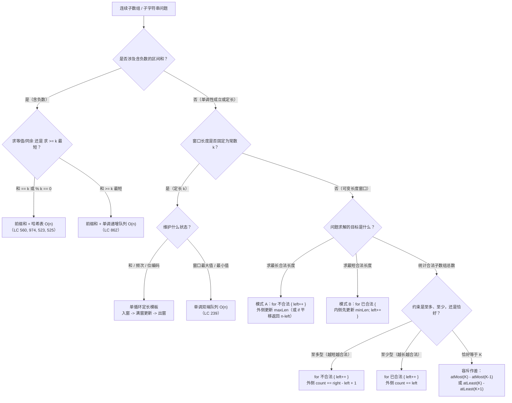

# 滑动窗口综合通关：面试高频模式总结与难题攻破

**摘要：**

历经前九篇从暴力冗余剖析、定长窗口进出对称、可变窗口最长与最短镜像法则、游标卡尺等宽平移、位运算可逆拆解、同余轨道与滚动哈希、单调双端队列极值维护，到前缀和负数突围与"恰好 $K$"容斥差分的系统演进，本篇作为《滑动窗口》专栏的收官之作，旨在将这些技法锻造为一套**考场实战直觉体系**。本文将给出拿到题目后 30 秒内锁定解法的**全景模式识别决策树**、覆盖全部六大场景的 **Golang 标准代码模板库**、两道融合"排序 + 二分答案 + 滑动窗口"的压轴难题（LeetCode 1838、719、2555）实战演练，以及考场提交前的**八大高频 Bug 诊断手册**。

---

## 第 1 章 考场 30 秒模式识别：从题面信号词到算法选型

### 1.1 题面特征信号与底层武器映射表

在面试读题的第一遍，抓住以下组合信号词即可完成 90% 的初步定型：

| 题面核心信号组合 | 单调性是否天然成立 | 锁定算法模型 | 答案更新位置与核心算式 | 代表题目（LeetCode） |
|------------------|--------------------|--------------|------------------------|----------------------|
| 连续子数组/子串 + **长度固定为 $k$**（或半径为 $k$） | 天然成立 | **固定长度滑动窗口** | 满窗 `right >= k-1` 时结算，随后 `right-k+1` 出窗 | 643、1343、1456、2090、2461、2134 |
| 字母异位词 / 排列 / 串联等长单词 / 重复定长基因序列 | 天然成立 | **定长频次净差 / 步长 $L$ 同余轨道 / 滚动哈希** | `match == 26` 或 `matched == m` 或 20-bit 位掩码查重 | 567、438、30、187 |
| 全正数/非负 + **最长**子数组/子串满足"不超过/无重复/至多 $k$ 次修改" | 成立（越短越合法） | **模式 A：可变窗口求最长**（或游标卡尺 `if` 平移） | `for 不合法` 收缩，在循环**外侧**更新 `maxLen`（或结尾 `n - left`） | 3、340、904、1004、1493、424、2024、1208、2401 |
| 全正数/非负 + **最短**子数组/子串满足"和 $\ge target$ / 覆盖目标串" | 成立（越长越合法） | **模式 B：可变窗口求最短** | `for 已合法` 收缩，在循环**内部**先更新 `minLen` 再吐左端 | 209、76、632、1234、3097 |
| 统计满足**越短越合法（至多 $K$）**的连续子数组**个数** | 成立 | **模式 C1：至多型计数滑窗** | `for 不合法` 收缩，在循环**外侧**累加 `count += right - left + 1` | 713、2762 |
| 统计满足**越长越合法（至少 $K$）**的连续子数组**个数** | 成立 | **模式 C2：至少型计数滑窗** | `for 已合法` 收缩，在循环**外侧**累加 `count += left` | 1358、2537、2962、2799 |
| 统计满足**恰好等于 $K$**（非负统计量）的子数组**个数** | 单次不成立，拆分后成立 | **模式 C3：容斥差分滑窗**或三指针 | `atMost(K) - atMost(K-1)` 或 `atLeast(K) - atLeast(K+1)` | 992、1248、930、3306 |
| 窗口约束含**最大值 / 最小值 / 绝对差 $\le limit$** | 需辅助结构维护极值 | **单调双端队列 + 滑动窗口** | `maxQ` 递减、`minQ` 递增，队尾淘汰老弱、队首驱逐过期 | 239、1438、2762、1696 |
| **含负数** + 求和 `== k` 或整除 `% k == 0` 或 `0/1` 等量 | **不成立**（负数破单调） | **前缀和 + 哈希表**（计数或最早下标） | 计数哨兵 `cnt[0] = 1`；最长长度哨兵 `firstIdx[0] = -1` | 560、974、523、525 |
| **含负数** + 求和 **`>= k` 的最短**子数组 | **不成立** | **前缀和 + 单调递增双端队列** | 队首达标即弹，队尾淘汰 `P[tail] >= P[r]` 的劣质起点 | 862 |
| 从数组**两端**拿走最少/最多元素满足和条件 | 逆向转化为中间窗口 | **正难则反滑动窗口** | 转化为求中间保留最长/定长窗口使其和为 `totalSum - x` | 1658、1423、2516 |

### 1.2 全景选型决策树



---

## 第 2 章 六大黄金 Golang 模板速查卡片

为了让读者在面试前能快速温习零 Bug 的肌肉记忆，下面将本专栏沉淀出的**六套最精炼 Go 语言标准模板**汇总于此：

```go
package main

import "math"

// ==================== 模板 1：固定长度滑动窗口（单循环三步曲） ====================
func templateFixedWindow(nums []int, k int) int {
	sum, maxSum := 0, math.MinInt64
	for right, v := range nums {
		sum += v // 1. 右端入窗
		if right < k-1 {
			continue // 尚未攒满 k 个元素
		}
		if sum > maxSum { // 2. 满窗结算答案（务必在出窗之前）
			maxSum = sum
		}
		sum -= nums[right-k+1] // 3. 左端最老元素出窗
	}
	return maxSum
}

// ==================== 模板 2：可变窗口求最长（模式 A：被动清理，外侧结算） ====================
func templateLongestWindow(nums []int, k int) int {
	left, badCount, maxLen := 0, 0, 0
	for right, v := range nums {
		if v == 0 {
			badCount++
		}
		for badCount > k { // 当窗口不合法时被动收缩
			if nums[left] == 0 {
				badCount--
			}
			left++
		}
		if right-left+1 > maxLen { // 在收缩循环【外侧】更新最大长度
			maxLen = right - left + 1
		}
	}
	return maxLen
}

// ==================== 模板 3：可变窗口求最短（模式 B：主动压榨，内侧结算） ====================
func templateShortestWindow(nums []int, target int) int {
	left, sum, minLen := 0, 0, math.MaxInt32
	for right, v := range nums {
		sum += v
		for sum >= target { // 当窗口【已合法】时主动收缩
			if right-left+1 < minLen { // 在收缩循环【内侧】先记录最短长度
				minLen = right - left + 1
			}
			sum -= nums[left]
			left++
		}
	}
	if minLen == math.MaxInt32 {
		return 0
	}
	return minLen
}

// ==================== 模板 4：至多型 / 至少型 / 恰好型子数组计数 ====================
func templateCountSubarrays(nums []int, k int) (atMostCnt, atLeastCnt int) {
	// 4a. 至多型（越短越合法）：外侧累加 right - left + 1
	l1, state1 := 0, 0
	for r, v := range nums {
		state1 += v
		for state1 > k {
			state1 -= nums[l1]
			l1++
		}
		atMostCnt += r - l1 + 1
	}

	// 4b. 至少型（越长越合法）：外侧累加 left
	l2, state2 := 0, 0
	for _, v := range nums {
		state2 += v
		for state2 >= k {
			state2 -= nums[l2]
			l2++
		}
		atLeastCnt += l2
	}
	// 注：恰好等于 k 的个数即为 atMost(k) - atMost(k-1) 或 atLeast(k) - atLeast(k+1)
	return
}

// ==================== 模板 5：单调递减双端队列维护窗口最大值 ====================
func templateMonotonicDeque(nums []int, k int) []int {
	var deque, res []int
	for right, v := range nums {
		for len(deque) > 0 && nums[deque[len(deque)-1]] <= v {
			deque = deque[:len(deque)-1] // 队尾淘汰老弱
		}
		deque = append(deque, right)
		if deque[0] < right-k+1 {
			deque = deque[1:] // 队首驱逐过期
		}
		if right >= k-1 {
			res = append(res, nums[deque[0]])
		}
	}
	return res
}

// ==================== 模板 6：前缀和 + 哈希表（攻克含负数等值/同余） ====================
func templatePrefixSumHash(nums []int, k int) int {
	cntMap := map[int]int{0: 1} // 必写哨兵：空前缀 P[0] = 0 出现 1 次
	curPrefix, total := 0, 0
	for _, v := range nums {
		curPrefix += v
		total += cntMap[curPrefix-k] // 先查历史配对
		cntMap[curPrefix]++          // 后登记当前前缀和
	}
	return total
}
```

---

## 第 3 章 跨范式综合难题攻破：滑动窗口与其他算法的协同作战

在顶尖大厂的 Hard 级终面题中，滑动窗口往往与**排序**、**二分答案**或**动态规划（前后缀预处理）**组合出击。下面通过两道极具代表性的综合题展示破题思路。

### 3.1 综合实战一：两个线段获得的最多奖品——排序滑窗 + 前缀最大值 DP（LeetCode 2555）

**题目描述**：在 $X$ 轴上有一些奖品，`prizePositions[i]` 是第 `i` 个奖品的位置（已按非递减顺序排列）。你可以选择**两个**长度均为 `k` 的线段（可以重叠）。返回两个线段最多可以覆盖多少个奖品。

**推导过程（双窗口无重叠拆解）**：
1. 为什么两个线段哪怕允许重叠，我们也只需要考虑"一左一右两个窗口"？因为如果两个线段重叠，把其中一个线段往旁边平移使其不重叠，覆盖的奖品数只会更多不会更少；
2. 当我们在外层用滑动窗口枚举**右侧第二条线段** `[left .. right]`（满足 `prizePositions[right] - prizePositions[left] <= k`，包含 `curLen = right - left + 1` 个奖品）时，为了使两线段总奖品数最大，**左侧第一条线段**应该选在哪里？
3. 显然，左侧第一条线段必须完全位于下标 `left - 1` 及其左侧（即右端点 $\le left - 1$），并且我们希望它覆盖的奖品数尽可能多。如果我们维护一个前缀最大值数组 **`maxBefore[i+1]`（表示在下标 `0 .. i` 范围内，单条长度为 $k$ 的线段最多能覆盖的奖品数）**，那么当第二条线段为 `[left .. right]` 时，两线段总收益直接就是：
   $$\text{curLen} + \text{maxBefore}[left]$$
4. 在滑动窗口一次遍历中，一边算当前窗口宽度 `curLen`，一边用 `curLen + maxBefore[left]` 更新全局答案，同时顺手更新 `maxBefore[right+1] = max(maxBefore[right], curLen)`，即可在 $O(n)$ 时间内一举攻克这道双窗口难题：

```go
package main

// maximizeWin LeetCode 2555：滑动窗口 + 前缀历史最优窗口记录 maxBefore，时间 O(n)，空间 O(n)
func maximizeWin(prizePositions []int, k int) int {
	n := len(prizePositions)
	// maxBefore[i+1] 表示右端点不超过下标 i 的单条长度为 k 的线段所能覆盖的最大奖品数
	maxBefore := make([]int, n+1)
	left, ans := 0, 0

	for right, pos := range prizePositions {
		for pos-prizePositions[left] > k {
			left++
		}
		curWinPrizes := right - left + 1
		// 当前右线段 [left..right] 加上左侧 [0..left-1] 内的最优单线段 maxBefore[left]
		if curWinPrizes+maxBefore[left] > ans {
			ans = curWinPrizes + maxBefore[left]
		}
		// 递推维护前缀最大单窗口收益
		maxBefore[right+1] = max(maxBefore[right], curWinPrizes)
	}
	return ans
}
```

这套**"滑动窗口枚举右区间 + `maxBefore[left]` 记忆化左半区历史最优窗口"**的范式，是解决一切"选两个互不重叠合法子数组使总收益最大/总长度最短"（如 **LeetCode 1477：找两个和为目标值且不重叠的子数组**、**LeetCode 1031：两个非重叠子数组的最大和**）的通杀母题。

### 3.2 综合实战二：二分答案空间 + 滑动窗口验证（LeetCode 719 & 2560）

当题目要求"第 $K$ 小的子数组属性（如数对距离、子数组和）"时，外层在属性值域 `[lo, hi]` 上执行**二分答案**，内层 `check(mid)` 则调用**滑动窗口计数模板（模式 C1：`count += right - left + 1`）**在 $O(n)$ 时间内统计属性值 $\le mid$ 的子数组或数对是否达到 $K$ 个。例如在 **LeetCode 719：找出第 K 小的数对距离**中，排序后两数下标 `(left, right)` 的距离 `nums[right] - nums[left]` 随窗口扩大单调递增，内层滑窗仅需 6 行代码即可完成计数：

```go
package main

import "sort"

// smallestDistancePair LeetCode 719：排序 + 值域二分答案 + 内层滑动窗口统计距离 <= mid 的数对总数
// 时间复杂度：O(n log n + n log(max-min))，额外空间复杂度：O(1)
func smallestDistancePair(nums []int, k int) int {
	sort.Ints(nums)
	n := len(nums)

	// countPairsWithin 利用模式 C1（至多型计数滑窗）O(n) 统计差值 <= maxDist 的数对个数
	countPairsWithin := func(maxDist int) int {
		left, count := 0, 0
		for right := 0; right < n; right++ {
			for nums[right]-nums[left] > maxDist {
				left++
			}
			// 左端点取 [left .. right-1] 共 right - left 个下标与 right 配对的距离均 <= maxDist
			count += right - left
		}
		return count
	}

	lo, hi := 0, nums[n-1]-nums[0]
	for lo <= hi {
		mid := lo + (hi-lo)/2
		if countPairsWithin(mid) >= k {
			hi = mid - 1
		} else {
			lo = mid + 1
		}
	}
	return lo
}
```

### 3.3 综合实战三：找两个和为目标值且不重叠的子数组——模式 B 滑窗 + 前缀最短记忆（LeetCode 1477）

与第 3.1 节 LeetCode 2555（求两个不重叠窗口的**最大收益和**）形成完美镜像的，是 **LeetCode 1477：找两个和为目标值且不重叠的子数组**（给定**正整数**数组 `arr` 和整数 `target`，找出两个互不重叠、且各自元素之和都等于 `target` 的子数组，返回这两个子数组**长度之和的最小值**；若不存在则返回 `-1`）。

**破题推导**：
1. 因为 `arr` 全为正整数，子数组和随窗口扩大严格单调递增，所以我们可以用滑动窗口在 $O(n)$ 时间内找出**所有**和恰好等于 `target` 的连续子数组 `[left .. right]`；
2. 为了选出两个**互不重叠**且长度之和最小的子数组，我们同样维护一个前缀最小值数组 **`minLenBefore[i+1]`（表示在下标 `0 .. i` 范围内，和等于 `target` 的单个子数组的最小长度；初始全设为无穷大 `inf`）**；
3. 当滑动窗口在右端点 `right` 处收缩后恰好命中 `winSum == target` 时：
   - 当前右侧子数组为 `[left .. right]`，其长度为 `curLen = right - left + 1`；
   - 左侧不重叠的最短合法子数组长度直接查 **`minLenBefore[left]`**（覆盖范围 `0 .. left-1`，与 `[left .. right]` 物理隔离、绝不重叠）；
   - 用 **`curLen + minLenBefore[left]`** 更新全局最小总长度 `ans`，同时用 `min(minLenBefore[right], curLen)` 更新 `minLenBefore[right+1]`：

```go
package main

// minSumOfLengths LeetCode 1477：正数滑动窗口 + 前缀最短合法窗口数组 minLenBefore，时间 O(n)
func minSumOfLengths(arr []int, target int) int {
	n := len(arr)
	const inf = int(1e9)
	minLenBefore := make([]int, n+1)
	for i := range minLenBefore {
		minLenBefore[i] = inf
	}

	left, winSum := 0, 0
	ans := inf

	for right, v := range arr {
		winSum += v
		for winSum > target {
			winSum -= arr[left]
			left++
		}

		minLenBefore[right+1] = minLenBefore[right]
		if winSum == target {
			curLen := right - left + 1
			// 与左侧 [0 .. left-1] 内的最短合法子数组配对
			if minLenBefore[left]+curLen < ans {
				ans = minLenBefore[left] + curLen
			}
			if curLen < minLenBefore[right+1] {
				minLenBefore[right+1] = curLen
			}
		}
	}

	if ans >= inf {
		return -1
	}
	return ans
}
```

### 3.4 综合实战四：执行操作使频率分数最大——排序 + 中位数滑动窗口（LeetCode 2968）

最后看一道将第 04 篇的 **LeetCode 1838（最高频元素的频数）** 升级为双向加减操作的 Hard 压轴题——**LeetCode 2968：执行操作使频率分数最大**：
给你一个整数数组 `nums` 和一个整数 `k`。你可以对数组中任意元素执行 `+1` 或 `-1` 操作，总操作次数不超过 `k` 次。求操作后数组中出现次数最多的元素的最大可能频数。

- **与 LC 1838 的唯一区别**：LC 1838 只允许 `+1`，所以排序后窗口 `[left .. right]` 里的所有数只能統一拔高到**右端点 `nums[right]`**；而本题既允许 `+1` 又允许 `-1`，根据中位数定理，将排序后窗口 `nums[left .. right]` 内的所有数变成同一个数的最小操作次数，必然是统一变成**窗口中位数 `nums[(left + right) / 2]`**；
- 利用前缀和数组 `prefix[0..n]`，我们可以在 $O(1)$ 时间内算出任意窗口 `[left .. right]` 聚拢到中位数 `mid = (left + right) / 2` 的总代价 `cost(left, right)`；
- 随着窗口扩大，聚拢到中位数的总代价单调不减，直接套用模式 A 的可变滑动窗口（当 `cost(left, right) > k` 时 `left++`）即可在 $O(n \log n)$ 时间内通关：

```go
package main

import "sort"

// maxFrequencyScore LeetCode 2968：排序 + 前缀和 O(1) 计算窗口中位数距离和 + 可变滑动窗口
func maxFrequencyScore(nums []int, k int64) int {
	sort.Ints(nums)
	n := len(nums)
	prefix := make([]int64, n+1)
	for i, v := range nums {
		prefix[i+1] = prefix[i] + int64(v)
	}

	// calcCost O(1) 计算将有序子数组 nums[l..r] 全部变为中位数 nums[mid] 的操作次数
	calcCost := func(l, r int) int64 {
		mid := (l + r) / 2
		median := int64(nums[mid])
		leftCost := median*int64(mid-l) - (prefix[mid] - prefix[l])
		rightCost := (prefix[r+1] - prefix[mid+1]) - median*int64(r-mid)
		return leftCost + rightCost
	}

	left, maxScore := 0, 0
	for right := 0; right < n; right++ {
		for calcCost(left, right) > k {
			left++
		}
		if right-left+1 > maxScore {
			maxScore = right - left + 1
		}
	}
	return maxScore
}
```

---

## 第 4 章 考场八大高频失分陷阱诊断手册

在结束全专栏前，我们将候选人在白板编码中最容易翻车的八处细节浓缩为一份考前排雷清单：

1. **【陷阱一】在含负数数组中强行使用可变滑动窗口或容斥差分 `atMost(k) - atMost(k-1)`**：
   - **后果**：负数使区间和失去单调性，`left++` 无法保证区间和减小，直接漏掉大量合法解。
   - **药方**：只要数组含负数且涉及求和，等值/同余一律走**前缀和 + 哈希表**（第 08 篇），不等式最短一律走**前缀和 + 单调队列**（第 07 篇 LC 862）。
2. **【陷阱二】求最短窗口（模式 B）时把答案更新写在了内层 `for` 循环的外面**：
   - **后果**：退出 `for 窗口合法` 时，窗口已经因为多吐了一个关键元素而变得**不合法**，在外侧更新要么算错长度、要么根本拿不到最短解。
   - **药方**：牢记口诀——**求最长（`for 不合法`）外侧更，求最短（`for 已合法`）内侧更**。
3. **【陷阱三】定长窗口单循环模板中，先执行左端出窗、后更新答案**：
   - **后果**：当 `right >= k - 1` 时，若先减掉 `nums[right - k + 1]` 再更新 `ans`，实际统计的是长度为 $k - 1$ 的窗口。
   - **药方**：严格遵守"1. 右端入窗 $\to$ 2. 满窗结算 $\to$ 3. 左端出窗"的三步次序。
4. **【陷阱四】在 `lastPos` 一步跳转（LC 3）中漏写 `lastPos[c] >= left` 下界检查**：
   - **后果**：遇到早已滑出窗口左侧的旧字符时，`left` 指针向后倒退（如 `"abba"` 中 `left` 从 `2` 退回 `1`），把中间的重复字符重新圈进窗口。
   - **药方**：必须判断 `if lastPos[c] >= left { left = lastPos[c] + 1 }`。
5. **【陷阱五】在求子数组个数或求最短窗口时，误用 `if` 游标卡尺平移代替 `for` 循环**：
   - **后果**：`if` 平移（不缩反扩）只在**唯一目标是求全局最大窗口长度**时正确；用于求子数组个数时，窗口内部残留非法元素，导致 `right - left + 1` 严重高估。
6. **【陷阱六】频次哈希表维护种类数 `len(freq)` 时，出窗归零未调用 `delete`**：
   - **后果**：在 Go 中，`freq[out]--` 使值变为 `0` 后，键 `out` 依然存在于 `map` 中，`len(freq)` 不会减少。必须显式执行 `if freq[out] == 0 { delete(freq, out) }`（或改用定长数组 + 独立 `distinct` 标量）。
7. **【陷阱七】前缀和哈希漏写空前缀哨兵，或混淆 `cntMap[0] = 1` 与 `firstIdx[0] = -1`**：
   - **后果**：漏掉所有从下标 `0` 开始的合法前缀子数组。统计个数用 `cntMap[0] = 1`，求最大/最小长度用 `firstIdx[0] = -1`。
8. **【陷阱八】Go 语言负数取模未加 `+ k` 偏移修正**：
   - **后果**：在 LC 974、523 中，`curPrefix % k` 对负数返回负余数，导致同余配对失败或切片下标越界 panic。务必统一写为 `mod := (curPrefix%k + k) % k`。

---

## 第 5 章 面试现场表达：如何向面试官清晰阐述滑动窗口的推导过程？

在大厂技术面试中，面试官不仅看你最终写出的 20 行代码能不能跑通，更看重你**为什么能想到用滑动窗口、以及如何证明你的窗口不会漏解**。推荐采用以下**四段式结构化表达话术**：

1. **第一段（定性与暴力基线）**：
   > "这道题要求在连续子数组/子串中寻找满足条件 $P$ 的最长/最短/个数。如果暴力枚举所有左右端点 $(l, r)$，共有 $O(n^2)$ 个子区间。我接下来分析能否利用区间单调性将其降维到 $O(n)$ 的滑动窗口。"
2. **第二段（点明单调性许可证——最核心加分项）**：
   > "观察到数组元素均为非负数（或窗口内不同字符种类数随区间扩大单调不减）。这意味着当右端点 `right` 向右推进时，使窗口保持合法的最优左端点 `left` 也必然单调向右移动、绝不需要向左回退。每个元素最多进窗一次、出窗一次，因此可以用同向双指针在严格 $O(n)$ 时间内扫描完毕。"
3. **第三段（说明窗口内部状态的可逆增量设计）**：
   > "为了避免每次移动窗口时重扫内部元素，我在窗口内维护状态 $S$（例如一个长度为 128 的净欠账数组 `need` 配合总欠账计数器 `debt`，或者一个单调递减双端队列 `maxQ`），使每次 `right++` 入窗与 `left++` 出窗的状态更新都在均摊 $O(1)$ 时间内完成。"
4. **第四段（主动点出收缩时机、答案结算位置与边界用例）**：
   > "因为本题求的是**最短**合法窗口（模式 B），所以我会在内层 `for 窗口已合法` 循环**内部**先更新最短长度 `minLen`，再移动 `left++` 尝试压缩；同时我需要重点测试全不满足返回 `0`、`k > len(nums)` 以及累加和潜在的 `int64` 溢出边界。"

---

## 第 6 章 滑动窗口性能压榨：Go 语言工程实现中的四个微架构优化

当你在机试或高性能生产代码中处理百万级（$n = 10^6 \sim 10^7$）序列窗口时，以下四条 Go 语言级调优能让你的滑动窗口耗时再降 50% 以上：

1. **用栈上定长数组替代 `map`**：
   - 凡是字符集为小写字母（`[26]int`）、ASCII 字符（`[128]int` 或 `[256]int`）、固定位数比特（`[32]int`）或已知小整数值域（如 LC 904 中 `0..n`、LC 2653 中 `-50..50`），一律使用数组或预分配切片代替 `map`。在 Go 中，`[128]int` 直接分配在协程栈上，零 GC 压力，且连续内存完美契合 CPU L1 Cache Line（64 字节）；
2. **预分配双端队列与结果切片容量**：
   - 在单调队列（LC 239）或收集型窗口（LC 438）中，使用 `deque := make([]int, 0, n)` 预先分配底层数组，可彻底消除滑动途中的 `growslice` 倍增扩容拷贝；
3. **只记录最优窗口的起止下标 `(bestStart, bestLen)`，拒绝在循环内切片转字符串**：
   - 虽然 Go 中 `s[left : right+1]` 只是生成 16 字节的字符串头（`reflect.StringHeader`），但如果涉及 `[]rune` 转 `string` 或拼接，在循环内频繁构造会产生大量临时堆对象；仅维护两个 `int` 标量并在函数末尾切一次是最干净的做法；
4. **用位运算打包多维小状态**：
   - 如第 06 篇 LC 187 将 10 个四进制字符打包进 20-bit `int`，以及第 08 篇 LC 1542 将 10 个数字的频次奇偶性打包进 10-bit `curMask`，将原本需要遍历比对的数组状态坍缩为单条 CPU 寄存器位指令。

### 6.2 综合实战五：区间和的个数——当含负数区间和遇到上下界不等式 `[lower, upper]` 时的分治归并突围（LeetCode 327）

在思考题中我们提出了一个站在滑动窗口与前缀和哈希共同边界之外的终极问题：**给定一个包含正数、负数和 0 的整数数组 `nums` 以及两个整数 `lower` 和 `upper`，返回数组中元素之和落在闭区间 `[lower, upper]` 内的连续子数组总个数（LeetCode 327：区间和的个数）**。

为什么这道题既不能用原数组滑动窗口、又不能用普通前缀和哈希表？
- **原数组滑动窗口失灵**：因为数组包含负数，原数组区间和没有单调性；
- **普通前缀和哈希表失灵**：虽然我们可以把问题写成前缀和差的形式 $lower \le P[r] - P[l] \le upper$（即 $P[r] - upper \le P[l] \le P[r] - lower$），但哈希表只能 $O(1)$ 查询某个**精确等值**，无法在 `[lower, upper]` 宽度高达 $10^9$ 时 $O(1)$ 查询落在一段数值区间内的历史前缀和个数。

**破局之道——在前缀和数组 `P[0..n]` 上运行归并排序 + 同向双指针窗口**：
1. 在归并排序将前缀和数组切分为左半部 `P[lo .. mid]` 与右半部 `P[mid+1 .. hi]` 并各自递归排好序之后，虽然原数组的下标顺序被打乱了，但**左半部里的任意元素 $P[l]$ 在原数组中的下标必然严格小于右半部里的任意元素 $P[r]$**；
2. 更为关键的是：**此时的左半部 `P[lo .. mid]` 和右半部 `P[mid+1 .. hi]` 已经是两个严格单调递增的有序数组了**。在两个有序数组之间，单调性满血复活：
   - 当我们在左半部遍历 $P[l]$ 时，随着 $P[l]$ 单调递增，右半部中满足 $P[r] - P[l] \ge lower$ 的第一个位置 `start` 与满足 $P[r] - P[l] > upper$ 的第一个位置 `end` 也必然**单调向右滑动、绝不回退**；
   - 因此，在归并的每一层，我们直接用**同向三指针（`l` 配合右半部的滑动窗口 `[start, end)`）**在严格的 $O(\text{len})$ 线性时间内累加 `end - start`，随后完成标准归并排序合并，即可在 $O(n \log n)$ 时间内攻克这道 Hard 难题：

```go
package main

// countRangeSum LeetCode 327：前缀和归并分治重建有序性 + 跨区同向滑动窗口 [start, end)
// 时间复杂度：O(n log n)，空间复杂度：O(n)
func countRangeSum(nums []int, lower int, upper int) int {
	n := len(nums)
	prefix := make([]int64, n+1)
	for i, v := range nums {
		prefix[i+1] = prefix[i] + int64(v)
	}
	temp := make([]int64, n+1)

	var mergeSort func(lo, hi int) int
	mergeSort = func(lo, hi int) int {
		if lo >= hi {
			return 0
		}
		mid := lo + (hi-lo)/2
		count := mergeSort(lo, mid) + mergeSort(mid+1, hi)

		// 跨区统计：由于左右半区均已升序，随着左半区 l 右移，右半区的合法窗口 [start, end) 单调右滑
		start, end := mid+1, mid+1
		for l := lo; l <= mid; l++ {
			for start <= hi && prefix[start]-prefix[l] < int64(lower) {
				start++
			}
			for end <= hi && prefix[end]-prefix[l] <= int64(upper) {
				end++
			}
			count += end - start
		}

		// 标准双指针归并两个有序半区
		i, j, k := lo, mid+1, lo
		for i <= mid && j <= hi {
			if prefix[i] <= prefix[j] {
				temp[k] = prefix[i]
				i++
			} else {
				temp[k] = prefix[j]
				j++
			}
			k++
		}
		for i <= mid {
			temp[k] = prefix[i]
			i++
			k++
		}
		for j <= hi {
			temp[k] = prefix[j]
			j++
			k++
		}
		copy(prefix[lo:hi+1], temp[lo:hi+1])
		return count
	}

	return mergeSort(0, n)
}
```

这道题为整个《滑动窗口》专栏画上了一个极具哲学意味的句号：**当原序列因为负数而失去单调性时，我们通过前缀和结合归并分治，在每一个子问题的跨区交界处人工重铸了有序单调性，让滑动窗口在分治树内部重获新生**。

---

## 第 7 章 全专栏十篇核心知识图谱与通关复盘表

最后，我们将《滑动窗口》专栏十篇文章的核心命题、代表题号与思维跃迁点浓缩为一张全景总表：

| 篇章 | 核心主题 | 关键思维跃迁点 | 必刷标杆题（LeetCode） |
|------|----------|----------------|------------------------|
| 01 原理全景 | 增量更新与单调性证明 | 识别两层冗余；可逆状态四等级；区分最长/最短/计数四象限 | 1052、1423 |
| 02 定长窗口 | 一进一出对称与净差计数 | 单循环三步模板；化除为乘避浮点；`match == 26`；环形取模展平 | 643、1343、2461、567、2134、1297、220、2653 |
| 03 最小覆盖 | 最长外更 vs 最短内更法则 | `lastPos >= left` 一步跳转；单数组净欠账 `need` 正负分离 + `debt == 0` | 3、340、76、632、1574、2875、1695 |
| 04 替换扩张 | 坏元素 $\le k$ 与不缩反扩 | 游标卡尺 `if` 等宽平移代替 `for`；历史最高频次 `maxFreq` 不回退证明 | 1004、1493、424、2024、1208、1838、2831、2516 |
| 05 同向视角 | 快慢/读写指针与位运算窗口 | 互斥比特位 `usedBits ^= x` 异或撤销；重叠比特位 `[32]int` 频次还原 OR/AND | 209、904、2401、3097、1658、713、2411、1521 |
| 06 字符哈希 | 单词同余轨道与滚动哈希 | 按模 $L$ 拆 $L$ 条轨道；2-bit 滚动掩码；枚举字符种类上限 $1..26$ 重建单调性 | 438、30、187、395、2953、2156 |
| 07 单调队列 | 寿命与数值双重支配极值 | 单调递减/递增双队列；前缀和单调队列破除负数最短子数组；单调队列优化 DP | 239、1438、2762、862、1696、2398、1499、918 |
| 08 前缀融合 | 突破负数与等值同余禁区 | `P[l] = P[r+1] - k`；负数取模 `+k` 修正；`0/1` 转 `-1/+1`；前缀异或奇偶掩码 | 560、974、523、525、1248、930、1590、1074、1542、1124 |
| 09 恰好 K 型 | 容斥前缀差与外侧剩余约束 | `atMost(K)-atMost(K-1)` 与 `atLeast(K)-atLeast(K+1)`；单表三指针；外侧 `<= n/4` | 992、1358、2537、3306、1234、2799、2962、795、2444 |
| 10 综合通关 | 跨范式组合与考场排雷 | 双不重叠窗口（滑窗 + `maxBefore/minBefore`）；值域二分答案 + 内层滑窗计数 | 2555、719、1477、2968 |

---

## 小结

至此，**《滑动窗口》专栏全部十篇文章圆满收官**。回望整座知识大厦，它的根基其实只有两块基石：
- **状态可逆性（Invertibility）**：让窗口每移动一步都能以 $O(1)$ 代价完成"右进左出"的状态接力（无论是标量加减、净差计数 `match`、32 位比特频次 `bitCnt`，还是单调双端队列淘汰老弱）；
- **区间单调性（Monotonicity）**：让最优左边界随着右边界的推进单调向右滑行、永不回退，从而将 $\Theta(n^2)$ 的二维子区间平面压缩成一条长至多 $2n$ 的线性轨迹；而在单调性被打破的边界之外，前缀和哈希与容斥差分则为我们补齐了最后一块拼图。

愿你在未来的每一场面试与工程设计中，面对任何连续序列问题，都能胸有成竹地画出那扇轻盈滑动的窗口。

---

## 参考资料

1. Cormen, T. H., et al. *Introduction to Algorithms* (4th ed.). MIT Press, 2022.
2. Sedgewick, R., & Wayne, K. (2011). *Algorithms* (4th ed.). Addison-Wesley.
3. Bentley, J. (1999). *Programming Pearls* (2nd ed.). Addison-Wesley.

---

> [!note] 思考题
> 1. 回顾全专栏涉及的所有滑动窗口题目，请总结：在什么条件下我们可以用固定大小的栈上数组（如 `[26]int`、`[128]int`、`[32]int`）完全替代堆上分配的 `map`，从而将 Go 代码的运行耗时降低一个数量级？
> 2. 在第 3.1 节的 LeetCode 2555（两个线段获得的最多奖品）中，如果题目改为允许选择 **$m$ 条**（$m \ge 3$）长度为 $k$ 的线段，如何将本章的"滑动窗口 + `maxBefore` 前缀记录"推广为 $O(m \cdot n)$ 的二维动态规划？
> 3. 如果一道连续子数组问题同时允许数组中出现负数、且要求找出"元素之和在闭区间 `[lower, upper]` 内的子数组总个数"（即 LeetCode 327 区间和的个数），滑动窗口和普通前缀和哈希表为什么都无法在 $O(n)$ 时间内解决？此时应该结合《排序与查找》专栏中的哪一种分治算法在 $O(n \log n)$ 时间内攻克？
