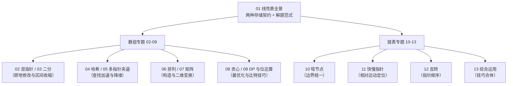

# 线性表专栏导览：数组与链表的本质与 LeetCode 面试通关

**摘要：**

本专栏面向有一定编程基础、正在备战技术面试的工程师，聚焦**线性表**这一数据结构——即数组（Array）与链表（Linked List）两种实现。专栏不追求"背模板"，而是沿着"是什么 → 为什么 → 怎么做 → 边界与反例"的推导链，把每道题背后的**解题思路**讲透：从约束出发推导解法，用不变量钉死边界，最终落到"什么场景选什么方案"的权衡上。全文的示例代码统一使用 Go 语言。全部 13 篇正文覆盖 LeetCode 高频考点，读完即可建立一套可迁移的线性表解题思维。

---

## 专栏定位

**讨论范围严格限定**：数组（Array）与单链表（Linked List），不涉及栈、队列、树、图等其他结构；也不展开排序算法与查找算法的专题（那属于另一条主线）。

**写作取向**：每篇都从"暴力解法"或"约束"出发，一步步推导出优化解，重点回答**"为什么这样解"**，而非罗列代码。对每种技巧，都力求交代它的适用前提、失效场景与边界反例。

**语言约定**：示例代码以 **Go** 为主。Go 没有泛型集合的复杂继承体系，代码更贴近算法的本来面目；关键处会标注 Go 特有的细节（如 `^x` 表示按位取反、切片删除的写法等），便于迁移到其他语言。

---

## 专栏目录

### 第一部分：本质与全景

| 序号 | 文章标题 | 核心话题 | 覆盖题目 |
|------|----------|----------|----------|
| 01 | 线性表全景：数组与链表的本质与工程权衡 | 两种存储契约、复杂度推导、缓存亲和性、解题范式总览 | 概念篇 |

### 第二部分：数组专题

| 序号 | 文章标题 | 核心话题 | 覆盖 LeetCode 题目 |
|------|----------|----------|--------------------|
| 02 | 数组双指针：原地修改数组的核心范式 | 同向/对撞双指针、循环不变量、保留 k 次泛化 | 26、80、27 |
| 03 | 数组二分搜索变体：旋转数组与中位数 | 区间不变量、旋转数组的"至少一半有序"、二分划分点 | 33、81、4、153 |
| 04 | 哈希表与连续序列：Two Sum 与 Longest Consecutive Sequence | 空间换时间、单遍哈希、起点过滤与均摊分析 | 1、128、167 |
| 05 | 多指针夹逼：3Sum、3Sum Closest、4Sum 系列 | 排序 + 降维归约、去重的两处位置、k-Sum 递归框架 | 15、16、18 |
| 06 | 全排列与字典序：Next Permutation、Permutation Sequence、Gray Code | 字典序最小改动、阶乘数系、镜像递推、康托展开 | 31、60、89 |
| 07 | 矩阵数组专题：Rotate Image、Set Matrix Zeroes、Valid Sudoku | 转置 + 翻转、就地借用标记、位掩码压缩 | 48、73、36 |
| 08 | 贪心策略：Trapping Rain Water、Gas Station、Candy | 瓶颈判定、反证排除、两遍扫描、贪心正确性证明 | 42、134、135 |
| 09 | 动态规划与位运算：Climbing Stairs、Plus One、Single Number 系列 | DP 三要素、进位模拟、异或抵消、三进制计数器 | 70、66、136、137 |

### 第三部分：链表专题

| 序号 | 文章标题 | 核心话题 | 覆盖 LeetCode 题目 |
|------|----------|----------|--------------------|
| 10 | 链表基础与哑节点技巧：Remove Duplicates、Partition List | 哑节点统一边界、prev + curr 双指针、多链表拼接 | 83、82、86 |
| 11 | 链表快慢指针：环检测、倒数节点与链表旋转 | 速度差判圈、环入口数学推导、错位起跑、成环再断开 | 141、142、19、61、876 |
| 12 | 链表反转艺术：局部反转、k 组翻转与节点交换 | 三指针迭代反转、头插法局部反转、递归与迭代取舍 | 206、92、25、24 |
| 13 | 链表综合运用：大数加法、重排链表、随机指针与 LRU 缓存 | 进位模拟、三步法合体、交织法深拷贝、哈希 + 双向链表 | 2、143、138、146 |

合计覆盖 **40 余道高频面试题**，横跨 Google、Meta、Amazon、字节跳动、阿里等一线大厂的高频考点。

---

## 阅读路径

专栏的组织逻辑是**先建立底层认知，再按"数组 → 链表"两条支线逐题深入**。下图给出了主线脉络：

---

## 贯穿全专栏的两条主线

本专栏反复回到两条主线，它们是比任何具体模板都更持久的收获：

**主线一，约束是解题方向的指南针。** 题目越是把条件收紧（原地、$O(1)$ 空间、保持顺序、一遍扫描），可行解的空间就越窄，推导的路径反而越清晰。双指针、位运算、就地借用、交织法，全都是被约束"逼"出来的。

**主线二，不变量是直觉的严格化。** 双指针的"已处理区域是什么"、二分的"答案在哪个区间"、快慢指针的"相对位置意味着什么"、LRU 的"头部最近、尾部最久"——把不变量想清楚，边界条件便不再靠猜，而是靠推。

---

## 专栏阅读建议

1. **第 01 篇必读**：它是全专栏的认知底座，后面所有技巧都能归约到它所讲的两种存储契约上。
2. **数组篇（02-09）**：建议按顺序读，02 的双指针范式是 05 多指针夹逼的前置，03 的区间不变量与 04 的查找加速是两类不同的"降复杂度"思路。
3. **链表篇（10-13）**：10 的哑节点与 12 的反转是两个基础工具，11 的快慢指针与 13 的综合运用建立在其上。
4. **亲自动手**：每篇讲完，建议先不看代码，自己在 LeetCode 上独立实现一遍，再对照思路检查。
5. **关注推导过程**：本专栏不追求"背答案"，而是强调**为什么这样想**，帮助举一反三。

---

## 关联专栏

本专栏与同目录下的其他算法专栏相互补充，可交叉阅读：

- **双指针专栏**（[[01 双指针算法全景：核心直觉、三大模型与面试考频分析]]）：对撞指针与快慢指针的通用视角，与本专栏第 02、05、11 篇互为补充。
- **滑动窗口专栏**（[[01 滑动窗口算法原理全景：从暴力枚举到 O(n) 的思维跃迁]]）：同向双指针的窗口化应用，是数组原地扫描技法的另一条支线。
- **排序与查找专栏**（[[01 排序算法原理全景：从 O(n²) 到 O(nlogn) 的演进之路]]）：排序是第 05、06 篇的前置步骤，二分查找与第 03 篇相互呼应。
- **栈与队列专栏**（[[04 单调栈入门：每日温度与下一个更大元素]]）：单调栈与接雨水（第 08 篇）、单调队列与滑动窗口最大值关系密切。
