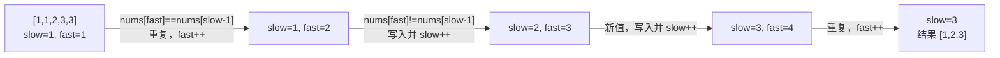

# 线性表全景：数组与链表的本质与工程权衡

**摘要：**

线性表（Linear List）是数据结构世界的起点，也是技术面试里覆盖面最广、变体最多的考察领域。它的两种实现——数组（Array）与链表（Linked List）——看上去只是"连续存储"与"分散存储"的差别，实则代表了两种截然不同的工程契约：数组用连续内存换取 $O(1)$ 的随机访问，链表用引用串联换取 $O(1)$ 的任意位置增删。本文不堆砌定义，而是从存储契约的物理本质出发，推导这两种结构各自的时间复杂度为什么长成那个形状，进而回答两个问题：**面对一道新题，如何判断该动用哪一类指针技巧；以及，为什么"会背模板"与"会解题"之间隔着一层对不变量的理解**。作为专栏第一篇，本文为后续三十余道 LeetCode 题建立统一的思维底座，不涉及任何具体题目的代码。

---

## 第 1 章 从"一列数据"到两种存储契约

### 1.1 线性关系的本质

设想一个再普通不过的需求：把一批学生的成绩按学号顺序存放。这批数据有一个共同特征——它们之间存在**前驱与后继**的关系，第一个元素之前没有元素，最后一个元素之后没有元素，中间任意一个元素都有且仅有一个前驱和一个后继。

这种"一对一"的关系，就是**线性关系**，对应的结构便称为**线性表**。它可以用一个有限序列 $L = (a_1, a_2, \ldots, a_n)$ 来刻画，其中 $n \geq 0$，$n = 0$ 时称为空表。请注意，这个定义只约束了元素之间的**逻辑关系**，丝毫没有规定它们在内存里长什么样。逻辑上是"排成一列"，物理上却可以有多种摆法——这一点，恰恰是全部复杂性的源头。

线性表要解决的根本问题，用一句话概括就是：**如何在计算机中高效地存储与操作一批同类型数据**。它是所有上层结构的底座，栈、队列、哈希表乃至树与图，都可以在某种视角下被看作线性表的特化或推广。

### 1.2 两种实现路线，就是两种契约

逻辑关系只有一种，物理实现却有两条路可走：

**路线一，把元素一个挨一个地摆在一块连续的内存里**，于是得到**数组**；**路线二，把每个元素包装成节点，再用指针把节点串联起来，允许它们散落在内存各处**，于是得到**链表**。

这两条路线不是"谁更好"的问题，而是在不同约束下做出的两种**设计权衡**。笔者更愿意把它们称作两种**契约**：你选择数组，就等于接受了"用连续的存储换来按下标直接定位"这份契约；你选择链表，就等于接受了"放弃随机定位，换来在任意已知位置插入删除都只需改动几个引用"这份契约。契约没有高下之分，只有是否匹配当下场景之别。

理解这两份契约好在哪、坏在哪，是解所有线性表题目的底层逻辑。因为面试题千变万化，真正稳定不变的，只有这两份契约所派生的那些性质。

### 1.3 为什么先讲契约，再讲题目

很多人刷题的方式是"见一道背一道"，把每道题的解法当成孤立的招式记下来。这样做的代价是：题目稍一变形，招式就失效了。而如果先把两份契约想透，你会发现大量的"新题"其实只是旧契约在不同约束下的重新组合。

举个简单的例子。所有"原地修改数组"的题目，本质上都在回答同一个问题——在不能另开空间的约束下，如何用数组自己的前段存放结果、后段充当待处理区；所有"链表指针操作"的题目，本质上都在回答另一个问题——如何在只改引用、不改数据的前提下，安全地改变链表的拓扑。**把问题归约到契约层面，解法就从"记忆"变成了"推导"**。这就是本专栏反复强调的思路。

---

## 第 2 章 数组：连续内存的红利与代价

### 2.1 地址公式：随机访问的全部秘密

数组要求所有元素在内存中**连续存放**。设数组首地址为 $\text{base}$，每个元素占 $s$ 字节，那么第 $i$ 个元素的地址就是一个再简单不过的公式：

$$\text{addr}(a[i]) = \text{base} + i \times s$$

这个公式是整个数组结构的灵魂。它意味着：**给定下标 $i$，CPU 不需要任何"查找"，只需做一次乘法和一次加法，就能直接算出目标地址，再发起一次内存访问把数据取回来**。数组的随机访问之所以是 $O(1)$，靠的正是这道理性而廉价的地址计算，而不是某种神秘的硬件魔法。

```text
内存地址:  0x100  0x104  0x108  0x10C  0x110
           ┌─────┬─────┬─────┬─────┬─────┐
数组内容:  │  5  │  3  │  8  │  1  │  9  │
           └─────┴─────┴─────┴─────┴─────┘
下标:        [0]   [1]   [2]   [3]   [4]
```

反过来看，这个公式也解释了数组的软肋。既然第 $i$ 个元素的地址是"首地址 + 偏移"，那么一旦在中间插入或删除一个元素，所有位于其后的元素地址就全都错了，必须整体搬移。**数组的灵活性，是用地址公式的刚性换来的**——下标与地址被死死绑在一起，动一处就得动一串。

> [!note] 设计哲学：下标为什么从 0 开始
> 不少初学者把"下标从 0 开始"当成一个古怪的习惯，其实它是数学上最自然的选择。若从 1 开始，地址公式会退化成 $\text{base} + (i-1) \times s$，凭空多出一次减法；从 0 开始，公式直接就是 $\text{base} + i \times s$，少一步运算。Dijkstra 在 1982 年专门写过一篇短文论证这件事，结论是：从 0 开始，区间 $[0, n)$ 的上下界之差恰好等于元素个数，边界处理也更优雅。它不是历史包袱，而是设计上的更优解。

### 2.2 复杂度逐项拆解

把数组的每种操作放到契约下审视，复杂度的形状就一目了然了。

**随机读取，$O(1)$。** 前面已经说清楚了：一次地址计算，一次内存读取，与数组规模无关。这是数组契约给得最大方的一项。

**末尾追加，均摊 $O(1)$。** 往数组末尾写一个元素，直接在 `a[n]` 处落笔即可。前提是数组还有空位；若已满，动态数组（Java 的 `ArrayList`、Go 的 `slice`、Python 的 `list`）会触发一次**扩容**——申请一块更大的内存，把旧数据整体搬过去，再写入新元素。这次扩容本身是 $O(n)$ 的。

**中间插入与删除，$O(n)$。** 这是数组最大的软肋。在位置 $i$ 插入一个新元素，需要把 $a[i]$ 到 $a[n-1]$ 的所有元素整体后移一格，为新人腾出位置：

```text
插入前: [5, 3, 8, 1, 9]
在位置 2 插入 7：需要把 [8, 1, 9] 整体右移一格
插入后: [5, 3, 7, 8, 1, 9]
```

最坏情况是插到头部，需要移动全部 $n$ 个元素。删除同理，删掉 $a[i]$ 之后，后面的元素要整体左移填坑。**请注意一个容易被忽略的细节：这里的 $O(n)$ 代价并不来自"找到位置"——若已知下标，查找是 $O(1)$ 的——而完全来自"找到位置之后还要搬移后面所有元素"**。把这一点想清楚，就能明白为什么数组题里"减少元素移动次数"常常是优化的核心。

**按值搜索，$O(n)$；有序时可降至 $O(\log n)$。** 数组无序时只能逐个比对；若数组有序，二分查找能把搜索代价压到对数级。有序性是很多高效算法的前提，后文还会反复回到这个主题。

### 2.3 均摊分析：为什么追加仍是 $O(1)$

有人会问：既然扩容是 $O(n)$，那"追加均摊 $O(1)$"这个结论岂不是自相矛盾？答案藏在**均摊分析（Amortized Analysis）**里。

以容量翻倍扩容为例。容量为 $n$ 的数组扩到 $2n$，需要复制 $n$ 个元素，这一次追加的代价确实是 $O(n)$。但请注意，在这次扩容之前，你已经做了整整 $n$ 次廉价的追加，每次只花了 $O(1)$。把这次昂贵的扩容分摊到前面那 $n$ 次追加上，每次追加的"分摊代价"恰好是 $n/n = O(1)$。

> [!info] 均摊分析的直觉
> 不妨这样想象：你每追加一个元素，就往存钱罐里丢一枚硬币，用于支付未来某次扩容的账单。容量从 $n$ 扩到 $2n$ 需要搬运 $n$ 个元素，也就是需要 $n$ 枚硬币；而在扩容发生前，你刚好已经投进了 $n$ 枚。账目两清，平均每次追加的代价恒为常数。均摊分析与"平均情况分析"不同——它不依赖概率假设，而是对任意一串操作序列都成立的最坏情况平均，因此是更强的保证。

### 2.4 缓存亲和性：被忽视的隐藏红利

数组还有一项常被理论分析忽略、却在工程中举足轻重的优势：**CPU 缓存亲和性（Cache Locality）**。

现代 CPU 有多级缓存。当它从内存读取某个地址的数据时，并不会只取那一个字节，而是把**附近一整块连续内存**（通常 64 字节，称为一个 Cache Line）一并搬进缓存。对于连续存放的数组，访问 `a[0]` 时，`a[1]`、`a[2]` 乃至其后若干个元素都已经跟着进了缓存；下一次访问 `a[1]` 时便是缓存命中，无需再去访问主内存。而缓存命中与主内存访问之间的速度差，往往在数十倍量级。

链表恰恰相反。节点散落在堆内存各处，顺着 `next` 指针走一步，几乎必然跨越到一块全新的内存区域，导致频繁的 Cache Miss。**这就是为什么在处理大规模数据时，理论复杂度更"漂亮"的链表，实测性能却常常被数组远远甩开**。理论复杂度刻画的是运算次数的量级，而缓存命中率刻画的是每次运算实际有多贵，二者缺一不可。

---

## 第 3 章 链表：引用串联的灵活与代价

### 3.1 节点与指针的物理模型

链表把每个元素包装成一个**节点（Node）**，节点里除了数据本身，还存着一个指向下一个节点的引用（指针）。用 Go 来定义，一个单链表节点不过两行：

```go
// 单链表节点的经典定义
type ListNode struct {
    Val  int       // 数据域：存储实际值
    Next *ListNode // 指针域：指向下一个节点，末尾节点为 nil
}
```

链表的节点无需在内存中连续，它们可以散落在堆内存的任意角落，只要顺着 `Next` 能找到下一个就够了：

```text
内存中的样子（节点地址不连续）：

0x200: [Val=5 | Next→0x350]
0x350: [Val=3 | Next→0x180]
0x180: [Val=8 | Next→0x420]
0x420: [Val=1 | Next→nil]

逻辑上的链表: 5 → 3 → 8 → 1 → nil
```

链表有一个特殊的角色：**头指针 `head`**，它保存着第一个节点的地址。一旦丢失 `head`，整条链表就再也找不回来了（会被垃圾回收器回收）。这一点在写代码时极易酿成事故。

> [!warning] 生产避坑：不要弄丢 head
> 遍历链表时，如果直接拿 `head` 当游标一路 `head = head.Next` 走下去，走完之后原始入口就永久丢失了，返回时你手里只剩一个指向 `nil` 的空引用。标准做法是：始终保留一个指向原始头节点的引用，另外用一个遍历指针去移动。初学者的链表 bug，十之三四都出在这里。

### 3.2 复杂度逐项拆解

**随机访问，$O(n)$。** 链表没有地址公式，要访问第 $i$ 个元素，只能从 `head` 出发，顺着 `Next` 一步步数过去。**这里的慢，不是"指针运算慢"，而是链表的存储结构物理上就不支持随机寻址**——你无法跳过任何一个节点，因为下一个节点的地址只存在于当前节点里。

**头部插入与删除，$O(1)$。** 在链表头部插入一个新节点，只需让新节点的 `Next` 指向原 `head`，再把 `head` 指过去，两步操作与链表长度无关。删除头节点同理，`head = head.Next` 一步到位。

**任意已知位置的插入与删除，$O(1)$。** 这是链表最大的优势，也是它存在的核心理由。若你已持有目标位置的前驱节点 `prev`，在其后插入一个节点只需要改动两个引用：

```go
newNode.Next = prev.Next // 新节点接管原来的后继
prev.Next = newNode      // 前驱改为指向新节点
```

两次赋值，$O(1)$。这与数组插入要搬移一整串元素形成鲜明对比，也正是链表契约最诱人的地方。

**但实际中，插入删除往往是 $O(n)$。** 请注意"已知前驱"这个前提。若题目只说"在值为 `k` 的节点之前插入"，那你得先遍历找到那个节点，而遍历本身是 $O(n)$。所以面试里说"链表插入是 $O(1)$"，是特指**已经定位到插入点之后**的操作代价，不含查找代价。把"定位"与"插入"两笔账分开算，是理解链表复杂度的关键。

### 3.3 单链表与双向链表

本专栏聚焦**单链表**，因为 LeetCode 中九成以上的链表题都是单链表。但双向链表的存在值得了解，它揭示了一个重要事实：契约是可以调整的。

| 特性 | 单链表 | 双向链表 |
|------|--------|----------|
| 节点额外空间 | 1 个指针（`Next`） | 2 个指针（`Prev` + `Next`） |
| 向前遍历 | 不支持，必须从头重来 | 直接 `node.Prev` |
| 删除已知节点（无需前驱） | $O(n)$（需先找前驱） | $O(1)$ |
| 典型应用 | 绝大多数 LeetCode 题 | LRU Cache、`container/list` |

LRU Cache 必须用双向链表，原因恰恰在于"删除任意已知节点"必须做到 $O(1)$，而单链表做不到——删一个节点必须先拿到它的前驱，单链表拿不到。这是第 13 篇会深入展开的内容。**多存一个指针，买回的是"可反向定位"的能力，这又是一次典型的空间换时间权衡**。

---

## 第 4 章 两种契约的横向权衡

### 4.1 复杂度对照表

把两种结构放在同一张表里对照，契约的边界就清晰了：

| 操作 | 数组（Array） | 链表（Linked List） |
|------|--------------|---------------------|
| 随机读取 `a[i]` | $O(1)$ | $O(n)$ |
| 头部插入 | $O(n)$（需移位） | $O(1)$ |
| 尾部追加 | 均摊 $O(1)$ | $O(n)$（无尾指针）/ $O(1)$（有尾指针） |
| 中间插入（已知位置） | $O(n)$（需移位） | $O(1)$（已知前驱）/ $O(n)$（需找前驱） |
| 删除中间元素 | $O(n)$（需移位） | $O(1)$（已知前驱）/ $O(n)$（需找前驱） |
| 按值搜索 | $O(n)$ / 有序时 $O(\log n)$ | $O(n)$ |
| 内存占用 | 紧凑，无额外开销 | 每节点多存一个指针 |

这张表最值得玩味的，是"中间插入"那一行。表面上链表以 $O(1)$ 完胜，但括号里的前提——"已知前驱"——才是真正的胜负手。现实中绝大多数操作都得先定位，一旦把定位代价算进去，链表的优势就大打折扣。**复杂度分析里最容易被忽视的，往往是那些写在括号里的前提条件**。

### 4.2 空间模型的差异

数组有一项隐性代价：**它需要预先声明容量，或在扩容时申请一块全新的连续内存**。声明容量 100 却只用了 10，剩下 90 个槽位就是浪费；容量不够触发翻倍扩容时，在复制完成之前，内存中会同时存在旧的 100 个与新的 200 个槽位，峰值占用是平时的三倍。

链表则是"用多少申请多少"，理论上没有预分配浪费。但每个节点都要额外存一个指针（64 位系统上是 8 字节），若节点数据本身很小（譬如只存一个字节），指针的开销反而比数据本身大出数倍。**空间上的权衡，同样是"有没有浪费"与"浪费在哪儿"的区别，而非绝对的高下**。

### 4.3 为什么工程中数组几乎统治了"序列"

在真实的工程里，动态数组几乎统治了所有"序列"需求，链表反倒是冷门选择。这不是因为教科书讲错了，而是因为前面提到的缓存亲和性——现代 CPU 的缓存命中比访问主内存快出数十倍，数组凭这一项就能在很多场景下弥补理论复杂度上的劣势。

> [!note] 设计哲学：理论复杂度与实际性能之间的那道缝
> 教科书给的是渐进复杂度的量级，工程里拼的是常数因子与内存访问模式。当 $n$ 不大时，常数因子往往比量级更能决定胜负；当数据规模很大时，缓存局部性又成了隐藏的胜负手。笔者建议的做法是：**先用复杂度排除掉量级不可接受的方案，再在剩下的方案里用实测数据做决定**，而不是迷信"复杂度更低就一定更快"。这也正是后面每一篇题解里，笔者都会区分"理论最优"与"面试推荐写法"的原因。

### 4.4 为什么面试中链表题依然重要

既然工程里链表用得少，面试为何还频繁考它？因为链表题考察的是**指针操作的正确性与边界条件的处理能力**——这是一种数组题替代不了的硬功夫。链表题几乎无法靠"调 API"绕过，你必须亲手维护每一个引用，稍有不慎就是空指针异常或断链。面试官想看的，正是你在这种"每一步都不能错"的场景下，能否有条不紊地推进。理解了这一点，刷链表题时就会把注意力放在"引用关系的正确性"上，而不是死记某道题的答案。

---

## 第 5 章 解题视角（一）：数组题的四种范式

不同的数组题表面形式各异，底层逻辑却高度收敛。笔者把它们归为四种范式，后续每一篇数组题都会落到其中之一。

### 5.1 双指针：把"位置"变成可编程的变量

绝大多数数组的原地修改题，本质都是双指针：一个慢指针标记"下一个可写位置"，一个快指针扫描数组。它的精妙之处在于，把"数组的前半段"和"后半段"这两种角色，交给了两个会移动的下标去表达。下面这张图给出了一个去重场景的推演，慢指针 `slow` 划定已整理区域，快指针 `fast` 逐格探测：



这类范式的关键，是预先想清楚一个**循环不变量**：在每次迭代结束时，`nums[0..slow-1]` 里保存的到底是什么。想清楚了，边界条件就不再靠直觉，而有严格的逻辑支撑。

### 5.2 二分：不变量驱动的区间收缩

处理有序数组时，优先考虑是否能用二分。二分的关键从来不是"找到某个值"这个动作，而是**确定不变量**：在每一次迭代中，明确哪一半区间不可能包含答案，从而安全地收缩搜索范围。二分的边界条件（用 `<` 还是 `<=`、更新成 `mid` 还是 `mid+1`）是面试的高频失误点，破解之道是选定一套统一的区间语义（譬如始终采用左闭右开）并一以贯之，而不是每道题凭感觉。第 03 篇会专门拆解这套不变量。

### 5.3 哈希：空间换时间的查询

当需要在 $O(1)$ 时间内查询"某个值是否存在"或"某个值出现在哪"时，哈希表以空间换时间是最直接的选择。Two Sum 便是最经典的例子：把"两数之和"从"枚举所有配对"的 $O(n^2)$，转化为"对每个数查询目标补数是否见过"的 $O(n)$。哈希表的价值不在于它快，而在于它把"查找"这一动作的代价从线性压到了常数，从而让一次线性扫描足以解决问题。

### 5.4 贪心扫描：一次遍历里的局部最优

还有一类题，可以通过一次或两次线性扫描，在每一步做出当前看来最优的决策，最终得到全局最优解。这类解法的难点不在于代码，而在于**证明局部最优能推出全局最优**——也就是贪心正确性。接雨水、加油站、分发糖果都属于这一类，第 08 篇会用反证法逐一交代它们为什么成立。

---

## 第 6 章 解题视角（二）：链表题的四种范式

### 6.1 哑节点：消灭头节点特判

链表题最常见的边界问题，是"头节点需要被删除或修改"。此时引入一个虚拟的**哑节点（Dummy Node）**，令 `dummy.Next = head`，操作完成后返回 `dummy.Next`，就能让"删除头节点"与"删除中间节点"的代码完全一致，消灭掉大量 `if head == nil` 的特判。

```go
dummy := &ListNode{Next: head} // 哑节点的值无所谓，只为占位
// ... 所有操作都经由 dummy 或 dummy.Next 进行 ...
return dummy.Next // 返回真正的头节点（可能已改变）
```

哑节点的思想在链表题里出现频率极高，值得单独记住：**它用一个"永远存在的前驱"，把原本需要分类讨论的边界，统一成了普通情形**。

### 6.2 快慢指针：用速度差度量位置

用两个速度不同的指针在链表上移动，可以解决一批"位置"问题：慢指针每次走一步、快指针每次走两步，当快指针走到末尾时，慢指针恰好停在中间，这用来找中点；让快指针先走 $k$ 步再同步前进，快指针到头时慢指针正停在倒数第 $k$ 个；而若链表里有环，快指针终将追上慢指针，这便是 Floyd 判圈算法。**速度差，本质上是一种把"相对位置"变成"可测量量"的巧劲**。

### 6.3 迭代反转：三指针的舞蹈

反转链表是链表题的基本功。迭代做法用三个指针 `prev`、`curr`、`next`，每轮把 `curr.Next` 指向 `prev`，再整体向前推进一格。这个范式在"局部反转""每 k 个一组反转"等变体里反复出现，是必须练到肌肉记忆的一段代码。它的难点全在顺序：必须先保存 `next`，才能安全地改写 `curr.Next`，否则后继节点就丢了。

### 6.4 分拆再合并：把复杂操作拆成子问题

遇到复杂链表操作（重排链表、合并有序链表），一个屡试不爽的策略是把它拆成几个子问题：找中点、反转后半段、合并两条链，逐个击破。**链表的很多难题之所以难，不是因为单个步骤难，而是因为它们把好几个步骤缠在了一起**；一旦拆开，每一步都平平无奇。

---

## 第 7 章 解题思路的元技能：复杂度分析与不变量

### 7.1 复杂度分析的习惯

面试时解完题，主动说出时间与空间复杂度，是工程素养的体现。两个实用的分析习惯：**数清楚每个元素或节点被访问了几次**，若每次访问是 $O(1)$、总共访问 $k$ 次（$k$ 为常数），那整体就是 $O(n)$；**区分原地算法与需要额外空间的方案**，面试官常会追问"能否用 $O(1)$ 额外空间实现"，这往往就是题目的第二层考点。

### 7.2 不变量：从"凭直觉"到"有证明"

如果说本专栏只允许读者记住一件事，那便是**不变量**。所谓不变量，就是在算法的每一次迭代中都必须成立的一个性质。双指针里"已处理区域保存的是什么"、二分里"答案一定落在哪个区间"、快慢指针里"两指针的相对位置意味着什么"，全都是不变量。**不变量是直觉的严格化**：当你写代码写不下去时，回去问一句"我的不变量是什么"，边界条件往往迎刃而解；当面试官追问"为什么这样写是对的"时，不变量就是你最有力的回答。

### 7.3 面试表达的结构

一道题从看到到讲完，建议按这样一条链来表达：先复述题意并点明关键约束（数组还是链表、是否有序、是否要求原地），再给出暴力思路及其瓶颈，接着指出观察到的结构性质，由此推导出优化解法，最后主动交代复杂度与边界情况。**这条链的价值在于，它展示的是"如何想到解法"的过程，而不是"我已经背下了解法"的结果**——后者恰恰是面试官最想识别的。

---

## 第 8 章 边界与反例

### 8.1 那些"理论上更优、实测更差"的陷阱

前面反复提到缓存亲和性，这里把它作为一个反例集中提醒：在数据规模不大时，链表某些操作的 $O(1)$ 优势会被指针跳转带来的缓存开销吃掉；而在数据规模很大时，数组即便在理论复杂度上吃亏，也常常凭缓存命中率反超。**因此，"某结构在某个操作上是 $O(1)$"这句话，永远要连同它的前提（已知前驱、无扩容、数据规模）一起理解**。脱离场景谈优劣，本身就是一种思维陷阱。

### 8.2 边界条件清单

线性表题的 bug，绝大多数来自边界。下面这张清单值得在每道题写完代码后过一遍：

| 场景 | 数组 | 链表 |
|------|------|------|
| 空输入 | 长度为 0，注意越界与特判 | `head == nil` |
| 单元素 | 循环是否执行、初值是否正确 | `head.Next == nil` |
| 操作头节点 | 下标 0 的移位 | 是否需哑节点统一处理 |
| 操作尾节点 | 下标 $n-1$ 的移位 | 是否误访问 `nil.Next` |
| 全同/全目标值 | 结果长度可能为 0 或 1 | 整条链可能被删空 |

**把这些边界在动笔前就在脑子里过一遍，比写完再调试要省事得多。**

---

## 小结

线性表的故事，说到底是一个"逻辑关系只有一种、物理实现却有两种"的故事。数组以连续内存为契约，用地址公式换来 $O(1)$ 的随机访问，代价是插入删除时的整体搬移；链表以引用串联为契约，用指针的灵活换来 $O(1)$ 的已知位置增删，代价是丢失随机定位与缓存亲和性。**没有哪一种结构绝对更优，只有哪一种契约更匹配当下的场景**——这正是"架构即权衡"在数据结构层面的最小投影。

而对解题而言，真正可迁移的能力并不是记住某道题的答案，而是三样东西：**看懂题目约束背后对应的是哪份契约、把解法归约到少数几种范式、并用不变量把直觉严格化**。掌握了这三样，题目再怎么变形，你都能从约束出发一步步推导出解法，而不是在脑海里搜索"这题我背过没有"。

下一篇 [[02 数组双指针：原地修改数组的核心范式]] 将进入第一个具体题目模块，从"为什么不能另开数组"这个铁约束出发，推导出双指针的必然性，并用 Go 语言完整实现 LeetCode 26、80、27 三道经典题。

---

## 参考资料

1. Dijkstra, E. W. (1982). *Why numbering should start at zero*. EWD831.
2. Cormen, T. H., Leiserson, C. E., Rivest, R. L., & Stein, C. *Introduction to Algorithms* (4th ed.). MIT Press, 2022. 第 10 章"基本数据结构"、第 16 章"均摊分析"。
3. Sedgewick, R., & Wayne, K. *Algorithms* (4th ed.). Addison-Wesley, 2011. 第 1.3 节"背包、队列与栈"、第 1.4 节"算法分析"。
4. Drepper, U. (2007). *What Every Programmer Should Know About Memory*. Red Hat, Inc. 关于 Cache Line 与内存访问延迟的量化分析。
5. Go 官方博客. *Arrays, slices (and strings): The mechanics of 'append'*. https://go.dev/blog/slices

---

> [!note] 思考题
> 1. 数组随机访问是 $O(1)$，但这个结论依赖"每个元素等长"这一前提。若数组中存放的是变长字符串，随机访问还能保持 $O(1)$ 吗？工业界的做法通常是什么？
> 2. 动态数组的扩容倍数取 1.5 倍还是 2 倍，会影响哪些性能指标？为什么 Java 的 `ArrayList` 选 1.5 倍，而许多其他实现选 2 倍？
> 3. 链表插入是 $O(1)$，但前提是"已知前驱"。如果题目要求在链表中按值有序插入，整体复杂度是多少？有没有办法把这个值降下来？
> 4. 缓存的 Cache Line 是 64 字节。如果一个链表节点的数据加指针恰好也是 64 字节，它的缓存局部性会比"数据 4 字节 + 指针 8 字节"的节点更好还是更差？为什么？
> 5. 如果要求你设计一个既能 $O(1)$ 随机访问、又能 $O(1)$ 在头部增删的结构，你会如何组合数组与链表？提示：思考"索引与数据分离"的思路。
