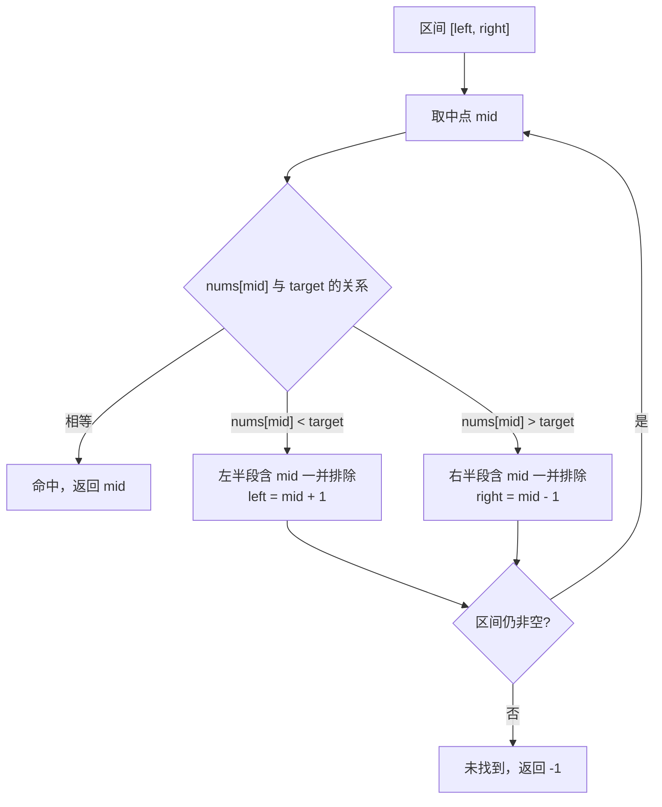

# 数组二分搜索变体：旋转数组与中位数

**摘要：**

二分搜索的"基础版"——在有序数组里找一个数——几乎人人都会写，但它恰恰是最容易"背模板背到不会思考"的一类算法：一旦数组的有序性被破坏，或者二分的对象从"元素"变成"答案区间"，死记的边界条件立刻失灵。本文要建立的，正是一套不依赖记忆的二分思维框架。我们会先厘清二分的本质是"每次证明一半区间不可能包含答案"，再用一条统一的区间不变量把边界条件彻底钉死；随后逐一拆解三道高频变体——旋转数组中的搜索（LeetCode 33）、含重复元素的旋转数组（LeetCode 81）、两个有序数组的中位数（LeetCode 4，困难）——以及作为前置子问题的寻找旋转点（LeetCode 153/154）。每一题都从"哪一半可以安全排除"这一问句出发推导解法，并用 Go 语言完整实现。读完本篇，你面对任何二分变体，都能靠逻辑而非记忆写出正确的边界。

---

## 第 1 章 二分搜索的本质：不是"猜中"，而是"排除"

### 1.1 一个被普遍误解的直觉

初学者理解二分搜索时，常有一个不够深刻的直觉：二分就是"每次猜中间那个数，猜中了就找到了"。这个理解不能说错，却难以迁移——因为绝大多数二分变体里，"猜中"根本不是关键，你甚至不知道要猜的那个东西长什么样（第 4 章要猜的就不是元素，而是一个"划分位置"）。

更准确的表述是：**二分搜索的每一步，不是要"找到答案"，而是要"证明某一半区间绝不可能包含答案"，从而把搜索空间稳定地砍掉一半。** 这个视角的转变至关重要。以旋转数组为例，你乍一看会觉得"数组都乱了，还怎么二分"，但只要把问题换成"哪一半区间可以被安全排除"，思路便豁然开朗。**二分是一台排除机器，而不是一台命中机器**——理解了这一点，后面所有变体都只是"如何找到排除依据"的问题。

### 1.2 用不变量统一边界条件

二分搜索的边界条件（该用 `left < right` 还是 `left <= right`、该更新成 `mid` 还是 `mid+1`）是无数人的噩梦，根源在于没有选定一套自洽的**区间语义**。本专栏统一采用**闭区间模板**：每次迭代中，答案（如果存在）一定落在闭区间 $[left, right]$ 内。

```go
func binarySearch(nums []int, target int) int {
    left, right := 0, len(nums)-1
    for left <= right { // 区间 [left, right] 非空时继续
        mid := left + (right-left)/2 // 防溢出的中点写法
        switch {
        case nums[mid] == target:
            return mid
        case nums[mid] < target:
            left = mid + 1 // mid 已排除，新区间 [mid+1, right]
        default:
            right = mid - 1 // mid 已排除，新区间 [left, mid-1]
        }
    }
    return -1
}
```

这套模板之所以不会出错，是因为它背后有一条清晰的不变量：**`mid` 在每轮都已被显式检查并排除，因此新区间必然不含 `mid`**。于是 `left = mid + 1`、`right = mid - 1` 的写法就不是凭感觉，而是由不变量推出的必然；循环条件 `left <= right` 也不是约定俗成，而是"闭区间非空"这一语义的直接翻译。**当有人问你"为什么这里是 `<=`"，正确的回答不是"我背的模板如此"，而是"因为区间是闭的，`left == right` 时还剩一个元素没检查"。**

> [!warning] 生产避坑：中点的整数溢出
> `mid := (left + right) / 2` 在 `left` 与 `right` 都接近类型上界时会溢出。Go 的 `int` 是 64 位，实际几乎不可能触发，但 `left + (right-left)/2` 这种写法是跨语言的良好习惯，且它把"区间长度的一半"这一语义表达得更清楚。面试中写出防溢出写法，是工程素养的加分项。

### 1.3 二分的适用前提

二分能成立，本质上依赖一个**单调性**：存在某种"判定"，使得区间的一端全是"否"、另一端全是"是"。有序数组里的"值是否小于 target"就是这样一个判定；旋转数组里的"target 是否落在某个有序段内"也是。**凡是能用二分的题，背后一定藏着一条可被判定的单调边界**。找不到这条边界，二分就无从谈起——这也是后面第 81 题会陷入困境的根源。

把这一过程画成图，二分的"排除"本质会更加直观。每轮迭代都把当前区间一分为二，依据判定条件砍掉不可能的那一半：



### 1.4 三种常见边界错误，以及不变量如何化解

二分的边界之所以让无数人栽跟头，是因为它有三处极易写错的地方。笔者把它们逐一点出来，并说明为什么"守住不变量"就能避免。

**错误一：循环条件与区间语义不一致。** 若采用闭区间语义，却把循环条件写成 `left < right`，那么当区间收缩到只剩一个元素（`left == right`）时循环就退出了，最后一个元素永远得不到检查。**根因是把"区间非空"错误地翻译成了 `left < right`**——对闭区间而言，非空的条件是 `left <= right`，二者必须一一对应。

**错误二：更新时忘记排除 `mid`。** 若写成 `left = mid`（而非 `mid + 1`），在 `nums[mid] < target` 且区间只剩两个元素时，`mid` 会一直等于 `left`，区间不再收缩，程序陷入死循环。**根因是违背了"`mid` 已被检查并排除"这条不变量**：既然 `mid` 已排除，新区间就不该再包含它。

**错误三：`mid` 的计算溢出。** `(left + right) / 2` 在两端都接近类型上界时溢出为负，导致下标越界。改用 `left + (right-left)/2` 即可，且这一写法把"区间长度的一半"这一语义表达得更清楚。

三处错误，看上去是三个独立的技巧点，本质上却都指向同一条不变量：**答案始终落在闭区间 $[left, right]$ 内，且 `mid` 每轮都被显式排除**。把这条不变量在动笔前写在草稿纸上，三个错误便都不再可能发生。**这正是笔者反复强调"先想清不变量、再写边界"的原因——它不是多此一举的形式，而是把直觉严格化的唯一途径。**

---

## 第 2 章 LeetCode 33：搜索旋转排序数组

### 2.1 题目

**LeetCode 33 - Search in Rotated Sorted Array**（中等）

整数数组 `nums` 按升序排列，且值互不相同。在传给函数之前，`nums` 在某个未知下标处进行了**旋转**（譬如 `[0,1,2,4,5,6,7]` 在下标 3 处旋转，变成 `[4,5,6,7,0,1,2]`）。给定旋转后的 `nums` 与目标值 `target`，若存在则返回下标，否则返回 -1。要求时间复杂度 $O(\log n)$。

```text
输入: nums = [4,5,6,7,0,1,2], target = 0  →  输出: 4
输入: nums = [4,5,6,7,0,1,2], target = 3  →  输出: -1
```

### 2.2 结构分析：旋转数组藏着一条可用性质

旋转之后，原本完整的升序数组被切成两段，每一段内部仍然升序。以 `[4,5,6,7,0,1,2]` 为例：

```text
      旋转点
       ↓
[4, 5, 6, 7, | 0, 1, 2]
 左侧升序段     右侧升序段
 最小=4 最大=7  最小=0 最大=2
```

$O(\log n)$ 的复杂度要求已经排除了线性扫描，逼着我们必须用二分。但二分要求单调性，而整个数组显然不单调——于是关键问题是：**这个被破坏的数组里，还残留着什么可以被利用的有序性？**

答案藏在下面这条观察里：**对于区间 $[left, right]$ 内任意取的 `mid`，$[left, mid]$ 与 $[mid+1, right]$ 这两段中，至少有一段是完全有序的。**

证明并不复杂。旋转点（从大跳到小的那处断口）在整个数组中只有一个。当我们在区间中间切一刀，这个唯一的断口要么落在左半段，要么落在右半段，要么恰好在切点——无论如何，**剩下那一半必然不含断口，因而完全有序**。这条性质，就是二分得以在"乱序"数组中存活的救命稻草。

### 2.3 推导：先找有序的一半，再判断 target 在不在这里

有了上面的观察，每一轮迭代的思路就顺理成章了，只需两步：

**第一步，判断哪一半是有序的。** 若 `nums[left] <= nums[mid]`，说明断口不在左半段，左半段 $[left, mid]$ 有序；否则断口在左半段，右半段 $[mid+1, right]$ 有序。

**第二步，判断 target 是否落在有序的那一半里。** 这一步是整道题的精髓，值得追问一句"为什么"。**因为只有有序的区间，才能用 `nums[lo] <= target <= nums[hi]` 这种范围判断来确定 target 是否在其中**；无序区间根本无法做范围判断——你没法说清"target 在不在这一堆乱序的数里"。所以我们必须先找到有序的一半，再用范围判断决定去留：在，就收缩到这一半；不在，就必然在另一半。

```go
func search(nums []int, target int) int {
    left, right := 0, len(nums)-1
    for left <= right {
        mid := left + (right-left)/2
        if nums[mid] == target {
            return mid
        }
        if nums[left] <= nums[mid] {
            // 左半段 [left, mid] 有序
            if nums[left] <= target && target < nums[mid] {
                right = mid - 1 // target 在有序的左半段内
            } else {
                left = mid + 1 // 否则只能去右半段
            }
        } else {
            // 右半段 [mid, right] 有序
            if nums[mid] < target && target <= nums[right] {
                left = mid + 1 // target 在有序的右半段内
            } else {
                right = mid - 1 // 否则只能去左半段
            }
        }
    }
    return -1
}
```

### 2.4 手动模拟

以 `nums = [4,5,6,7,0,1,2]`、`target = 0` 为例：

```text
初始: left=0, right=6

迭代1: mid=3, nums[3]=7 ≠ 0
       nums[left=0]=4 <= nums[mid=3]=7 → 左半段 [0,3] 有序
       target=0 是否在 [4,7) 内？4<=0 为假 → 不在，去右半段
       left = mid+1 = 4

迭代2: left=4, right=6, mid=5, nums[5]=1 ≠ 0
       nums[left=4]=0 <= nums[mid=5]=1 → 左半段 [4,5] 有序
       target=0 是否在 [0,1) 内？0<=0 且 0<1 为真 → 在，去左半段
       right = mid-1 = 4

迭代3: left=4, right=4, mid=4, nums[4]=0 == target → 返回 4 ✓
```

### 2.5 两处边界的逻辑解释

**为什么用 `nums[left] <= nums[mid]` 而不是 `<`？** 当区间只剩一个元素（`left == mid`）时，`nums[left] == nums[mid]`，此时"左半段"退化为单元素区间，当然是"有序"的，用 `<=` 才能正确覆盖这种情况。

**内层为什么写 `target < nums[mid]` 而不是 `<=`？** 因为在进入这一步之前，`nums[mid] == target` 已被检查并返回，能走到这里的 `nums[mid]` 必然不等于 `target`，所以取严格小于；反之，`nums[left] <= target` 的 `<=` 是必要的，因为 `nums[left]` 本身可能就是 target（此时 target 确实落在左半段内）。

**请注意，这两处符号不是需要死记的规则，而是"mid 已排除"与"区间端点是否含于区间"这两个语义的推论。** 想清楚语义，符号自然浮现。

### 2.6 另一种解题思路：先找旋转点，再普通二分

上面的做法是"边二分边判断 target 落在哪半"，一步到位。但还有另一条同样合法的思路，值得对照着看，因为它更贴近人的直觉：**先用一次二分找出旋转点（也就是最小值所在的位置），把数组在逻辑上切成两段有序数组，再在正确的那一段上做一次普通的二分。**

第一步，找最小值（LeetCode 153）：若 `nums[mid] > nums[right]`，最小值必在 `[mid+1, right]`；否则最小值在 `[left, mid]`。第二步，拿旋转点的下标 `pivot` 与 target 比较：若 `target >= nums[0]`，target 只可能落在左段 `[0, pivot-1]`；否则只可能落在右段 `[pivot, n-1]`。在选定的段上跑一次标准二分即可。

两次二分都是 $O(\log n)$，总复杂度仍是 $O(\log n)$，只是常数翻倍。**两条思路的取舍也很有意思**：一步到位的写法代码更短、常数更小，但每轮的判断逻辑更绕；两步走的写法把一个"乱序"问题拆成了两个"有序"子问题，每一步都简单直白，可读性更好。**在面试里，如果一时想不清"哪半有序"的判断，先拆成两步走往往是更稳的退路**——它牺牲了一点性能，换回了思维的确定性。这也再次印证了那个朴素的道理：把复杂问题拆成简单子问题，永远是算法设计里最可靠的一招。

---

## 第 3 章 LeetCode 81：含重复元素的旋转数组

### 3.1 题目

**LeetCode 81 - Search in Rotated Sorted Array II**（中等）

与第 33 题相同，但数组中**可以含有重复元素**，函数返回 `boolean`（target 是否存在）。

```text
输入: nums = [2,5,6,0,0,1,2], target = 0  →  输出: true
输入: nums = [2,5,6,0,0,1,2], target = 3  →  输出: false
```

### 3.2 重复元素带来的困境

第 33 题能靠 `nums[left] <= nums[mid]` 判断哪半段有序，前提是**元素互不相同**。一旦引入重复，这条判断的可靠性就开始动摇。请看 `[1, 3, 1, 1, 1]`：

```text
left=0, right=4, mid=2
nums[left]=1, nums[mid]=1 → nums[left] == nums[mid]
```

按第 33 题的逻辑，`nums[left] <= nums[mid]` 成立，我们会认为左半段有序。但真相是：**这个等式根本无法告诉我们断口在哪。** 左半段可能是 `[1,3,1]`（断口在中间），也可能是 `[1,1,1]`（压根没断口），两种结构都满足 `nums[left] == nums[mid]`。也就是说，**当 `nums[left] == nums[mid]` 时，判断依据失效了，二分失去了"排除一半"的能力**。

这正是"单调边界"被破坏的具体表现：判定条件在同一取值下既可能为真也可能为假，二分的前提也就随之瓦解。

### 3.3 解决方案：无法判断时，保守地退一步

面对这种"无法判断"的僵局，最务实的做法是**保守策略**：既然 `nums[left] == nums[mid]` 提供不了信息，那就把左边界右移一格，跳过一个重复元素，下一轮再判断。

```go
func search(nums []int, target int) bool {
    left, right := 0, len(nums)-1
    for left <= right {
        mid := left + (right-left)/2
        if nums[mid] == target {
            return true
        }
        if nums[left] == nums[mid] {
            // 无法判断哪半有序，保守地跳过一个重复元素
            left++
            continue
        }
        if nums[left] < nums[mid] {
            // 左半段有序
            if nums[left] <= target && target < nums[mid] {
                right = mid - 1
            } else {
                left = mid + 1
            }
        } else {
            // 右半段有序
            if nums[mid] < target && target <= nums[right] {
                left = mid + 1
            } else {
                right = mid - 1
            }
        }
    }
    return false
}
```

**代价是什么？** 当数组中大量元素重复时（譬如全是 `1`，只有一个是 `3`），每一轮 `left++` 只能排除一个元素，最坏情况下复杂度从 $O(\log n)$ 退化到 $O(n)$。但在平均意义上，仍接近对数级。

> [!note] 设计哲学：不完美的二分也是二分
> 第 81 题的核心教训在于：**当标准二分的判定条件无法成立时，退而求其次、接受最坏情况的性能退化，往往比强行追求完美更正确**。追求严格的 $O(\log n)$ 可能导致漏解或死循环，而"退化但正确"的方案至少把答案交出来了。工程里这样的取舍随处可见——正确的次优解，永远胜过错误的完美解。这也是"架构即权衡"这一命题在算法层面的又一次现身。

---

## 第 4 章 LeetCode 4：两个正序数组的中位数

### 4.1 题目

**LeetCode 4 - Median of Two Sorted Arrays**（困难）

给定两个大小分别为 $m$ 和 $n$ 的正序数组 `nums1`、`nums2`，找出并返回这两个数组的中位数。要求时间复杂度 $O(\log(m+n))$。

```text
输入: nums1 = [1,3], nums2 = [2]      →  输出: 2.0
输入: nums1 = [1,2], nums2 = [3,4]    →  输出: 2.5
```

### 4.2 为什么它是"困难"

如果没有复杂度要求，把两个有序数组合并（归并排序的一步），再取中位数，是 $O(m+n)$ 的，代码毫不费力。困难全在 $O(\log)$ 这个要求上：它意味着必须二分，可是**二分什么**？我们没法简单地只在某一个数组上二分，因为中位数可能横跨两个数组。

这道题的价值正在于它逼你跳出"二分数组元素"的思维定式，转而**二分一个抽象的位置**。它是一次思维层级的跃迁，而不是技巧的堆叠。

### 4.3 关键洞察：中位数的本质是一条划分线

**中位数的本质，是把全部 $m+n$ 个元素分成等长的两组，使得左组的最大值不超过右组的最小值。** 只要找到这样一条划分线，中位数就唾手可得：总数为奇数时，答案是左组最大值；总数为偶数时，答案是"左组最大值与右组最小值的平均"。

于是问题从"找中位数"转化为"找划分线"。设总长 `total = m + n`，左组应有 `half = (total + 1) / 2` 个元素（`+1` 是为了在总数为奇数时让左边多一个）。我们要在 `nums1` 中取 `i` 个元素进左组、在 `nums2` 中取 `j` 个元素进左组，使得 `i + j == half`，且满足：

$$\text{nums1}[i-1] \leq \text{nums2}[j] \quad \text{且} \quad \text{nums2}[j-1] \leq \text{nums1}[i]$$

这两条不等式说的其实是同一件事：**左组的所有元素都不大于右组的所有元素**（只需检查跨数组的两个相邻边界即可，因为每个数组内部本就有序）。

```text
nums1: [... | nums1[i-1] | nums1[i] ...]
             左组取 i 个    右组剩余
nums2: [... | nums2[j-1] | nums2[j] ...]
             左组取 j 个    右组剩余

条件: nums1[i-1] <= nums2[j]   （nums1 左组最大 ≤ nums2 右组最小）
     nums2[j-1] <= nums1[i]   （nums2 左组最大 ≤ nums1 右组最小）
```

**由于 `j = half - i`，只要对 `i` 进行二分，`j` 就自动确定了。** 于是我们只需在 `i ∈ [0, m]` 上二分——这个区间恰好对应"`nums1` 一个都不取"到"`nums1` 全取"的全部可能。

### 4.4 二分调整方向：把"选多了/选少了"翻译成移动方向

剩下的问题是怎么调整 `i`，而这恰恰又是"排除一半"的思路：

- 若 `nums1[i-1] > nums2[j]`，说明 `nums1` 左组选进了一个过大的元素，**`i` 选多了，需要减小**，于是 `right = i - 1`；
- 若 `nums2[j-1] > nums1[i]`，说明 `nums1` 左组选少了，**`i` 需要增大**，于是 `left = i + 1`；
- 若两条不等式都满足，划分线找到，计算中位数。

### 4.5 Go 实现

```go
func findMedianSortedArrays(nums1, nums2 []int) float64 {
    // 保证 nums1 是较短的那个，缩小二分范围并避免 j 越界
    if len(nums1) > len(nums2) {
        return findMedianSortedArrays(nums2, nums1)
    }
    m, n := len(nums1), len(nums2)
    half := (m + n + 1) / 2 // 左组应有的元素个数

    const negInf = math.MinInt32
    const posInf = math.MaxInt32

    left, right := 0, m // 对划分点 i 在 [0, m] 上二分
    for left <= right {
        i := left + (right-left)/2 // nums1 左组取 i 个
        j := half - i              // nums2 左组取 j 个，自动确定

        // 四个边界值；下标越界时用 ±∞ 代替，省去繁琐的特判
        nums1LeftMax := negInf
        if i > 0 {
            nums1LeftMax = nums1[i-1]
        }
        nums1RightMin := posInf
        if i < m {
            nums1RightMin = nums1[i]
        }
        nums2LeftMax := negInf
        if j > 0 {
            nums2LeftMax = nums2[j-1]
        }
        nums2RightMin := posInf
        if j < n {
            nums2RightMin = nums2[j]
        }

        switch {
        case nums1LeftMax > nums2RightMin:
            right = i - 1 // nums1 左组选多了，减小 i
        case nums2LeftMax > nums1RightMin:
            left = i + 1 // nums1 左组选少了，增大 i
        default:
            maxLeft := max(nums1LeftMax, nums2LeftMax)
            if (m+n)%2 == 1 {
                return float64(maxLeft) // 奇数：左组最大值即中位数
            }
            minRight := min(nums1RightMin, nums2RightMin)
            return float64(maxLeft+minRight) / 2.0 // 偶数：左右边界的平均
        }
    }
    return 0.0 // 逻辑上不可达
}
```

### 4.6 手动验证

**例 1**：`nums1 = [1,3]`，`nums2 = [2]`，$m=2, n=1$，`half = 2`。

```text
i=1, j=1:
  nums1LeftMax=1, nums1RightMin=3, nums2LeftMax=2, nums2RightMin=+∞
  检查: 1 <= +∞ ✓  且  2 <= 3 ✓ → 划分成立
  (m+n) 为奇数 → 返回 max(1,2) = 2 ✓
```

**例 2**：`nums1 = [1,2]`，`nums2 = [3,4]`，$m=2, n=2$，`half = 2`。

```text
i=1, j=1:
  nums1LeftMax=1, nums1RightMin=2, nums2LeftMax=3, nums2RightMin=4
  检查: nums2LeftMax=3 > nums1RightMin=2 → left = 2
i=2, j=0:
  nums1LeftMax=2, nums1RightMin=+∞, nums2LeftMax=-∞, nums2RightMin=3
  检查: 2 <= 3 ✓ 且 -∞ <= +∞ ✓ → 划分成立
  (m+n) 为偶数 → 返回 (max(2,-∞) + min(+∞,3)) / 2 = (2+3)/2 = 2.5 ✓
```

### 4.7 为什么必须先保证 `nums1` 较短

代码第一行的交换，用意是把 `m ≤ n` 这一前提固化下来。我们二分的对象是 `i ∈ [0, m]`，而 `j = half - i` 必须落在 `[0, n]` 内才有意义。若 `nums1` 更长，`j` 就可能越界，需要额外特判。**先交换成 `m ≤ n`，可以让"对任意 `i`，`j` 都自动合法"这一性质恒成立，代码因此简洁许多。** 这是一个典型的"用一次预处理换取全程免除边界判断"的手法，值得记住。

### 4.8 为什么"左组最大 ≤ 右组最小"就等价于中位数

有人会疑惑：两条不等式只检查了跨数组的两个相邻边界（`nums1[i-1]` 对 `nums2[j]`，`nums2[j-1]` 对 `nums1[i]`），凭什么断言"左组所有元素都不大于右组所有元素"？

答案藏在数组各自的有序性里。以 `nums1` 为例，它的左组部分是 `nums1[0..i-1]`，右组部分是 `nums1[i..m-1]`，由于 `nums1` 本身升序，必然有 `nums1[i-1] <= nums1[i]`，也就是说 **`nums1` 内部的跨组边界天然满足条件**。同理，`nums2` 内部的跨组边界也天然满足。真正需要额外保证的，只剩两条**跨数组**的边界：`nums1` 左组最大值不得超过 `nums2` 右组最小值，反之亦然。**只要这两条成立，全部四组大小关系就都成立，划分线也就找到了。**

再看"中位数"这一概念本身。中位数的定义是：把全部元素排序后处于中间位置的那个（或两个的平均）。而"排序后处于中间"，恰恰等价于"存在一条线，把它分成元素个数相等（或相差一）的左右两组，且左组全不大于右组"。**换句话说，中位数是划分线的产物，而非一个需要单独寻找的孤立数值**——把问题从"找数"改写成"找线"，正是这道题最关键的思维转换，也是它能用二分求解的根本原因。用排序的视角去理解中位数，你会被"必须先排序"这一假象困住；用划分的视角去理解，二分的大门便自然打开。

---

## 第 5 章 二分搜索的横向扩展

### 5.1 寻找旋转点：LeetCode 153/154

第 33 题有一个前置子问题：**找出旋转数组中的最小值**（LeetCode 153，元素互异；154 允许重复）。它同样是二分的经典应用，思路依旧落在"排除哪一半"上：

- 若 `nums[mid] > nums[right]`，说明 `mid` 落在左半段的升序区内，而最小值一定在断口之后，即 `[mid+1, right]`，于是 `left = mid + 1`；
- 否则，`mid` 落在右半段（或恰为最小值），最小值在 `[left, mid]`，于是 `right = mid`。

找到了最小值的下标，也就找到了旋转点，可以把旋转数组"还原"成两段有序数组来处理。**这道题与第 33 题互为表里：一个在旋转数组里找元素，一个在旋转数组里找断口，用的都是同一条"至少一半有序"的性质。**

### 5.2 二分答案：当搜索对象不是数组元素

二分的对象并不局限于数组元素。对于某类"求最优值"的问题，可以**直接对答案本身进行二分**：先猜一个候选答案 `mid`，再验证"答案不超过 `mid` 是否可行"，依据验证结果收缩范围。这类"二分答案"技巧属于高阶题型，不在本专栏的范围内，但了解它的存在，有助于建立起"二分 = 排除一半"这一更完整的认知——**只要存在一条可判定的单调边界，任何东西都可以拿来二分，哪怕是答案本身**。

### 5.3 三道题的对照

| 题目 | 时间复杂度 | 空间复杂度 | 关键技巧 |
|------|------------|------------|----------|
| LeetCode 33（无重复旋转） | $O(\log n)$ | $O(1)$ | 每轮确定哪半有序，再判 target 是否在内 |
| LeetCode 81（有重复旋转） | 均摊 $O(\log n)$，最坏 $O(n)$ | $O(1)$ | 相等时退化，`left++` |
| LeetCode 4（双数组中位数） | $O(\log \min(m,n))$ | $O(1)$ | 二分划分点而非元素 |

---

## 第 6 章 二分查找的面试表达与常见追问

二分题在面试中的失分，往往不在"写不出"，而在"讲不清边界为什么这么写"。本章整理一套表达套路与几类高频追问。

### 6.1 表达套路

被要求手写二分时，建议按下面的顺序讲，而不是直接落笔：

1. **先声明区间语义**："我用闭区间 `[left, right]`，保证答案（若存在）始终落在这个区间内。"
2. **再说循环条件**："因为区间是闭的，所以循环条件是 `left <= right`——`left == right` 时还剩一个元素没检查。"
3. **然后说排除逻辑**："`mid` 每轮都被显式检查并排除，所以新区间是 `[mid+1, right]` 或 `[left, mid-1]`。"
4. **最后处理返回值**："循环结束说明区间为空，答案不存在，返回 -1。"

**这四句话的作用，是让面试官看到你"有推导、而非背诵"。** 一旦他把区间语义听明白了，后面无论你写 `<` 还是 `<=`，他都能自己验证，而不会揪着某个符号发问。

### 6.2 三类常见追问

**追问一："为什么 `mid` 要写成 `left + (right-left)/2`？"** 答：避免 `left + right` 的整数溢出，且这种写法把"区间长度的一半"这一语义表达得更清楚。

**追问二："旋转数组里如果允许 $O(n)$ 空间，有没有更简单的解法？"** 答：有——先线性扫描找出旋转点，把数组"还原"成两段有序数组，再普通二分；或者干脆线性扫描找 target。但那样就丢掉了 $O(\log n)$ 的优势。

**追问三："第 81 题最坏为什么退化到 $O(n)$？能不能避免？"** 答：`nums[left] == nums[mid]` 时无法判断哪半有序，只能保守地 `left++`，每次排除一个元素。在"大量重复"的输入下无法避免退化——**这本质上是信息不足，任何算法都无法在信息缺失时做出正确的一半排除。**

### 6.3 一个易被忽视的落点

二分题最值得带走的，其实不是那套模板，而是一种**思维方式：把"求解"转化为"判定 + 排除"**。一旦习惯了"问自己哪一半不可能包含答案"，你会发现很多看似需要遍历的问题，都能被改写成"对某个单调边界做二分"——这也正是第 5 章提到的"二分答案"技巧的由来。**从"找元素"到"找边界"，再到"对答案二分"，这条路径展示的是同一种思维的三次升维。**

---

## 小结

三题看似风马牛不相及，骨子里却是同一套逻辑的三次变奏。**二分的本质始终是"每次证明一半区间不可能包含答案"**，剩下的全部工作，都只是为这个证明寻找依据：在普通有序数组里，依据是"值与 target 的大小关系"；在旋转数组里，依据是"至少一半有序"这条结构性质；在两个数组的中位数里，依据是"左组最大值是否超过右组最小值"这条划分条件；而在含重复的旋转数组里，依据偶尔会失效，此时只能保守退化。

由此可见，掌握二分的关键从来不在于背熟某一段模板，而在于**在动笔前把区间语义与循环不变量说清楚**：答案一定落在哪个区间、`mid` 是否已被排除、`left` 与 `right` 的更新是否维持了不变量。把这三句话想透，`<` 与 `<=`、`mid` 与 `mid+1` 的选择都会自动浮现，而无须再去"记忆"。

在认知层面，第 81 题还给出了一条更普遍的经验：**当理想的算法条件不再成立时，正确的做法往往是优雅地退化，而非勉强维持形式上的完美**。二分退化为线性扫描，一如工程里许多"降级方案"——它们不漂亮，却保证了正确性这条底线。

下一篇 [[04 哈希表与连续序列：Two Sum 与 Longest Consecutive Sequence]] 将转向哈希表辅助数组操作的主题。Two Sum 是面试频率最高的题目之一，而 Longest Consecutive Sequence 则是一道反直觉的题——看起来非排序不可，实际上用哈希可以做到 $O(n)$，其中的关键，是把"查找"的代价从线性压到常数。

---

## 参考资料

1. LeetCode 33. Search in Rotated Sorted Array. https://leetcode.cn/problems/search-in-rotated-sorted-array/
2. LeetCode 81. Search in Rotated Sorted Array II. https://leetcode.cn/problems/search-in-rotated-sorted-array-ii/
3. LeetCode 4. Median of Two Sorted Arrays. https://leetcode.cn/problems/median-of-two-sorted-arrays/
4. LeetCode 153. Find Minimum in Rotated Sorted Array. https://leetcode.cn/problems/find-minimum-in-rotated-sorted-array/
5. Bentley, J. (2000). *Programming Pearls* (2nd ed.). Addison-Wesley. 第 4 章"编写正确的程序"，关于二分不变量与边界条件的经典讨论。
6. Go 标准库 `sort.Search` 文档. https://pkg.go.dev/sort#Search

---

> [!note] 思考题
> 1. 第 33 题的"至少一半有序"依赖"元素互异"吗？如果不依赖，为什么第 81 题还会失效？请把"结构性质"与"判定条件"这两件事分开说清楚。
> 2. 第 4 题里，若两个数组都为空或其中一个为空，代码会怎样运行？边界值用 $\pm\infty$ 代替越界访问，是否会影响正确性？
> 3. 若把第 4 题的"中位数"改成"第 k 小的元素"，二分划分点的思路还能用吗？`half` 该如何取？
> 4. Go 的 `sort.Search(n, f)` 要求 `f` 在前半段为假、后半段为真。用它能实现第 153 题的"寻找旋转点"吗？请写出 `f` 的表达式。
> 5. 在含重复的旋转数组里，是否存在一种不退化到 $O(n)$ 的解法？请从"信息论"的角度思考：`nums[left] == nums[mid]` 这一观察究竟丢失了多少信息？
